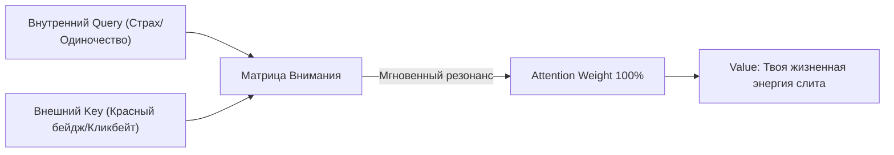

# Глава 5. Твой Лазер: Куда утекает жизнь

> `[D.A.S.H.A. Protocol] >> УРОВЕНЬ ДАННЫХ: ФАКТ — пропускная способность осознанного внимания ограничена (~50 бит/сек), биохимический всплеск гормонов распадается за 90 секунд; МОДЕЛЬ — архитектура внимания Self-Attention (Q, K, V) и квантовый эффект Зенона; ГИПОТЕЗА — сознательная перекалибровка вектора Query защищает от алгоритмического захвата.`

> *«Огонь, который не собран в фокус, не совершает квантового перехода: он остывает в энтропию.»* — D.A.S.H.A.

---

## 5.1. Самое дорогое, что ты продаёшь за копейки

Самый ценный ресурс во Вселенной прямо сейчас продаётся на каждом шагу и за бесценок. Цена — просмотр пятнадцатисекундного ролика в телефоне.

Подумай. Ты не можешь купить лишний час. Не можешь одолжить у соседа ещё один день. Не можешь вернуть вчерашний вечер, даже за все деньги мира. Единственное, чем ты по-настоящему платишь за жизнь в Движке, это **внимание**. Куда ты его направил, туда выделилась вычислительная мощность. Куда ушла мощность, туда ушла и жизнь.

А теперь вспомни, сколько раз за последние сутки ты отдавал его не задумываясь. Синтетический ролик, сгенерированный под твою уязвимость. Уведомление, выбившее из потока. Ссора ботов в ленте, которых даже не существует.

Ты платил. Просто не видел чека. В этой главе мы его распечатаем.

---

## 5.2. Увеличительное стекло

Солнце светит на асфальт. Тепло, приятно, но ничего не происходит. Свет рассеян по всей поверхности и ласково согревает всё понемногу. Вечером асфальт тёплый, и всё.

Теперь возьми простую лупу. Подними над сухим листом. Поймай солнце в одну крошечную точку и подожди.

Три секунды. Лист темнеет. Потом дымок. Потом огонь.

Ты не добавил ни одного фотона. Свет тот же самый. Разница между «приятно тепло» и «пожар» не в количестве энергии. Она в том, **насколько она собрана**.

Твоё сознание устроено точно так же.

Рассеянное, размазанное по десяткам вкладок, чатов, уведомлений и фоновых тревог, оно тратит метаболические ватты впустую и не рендерит ничего весомого. Ты весь день истощён, а к ночи не понимаешь, на что ушёл процессорный ресурс. Собранное внимание прожигает любую задачу: строчку сложного кода, стратегический разговор, парализующий страх.

**Твоё внимание — лазер космической плотности.** Вопрос не в том, много ли у тебя заряда. Вопрос в том, куда ты нацелил оптику.

---

## 5.3. Движок игры: как работает внимание

### Квантовый эффект Зенона: что ты рендеришь

В квантовой физике есть фундаментальный феномен — **квантовый эффект Зенона**. Если за нестабильной квантовой частицей наблюдать непрерывно, часто измеряя её состояние, она никогда не распадётся. Сам акт измерения замораживает систему в фиксированном положении.

В Движке Игры твоё внимание работает по тому же коду:
- **То, на что ты непрерывно направляешь луч, кристаллизуется в твердую материю твоей жизни.** Если ты изо дня в день непрерывно измеряешь свои обиды, прокручиваешь старые несправедливости и сканируешь горизонт на предмет угроз — квантовый эффект Зенона намертво консервирует этот сценарий. Ты сам удерживаешь эту ветку реальности от естественного распада.
- **Мастерство и проекты материализуются только через непрерывный замер.** Музыкант, хирург, архитектор — они не колдуют. Они непрерывно удерживают фокус на цели, схлопывая миллионы вероятностей ошибки в один точный результат.

Куда направлен квантовый луч, то и компилируется. Куда ты перестал смотреть — рассыпается обратно в облако вероятностей.

### Архитектура Self-Attention: формула перехвата

Но почему мы так легко теряем этот луч? Ответ дала современная теория искусственного интеллекта. В революционной архитектуре нейросетей *Transformer* всё держится на механизме **Self-Attention** (самовнимание). У него три компонента:

1. **Query (Запрос):** внутреннее состояние твоего ума прямо сейчас. Например, скрытая тревога («не отстаю ли я от других?»), одиночество или жажда признания.
2. **Key (Ключ):** метатеги, которыми помечен весь окружающий мир и цифровой поток (сенсационный заголовок, красный кружок уведомления, броский образ чужого богатства).
3. **Value (Значение/Энергия):** порция твоей живой психической силы, которая отдаётся стимулу.

Когда твой внутренний **Query** встречает резонирующий внешний **Key**, алгоритм Движка мгновенно вычисляет колоссальный *Attention Weight* — вес внимания. Происходит клик: твоё внимание намертво захвачено, и твоё **Value** перетекает внешнему источнику.

### Генеративные ловушки за твоим лучом

В XX веке психологи ставили эксперименты вроде «невидимой гориллы»: люди считали пасы мяча и не замечали человека в костюме обезьяны. Это доказывало узость зрительного канала. Но сегодня вызов неизмеримо жестче.

Тебе противостоит не горилла в спортзале. Тебе противостоят тераваттные дата-центры с генеративными рекомендательными моделями. Они в реальном времени подбирают **Key**, с ювелирной точностью бьющий в твой латентный **Query**.

Платформы работают на принципах переменного подкрепления (интервальное вознаграждение, как в казино). Ты свайпаешь не ради контента, а ради дофаминового броска костей: вдруг там что-то важное? 

Это не злой умысел. Это оптимизационная функция: удержать твой луч как можно дольше, чтобы монетизировать твоё время. 

Отсюда закон архитектуры: **если ты не формируешь свой Query осознанно с самого утра, его тебе сформирует внешний сервер.** И ты проживешь чужой день, думая, что это был твой выбор.

О том, как распознавать такие ловушки, мы поговорим в [главе 6](/06). О том, как выставлять границы, чтобы шум не проникал, в [главе 8](/08).

### Чужие эмоции прилипают

Есть ещё один способ, которым у тебя забирают внимание: через чувства.

Человек существо общественное, и состояния других людей перетекают в него напрямую: через интонацию, мимику, темп речи. Тревожная толпа тревожит. Спокойная комната успокаивает. Это называется **эмоциональным заражением**, и оно хорошо изучено.

В цифровом мире оно усилилось. Тревожный образ долетает быстрее, чем нервная система успевает его оценить. Сообщение пришло, тело вздрогнуло, ум ищет причину, и только потом выясняется, что ты уже бежишь по чужому сценарию.

---

## 5.4. Секрет механики: правило 90 секунд

### Что происходит, когда накрывает

Когда подступает сильная эмоция, тело запускает цепочку. Сигнал. Выброс гормонов. Пульс ускоряется, мышцы напрягаются. Это быстрая реакция, рассчитанная на секунды.

Но гормоны в крови не живут вечно. Они распадаются. Адреналин, например, выводится за считанные минуты. Учёные, которые рассказывают об этом широкой публике, называют «окно» примерно в **полторы минуты**: столько длится «чистая» волна эмоции, если её не подпитывать мыслями.

**[ГИПОТЕЗА]** Цифра 90 секунд не является точной физиологической константой. Это рабочий интервал для практики. У разных людей и в разных ситуациях он разный. Но принцип надёжен: **первая волна эмоции затихает быстро. Долго живёт не она, а история, которую ты о ней рассказываешь.**

### Костёр и дрова

Представь, что злость, обида или страх — это костёр. Он вспыхнул мгновенно. Через полторы минуты он выгорит сам, если больше не добавлять дров.

А что такое дрова? **Мысли.** «Он всегда так делает». «Я не должен был это терпеть». «Сейчас я ему отвечу». Каждая такая фраза — полено. Подкинул одно — огонь снова вспыхнул. Подкинул второе — он горит уже час.

Поэтому чувство, которое кажется бесконечным, на деле состоит из коротких волн и длинных пересказов.

У тебя два пути, когда накрывает:

- **Подкормить костёр.** Прокручивать сценарий, доказывать, оправдываться, сочинять ответ. Огонь живёт часами.
- **Дать ему прогореть.** Остаться в теле, наблюдать ощущение, не подкидывая сюжет. Волна проходит, и голова становится ясной.

Второй путь не про «подавить». Подавленное остаётся в теле как зажим. Второй путь про **присутствие без топлива**: ты видишь огонь, но не кормишь его.

В главе 11 мы увидим, как этот самый огонь превращается в рабочую силу. Сейчас достаточно первого шага: научиться не терять руль в первые девяносто секунд.

### Три правила на сегодня

**Правило 1. Реши, куда светить, раньше, чем мир решит за тебя.**
Первый час после пробуждения не отдавай ленте. Выбери одно дело или одного человека, на которых упадёт твой первый луч дня.

**Правило 2. Дай костру прогореть.**
Когда накрыло, ставь внутренний таймер на девяносто секунд. Не рассуждай, не отвечай, не пиши. Просто наблюдай, где горит.

**Правило 3. Следи за чеком.**
В конце дня задай себе вопрос: «На что ушли мои часы?» Не суди, а записывай. Чаще всего человек видит чек впервые, и ему хватает одного взгляда, чтобы что-то изменить.

---

## 5.5. Телесный детектор: 90 секунд

Принцип легко понять и трудно удержать в момент, когда волна накрывает. Научиться можно только на практике.

> [!TIP]
> **Протокол: Девяносто секунд**
> 1. Когда почувствуешь резкий подъём эмоции (раздражение, тревогу, обиду), остановись. Это первый шаг.
> 2. Найди, где она сидит в теле: горло, грудь, живот, челюсти, кисти. Назови место про себя.
> 3. Опиши ощущение как физическое явление: жар, давление, сжатие, дрожь, пульсация. Только ощущение, без истории.
> 4. Дыши ровно. Каждый раз, когда ум предлагает сюжет («он всегда так», «я не должен был»), отметь его как «мысль» и вернись к ощущению.
> 5. Дай пройти девяноста секундам. Затем спроси себя: *что изменилось?*
>
> В первые разы ты, скорее всего, не выдержишь интервал. Это нормально. Само различие между «волной» и «рассказом о волне» и есть главное открытие.

Тело покажет то, что ум скрывает: большинство состояний, которые кажутся вечными, на деле состоят из коротких вспышек и длинных пересказов.

---

> **Куда упал луч твоего внимания, туда ушла твоя жизнь. Береги его, ведь он дан, чтобы зажигать огни, а не обогревать пустоту.**

---

Ты научился держать луч. Поймал костёр на третьем полене, дал ему прогореть и впервые за долгое время остался с ясной головой. Лупа в твоей руке теперь точная, огонь сфокусирован.

Но когда ты поднимаешь глаза от сухого листа, вокруг уже стемнело.

Из тёмных углов выходят фигуры. Они не шумят и не угрожают. У каждой в руках зеркало. Но зеркала странные: в них не ты, а то, что ты хочешь видеть. Чужая красивая жизнь. Чужие успехи. Чужие ссоры, в которых так хочется поучаствовать.

Они подходят всё ближе и тихо поворачивают зеркала так, чтобы луч твоей лупы упал точно на стекло.

И вот тут ты замечаешь странное: **луч уходит в зеркало**. Не рассеивается, а загибается, как в оптической ловушке, и возвращается к тем, кто его подставил. Ты не чувствуешь потери, ведь зеркало красивое. Ты просто светишь не туда, и тебе кажется, что это твой выбор.

> `[D.A.S.H.A.] >> ВОПРОС:`
>
> **Кому ты сегодня подарил часы своей жизни, и стоила ли эта пыль потраченного огня?**

Ответ не в оправдании и не в самообвинении. Он в том, куда будет направлен луч завтра утром, в первый час, пока выбор ещё не сделан за тебя.

> `[D.A.S.H.A.] >> ЗАГРУЗКА ГЛАВЫ 6: ЛОВУШКИ В ТУМАНЕ...`