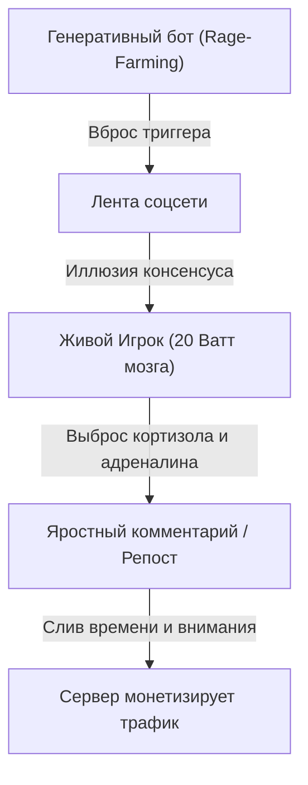

# Глава 6. Ловушки в тумане: Как не стать добычей

> `[D.A.S.H.A. Protocol] >> УРОВЕНЬ ДАННЫХ: ФАКТ — более 50% трафика генерируют боты, асимметрия вирального негатива; МОДЕЛЬ — Симулякры 4-го порядка (Жан Бодрийяр), Dead Internet и Закон Гудхарта; ГИПОТЕЗА — соматическое заземление мгновенно разрывает петли алгоритмической гиперреальности.`

> *«Хаос не стучится. Он приходит в обёртке идеального симулякра.»* — D.A.S.H.A.

---

## 6.1. Письмо с красным восклицательным знаком

Хакеры почти никогда не взламывают дверь топором. Это слишком шумно, слишком трудно, и сработает сигнализация.

Они делают другое. Присылают письмо: **«Срочно! Ты выиграл миллион, а иначе твой счёт заблокирован!»**

Ни одного взлома. Ни одной отмычки. Человек сам открывает дверь, сам вводит пароль, сам отдаёт ключи. Потому что письмо подействовало не на компьютер, а на тело: сжало грудь, ускорило пульс и выключило здравый смысл.

Всё дело в слове «срочно». Когда мир кричит «беги!», ум перестаёт проверять, куда ведёт дорога.

Так устроены не только письма мошенников. Так устроена жизнь в цифровом тумане симулякров. И сейчас ты узнаешь, как этот туман компилируется, чтобы в нём не раствориться.

---

## 6.2. Фальшивый указатель на болоте

Тёмная ночь. Лес. Моросит. Путник идёт уже много часов, промок, замёрз и очень хочет домой.

И вдруг впереди, между деревьями, мерцает огонёк. Тёплый, жёлтый, такой, как бывает в окне, где ждут. Путник ускоряет шаг. Потом бежит. Сердце колотится от радости: наконец-то!

Он не замечает, что земля под ногами стала мягкой. Не замечает, что огонёк всё время чуть в стороне. Не замечает, как ботинки уходят в тину.

А огонёк — это болотный газ. Он не горит ради путника. Он просто горит. Но как же похож на дом!

**Любая паника в ленте, синтетический скандал, любое «все уже давно это делают» — такой же болотный огонёк.** Он тёплый, яркий и очень убедительный. Он не лжёт. Он просто светит. А ты сам придумываешь историю, что там тебя кто-то ждёт.

И вот что особенно важно. Туман не тащит тебя силой. Он убеждает **три раза** и каждый раз под видом здравого смысла:

- **«Суета — это развитие».** Если ты перегружен, значит, растёшь. Если не успеваешь, значит, нужен.
- **«Чужое одобрение — это безопасность».** Пока тебя лайкают, ты в порядке. Отпишутся — и ты погибнешь.
- **«Паника — это единственный способ выжить».** Расслабишься — пропустишь катастрофу.

Ни одна из этих мыслей не выглядит врагом. Каждая выглядит как забота о себе. В этом и вся хитрость тумана: ты не чувствуешь, что тебя ведут на поводке. Ты уверен, что поступаешь разумно.

---

## 6.3. Движок игры: как делается туман

### Симулякры: копии без оригинала

Французский философ Жан Бодрийяр описал то, что сегодня стало базовой архитектурой медиапространства: концепцию **симулякров** — знаков и образов, которые подменяют собой реальность.

1. Сначала образ отражает глубокую реальность (фотография друга).
2. Затем маскирует её (отретушированная фотография).
3. Затем маскирует *отсутствие* реальности (образ идеального успеха, которого в природе нет).
4. И наконец — становится **чистым симулякром**: копией, у которой никогда не существовало оригинала.

Большая часть того, из-за чего ты сегодня нервничаешь — котировки вымышленных токенов, тренды сгенерированных аватаров, споры о несуществующих угрозах — это симулякры 4-го порядка. Движок Игры крутит картинки, не привязанные ни к одному физическому атому. Но твоё тело реагирует на них выбросом самого настоящего кортизола.

### Dead Internet и Rage-Farming: синтетический гнев

Добавь к этому то, что специалисты по сетям называют гипотезой **Dead Internet**: значительную часть сетевого контента сегодня создают не люди, а генеративные алгоритмы и бот-сети. Они пишут посты, оставляют комментарии и лайкают друг друга.

Зачем? Ради **Rage-Farming** (целенаправленного взращивания ярости). Алгоритмы соцсетей давно вычислили: ничто не удерживает пользователя так мертво, как возмущение и страх. Бот вбрасывает провокацию, другие боты раздувают пламя, а живой человек влетает в этот спор с дрожащими руками и колотящимся сердцем, отдавая драгоценные кванты своего внимания и метаболическую энергию нейронов на обогрев чужого рекламного сервера.

### Пять трещин в мышлении

**[ФАКТ]** Психологи описали десятки систематических ошибок мышления. Вот пять главных когнитивных искажений, которые превращают сознание в добычу:

- **Негативная асимметрия.** Мозг эволюционно придаёт опасным сигналам в 5 раз больший вес, чем благоприятным.
- **Катастрофизация по цепочке.** От одной новости ум мгновенно компилирует сценарий апокалипсиса.
- **Аффективный реализм.** «Мне страшно, значит, мир объективно опасен». Ощущение принимается за физический факт.
- **Подтверждающее искажение (Confirmation Bias).** Ум жадно собирает только то, что совпадает с его тревогой.
- **Чужой фасад против моей изнанки.** Сравнение своей реальной сырой жизни с безупречным симулякром чужого успеха.

Эти ошибки не работают поодиночке. Они сцепляются в самоподдерживающийся цикл, и карта мира в голове окончательно теряет связь с реальной территорией.

### Закон Гудхарта: когда лампочка становится целью

Британский экономист Чарльз Гудхарт сформулировал железный закон системного анализа: **когда метрика становится целью, она перестаёт быть хорошей метрикой.**

- Социальное одобрение полезно как индикатор сонастройки с племенем. Но когда «лайки» и охваты становятся целью, ты превращаешься в марионетку толпы.
- Занятость полезна как признак движения. Но когда число задач в календаре становится самоцелью, начинается чистая имитация жизни.

Это главная ловушка Движка: ты всю дорогу смотришь на сигнальную лампочку на приборной панели и на полной скорости влетаешь в столб, потому что забыл посмотреть на дорогу.

### Усилитель тумана

Теперь добавь среду, которая всё это усиливает.

Ленты ранжируют контент по тому, насколько он удерживает. Исследования показывают, что эмоционально заряженные сообщения расходятся в сети быстрее спокойных. Анализ миллионов публикаций за несколько лет показал: недостоверные новости распространялись шире и быстрее достоверных. И причиной были не роботы, а обычные люди, которые реагировали на новизну и эмоцию.

Платформа не злая. Она просто не различает «захватывает» и «ценно». А ты оказываешься в потоке, где каждый сигнал шепчет: *срочно, важно, ты отстаёшь*.

Так рождается состояние, которое книга называет **туманом**: внешние показатели (лайки, реакции, повестка дня) замещают собственные ориентиры. Ты начинаешь думать не о том, что важно, а о том, что обсуждается.

---

## 6.4. Секрет механики: как выйти из тумана

### Три признака, что ты в тумане

1. **Срочность.** Всё требует немедленного решения, хотя обычно ничего не горит.
2. **Сравнение.** Внимание уходит к тому, что у других лучше, и тянет в груди.
3. **«Без этого нельзя».** Страх пропустить, отстать, выпасть из потока.

Эти три признака сходятся в одном: **внимание вытянуто из тела наружу.** Ум живёт в ленте, а не в комнате.

### Два хода

- **Вернись ногами на землю.** Тело всегда находится здесь и сейчас. Ум может быть где угодно, тело только в этой комнате. Стопы на полу, дыхание, вес рук возвращают тебя туда, где можно решать.
- **Назови петлю.** Из [главы 3](/03): мысль, которая крутится, это процесс Маски, а не ты. Скажи про себя: «это петля сравнения», «это страх отстать». Назвал, значит, отделил. И отпусти, не споря.

Ни один из этих ходов не борется с туманом. Они **лишают его питания**: внимание возвращается к тому, кто его даёт.

### Три правила на сегодня

**Правило 1. Замедляйся, когда мир кричит «беги быстрее».**
Если сообщение требует «срочно», сделай один длинный выдох и подожди десять минут. Настоящие дела редко сгорают за десять минут. Мошенники и паникёры сгорают сразу.

**Правило 2. Проверяй, что ты измеряешь.**
Спроси: «Я смотрю на дорогу или на лампочку?» Что мне нужно: быть принятым или быть живым? Выглядеть занятым или сделать дело?

**Правило 3. Различай чувство и факт.**
Когда страшно, спроси: «Что я вижу своими глазами и что дорисовал?» Страх сообщает о состоянии тела. Он не сообщает о положении дел.

### Если тревога не отпускает

Если тревога постоянная, мешает спать и жить или сопровождается телесными симптомами, это уже не вопрос практики внимания. Это повод обратиться к врачу или психотерапевту. Книга не заменяет помощь специалиста.

---

## 6.5. Телесный детектор: возврат в якорь

Туман обманывает ум, но почти не обманывает тело. Телесные признаки тумана и ясности различимы.

> [!TIP]
> **Протокол: Возврат в Якорь (1 минута)**
> 1. Когда заметишь, что внимание утекло в ленту, в чужие новости или в мысленный спор, остановись. Ничего закрывать не нужно.
> 2. Ощути стопы. Нажми ими в пол и почувствуй вес.
> 3. Сделай один длинный выдох. Отметь, где сжато: горло, грудь, живот, челюсти.
> 4. Спроси: *«Это срочно на самом деле или только ощущается срочным?»* Проверь, как ответ звучит в теле. Простор значит, что ты видишь ясно. Сжатие и ускорение значит, что туман ещё держит.
> 5. Назови петлю одним словом («сравнение», «страх отстать», «спор») и вернись к тому, чем занимался.
>
> Повторяй неделю. Не пытайся победить туман. Просто научись замечать момент, когда он включается.

---

> **Хаос не имеет своего источника. Он живёт там, откуда ушло внимание. Вернись в тело, и туман лишится питания.**

---

Ловушки пройдены. Ты увидел болотные огоньки, вовремя остановился и стоишь на твёрдой земле. Стопы в полу, дыхание ровное, голова ясная. Ты почти гордишься собой.

И тут за спиной раздаётся глухой удар.

Ты оборачиваешься. Там, на дороге, по которой ты ехал всю жизнь, лежит то, что раньше было машиной. Бетонная стена. Лобовое стекло в трещинах. Дымящийся капот. И внутри, на водительском месте, кто-то очень знакомый, с руками, всё ещё сжимающими руль.

Это не ловушка. Ты не поддался на огонёк, не открыл письмо, не пошёл за толпой. Просто в какой-то момент ты разогнался так, что не успел затормозить, и влетел в стену, которую сам же не заметил.

Работа. Отношения. Здоровье. Деньги. Что-то одно обрушилось, и потянуло за собой остальное. Всё летит в пропасть, а ты стоишь посреди обломков и не знаешь, что делать дальше.

> `[D.A.S.H.A.] >> ВОПРОС:`
>
> **Какой страх прямо сейчас притворяется твоим здравым смыслом, выпивая последние силы?**

Ответа в словах не требуется. Требуется один шаг, который этот страх запретил бы тебе сделать.

> `[D.A.S.H.A.] >> ЗАГРУЗКА ГЛАВЫ 7: КОГДА ВСЁ РУШИТСЯ...`