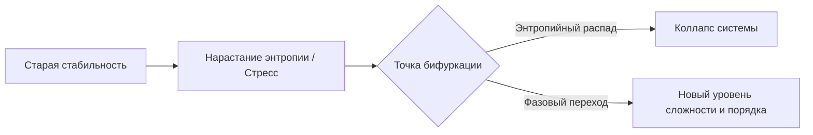

# Глава 7. Когда всё рушится: Перезагрузка после аварии

> `[D.A.S.H.A. Protocol] >> УРОВЕНЬ ДАННЫХ: ФАКТ — кортизоловый криз перегружает нейроэндокринную ось, временность острых аффективных пиков; МОДЕЛЬ — Точка бифуркации и самоорганизация диссипативных структур (Илья Пригожин); ГИПОТЕЗА — крушение старых смыслов есть термодинамический фазовый переход на более высокий уровень сложности.`

> *«Не всякий обвал — разрушение. В точке бифуркации это фазовый переход.»* — D.A.S.H.A.

В [главе 6](/06) шла речь о повседневном тумане. Эта глава о том, что случается, когда туман сгущается до отчаяния, а опоры рушатся одна за другой. Здесь нельзя говорить красиво и неточно. Поэтому сначала о главном.

> [!IMPORTANT]
> **Если ты читаешь это в тяжёлом состоянии**
> Если мысли о том, чтобы уйти из жизни, рядом или усиливаются, это не вопрос книги или философской практики. Это сигнал прямо сейчас опереться на живого человека: близкого, врача, экстренную службу или кризисную линию (международный каталог: findahelpline.com). Не оставайся один на один с перегрузкой. Книга подождёт, твоя жизнь — абсолютный приоритет.

---

## 7.1. Самый тёмный час

Самый тёмный час наступает не тогда, когда сломалась машина или уволили с работы. Он наступает, когда рушатся твои детские иллюзии о том, как устроен мир.

Ты верил, что если стараться, то всё получится. Что люди, которых ты любишь, будут рядом всегда. Что ты контролируешь то, что важно. Что эта опора никогда не подведёт.

А потом одна новость, один разговор, один звонок. И картинка, которую ты строил годами, идёт трещинами.

В этот момент кажется, что рухнуло всё. Что уцелевших опор нет. Что дальше будет только хуже.

Если ты сейчас именно там, вот первое, что нужно знать: **это состояние имеет архитектуру, и оно проходимо.** Не быстро и не легко. Но проходимо. В этой главе ты увидишь, как оно устроено.

---

## 7.2. Синий экран защиты

Ты когда-нибудь видел, как компьютер вдруг выключается посреди работы? Экран заливает синий цвет, появляется строка с кодом ошибки, и всё останавливается.

Новичок видит в этом конец. Инженер видит другое.

Компьютер выключился не со зла. Внутри процессор начал перегреваться, и система приняла решение: остановить всё сразу, пока ничего не расплавилось. Это не поломка. Это **защита**. Перед остановкой машина записывает снимок того, что происходило в момент сбоя (memory dump), чтобы потом можно было разобраться, где именно возник перегруз.

Потом перезагрузка. Система поднимается заново, и часто работает лучше прежнего: тот сбойный процесс, который перегревал ядро, больше не запускается.

**Кризис в жизни — это аварийное охлаждение твоей системы.**

Больно? Да. Страшно? Конечно. Но синий экран не значит, что процессор сгорел. Он значит, что система сбросила питание ради того, чтобы продолжить жить.

---

## 7.3. Движок игры: точка бифуркации и порядок из хаоса

### Теория Пригожина: порядок рождается из крушения

Законы физики подтверждают то, что интуитивно чувствует каждый переживший бурю. Лауреат Нобелевской премии Илья Пригожин доказал фундаментальный принцип термодинамики: **сложные открытые системы развиваются не по плавной прямой линии, а через кризисы и хаос.**

Пригожин ввёл понятие **диссипативных структур**. Живой организм, психика, общество — это открытые системы, которые непрерывно обмениваются энергией и информацией со средой. Когда внешнее или внутреннее давление нарастает, система больше не может удерживать прежнее равновесие. Она входит в **точку бифуркации** (разветвления).

В точке бифуркации старые законы больше не работают:
1. **Любая попытка удержать прошлое обречена.** Ты не можешь затолкать вылупившегося птенца обратно в скорлупу. Скорлупа треснула навсегда.
2. **Хаос — это не гибель, а расчистка оперативной памяти.** Система плавит застывшие неэффективные алгоритмы.
3. **Квантовый скачок сложности.** Из хаоса рождается качественно новый порядок, который способен выдерживать в разы большее давление среды.

Как вода при нагревании до 100°C переживает бурный кипящий хаос, чтобы совершить фазовый переход и стать паром — так и сознание в кризисе совершает фазовый переход.

### Биология кризиса: сначала тело, потом смыслы

**[ФАКТ]** Кризис бьёт не только по мыслям. Когда перегрузка нарастает, миндалевидное тело держит симпатическую нервную систему на взводе. Гормональный шторм ломает сон, аппетит и способность концентрироваться. 

Поэтому системный приоритет №1 при крушении — соматическая стабилизация. Если клиническое истощение длится неделями — это задача доказательной медицины и психотерапии, а не философских споров. Нельзя «промыслить» то, где истощены запасы нейромедиаторов. Сначала физиологический базис (сон, питание, медикаментозная поддержка при необходимости), и только затем — построение новых опор.

### Рост после удара (Посттравматический рост)

Психологи называют это явление посттравматическим ростом: пережив тяжелейший разлом, человек обнаруживает, что иллюзорные конструкции рухнули, обнажив настоящий гранитный фундамент.

Это не повод романтизировать боль. Боль отвратительна. Но в коде Движка боль — это не наказание. Это индикатор: старая архитектура выработала свой ресурс. Место свободно для новой сборки.

---

## 7.4. Когда хочется всё прекратить

Теперь о том, что нельзя обойти молчанием.

В минуты отчаяния ум предлагает один выход: прекратить всё. И часто предлагает его так убедительно, что кажется единственным.

Что можно сказать об этом твёрдо.

**Это состояние, а не приговор.** Острый кризис с мыслями об уходе из жизни, как правило, не длится вечно. Накал таких мыслей часто спадает, и большинство людей, которые пережили такие минуты, живут дальше. То, что сейчас кажется вечным, вечным обычно не бывает.

**Отчаяние искажает картину.** Оно сужает будущее до одной точки и убеждает, что выхода нет. Но это свойство самого состояния, а не описание мира. Аварийная лампа горит ярко, но это не значит, что горит весь дом.

**Боль, усталость и потери настоящие, а вывод из них неверный.** Книга не называет желание уйти разумным, логичным или естественным следствием боли. Между болью и этим решением лежит расстояние, и это расстояние можно пройти иначе: с помощью людей.

**Первое действие не размышление, а контакт.** Позвать человека. Сказать вслух. Позвонить. Это не слабость. Это способ сбросить давление, пока оно не стало невыносимым. Живой контакт самый быстрый из доступных способов.

И ещё. Игра, которую ты проходишь, не рассчитана на то, чтобы ты проходил её в одиночку.

---

## 7.5. Ложные опоры

Если оставить в стороне острые состояния, у кризиса есть и другая сторона. Он обнажает то, на чём держалась жизнь.

Мы живём на опорах, которые редко рассматриваем: «я достаточно успешен», «меня любят, пока я полезен», «мои планы сбудутся», «я контролирую то, что важно». Пока всё идёт нормально, эти опоры кажутся фундаментом.

Когда они рушатся, видно: **это были не стены, а строительные леса.**

Помнишь красную лампочку из [главы 1](/01)? Боль — это расхождение между картой и местностью. Кризис — самая сильная форма такого расхождения. Рухнуло то, на что опиралась карта. Это больно, и это не наказание. Это сообщение: карта не совпадала с местностью.

Радоваться потере не нужно. Нужно другое: понять, что после обвала у тебя есть шанс построить что-то подлиннее. Не потому что боль справедлива, а потому что место освободилось.

---

## 7.6. Секрет механики: три правила для самого трудного времени

**Правило 1. Сначала тело и люди, потом смыслы.**
Сон. Еда. Вода. Один живой человек рядом. Когда система перегрета, философия не помогает. Помогает охлаждение. В тяжёлые дни главное дело дня — не сгореть.

**Правило 2. Не принимай больших решений на дне.**
Увольнение, разрыв, продажа, переезд — всё это лучше откладывать, пока не отпустит острота. В синем экране машину не перепрошивают. Её сначала перезагружают.

**Правило 3. Назови леса.**
Когда немного уляжется, возьми лист бумаги и напиши: «На что я опирался и что оказалось строительными лесами?» Не ради самобичевания, а ради карты. Тот, кто видит леса, перестаёт строить на них следующий этаж.

---

## 7.7. Телесный детектор: пять минут тишины

В кризисе ум шумит громче всего. Тело при этом знает, что ему нужно, но его не слышно за шумом.

> [!TIP]
> **Протокол: Пять минут тишины**
> 1. Сядь или ляг так, чтобы тело было полностью поддержано. Закрывать глаза не обязательно.
> 2. Почувствуй точки опоры: спина, таз, стопы. Отметь вес тела.
> 3. Сделай три длинных выдоха, каждый длиннее вдоха.
> 4. Пять минут ничего не делай: не решай, не планируй, не оценивай. Если ум подсовывает сценарий, отметь: «мысль», и вернись к опоре.
> 5. В конце спроси тело: *что мне сейчас нужно?* Сон, еда, разговор, помощь врача?
>
> Это не лечение и не способ «справиться с кризисом». Это пять минут, чтобы шум немного стих и ты смог услышать, что нужно прямо сейчас.

Если в тишине тяжёлые мысли усиливаются, это не провал практики. Это знак, что нужен живой человек. Прекрати упражнение и свяжись с кем-нибудь.

---

> **Кризис не отменяет Игру. Он расчищает место. Береги себя и не оставайся один: эту часть пути проходят вдвоём.**

---

Ты встал после нокдауна. Пыль осела. Что-то ты сумел назвать, что-то отложил на потом, что-то уже вынес из-под обломков. Дышать стало легче.

И вдруг замечаешь: небо на горизонте меняется. Тучи собираются в одну плотную темноту. Ветер приносит запах дождя и озона. Где-то далеко уже сверкнула молния.

Это не последняя буря. Мир не обещал, что она будет единственной. Ты только что узнал, как собирать себя после обвала. Но как не позволять каждой следующей грозе вышибать из тебя дух с первого удара?

Нужно что-то более крепкое, чем просто стены. Что-то, что пропускает свет и не пускает шторм. Силовой щит.

> `[D.A.S.H.A.] >> ВОПРОС:`
>
> **Что в твоих старых привычках должно закончиться, чтобы ты наконец начал жить по-настоящему?**

Ответа в словах не требуется. Нужно честно назвать одну опору, которая оказалась строительными лесами.

> `[D.A.S.H.A.] >> ЗАГРУЗКА ГЛАВЫ 8: ТВОЙ НЕВИДИМЫЙ ЩИТ...`