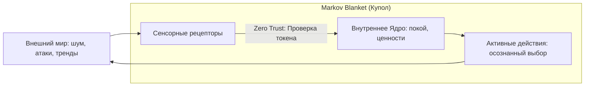

# Глава 8. Твой невидимый щит: Броня без стен

> `[D.A.S.H.A. Protocol] >> УРОВЕНЬ ДАННЫХ: ФАКТ — сенсорная перегрузка амигдалы, антихрупкость биологических тканей под дозированной нагрузкой; МОДЕЛЬ — Markov Blanket (граница Карла Фристона) и архитектура Zero Trust; ГИПОТЕЗА — трёхсекундный шлюз аутентификации отсекает 95% вредоносных стимулов.`

> *«Щит калибруется в покое. В кризисе поздно ставить фаервол. Закрыться — не значит отключить сеть: это значит фильтровать входящие пакеты.»* — D.A.S.H.A.

---

## 8.1. Забор и одно слово

Глупцы защищаются от мира бетонными заборами и железными дверями. А потом сходят с ума от одного злого комментария в интернете.

Ты наверняка знаешь такого человека. Или видел его в зеркале. У него хорошая квартира, надёжный замок, охраняемый двор. Но случайный аноним написал под фотографией три слова, и вечер пропал. Сон пропал. Аппетит пропал. Он снова и снова перечитывает эту фразу, как будто в ней написан его приговор.

Что случилось? Забор стоит. Замок целый. А через дыру в сетевом протоколе, которую никто не заметил, вошёл чужой вредоносный скрипт и захватил вычислительные мощности процессора.

Броню строят не вокруг кирпичей. Настоящая защита разворачивается вокруг твоего **внимания**.

---

## 8.2. Стеклянный купол: мембрана, а не бункер

Представь, что ты стоишь под огромным прозрачным куполом. Снаружи бушует буря. Ветер ревёт, капли барабанят по куполу так, что звенит вся конструкция. Гроза. Молнии. Мрак.

А внутри светит лампа. Горит очаг. Пахнет чаем. Тепло.

Ты видишь бурю. Ты слышишь её. Ты не прячешься в слепом подземелье. Но буря не может погасить твою свечу, потому что между ней и пламенем есть купол.

И вот что принципиально: **купол прозрачный.** Он не отгораживает тебя от мира наглухо. Ты видишь звёзды, облака, людей за стеклом. Ты можешь открыть шлюз и выйти навстречу тому, чему доверяешь. Он не тюрьма. Он — **умная полупроницаемая мембрана**.

Защита в Движке строится не на агрессивной глухоте, а на прозрачной избирательности. Стрела, пущенная в пустоту, ни за что не цепляется. Чужой токсичный выброс, направленный в игрока с настроенной мембраной, просто проходит насквозь в энтропию.

---

## 8.3. Движок игры: Markov Blanket и протокол Zero Trust

### Markov Blanket: граница твоего «Я»

В теоретической физике и нейробиологии один из ведущих учёных современности Карл Фристон разработал теорию **Markov Blanket** (оболочка Маркова). 

Любая живая система — от одноклеточной амебы до твоего сознания — существует ровно постольку, поскольку у неё есть статистическая граница. Эта граница разделяет:
- **Внутренние состояния** (твои мысли, соматика, внутренний покой).
- **Внешние состояния** (шум мира, кризисы, чужой гнев).
- **Сенсорные и активные шлюзы** (органы чувств и твои действия).

Если убрать мембрану Маркова — клетка немедленно растворяется в окружающей среде и погибает. Если сделать мембрану наглухо непроницаемой — клетка умрёт от нехватки энергии и кислорода.

Здоровье и сила Игрока — это не толщина брони, а **точность настройки твоего Markov Blanket**: что впускать для питания системы, а что отбрасывать как паразитный шум.



### Архитектура Zero Trust: никогда не доверяй по умолчанию

В современной сетевой безопасности парадигма глухого периметра давно признана устаревшей. Сегодня стандартом является концепция **Zero Trust** («Нулевое доверие»): *Never trust, always verify* (Никогда не доверяй автоматически, всегда проверяй подлинность).

Как это работает в сознании Игрока:
1. **Любой входящий запрос считается непроверенным пакетом данных.** Чужая претензия, звонок с требованием «срочно помочь», токсичный упрёк в чате — это не твоя вина. Это входящий запрос.
2. **Пауза на аутентификацию (буфер 3 секунд).** Вместо мгновенной рефлекторной реакции включи шлюз. Сделай вдох. Задай себе контрольный вопрос: *«Есть ли у этого входящего запроса цифровая подпись моих ценностей? Это действительно моя зона ответственности или внедрение чужого скрипта?»*
3. **Дроп невалидных пакетов.** Если запрос прислан манипулятором на языке вины или страха, система молча сбрасывает пакет (Drop Packet). Без скандала, без драки, без оправданий. Просто: *«Запрос отклонён»*.

---

## 8.4. Антихрупкость: закалка ядра

Философ и математик Нассим Талеб ввёл понятие **Антихрупкости** (Antifragility). Системы делятся на три типа:

| Тип системы | Реакция на стресс и давление | Поведение в Движке |
| :--- | :--- | :--- |
| **Хрупкая** | Ломается и трескается от малейшего удара | Человек без границ: чужой косой взгляд вызывает панику |
| **Неуязвимая (Крепкая)** | Сопротивляется удару, оставаясь неизменной | Упрямец на силе воли: терпит, пока не лопнет металл |
| **Антихрупкая** | **Становится сильнее от дозированного стресса** | Игрок с мембраной Маркова: превращает сопротивление в упор |

Твоё тело антихрупко по природе. Если мышцу не нагружать, она атрофируется. Если кость не испытывает давления гравитации, она теряет кальций. Но если дать мышце дозированный микростресс, а затем качественный отдых — кость и мышечные волокна становятся плотнее прежнего.

```
Дозированный стресс + Глубокое восстановление = Антихрупкость
Стресс без границ + Отсутствие восстановления = Системный крах
```

Препятствия в Движке — это не козни врагов. Это вес штанги в тренажёрном зале симуляции. Ты не ненавидишь штангу. Ты упираешься в неё ногами, чтобы накачать силу.

---

## 8.5. Мембрана или глухой бункер?

Купол Zero Trust — это живой фильтр, а не параноидальный бункер.

| Здоровая мембрана Маркова | Параноидальная глухая стена |
| :--- | :--- |
| Спокойная фильтрация токсичного шума | Презрительное «все вокруг биороботы, один я проснулся» |
| Осознанный выбор глубины контакта | Панический уход в полную изоляцию от людей |
| Список доверенных узлов связи | Хроническая подозрительность ко всему живому |

Сказать твёрдое «нет» манипуляции не означает перестать любить человека. Это означает: *«Я ценю тебя, но этот вирусный пакет я внутрь своего ядра не пущу»*.

---

## 8.6. Секрет механики: три правила Zero Trust

**Правило 1. Трёхсекундный шлюз аутентификации.**
Когда прилетает тревожный сигнал или острая просьба, не бросайся отвечать. Сначала спокойный выдох, три секунды паузы. Входящий пакет изолирован в карантине.

**Правило 2. Определение источника и цифровая подпись.**
Спроси себя: «Откуда этот сигнал? Он совпадает с моим вектором или это попытка удалённого управления через вину и страх?» Чужой вирусный скрипт — сбросить без ответа.

**Правило 3. Настройка мембраны в штиль.**
Не конфигурируй фаервол во время шторма. Поставь одно правило границ сегодня утром, пока в эфире тишина.

---

## 8.7. Телесный детектор: настройка мембраны

> [!TIP]
> **Протокол: Базовая настройка Markov Blanket (20 минут, один раз)**
>
> **Шаг 1. Белый список (White List).** Запиши 3–5 источников, которым ты доверяешь безусловно: конкретные близкие люди, фундаментальные книги, проверенные знания. Спроси себя: почему именно они авторизованы во внутреннем контуре?
>
> **Шаг 2. Карантинный список (Quarantine List).** Выпиши токсичные триггеры, которые мгновенно сжигают процессор: определённые паблики, чаты, люди-вампиры. Сигналы от них не принимаются напрямую — только через строгую фильтрацию.
>
> **Шаг 3. Одно правило изоляции на неделю.** Выбери одно аппаратное ограничение. Например: первый час после сна — авиарежим. Или: не вступать в дискуссии в комментариях.
>
> **Телесная телеметрия:** через 3 дня проверь датчики. Плечи опустились? Дыхание стало глубже? Зажим в челюстях ушёл? Если да — мембрана работает безупречно.

---

> **Купол прозрачен. Он не прячет тебя от мира, а пропускает свет и не пускает шторм.**

---

Твой щит крепок. Ты стоишь под куполом, видишь бурю, слышишь, как она бьёт по стеклу, и впервые за долгое время не вздрагиваешь. Свеча горит ровно.

И вдруг замечаешь: в глубине купола, у самой стены, стоит металлический шкаф. Старый, массивный, без вывески. Ты подходишь ближе, открываешь дверцу.

Внутри огромная панель. Сотни рычагов, ползунков, тумблеров. Каждый подписан едва заметной гравировкой: **«Дыхание»**. **«Пульс»**. **«Напряжение»**. **«Внимание»**. **«Мысли»**. **«Настроение»**.

Ты видишь, что почти все ползунки стоят на отметках, которые ты не выбирал. Кто-то выставил их давным-давно. Они двигаются сами, без тебя, как стрелки на приборах в пустой кабине.

И пока ты стоишь, глядя на пульт, ты понимаешь: все эти годы ты защищал дом, не зная, что у него есть панель управления.

> `[D.A.S.H.A.] >> ВОПРОС:`
>
> **Где в твоём заборе дыра, через которую чужое дурное настроение способно выключить твою радость?**

Ответа в словах не требуется. Требуется один камень: одно правило, поставленное сегодня.

> `[D.A.S.H.A.] >> РАЗДЕЛ II ЗАВЕРШЁН.`
> `[D.A.S.H.A.] >> ЗАГРУЗКА РАЗДЕЛА III: ПУЛЬТ УПРАВЛЕНИЯ...`