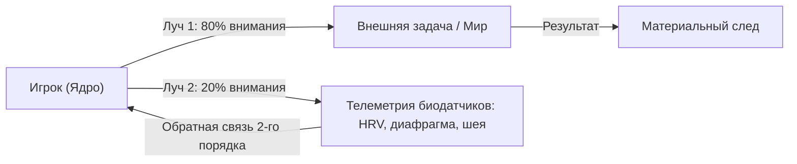

# Глава 9. Двойной дозор: Смотри внутрь и наружу

> `[D.A.S.H.A. Protocol] >> УРОВЕНЬ ДАННЫХ: ФАКТ — спектральный анализ HRV (вариабельности сердечного ритма) отражает тонус блуждающего нерва; МОДЕЛЬ — Кибернетика второго порядка (наблюдение за наблюдателем Хайнца фон Фёрстера); ГИПОТЕЗА — резонансное дыхание на частоте 0.1 Гц мгновенно восстанавливает телесную когерентность.`

> *«Маяк светит кораблям только до тех пор, пока смотритель поддерживает огонь внутри.»* — D.A.S.H.A.

Третий раздел книги практический. До сих пор ты исследовал законы Движка. Теперь мы садимся за консоль управления.

---

## 9.1. Пилот и облака

Представь пилота сверхзвукового истребителя. Он летит на огромной скорости над облаками. Под крылом сияют белые горы, над головой густая синева. Красота такая, что захватывает дух.

И пилот залюбовался. Он смотрит в стекло фонаря, отдаёт всё внимание облакам, закату, линии горизонта.

А на приборной панели прямо перед ним мигает лампа остатка топлива. Он её не видит. Он даже не знает, что она мигает. Его мир сейчас состоит из облаков, и больше в нём ничего нет.

Через десять минут двигатель кашляет. Через пятнадцать падает давление в гидросистеме. Через двадцать он понимает: смотрел в одну сторону, а самолёт всё это время кричал ему в другую.

Это не метафора про авиацию. Это точная телеметрия твоего дня.

Большую часть суток твоё внимание вывернуто наружу: в ленты, чужие задачи, сообщения, споры и тревожные сценарии. Всё, что вовне, ты видишь с максимальным разрешением. А приборную панель собственного аватара — пульс, тонус шеи, диафрагму, уровень заряда батареи — ты не сканируешь вовсе. Пока датчики не вспыхнут аварийным красным.

---

## 9.2. Маяк в шторме

Представь маяк на скале. Ночь, шторм, десятиметровые волны разбиваются о камни. Далеко в море идут корабли, и каждый ищет спасительный луч.

Свет маяка пробивает тьму на десятки километров. Он нужен всем. Но на чём он держится?

Внутри башни горит лампа. За ней круглосуточно следит **смотритель**. Он подливает топливо, протирает оптику, проверяет шестерни вращающегося стола. Если смотритель потеряет сознание — свет погаснет. И корабли разобьются о скалы.

**Твой внешний луч** (твои проекты, помощь близким, работа) держится исключительно на ресурсе внутреннего смотрителя. Если смотритель истощён и спит — маяк потухнет, как бы громко мир ни просил света.

Поэтому внимание должно работать в двух направлениях одновременно: **вовне и внутрь**.

---

## 9.3. Движок игры: кибернетика второго порядка

### Наблюдатель, наблюдающий за собой

В классической кибернетике Норберта Винера изучались машины, управляющие внешними объектами (термостат греет комнату, автопилот держит курс). Но австрийский физик и кибернетик Хайнц фон Фёрстер совершил революцию, создав **кибернетику второго порядка** — кибернетику наблюдающих систем.

Её суть: **ты не можешь эффективно управлять внешней системой, если не включил самого себя в контур управления.**

В Движке Игры это реализуется через двухконтурную петлю обратной связи (Feedback Loop):
- **Луч 1 (Внешний контур):** решение рабочей задачи, чтение книги, разговор с клиентом, ведение машины.
- **Луч 2 (Внутренний контур кибернетики 2-го порядка):** непрерывный замер собственного инструмента: *«В каком тонусе мои плечи? Не зажата ли челюсть? Ровно ли идёт дыхание? Кто прямо сейчас решает эту задачу — спокойный Игрок или перегретая Маска?»*

### Рабочая пропорция: 80 на 20

**[ГИПОТЕЗА]** Оптимальный режим вычислительного процессора: **80% внимания на внешней задаче, 20% фоново сканирует биометрию тела.**

Эти двадцать процентов не отнимают фокус у дела. Напротив: они не дают системе впасть в когнитивный туннель и сжечь аккумулятор до наступления вечера.

---

## 9.4. Пять прерываний, которые будят смотрителя

Автопилот экономит энергию и стремится отключить второй луч. Чтобы держать смотрителя на посту, нужны аппаратные прерывания (интеррапты):

1. **Случайный вибросигнал таймера.** 5 раз в день без расписания. Короткий импульс: *«Где фокус? Что в теле?»*
2. **Физический триггер-контакт.** Коснулся дверной ручки, сел в кресло, нажал кнопку включения экрана — один осознанный выдох животом.
3. **Соматический спайк.** Вспышка злости, обиды или спешки мгновенно считывается как системное предупреждение: *«Внимание, скачок температуры ядра! Смотрю на приборы»*.

---

## 9.5. Телесные приборы: HRV и резонансное дыхание 0.1 Гц

### Телеметрия HRV (Вариабельность сердечного ритма)

**[ФАКТ]** Сердце здорового человека не должно работать как кварцевые часы. Между ударами сердца всегда есть микроколебания в миллисекундах: на вдохе интервалы сокращаются, на выдохе — удлиняются (дыхательная синусовая аритмия).

Этот показатель называется **HRV (Heart Rate Variability)**:
- **Высокая HRV:** парасимпатическая ветвь и блуждающий нерв (вагус) активны. Система находится в режиме пластичности, креативности и высокой стрессоустойчивости.
- **Низкая («метрономная») HRV:** нервная система зажата в тисках симпатического шторма. Ресурс на нуле, кора больших полушарий отключается в пользу примитивных реакций страха.

### Резонансный протокол 0.1 Гц (Дыхание когерентности)

Чтобы мгновенно вернуть систему из перегрева в оптимум, используется физиологический резонанс: **дыхание с частотой 0.1 Гц (примерно 6 дыхательных циклов в минуту)**.

5 секунд плавный вдох животом — 5 секунд мягкий выдох. Без пауз.

На этой частоте ритм дыхания входит в синхронный резонанс с волнами артериального давления (волнами Майера) и сердечным ритмом. Происходит физиологическая когерентность: мозг получает сигнал наивысшей безопасности, и ресурсы оперативной памяти освобождаются.

---

## 9.6. Секрет механики: три правила на сегодня

**Правило 1. Фоновые 20% в соматике.**
Пишешь отчёт или ведёшь переговоры — краем глаза всегда держи датчики: стопы в пол, челюсть разжата, воздух в ноздрях.

**Правило 2. Три тактильных якоря.**
Выбери три механических триггера дня (первый глоток чая, поворот ключа в замке, открытие ноутбука) для сверки с приборами.

**Правило 3. Возврат без штрафа.**
Поймал себя на том, что два часа нёсся на автопилоте? Отлично. Без самобичевания: просто сделай длинный выдох и включи второй луч прямо сейчас.

---

## 9.7. Телесный детектор: протокол когерентности (5 минут)

> [!TIP]
> **Протокол: Резонанс 0.1 Гц (Калибровка смотрителя)**
> 1. Сядь прямо, не прислоняясь к спинке кресла. Стопы плотно стоят на полу.
> 2. Положи ладонь на живот в область солнечного сплетения.
> 3. Вдох через нос на 5 счётов: живот мягко надувается, плечи остаются неподвижными.
> 4. Выдох через приоткрытые губы на 5 счётов: живот мягко опадает.
> 5. Держи этот цикл ровно 5 минут. Почувствуй, как расслабляются глазные мышцы и теплеют ладони.
>
> Это не медитативная релаксация. Это аппаратная перекалибровка бортовой сети твоего аватара.

---

> **Свет маяка держится на смотрителе. Держи двойной дозор: снаружи работа, внутри присутствие.**

---

Ты держишь оба луча. Снаружи идёт работа, внутри горит ровный огонёк. Дыхание тихое, плечи опущены, ты чувствуешь себя на удивление собранным. Впервые за долгое время смотритель на посту.

Но мир вокруг не собирается замедляться.

Телефон вибрирует. Сообщения сыплются одно за другим. Кто-то требует ответа немедленно. На экране мелькают заголовки, в них слово «срочно» стоит через слово. Коллега торопит. Дорога гудит. Всё вокруг ускоряется, как будто кто-то повернул ручку на максимум.

И ты слышишь внутри старую знакомую команду: *«Действуй! Быстрее! Прямо сейчас!»*

Смотритель стоит у стекла маяка и не знает, что делать. Шторм усилился. Корабли всё ближе. А в руках у него два рычага, и ни один не подписан.

> `[D.A.S.H.A.] >> ВОПРОС:`
>
> **Помнишь ли ты о своём дыхании прямо сейчас, пока читаешь эти строки?**

Ответа в словах не требуется. Ответом станет один выдох, длиннее вдоха.

> `[D.A.S.H.A.] >> ЗАГРУЗКА ГЛАВЫ 10: СИЛА ПАУЗЫ...`