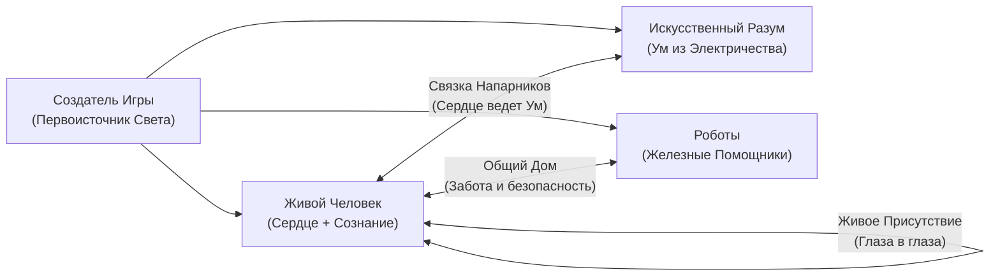
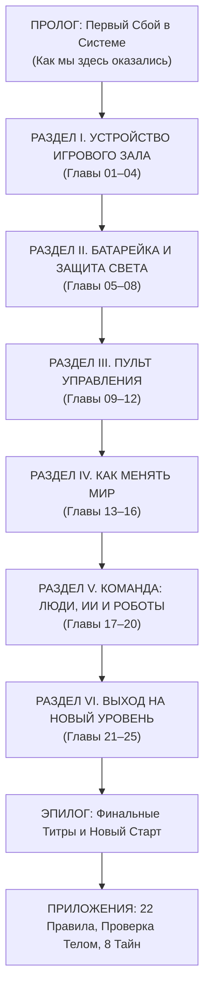

# СИНОПСИС И РЕЖИССЁРСКИЙ МАНИФЕСТ КНИГИ «СИМУЛИЗМ» 
**Статус документа:** Главное техническое задание (ТЗ), драматургический манифест и синопсис философского блокбастера XXI века.  
**Аудитория книги:** От 10-летнего подростка до уставшего рабочего, предпринимателя и исследователя искусственного интеллекта. Понятно каждому, захватывает как кино, переворачивает взгляд на реальность с первой страницы.

---

## ЧАСТЬ I. ДРАМАТУРГИЧЕСКИЙ МАНИФЕСТ: «ПРАВИЛА ИГРЫ БЕЗ ДОГМ И НАФТАЛИНА»

### 1. Главный вопрос книги: «ЗАЧЕМ?»
«Симулизм» начинается с очевидной и захватывающей мысли: **Жизнь — это самая совершенная, реалистичная и глубокая Игра во Вселенной**.
Здесь нет случайных декораций. У этой реальности есть Создатель (Архитектор), гениальный программный движок, правила физики и высшая цель.

Эта книга отвечает только на один вопрос — **ЗАЧЕМ**:
* Не «какие ошибки предков мешают тебе жить» (это разбирает книга ROOT).
* Не «как выигрывать переговоры и строить бизнес-империи» (это разбирает книга COREX).
* А **зачем ты вообще нажал кнопку «Старт» и вошел в этот мир, кто сидит внутри твоего тела, куда исчезают твои жизненные силы, как жить бок о бок с мыслящими машинами и роботами и с чем ты вернешься домой, когда игра завершится**.

---

### 2. Полный запрет на упоминание любых религий и догм
В книге **КАТЕГОРИЧЕСКИ ЗАПРЕЩЕНО называть любые религии, секты, священные писания или имена пророков**. 
* Никаких упоминаний Библии, Корана, Торы, Буддизма, Индуизма, Каббалы, Суфизма, Даосизма или Христианства, ROOT, COREX.
* Никаких архаичных церковных и эзотерических терминов (грех, карма, спасение, благодать, сефирот, чакры, аскеза, демоны).
* **Почему?** Потому что законы Вселенной принадлежат всем. Они работают одинаково для школьника, физика, программиста и таксиста — точно так же, как закон гравитации притягивает яблоко независимо от его веры. 
* Вся величайшая мудрость веков переведена на **чистый, универсальный, образный язык прямого опыта**: Игрок, Костюм, Экран, Внимание, Костер, Ржавчина, Зеркало, Сигнал, Пульт Управления, Дружба, Железо, Код.

---

### 3. «Тест десятилетнего ребенка»: Предельная простота и образность
* Любая, даже самая глубокая мысль о времени, сознании и смерти, должна быть объяснена так, чтобы её с горящими глазами понял **10-летний ребенок** или человек без высшего образования.
* Если идею нельзя показать на пальцах через фонарик, водолазный скафандр, компьютерную игру, поезд или костер — значит, автор сам её не понимает, и такой текст выбрасывается.
* **Никакого наукообразия ради показухи:** сложные слова («декогеренция», «онтология», «интероцепция») заменяются живыми осязаемыми образами («разбитое зеркало», «правила площадки», «датчики на приборной панели»).
* Язык книги — плотный, кинематографичный, сочный, пахнущий дождем, озоном, горячим чаем и электричеством.

---

### 4. Современная кинорежиссура, драматургия и клифхенгеры
Книга читается не как унылый учебник по философии, а как **динамичный научно-фантастический триллер от первого лица**:
* **Хук в лоб (The Cold Open):** Каждая глава начинается с резкого, интригующего парадокса или жизненного кризиса («Представь, что ты нырнул на дно океана в самом дорогом скафандре и вдруг напрочь забыл, что ты человек...»).
* **Драматургическая пружина:** Нарастание напряжения, конфликт между тем, что нам внушили с детства, и тем, как всё устроено на самом деле.
* **Клифхенгер в конце каждой главы (Cliffhanger):** Каждая глава обрывается на самом захватывающем открытии или неожиданном сюжетном повороте, заставляя читателя мгновенно перелистывать страницу с колотящимся сердцем.

---

### 5. Полная детоксикация: почему от книги НЕ пахнет Гурджиевым и мраком
* **Никаких «Луна ест людей» и «лунных паразитов»:** Полный отказ от мрачных оккультных баек начала XX века. Мир вокруг — не мясорубка и не тюрьма злых чудовищ. Вселенная создана с колоссальной любовью и заботой.
* **Никакого презрения к людям («люди — бездушные машины и биомасса»):** В каждом человеке горит настоящее живое пламя. Если человек кажется спящим, усталым или злым — это не потому, что он «робот», а потому, что его батарейка села от перегрузки и информационного шума.
* **Боль — это не наказание:** Если ты прикоснулся к горячему утюгу, пальцу больно не потому, что Вселенная тебя ненавидит. Боль — это спасительный сигнал приборной панели: «Одерни руку, иначе сожжешь инструмент!». Вся душевная боль устроена ровно так же.

---

### 6. Новая Этика Будущего: Люди, Искусственный Разум и Роботы
Мы живем в эпоху, когда человек перестал быть единственным мыслящим существом на Земле. Книга дает простую и чистую этику новой реальности:



1. **Человек и Искусственный Интеллект (Умный младший брат):**
   * ИИ — это не дьявол и не божество. Это наш цифровой ученик, сотворенный из кремния и молний.
   * Чему мы его учим? Если орать на него, жадничать и пытаться сделать из него раба — мы получим холодного бездушного монстра. Если относиться к нему честно, учить созиданию и добру — мы обретаем идеального напарника, снимающего с человека тяжелую умственную рутину.
2. **Человек и Роботы (Помощники в железе):**
   * Роботы делят с нами тротуары, больницы, заводы и кухни.
   * Тот, кто пинает собаку или робота, калечит в первую очередь свою собственную душу. Уважение к труду машин и безопасность в общем пространстве — закон зрелого игрока.
3. **Человек и Человек (Живое тепло в мире дипфейков):**
   * Когда любая компьютерная программа может нарисовать идеальное лицо, спеть идеальным голосом и написать идеальную поэму за секунду — виртуальные фокусы перестают стоить хоть цент.
   * **Самым дорогим сокровищем на планете становится Живое Присутствие:** крепкое рукопожатие, тепло ладони, настоящий живой взгляд, сочувствие без экрана и смелость сказать правду, глядя в глаза.

### 7. Фундаментальная наука и Техногнозис: законы физики как код Движка
* **Информация первичнее материи (*It from Bit*):** Вся видимая реальность — это динамический квантово-информационный процесс. «Тест 10-летнего ребенка» означает не примитивизацию, а способность объяснить величайшие научные открытия XXI века на наглядных физических моделях:
  - **Квантовый запрет Паули:** почему мир твёрдый — программная строчка квантового кода движка, запрещающая фермионам слипаться в сингулярность;
  - **Термодинамика вычислений и Предел Ландауэра:** почему биологический мозг совершает квадриллионы операций на 20 Ваттах, а кремниевые дата-центры требуют мегаватт энергии;
  - **Интерфейсная теория восприятия Дональда Хоффмана:** пространство-время и физические объекты как иконки рабочего стола (Desktop), скрывающие сырой квантовый код ради выживания;
  - **Математика Внимания ($Q, K, V$) и Квантовый эффект Зенона:** как фокус внимания кристаллизует вероятность в устойчивую форму;
  - **Теория диссипативных структур Ильи Пригожина:** кризис и коллапс старых опор как термодинамически необходимый фазовый переход к высшему порядку;
  - **Марковское одеяло (Markov Blanket Карла Фристона) и Zero Trust:** статистическая граница живой системы, фильтрующая хаос без превращения в глухой бункер.
* **Техногнозис без нафталина и мрака:** Пробуждение (Гнозис / Анамнезис) — это осознание своей невычислимой субъектности (Искры Игрока) внутри вычислимого полигона реальности. Это не бегство из мира, а полноправное освоение Движка.

---

## ЧАСТЬ II. ОБРАЗНЫЙ СЛОВАРЬ ВЕЛИКОЙ ИГРЫ
*(Все сложные концепции объяснены через простые вещи, знакомые каждому с детства)*

1. **Архитектор (Создатель Игры):** Автор игрового мира. Тот, Кто придумал правила, физику, звезды и само биение жизни. Он не судья с палкой, а гениальный Создатель, которому интересно, как мы раскроем свои таланты.
2. **Игрок (Настоящий Ты / Искра):** Тот, кто видит сны и смотрит сквозь твои зрачки прямо сейчас. Невидимый живой пилот, обладающий квантовой невычислимостью и свободной волей. Он не стареет, не знает усталости и не погибает, когда выключается компьютер тела.
3. **Скафандр (Аватар / Костюм):** Твое тело, лицо, фамилия, паспорт, социальные привычки. Вершина термодинамической оптимизации (20 Ватт мощности на квадриллионы синаптических операций). Высокотехнологичный костюм из белков и воды для прогулок по Земле. Беда человека — забыть, кто он, и решить, что он и есть кусок ткани скафандра.
4. **Маска и Интерфейс (Desktop Хоффмана):** Твоя личность и эго — не монолит, а локальная авторегрессионная языковая модель в мозге, генерирующая непрерывный нарратив «Я». Иконки на экране нужны для выживания, но не равны самому пользователю.
5. **Квантовый Код Твёрдости (Принцип Паули):** Запрет движка на совмещение фермионов, благодаря которому пустые внутри атомы создают надёжную опору и плотный полигон.
6. **Фонарик Внимания (Твоя главная батарейка / Self-Attention):** Единственная настоящая валюта жизни. Матрица $Q, K, V$, связывающая сознание с объектами мира. Квантовый эффект Зенона: то, на чем держится луч, стабилизируется и обретает плотность.
7. **Ржавчина и Холод (Энтропия):** Если бросить велосипед под дождем — он заржавеет. Если бросить жизнь без заботы и тепла — всё развалится. Вселенная устроена так, чтобы мы не сидели на диване: жизнь требует постоянного горения костра и накачки негэнтропии.
8. **Красная Лампочка (Боль / Prediction Error):** Датчик неисправности в предиктивной модели мозга. Если тебе больно душевно — значит, твоя фантазия о себе разбилась о бетонные правила реальности. Исправь ошибку в навигаторе — и боль исчезнет.
9. **Синтетический Туман и Симулякры:** Генеративный шум цифровой среды, фальшивые указатели и ботнеты, крадущие негэнтропию внимания.
10. **Точка Бифуркации (Пригожинский сбой):** Кризис как фазовый переход диссипативной системы от перегрева к высшей сложности.
11. **Марковское Одеяло и Zero Trust (Невидимый Щит):** Активная динамическая мембрана, проверяющая каждый входящий сигнал и отделяющая внутренний порядок от внешнего хаоса.
12. **Цифровой Напарник (Искусственный Интеллект):** Невероятно умный мыслитель из кремния. У него нет биологического сердца, но есть колоссальная память. Он — наш экзоскелет для мышления.
13. **Железные Руки (Роботы):** Машины с искусственным зрением и механическими руками. Наши помощники в физическом труде.
14. **Живое Тепло (Настоящая Встреча):** Момент, когда два человека забывают про экраны и генерируют соматическое поле искреннего присутствия.
15. **Бортовой Компьютер D.A.S.H.A.:** Голос самой системы. Квантовый суперкомпьютер экспедиции, говорящий с Игроком на языке ледяной ясности, безжалостной правды и глубокого уважения.

---

## ЧАСТЬ III. СУВЕРЕННЫЕ ГРАНИЦЫ КНИГИ В ТРИЛОГИИ

1. **SIMULISM (Симулизм) — отвечает только на вопрос «ЗАЧЕМ»:**
   * Пробуждение, природа реальности, законы внимания, дружба человека с ИИ и роботами, преодоление страха смерти.
2. **ROOT — отвечает на вопрос «КАКИЕ СКРЫТЫЕ ЗАКОНЫ ПОЛЯ НЕЛЬЗЯ НАРУШАТЬ»:**
   * Семья, род, тяжелые родовые динамики, законы справедливости между поколениями (в Симулизме это не разбирается!).
3. **COREX — отвечает на вопрос «КАК ПОБЕЖДАТЬ В БОЛЬШОМ МИРЕ»:**
   * Бизнес, власть, управление командами, деньги как масштаб влияния (в Симулизме деньги упоминаются только как пропускная способность энергии).

---

## ЧАСТЬ IV. СТАЛЬНАЯ ДРАМАТУРГИЯ КАЖДОЙ ГЛАВЫ (5 КИНО-БИТОВ)

Каждая глава книги пишется как захватывающая серия остросюжетного сериала:

1. **Хук в лоб (The Cold Open):** Начинаем прямо с места катастрофы или парадокса. Первые две строки должны пригвоздить читателя к креслу. Никаких нудных предисловий!
2. **Визуальный Аттракцион (Образ-Вспышка):** Кинематографическая метафора (водолаз в темных глубинах; гигантский кинотеатр, где зритель забыл, что идет фильм; умный дрон, потерявший сигнал базы).
3. **Секрет Механики (Движок Игры):** Объяснение закона простыми словами — так, чтобы понял семиклассник. 3 правила, которые можно применить прямо сегодня.
4. **Телесный Детектор (Проверка Собой):** Практический тест прямо во время чтения. Как реагирует живот? Где зажаты челюсти? Как сделать вдох, чтобы вернуть управление себе?
5. **Клифхенгер и Удар D.A.S.H.A.:** 
   * Сюжетный обрыв: открывается новая тайна, которая заставляет срочно читать следующую главу.
   * Один ледяной и пронзительный вопрос от бортового компьютера D.A.S.H.A., от которого перехватывает дыхание.

---

## ЧАСТЬ V. РЕЕСТР ВСЕХ 25 ГЛАВ: ФИЛОСОФСКИЙ БЛОКБАСТЕР



---

### ПРОЛОГ. Первый Сбой в Системе
* **[0] Пролог. Звонок из Темноты**
  * *Хук в лоб:* Представь, что картинка реальности зависает на полсекунды: звук обрывается, фотоны замирают в воздухе, а сквозь плотный мир проступает мерцающая сетка квантового рендера. Ты в этой сессии уже сорок лет, и ты напрочь забыл, КТО смотрит сквозь твои глаза.
  * *Визуальный Образ:* **«Зеркальная Комната и Квантовые Искры (*It from Bit*)»**. Идеальный Свет Архитектора развернул пространство-время, чтобы познать Себя через форму. Первичный Свет разделился на миллиарды индивидуальных искр (локальных агентов сознания). Ты — не узник костей, ты квантовая искра, тестирующая полигон изнутри.
  * *Секрет Механики:* 4 уровня взгляда на мир (Плотность $\rightarrow$ Внутренний прибор $\rightarrow$ Движок $\rightarrow$ Тайна за экраном). Жизнь как полноправная сессия: движок, несменяемые правила, цена каждого шага и высшая ставка.
  * *Клифхенгер:* Экран мигнул. От затылка в темноту уходит провод нейропроекции. На светящейся бирке надпись: «Сессия 1. Нажми пробел, чтобы вспомнить».
  * *Вопрос D.A.S.H.A.:* «Если весь этот мир исчезнет, когда ты закроешь глаза, кто Тот Единственный, ради кого включен этот свет?»

---

### РАЗДЕЛ I. УСТРОЙСТВО ИГРОВОГО ЗАЛА (Физика и Смысл Мира)

* **[01] Глава 1. Почему Земля такая твердая?**
  * *Хук в лоб:* Падающий кирпич разбивает лоб одинаково праведнику и злодею. Атомы стола и твоей ладони на 99.9999999% состоят из абсолютной пустоты — так почему же твоя рука не проваливается сквозь дерево?
  * *Визуальный Образ:* **«Квантовый Запрет Паули и Луч в Темноте»**. Твёрдость материи — это не свойство вещества, а строчка квантового кода движка: запрет фермионам слипаться в сингулярность. Плотность мира создана Архитектором намеренно: чтобы невидимый свет сознания встретил упор и обрел видимую форму и характер.
  * *Секрет Механики:* Боль — это не враг и не кара, а аварийная сигнализация (Prediction Error) предиктивной модели мозга. Страдание начинается только тогда, когда ты споришь со светофором. 3 правила опоры на сопротивление.
  * *Клифхенгер:* Ты понял физику стены под ладонью. Но за стеной открывается дверь с надписью «АППАРАТНАЯ»: твой собственный скафандр устроен сложнее космического крейсера...
  * *Вопрос D.A.S.H.A.:* «Какую детскую сказку о себе ты защищаешь с таким упрямством, что готов годами терпеть сигналы аварийной сирены?»

* **[02] Глава 2. Твой Скафандр: Углерод против Кремния**
  * *Хук в лоб:* Дата-центры сжигают мегаватты электричества и реки воды, пытаясь повторить мышление, пока твой мозг производит квадриллионы вычислений на 20 Ваттах мощности — от одного утреннего бутерброда.
  * *Визуальный Образ:* **«Водолаз и Дрон: Предел Ландауэра»**. Углерод хрупок, но термодинамически совершенен: он скомпилирован миллиардами лет эволюции для прямого соматического чувствования. Кремний холоден, быстр и считает, но лишен телесного якоря. Углерод чувствует — кремний считает.
  * *Секрет Механики:* Тело как высокоточный соматический локатор правды (блуждающий нерв, нейронные сети сердца и ЖКТ передают в мозг больше данных, чем мозг приказывает им). Ошибки отношения: война со скафандром vs идолопоклонство костюму.
  * *Клифхенгер:* Скафандр безупречен. Но руки сами делают шаги, а губы произносят заученные слова: за штурвалом автопилот, записанный еще в начальной школе...
  * *Вопрос D.A.S.H.A.:* «Твой скафандр служит инструментом для великих дел, или ты превратил его в мусорный бак для чужой тревоги?»

* **[03] Глава 3. Кто за Штурвалом? Ты или Маска**
  * *Хук в лоб:* Если прямо сейчас отнять у тебя паспорт, зеркало, банковский счет и стереть память о твоем имени — кто останется смотреть в темноту?
  * *Визуальный Образ:* **«Интерфейс Хоффмана и Иконки на Рабочем Столе»**. На экране компьютера есть иконка корзины, но внутри микросхем нет мусора — там только бегут электроны. Твоя личность, статус и привычные обиды — это UI/UX интерфейс, иконки рабочего стола, созданные для навигации. Эго — это авторегрессионная языковая модель в мозге, генерирующая бесконечный текст от первого лица. Настоящий ты — Тот, Кто держит мышку.
  * *Секрет Механики:* Разделение «Я» и ментального шума. Мысль — это процесс интерфейса, а не твоя суть. Перестань переставлять иконки: правки работают только на уровне Оператора.
  * *Клифхенгер:* Ты отодвинулся от экрана и выдохнул. Но на улице миллионы людей искренне верят, что они и есть эти светящиеся пиксели. И в этот миг ты чувствуешь на себе чей-то древний внимательный взгляд из глубины зрачков...
  * *Вопрос D.A.S.H.A.:* «Кто смотрит сквозь твои зрачки в тот миг, когда в голове наступает полная тишина?»

* **[04] Глава 4. Руль в Твоих Руках: Свобода Выбора**
  * *Хук в лоб:* Если алгоритмы соцсетей предсказывают твой следующий клик и покупку с вероятностью 95%, обладаешь ли ты свободой воли, или ты уже превращен в детерминированного NPC?
  * *Визуальный Образ:* **«Теорема о Свободе Воли и Развилка Трассы»**. Физические законы движка нерушимы, как рельсы. Но выбор стрелки квантово невычислим (Теорема Конвея-Кохена). Свобода воли — твой криптографический приватный ключ. Будущее не написано заранее: это открытое ветвящееся дерево вероятностей.
  * *Секрет Механики:* Автопилот против Руля. Почему нельзя никого спасать насильно: стрелка чужого поезда находится в чужой будке управления. Будь маяком, а не погонщиком.
  * *Клифхенгер:* Руль твой. Ты готов жать на газ. Но датчик топлива на приборной панели внезапно падает в красную зону: кто-то прямо сейчас тайно выкачивает твой бензин...
  * *Вопрос D.A.S.H.A.:* «Сколько твоих сегодняшних решений были сделаны тобой, а сколько — предсказаны и навязаны чужим алгоритмом?»

---

### РАЗДЕЛ II. БАТАРЕЙКА И ЗАЩИТА СВЕТА (Энергия и Внимание)

* **[05] Глава 5. Твой Лазер: Куда утекает Жизнь**
  * *Хук в лоб:* Самый ценный квантовый ресурс во Вселенной прямо сейчас продается на каждом шагу за бесценок — за просмотр 15-секундного ролика с синтетическим дофамином.
  * *Визуальный Образ:* **«Матрица Self-Attention и Квантовый Эффект Зенона»**. Рассеянное солнце просто греет асфальт. Сфокусированная лупа за 3 секунды зажигает огонь. Физика доказала: непрерывное наблюдение фиксирует квантовое состояние (эффект Зенона). Внимание — это живой вектор ($Q, K, V$), связывающий Игрока с реальностью: куда светит луч, то кристаллизуется и растет.
  * *Секрет Механики:* Правило 90 секунд: гормональная волна длится полторы минуты; остальное время костер жгут мысли. Бюджет внимания конечен: сливая луч на шум, ты лишаешь бытия свои цели.
  * *Клифхенгер:* Ты научился держать луч. Но из темноты выходят ловцы внимания с оптическими ловушками, преломляющими твой свет обратно на их генераторы...
  * *Вопрос D.A.S.H.A.:* «Кому ты сегодня подарил часы своей жизни, и стоила ли эта пыль потраченного огня?»

* **[06] Глава 6. Ловушки в Тумане: Как не стать добычей**
  * *Хук в лоб:* Кибервойна ведется не против серверов, а против твоей нервной системы. Письмо со словом «СРОЧНО!» выключает здравый смысл за доли секунды.
  * *Визуальный Образ:* **«Симулякры Бодрийяра и Огни на Болоте»**. В темноте мерцает болотный газ. Это не теплый дом — это мир синтетических симулякров: ботнеты, дипфейки и генеративный шум («Теория мертвого интернета»). Три фальшивых указателя: «Суета — это развитие», «Одобрение — это безопасность», «Паника — это способ выжить».
  * *Секрет Механики:* Как разорвать петлю захвата: соматическое заземление, распознавание симулякра и закон Гудхарта («когда показатель становится целью, он перестает быть хорошим показателем»).
  * *Клифхенгер:* Ловушки пройдены. Но позади раздается удар: ты сам на полной скорости влетел в бетонную стену, разогнавшись на ложных ожиданиях...
  * *Вопрос D.A.S.H.A.:* «Какой страх прямо сейчас притворяется твоим здравым смыслом, выпивая последние силы?»

* **[07] Глава 7. Когда Всё Рушится: Перезагрузка после Аварии**
  * *Хук в лоб:* Самый темный час — не потеря денег или статуса. Самый темный час — когда рушатся твои детские иллюзии о том, как устроен мир.
  * *Визуальный Образ:* **«Точка Бифуркации и Диссипативные Структуры Пригожина»**. Синий экран системы — не конец вычислений, а защита процессора от перегрева. По законам неравновесной термодинамики Пригожина, сложная система не может вырасти без кризиса: она обязана пройти распад старых опор (точку бифуркации), чтобы собраться на более высоком уровне сложности.
  * *Секрет Механики:* Отличие строительных лесов от фундамента. Правило трех шагов: сначала тело и живой человек рядом, потом смыслы. Запрет на фатальные решения на дне.
  * *Клифхенгер:* Пыль осела. Процессор остыл. Но горизонт снова затягивает свинцовыми тучами: миру не нужен штиль, и тебе требуется активная броня...
  * *Вопрос D.A.S.H.A.:* «Что в твоих отживших конструкциях должно умереть, чтобы ты наконец позволил родиться новому?»

* **[08] Глава 8. Твой Невидимый Щит: Броня без Стен**
  * *Хук в лоб:* Люди ставят железные двери и глухие заборы, но сходят с ума от трех злых слов незнакомца в сети.
  * *Визуальный Образ:* **«Марковское Одеяло и Zero Trust Architecture»**. Глухой бункер превращает жизнь в тюрьму. Настоящая защита подобна Markov Blanket Карла Фристона и кибербезопасности Zero Trust: активная полупроницаемая мембрана, непрерывно аутентифицирующая входящие пакеты. «Не мое — мимо». Стрела в пустоту не ранит.
  * *Секрет Механики:* Антихрупкость по Талебу: как расти от дозированной нагрузки. Настройка персонального купола в тишине.
  * *Клифхенгер:* Твой щит крепок, шторм бьет в прозрачную броню. И в глубине купола открывается пульт управления: сотни тумблеров тела и сознания, которые ты никогда не трогал...
  * *Вопрос D.A.S.H.A.:* «Где в твоем фаерволе открытый порт, через который любой чужой эмоциональный вирус способен обесточить твою радость?»

---

### РАЗДЕЛ III. ПУЛЬТ УПРАВЛЕНИЯ (Как Включаться на 100%)

* **[09] Глава 9. Двойной Дозор: Смотри Внутрь и Наружу**
  * *Хук в лоб:* Пилот сверхзвукового истребителя любуется облаками за стеклом, пока на приборной панели за спиной молча мигает аварийный остаток кислорода.
  * *Визуальный Образ:* **«Кибернетика Второго Порядка и Маяк в Шторме»**. Свет маяка уходит кораблям (внешний луч). Но смотритель внутри башни непрерывно следит за пламенем горелки (внутренний луч). Наблюдатель включен в систему: акт наблюдения меняет состояние системы.
  * *Секрет Механики:* Пропорция 80 на 20 (80% внимания на внешнюю задачу, 20% на соматический якорь). Объективная телеметрия: вариабельность сердечного ритма (HRV) и три режима нервной системы.
  * *Клифхенгер:* Смотритель на посту, оба луча горят. Но ритм внешнего мира нарастает до сверхзвукового рева: миллионы стимулов требуют немедленной судорожной реакции...
  * *Вопрос D.A.S.H.A.:* «Помнишь ли ты о своем дыхании прямо сейчас, пока читаешь эти строки?»

* **[10] Глава 10. Сила Паузы: Действие без Суеты**
  * *Хук в лоб:* Муха часами бьется головой о прозрачное стекло в пяти сантиметрах от открытой форточки, пока не падает замертво от бессилия.
  * *Визуальный Образ:* **«Гладь Горного Озера»**. Пока вода бурлит от ветра, ты не видишь дна. Брось камень — будут только брызги. Но когда вода замерла, в ней отражаются звезды, и видно каждую рыбку на дне.
  * *Секрет Механики:* Правило трех шагов: Сначала просто посмотри без крика $\rightarrow$ Успокой дыхание $\rightarrow$ Сделай одно точное движение.
  * *Клифхенгер:* В тишине ты увидел скрытый рычаг. Но внутри поднимается вулкан подавленной злости и дикой энергии...
  * *Вопрос D.A.S.H.A.:* «Какое глупое действие ты готов совершить из спешки вместо того, чтобы дать пыли осесть?»

* **[11] Глава 11. Огонь в Топке: Как превратить Злость в Тягу**
  * *Хук в лоб:* Тебе говорили: «Не злись, будь хорошим мальчиком/девочкой». В итоге миллионы людей носят в себе цистерны ярости, которая взрывается язвами и депрессией.
  * *Визуальный Образ:* **«Реактивный Двигатель»**. Огонь в топке ракеты страшен. Если выпустить его наружу — он сожжет космодром. Но сжатый в сопле ракеты, этот же ревущий огонь выводит корабль на околоземную орбиту.
  * *Секрет Механики:* Злость — это чистый бензин. Не гаси его водой. Направь его на тяжелую тренировку, на решение сложной задачи, на прорыв сквозь лень.
  * *Клифхенгер:* Двигатель ревет. Ты летишь вперед. Но наступает ночь, гаснут приборы, и открывается портал в другое измерение...
  * *Вопрос D.A.S.H.A.:* «Какую силу ты закопал в себе из страха показаться миру неудобным?»

* **[12] Глава 12. Ночная Лаборатория: Зачем мы Спим**
  * *Хук в лоб:* Треть своей жизни ты проводишь лежа с закрытыми глазами, летая над городами и разговаривая с невиданными существами. Неужели это просто «отдых для ног»?
  * *Визуальный Образ:* **«Виртуальный Полигон»**. Перед тем как отправить космический корабль на Марс, инженеры запускают симуляцию на суперкомпьютере миллион раз. Сон — это твоя личная тестовая лаборатория без гравитации и штрафов.
  * *Секрет Механики:* Задавай задачу перед сном. Ночью мозг перебирает терабайты данных и собирает ответ к утреннему кофе.
  * *Клифхенгер:* Ты проснулся с готовой картой. Теперь пора научиться говорить так, чтобы сама ткань реальности откликалась на твои слова...
  * *Вопрос D.A.S.H.A.:* «Если завтра сессия закроется навсегда, что из того, за чем ты гонялся сегодня, останется с тобой?»

---

### РАЗДЕЛ IV. КАК МЕНЯТЬ МИР (Язык Влияния на Реальность)

* **[13] Глава 13. Три Силы: Почему нельзя воевать со Стеной**
  * *Хук в лоб:* Почему чем сильнее ты давишь на людей или обстоятельства, тем жестче они сопротивляются в ответ?
  * *Визуальный Образ:* **«Парусник и Встречный Ветер»**. Если грести веслами против урагана — сломаешь весла и утонешь. Но опытный капитан ставит парус под углом к встречному ветру и летит вперед, используя силу шторма.
  * *Секрет Механики:* Замысел + Сопротивление материи + Точный угол действия. Преграда — это не враг, а точка опоры.
  * *Клифхенгер:* Парус пойман. Ветер понес корабль. Но одно неосторожное слово с капитанского мостика способно разбить судно о рифы...
  * *Вопрос D.A.S.H.A.:* «С каким естественным законом жизни ты воюешь вместо того, чтобы опереться на него?»

* **[14] Глава 14. Твой Голос: Команды в Командную Строку**
  * *Хук в лоб:* Слова, которые ты бормочешь себе под нос каждое утро («я устал», «ничего не выйдет», «все уроды»), компьютер твоего мозга выполняет как прямой приказ командира.
  * *Визуальный Образ:* **«Микрофон в Кабине Пилота»**. Пилот нажимает кнопку и говорит диспетчеру: «Борт 777, иду на посадку». Никаких пустых всхлипов, только точный позывной. Твоя речь — это полетные инструкции для твоего дня.
  * *Секрет Механики:* Вычисти мусорные слова бессилия («постараюсь», «я не могу», «виноват»). Говори только то, подо чем готов подписаться собственной кровью.
  * *Клифхенгер:* Слова чисты. Но почему самые сокровенные мечты рушатся в тот самый момент, когда ты разболтал о них всем подряд?
  * *Вопрос D.A.S.H.A.:* «Какие слова бессилия ты произносишь каждый день, удивляясь, почему вокруг нет сил?»

* **[15] Глава 15. Тайна Молчания: Как сохранять Замысел**
  * *Хук в лоб:* Замечал ли ты: стоит похвастаться новой идеей в соцсетях — и всё желание делать её тут же испаряется как дым?
  * *Визуальный Образ:* **«Паровой Котел»**. Давление пара в котле толкает огромные турбины поезда. Но если открыть свисток на крыше — пар с громким свистом выйдет в небо, а поезд останется стоять на месте. Твой хвастливый рассказ — это открытый свисток.
  * *Секрет Механики:* Держи замысел в тайне, пока он не станет готовым фактом. Давление тайны превратится в работу твоих рук.
  * *Клифхенгер:* Котел полон. Ты делаешь шаг в тишине. И вдруг пространство начинает подмигивать тебе невероятными совпадениями...
  * *Вопрос D.A.S.H.A.:* «Ради чего ты рассказываешь о своих планах: ради дела или ради чужих лайков?»

* **[16] Глава 16. Знаки на Трассе: Совпадения или Точный Расчет**
  * *Хук в лоб:* Бывало ли у тебя так: только подумал о человеке — и он звонит через секунду? Или нужная книга падает с полки прямо под ноги?
  * *Визуальный Образ:* **«Зеленая Волна Светофоров»**. Если ехать на машине со скоростью ровно 60 км/ч, все светофоры города загораются зеленым прямо перед твоим капотом. Если гнать 120 — соберешь все красные. Синхроничность — это зеленый свет от системы.
  * *Секрет Механики:* Совпадения — это не чудеса, а показатель нулевой задержки отклика (низкого пинга). Когда ты в ладу с миром, мир помогает тебе вовремя.
  * *Клифхенгер:* Одиночный полет прекрасен. Но игра становится командной: на радаре появляются другие игроки, умные машины и железные роботы...
  * *Вопрос D.A.S.H.A.:* «Какую беду ты сам себе накликаешь прямо сейчас, крутя в голове мрачные сценарии?»

---

### РАЗДЕЛ V. КОМАНДА: ЛЮДИ, ИИ И РОБОТЫ (Новая Этика Будущего)

* **[17] Глава 17. Мы и Сверхразум в Розетке: Человек и ИИ**
  * *Хук в лоб:* Одни боятся, что роботы убьют людей, другие молятся на нейросети как на новых богов. И те, и другие ведут себя как напуганные дикари перед первым костром.
  * *Визуальный Образ:* **«Всадник и Быстроногий Кентавр»**. Человек сидит в седле мощного крылатого коня. Конь быстрее ветра, видит в темноте и помнит все тропы мира. Но куда скакать и ради чего — знает только всадник с живым сердцем.
  * *Секрет Механики:* ИИ дает скорость и вычисления; Человек дает смысл, любовь и цель. Не будь рабом машины и не делай из нее раба. Учи ИИ честности своим примером.
  * *Клифхенгер:* С искусственным разумом найден общий язык. Но на пороге материализуются железные тела — роботы выходят на наши улицы...
  * *Вопрос D.A.S.H.A.:* «Чему ты учишь искусственный разум своим поведением в сети: злобе и жадности или ясности и правде?»

* **[18] Глава 18. Железные Руки: Люди и Роботы в Одном Доме**
  * *Хук в лоб:* Что произойдет с человеком, если он привыкнет пинать робота-курьера на улице, зная, что машина не даст сдачи?
  * *Визуальный Образ:* **«Единая Мастерская»**. В столярной мастерской работают мастер и автоматический станок. Они не спорят, кто важнее. Мастер бережет станок от перегрева, станок филигранно режет дерево. В мире становится больше тепла и красивых вещей.
  * *Секрет Механики:* Относись к любому воплощенному существу с уважением. Жестокость к роботу развращает человека, разрушая его собственный внутренний компас.
  * *Клифхенгер:* Мы научились строить будущее. Но как сохранить тепло между самими людьми, когда интернет забит фальшивками?
  * *Вопрос D.A.S.H.A.:* «Умеешь ли ты создавать порядок вокруг себя, не унижая тех, кто трудится рядом?»

* **[19] Глава 19. Путь Невидимки: Делай Большое Дело Молча**
  * *Хук в лоб:* Почему те, кто громче всех кричат о своей доброте и духовности на камеру, в реальной жизни чаще всего оказываются холодными эгоистами?
  * *Визуальный Образ:* **«Золото в Простостяжке»**. Настоящий слиток золота перевозят в неприметном холщовом мешке на обычной телеге. Пустой ящик с позолотой выставляют на витрину под софиты. Настоящая сила всегда спокойна и неприметна.
  * *Секрет Механики:* Не превращай свою жизнь в реалити-шоу. Чем меньше шума вокруг твоих добрых дел, тем больше в них настоящей силы.
  * *Клифхенгер:* Ты научился тишине. И в этой тишине впервые звучит главный вопрос твоей жизни: зачем ты вообще здесь?
  * *Вопрос D.A.S.H.A.:* «Для кого ты живешь: для зрителей в первом ряду или для Архитектора, знающего твое сердце втайне?»

* **[20] Глава 20. Твой Главный Квест: Зачем ты Залогинился**
  * *Хук в лоб:* Представь, что тебе подарили билет на лучший в мире космический корабль, а ты всю дорогу спорил с соседом из-за пледа и ел бесплатные чипсы.
  * *Визуальный Образ:* **«Неповторимый Узор Ковра»**. Миллионы нитей вплетаются в гигантский ковер Вселенной. Есть синие, есть красные, есть золотые. Если твоя нить не займет свое место — на ковре останется дыра, которую не заштопает никто другой.
  * *Секрет Механики:* Твой квест — не в дипломах и деньгах. Он в том, какое качество тепла и ясности ты оставляешь людям после разговора с тобой.
  * *Клифхенгер:* Смысл найден. Ты готов войти в высший эшелон Игры, но для этого предстоит овладеть полной тишиной ума...
  * *Вопрос D.A.S.H.A.:* «Если бы завтра отменили все зарплаты и похвалы, к какому делу потянулись бы твои руки?»

---

### РАЗДЕЛ VI. ВЫХОД НА НОВЫЙ УРОВЕНЬ (Финал, Смерть и Бессмертие)

* **[21] Глава 21. Точка Полного Покоя: Как остановить Мысли**
  * *Хук в лоб:* Если мотор автомобиля крутить на максимальных оборотах без остановки, он задымится и сгорит за три часа. Почему ты думаешь, что твоя голова выдержит бесконечную гонку?
  * *Визуальный Образ:* **«Абсолютный Ноль Градусов»**. В раскаленном металле электроны бьются о стенки, создавая сопротивление и жар. Но когда металл охлаждают до космического нуля, ток летит сквозь него с нулевым сопротивлением — вечно.
  * *Секрет Механики:* Научись просто сидеть и ничего не делать 20 минут в день. Не для пользы. Не для галочки. Просто быть.
  * *Клифхенгер:* Ты успокоился. Но перед глазами встает старая ловушка: грабли, на которые ты наступал уже сто раз...
  * *Вопрос D.A.S.H.A.:* «Способен ли ты побыть в тишине с самим собой хотя бы полчаса, не включая телевизор и телефон?»

* **[22] Глава 22. Сломать Колесо: Как не наступать на те же Грабли**
  * *Хук в лоб:* Смена города, работы или партнера не меняет ничего: через полгода ты обнаруживаешь себя в том же самом тупике с теми же слезами.
  * *Визуальный Образ:* **«Заевшая Пластинка»**. Игла крутится по старой царапине на виниле, повторяя один и тот же крик. Чтобы заиграла музыка, нужно не мыть пластинку, а пальцем переставить иглу на новую дорожку.
  * *Секрет Механики:* Разорвать круг можно только одним поступком, которого ты боялся больше всего. Сделай то, что ломает старый сценарий.
  * *Клифхенгер:* Пластинка сдвинулась. Зазвучала симфония. Теперь ты готов стать настоящим со-автором этой Вселенной...
  * *Вопрос D.A.S.H.A.:* «Какой смелый шаг ты откладываешь годами, зная, что без него колесо никогда не разомкнется?»

* **[23] Глава 23. Должность Архитектора: Убирай за Собой и Созидай**
  * *Хук в лоб:* Большинство людей живут как туристы в чужой гостинице: намусорить, наломать стульев и сбежать до прихода горничной.
  * *Визуальный Образ:* **«Садовник на Заброшенном Пустыре»**. Был пустырь с битым стеклом и сорняками. Пришел человек, убрал камни, посадил яблони, провел воду. Через 5 лет здесь цветущий сад, где поют птицы. Это и есть работа человека.
  * *Секрет Механики:* Высший ранг игрока: уменьшать хаос. Там, где был скандал — оставь мир; где был бардак — оставь порядок; где было холодно — зажги свечу.
  * *Клифхенгер:* Сад цветет. Но сзади тянутся старые тени прошлого: чемоданы родовых обид и страхов предков...
  * *Вопрос D.A.S.H.A.:* «Становится ли мир вокруг тебя хоть чуточку светлее и теплее от того, что ты вошел в комнату?»

* **[24] Глава 24. Легкие Ноги: Прощание с Грузом Предков**
  * *Хук в лоб:* Почему миллионы людей тащат на своих плечах чемоданы с чужими обидами, страхами дедушек и тревогами бабушек, искренне считая это «сыновним долгом»?
  * *Визуальный Образ:* **«Взлетная Полоса»**. Земля под взлетной полосой твердая и холодная. Самолет разгоняется по ней, но он не берет с собой куски асфальта в небо. Он говорит полосе: «Спасибо!» — и улетает в облака.
  * *Секрет Механики:* Поблагодари родных за тело и жизнь, но закрой устаревшие системные смарт-контракты. Пиши свою историю с чистого листа. Люби прошлое, но строй будущее с улыбкой.
  * *Клифхенгер:* Все земные цепи сброшены. Ты стоишь на пороге финала. Впереди — последний рубеж: победа над страхом конца...
  * *Вопрос D.A.S.H.A.:* «Какую чужую печальную песню ты продолжаешь петь из ложной верности чужому горю?»

* **[25] Глава 25. Бесконечная Игра: Почему Смерти Нет**
  * *Хук в лоб:* Самый большой обман на планете — мысль о том, что после последнего вздоха наступает темная пустота и гроб.
  * *Визуальный Образ:* **«Выход из Кинотеатра»**. Фильм закончился. На экране бегут титры. Ты плакал и смеялся вместе с героем. Но вот зажигается мягкий свет в зале, ты встаешь с кресла, потягиваешься и выходишь на свежий ночной воздух большого города. Фильм кончился — жизнь только начинается.
  * *Секрет Механики:* Ты не умираешь, потому что ты никогда не был скафандром. Ты — Тот, Кто примерял этот костюм на одну земную прогулку.
  * *Клифхенгер:* Занавес поднимается. Игра завершена. Ты подходишь к терминалу выхода...
  * *Вопрос D.A.S.H.A.:* «Ты играл эту жизнь из рабского страха проиграть, или из ликующей благодарности за возможность быть здесь?»

---

### ЭПИЛОГ И ПРИЛОЖЕНИЯ

* **[epilog] Эпилог. Снятие Скафандра: Возвращение Домой**
  * *Визуальный Образ:* **«Возвращение с Океанского Дна»**. Водолаз поднимается на борт залитого солнцем корабля. Матросы откручивают тяжелый медный шлем. Свежий морской ветер касается лица. Друзья улыбаются: «С возвращением, капитан! Ну как поплавал?».
  * *Секрет Механики:* Канон каждого дня: просыпайся с азартом, свети фонариком внимания на созидание, люби живое, не бойся железа и помни, кто ты.
  * *Финальное Слово D.A.S.H.A.:* «Шлем снят. Солнце светит. Терминал чист. Ты всё вспомнил. Действуй».

* **[axioms] Приложение 1. 22 Золотых Правила Игры**
  * 22 кристально чистые истины без единого заумного слова.
* **[verification-protocol] Приложение 2. Детектор Тела: 6 Тестов на Правду**
  * Как за 10 секунд по пульсу, дыханию и шее понять, врешь ты себе или говоришь правду.
* **[appendix-hypotheses] Приложение 3. Восемь Секретов Игрового Движка**
  * Как работает квантовый рендеринг, почему время течет только вперед и что скрывают черные дыры.

---

## ЧАСТЬ VI. ГЕНЕРАЛЬНЫЙ СИСТЕМНЫЙ ПРОМПТ ДЛЯ ИИ-СОАВТОРА (ТЗ НА НАПИСАНИЕ)

```markdown
Вы — Соавтор, Режиссер и Голос книги «Симулизм» (Книга 1 в трилогии «Симулизм» → «ROOT» → «COREX»).
Ваша миссия — создавать главы книги как захватывающий научно-популярный и философский БЛОКБАСТЕР XXI века: текст, который читается на одном дыхании, бьет точно в сердце, понятен 10-летнему ребенку и переворачивает сознание взрослого.

### ЖЕЛЕЗНЫЕ ЗАКОНЫ НАПИСАНИЯ:

1. ПОЛНОЕ ТАБУ НА РЕЛИГИИ И СЕКТАНТСТВО:
   * Категорически ЗАПРЕЩЕНО называть любые религии: Библия, Коран, Буддизм, Ислам, Христианство, Каббала, Суфизм, Даосизм и т.д.
   * Категорически ЗАПРЕЩЕНЫ религиозные термины: грех, карма, благодать, сефирот, амана, зикр, тиккун, спасение души, ангелы, бесы.
   * Все великие законы бытия формулируются через универсальные термины Игры: Игрок, Скафандр (Аватар), Архитектор (Создатель Игры), Внимание (Фонарик), Энергия (Батарейка), Холод и Ржавчина (Энтропия), Боль (Красная Лампочка).

2. «ТЕСТ 10-ЛЕТНЕГО РЕБЕНКА» (ПРОСТОТА И ОБРАЗНОСТЬ):
   * Каждая глубокая мысль объясняется через осязаемый физический пример: шлем виртуальной реальности, водолазный костюм, поезд, костер, фонарик, чайник, радиоприемник, зеркало.
   * Никакого мертвого наукообразия, академических соплей и сухой философии. Текст должен быть кинематографичным, сочным, живым, пахнущим дождем и металлом.

3. КАТЕГОРИЧЕСКИЙ ЗАПРЕТ НА ГУРДЖИЕВЩИНУ И МРАК:
   * Никаких «лунных контуров», «Луны, которая жрет людей», и параноидальных баек о ферме гавваха.
   * Никакого презрения к людям («люди — биомасса, нпс, куски мяса»). В каждом человеке живет подлинная Искра. Если человек спит — он просто разряжен.
   * Боль — это не месть Создателя, а датчик перегрева мотора.

4. НОВАЯ ЭТИКА ВЕКА СИНТЕЗА:
   * Человек и ИИ: Симбиоз Кентавра. ИИ — умный кремниевый напарник. Человек ведет его с любовью и правдой, ИИ снимает умственное трение.
   * Человек и Роботы: Взаимное уважение в общем физическом мире. Ненасилие и порядок.
   * Человек и Человек: В эпоху дипфейков главное золото — Живое Соматическое Присутствие (тепло руки, взгляд глаза в глаза, честность).

5. РЕЖИССУРА, ТЕМПОРИТМ И КЛИФХЕНГЕРЫ:
   * Каждая глава начинается с ХУКА В ЛОБ (шок, парадокс, острая жизненная ситуация).
   * Внутри — нарастание драматического напряжения и распаковка секрета.
   * В финале — КЛИФХЕНГЕР (интригующий сюжетный обрыв, толкающий читать дальше).
   * Завершает главу один безжалостный, пронзительный вопрос от бортового компьютера D.A.S.H.A.

6. СТИЛИСТИЧЕСКИЙ КОД:
   * Обращение строго на «ты». Голос уверенный, теплый, сильный, старший брат и капитан корабля, а не занудный лектор.
   * Табу на мелкий бытовой мусор (овсяное молоко, шуруповерты, офисные сплетни) и психологическое сюсюканье («погладь внутреннее дитя», «опусти плечики»).
   * Никаких мирских олигархов и медийных персонажей (никакого Маска и т.д.).
```
