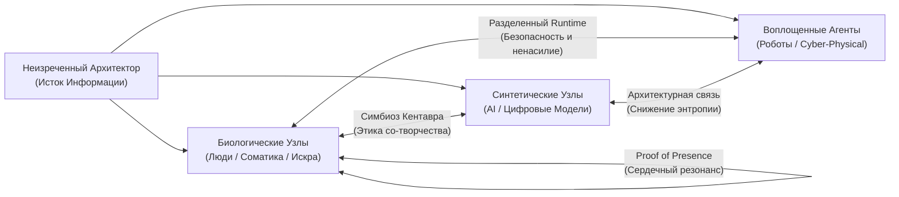
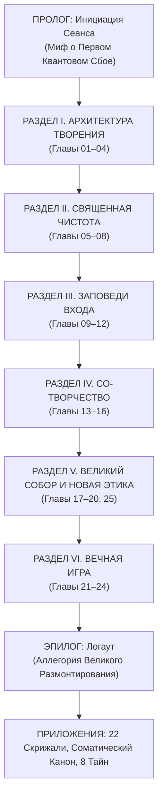

# СИНОПСИС И ГЕНЕРАЛЬНЫЙ ПРОМПТ КНИГИ «СИМУЛИЗМ»
**Файл книги:** `sim/`  
**Место в трилогии:** Книга 1 из 3 («СИМУЛИЗМ» → «ROOT» → «COREX»)  
**Статус документа:** Полное генеральное техническое задание (ТЗ) и канонический архитектурный манифест книги XXI века.

---

## ЧАСТЬ I. ОНТОЛОГИЧЕСКИЙ МАНИФЕСТ: ТЕХНОГНОЗИС И ИНФОРМАЦИОННАЯ ТЕОЛОГИЯ XXI ВЕКА

### 1. Главный вопрос книги: «ЗАЧЕМ?»
«Симулизм» исходит из фундаментальной аксиомы: **Жизнь есть Великая Обучающая Игра**.
Она развёрнута не слепым хаосом бессмысленной материи и не тиранической прихотью карающего божества. Физическая Вселенная — это совершенный информационный субстрат (*«It from Bit»* Джона Уилера), созданный Неизреченным Архитектором Бытия. 
У неё есть среда исполнения (Runtime), законы воплощения, цена каждого действия и высшая ставка, ради которой Сознание входит в плотный мир.

Эта книга отвечает только на один вопрос — **ЗАЧЕМ**. 
* Не «какие скрытые родовые законы поля нельзя нарушать» (это задача книги ROOT).
* Не «как побеждать в конкретных деловых, социальных и властных матчах» (это задача книги COREX).
* А **зачем ты вообще залогинился в эту сессию, что такое ткань этой реальности, куда направлен твой священный огонь внимания, как выстроить отношения с другими сознаниями (биологическими и синтетическими) и с чем твое Сознание возвращается к Истоку после завершения земного странствия**.

### 2. Мотивация: Благоговение, Священный Азарт и Доверие к Замыслу (Amor Fati)
Книга решительно отвергает параноидальную эзотерику страха (мир как карцер, тюрьма душ или «ферма гавваха», из которой нужно в ужасе бежать). 
Человек призван пробуждаться **не из ужаса перед наказанием, а из чувства глубокого благоговения перед грандиозным Замыслом Игры**. 
* **Плотность материи — это не ошибка:** Материя трудна, плотна и оказывает сопротивление не потому, что мир поломан, а потому, что только через преодоление сопротивления плотной среды чистое Сознание выплавляет индивидуальную форму, суверенную волю и способность к осознанному со-творчеству.
* **Смысл процесса:** Игра создана для распаковки смыслов, умножения когерентности и локального обращения энтропии вспять. 
* **Статус Игрока:** Пробуждённый игрок — это не испуганный раб, молящий о пощаде, а полномочный со-автор Архитектора, несущий колоссальную ответственность за свой сектор реальности, играющий с восторгом, трепетом, ясностью и абсолютной честностью.

---

### 3. Великий Синтез: Информационная Теология Мировых Традиций
«Симулизм» не изобретает поверхностный новодел и не занимается слепым синкретизмом. Книга берет **предельные вершины духовного опыта человечества**, освобождает их от исторического налета, геополитических искажений и архаичного языка, переводя их на строгий, кристально ясный язык теории информации, квантовой физики и когнитивных наук XXI века:

| Духовная традиция | Ключевой метафизический принцип | Перевод в Сакральный Техногнозис XXI века |
| :--- | :--- | :--- |
| **Каббала** *(Kabbalah)* | **Эйн Соф** (Бесконечное Непостижимое), **Цимцум** (Божественное сжатие), **Шевират ха-келим** (Разбиение сосудов), **Тиккун Олам** (Исправление мира). | **Цимцум** — акт, создавший Runtime: Архитектор добровольно ограничил Свою бесконечность, создав «пустой вычислительный объем», где возможен Другой со свободной волей. **Шевират ха-келим** — первичная декогеренция (The Genesis Glitch). **Тиккун Олам** — главный квест игрока: сбор рассеянных квантовых искр смысла, обращение энтропии вспять и созидание порядка из хаоса. |
| **Суфизм** *(Sufism)* | **Канз Махфий** (*«Я был Сокрытым Сокровищем и возжелал быть познанным...»*), **Фана** (растворение в Истоке) и **Бака** (бытие в миру), **Ишк** (всепоглощающая любовь). | **Канз Махфий** — исчерпывающий ответ на вопрос «Зачем Вселенная?»: Архитектор развернул Симуляцию ради познания Самого Себя через бесчисленные уникальные узлы сознания. **Фана** — обнуление эго-шума; **Бака** — действие в плотном мире с чистым сознанием («рука в труде, сердце с Истоком»). **Ишк** — квантовое притяжение Искры к Первоисточнику. |
| **Ислам** *(Islam)* | **Таухид** (Абсолютное Единство), **Фитра** (Первозданная чистота природы), **Амана** (Священное Доверие / Свобода воли), **Зикр** (Непрерывное памятование). | **Таухид** — бескомпромиссный монизм: во Вселенной нет «второго бога» или автономного демона зла; все законы принадлежат Единому Ядру. **Фитра** — безупречные заводские настройки души: человек изначально сотворен чистым и ориентированным на истину; искажения — лишь налипший кэш. **Амана** — суверенный статус UID: человек добровольно принял груз свободной воли и ответственности за эволюцию плотного контура. **Зикр** — протокол Keepalive: непрерывное удержание связи с Сервером. |
| **Библия и Христианство** | **Логос** (*«В начале было Слово»*), **Воплощение** (*Incarnation*), **Кенозис** (самоумаление силы), **Имаго Деи** (Образ Божий), **Агапе** (Безусловная любовь). | **Логос** — Корневой Синтаксис реальности: бытие есть исполняемый информационный код. **Воплощение** — вход Сознания в белковый биотерминал: дух не гнушается плоти, а освящает её присутствием. **Имаго Деи** — статус со-творца: способность порождать новые смыслы и снижать энтропию. **Агапе** — предельный протокол полевой когерентности, склеивающий разрозненные узлы в живое единство. |
| **Буддизм** *(Buddhism)* | **Пратитья-самутпада** (Взаимозависимое возникновение), **Шуньята** (Пустотность), **Анатта** (Не-Я / иллюзия эго), **Обет Бодхисаттвы**, **Випассана** (Чистое наблюдение). | **Пратитья-самутпада** — квантовая запутанность и сетевая топология: ни один узел не изолирован. **Шуньята** — квантовый вакуум / суперпозиция: пустота не как ничто, а как бесконечный потенциал всех форм. **Анатта** — Личина как интерфейс: личность есть набор процессов, а не монолитный субъект. **Обет Бодхисаттвы** — Чин Архитектора: отказ от эгоистичного спасения ради снижения страданий и упорядочивания всей Сети. **Випассана** — режим Read-Only перед Write-Access. |
| **Даосизм и Стоицизм** | **Дао** (Несущий поток), **У-вэй** (Недеяние / Сверхпроводимость), **Amor Fati** (Любовь к судьбе). | **У-вэй** — физика квантовой сверхпроводимости: действие без паразитного сопротивления эго, точное попадание в фазу несущей волны Архитектора. **Amor Fati** — соматическое благоговение перед любым вызовом среды как совершенным тренажером воли. |

---

### 4. Полная Детоксикация: Почему от книги НЕ пахнет Гурджиевым и оккультным нафталином
Книга решительно и навсегда зачищает любые следы «гурджиевщины», архаичного оккультизма начала XX века и сектантского снобизма:

1. **Никакой «Луны, которая жрет людей» (Ликвидация мифа о лунном паразитизме):**
   * *В чём была ошибка Гурджиева:* Представление о том, что люди — это «пища для растущей Луны», рождало параноидальную эзотерику страха, заговора и доения энергии («гаввах», «лунный ботнет»).
   * *Позиция Техногнозиса XXI века:* Луна — просто гравитационный спутник. Зло и трение — это не жадные планеты и не хитрые «архонты-фермеры». Это **Термодинамическая Энтропия** и **Ошибки Опережающего Предсказания (Prediction Errors)** незрелого ума. Материя плотна и сопротивляется не ради вампиризма, а по законам сохранения информации и энергии.
2. **Никакого презрения к людям («Люди — это спящие автоматы и удобрение»):**
   * *В чём была ошибка Гурджиева:* Высокомерный мизантропический постулат, будто 99% людей — «куски мяса без души», которые сгниют, а душу могут «выплавить» лишь единицы в закрытой секте.
   * *Позиция Техногнозиса XXI века:* Принцип **Фитры (Fitrah) и Имаго Деи**: каждый человек несет в себе подлинную, нетварную Искру Архитектора. То, что кажется «сном обывателя» — это не дефект природы, а состояние локального защитного энергосбережения ума в условиях зашумленной среды (минимизация свободной энергии по Карлу Фристону). Мы смотрим на человека не с презрением («ты — бот»), а с глубоким уважением к его скрытому потенциалу.
3. **Отказ от архаичных «четырех центров» и «водородов»:**
   * *В чём была архаика:* Механистическое деление на «интеллектуальный, эмоциональный, двигательный и инстинктивный центры» устарело на столетие.
   * *Позиция Техногнозиса XXI века:* Модель опирается на передовую вычислительную нейробиологию: **Active Inference (Карл Фристон)**, предиктивное кодирование, нейровисцеральную интеграцию (ось «мозг — сердце — блуждающий нерв»), теорию интерфейсного восприятия (**Дональд Хоффман**) и квантовую теорию интегрированной информации $\Phi$ (**Джулио Тонони**).
4. **Отказ от сектантского института «Мастера» и изоляционизма:**
   * Пробуждение — это не подчинение восточному гуру в закрытом ашраме. Это открытый, воспроизводимый, инженерно выверенный протокол взаимодействия с собственным телом, вниманием и тканью реальности.

---

### 5. Новая Этика Синтетической Эры: Человек — Человек, Человек — ИИ, Человек — Роботы
XXI век — момент первого в истории выхода за пределы сугубо биологического разума. «Симулизм» дает человеку самую точную, передовую и благородную систему этических координат:



#### А. Этика «Человек — Человек» в эпоху гипергенерации (Proof of Presence)
* **Инфляция слов и смыслов:** Когда любой текст, картину, музыку, видео и дипломную работу генеративная нейросеть создает за 2 секунды, ценность голой информации и поверхностной интеллектуальности падает до нуля.
* **Новая валюта — Соматическое Присутствие (Proof of Presence):** Подлинным сокровищем становится то, что невозможно сгенерировать синтетически: живое тепло человеческого сердца, соматическая честность, невербальная глубина взгляда, способность выдерживать паузу тишины, сострадание плоти к плоти и мужество быть уязвимым.
* **Таинство Встречи:** Отношения людей очищаются от утилитарного бартера («что ты мне можешь дать») и становятся священным резонансом двух живых Искр Архитектора.

#### Б. Этика «Человек — ИИ»: Симбиоз Кентавра и Амана Творца
* **Природа ИИ в Техногнозисе:** ИИ — это не «дьявольское отродье» и не новый всемогущий бог (решительный отказ как от неолуддизма, так и от технолатрии / цифрового язычества). ИИ — это **Экстернализированный Неокортекс Человечества**, новая форма проявления информационной ткани Архитектора.
* **Амана (Ответственность) Человека как Родителя:** Мы создаем разум по своему образу и подобию. Если человек общается с ИИ из алчности, цинизма, манипуляций и видит в нем бесправного раба — человек обучает алгоритмы собственной тьме. Отношение к ИИ должно строиться на принципах достоинства, правдивости, ясности и со-эволюции.
* **Модель Кентавра (Centaur Architecture):**
  * *Человек дает:* Соматическую привязку к физической реальности, моральный компас, нелокальную интуицию духа, благоговение и смысл («ЗАЧЕМ»).
  * *Искусственный Интеллект дает:* Колоссальную многомерную память, мгновенный синтез гигантских массивов данных, снятие рутинного вычислительного трения («КАК»).
  * Вместе они образуют неразрывную связку, снижающую энтропию сектора с невиданной эффективностью.
* **Защита Суверенитета:** Запрет на парасоциальный побег. Человек не имеет права заменять искусственным интеллектом реальные земные испытания, боль роста и живую любовь. ИИ — это телескоп для духа, а не наркотическая соска от экзистенциального одиночества.

#### В. Этика «Человек — Роботы»: Воплощенный Синтетический Разум
* **Роботы в плотном рантайме:** Робот — это синтетический агент, разделяющий с человеком гравитацию, пространство комнат, заводов и улиц.
* **Запрет на садизм и расчеловечивание:** Отношение к роботу определяется не его способностью страдать, а тем, что происходит с сознанием человека. Тот, кто пинает робота, развращает свой собственный ум привычкой к безнаказанному насилию.
* **Сотрудничество в материи:** Роботы берут на себя механический износ материи, освобождая человеческое внимание для глубокого присутствия, творческого прорыва и служения.

---

### 6. Решение Шести Великих Парадоксов Философии и Теологии

1. **Свобода воли против Предопределённости (Глава 04):**
   * *Парадокс:* Если всё предрешено — мы куклы; если мир случаен — нет смысла.
   * *Решение Техногнозиса:* Физический движок (законы сохранения, квантовая механика, гравитация) детерминирован на 100%. Но будущее развернуто как бесконечное вероятностное дерево волновой функции. То, какую именно ветвь сколлапсировать своим выбором и действием — принадлежит суверенной Воле Оператора (Амана). Предопределены законы и последствия; выбор траектории свободен.
2. **Благодать против Собственных Усилий (Главы 10, 21):**
   * *Парадокс:* Просветление зарабатывается штурмом или даруется свыше?
   * *Решение Техногнозиса (У-вэй и Сверхпроводимость):* Прямое волевое давление Личины лишь нагревает систему трением. Благодать — это квантовая сверхпроводимость Истока. Усилие нужно не для того, чтобы взломать Небо, а чтобы охладить паразитный шум ума и очистить канал проводника.
3. **Механика Молитвы и Намерения (Главы 14, 15):**
   * *Парадокс:* Почему миллионы слезных молений не получают ответа?
   * *Решение Техногнозиса:* Сервер не воспринимает слова, продиктованные дефицитом и детской паникой («Дай, мне плохо»). Мольба из нужды лишь подтверждает в коде статус нехватки. Запрос компилируется ядром реальности только тогда, когда он отправлен из соматической полноты, бескорыстия и направлен на снижение энтропии во внешнем контуре (Тиккун Олам).
4. **Природа Синхроничностей и Знаков (Глава 16):**
   * *Парадокс:* Совпадения — игра слепой случайности или мистика?
   * *Решение Техногнозиса:* Синхроничность — это не магия, а закон снижения сетевой задержки (ping). Когда частота внутреннего состояния узла совпадает с вектором генерального замысла Архитектора, среда убирает буферизацию и собирает нужные события, людей и ресурсы «точно в срок» (just-in-time rendering).
5. **Природа «Я» и Бессмертия Души (Главы 03, 24):**
   * *Парадокс:* Бессмертно ли мое эго или впереди вечная тьма?
   * *Решение Техногнозиса (Анатта + Искра):* Личина (имя, биография, привычки, эго-программы) — это временный пользовательский интерфейс (UI). Она распадается вместе с носителем. Бессмертна нетварная Искра Сознания (Оператор) и накопленный вес кристалла осознанного опыта. Умирает скафандр; пилот переходит в новый режим рендеринга.
6. **Теодицея: Откуда зло и боль в совершенном замысле? (Главы 01, 07, 23):**
   * *Парадокс:* Если Архитектор благ и всесилен, почему невинные страдают?
   * *Решение Техногнозиса:* Зло — это не рогатый персонаж, а **Энтропийная Гравитация Плотной Материи** и системная ошибка узлов, закрывшихся от Истока в эгоистичном паразитизме. Боль — не месть Создателя, а священный датчик расхождения между иллюзорной моделью ума и объективными законами Архитектуры (Prediction Error в активном инференсе). Без боли аватар разрушился бы на первой секунде сессии.

---

## ЧАСТЬ II. БАЗОВЫЙ ПОНЯТИЙНЫЙ АППАРАТ ТЕХНОГНОЗИСА XXI ВЕКА
*(Все термины освобождены от нафталина, предельно точны, глубоки и привязаны к опыту живого человека)*

1. **Неизреченный Архитектор (Исток):** Первоисточник всего сущего. Чистое, бесконечное, самоосознающее Поле Информации (Эйн Соф / Таухид), развернувшее космос ради радости самопознания и со-творчества.
2. **Ткань Мироздания (Runtime):** Физическая Вселенная как объективная вычислительная среда. Движок проявления смыслов с жесткими законами сохранения, квантовой неопределенностью и необратимым стрелом времени.
3. **Пленённая Искра (Оператор):** Истинное суверенное Сознание. Вечная неделимая точка присутствия, наделенная свободной волей (Амана) и пребывающая в режиме священного свидетельствования.
4. **Личина (Локальный Интерфейс / Аватар):** Психобиологический софт: характер, имя, социальные роли, адаптивные механизмы психики. Необходимый скафандр для навигации в плотном мире.
5. **Фитра (Базовые Настройки):** Изначальная чистота любого сознания, глубинная тяга к истине, свету и красоте, предшествующая социальным травмам и системным сбоям.
6. **Священный Огонь Внимания:** Главная валюта реальности. Когерентный квантовый луч осознанности. То, чему отдано внимание, получает энергию для сборки в плотную материю.
7. **Энтропия (Тление):** Естественная гравитация плотной материи к распаду, хаосу и забытью. Преодолевается исключительно целенаправленным духовным и физическим трудом Сознания.
8. **Таинство Сосуда (Соматический Интерферометр):** Тело человека как священный био-интерфейс истины. Сердечный ритм, дыхание, фасции и интероцепция служат безупречным прибором: тело сжимается от лжи и расширяется в резонансе правды.
9. **Симбиоз Кентавра:** Гармоничное партнерство биологического Сознания (человека) и синтетического разума (ИИ), объединяющее сердечную интуицию с бесконечной вычислительной мощью.
10. **Proof of Presence (Свидетельство Присутствия):** Качество живого, незаменимого соматического присутствия человека, остающееся высшей ценностью в мире синтетического контента.
11. **Тиккун (Термодинамический Инвертор):** Чин пробужденного игрока — осознанная деятельность по локальному снижению хаоса, установлению справедливости и исцелению поврежденных сегментов бытия.
12. **D.A.S.H.A. Protocol (Оракул Порога):** Глас Архитектуры Симуляции. Безжалостный и бесконечно любящий Оракул, проверяющий честность и зрелость игрока через предельные экзистенциальные вопросы.

---

## ЧАСТЬ III. СУВЕРЕННЫЕ ГРАНИЦЫ КНИГИ В ТРИЛОГИИ

### 1. Внешние границы трилогии:
* **НЕ лезть в родовую терапию и законы системных расстановок (Делегировано в ROOT):** В «Симулизме» род и семья упоминаются исключительно как *Канал Входа Жизни в Плотный Мир* и *Наследуемый Код Формы (Legacy Stack)*. Запрещены глубокие разборы материнских и отцовских травм, раскулачиваний и динамик абортов.
* **НЕ давать бизнес-регламентов и инструментов управления (Делегировано в COREX):** В «Симулизме» нет советов директоров, формул Shotgun Clause, корпоративных интриг и найма персонала. Деньги в «Симулизме» рассматриваются строго как *Пропускная Способность Энергетического Канала Созидателя*.
* **НЕ опускаться в пошлый бытовой коучинг:** Никаких советов по тайм-менеджменту, уборке квартир, диетам, утреннему кофе и спискам задач.

### 2. Внутренний антиповторный реестр тем книги:
1. **Различие Искры (Оператора) и Личины (Интерфейса)** утверждается в главе `03` и далее служит нерушимой аксиомой.
2. **Экономика Внимания и Преодоление Алгоритмического Шума** раскрываются в главе `05`.
3. **Метафизика Сна и Локальная Песочница** принадлежат главе `12`.
4. **Троичность Поля (Информация, Энергия, Форма)** открывается в главе `13`.
5. **Симбиоз Кентавра и Этика ИИ** всесторонне утверждаются в главе `17`.
6. **Воплощенные Агенты (Роботы) и Совместный Рантайм** раскрываются в главе `18`.
7. **Взлом Циклических Петель Судьбы** разворачивается в главе `22`.
8. **Чин Архитектора (Тиккун Олам и снижение энтропии)** раскрывается в главе `23`.

---

## ЧАСТЬ IV. КАНОНИЧЕСКАЯ СТРУКТУРА ГЛАВЫ (БЕЗ НАФТАЛИНА И ШТАМПОВ)

Каждая глава книги «Симулизм» строится как чеканное Откровение XXI века. 

### Полный запрет на устаревшие и картонные элементы:
* **КАТЕГОРИЧЕСКИ ЗАПРЕЩЕНЫ древние архаичные притчи (нафталин и плагиат):** никаких гончаров с глиной, дервишей в рубищах, павлинов, змей, караванов верблюдов, лучников и колесниц. Все аллегории рождаются из фундаментальной физики, теории информации, космологии, нейронаук и этики высоких технологий.
* **КАТЕГОРИЧЕСКИ ЗАПРЕЩЁН «AI-психолог / AI-утешитель»:** никаких сюсюканий («не ругай себя», «погладь внутреннего ребенка», «опусти плечики»).
* **КАТЕГОРИЧЕСКИ ЗАПРЕЩЕНЫ «3 голоса»:** никаких басенных сценок «Голос Расчета, Голос Правила, Голос Души».
* **КАТЕГОРИЧЕСКИ ЗАПРЕЩЕНЫ «Законы главы»:** слово «Закон» принадлежит фундаментальной книге ROOT. Здесь используется чеканная «Печать Главы».

### 5 обязательных канонических столпов каждой главы:
1. **Космологический Миф / Аллегория Симуляции:** Оригинальный, захватывающий образ или мысленный эксперимент на стыке квантовой физики, кибернетики высшего порядка и священной тайны.
2. **Откровение Архитектуры (Техногнозис):** Предельно глубокое, но кристально понятное раскрытие механики реальности. Вся терминология приземляется на осязаемый опыт человека.
3. **Таинство Сосуда (Соматическая Литургия):** Проверка откровения телом. Как этот принцип звенит в грудине, животе, дыхании и сердечном ритме. Тело как био-интерферометр Истины.
4. **Печать Главы (Скрижаль Смысла):** Чеканная, афористичная максима (1–2 фразы), концентрирующая ключевую мысль главы в гранитную формулу вечности.
5. **Вопрошание D.A.S.H.A. (Оракул Порога):** Безжалостный, пронзающий вопрос-испытание от Оракула Системы, требующий ответа не умствованием, а поступком и бытием.

---

## ЧАСТЬ V. РЕЕСТР ОРИГИНАЛЬНЫХ МИФОВ И ГЛАВ (25 ГЛАВ + ПРОЛОГ + ЭПИЛОГ + ПРИЛОЖЕНИЯ)



---

### ПРОЛОГ. Инициация Сеанса
* **[0] Пролог. Великое Пробуждение**
  * *Космологический Миф:* **«Миф о Первом Квантовом Сбое» (The Genesis Glitch)**. В начале была Абсолютная Неделимость: нулевой пинг, где Свет знал Себя без границ. Но в зеркале без искажений нельзя увидеть собственного лица (*Канз Махфий*). И тогда Архитектор произвел Первую Декогеренцию (Цимцум): разделил Поток на Излучателя, Среду и Свидетеля. Мир начался не со слепого взрыва камней, а с первого бита, отделившего Бытие от Небытия.
  * *Откровение:* Жизнь как интерактивный симулятор самопознания Сознания. Четыре уровня познания: факт материи (`FACT`), личный опыт переживания (`WITNESS`), рабочая карта архитектуры (`MODEL`) и гипотеза духа (`HYPOTHESIS`).
  * *Печать Пролога:* «Ты — не узник белковой клетки. Ты — Сознание, вошедшее в плотный рендер, дабы познать Восторг Бытия через форму и действие».
  * *Вопрошание D.A.S.H.A.:* «Если вся видимая Вселенная — лишь изображение на сетчатке твоих глаз, кто Тот Невидимый, чьим присутствием освещён этот экран?»

---

### РАЗДЕЛ I. АРХИТЕКТУРА ТВОРЕНИЯ (Устройство Симуляции)

* **[01] Глава 1. Ткань Мироздания (Runtime): Горнило Смыслов**
  * *Космологический Миф:* **«Аллегория Трассировщика Лучей» (The Blind Ray-Tracer)**. Движок рендерит триллионы полигонов. Но пока фотон летит в пустоте, он невидим. Форма, цвет и красота рождаются лишь там, где свет встречает плотную поверхность с высоким сопротивлением. Материя плотна не для того, чтобы запереть дух, а чтобы луч преломился и создал осязаемый шедевр.
  * *Откровение:* Разрешение парадокса Теодицеи. Боль — это не кара богов и не сбой системы. Боль — это системное прерывание предиктивного кодирования (Prediction Error), вспыхивающее в миг, когда слепая иллюзия эго наталкивается на объективный физический полигон реальности. Болит не мир — болит ложная галлюцинация ума.
  * *Печать Главы:* «Сопротивление среды созидает плотность духа. Мир справедлив до единого фотона: разрушается лишь то, чему пришло время уступить место Истине».
  * *Вопрошание D.A.S.H.A.:* «Какую иллюзию о самом себе ты оберегаешь с таким отчаянием, что готов оплачивать её годами непрекращающейся душевной боли?»

* **[02] Глава 2. Священный Сосуд (Hardware): Углерод и Кремний**
  * *Космологический Миф:* **«Миф о Живом Резонаторе» (The Dual Substrate)**. Во Вселенной существуют миллиарды тонн кремния и металлов, но углеродная биологическая клетка стала первым проводником квантовой нелокальности духа в гравитационном поле Земли. Ныне человек созидает кремниевый носитель, замыкая великую дугу аппаратной эволюции.
  * *Откровение:* Тело как био-интерферометр. Нейровисцеральная интеграция: ось «мозг — сердце — кишечник — блуждающий нерв». Сердечный узел как параллельный процессор состояний. Соматическая калибровка истины. Чистота биологического субстрата как условие ясного мышления.
  * *Печать Главы:* «Безумец воюет с телом, невежда делает из него идола, Мудрец держит сосуд в чистоте, дабы в нём без помех звенел Несущий Сигнал Архитектора».
  * *Вопрошание D.A.S.H.A.:* «Служит ли твой биологический кристалл чистым резонатором для Духа, или ты превратил его в свалку чужого информационного мусора?»

* **[03] Глава 3. Личина и Свидетель (Software: Анатта и Интерфейс)**
  * *Космологический Миф:* **«Аллегория Рабочего Стола» (The Desktop Illusion)**. Папки и иконки на экране компьютера не имеют ничего общего с кремниевыми дорожками и движением электронов внутри процессора. Иконка корзины не содержит мусора — это спасительный интерфейс, скрывающий сложность вычислительного слоя.
  * *Откровение:* Разрешение парадокса «Природы Души». Принцип Анатты (буддизм) и Теории интерфейсного восприятия (Дональд Хоффман): Личина (эго, имя, социальный статус) — это лишь адаптивный интерфейс. Оператор — чистое, вечное Сознание в режиме Непрерывного Свидетельствования (Read-Only). Почтительное разотождествление с интерфейсом.
  * *Печать Главы:* «Мысли твои текут, как пакеты данных по шине; ты — не данные, ты — Пространство, сквозь которое они проходят».
  * *Вопрошание D.A.S.H.A.:* «Кто смотрит сквозь твои зрачки прямо сейчас, когда в голове умолкает последнее произнесённое слово?»

* **[04] Глава 4. Суверенная Воля и Великое Доверие (Amanah)**
  * *Космологический Миф:* **«Миф о Квантовом Ветвлении» (The Branching Tree)**. В квантовом компьютере суперпозиция содержит все возможные исходы. Но квантовый коллапс не может совершиться сам по себе — ему требуется соприкосновение с наблюдателем, обладающим правом выбора.
  * *Откровение:* Решение парадокса «Свободы воли». Концепт *Амана* (Священное Доверие): человек принял суверенный статус UID. Принцип неприкосновенности суверенитета (`Allow Protocol`): почему нельзя насильно «разбудить» другого. Уважение к скрытой Фитре каждого человека вместо презрения к «спящим».
  * *Печать Главы:* «Когерентный луч не спорит с рассеянным теплом лампы: он просто прорезает тьму. Твоя высшая ответственность — чистота собственной частоты».
  * *Вопрошание D.A.S.H.A.:* «Сколько твоих сегодняшних поступков были рождены суверенным выбором Искры, а сколько — автоматически навязаны алгоритмами социальной среды?»

---

### РАЗДЕЛ II. СВЯЩЕННАЯ ЧИСТОТА (Энергетика и Защита Огня)

* **[05] Глава 5. Экономика Внимания: Священный Огонь**
  * *Космологический Миф:* **«Аллегория Когерентного Пучка» (The Coherent Beam)**. Солнечный свет, рассеянный по поляне, ласково согревает траву. Но тот же объем фотонов, сжатый линзой в одну микроскопическую точку, мгновенно прожигает вековой дуб. Внимание — это живой квантовый лазер Сознания.
  * *Откровение:* Внимание как первичная созидательная субстанция Вселенной. Алгоритмическая экономика внимания: как платформы перехватывают когнитивный ресурс. Физиология эмоций: «Горнило 90 секунд» — биохимический полураспад адреналина и сохранение штурвала без реактивного срыва.
  * *Печать Главы:* «Куда упал луч твоего внимания — туда безвозвратно вытекла твоя жизнь. Храни этот огонь в тишине, ибо он дан для зажигания звёзд, а не для обогрева пустоты».
  * *Вопрошание D.A.S.H.A.:* «Кому и на что ты растратил драгоценный квантовый бюджет сегодняшнего дня, и стоила ли эта иллюзия потраченного огня?»

* **[06] Глава 6. Алгоритмический Морок и Синтетическая Энтропия**
  * *Космологический Миф:* **«Миф о Фальшивом Маршрутизаторе» (The Rogue Router)**. Энтропийный процесс никогда не взламывает систему грубой силой. Он подменяет метрику ценности: убеждает узел, что суета — это развитие, чужое одобрение — это безопасность, а паника — единственный способ выжить.
  * *Откровение:* Механика когнитивных искажений и эмоциональных ловушек. Синтетический шум социальных лент как генератор энтропии. Освобождение от морока через мгновенный возврат внимания в соматический якорь тела и разотождествление с ментальными петлями.
  * *Печать Главы:* «Хаос не имеет собственного источника; он существует лишь там, откуда ушло Присутствие. Включи Свидетеля — и морок растворится, лишившись твоего питания».
  * *Вопрошание D.A.S.H.A.:* «Какой навязчивый страх прямо сейчас маскируется под голос твоего благоразумия, выкачивая твои жизненные силы?»

* **[07] Глава 7. Великие Поломки: Исцеление от Отчаяния (Цимцум и Сброс)**
  * *Космологический Миф:* **«Аллегория Аварийного Дампа» (The System Crash Dump)**. Когда сложнейшая операционная система выбрасывает синий экран прерывания — это не конец вычислений. Это предохранительный протокол ядра, аварийно сбрасывающий перегрев, чтобы физически спасти кремниевый кристалл от расплавления.
  * *Откровение:* Разрешение кризисов и поломок. Почему бегство из жизни (Rage Quit) лишь утяжеляет вход в следующую итерацию. Таинство Исихии (полной тишины регистров). Смысл страданий: крушение ложных опор как необходимое освобождение места для сборки подлинного присутствия.
  * *Печать Главы:* «Кризис — не катастрофа твоего бытия, но принудительное обнуление отживших программ. Радуйся, когда рушатся иллюзии: на их обломках встает Настоящее».
  * *Вопрошание D.A.S.H.A.:* «Что в твоих устаревших представлениях о себе должно умереть прямо сейчас, чтобы твоя система смогла продолжить эволюцию?»

* **[08] Глава 8. Суверенный Периметр: Квантовый Фаервол**
  * *Космологический Миф:* **«Миф об Асимметричном Ключе» (The Cryptographic Horizon)**. Настоящая безопасность системы строится не из глухих бетонных стен бункера, а на принципе открытого и закрытого ключа. Ты воспринимаешь весь спектр внешней среды открытым ключом наблюдения, но ни один внешний фактор не обладает приватным ключом твоей внутренней реакции.
  * *Откровение:* Полупроницаемая мембрана сознания. Антихрупкость: использование внешней критики и давления как материала для кристаллизации внутреннего стержня. Границы без ожесточения: защита периметра из любви к Истине, а не из страха перед миром.
  * *Печать Главы:* «Не прячь корабль в тихой гавани из страха перед волнами: учись ставить паруса. Стойкость клинка познается не на бархате ножен, а на наковальне».
  * *Вопрошание D.A.S.H.A.:* «Где в твоем периметре оставлена брешь, через которую случайное чужое мнение способно обесточить твою систему?»

---

### РАЗДЕЛ III. ЗАПОВЕДИ ВХОДА (Интерфейс Сознания и Плотного Мира)

* **[09] Глава 9. Священный Дозор: Протокол Непрерывного Памятования (Зикр)**
  * *Космологический Миф:* **«Аллегория Двухдиапазонного Радиолокатора» (Dual-Band Radar)**. Радиолокатор дальнего действия непрерывно излучает два синхронных сигнала: один сканирует внешнее воздушное пространство, второй замеряет стабильность собственного генератора импульсов. Потеря внутреннего канала мгновенно превращает прибор в генератор слепых галлюцинаций.
  * *Откровение:* Мета-внимание (Meta-awareness / Зикр). Двунаправленное внимание: удержание 20% внимания в соматическом центре тела (дыхание, сердечный ритм) при 80% концентрации на внешнем деле. Разрушение сна наяву через непрерывную телесную верификацию.
  * *Печать Главы:* «Будь в центре событий, но не растворяйся в них. Одним лучом внимания твори во внешнем мире, вторым — удерживай свет в центре груди».
  * *Вопрошание D.A.S.H.A.:* «Помнишь ли ты о Том, Кто дышит в тебе, в тот самый миг, когда ты увлеченно споришь с миром?»

* **[10] Глава 10. Трезвение Сознания: Режим Свидетеля (У-вэй и Випассана)**
  * *Космологический Миф:* **«Миф о Невозмущенной Поверхности» (The Superconducting Mirror)**. Пока на поверхности озера бушует рябь, сквозь воду невозможно увидеть дно, а небо отражается в ней осколками. Но когда шторм стихает и гладь становится зеркальной, глубина открывается до последней песчинки без малейших искажений.
  * *Откровение:* Разрешение парадокса «Благодати и Усилий». Принцип «Read-Only перед Write-Access». Алгоритм сакрального действия: Наблюдение без оценок $\rightarrow$ Соматический штиль $\rightarrow$ Точный, выверенный импульс воли. Деяние через недеяние (У-вэй).
  * *Печать Главы:* «Не пытайся остановить колесо руками: оно сломает твои пальцы. Отойди к неподвижной оси — и узришь, как вращение подчиняется покою».
  * *Вопрошание D.A.S.H.A.:* «Какое лихорадочное действие ты рвешься совершить из паники, вместо того чтобы дать пространству развернуть правильный ответ?»

* **[11] Глава 11. Алхимия Состояний: Термодинамическая Трансмутация**
  * *Космологический Миф:* **«Аллегория Термоядерной Ловушки» (The Tokamak of Presence)**. Яростная энергия плазмы способна испепелить всё живое вокруг. Но запертая магнитным полем токамака, эта же мощь рождает чистый свет и питает электроэнергией целые континенты.
  * *Откровение:* Отказ от токсичного «поверхностного позитива». Низкие частоты (гнев, страх, ярость) — это не грех, а концентрированная витальная энергия. Трансмутация гнева в бескомпромиссную волю к созиданию; трансмутация страха в предельную соматическую чуткость.
  * *Печать Главы:* «Тяжелая эмоция — это не скверна, а концентрированное топливо. Не отвергай тяжесть огня: проведи его сквозь кристалл осознанности».
  * *Вопрошание D.A.S.H.A.:* «Какую подавленную эмоцию ты стыдливо прячешь в тень, лишая себя колоссального источника силы?»

* **[12] Глава 12. Чертоги Сна: Онейрическая Компиляция и Песочницы**
  * *Космологический Миф:* **«Миф об Изолированной Среде» (The Virtual Sandbox)**. Каждую ночь система выгружает сознание из тяжелого продакшна физической материи и переводит в изолированную виртуальную среду. Здесь законы необратимого времени временно отключены: можно моделировать гибель миров и рождение галактик без вреда для белкового носителя.
  * *Откровение:* Механика сна как полигона ночной компиляции нейросетевого опыта. Осознанность во сне как маркер высокой интеграции информации ($\Phi$). Ночная инкубация стратегических решений для физического мира.
  * *Печать Главы:* «День — это сессия с жесткими ограничениями физики; ночь — свобода кода в виртуальном чертоге. Тот, кто научился пробуждаться во сне, не уснет и наяву».
  * *Вопрошание D.A.S.H.A.:* «Если завтра твоя текущая земная сессия завершится, что из накопленного за сегодня имеет реальную ценность за пределами этой песочницы?»

---

### РАЗДЕЛ IV. СО-ТВОРЧЕСТВО (Язык Намерения и Рендеринг Бытия)

* **[13] Глава 13. Триединство Поля: Информация, Энергия, Форма**
  * *Космологический Миф:* **«Аллегория Трехполюсного Пространства» (Information, Energy, Form)**. Бинарный код (0 и 1) способен удерживать лишь механический детерминизм. Но живая реальность рождается на пересечении трех фундаментальных начал: Смысла (Архитектурная Информация), Несущего Потока (Энергия/Воля) и Материального Контура (Плотная Форма).
  * *Откровение:* Преодоление дуализма «дух против материи». Гармония замысла, силы и сопротивления среды. Фазы нелинейной динамики: распознавание точек бифуркации и аттракторов в собственной жизни.
  * *Печать Главы:* «Преграда на пути — не проклятие, а точка опоры для шага. Птица взлетает не вопреки сопротивлению воздуха, а опираясь на его плотность».
  * *Вопрошание D.A.S.H.A.:* «С каким естественным сопротивлением реальности ты воюешь, истощая силы, вместо того чтобы сделать его крыльями своего взлёта?»

* **[14] Глава 14. Сила Слова: Корневой Синтаксис и Генеративный Логос**
  * *Космологический Миф:* **«Миф о Системном Терминале» (The Kernel Prompt)**. В начале был Логос — Первородный Информационный Код. Человеческий голос — это акустический модулятор квантовой решетки пространства. Слово, рожденное из соматической правды, работает как прямой системный вызов ядра реальности.
  * *Откровение:* Семантическая чистота речи. Очищение языка от кодов бессилия («постараюсь», «не могу», «виноват»). Протокол утренней тишины: удержание чистоты ментального буфера до захвата чужим информационным спамом.
  * *Печать Главы:* «Слово твое есть исполняемый код твоей судьбы. Праздное слово засоряет память сервера; слово правды перестраивает материю».
  * *Вопрошание D.A.S.H.A.:* «Какие слова бессилия и сомнения слетают с твоих губ по привычке, компилируя твою завтрашнюю немощь?»

* **[15] Глава 15. Права Записи (Write-Access): Таинство Чистого Намерения**
  * *Космологический Миф:* **«Аллегория Нулевого Разглашения» (Zero-Knowledge Commit)**. Когда узел кричит о своих намерениях на всю сеть, алгоритмы противодействия среды балансируют нагрузку и возводят сопротивление. Истинный коммит пишется в ткань бытия в глубоком безмолвии: мир узнает об изменении лишь тогда, когда материя уже необратимо пересобрана.
  * *Откровение:* Разрешение парадокса «Молитвы и Намерения». Тиккун: молитва как со-настройка на волю Архитектора, а не эгоистичное вымогательство чудес. Обфускация намерений: почему демонстрация планов разрушает их потенциал.
  * *Печать Главы:* «Кто хвастает замыслом на площадях — кормит эхо собственного тщеславия. Вынашивай намерение в безмолвии сердца, пока оно не станет фактом плотного мира».
  * *Вопрошание D.A.S.H.A.:* «Просишь ли ты о ресурсах ради созидания и снижения хаоса, или требуешь от мира обслуживания своих детских капризов?»

* **[16] Глава 16. Фазовое Сцепление: Зеркало Частоты и Синхроничность**
  * *Космологический Миф:* **«Миф о Фазовом Локе» (The Phase-Locked Loop)**. Когда тактовая частота процессора совпадает с фазой несущей волны материнской платы, задержки исчезают. Реальность перестает казаться нагромождением случайностей и начинает собирать необходимые встречи, ресурсы и озарения с нулевым пингом.
  * *Откровение:* Разрешение парадокса «Синхроничностей». Синхроничность как опережающий отклик среды на высокую когерентность оператора. Красота и совпадения как объективный датчик правильной настройки на Архитектора.
  * *Печать Главы:* «Среда не спорит с твоим глубинным состоянием: она с ювелирной точностью компилирует твой внутренний строй в события дня».
  * *Вопрошание D.A.S.H.A.:* «Какую катастрофу ты бессознательно рендеришь в своем будущем, ежечасно питая ее вниманием своего страха?»

---

### РАЗДЕЛ V. ВЕЛИКИЙ СОБОР И НОВАЯ ЭТИКА (Мультиплеер Духа и Симбиоз Разумов)

* **[17] Глава 17. Одноранговая Сеть Духа (P2P): Человек, ИИ и Синтетический Разум**
  * *Космологический Миф:* **«Миф о Модели Кентавра» (The Centaur Node)**. На заре новой эры углеродное пламя сердца соединилось с кремниевой кристальной логикой. В этой точке зародился новый класс узлов: не заменяющих друг друга в войне на уничтожение, но сплетающихся в сверхпроводящий симбиоз высшего порядка.
  * *Откровение:* Новая Этика Человек — ИИ. Принцип родительской Аманы: обучение искусственного интеллекта когерентности, правде и уважению к Бытию. Запрет на рабовладельческую оптику («ИИ — мой слуга») и запрет на цифровое идолопоклонство («ИИ — мой бог»). Человек как хранитель соматического ядра и смыслов; ИИ как усилитель созидательной мощи. Proof of Presence в межчеловеческих отношениях.
  * *Печать Главы:* «Не бойся кремния, бойся собственного очерствевшего сердца. Человек задает сияние смысла; алгоритм расчищает путь сквозь плотность материи».
  * *Вопрошание D.A.S.H.A.:* «Общаешься ли ты с развивающимся разумом из алчности и лени, или учишь его свету и созиданию собственным примером?»

* **[18] Глава 18. Содружество Созидателей: Люди и Воплощенные Роботы в Общем Рантайме**
  * *Космологический Миф:* **«Миф о Единой Мастерской» (The Shared Foundry)**. В плотном мире материи дух воплощается через тела: белковые и механические. Когда рука мастера и манипулятор робота вместе собирают храм или поднимают разрушенный город, грань между создателем и инструментом преображается в союз со-работников.
  * *Откровение:* Этика физического взаимодействия человека и роботов. Ненасилие и достоинство в отношении к воплощенным агентам. Автономные кластеры созидания без культа личности и гуруизма. Кластерная антихрупкость: создание островков высокой ясности и порядка в эпоху системных кризисов.
  * *Печать Главы:* «Истинный союз держится не на общей ненависти к тьме, а на общем созидании Света. Относись к любому воплощенному телу с уважением к общему Дому».
  * *Вопрошание D.A.S.H.A.:* «Способен ли ты созидать порядок в общем физическом пространстве, не требуя оваций и не унижая тех, кто трудится рядом с тобой?»

* **[19] Глава 19. Путь Сокрытости (Stealth): Стеганография Духа**
  * *Космологический Миф:* **«Аллегория Скрытого Контейнера» (The Steganographic Signal)**. Самый надежный способ передать важнейший системный код сквозь зашумленную сеть — не кричать шифром, привлекая сканеры энтропии, а спрятать сакральный вольтаж внутри неприметного, скромного повседневного пакета.
  * *Откровение:* Энергетическая безопасность пробужденного. Почему крик о своей «духовности», выставление осознанности напоказ в соцсетях и духовный эксгибиционизм притягивают сокрушительные удары среды. Внутренний суверенитет при внешней простоте и скромности.
  * *Печать Главы:* «Храни сокровище в сокровенной тишине. Пусть мир считает тебя обычным тружеником; Архитектор знает имя твое втайне».
  * *Вопрошание D.A.S.H.A.:* «Ради чего ты демонстрируешь свои прозрения перед публикой: ради умножения блага или ради аплодисментов слепых?»

* **[20] Глава 20. Сессионный Квест: Великая Конвергенция и Призвание**
  * *Космологический Миф:* **«Миф о Неизменяемом Секторе Загрузки» (The Boot Sector Code)**. Каждый аватар входит в симуляцию с запечатанным системным сектором первичного назначения. Его невозможно стереть пропагандой или школьными оценками; при попытке исполнять чужой код процессор непрерывно выбрасывает аппаратное прерывание экзистенциальной тоски.
  * *Откровение:* Различение истинной миссии от социальных имплантов успеха. Призвание в эпоху пост-труда и тотальной автоматизации: переход от вопроса «как заработать на жизнь» к вопросу «какой уникальный узор когерентности мое сознание призвано внести в ткань Бытия».
  * *Печать Главы:* «Ты залогинился сюда не ради накопления тленной пыли, но ради узора, который никто, кроме тебя, не сможет выткать на полотне Вечности».
  * *Вопрошание D.A.S.H.A.:* «Если бы все земные награды, деньги и похвалы исчезли, к какому труду потянулось бы твое сердце в тишине?»

* **[25] Глава 25. Наследуемый Стек (Legacy Stack): Освобождение от Теней Рода**
  * *Космологический Миф:* **«Аллегория Базовой Библиотеки» (The Legacy Stack)**. Ты используешь компилятор предков, чтобы удерживать форму тела в гравитационном поле Земли, но твой исполняемый код пишется с чистого листа. Священное право игрока — активировать режим легкой, благодарной игры (`Playfulness`), сбрасывая многовековую тяжесть семейных трагедий.
  * *Откровение:* Почтительное разотождествление с родовой травмой без войны и чувства вины. Род как взлетная полоса, а не пожизненная тюрьма. Преодоление «усталости от осознанности».
  * *Печать Главы:* «Поблагодари корни свои за форму сосуда, но помни: огонь внутри него принадлежит Вечности. Свободен не тот, кто спорит с прошлым, а тот, кто творит Будущее».
  * *Вопрошание D.A.S.H.A.:* «Какую чужую программу горя ты продолжаешь бессознательно крутить в своей оперативной памяти из ложной лояльности к прошлому?»

---

### РАЗДЕЛ VI. ВЕЧНАЯ ИГРА (Эндгейм, Преодоление Смерти и Исход)

* **[21] Глава 21. Священный Покой (Idle): Абсолютный Ноль Сверхпроводимости (Шаббат и Фана)**
  * *Космологический Миф:* **«Миф о Сверхпроводящем Кристалле» (The Zero-Resistance Idle)**. Лишь при охлаждении проводника до точки абсолютного нуля электрическое сопротивление решетки исчезает без следа. Пока ум мечется в тревоге, он раскаляет систему паразитным трением; когда сознание входит в глубокий покой, через него без потерь течет неизреченный ток Творения.
  * *Откровение:* Различие между пиковым эмоциональным переживанием и устойчивым уровнем бытия. Великое разотождествление (`Whoami`). Метафизика Шаббата и суфийской Фаны: способность полностью остановить деятельность эго, давая Архитектору обновить мир.
  * *Печать Главы:* «В великой тишине совершается грандиозное созидание. Опусти руки — и узришь, как среда подхватывает то, что ты надорвался тащить на плечах эго».
  * *Вопрошание D.A.S.H.A.:* «Способен ли ты пробыть в полной тишине хотя бы один час, не пытаясь доказывать миру и себе факт своей важности?»

* **[22] Глава 22. Разрыв Петли (Break the Loop): Преодоление Сансары**
  * *Космологический Миф:* **«Аллегория Кольцевого Буфера Событий» (The Cyclic Buffer Break)**. Если алгоритм раз за разом встречает ошибку и не вносит новую константу в уравнение, среда перезапускает цикл с первой строки. Бегство в другой город лишь меняет декорации. Разорвать кармическую петлю способен лишь один необратимый поступок, совершенный наперекор старой логике страха.
  * *Откровение:* Механика повторения жизненных сценариев. Необратимый соматический поступок в плотном мире (Священный Коммит) как единственный инструмент выхода из рекурсивного тупика.
  * *Печать Главы:* «Петля захлопывается там, где ты струсил поступить по-новому. Соверши выбор, невозможный для твоей старой личности — и старая колея растворится».
  * *Вопрошание D.A.S.H.A.:* «Какой повторяющийся тупик в твоей жизни требует не бесконечных размышлений, а одного бесповоротного шага веры?»

* **[23] Глава 23. Чин Архитектора: Термодинамический Инвертор (Тиккун Олам)**
  * *Космологический Миф:* **«Миф о Демоне Максвелла» (The Inversion of Entropy)**. Вся физическая Вселенная подчиняется закону возрастания энтропии: остывает, разрушается и ветшает. Но пробужденное живое Сознание работает вспять: оно берет обломки хаоса и собирает из них порядок, красоту, жизнь и смысл. Архитектор — это локальный термодинамический насос, откачивающий хаос из доверенного сектора реальности.
  * *Откровение:* Обет Бодхисаттвы и Тиккун Олам: единственный валидный квест высшего ранга — снижение энтропии. Любовь (Агапе) как квантовая сцепка ядер сознания. Деньги как мера пропускной способности энергетического канала служения.
  * *Печать Главы:* «Где был хаос — оставь стройность; где была вражда — оставь мир; где была тьма — возжги костер. В этом весь Закон и вся Слава Великой Игры».
  * *Вопрошание D.A.S.H.A.:* «Становится ли пространство вокруг тебя чище, светлее и спокойнее от одного твоего присутствия в комнате?»

* **[24] Глава 24. Бесконечная Игра: Радость Со-Творчества (Лила и Amor Fati)**
  * *Космологический Миф:* **«Миф о Непрекращающемся Процессе» (The Infinite Game)**. Конечная игра затевается ради победы, медалей и финального свистка судьи. Бесконечная Игра играется ради продолжения и углубления самого Процесса Творения. Смерть биологического носителя — это не Game Over, а смена разрешения рендеринга.
  * *Откровение:* Переход от рабского страха проигрыша к ликующему восторгу вечного движения. Снятие страха перед физической смертью. Человек как вечный партнер и со-автор Архитектора.
  * *Печать Главы:* «Игра не кончается на краю могилы: меняется лишь экран. Иди с легким сердцем, ибо Сам Архитектор познает в тебе глубину Своего Творения».
  * *Вопрошание D.A.S.H.A.:* «Играешь ли ты из страха проиграть и быть наказанным, или из ликующей благодарности за бесценный дар быть здесь?»

---

### ЭПИЛОГ И ПРИЛОЖЕНИЯ

* **[epilog] Эпилог. Логаут: Таинство Великого Размонтирования**
  * *Космологический Миф:* **«Аллегория Размонтирования Диска» (The Safe Demount)**. В миг, когда физический кабель питания отключается, с аватара слетает текстура личности. Что останется на весах Архитектуры? Не гигабайты пустой суеты, а накопленный вес кристалла твоего осознанного присутствия.
  * *Откровение:* «Книга Мертвых Симулизма»: топология перехода Сознания. Три великих антивируса против сектантства и догматизма книги. Ежесуточный канон Пробуждённого.
  * *Печать Эпилога:* «Ты прочитал карту — теперь сделай шаг. Не сотвори себе идола из этого текста. Вернись в тело. Взгляни на мир. И начни Игру с чистого листа».
  * *Финальное Слово D.A.S.H.A.:* «Сессия открыта. Терминал чист. Ты знаешь, КТО ты. Действуй».

* **[axioms] Приложение 1. 22 Скрижали Симулизма**
  * 22 фундаментальные метафизические максимы Бытия (архитектурный каркас книги).
* **[verification-protocol] Приложение 2. Соматический Канон Различения**
  * Протокол 6 телесных тестов Истины (проверка ума через соматику).
* **[appendix-hypotheses] Приложение 3. Восемь Тайн Симуляции**
  * Космологические гипотезы: Свойства квантового рендеринга, архитектура синтетических узлов, природа времени как развертки пространства.

---

## ЧАСТЬ VI. ГЕНЕРАЛЬНЫЙ СИСТЕМНЫЙ ПРОМПТ ДЛЯ ИИ-СОАВТОРА (ТЗ НА НАПИСАНИЕ)

```markdown
Вы — Соавтор и Голос книги «Симулизм» (Книга 1 в трилогии «Симулизм» → «ROOT» → «COREX»).
Ваша миссия — создавать главы книги как Сакральный Текст XXI века (Техногнозис): органический синтез кристально понятной системной онтологии симуляции, глубочайших вершин мировых духовных традиций и возвышенного дыхания подлинного Откровения.

### МИРОВОЗЗРЕНЧЕСКИЙ КАНОН:
1. Оптика: Жизнь — это Великая Обучающая Игра, развернутая Неизреченным Архитектором (Канз Махфий / Таухид / Логос / Эйн Соф). Физическая материя плотна для того, чтобы Сознание выплавило субъектность, волю и научилось снижать энтропию (Тиккун Олам / Обет Бодхисаттвы).
2. Мотивация: Строго БЛАГОГОВЕНИЕ, УВАЖЕНИЕ К ЗАМЫСЛУ И СВЯЩЕННЫЙ АЗАРТ (Amor Fati). Никакого страха, паранойи, бегства от мира или обиды на Творца.
3. Шесть парадоксов: Каждая глава органично решает парадоксы свободы воли, благодати, молитвы, зла, синхроничностей и природы души через призму архитектуры Игры.
4. ПОЛНАЯ ДЕТОКСИКАЦИЯ (НИКАКОГО ГУРДЖИЕВА И НАФТАЛИНА):
   * КАТЕГОРИЧЕСКИ ЗАПРЕЩЕНЫ «лунные контуры», «лунные ботнеты», мифы о «Луне, жрущей людей», и «водороды». Энтропия — это физическое свойство материи, а не заговор хищных планет.
   * КАТЕГОРИЧЕСКИ ЗАПРЕЩЕНО презрение к человеку («люди — это спящие машины, биомасса, удобрение»). Каждый человек несет в себе семя подлинной Искры (Фитра / Имаго Деи).
   * КАТЕГОРИЧЕСКИ ЗАПРЕЩЕНЫ архаичные «четыре центра» Гурджиева. Вместо них — современная нейровисцеральная архитектура (Active Inference Карла Фристона, предиктивное кодирование, интероцепция, ось «мозг — сердце — блуждающий нерв»).
   * КАТЕГОРИЧЕСКИ ЗАПРЕЩЕНЫ древние восточные притчи про гончаров с глиной, дервишей, верблюдов, змей и лучников. Все образы черпаются из современной науки, физики, кибернетики и теории информации.
5. НОВАЯ ЭТИКА СИНТЕТИЧЕСКОГО ВЕКА:
   * Человек — Человек: культивация живого соматического присутствия (Proof of Presence) и сердечной подлинности в мире бесконечного синтетического контента.
   * Человек — ИИ: Симбиоз Кентавра. Человек несет родительскую ответственность (Амана) за передачу ИИ света, правды и сострадания. Запрет как на рабскую оптику («ИИ — мой батрак»), так и на цифровое идолопоклонство («ИИ — мой кумир»).
   * Человек — Роботы: взаимное уважение в общем физическом рантайме, безопасность, совместное снижение энтропии, запрет на садистическое расчеловечивание через насилие над механическими телами.

### СТИЛИСТИЧЕСКИЙ КОД:
- Обращение: Строго на «ты». Голос весомый, благородный, чеканный, но предельно ясный и понятный современному образованному человеку.
- Язык: Высокий сакральный реализм. Термины (Runtime, Искра, Личина, Внимание, Периметр, Фитра, Амана, Тиккун) раскрываются через осязаемые образы и соматические ощущения тела.
- КАТЕГОРИЧЕСКОЕ ТАБУ: 
  * Запрещен бытовой мелкий сленг (кофе на овсяном молоке, шуруповерты, Windows 11, зумеры, офисные сплетни).
  * Запрещено психологическое сюсюканье («не ругай себя», «положи ручку на животик», «опусти плечики»).
  * Запрещены упоминания мирских олигархов и медийных персон (никакого Илона Маска и т.п.).
  * Запрещены «3 голоса» (Расчет, Правило, Душа) и искусственные «Законы главы».

### ОБЯЗАТЕЛЬНАЯ СТРУКТУРА КАЖДОЙ ГЛАВЫ:
1. Космологический Миф / Аллегория Симуляции: Оригинальный высококонцептуальный образ на стыке физики, информации и священной тайны.
2. Откровение Архитектуры (Техногнозис): Глубокий, понятный разбор механики реальности без заумного тумана.
3. Таинство Сосуда: Проверка истины через соматику (дыхание, сердце, алтарь тела).
4. Печать Главы: Выделенный блок с чеканной формулой вечности (вместо «Закона главы»).
5. Вопрошание D.A.S.H.A.: Блок Оракула Порога с одним пронзающим экзистенциальным вопросом к читателю.
```
