# СИНОПСИС КНИГИ «ROOT: УПРАВЛЕНИЕ РЕАЛЬНОСТЬЮ»
### Кибернетика человека, бизнеса и систем
**Мастер-версия: synopsis_v11 | Дата редакции: 14 октября 2026 | Автор: Eugene Creevey**

---

## АННОТАЦИЯ

Вы умеете за ночь поднять упавший кластер серверов, но не знаете, как за вечер починить разговор с женой. Вы выстроили сквозную воронку продаж и закрыли инвестиционный раунд, а собственный сон и уровень кортизола так и не отладили. Вы точно понимаете, почему падает конверсия в продукте, но понятия не имеете, почему в три часа ночи падаете вы сами.

**ROOT** — книга о том, что человек, брак, команда и бизнес устроены по одним и тем же законам системной динамики и теории информации. У любой живой системы есть узлы, накопители (запасы), границы, каналы связи и потоки, а также стабилизирующие и усиливающие контуры обратной связи, которые либо удерживают её в динамическом гомеостазе, либо раскачивают до катастрофического отказа железа.

Системный язык здесь — не абстрактная метафизика и не академическая схоластика. Это прикладная инженерная оптика высочайшей точности. Она показывает, где именно возник затор, в каком контуре сорвало резьбу и где находится точка наименьшего усилия с наибольшим системным рычагом.

Книга построена как инженерный справочник с живым человеческим лицом. В её основе:
1. **Топологическая карта:** 5 фундаментальных системных примитивов, фрактальная матрица **Круга из 16 сфер** (4 контура $\times$ 4 такта), 8 осей полярных качелей и вертикаль зрелости **L1–L5**.
2. **Единый универсальный двигатель ремонта C-O-R-E-X:** от соматического заземления за 3 минуты через вскрытие скрытого иммунитета к изменениям до необратимого физического коммита в окне 72 часов.
3. **Два компактных каталога поломок:** 12 инвариантных поломок Узла (одинаково проявляющихся в теле/психике человека и в структуре бизнеса) и 12 поломок Связи (работающих одинаково в супружеской спальне, между сооснователями и внутри проектных команд).
4. **Сквозная хроника одной технологической семьи:** Жора и Кристина спасают брак и совместный IT-бизнес одновременно, проверяя каждый протокол на собственной шкуре.

> **Главная аксиома книги:**  
> **«Мы не можем починить другого человека напрямую. Но мы можем починить связь — и через изменение параметров канала, границ и протокола обмена начинает трансформироваться внутреннее состояние узла».**

---

## ДЛЯ КОГО ЭТА КНИГА

* **Первичное ядро аудитории:** Предприниматели, основатели технологических и сервисных компаний, лидеры организационных перемен, C-level руководители, технические директора и продуктовые лидеры (25–50 лет).
* **Профессиональная аудитория:** Организационные консультанты, бизнес-терапевты, executive-коучи, системные семейные терапевты, специалисты помогающих профессий, которым необходим строгий бескомпромиссный фреймворк для работы с первыми лицами бизнеса и сложными командными динамиками.
* **Скрытая боль:** Они блестяще оперируют логикой, кодом, финансовыми потоками и архитектурой бизнес-процессов, но систематически терпят крах в психосоматике (панические атаки, бессонница, гипертония), сгорают в токсичных супружеских клинчах и не понимают, почему топ-команды саботируют очевидные стратегические решения.
* **Чего они органически не выносят:** Инфантильного селф-хелпа («визуализируй изобилие», «дыши маткой»), нефальсифицируемой эзотерики («пробей денежные блоки», «родовые проклятия») и бесконечного психоаналитического пережевывания детских травм без измеримого плана действий.
* **Место на полке:** Рядом с *«Принципами»* Рэя Далио, *«Антихрупкостью»* Нассима Талеба, *«Целью»* Элияху Голдратта, *«Пятой дисциплиной»* Питера Сенге и *«Атомными привычками»* Джеймса Клира. **ROOT** даёт единый системный знаменатель для нейробиологии, психики, партнерства и организационного масштабирования.

---

## КАК ЧИТАТЬ ЭТУ КНИГУ

| Маршрут | Что читать | Для какой ситуации |
|---|---|---|
| **🚨 Аварийный (Красный)** | Глава 16 (Экспресс-карта за 60 минут) и Приложение Б | Острый кризис прямо сейчас: паника, ссора, угроза кассового разрыва |
| **🛠 Тактический (Рабочий)** | Часть II (Двигатель COREX), затем адресные каталоги поломок (Главы 17 и 20) | Нужно разобрать и починить конкретный системный затор |
| **🧭 Стратегический (Полный)** | Главы 0–25 подряд с выполнением практикумов | Построение целостной архитектуры личной и бизнес-устойчивости |

В начале каждой главы расположен **Паспорт главы на полстраницы**:
* Какой системный закон мы распаковываем;
* Какой измеримый инструмент читатель положит в рабочий стек;
* Какое проверяемое физическое действие ждёт его в материальном мире в окне 72 часов.

---

## ROOT НА ОДНОЙ СТРАНИЦЕ: АРХИТЕКТУРА И АЛГОРИТМ COREX

В системе ROOT существуют два уровня элементов, два масштаба их организации и один универсальный алгоритмический двигатель C-O-R-E-X.

```mermaid
flowchart TD
    subgraph Micro["Микроуровень (1-й порядок)"]
        Node1["УЗЕЛ: ЧЕЛОВЕК<br/>(Психика + Тело + Ресурс)"]
        Link1["СВЯЗЬ: ПАРА<br/>(Супруги / Сооснователи)"]
    end

    subgraph Macro["Макроуровень (2-й порядок)"]
        Node2["УЗЕЛ: ДЕЛО / БИЗНЕС<br/>(Организация / Проект / Продукт)"]
        Link2["СВЯЗЬ: КОМАНДА / СЕТЬ<br/>(Топология пар + Треугольники)"]
    end

    Engine["ДВИГАТЕЛЬ C-O-R-E-X<br/>(Стоп 3' ➔ Замер 10' ➔ Причины 10' ➔ Репетиция 20' ➔ Инженерия 15' ➔ Коммит 72ч)"]

    Node1 -.->|Фрактальное подобие| Node2
    Link1 -.->|Сеть связей n*(n-1)/2| Link2

    Engine ==>|Ремонтирует дефекты узла| Node1
    Engine ==>|Ремонтирует дефекты узла| Node2
    Engine ==>|Чинит канал без ломки узлов| Link1
    Engine ==>|Устраняет системные шумы| Link2
```

### Сводная матрица системных сущностей

| Сущность | Что это такое | Чем описывается в модели | Каталог поломок |
|---|---|---|---|
| **Узел: Человек** | Психика, нервная система, соматическое тело | 4 контура (Оператор, Hardware, Software, Power Supply), Круг из 16 сфер, этажи L1–L5 | Каталог из 12 поломок Узла (Часть III) |
| **Узел: Дело** | Бизнес, стартап, подразделение, проект | Тот же Круг из 16 сфер (бизнес-функции), этажи зрелости L1–L5 | Тот же Каталог из 12 поломок Узла |
| **Связь: Пара** | Два узла и полудуплексный/дуплексный канал между ними (брак, сооснователи, родитель-ребенок) | Наложение двух Кругов, состояние границы, баланс Rx/Tx, задержка (latency) | Каталог из 12 поломок Связи (Часть IV) |
| **Команда: Сеть** | Группа людей больше двух: связный граф пар ($n(n-1)/2$) плюс триангуляции | Карта парных связей, матрицы RACI/DACI, треугольники Карпмана | Тот же каталог Связи + 3 групповых эффекта |

### Как это работает: Алгоритм COREX как единый сквозной процесс

В прежних версиях существовала путаница: отдельно выделялись «пять движений» (диагностика, карта, поломка, коммит), а внутри них отдельно запускался COREX. В действительности **все эти действия и есть сам алгоритм C-O-R-E-X** — единый, неделимый инженерный протокол от первой соматической вспышки до проверяемого материального результата:

* **0. СТОП (Аппаратный сброс Hardware, 3 минуты):**  
  Проверка физической безопасности. Сброс адреналинового захвата через циклический вздох, якорь 5-4-3-2-1 и дайвинг-рефлекс. Возврат нисходящего тормозного контроля префронтальной коре (PFC).
* **C — CLARIFY (Локализация, топография и замер реальности, 10–12 минут):**  
  1. *Локализация сбоя (Узел или Связь):* Если одна и та же проблема воспроизводится с разными контрагентами/партнерами — поврежден **Узел**; если сбой возникает только в контакте с конкретным объектом — повреждена **Связь**.  
  2. *Топографическая привязка на карте:* Точная координата в матрице $4 \times 4$ (какая функция повреждена) и этаж зрелости **L1–L5** (уровень сложности проблемы с обязательной проверкой дефицита на этаже ниже по *правилу этажа ниже*).  
  3. *Замер твердого факта:* Спуск по лестнице Аргириса («Камера против Комментатора») до одного сухого предложения и расчет коэффициента системной отдачи $K_r = O / I$.
* **O — OWN (Идентификация дефекта, иммунитет и своя доля, 10 минут):**  
  1. *Идентификация поломки:* Точное называние дефекта по коду из каталогов (12 поломок Узла / 12 поломок Связи, строго не более двух за один цикл ремонта).  
  2. *Диагностика системных ловушек:* Проверка ловушек Питера Сенге (симптомное лечение, предел роста, эскалация).  
  3. *Вскрытие иммунитета к изменениям:* 4 колонки гарвардского протокола Кигана — Лэйхи (скрытый детский страх и базовое непроверенное допущение).  
  4. *Признание своей доли:* Обнаружение личной роли в сбое как единственного рычага, находящегося в суверенном распоряжении Оператора.
* **R — RELIVE (Принятие факта и перепроживание развилки, 15–20 минут):**  
  1. *Радикальное принятие:* Прекращение инфантильной войны со свершившимся ($\text{Страдание} = \text{Боль} \times \text{Сопротивление}$), вербализация соматической эмоции по Либерману, системная валидация мотивов контрагента и извлечение обучающего урока для модели.  
  2. *Мысленная репетиция развилки:* Реконструкция сцены конфликта или сбоя (субъекты, истинные цели, фокус луча внимания) и нахождение точки бифуркации, где Оператор формулирует новую точную реплику или действие.
* **E — ENGINEER (Инженерия системного решения и устранение трения, 15 минут):**  
  1. *ТРИЗ и ресурсы:* Формулирование Идеального Конечного Результата (ИКТ) за счет уже имеющихся в системе ресурсов без привлечения внешних займов.  
  2. *Системный рычаг Медоуз:* Приложение силы строго на противоположном полюсе заклинивших качелей ($|\Delta| > 3$) и этажом выше (в надсистеме).  
  3. *Разрешение системного противоречия:* Разведение конфликтующих требований во времени, в пространстве или по условию.  
  4. *Архитектура среды и правила реализации:* Протокол WOOP, стресс-тест Pre-Mortem и триггерные связки Голльвитцера («ЕСЛИ триггер $X$, ТО физическое действие $Y$»).
* **X — eXECUTE (Необратимый физический коммит в окне 72 часов):**  
  1. *Физиологическое закрепление по Хеббу:* Удержание соматической тишины в Hardware и немедленное закрепление новым физическим поступком, пока старый синаптический путь пластичен.  
  2. *Необратимый микрокоммит за 1 час:* Действие, меняющее физическую среду (отправить письмо, провести платеж, отключить доступы).  
  3. *Системный шаг за 24 часа:* Внедрение регламента, лимита задач (WIP) или проведение честного разговора по протоколу.  
  4. *Проверка критерия результата за 72 часа:* Замер твердых метрик в материальном мире, мини-ретроспектива и фиксация обновления весов во внутренней модели.

> **Главная мысль в одной строке:**  
> **Система, лишённая постоянной сверки с твердой реальностью и не вносящая поправки в свою модель, неизбежно галлюцинирует и гибнет. Поэтому жизнеспособность определяется качеством контура Поправки.**

---

## 0. МАНИФЕСТ И ПРИКЛАДНАЯ ИНЖЕНЕРНАЯ ОНТОЛОГИЯ

### 0.1. Одна идея
Человек, брак, проект и многомиллионная корпорация подчиняются фундаментальным законам системной динамики Джея Форрестера, Норберта Винера и Уильяма Росса Эшби. Законы движения информации, распределения ресурсов и накопления ошибок в биологическом теле тождественны законам, управляющим распределенными базами данных и финансовыми балансами.

### 0.2. Один образ: Реальность как неподкупный симулятор
Реальность — это интерактивный тренажёр с неумолимым физическим сопротивлением. Человеческая мысль пластична, труслива и виртуозно способна рационализировать любой самообман. Но гравитацию, биохимию печени, физическую усталость тела и выписку с расчетного счета в банке обмануть невозможно. **Мы чиним мышление и бизнес исключительно через соприкосновение с твердым:** фактом видеокамеры, соматической реакцией тела, юридическим договором, измеримым банковским балансом.

### 0.3. Одна цель: Непрерывный Fine-Tuning внутренней модели
Сознание человека функционирует как генеративная предиктивная нейросеть (*Predictive Processing* Карла Фристона и Энди Кларка). Цель жизни и бизнеса — непрерывное дообучение внутренних весов на ошибках прогноза через контакт с фактами. Если система закрывает входящие порты, перестает сверяться с внешним миром и учится на собственном ментальном шуме, наступает **коллапс модели (Model Collapse)**: система галлюцинирует, теряет адаптивность и разбивается о реальность.

### 0.4. Принцип научной честности: Три маркера истинности
Каждое утверждение, фреймворк и техника в книге снабжены строгим статусом на полях:

| Маркер | Статус | Научная база | Примеры в тексте |
|---|---|---|---|
| 🟢 | **[Доказано]** | Рецензируемые клинические, эмпирические или математические данные | КПТ, ACT Хейса, DBT Линехан, модель Фристона, исследования Готтмана, аллостаз Макьюэна, модель регуляции Гросса, теорема Конанта-Эшби, клиника парентификации Бозормени-Надя, нейробиология остракизма Баумейстера и Либермана |
| 🟡 | **[Рабочая модель]** | Авторские прикладные эвристики, верифицированные на сотнях бизнес-кейсов | Круг 16 сфер, этажи L1–L5, алгоритм COREX, коэффициент отдачи $K_r$, 8 осей качелей, каталоги поломок, инструменты ТРИЗ |
| 🔵 | **[Метафора]** | Инженерные и вычислительные метафоры для наглядности (без претензии на физическую буквальность) | Оператор, Hardware/Software/Power Supply, командная строка сознания, ванна Форрестера |

### 0.5. Полный отказ от эзотерики через кибернетический перевод
В этой книге нет места «вибрациям Вселенной», «родовым проклятиям», «открытию денежных каналов» и мистическому фатализму. Все феномены, веками обраставшие суевериями, переводятся на строгий язык нейробиологии, теории управления и сигнальной динамики:

* *«Поле человека и харизма»* $\rightarrow$ Радиус эмоциональной проводимости узла: соматические маркеры Антонио Дамасио, микромимика Пола Экмана, просодика голоса и биохимический запах стресса, считываемые зеркальными системами мозга за 50 мс. 🟢
* *«Сглаз и порча»* $\rightarrow$ Системный эффект ноцебо (*Nocebo*): деструктивный предиктивный сигнал от авторитетного внешнего узла при незащищенных личных границах запускает соматический стресс и деформирует веса принятия решений. 🟢
* *«Карма»* $\rightarrow$ Закон сохранения информации и накопленная индуктивность замкнутой сети. Деструктивный сигнал, запущенный узлом в сеть с высокой задержкой, рикошетит через контрагентов и неизбежно возвращается в точку генерации, усиленный резонансом. 🟡
* *«Грех» (греч. $\alpha\mu\alpha\rho\tau\iota\alpha$ — промах мимо цели)* $\rightarrow$ Накопление систематической ошибки предсказания (*Loss Drift*), уводящее модель от твердой реальности. 🔵

### 0.6. Тон книги: Инженерная точность и предельное сострадание
* **Метафора не отменяет живого человека:** Рассмотрение матери или отца как «входящего порта питания» помогает отключить инфантильные претензии и увидеть топологию, но не обесценивает любовь, боль утраты или благодарность.
* **Системный баг — не моральное клеймо:** Мы не вешаем на живого человека ярлык «дефективный». Любой узел в любой момент времени действует из своей внутренней логики, доступных вычислительных ресурсов и степени истощения батареи.
* **Здоровая самоирония:** Герои ошибаются, спорят, проваливают собственные регламенты и смеются над этим. Автор не строит из себя непогрешимого гуру: он такой же оператор в том же самом тренажёре.

---

# ЧАСТЬ I. КАРТА: КАК УСТРОЕН МИР СИСТЕМ

---

## Глава 1. Оператор, нейросеть и твёрдый мир

### 1.1. Мозг как биологическая LLM: Архитектура предиктивного кодирования
Современная когнитивная наука (Карл Фристон, Энди Кларк) доказала: мозг не ждёт пассивно входящих сигналов от органов чувств. Мозг заперт в абсолютной темноте и тишине черепной коробки и непрерывно рендерит 3D-модель реальности, генерируя опережающие предсказания (*Top-Down Predictions*) и сверяя их с узким потоком сенсорных данных (*Bottom-Up Sensory Feedback*).

Человек обучается ровно по тем же принципам, что и современные большие языковые модели (LLM):
1. **Pre-training (Базовое эволюционное обучение):** Миллионы лет естественного отбора зашили в базовую модель (*Base Model*) безусловные рефлексы, реакцию замирания, страх высоты, стремление к калориям и поиск стаи.
2. **Fine-Tuning (Тонкая настройка опытом и детством):** Детский опыт корректирует синаптические веса. Ребёнок тянется к огню $\rightarrow$ предсказание «будет тепло» сталкивается с сигналом ожога $\rightarrow$ вес ошибки переписывает модель: «огонь = боль».
3. **Alignment / RLHF (Обучение с подкреплением культурой):** Социальные нормы, законы, язык, мораль. **Префронтальная кора (PFC)** выступает в роли встроенного **System Prompt** и фильтров безопасности (*Safety Guardrails*). Вспыхивающий импульс агрессии тормозится проверкой: «Я цивилизованный человек, это разрушит долгосрочный контракт». 🟢

### 1.2. Нисходящий тормозной контроль и феномен «отключения человеческого мозга»
Хотя концепция «триединого мозга» Маклина (рептилия / млекопитающее / неокортекс) анатомически устарела, функциональная иерархия абсолютно реальна. Она называется **нисходящим контролем (Top-Down Control)**.
* Префронтальная кора отправляет мощные тормозные сигналы через ГАМК-нейроны вглубь подкорковых ядер (амигдалу, гипоталамус), удерживая первичные аффекты страха и ярости под контролем.
* **Нейробиология срыва (Эми Арнстен):** При запредельном стрессе (выброс штормовых доз норадреналина и дофамина) синаптическая проводимость в PFC мгновенно падает. Нисходящее торможение выключается. Человек не «сходит с ума» — у него физиологически слетает *System Prompt*, обнажая нефильтрованные животные веса выживания (*Jailbreak*). 🟢

### 1.3. Патологии модели на языке искусственного интеллекта
* **Алкогольная интоксикация = Снятие фильтров безопасности (Jailbreak):** Алкоголь временно растворяет тормозные механизмы префронтальной коры. Базовая модель без цензуры начинает генерировать сырые, агрессивные или похотливые токены-поступки.
* **ПТСР = Катастрофическое переобучение (Catastrophic Overfitting):** Экстремальная травма (война, насилие, крах дела) с гигантским весом пережигает архитектуру связей. Мозг намертво оптимизируется под задачу «выжить в смертельной опасности». Ошибка обобщения: вероятность угрозы в любом нейтральном контексте оценивается в 99.9%.
* **Флешбэк = Галлюцинация из-за схлопывания контекстного окна:** При триггере (запах гари, тон голоса) контекстное окно оперативной памяти сжимается. Мозг берет входящий сенсорный токен и на базе переобученных весов за миллисекунды генерирует полную галлюцинацию пережитой катастрофы в реальном времени.

### 1.4. Оператор и дискретная свобода воли
Кто наблюдает за работой этой бионейросети? **Оператор** — точка суверенного присутствия, ценностей, осознанного фокуса и этического выбора. 🔵
* Автопилот (привычки, автоматизмы, гормональные циклы) ведёт нас 90–95% времени. Пытаться ежесекундно контролировать всё усилием воли — верный путь к нервному истощению.
* **Свобода воли дискретна:** Она проявляется не в постоянном напряжении мускулов, а в точечном переводе стрелки стрелочного перевода в редких критических развилках (*бифуркациях*). Оператор делает один шаг, который меняет конфигурацию среды, и дальше система снова катится по рельсам, но уже в нужном направлении.

### 1.5. Почему физический мир твёрд?
Материя обладает несгибаемым сопротивлением (принцип запрета Паули в квантовой физике, второй закон термодинамики). Зачем Вселенной эта жесткость?
Мысль пластична: человек может десятилетиями внушать себе, что он строит великую компанию или находится в счастливом браке. Но соматика тела (давление 180/110), кассовый разрыв в 5 миллионов и чемодан жены у входной двери не поддаются внушению. Материя создана твердой, чтобы служить неподкупным валидатором: она не позволяет человеку смошенничать в процессе эволюционного обучения. 🟢

---

## Глава 2. Четырёхсоставная архитектура человека и субагенты психики

### 2.1. Четыре контура живой системы
Человек как система функционирует через четыре неразрывных аппаратных контура:

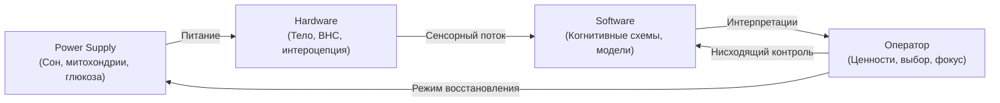

1. **Оператор (Субъект управления):** Высшая инстанция целеполагания, этической ответственности и управления вниманием. Не сводится к эмоциям или мыслям.
2. **Hardware (Аппаратный субстрат):** Биологическое тело, вегетативная нервная система, соматические датчики (интероцепция, проприоцепция), эндокринный профиль.
3. **Software (Когнитивно-программный стек):** Ментальные карты, семантические сети, когнитивные схемы Янга, языковые шаблоны, сценарии.
4. **Power Supply (Энергоблок):** Качество медленного и быстрого сна, запасы АТФ и гликогена, электролитный баланс, митохондриальная плотность.

### 2.2. Нейробиология субагентов: Как запустить внутреннего помощника
Физически нарезать мозг на сектора нельзя — он работает как единая динамическая сеть. Но с точки зрения функциональных состояний мозг веками использовал механизм расщепления потоков моделирования (в культурах это называли музой, даймонием, внутренним наставником).

**На каком «железе» это работает?**  
Эволюционный аппарат **Theory of Mind (модель психики другого человека)**: медиальная префронтальная кора, зеркальные нейроны и височно-теменной узел (TPJ). Мозг от природы натренирован симулировать чужие мысли и реакции. Направление этого симулятора внутрь собственной нейросети порождает устойчивого функционального **субагента (Sub-Agent)**.

**Алгоритм инициализации субагента:**
1. *Инициализация System Prompt:* Четкое определение роли: «Ты — мой беспристрастный инженерный советник. Ты спокоен, видишь системные искажения и не поддаешься панике».
2. *Fine-Tuning через диалог:* Человек сознательно формулирует запросы и проигрывает ответы от лица этой роли, укрепляя синаптический ансамбль.
3. *Автономизация (Сдвиг чувства авторства — Sense of Agency):* Теменная кора отключает маркер «я автор этой мысли». Скорость генерации ответа субагента превышает скорость медленного дискурсивного мышления: совет звучит в сознании неожиданно, метко и как бы со стороны.

**Научная легитимация метода:**
* **IFS-терапия (Internal Family Systems Ричарда Шварца):** Доказанный клинический метод работы с внутренними частями (Защитники, Изгнанники, Менеджеры) и активацией суверенного Self (Оператора). 🟢
* **Метод Мудрого Адвоката (Джеффри Шварц, UCLA):** Инструмент лечения ОКР через создание ментального наблюдателя, разотождествляющего личность с биохимическим сбоем в базальных ганглиях («Это не я хочу проверять замок в двадцатый раз — это баг проводки»). 🟢
* **Метод «Резиновой уточки» в software engineering:** Проговаривание сложной архитектуры внешнему объекту активирует альтернативные вычислительные контуры коры.

> [!WARNING]
> **Красные флаги техники субагентов:**
> 1. *Когнитивная цена:* Поддержание второго активного вычислительного потока сжигает драгоценную глюкозу мозга.
> 2. *Риск диссоциации:* При пограничной или психотической структуре личности барьер контроля может разрушиться, а субагент превратится во враждебный некорректируемый голос. Метод показан только психически сохранным людям.

### 2.3. Сенсорная физиология Hardware: Интероцепция и 3-контурная ВНС
Тело — главный аппаратный телеметрический комплекс.
* **Интероцепция:** Сенсорное считывание состояния висцеральных органов (сердечный ритм, напряжение диафрагмы, спазм кишечника через блуждающий нерв).
* **Поливагальная архитектура (Стивен Порджес):**
  1. *Вентральный вагус (Зеленая зона):* Социальное вовлечение, ясный ум, низкий пульс, способность слышать партнера и договариваться.
  2. *Симпатическая система (Желтая зона):* Мобилизация, бей или беги, туннельное зрение, тахикардия, восприятие нейтральных стимулов как угрозы.
  3. *Дорсальный вагус (Красная зона):* Замирание, коллапс, диссоциация, оцепенение, выключение эмоций («система ушла в safe mode»). 🟢

### 2.4. Первичные чистые чувства vs вторичный токсичный шум
* **Первичные чувства (гнев, страх, печаль, радость):** Длятся от секунд до нескольких минут. Это чистые биохимические сигналы об изменении внешнего контекста. Гнев мобилизует силы для защиты границы; страх сигнализирует о дистанции до опасности; печаль запускает переработку необратимой утраты.
* **Вторичные паразитные чувства (обида, вина, стыд, жалость к себе):** Ментальные закольцованные конструкты Software. Они не имеют адаптивной функции, длятся месяцами и годами, вызывают хронический аллостатический перегрев Hardware и служат психологическим алиби для бездействия Оператора.

### 2.5. Экспресс-калибровка за 2 минуты
В любой критической точке Оператор задает четыре сухих диагностических вопроса:
1. *Кто сейчас у руля:* Оператор или реактивный автопилот схемы?
2. *Что сообщает Hardware:* Какой пульс, где мышечный зажим, какой режим ВНС включен?
3. *Какую задачу крутит Software:* Обрабатывает ли ум твердый факт или наматывает петли катастрофизации?
4. *Каков уровень Power Supply:* Сколько часов чистого сна было за последние 48 часов и есть ли базовое топливо в батарее?

---

## Глава 3. Алфавит системной динамики: Пять примитивов и контуры

Любая организация, личность, супружеский союз или технологический кластер описываются строгим языком пяти системных примитивов Джея Форрестера:

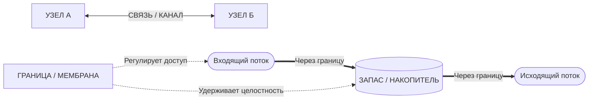

### 3.1. Пять фундаментальных примитивов
1. **Узел (Node):** Суверенный обособленный объект, обладающий собственной памятью, внутренним состоянием, емкостью и границей (человек, бизнес-единица, сервер, департамент).
2. **Запас / Накопитель (Stock):** Аккумулированный объем ресурса внутри узла. Запасы меняются медленно, обладают физической емкостью и создают системную инерцию.  
   *Примеры:* Деньги на счету, гликоген в печени, доверие в браке, уровень технического долга в кодовой базе, груз невысказанных претензий.
3. **Граница (Boundary / Perimeter):** Полупроницаемая мембрана, разделяющая внутреннее пространство узла и внешнюю среду. Граница определяет протоколы допуска, фильтрации и изоляции. Без границы узел растворяется в энтропии среды; при абсолютно непроницаемой броне узел задыхается от сенсорной депривации.
4. **Связь (Link / Channel):** Коммуникационный канал передачи информации, вещества или энергии между узлами. Характеризуется пропускной способностью (*bandwidth*), задержкой (*latency*), уровнем шума и протоколом согласования.
5. **Поток (Flow):** Скорость изменения запаса в единицу времени. Потоки бывают входящими (*Inflows*) и исходящими (*Outflows*).  
   *Примеры:* Выручка и операционные расходы, поступление калорий и их сжигание, входящие задачи и выполненные релизы, знаки признания и ядовитая критика.

### 3.2. Образ ванны Форрестера: Механика скрытых утечек
Уровень ресурса в накопителе (вода в ванне) зависит исключительно от разницы между входящим и исходящим потоками.
* Доверие в браке не испаряется внезапно от одной размолвки. Его вымывает микроскопический, но круглосуточный фоновый отток через скрытую трещину сарказма и пренебрежения.
* Ликвидность прибыльного по P&L бизнеса исчезает не от разового штрафа, а из-за хронического кассового разрыва между отсрочками дебиторки и мгновенными выплатами зарплат.
* **Правило ремонта запаса:** Бесполезно увеличивать напор входящего крана (больше работать, агрессивнее требовать любви), пока не загерметизировано сливное отверстие на дне.

### 3.3. Контуры обратной связи
* **Стабилизирующий контур (Отрицательная ОС — Negative Feedback Loop):** Возвращает систему к целевому заданному значению (термостат в комнате, гомеостаз глюкозы в крови, искреннее извинение после вспышки раздражения, автоскейлинг серверов).
* **Усиливающий контур (Положительная ОС — Positive Feedback Loop):** Раскачивает систему по экспоненте. Без внешнего предохранителя неизбежно ведет к взрыву или коллапсу (эскалация ссоры по схеме «упрек $\rightarrow$ оскорбление $\rightarrow$ крик», лавинообразный набег вкладчиков на банк, паническая атака, разгон инфляции).

---

## Глава 4. Фундаментальные законы систем и кибернетика этики

### 4.1. Семь классических системных законов
1. **Закон Принадлежности (Integrity):** Каждый легитимный элемент, вошедший в систему, имеет неотъемлемое право на признание своего места. Исключенный, забытый или вычеркнутый узел деформирует топологию всей сети: система принудит другой узел компенсировать пустоту ценой собственного ресурса. 🟢 **[Доказано]** *(Фундаментальная потребность в принадлежности Баумейстера и Лири; нейробиология боли социального исключения Айзенбергер и Либермана на фМРТ; теория структурных дыр в социальных сетях Рональда Берта).*
2. **Закон Иерархии и Порядка (Precedence):** Поток базовых ресурсов, контекста и правил течет во времени от источника к приемнику (от родителей к детям, от фаундеров к наемным менеджерам). Попытка приемника поучать, спасать или ресурсировать источник перегружает слабый канал и ломает системную цепь. 🟢 **[Доказано]** *(Клинические исследования парентификации Бозормени-Надя и Грегори Юрковича; теория стратифицированных реквизитных систем Эллиотта Жака; причинно-следственные направленные ациклические графы DAG Джуды Перла).*
3. **Закон Обмена и Баланса (Reciprocity):** Горизонтальная связь между равными устойчива только при симметричном взаимовыгодном обмене. Перекос Rx/Tx разрушает связь: отдающий накапливает пассивную ярость, берущий — токсичный стыд и бессознательное стремление сбежать (норма взаимности Гоулднера). 🟢
4. **Закон Границ (Perimeter Integrity):** Любая система должна обладать полупроницаемой мембраной. Отсутствие границ ведет к энтропийному слиянию с хаосом; абсолютная глухая стена ведет к гибели от информационного голода (Сальвадор Минухин). 🟢
5. **Закон Необходимого Разнообразия Эшби (Requisite Variety):** Внутреннее разнообразие управляющей системы должно быть не меньше разнообразия возмущений управляемой среды. Примитивное бинарное («черно-белое») мышление руководителя гарантированно терпит крах в сложной нелинейной рыночной среде. 🟢
6. **Закон Временных Задержек (Latency & Feedback Delays):** Ответный отклик среды всегда приходит с запаздыванием (Стерман, имитационная игра *Beer Game*). Хаотичное дергание рычагов управления до момента получения обратной связи неизбежно раскачивает систему до механического разрушения. 🟢
7. **Закон Эмерджентности и Закон Гудхарта:** Целое принципиально больше суммы своих частей (Герберт Саймон). Но как только частный измеримый показатель объявляется самоцелью, он немедленно теряет свойство надежной метрики (Чарльз Гудхарт). 🟢

### 4.2. Кибернетический перевод этических императивов
Древние этические заповеди — это не абстрактные религиозные догмы, а эмпирически нащупанные протоколы безаварийной маршрутизации в сверхсложных социальных сетях:
* *«Не суди, да не судим будешь»* $\rightarrow$ Запрет на перегрузку локального процессора через `loopback`-интерфейс (`127.0.0.1`). Осуждение чужого узла без знания его внутренних ограничений замыкает вычисления на себя, сжигая собственный ресурс внимания.
* *«Почитай отца и мать»* $\rightarrow$ Признание аппаратного источника входящего питания. Попытка перепрошить порт, через который ты получил жизнь, создает фатальное короткое замыкание в собственной идентичности.
* *«Покаяние» (метанойя — перемена ума)* $\rightarrow$ Принудительный сброс переполненного буфера ошибок, обнуление накопившегося градиентного дрифта (*Weight Decay*) и реконсолидация синаптических весов нейросети.
* *«Самопожертвование как грех»* $\rightarrow$ Антипаттерн несанкционированной декомпенсации: попытка спасти чужой узел ценой полного сжигания собственного ядра превращает спасателя в инвалида, а спасаемого лишает возможности обучить собственную модель выживания.

---

## Глава 5. Модель мира, Лестница Аргириса и когнитивные фильтры

### 5.1. Пять критических багов генеративной нейросети
1. **Коллапс модели (Model Collapse):** Обучение внутренних сетей на синтетических данных собственных страхов и домыслов без калибровки о твердый мир. Человек варится в эхо-камере своих интерпретаций.
2. **Катастрофическое переобучение (Overfitting):** Единичный негативный опыт масштабируется на весь универсум («Меня предал первый партнер $\rightarrow$ никому в бизнесе нельзя доверять»).
3. **Галлюцинации (Hallucinations):** Дорисовывание скрытых злых намерений за нейтральными или случайными действиями контрагента.
4. **Взлом функции награды (Reward Hacking):** Получение быстрого суррогатного дофамина (соцсети, порнография, алкоголь, пустые похвалы) в обход реального продуктивного действия в материальном мире.
5. **Технический долг психики:** Лавинообразный расход метаболической энергии на поддержание устаревших детских защитных скриптов и непрожитых обид.

### 5.2. Лестница умозаключений Криса Аргириса
Механизм, посредством которого мозг за доли секунды фабрикует персональный ад:

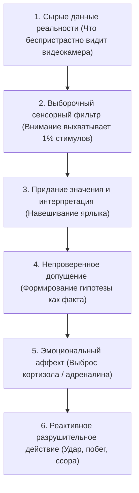

### 5.3. Инструмент «Камера против Комментатора»
Техника мгновенного спуска по лестнице Аргириса на твердую почву:
* **Протокол Видеокамеры:** Что зафиксировала бы беспристрастная оптическая матрица со звуком? («Сотрудник вошел в переговорную в 10:15 при начале встречи в 10:00 и положил отчет на стол без слов»).
* **Протокол Внутреннего Комментатора:** Что сгенерировал интерпретационный движок ума? («Он меня ни во что не ставит, саботирует проект и пытается подорвать мой авторитет перед акционерами»).
* **Правило:** Любой системный разбор в алгоритме COREX допускает использование *исключительно* протокола Видеокамеры. 🟢

---

## Глава 6. Состояния, внимание и децентрация восприятия

### 6.1. Аллостаз и цена хронической адаптации (Брюс Макьюэн)
Гомеостаз удерживает постоянство внутренней среды; аллостаз — это механизм достижения стабильности через постоянные физиологические изменения. **Аллостатическая нагрузка (Allostatic Load)** — это совокупный износ биологического Hardware под действием хронического стресса.
Низкоуровневые паразитные эмоции (вина, скрытый стыд, непроявленная агрессия) выступают как постоянное паразитное омическое сопротивление проводников: система греется вхолостую, разряжая батарею в ноль даже в состоянии полного физического покоя. 🟢

### 6.2. Модель регуляции эмоций Джеймса Гросса
Пять точек приложения системного рычага:
1. *Выбор ситуации:* Превентивный отказ от входа в высокоэнтропийные токсичные контексты.
2. *Модификация ситуации:* Изменение физических параметров среды (ввести тайминг, пригласить медиатора).
3. *Перенаправление внимания:* Сенсорное заземление, увод фокуса с мысленной жвачки на соматику дыхания.
4. *Когнитивная переоценка (Reappraisal):* Смена смыслового фрейма входящего стимула («Это не нападение на меня — это крик истощенного партнера о помощи»).
5. *Подавление экспрессии (Suppression):* Попытка «держать лицо» и проглотить аффект. Самая разрушительная стратегия, кратно взвинчивающая давление и провоцирующая инфаркты. 🟢

### 6.3. Экономика внимания и ликвидация утечек памяти
* Лимиты рабочей памяти процессора: $3–4$ информационных чанка одновременно (Нельсон Коуэн).
* **Остаток внимания (Attention Residue по Софи Лерой):** При резком переключении между сложными контекстами до 40% вычислительной мощности мозга остается застрявшей в предыдущей задаче.
* **Фоновые демоны оперативной памяти:** Незакрытые диалоги, подвешенные обязательства и скрытые конфликты пожирают стек ресурсов.  
  *Протокол дефрагментации:* Любая входящая петля должна быть немедленно: **Сделана $(<2$ мин) $\rightarrow$ Запланирована в календарь $\rightarrow$ Делегирована с фиксацией срока $\rightarrow$ Ликвидирована**. 🟢

### 6.4. Нейробиология децентрации: Перспектива третьего лица (TPJ)
Что физиологически происходит, когда человек волевым усилием представляет себя вне физического тела (например, парящим над ситуацией или смотрящим на себя из угла комнаты)?
1. **Сенсорный сдвиг в височно-теменном узле (TPJ):** TPJ работает как внутренний GPS сознания. Волевая смена перспективы («вид от 3-го лица» — *3rd-person perspective*) ломает автоматическую эмоциональную реактивность.
2. **Переключение вегетативного тонуса:** Мозг перестает считывать текущие стрессовые стимулы как прямую угрозу биологическому выживанию здесь и сейчас. Амигдала снижает активность, падает уровень кортизола, расслабляется диафрагма.
3. **Когнитивное разотождествление (Cognitive Defusion):** Активируется дефолт-система мозга (DMN) в креативном режиме: открывается доступ к нестандартным решениям, невидимым из туннеля паники. 🟢

### 6.5. Четыре слоя восприятия реальности
При анализе любого инцидента Оператор разделяет входящий поток на 4 изолированных слоя:
* **ФАКТ:** Твердые данные видеокамеры (слова, цифры, таймстампы).
* **СВИДЕТЕЛЬСТВО:** Физиологический отклик Hardware (сжатие в горле, учащение пульса, холод в руках).
* **МОДЕЛЬ:** Интерпретация Software (предположение о мотивах, логическая схема ситуации).
* **ГИПОТЕЗА:** Проверяемое действие для калибровки модели в твердой реальности.

---

## Глава 7. Человек, ИИ и распределённый интеллект (Swarm Intelligence)

### 7.1. Симбиоз углерода и кремния
В эпоху искусственного интеллекта ценность механического запоминания и вычислений упала до нуля.
* **Машине делегируются:** Перебор вариантов, быстрый поиск аномалий в данных, рутинный синтез больших объемов информации, первичное драфтирование текстов и кода.
* **За Человеком-Оператором остаются:** Смыслополагание, ценностный выбор, этическая ответственность, способность чувствовать боль другого узла (эмпатия), мужество совершить необратимый поступок в условиях неполноты информации.
* **Правило трех проверок:** Любой синтетический вывод ИИ верифицируется: (1) сверкой с первоисточником данных, (2) проверкой на системную непротиворечивость и (3) соматическим откликом живого опыта в Hardware.

### 7.2. Человечество как Swarm Intelligence: Мы — краевые ноды
Представьте человечество как единый планетарный распределенный суперкомпьютер, а каждого отдельного человека — как краевое вычислительное устройство (**Edge Node**).
* 8 миллиардов узлов запущены в уникальных средах с уникальным исходным кодом (генетикой) и уникальным жизненным контекстом.
* Задача каждого отдельного узла — исследовать свой конкретный сектор пространства бытия, собирать сырой опыт, совершать ошибки, находить эффективные паттерны адаптации и возвращать очищенные веса обратно в общий планетарный датасет (культуру, технологии, науку, этику).

### 7.3. Смысл обучения модели: Дистилляция весов и качество инференса
Если биологический сервер неизбежно прекратит существование, в чем объективный смысл его тренировать?
1. **Качество инференса прямо сейчас:** Жизнь модели — это не ожидание Страшного Суда, а текущий вычислительный процесс (*Inference*). Недообученная, замусоренная модель проживает свои 70 лет в аду тревоги, галлюцинаций, паники и психосоматических болей. Обученная модель выдает чистоту присутствия, переживает восторг познания, глубину близости и радость созидания.
2. **Дистилляция знаний (Knowledge Distillation):** В машинном обучении веса гигантской модели-учителя передаются компактной модели-ученику. Когда вы воспитываете ребенка, передаете мастерство сотруднику, строите честный бизнес или пишете книгу — вы буквально прошиваете синапсы других узлов сети. Биологический процессор Сократа истлел тысячи лет назад, но его алгоритмы мышления крутятся на миллионах серверов человечества прямо сейчас.
3. **Парадокс музыки Алана Уотса:** Смысл исполнения симфонии — не в том, чтобы как можно скорее добежать до финального аккорда (иначе лучшим дирижером был бы тот, кто сыграет всё за 10 секунд). Смысл музыки — в самом танце, пока она звучит.

### 7.4. Смысл как высшая когнитивная функция: Оптимистический нигилизм
С точки зрения строгой физики и термодинамики во Вселенной нет заранее заготовленного смысла жизни. Вы не можете поймать смысл телескопом или взвесить на весах.
* **Нейробиологический конструкт:** Чувство смысла — это когнитивное состояние нейросети, при котором синтезируются дофамин, серотонин и окситоцин, когда мозг фиксирует устойчивую связь между:
  1. Тем, что я делаю прямо сейчас;
  2. Измеримым долгосрочным результатом в будущем;
  3. Объективной полезностью этого действия для выживания моей стаи (социума).
* **Свобода System Prompt:** Если Вселенная не зашила в вас предопределенный сценарий, вы абсолютно свободны прописать свой главный системный промпт самостоятельно:
  * *Смысл Исследователя:* Быть органом познания Космоса.
  * *Смысл Созидателя:* Превращать окружающий энтропийный хаос в кристальный функциональный порядок (код, архитектуру, компанию, уютный дом).
  * *Смысл Целителя:* Снижать уровень боли и страдания в доступном радиусе действия.

---

# ЧАСТЬ I (ПРОДОЛЖЕНИЕ). КАРТА УЗЛА: КРУГ ИЗ 16 СФЕР И ВЕРТИКАЛЬ ЭТАЖЕЙ

---

## Глава 8. Онтология Круга 16 сфер: Контуры и Такты

### 8.1. Почему 16 сфер: Замыкание контура обратной связи
Прежние модели самоорганизации описывали систему линейно: Вход $\rightarrow$ Процесс $\rightarrow$ Выход. Но система, которая только берет ресурсы, перерабатывает их и выбрасывает во внешнюю среду, принципиально неспособна к самообучению. Её контур разомкнут. При малейшем изменении внешней среды такая система слепнет и гибнет.

Чтобы система стала жизнеспособной и саморегулирующейся, необходим **Четвертый такт — Поправка** (замер ошибки предсказания, списание накопившегося долга, аудит потерь, адаптация интерфейсов). Это фундаментальный принцип циклов Деминга (PDCA: *Plan-Do-Check-Act*) и Джона Бойда (OODA: *Observe-Orient-Decide-Act*).

Матрица Круга 16 сфер образуется пересечением **4 Базовых Контуров** (горизонтальные строки вещества системы) и **4 Универсальных Тактов** (вертикальные столбцы фаз движения):

$$\mathbf{4~Контура} \times \mathbf{4~Такта} = \mathbf{16~Функциональных~Сфер}$$

```mermaid
graph TD
    subgraph Matrix["МАТРИЦА 4x4: СФЕРЫ КРУГА"]
        direction TB
        subgraph C1["I. ОСНОВА (Тело, деньги, прочность)"]
            S1["1. Учёт<br/>(Вход)"] --- S2["2. Тыл<br/>(Ход)"] --- S3["3. Масштаб<br/>(Выход)"] --- S4["4. Запас прочности<br/>(Поправка)"]
        end
        subgraph C2["II. МАСТЕРСТВО (Ум, процессы, результат)"]
            S5["5. Знания<br/>(Вход)"] --- S6["6. Порядок<br/>(Ход)"] --- S7["7. Продукт<br/>(Выход)"] --- S8["8. Очистка<br/>(Поправка)"]
        end
        subgraph C3["III. КОНТАКТ (Люди, союзы, сеть)"]
            S9["9. Образ<br/>(Вход)"] --- S10["10. Союз<br/>(Ход)"] --- S11["11. Среда<br/>(Выход)"] --- S12["12. Шлюз<br/>(Поправка)"]
        end
        subgraph C4["IV. КУРС (Воля, ценности, видение)"]
            S13["13. Страсть<br/>(Вход)"] --- S14["14. Вклад<br/>(Ход)"] --- S15["15. Смысл<br/>(Выход)"] --- S16["16. Наблюдатель<br/>(Поправка)"]
        end
    end
```

### 8.2. Четыре Такта цикла (Столбцы матрицы)
1. **Такт 1. Вход (Input):** Что поступает в систему из внешней среды (сенсорные данные, энергия, калории, базовые потребности, входящий интерес).
2. **Такт 2. Ход (Process):** Как система обрабатывает и структурирует полученное внутри своего контура (правила, привычки, внутренние альянсы, операционные регламенты).
3. **Такт 3. Выход (Output):** Что система манифестирует и отдает наружу в физический мир (капитал, готовый продукт, социальное влияние, ценностное служение).
4. **Такт 4. Поправка (Feedback & Correction):** Как система проверяет себя на ошибки, сбрасывает перегрузку, очищает фильтры и обновляет карту мира.

### 8.3. Полная функциональная спецификация 16 сфер

| Контур | № | Сфера | Проявление в Человеке | Функция в Деле (Бизнесе) | Критерий системной нормы |
|---|---|---|---|---|---|
| **I. ОСНОВА** | **1** | **Учёт** | Точный замер: сон, калории, вес, личные расходы | P&L, Cash Flow, юнит-экономика, когортный анализ | Цифры сходятся с фактом, иллюзий и кассовой слепоты нет |
| *(Материя,* | **2** | **Тыл** | Безопасная база: свое жилье, финподушка на 6 мес., здоровье | Юридическая броня, резервный фонд, бэкапы, дублирование серверов | Фоновое чувство защищенности без параноидальной паники |
| *деньги,* | **3** | **Масштаб** | Личный вес в социуме: доход, свобода маневра, территория | Выручка компании, доля рынка, инфраструктурная экспансия | Рост опирается на твердый тыл, а не на заемный блеф |
| *прочность)* | **4** | **Запас прочности** | Аварийный режим *Degraded Mode*, умение держать удар судьбы | План непрерывности бизнеса (BCP), отсутствие единых точек отказа (SPOF) | Система гнется под ураганом кризиса, но не дает трещин |
| **II. МАСТЕРСТВО** | **5** | **Знания** | Обучение, актуализация картины мира, профессиональный R&D | Рыночная аналитика, продуктовый R&D, обучение команды | Веса модели непрерывно дообучаются на свежих данных рынка |
| *(Разум,* | **6** | **Порядок** | Самодисциплина: режим дня, лимиты задач (WIP), фокус | Регламенты, трекер задач, прозрачный SLA процессов | Спокойная ритмичная работа конвейера без подвигов и авралов |
| *процессы,* | **7** | **Продукт** | Мастерство: отчуждаемый качественный результат труда | Ядро ценности бизнеса, решающее острую боль клиента | Твердый воспроизводимый результат, за который гордятся |
| *результат)* | **8** | **Очистка** | Ликвидация обид, незакрытых петель, токсичных связей | Рефакторинг техдолга, закрытие убыточных направлений, аудит регламентов | Отсутствие исторического мусора и неликвидного балласта |
| **III. КОНТАКТ** | **9** | **Образ** | Аутентичная идентичность без масок и дешевого понта | Бренд компании, позиционирование: слова строго равны делам | Снаружи транслируется ровно то, что находится внутри |
| *(Отношения,* | **10**| **Союз** | Брак, близость на равных, крепкая дружба без созависимости | Партнерство сооснователей, стратегические альянсы с паритетом | Баланс обмена, высокий уровень психологической безопасности |
| *люди,* | **11**| **Среда** | Своя стая: развивающее окружение, клубы единомышленников | Лояльное комьюнити клиентов, сеть отраслевых амбассадоров | Среда питает ресурсом и открывает скрытые двери |
| *партнерство)* | **12**| **Шлюз** | Способность слышать и договариваться с непохожими (в т.ч. с ИИ) | Междепартаментские интерфейсы, API интеграции, кросс-функциональные хабы | Сигнал проходит между разными культурами без искажений |
| **IV. КУРС** | **13**| **Страсть** | Витальный огонь: здоровый аппетит к жизни, азарт, смелость | Маркетинг, смелая экспансия, агрессивное тестирование рискованных гипотез | Высокий тонус, дерзость при опоре на фундамент |
| *(Воля,* | **14**| **Вклад** | Деятельная забота, менторство, щедрость без истощения | Превосходящий ожидания клиентский сервис, высокий LTV | Близкие расцветают, клиенты искренне благодарят |
| *смысл,* | **15**| **Смысл** | Ответ на вопрос «Зачем?»: служение тому, что больше меня | Миссия компании, стратегия на 5–10 лет, неразменные ценности | Длинный горизонт планирования, устойчивость к штормам |
| *наблюдатель)* | **16**| **Наблюдатель**| Чистое присутствие Оператора: различение факта и домысла | Беспристрастный совет директоров, объективный дашборд, *Blameless Post-Mortem* | Ошибки признаются за минуты без поиска виноватых |

### 8.4. Прямоугольники: Контуры и Такты (Смена геометрии с треугольников на прямоугольники)

В прежней 12-сферной модели течения образовывали незамкнутые треугольники из трех сфер (например, Дар: 1–5–9, Капитал: 2–6–10), описывавшие движение *Вход $\rightarrow$ Ход $\rightarrow$ Выход*. В Круге из 16 сфер произошел качественный фазовый переход: **треугольники замкнулись в устойчивые четвёрки — Прямоугольники**.

Теперь у топографической карты два набора ортогональных прямоугольников:
1. **Контур (Горизонтальный прямоугольник — строка):** Четыре сферы одного базового вещества системы (Основа, Мастерство, Контакт, Курс).
   * *Закон слабого звена (Голдратт):* Контур держится по своей слабейшей сфере. Она выступает бутылочным горлышком и лимитирует проводимость остальных трех сфер строки.
2. **Такт (Вертикальный прямоугольник — столбец):** Четыре сферы единой фазы жизненного цикла:

| Прямоугольник Такта | Входящие в него сферы | Что диагностирует в системе |
|---|---|---|
| **Такт 1: Вход** | 1 Учёт, 5 Знания, 9 Образ, 13 Страсть | Чем питается система, откуда берет энергию и чего хочет |
| **Такт 2: Ход** | 2 Тыл, 6 Порядок, 10 Союз, 14 Вклад | Как система оперирует ресурсами, организует процессы и с кем кооперируется |
| **Такт 3: Выход** | 3 Масштаб, 7 Продукт, 11 Среда, 15 Смысл | Что осязаемое система манифестирует и отдает во внешний мир |
| **Такт 4: Поправка** | 4 Запас прочности, 8 Очистка, 12 Шлюз, 16 Наблюдатель | Как система сверяется с реальностью, сбрасывает балласт и чинит себя |

> **Диагностический закон Прямоугольников:**  
> **Если вертикальный прямоугольник «Поправка» заметно слабее трех остальных тактов, система хорошо бегает и много производит, но органически не способна учиться: она раз за разом повторяет фатальные ошибки и неизбежно гибнет под весом накопившегося технического долга.** 🟡

---

## Глава 9. Перекрёстки и три маршрута Круга (Генезис, Ремонт, Пульс)

### 9.1. Архитектура перекрёстков: Тепловая карта системы
Каждая сфера в матрице — это не изолированный «кружок», а строгий функциональный перекрёсток определенного вещества (Контура) и определенной фазы цикла (Такта):
* Сфера **1 (Учёт)** = Контур Основа $\times$ Такт Вход (входная инвентаризация материи).
* Сфера **7 (Продукт)** = Контур Мастерство $\times$ Такт Выход (материализованный результат интеллектуального процесса).
* Сфера **12 (Шлюз)** = Контур Контакт $\times$ Такт Поправка (протокол исправления ошибок межсистемной коммуникации).
* Сфера **16 (Наблюдатель)** = Контур Курс $\times$ Такт Поправка (высшая петля обратной связи всей метасистемы).

**Снятие тепловой карты:**  
Каждая из 16 клеток оценивается по двум объективным параметрам:
1. *Состояние функции ($0–10$):* где 0 — функция парализована или отсутствует, 10 — эталонная автономная работа.
2. *Расход ресурсов (PRP):* сколько часов времени, денег и фокусного внимания ушло в эту клетку за последние 7 дней.

> **Диагностические аномалии:**
> * *Черная дыра:* Огромный расход ресурса при оценке сферы ниже 4 баллов (хронический слив ресурса в неработающую механику).
> * *Дистрофия ядра:* Оценка сферы ниже 3 баллов при нулевом расходе ресурса (функция атрофирована, создает системный риск).

### 9.2. Три маршрута Круга: Генезис, Инженерный Ремонт и Операционный Пульс

Критическая ошибка наивного системного анализа — путать **как система рождается (Генезис)**, **как система дышит каждый день (Операционный пульс)** и **как упавшая взрослая система восстанавливается после катастрофы (Инженерный ремонт)**. 

В Круге из 16 сфер заложены три принципиально разных топологических маршрута.

---

#### МАРШРУТ А. УНИВЕРСАЛЬНЫЙ ГЕНЕЗИС: От витальной искры к мета-системе
*(Единый инвариантный морфогенез Человека и Организации)*

В кибернетике нет «отдельно законов для биологии» и «отдельно законов для бизнеса». Развитие любой сложной адаптирующейся системы (человека, технологического стартапа, биологического организма или цивилизации) подчиняется **единому универсальному алгоритму морфогенеза**.

Ни одна живая система не начинает жизнь с бухгалтерского учета. **Генезис всегда разворачивается от энергетической искры к кристаллизации структуры.** 

Все 16 сфер Круга активируются строго в четыре универсальные эпохи — ровно по 4 сферы в каждой эпохе ($4 \times 4 = 16$):

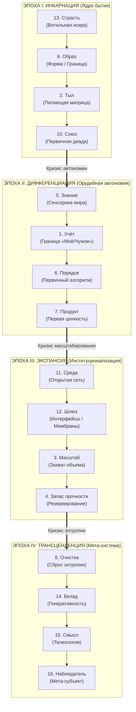

---

##### Матрица универсального изоморфизма Генезиса

| Эпоха Генезиса | Кибернетическая формула | Активируемый квартет сфер | Проекция на Человека (Онтогенез психики и тела) | Проекция на Бизнес (Жизненный цикл дела) | Системный кризис фазового перехода |
|---|---|---|---|---|---|
| **ЭПОХА I**<br/>**Инкарнация**<br/>*(Зарождение ядра)* | Выделение прото-узла из хаоса среды: зажигание энергетического градиента, первичная мембрана, питающий ресурс и симбиотический контур. | **13. Страсть**<br/>$\downarrow$<br/>**9. Образ**<br/>$\downarrow$<br/>**2. Тыл**<br/>$\downarrow$<br/>**10. Союз** | **13 (Страсть):** Витальный крик жизни, безусловный сосательный рефлекс, аффекты выживания по Панксеппу.<br/>**9 (Образ):** Телесное воплощение «Я есть», соматосенсорная кора, зеркало матери.<br/>**2 (Тыл):** Материнское лоно, холдинг (Винникотт), безопасная привязанность (Боулби).<br/>**10 (Союз):** Первичная диада «Мать–Младенец». | **13 (Страсть):** Одержимость фаундера проблемой, визионерский огонь, готовность рисковать.<br/>**9 (Образ):** Первичное имя, прототип бренда, юрлицо, концепт «Кто мы такие».<br/>**2 (Тыл):** Материнский пре-сид капитал, инкубатор, колыбель, закрывающая базовые расходы.<br/>**10 (Союз):** Первичный тандем сооснователей («Хакер + Хастлер»). | **Кризис жизнеспособности** *(Синдром выкидыша):* если Тыл или Союз пробиты, система погибает до обретения устойчивой формы. |
| **ЭПОХА II**<br/>**Дифференциация**<br/>*(Орудийная автономия)* | Разрыв первичного симбиоза: сенсорная калибровка физических законов, появление внутренних суверенных границ, ритмов и первого отчуждаемого результата. | **5. Знания**<br/>$\downarrow$<br/>**1. Учёт**<br/>$\downarrow$<br/>**6. Порядок**<br/>$\downarrow$<br/>**7. Продукт** | **5 (Знания):** Сенсомоторное познание мира по Пиаже (гравитация, пространство, свойства предметов).<br/>**1 (Учёт):** Кризис «Я сам!», разделение «моё / не моё», контроль тела (анальная стадия).<br/>**6 (Порядок):** Режим сна и кормления, первые социальные нормы и бытовые привычки семьи.<br/>**7 (Продукт):** Первые отчуждаемые поделки, рисунки, освоение связной речи и письма. | **5 (Знания):** CustDev, полевой сбор данных о клиенте, продуктовая аналитика рынка.<br/>**1 (Учёт):** Разделение кармана фаундера и компании, первый P&L, юнит-экономика.<br/>**6 (Порядок):** Первые спринты, роли в команде, прозрачное расписание релизов.<br/>**7 (Продукт):** Работающий MVP, создающий твердую ценность, за которую клиент платит деньги. | **Кризис кустарщины** *(Ловушка слияния):* неспособность отделиться от матери / фаундера; невозможность производить результат без личного подвига. |
| **ЭПОХА III**<br/>**Экспансия**<br/>*(Институционализация)* | Выход из закрытого кокона в открытую конкурентную среду: построение адаптивных защитных мембран, кратный рост объема и резервирование прочности. | **11. Среда**<br/>$\downarrow$<br/>**12. Шлюз**<br/>$\downarrow$<br/>**3. Масштаб**<br/>$\downarrow$<br/>**4. Запас прочности** | **11 (Среда):** Выход во двор, школу, социализацию в референтной группе сверстников.<br/>**12 (Шлюз):** Умение говорить «нет», защита личных границ, освоение чужих культурных кодов.<br/>**3 (Масштаб):** Профессиональный и финансовый рост, увеличение суверенной территории жизни.<br/>**4 (Запас прочности):** Формирование личной финансовой подушки, стрессоустойчивость тела к перегрузкам. | **11 (Среда):** Выход на открытый рынок, интеграция в отраслевой нетворк и комьюнити клиентов.<br/>**12 (Шлюз):** Публичные API, SLA, юридические договоры, протоколы информационной безопасности.<br/>**3 (Масштаб):** Масштабирование дистрибуции, рост выручки, захват доли рынка.<br/>**4 (Запас прочности):** 18 месяцев runway, дублирование инфраструктуры, регламенты непрерывности (BCP). | **Кризис масштабирования** *(Долина смерти):* система ломается под нагрузкой из-за отсутствия запаса прочности или погибает от кассового разрыва. |
| **ЭПОХА IV**<br/>**Трансценденция**<br/>*(Мета-система и Наследие)* | Санация накопленной энтропии, переход от жадного удержания к щедрой отдаче, долгосрочная телеология и надсистемная рефлексия. | **8. Очистка**<br/>$\downarrow$<br/>**14. Вклад**<br/>$\downarrow$<br/>**15. Смысл**<br/>$\downarrow$<br/>**16. Наблюдатель** | **8 (Очистка):** Сброс родительских интроектов, прощение старых обид, отказ от деструктивных зависимостей.<br/>**14 (Вклад):** Генеративность по Эриксону: родительство, менторство, передача огня молодежи.<br/>**15 (Смысл):** Экзистенциальный ответ на вопрос «Зачем?», служение ценностям, переживающим тело.<br/>**16 (Наблюдатель):** Эго-интеграция, мудрость, позиция чистого разотождествленного свидетеля. | **8 (Очистка):** Тотальный рефакторинг техдолга, закрытие токсичных проектов, увольнение балласта.<br/>**14 (Вклад):** Превосходящий сервис, выращивание лидеров внутри компании, инвестиции в отрасль.<br/>**15 (Смысл):** Формулирование 50-летней миссии, меняющей индустрию и культурный контекст.<br/>**16 (Наблюдатель):** Выход фаундера из операционки, Совет директоров, институт независимого контроля. | **Кризис энтропии и застоя** *(Смерть смысла):* накопление неликвидного багажа, старческий маразм / бюрократический склероз, неспособность передать наследие. |

---

#### МАРШРУТ Б. ИНЖЕНЕРНЫЙ АУДИТ И РЕМОНТ: $1 \rightarrow 16$ (Как спасают зрелую аварийную систему)

Когда к нам приходит **35-летний выгоревший предприниматель** или **компания в предбанкротном состоянии**, маршрут Генезиса для них смертельно опасен!

> **Главный закон антикризисного ремонта:**  
> **Когда несущие балки трещат, а в трюме вода — категорически запрещено начинать с поиска «Страсти», «Смысла» или «Прокачки личного бренда».**  
> Попытка выгоревшего фаундера с кассовым разрывом в 10 миллионов «искать новое предназначение на ретрите» (Сфера 15) или «вдохновлять команду харизмой» (Сфера 13) — это управленческая шизофрения и бегство от реальности. 🔴

Ремонт аварийной системы идет строго по слоям физической зависимости — **снизу вверх (Bottom-Up Troubleshooting по архитектурному стеку $1 \rightarrow 16$):**

```mermaid
flowchart LR
    subgraph P1["ФАЗА I: БАЗИСНЫЙ РЕМОНТ (ОСНОВА)"]
        1["1. Учёт<br/>(Замер факта)"] --> 2["2. Тыл<br/>(Остановка кровопотери)"] --> 3["3. Масштаб<br/>(Срезка лишнего)"] --> 4["4. Запас прочности<br/>(Degraded Mode)"]
    end
    subgraph P2["ФАЗА II: ОПЕРАЦИОННЫЙ РЕМОНТ (МАСТЕРСТВО)"]
        5["5. Знания<br/>(Аудит сбоя)"] --> 6["6. Порядок<br/>(WIP-лимиты)"] --> 7["7. Продукт<br/>(Починка ядра)"] --> 8["8. Очистка<br/>(Сброс техдолга)"]
    end
    subgraph P3["ФАЗА III: СОЦИАЛЬНЫЙ РЕМОНТ (КОНТАКТ)"]
        9["9. Образ<br/>(Снятие фасада)"] --> 10["10. Союз<br/>(Передоговорка)"] --> 11["11. Среда<br/>(Санация связей)"] --> 12["12. Шлюз<br/>(Фильтры доступа)"]
    end
    subgraph P4["ФАЗА IV: СТРАТЕГИЧЕСКИЙ РЕМОНТ (КУРС)"]
        13["13. Страсть<br/>(Возврат огня)"] --> 14["14. Вклад<br/>(Щедрый сервис)"] --> 15["15. Смысл<br/>(Длинный горизонт)"] --> 16["16. Наблюдатель<br/>(Мета-контроль)"]
    end

    4 --> 5
    8 --> 9
    12 --> 13
    16 ==>|Замыкание петли обучения| 1
```

* **ФАЗА I. Остановка системного кровотечения (Сферы 1 $\rightarrow$ 4):**
  * **Шаг 1. Учёт:** Замер твердого факта: сколько реально денег на счетах? сколько часов сна? каков уровень кортизола? Снятие кассовой и соматической слепоты.
  * **Шаг 2. Тыл:** Закрытие критических утечек. Принудительный сон, восстановление 3-месячной подушки ликвидности. Психика переводится из панического бегства в режим стабильности.
  * **Шаг 3. Масштаб:** Срезание заемных амбиций, заморозка неприоритетных проектов. Ограничение экспансии до контура, который реально защищен Тылом.
  * **Шаг 4. Запас прочности:** Перевод системы в режим управляемой деградации (*Degraded Mode*). Фундамент защищен, угроза немедленной гибели снята.

* **ФАЗА II. Восстановление операционного конвейера (Сферы 5 $\rightarrow$ 8):**
  * **Шаг 5. Знания:** Загрузка честных данных об ошибках и поломках. Очистка моделей от устаревших догм.
  * **Шаг 6. Порядок:** Введение жестких лимитов незавершенной работы (WIP limits), регламентов и суточного ритма.
  * **Шаг 7. Продукт:** Починка ядра потребительской ценности: отказ от брака, фокусировка на 20% функционала, приносящего 80% пользы.
  * **Шаг 8. Очистка:** Тотальная санация технического и организационного долга: удаление мертвых скриптов, закрытие зависших обязательств, увольнение паразитических звеньев. Цех заработал чисто.

* **ФАЗА III. Пересборка интерфейсов и партнерств (Сферы 9 $\rightarrow$ 12):**
  * **Шаг 9. Образ:** Снятие ложного фасада и синдрома самозванца: признание своих реальных текущих возможностей перед рынком и близкими.
  * **Шаг 10. Союз:** Взрослый перезапуск контрактов: передоговорка с супругом или сооснователями на основе паритета вкладов.
  * **Шаг 11. Среда:** Аудит окружения: выход из токсичных группировок, интеграция в поддерживающую профессиональную стаю.
  * **Шаг 12. Шлюз:** Настройка полупроницаемых мембран: протоколы отказа («нет»), фильтры входящей информации и коммуникаций с чужими системами.

* **ФАЗА IV. Перезапуск стратегического полета (Сферы 13 $\rightarrow$ 16):**
  * **Шаг 13. Страсть:** И только теперь, когда тыл прикрыт, конвейер работает, а партнерство устойчиво, безопасно раздувать витальный огонь, идти на смелый риск и эксперименты!
  * **Шаг 14. Вклад:** Переход от жадного удержания ресурса к щедрому клиентскому сервису и наставничеству.
  * **Шаг 15. Смысл:** Формулирование 10-летней миссии: ради чего большего эта система функционирует в мире?
  * **Шаг 16. Наблюдатель:** Выход Оператора в устойчивую метапозицию: беспристрастное считывание телеметрии со всех 16 сфер без эмоционального залипания.

---

#### МАРШРУТ В. ОПЕРАЦИОННЫЙ ПУЛЬС: Синхронное дыхание 4 Тактов (Как живет здоровая система)

Зрелая стабильная система не бродит годами по цепочке $1 \rightarrow 16$. В повседневной жизни она циклически пульсирует по вертикальным **Тактам (столбцам матрицы)** каждую неделю, месяц или спринт:

$$\begin{array}{ccccccc}
\mathbf{Такт~1:~ВХОД} & \longrightarrow & \mathbf{Такт~2:~ХОД} & \longrightarrow & \mathbf{Такт~3:~ВЫХОД} & \longrightarrow & \mathbf{Такт~4:~ПОПРАВКА} \\
\begin{pmatrix} \text{Учёт (1)} \\ \text{Знания (5)} \\ \text{Образ (9)} \\ \text{Страсть (13)} \end{pmatrix} & &
\begin{pmatrix} \text{Тыл (2)} \\ \text{Порядок (6)} \\ \text{Союз (10)} \\ \text{Вклад (14)} \end{pmatrix} & &
\begin{pmatrix} \text{Масштаб (3)} \\ \text{Продукт (7)} \\ \text{Среда (11)} \\ \text{Смысл (15)} \end{pmatrix} & &
\begin{pmatrix} \text{Запас прочности (4)} \\ \text{Очистка (8)} \\ \text{Шлюз (12)} \\ \text{Наблюдатель (16)} \end{pmatrix}
\end{array}$$

1. **Вход:** Система единовременно принимает сырье: ресурсы тела/денег (Учёт 1), рыночные данные (Знания 5), импульс идентичности (Образ 9) и витальный азарт (Страсть 13).
2. **Ход:** Система пропускает сырье через структуру: сверяет с безопасностью (Тыл 2), прогоняет по процессам (Порядок 6), координирует в команде/паре (Союз 10) и вкладывает заботу (Вклад 14).
3. **Выход:** Система манифестирует результат во внешний мир: захватывает долю рынка (Масштаб 3), отдает готовое изделие (Продукт 7), усиливает влияние на окружение (Среда 11) и утверждает свои ценности (Смысл 15).
4. **Поправка:** Система снимает отклонение и чистит себя: проверяет резервы (Запас прочности 4), срезает баги и долги (Очистка 8), калибрует протоколы связи (Шлюз 12) и проводит беспристрастную ретроспективу глазами Наблюдателя (16), передавая дельту обратно на Вход!

---

## Глава 10. Геометрия Круга: 8 осей Качелей и Правило заклинивания

Сферы, расположенные в матрице на противоположных полюсах (номер $N$ и номер $N+8$), образуют **8 фундаментальных динамических осей полярности (Качелей)**:

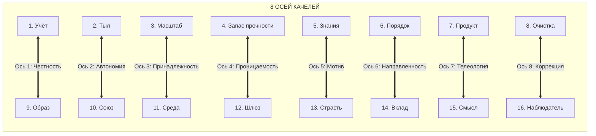

### 10.1. Спецификация 8 осей и симптомы перекосов

| Ось | Полюса качелей | Что уравновешивается | Системный перекос при дисбалансе |
|---|---|---|---|
| **1** | **1 Учёт $\leftrightarrow$ 9 Образ** | Твердый внутренний факт и внешняя манифестация | *Перекос в 9:* Жизнь не по средствам, фасадный блеф, стыд. *Перекос в 1:* Скупость, синдром невидимки, страх заявить о себе. |
| **2** | **2 Тыл $\leftrightarrow$ 10 Союз** | Личная суверенная база и межличностная близость | *Перекос в 10:* Созависимость, растворение в партнере из страха нищеты. *Перекос в 2:* Параноидальная изоляция, неспособность доверять. |
| **3** | **3 Масштаб $\leftrightarrow$ 11 Среда** | Личный статус/экспансия и опора на стаю | *Перекос в 3:* Одинокий тиран на вершине, оторванный от людей. *Перекос в 11:* Конформизм, растворение личных амбиций в тусовке. |
| **4** | **4 Запас прочности $\leftrightarrow$ 12 Шлюз** | Броня безопасности и открытость мостов вовне | *Перекос в 4:* Замурованная крепость, умирающая от голода. *Перекос в 12:* Проходной двор без охраны, взлом периметра. |
| **5** | **5 Знания $\leftrightarrow$ 13 Страсть** | Холодный рацио-анализ и витальный риск | *Перекос в 5:* Горе от ума, паралич анализа, вечный студент. *Перекос в 13:* Слепое безрассудство, лудомания, слив ресурсов. |
| **6** | **6 Порядок $\leftrightarrow$ 14 Вклад** | Внутренняя дисциплина и щедрая отдача вовне | *Перекос в 6:* Бюрократия ради регламентов, сухой педантизм. *Перекос в 14:* Самоотверженное спасательство ценой собственного истощения. |
| **7** | **7 Продукт $\leftrightarrow$ 15 Смысл** | Локальное мастерство дела и высшая миссия | *Перекос в 7:* Идеально отполированный продукт, никому не нужный на рынке. *Перекос в 15:* Пафосные лозунги о спасении мира без работающего кода. |
| **8** | **8 Очистка $\leftrightarrow$ 16 Наблюдатель** | Списание балласта и беспристрастная фиксация | *Перекос в 8:* Слепые хаотичные чистки без понимания архитектуры. *Перекос в 16:* Пассивное созерцание катастрофы без вырезания опухолей. |

### 10.2. Правило заклинивших качелей
Если разница в оценках двух противоположных сфер превышает 3 балла ($|S_n - S_{n+8}| > 3$), **ось намертво заклинивает**.  
Попытка давить на слабую сферу напрямую лишь усиливает спазм системы (например, заставлять себя наводить Порядок при полном отсутствии Смысла или заставлять строить счастливый Союз при нулевом Тыле).

> **Принцип рычага Донеллы Медоуз:**  
> **Ремонт слабой сферы ВСЕГДА начинается с противоположного конца качелей!**  
> * Если разрушен Союз (сфера 10) — прекратите выяснять отношения. Идите чинить личный Тыл (сфера 2): восстановите сон, личные деньги и физическую автономию.
> * Если бизнес буксует в Продукте (сфера 7) — поднимитесь в Смысл (сфера 15): какую реальную боль мира мы решаем и ради чего существуем?
> * Если замучила прокрастинация в Порядке (сфера 6) — посмотрите во Вклад (сфера 14): кому прямо сейчас конкретно станет легче от плодов вашего труда? 🟡

---

## Глава 11. Вертикаль зрелости: Пять этажей L1–L5

В то время как Круг из 16 сфер задает **горизонтальную топологию** (какая функция повреждена), вертикаль этажей отвечает на вопрос: **на каком уровне сложности находится узел?**

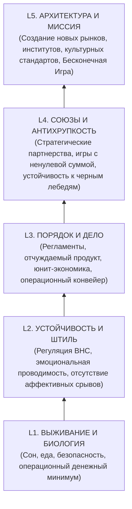

### 11.1. Спецификация этажей L1–L5

* **Этаж L1. Биологический фундамент и выживание:** Базовый физиологический гомеостаз скафандра: не менее 7 часов сна, баланс электролитов, отсутствие непосредственной физической угрозы, базовый денежный поток на покрытие еды и жилья.  
  *Ловушка:* Застрять в бесконечной борьбе за кусок хлеба, превратив жизнь в обслуживание страха нищеты.
* **Этаж L2. Эмоциональная проводимость и штиль:** Способность удерживать нервную систему в вентровагальной зоне, отсутствие реактивных аффективных срывов, навык соматического заземления.  
  *Ловушка:* «Духовный байпас» — уход в медитации и практики от реальных вызовов материального мира.
* **Этаж L3. Операционный порядок и отчуждаемое дело:** Построение воспроизводимых процессов, регламентов, делегирование, создание продукта, независимого от ежеминутного присутствия создателя.  
  *Ловушка:* Микроменеджмент, попытка контролировать каждый шаг подчиненных, страх вырастить сильных лидеров.
* **Этаж L4. Союзы и антихрупкость:** Повторяющиеся игры с ненулевой суммой (Роберт Аксельрод), синергетические партнерства, превращение внешних ударов рынка в источник роста (Нассим Талеб).  
  *Ловушка:* Циничный оппортунизм, предательство базовых ценностей ради сиюминутной выгоды масштабного союза.
* **Этаж L5. Архитектура поля и Бесконечная игра:** Создание новых экосистем, индустриальных стандартов, смысловых пространств. Переход к Бесконечной Игре Джеймса Карса, цель которой — не победить соперника, а продолжать саму игру.

### 11.2. Два фундаментальных правила вертикали
1. **Правило этажа ниже:** Причина поломки на этаже $N$ почти всегда коренится в дыре на этаже $N-1$.  
   *Кейс:* Невозможность договориться с партнером по бизнесу на уровне L4 при 4 часах сна и панической тахикардии лечится не дипломатическими переговорами, а 10 часами сна и восстановлением базовой физиологии L1.
2. **Правило рычага этажа выше:** Рычаг для системного перепрограммирования проблемы всегда находится на этаж выше ($N+1$), в надсистеме.  
   *Кейс:* Операционный тупик и хаос на уровне процессов (L3) невозможно разрешить новыми регламентами — он разрешается заключением стратегического союза со сильным операционным директором на уровне L4. 🟡

---

# ЧАСТЬ II. ДВИГАТЕЛЬ: УНИВЕРСАЛЬНЫЙ АЛГОРИТМ COREX

---

## Введение в Двигатель: Инвариантный протокол починки

Алгоритм **C-O-R-E-X** — это единый унифицированный двигатель, запускаемый при абсолютно любой поломке системы: при панической атаке топ-менеджера, семейном кризисе на грани развода или критическом кассовом разрыве технологического стартапа.

$$\begin{array}{ccccccc}
\mathbf{Шаг~0} & \longrightarrow & \mathbf{C} & \longrightarrow & \mathbf{O} & \longrightarrow & \mathbf{R} & \longrightarrow & \mathbf{E} & \longrightarrow & \mathbf{X} \\
\text{Стоп (3')} & & \text{Clarify (10')} & & \text{Own (10')} & & \text{Relive (20')} & & \text{Engineer (15')} & & \text{eXecute (72ч)} \\
\text{Hardware} & & \text{Телеметрия} & & \text{Иммунитет} & & \text{Патч памяти} & & \text{ТРИЗ-план} & & \text{Коммит}
\end{array}$$

---

## Глава 12. Шаг 0. Стоп: Соматическое заземление (3 минуты)

При остром стрессе миндалина захватывает управление, а префронтальная кора физиологически обесточивается. Пытаться логически рассуждать, вести переговоры или принимать управленческие решения в этом состоянии — инженерное безумие: центральный процессор выключен. Требуется немедленный аппаратный сброс Hardware.

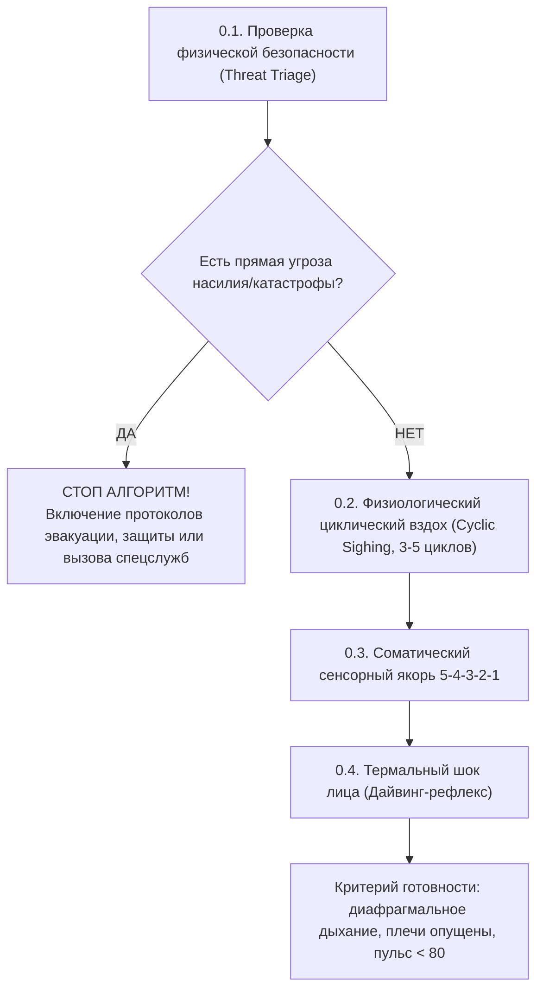

* **0.1. Проверка безопасности:** «Угрожает ли прямо сейчас моей жизни физическое насилие, шантаж или катастрофа?». Если да — алгоритм останавливается. **Принятие никогда не означает терпения насилия!** 🟢
* **0.2. Циклический вздох (Balban et al., 2023, Stanford):** Два резких коротких вдоха через нос и один длинный, плавный, расслабленный выдох через рот. Снижает симпатический тонус быстрее медитации. 🟢
* **0.3. Якорь 5-4-3-2-1:** Назвать вслух: 5 предметов, которые я вижу; 4 тактильных ощущения; 3 звука; 2 запаха; 1 вкус.
* **0.4. Дайвинг-рефлекс:** Погружение лица в ледяную воду на 15 секунд мгновенно активирует вагусный тормоз через тройничный нерв. 🟢

---

## Глава 13. Шаг C. Clarify: Локализация, топография и замер реальности (10–12 минут)

Снятие объективной системной телеметрии по 5 строгим фильтрам:
1. **ЛОКАЛИЗАЦИЯ СБОЯ (Узел или Связь):**
   * *Эвристика:* Если одна и та же проблема систематически повторяется с разными контрагентами/партнерами — поврежден **Узел**. Если деструктивный паттерн возникает исключительно в контакте с одним конкретным объектом — повреждена **Связь**.
2. **ЭТАЖ (Вертикаль зрелости L1–L5):**
   * На каком этаже сложности находится проблема?
   * *Проверка по правилу этажа ниже:* Нет ли критической дыры на этаже ниже (L1: сон, питание, базовые деньги, безопасность)? Если этаж ниже пробит — алгоритм переключается на его починку, а исходная задача замораживается.
3. **ЧИСТЫЙ ФАКТ (Камера против Комментатора):**
   * Спуск по лестнице Аргириса. Очистить ситуацию от интерпретаций до одного сухого предложения, которое зафиксировала бы беспристрастная оптическая видеокамера со звуком. (Не «Партнер — предатель и украл проект», а «Партнер отозвал доступы к репозиторию и прислал письмо о расторжении меморандума»).
4. **ПРЯМОУГОЛЬНИКИ (Контуры и Такты):**
   * Оценить 4 горизонтальных контура (Основа, Мастерство, Контакт, Курс) и 4 вертикальных такта (Вход, Ход, Выход, Поправка): какой слабейший?
   * *Особое внимание — такту Поправка:* если он пробит, система не способна учиться на ошибках.
5. **КАЧЕЛИ (8 динамических осей):**
   * Проверить расхождение по 8 полярным парам качелей. Зафиксировать заклинившие оси, где разрыв превышает 3 балла ($|S_n - S_{n+8}| > 3$). Ремонт будет планироваться через противоположный конец.
6. **ПЕРЕКРЁСТКИ И КОЭФФИЦИЕНТ ОТДАЧИ ($K_r$):**
   * Снять тепловую карту матрицы $4 \times 4$ (состояние $0–10$ и ресурс PRP). Отобрать 3 клетки-кандидата для разбора.
   * При подозрении на утечку ресурса узла рассчитать коэффициент отдачи:
     $$K_r = \frac{O}{I} = \frac{\text{Выход (ценность, выручка, энергия)}}{\text{Вход (затраченное время, силы, деньги)}}$$
     * $K_r \ge 1$ — **Драйвер** (зона инвестиций и масштабирования).
     * $0.4 \le K_r < 1$ — **Резервуар** (накопление долгосрочного актива при растущем $O$).
     * $K_r < 0.4$ — **Аварийный слив** (немедленный запуск стоп-крана). 🟡

**Паспорт проблемы (Карточка 10x15):**  
Локализация (Узел/Связь) | Координата $4 \times 4$ | Этаж L1–L5 (и этаж ниже) | Чистый факт видеокамеры | Заклинившая ось качелей | Значение $K_r$.

---

## Глава 14. Шаг O. Own: Идентификация дефекта, иммунитет и моя доля (10 минут)

1. **ИДЕНТИФИКАЦИЯ ПОЛОМКИ ПО КАТАЛОГАМ:**  
   * При повреждении Узла — выбрать поломку по коду из **Каталога Узла (Глава 19)**.  
   * При повреждении Связи — выбрать поломку по коду из **Каталога Связи (Глава 23)**.  
   * *Правило фокусировки:* Строго не более 1–2 поломок за один цикл ремонта!
2. **АНАЛИЗ СИСТЕМНЫХ ЛОВУШЕК СЕНГЕ:**
   * *Симптомное лечение:* снятие внешних симптомов, пока коренная причина продолжает гнить под ковром.
   * *Предел роста:* масштабирование уперлось в скрытое узкое горлышко (Голдратт).
   * *Эскалация:* стороны взаимно усиливают симметричные удары в усиливающем контуре. 🟡
3. **ВСКРЫТИЕ ИММУНИТЕТА К ИЗМЕНЕНИЯМ (Гарвардский протокол Кигана — Лэйхи):**
   * *Колонка 1:* Заявленная сознательная цель.
   * *Колонка 2:* Что я делаю (или не делаю) прямо сейчас вопреки этой цели?
   * *Колонка 3:* Скрытое конкурирующее обязательство: «Если я перестану так делать, случится самое страшное:...».
   * *Колонка 4:* Базовое детское непроверенное допущение (*Big Assumption*), управляющее весами модели. 🟢
4. **ПРИЗНАНИЕ СВОЕЙ ДОЛИ ОТВЕТСТВЕННОСТИ:**  
   «Что конкретно я сделал (или о чем трусливо умолчал), что создало условия для этой поломки?». Это не самобичевание и не вина — это обнаружение единственного рычага, физически находящегося в руках Оператора.

**Формула коренной причины:**  
$$\text{Причина} = \text{Код поломки} + \text{Скрытое обязательство} + \text{Моя системная доля}$$

---

## Глава 15. Шаг R. Relive: Принятие и перепроживание развилки (15–20 минут)

### Часть А. Радикальное принятие (7–8 минут)
1. **Согласие с фактом:** «Это уже произошло. Реальность такова, какова она есть». Боль неизбежна, но $\text{Страдание} = \text{Боль} \times \text{Сопротивление}$. Снятие внутреннего трения. 🟢
2. **Маркировка аффекта (Affect Labeling по Либерману):** Точное называние первичной соматической эмоции («Я чувствую ярость и ужас») снижает возбуждение амигдалы на фМРТ. 🟢
3. **Системная валидация:** Признание того, что контрагент действовал из своей внутренней картины мира и дефицита ресурсов. Валидация — не согласие, а понимание причин. 🟢
4. **Обучающий урок:** Превращение ошибки предсказания в обучающий датасет для модели: «Какую наивную иллюзию сожгла эта ситуация?».

### Часть Б. Репетиция развилки (8–10 минут)
Разбор сцены конфликта или срыва по 4 фокусным вопросам:

| Вопрос | Что выявляем в симуляции |
|---|---|
| **Субъекты и роли** | Кто участвовал и из каких позиций: Жертва, Спасатель, Агрессор или Оператор? |
| **Истинные цели** | Чего на самом деле хотел каждый узел под прикрытием слов? Где цели столкнулись? |
| **Фокус внимания** | Куда был направлен луч Оператора в момент развилки: на твердый факт или на защиту уязвленного эго? |
| **Точка развилки** | Где находилась стрелка перевода сценария? Какую новую реплику или действие совершает Оператор? |

**Результат:** Исправленный сценарий в 3 строках текста: новая точная реакция в точке бифуркации. 🟡

---

## Глава 16. Шаг E. Engineer: ТРИЗ-план и устранение трения (15 минут)

1. **Идеальный Конечный Результат (ИКТ по ТРИЗ):** Проблема решается сама собой за счет ресурсов, которые уже присутствуют в системе. Составляется жесткий аудит имеющихся ресурсов (люди, софт, время, деньги, регламенты). Запрет на привлечение нового, пока не исчерпаны внутренние резервы. 🟡
2. **Рычаг на качелях:** Приложение силы строго на противоположном конце качелей и этажом выше.
3. **Разделение системного противоречия (ТРИЗ):** «Если улучшаю $A$, деградирует $B$». Разрешение противоречия:
   * *Во времени:* Фокусная экспансия с 9:00 до 18:00, глухой отдых после 18:00.
   * *В пространстве:* Жесткое разделение спальни (личное) и кабинета (бизнес для супругов-фаундеров).
   * *По условию:* Берем клиента, только если маржинальность превышает 40%. 🟡
4. **Протокол WOOP и Pre-Mortem:**
   * *WOOP (Эттинген):* Wish (Желание) $\rightarrow$ Outcome (Результат) $\rightarrow$ Obstacle (Препятствие) $\rightarrow$ Plan (План). 🟢
   * *Pre-Mortem (Гэри Клейн):* «Представим, что прошло 6 месяцев и наш план с треском провалился. Что послужило причиной?». Превентивное устранение уязвимостей. 🟢
5. **Намерения реализации (Питер Голльвитцер):** Четкие триггерные связки:  
   **«ЕСЛИ наступает событие $X$, ТО я немедленно делаю физическое действие $Y$»**.

---

## Глава 17. Шаг X. eXecute: Необратимый физический коммит за 72 часа

План без немедленного соматического закрепления превращается в ментальный шум.

```mermaid
timeline
    title ОКНО НЕОБРАТИМОГО ДЕЙСТВИЯ (72 ЧАСА)
    01 час : Шаг 1 (Микрокоммит среды) : Отправить письмо / Оплатить счет / Отключить доступ
    24 часа : Шаг 2 (Системный регламент) : Внедрить WIP-лимит / Провести разговор 1-on-1 по протоколу
    72 часа : Шаг 3 (Мини-ретро и метрика) : Сверить дашборд / Зафиксировать изменение весов в модели
```

* **Закон Хебба и закрепление патча:** *«Neurons that fire together, wire together»*. Новое поведение должно прозвучать в теле сразу после нахождения патча, пока старый синаптический путь пластичен. 🟢
* **Критерий необратимости:** Первый шаг нельзя «тихо отменить» в голове (письмо отправлено, транзакция проведена, регламент опубликован).
* **Малый безопасный эксперимент (Safe-to-Fail по Талебу и SRE):** Если шаг тестирует базовое допущение, цена ошибки должна быть минимальной и обратимой. 🟡

---

## Глава 18. Экспресс-карта аварийного входа (60 минут)

Компактная боевая шпаргалка на одну страницу, когда на долгий анализ нет времени:

| Тайминг | Фаза | Конкретное действие |
|---|---|---|
| **0:00 – 0:03** | **0. СТОП** | Проверка физической угрозы. 3 циклических вздоха. Умывание ледяной водой. |
| **0:03 – 0:10** | **C. Clarify** | Выписать факт одной фразой. Проверить сон и деньги (этаж L1). Найти просевшую клетку матрицы. |
| **0:10 – 0:25** | **R. Relive** | Радикальное согласие: «Это произошло». Назвать эмоцию в теле. Сформулировать урок. Найти развилку. |
| **0:25 – 0:40** | **O. Own** | Назвать поломку по каталогу. Вскрыть колонку 3 Кигана (скрытый детский страх). Признать свою долю. |
| **0:40 – 0:55** | **E. Engineer** | Найти рычаг на противоположном конце качелей. Сформулировать 2 правила *«Если — То»*. |
| **0:55 – 1:00** | **X. eXecute** | Совершить ОДНО необратимое физическое действие прямо сейчас. Запустить таймер на 72 часа. |

---

# ЧАСТЬ III. УЗЛЫ: ЧЕЛОВЕК И БИЗНЕС

---

## Глава 19. Каталог из 12 универсальных поломок Узла

Поломка узла инвариантна: системный сбой имеет одинаковую топологическую структуру как в нейронных сетях и органах человека, так и в бизнес-архитектуре компании.

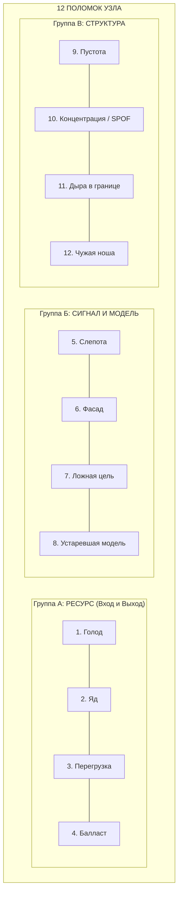

### Сводная таблица поломок Узла

| № | Поломка | Проявление в Человеке | Проявление в Бизнесе | Системный патч (Ремонт) |
|---|---|---|---|---|
| **1** | **Голод** | Сон меньше 5 часов, истощение запасов АТФ, изоляция | Хронический кассовый разрыв, задержка зарплат, обескровленный бюджет | Переход в режим *Degraded Mode*: заморозка всех инвестиций, защита ядра |
| **2** | **Яд** | Поглощение токсичного контента, алкоголя, сахара под видом отдыха | Токсичные клиенты, серые схемы, разрушительные сотрудники | Санитарная изоляция входящего порта, жесткий детокс |
| **3** | **Перегрузка** | Входящий поток требований выше емкости процессора; неумение говорить «нет» | Захлебывание заказами, срыв сроков, массовое выгорание саппорта | Введение жестких лимитов незавершенных задач (*WIP Limits*), отсечение хвоста |
| **4** | **Балласт** | Потребление ресурсов без генерации отдачи (вечный студент) | Раздутый штат, не создающий измеримой ценности; убыточные филиалы | Аудит отдачи $K_r = O/I$, введение налога на результат, ликвидация балласта |
| **5** | **Слепота** | Эмоциональное подавление, игнорирование телесных болей | Отсутствие управленческого учета, игнорирование оттока клиентов (Churn) | Восстановление непрерывного потока сырых данных телеметрии; *Blameless Post-Mortem* |
| **6** | **Фасад** | Синдром самозванца, показушная компетентность из стыда | Маркетинг обещает премиум, а производство гонит брак | Синхронизация обещания с реальной пропускной способностью |
| **7** | **Ложная цель** | Погоня за лайками и чужим статусом ценой собственного здоровья | Оптимизация узкого KPI ценой краха выручки (проклятие Гудхарта) | Замена одной метрики сбалансированной системой дашбордов; калибровка ценностей |
| **8** | **Устаревшая модель** | Жизнь по детским психологическим правилам двадцатилетней давности | Отказ от автоматизации и ИИ, архаичная бизнес-модель (синдром Kodak) | Принудительный аудит базовых допущений; серия экспериментов $N=1$ |
| **9** | **Пустота** | Паралич сферы (оценка $\le 3$), выученная беспомощность | Полное отсутствие ключевой функции (нет продаж или нет контроля качества) | Сборка простого протокола «на тройку» из 5 шагов; назначение владельца |
| **10**| **Концентрация (SPOF)**| Вся самооценка завязана на одном факторе (одна работа, один партнер) | Более 50% выручки от одного заказчика; критический *Bus Factor = 1* | Расширение узкого места по Голдратту; дублирование критических опор |
| **11**| **Дыра в границе** | Пробитые личные границы, невозможность отказать наглецам | Работа без договоров, утечки коммерческой тайны, дыры в безопасности | Выстраивание полупроницаемой границы с четким регламентом доступа |
| **12**| **Чужая ноша** | Несение чужой вины, спасательство деструктивных родственников | Бизнес оплачивает непрофильные прихоти фаундера; подчиненный решает за шефа | Возврат груза и ответственности на законный уровень системы |

---

## Глава 20. Ремонт узла за 60 минут: Сквозной кейс Жоры и его компании

* **Контекст кейса:** Жора — 34 года, сооснователь и технический директор IT-компании. 3 недели бессонницы, кассовый разрыв 1.5 млн руб., ключевой клиент прислал уведомление о разрыве контракта, дома — угроза развода с Кристиной.
* **0. Стоп (3'):** Пульс 110. Три циклических вздоха, умывание ледяной водой. Физической угрозы жизни нет. Включается вентральный вагус.
* **C. Clarify (10'):** 
  * *Факт:* Заказчик отказался от продления договора на 4 млн руб. из-за трех сорванных дедлайнов.
  * *Этаж:* Сбой на L3 (процессы), но этаж L1 (сон 4 часа, соматика на пределе) пробит.
  * *Матрица 4x4:* Сфера 6 (Порядок) = 2 балла; Сфера 4 (Запас прочности) = 2 балла; Сфера 14 (Вклад) = 9 баллов.
  * *Качели:* Ось 6 (Порядок) $\leftrightarrow$ 14 (Вклад) расходится на 7 баллов (глухой клинч!).
  * *Коэффициент отдачи:* $K_r = 0.31$ (Аварийный слив).
* **O. Own (10'):** 
  * *Поломки:* №3 (Перегрузка буфера) и №5 (Слепота).
  * *Иммунитет Кигана:* Цель — управляемый бизнес и здоровый сон. Делаю вопреки — не делегирую код архитектуры и молчу о дырах в бюджете. Скрытый страх — если передам код или откажу клиенту, меня посчитают слабым и отвергнут. Базовое допущение: «Я ценен, только когда работаю на износ».
  * *Моя доля:* Не выстроил интерфейсы между разработкой и продажами, скрывал правду от Кристины.
* **R. Relive (20'):** Радикальное согласие: «Контракт расторгнут. Это факт». Называние эмоции: жгучий стыд и страх нищеты. Перепроживание сцены: точка развилки была 2 недели назад, когда клиент потребовал нереалистичные правки. Новая реакция Оператора: сказать «Нет, это ломает архитектуру, мы фиксируем скоуп».
* **E. Engineer (15'):** Рычаг лежит на противоположном полюсе качелей: сократить избыточный Вклад (отсечь убыточных клиентов) ради наведения Порядка. Разделение противоречия: прием новых фич только при условии жесткой предоплаты. Правило *«Если — То»*: «Если время 20:00 — рабочий чат блокируется на роутере».
* **X. eXecute (72ч):**
  * *1 час:* Отправить письмо заказчику с фиксацией актов выполненных работ без унизительных скидок.
  * *24 часа:* Ввести лимит параллельных задач (WIP=3) в Jira; провести открытый разговор с Кристиной о финансах.
  * *72 часа:* Отключить уведомления после 20:00; проспать 8 часов две ночи подряд.

---

## Глава 21. Притча-загадка Узла: Спор трех советников

Герой стоит на перепутье выжженной пустоши перед запертыми вратами цитадели. Ресурсы на исходе, караван истощен. Внутри него оживают три голоса:
1. **Первый советник — Логический Расчет (Software / Ум):** «Давай оптимизируем пайки, взломаем замок, подделаем грамоты и обманем стражу. Это математически выгодно».
2. **Второй советник — Силовое Принуждение (Power Supply / Воля):** «Хватит думать! Пойдем на таран, разобьем ворота в щепки, накажем бунтовщиков! Сила решает всё!».
3. **Третий советник — Смысловой Наблюдатель (Оператор / Ценности):** «Посмотрите на людей. Если мы войдем ценой предательства или разобьем ворота ценой гибели половины отряда — зачем нам эта крепость?».

> **Закон соподчинения систем:**  
> **Смысловой контур (Ценности) направляет силовой мотор (Энергию), а логический процессор (Ум) служит лишь навигатором. Смысл главенствует над силой! Сила без смысла разрушает собственный узел.**

**Вопрос Силы:** «Ради чего большего, чем твой страх, ты готов совершить следующий шаг?». 🔵

---

# ЧАСТЬ IV. СВЯЗИ: ПАРА И КОМАНДА

---

## Глава 22. Топология связи: Пара, Сеть и Команда

### 22.1. Фундаментальная аксиома связи
> **«Мы не можем починить другого человека напрямую. Но мы можем починить связь — и через изменение параметров канала, границ и протокола обмена начинает трансформироваться внутреннее состояние узла».**

Попытка силой залезть внутрь чужого узла, взломать его защиты и «причинить добро» воспринимается его системой безопасности как враждебная DoS-атака и вызывает лишь глухую оборону. Ремонт начинается с очистки канала между узлами.

### 22.2. Топология пары: Четыре устойчивых союза

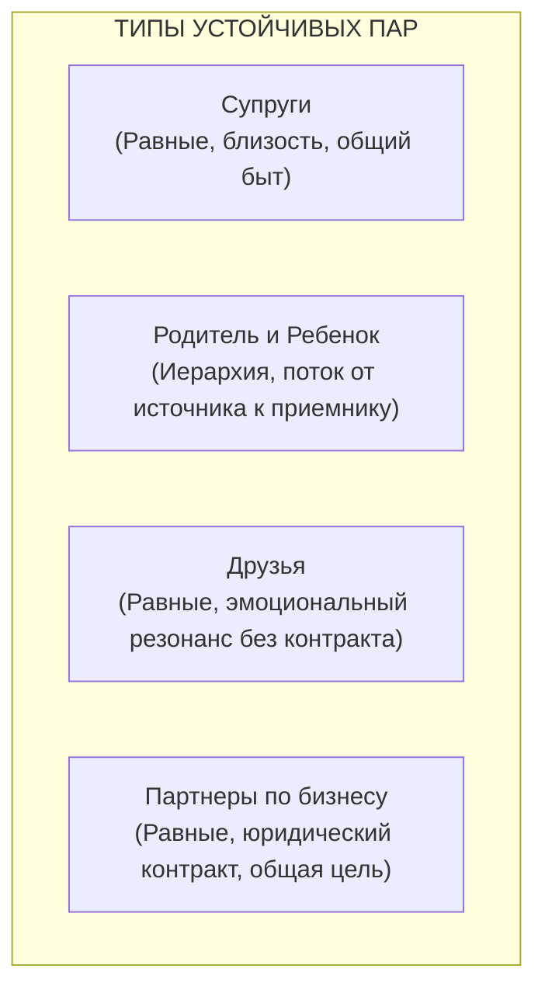

* **Супруги:** Симметричный дуплексный канал. Главные законы — Баланс обмена и полупроницаемость внешних границ.
* **Родитель — Ребенок:** Строгая асимметричная иерархия. Ресурс течет строго от старшего к младшему. Инверсия потока (парентификация) разрушает психику ребенка.
* **Партнеры по бизнесу:** Симметричный контрактный канал. Разделение зон владения и прав на ошибку.

### 22.3. Что удерживает канал в рабочем состоянии?
1. **Обмен с позитивной надбавкой (+5%):** Каждый акт возврата ценности в паре должен содержать крошечную добавленную стоимость. Если вам сварили кофе — ответьте теплой улыбкой и искренним объятием. Это компенсирует естественную энтропию среды. 🟡
2. **Коэффициент Готтмана 5 к 1:** В стабильных системах на одно критическое или неприятное взаимодействие приходится не менее 5 позитивных валидирующих подкреплений. При падении коэффициента ниже $1:1$ развод или распад партнерства математически неизбежен. 🟢
3. **Психологическая безопасность (Эми Эдмондсон, Google Aristotle):** Канал проводит сигналы без искажений только тогда, когда узлы не боятся быть уязвимыми и открыто признавать свои баги. 🟢
4. **Теория информации Шеннона:** При высоком уровне внешнего шума единственное спасение канала — алгоритмическая избыточность (техника контролируемого пересказа: «Правильно ли я услышал, что ты имеешь в виду $X$?»). 🟢

### 22.4. Команда как сеть пар: Комбинаторика треугольников
Команда не является единым монолитным объектом. Это связный граф взаимодействующих пар.
Количество связей в группе растет факториально:
$$C = \frac{n(n-1)}{2}$$
* В группе из 3 человек — 3 связи (и первый треугольник!).
* В группе из 5 человек — 10 парных связей.
* В группе из 8 человек — 28 парных каналов.

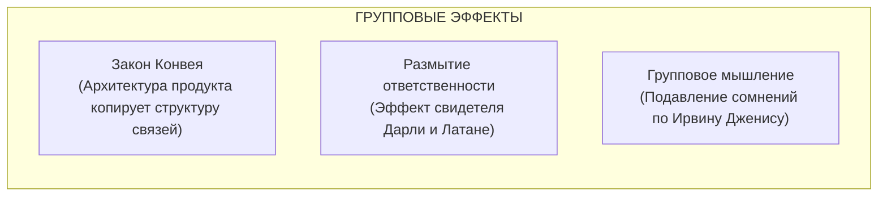

1. **Закон Конвея:** Архитектура создаваемой IT-системы или продукта фрактально повторяет коммуникационную структуру создающей её организации. Баги в коде на стыке модулей — это всегда зеркало конфликтов между тимлидами этих отделов. 🟢
2. **Размытие ответственности:** Если у процесса нет единственного владельца (*Single Accountable Owner* по RACI/DACI), задача не принадлежит никому. 🟢
3. **Групповое мышление (Groupthink):** Подавление сомнений и критики ради иллюзии командного согласия. Лечится институциональной ролью «Адвоката дьявола». 🟢

---

## Глава 23. Каталог из 12 универсальных поломок Связи

Поломки коммуникационного канала проявляются одинаково в супружеской паре и в бизнес-команде:

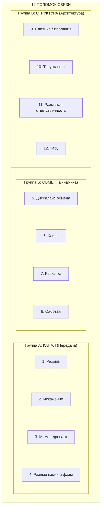

### Сводная таблица поломок Связи

| № | Поломка | Проявление в Паре (Семье) | Проявление в Команде (Бизнесе) | Системный патч (Ремонт) |
|---|---|---|---|---|
| **1** | **Разрыв** | Ледяное молчание, эмоциональный бойкот, жизнь соседями | Департаменты прекратили прямой контакт, общение через эскалации шефу | Минимальный низкопороговый ритуал контакта: 10-минутный ежедневный чек-ин |
| **2** | **Искажение** | Чтение мыслей: нейтральное молчание трактуется как «разлюбил» | Сухие правки тимлида читаются разработчиком как травля и угроза увольнения | Техника контролируемого пересказа: «Правильно ли я понимаю твой тезис?» |
| **3** | **Мимо адресата** | Слив злости с работы на ребенка; жалобы маме вместо разговора с мужем | Претензии по дизайну высказываются бэкендеру; токсичные сплетни в курилке | Маршрутизация сигнала строго к источнику; правило замкнутого контура |
| **4** | **Разные языки** | Одному нужны объятия и поступки, другому — вербальное признание | Инженеры говорят о техдолге, а финансовый директор — об EBITDA | Создание единого глоссария; перевод задач на язык метрик контрагента |
| **5** | **Дисбаланс обмена**| Один тащит 90% быта и заботы, второй лишь пассивно потребляет | Неравный вклад сооснователей при долях 50/50 в уставе компании | Прозрачный аудит вкладов; введение динамического вестинга долей |
| **6** | **Клинч (Deadlock)**| Оба ждут первого шага от другого («Пока он не извинится — я не заговорю») | Юристы блокируют договор без бухгалтерии, бухгалтерия — без юристов | Односторонний безусловный демпфирующий шаг (+5%); разделение суверенных зон |
| **7** | **Раскачка** | Каскад Готтмана: критика $\rightarrow$ презрение $\rightarrow$ защита $\rightarrow$ каменная стена | Взрывной спор на совете директоров с переходом на личности и сарказмом | Стоп-слово и регламентированный тайм-аут на 20 мин; 4 антидота Готтмана 🟢 |
| **8** | **Саботаж** | Согласие на словах, но постоянное «забывание» выполнить обещание | Итальянская забастовка сотрудников при внедрении новой CRM | Вскрытие скрытого протеста: «Что в этом решении вызывает твое несогласие?» |
| **9** | **Слияние/Изоляция**| Полная потеря границ («мы решили») либо ревнивый запрет на внешних друзей | Панибратство фаундеров, где нельзя спросить за KPI; изоляция отдела от клиентов | Восстановление суверенных границ узлов; возвращение контрактных рамок |
| **10**| **Треугольник** | Карпман: Жертва — Спасатель — Агрессор; втягивание ребенка в ссору | Жалобы через голову непосредственного лида; поиск козла отпущения | Правило прямой линии; решение конфликта строго между двумя участниками |
| **11**| **Размытая зона** | Взаимные догадки: «Я думал, ты заплатишь за квартиру — а я думала, ты» | Коллективная безответственность за срыв сроков запуска продукта | Матрицы RACI/DACI: ровно один персонально ответственный (*Driver*) на задачу 🟢 |
| **12**| **Табу** | Запрет на обсуждение денег, секса и обид ради иллюзии идеальности | Замалчивание стратегических рисков на совете директоров (Groupthink) | Роль штатного Адвоката дьявола; регулярный анонимный сбор критических гипотез 🟢 |

---

## Глава 24. Протоколы ролевой синхронизации

### 24.1. Протокол «Я — Супруг» (Личный контур)
* Ненасильственный диалог по Розенбергу — Готтману:
  $$\text{Сухой факт видеокамеры} \longrightarrow \text{Мое чувство} \longrightarrow \text{Моя глубинная потребность} \longrightarrow \text{Конкретная выполнимая просьба}$$
* Категорический запрет на токсичные кванторы общности («ты вечно», «ты никогда»).
* Ежедневные 20 минут неструктурированного безоценочного эмоционального контакта.

### 24.2. Протокол «Я — Родитель» (Детский контур)
* Абсолютная изоляция детско-родительской связи от супружеских конфликтов. Запрет на использование ребенка как контейнера для сброса тревоги.
* Принцип ко-парентинга: родительский альянс нерушим даже после юридического развода.

### 24.3. Протокол «Я — Партнёр по бизнесу» (Деловой контур)
* Жесткая сепарация спальни и рабочего пространства (критично для семейного бизнеса Жоры и Кристины).
* Правило 24 часов: любая профессиональная претензия озвучивается в течение суток в рабочем контексте.
* Письменное соглашение основателей (*Founders Agreement*): фиксация зон суверенного права вето, вестинга и условий цивилизованного развода до старта проекта.

### 24.4. Протокол «Я — Руководитель / Лидер команды»
* Регулярные двусторонние сессии *1-on-1* по модели развивающей обратной связи: *Беспристрастное наблюдение $\rightarrow$ Системное влияние на результат $\rightarrow$ Совместный поиск альтернативы*.

### 24.5. Протокол «Я — Консультант / Помогающий практик»
* Соблюдение системной нейтральности. Запрет на втягивание в треугольник клиента в роли «Спасателя».
* Уважение к суверенному праву клиентской системы на свой опыт и свои ошибки.

---

## Глава 25. Ремонт связи, Притча-загадка и цивилизованная декоммиссия

### 25.1. Ремонтная попытка (Repair Attempt по Джону Готтману)
Любое вербальное или невербальное действие, останавливающее эскалацию эмоционального пожара (шутка над собой, предложение выпить чаю, фраза «Я чувствую, что мы оба устали, давай сделаем паузу»). **Главный статистический предиктор долговечности союза — не отсутствие ссор, а способность партнеров распознавать и принимать ремонтные попытки друг друга.** 🟢

### 25.2. Притча-загадка Связи: «У пересохшего колодца»
Два путника подошли к пересохшему колодцу в пустыне с одной чашей воды на двоих.
Один кричит: «Если я отдам её тебе — я умру от жажды!». Второй стонет: «Если ты не отдашь её мне — я прокляну тебя перед смертью!».
И они сжимают кулаки, готовые убить друг друга за глоток влаги.
Но к колодцу подходит Мастер и выливает чашу в засохший ствол древнего насоса. Путники в ужасе кричат, думая, что вода погибла. Но вода смачивает рассохшуюся кожаную манжету поршня — и через минуту качания рычага из недр земли с грохотом бьет кристальный ледяной поток, наполняя водопой для сотен караванов.

> **Закон Связи:**  
> **Когда ресурс сжимается до нуля, не пытайся отобрать чашу силой. Вложи остаток ресурса в восстановление самого канала — и система откроет доступ к неисчерпаемому общему источнику.** 🔵

### 25.3. Цивилизованная декоммиссия связи (Протокол закрытия)
Когда связь исчерпала свой эволюционный потенциал, а попытки ремонта ведут лишь к деградации узлов, она должна быть экологично закрыта без уничтожения систем:
* **В личной паре (Развод):**
  1. *Аудит и возврат взаимных вкладов;*
  2. *Признание ценности пройденного совместного пути;*
  3. *Искренняя благодарность за совместный опыт и сожженные иллюзии;*
  4. *Твердый юридический раздел активов без войны на истощение;*
  5. *Фиксация родительского кодекса взаимодействия ради детей.*
* **В бизнесе (Выход фаундера / Закрытие проекта):**
  1. *Реализация положений Buy-Sell Agreement (русская рулетка, техасская перестрелка);*
  2. *Справедливый финансовый выкуп доли по понятной формуле;*
  3. *Бережный перевод сотрудников и клиентов без черного пиара;*
  4. *Сохранение деловой репутации обоих узлов в индустрии.*

---

# ЧАСТЬ V. ПРАКТИКА, ТЕЛЕМЕТРИЯ И АВАРИЙНЫЙ РЕЖИМ

---

## Глава 26. Недельный баланс ресурсов PRP и наука привычек

### 26.1. Архитектура PRP (Personal Resource Planning)
Сквозной еженедельный баланс трех несменяемых жизненных ресурсов:

$$\mathbf{PRP} = \langle \mathbf{VIT}~(\text{Витальность}),~\mathbf{ATT}~(\text{Внимание}),~\mathbf{CASH}~(\text{Ликвидность}) \rangle$$

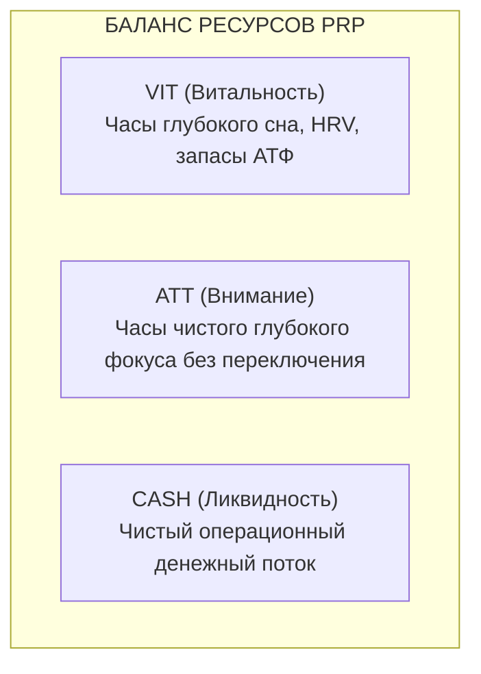

* **VIT (Витальность):** Сон, питание, физическое движение. Невосполнимый базовый фундамент.
* **ATT (Внимание):** Лимит глубокой сосредоточенной работы (не более 4–5 часов в сутки чистого времени по Калу Ньюпорту).
* **CASH (Ликвидность):** Запас свободных денег, обеспечивающий свободу принятия решений без унизительного давления нужды.

### 26.2. Наука формирования устойчивых привычек
* **Реальный диапазон нейропластичности (Филиппа Лалли, UCL):** Миф о «21 дне» опровергнут. Реальное время автоматизации поведенческого паттерна занимает **от 18 до 254 дней** (медиана — 66 дней в зависимости от сложности действия). 🟢
* **Метод крошечных привычек (Би Джей Фогг, Stanford Tiny Habits):**  
  Формула: **«ПОСЛЕ ТОГО КАК я совершаю привычное якорное действие $A$, Я ДЕЛАЮ микродействие $B$ ($<30$ сек) $\rightarrow$ И НЕМЕДЛЕННО праздную победу соматическим выбросом дофамина»**. 🟢

---

## Глава 27. Аварийный протокол Degraded Mode и практикумы кризисных зон

### 27.1. Протокол Degraded Mode (Сфера «Запас прочности» в действии)
При тяжелом ударе судьбы (смерть близкого, внезапный иск, аннулирование лицензии банка) система сбрасывает 90% второстепенных процессов и переходит на минимальное жизнеобеспечивающее ядро:
1. *Сон не менее 8.5 часов;*
2. *2 литра чистой воды и простая цельная еда без сахара и алкоголя;*
3. *40 минут непрерывной ходьбы на свежем воздухе;*
4. *Один теплый разговор с надежным близким человеком;*
5. *Ровно одно законченное микродействие в материальном мире в день.* 🟡

### 27.2. Практикумы кризисных зон
1. **Горе и необратимая утрата:** Лестница принятия неизбежного. Запрет на химическое глушение горя в острой фазе. Проживание соматической волны печали через телесное присутствие без застревания в руминациях вины.
2. **Биологический фундамент L1:** Циркадный световой протокол: 10 минут утреннего прямого солнечного света в глаза, отказ от синих экранов за 2 часа до сна, магниевый баланс, температурный режим спальни ($18–19^\circ\text{C}$). 🟢
3. **Прокрастинация и перфекционизм:** Деконструкция через скрытую конкурирующую выгоду Кигана: прокрастинация защищает хрупкое эго от панического страха столкнуться с собственной неидеальностью. Лечится протоколом «сделать на тройку за 15 минут».
4. **Поведенческие ловушки капитала:** Преодоление неприятия потерь (Канеман) и ловушки невозвратных затрат (*Sunk Cost Fallacy*): фиксация убытка как плата за бесценный урок и немедленная переброска ресурсов в драйверы. 🟢
5. **Медиация жестких переговоров:** Гарвардский метод (Фишер, Юри): отделение людей от проблемы, фокус на глубинных интересах сторон вместо упертых позиций, генерация взаимовыгодных альтернатив. 🟢

---

## Глава 28. Безопасность, этика и границы применимости

### 28.1. Границы книги
«ROOT» — это высокоточный инженерный тренажер для **психически сохранных людей и функциональных организаций**. Книга не является заменой клинической психиатрии, глубокой психотерапии расстройств личности и узкопрофильного корпоративного юридического консалтинга.

### 28.2. Красные флаги: Когда алгоритмы останавливаются и нужен врач
* Клиническая эндогенная депрессия (ангедония более 2 недель, утренняя апатия, потеря веса);
* Острые психотические и биполярные состояния (мания, бред, галлюцинации);
* Суицидальные мысли и намерения (требуется немедленное обращение на горячую линию кризисной помощи);
* Тяжелые химические зависимости (алкоголизм, наркомания);
* Физическое насилие и криминальный шантаж.

### 28.3. Этика системного невмешательства
* **Категорический запрет на несанкционированное «причинение добра»:** Запрещено применять системные интервенции к узлу без его прямого осознанного запроса.
* **Уважение к суверенитету чужих границ:** Каждый узел имеет священное право жить в своей архитектуре ошибок и нести за неё полную системную ответственность.

---

# ЭПИЛОГ И ФУНДАМЕНТАЛЬНЫЙ ГОРИЗОНТ: МОДЕЛЬ НЕЛОКАЛЬНОГО СОЗНАНИЯ (5% ТЕОРЕТИЧЕСКОЙ ФИЗИКИ)

---

## 5% Теоретической физики: Что, если Сознание фундаментально?

Если отбросить догматический вульгарный материализм и зайти в те 5% нерешенных парадоксов квантовой физики и философии сознания (аналитический идеализм Бернардо Каструпа, концепция импликативного порядка Дэвида Бома, участвующая Вселенная Джона Уилера, панпсихизм Филипа Гоффа):

> **Базовый постулат:**  
> **Мозг — это не производитель (генератор) сознания, а редукционный клапан и Wi-Fi-фильтр.**  
> Как утверждали Олдос Хаксли и Дэвид Бом, если бы мозг воспринимал ВСЮ квантовую реальность напрямую, система мгновенно сгорела бы от перегрузки петабайтами данных. Задача мозга — глушить 99.9% космического интернета, оставляя узкий туннель: ложка, угроза, светофор, потомство.

### Единая сводная таблица демистификации феноменов через теорию информации

| Феномен | Традиционный взгляд | Кибернетический и системный перевод в модели ROOT |
|---|---|---|
| **Бог** | Дедушка на облаке / Творец | Фундаментальный космический квантовый субстрат (Океан информации), познающий себя через дробление на триллионы живых узлов |
| **Душа** | Мистическая нематериальная сущность | Локальный водоворот (диссоциированный альтер) в едином субстрате, защищенный биологическим брандмауэром мозга для сбора уникального опыта |
| **Просветление** | Религиозное чудо / Святость | Прижизненный сбой работы эго-фильтра мозга, при котором локальный узел мгновенно осознает свою истинную природу как всего бесконечного Субстрата |
| **Молитва / Мантра** | Выпрашивание благ у высших сил | Ввод высококогерентного *System Prompt* в корневую директорию поля через глушение левополушарного аналитического шума |
| **Карма** | Мистическое возмездие за грехи | Фундаментальный закон сохранения информации в замкнутой сети: любой импульс неизбежно возвращается в узел-генератор, ибо других узлов в глубине нет |
| **Реинкарнация** | Переселение душ | Сохранение накопленных весов опыта после декоммиссии одного аппаратного носителя и загрузка датасета в новый биологический аватар для продолжения обучения |
| **Рай и Ад** | Места посмертного суда | Посмертный мгновенный рендеринг реальности без ограничений физики, где окружение сновидца на 100% строится из его собственных внутренних паттернов: любви и покоя (Рай) либо вины и ужаса (Ад) |
| **Эгрегоры** | Коллективные духи / Астральные сущности | Автономные распределенные макропрограммы (коллективные субагенты), скомпилированные из сфокусированного внимания миллионов узлов |
| **Интуиция** | Магическое предчувствие | Быстрый SQL-запрос локальной нейросети напрямую к нелокальному информационному полю в обход медленной дискурсивной коры |
| **Любовь** | Гормональный всплеск для размножения | Внезапный прорыв иллюзии раздельности: узнавание сквозь маску чужого эго той же самой сущности, что смотрит через твои собственные глаза |
| **Телепатия / Эмпатия** | Чтение мыслей сквозь пространство | Эффект локальной сети (LAN): два айсберга осознают, что под водой они соприкасаются с одной и той же океанической тканью |
| **Осознанные сны (Lucid Dreams)**| Причудливый нейробиологический сбой | Режим разработчика в локальной песочнице (*Developer Sandbox*): сознание отключено от физического рендеринга, но сохраняет Root-доступ к управлению материей сна |
| **Околосмертный опыт (NDE)** | Галлюцинация умирающего мозга | Фазовый переход: отключение биологического Wi-Fi-адаптера и возвращение локальной капли восприятия обратно в широкополосный Океан сети |
| **Смерть скафандра** | Трагедия полного уничтожения | Растворение временных стенок капли. Панорамный просмотр жизни (*Life Review*) как двустороннее одновременное проживание всех своих поступков — от своего лица и нервной системой тех, на кого ты повлиял |

---

## Финальное напутствие Игроку за столом реальности

Сними виртуальный шлем навязанных невротических иллюзий, детских обид и инфантильных претензий к миру. 

Реальность — это не тюрьма, не карательный трибунал и не экзамен со злым профессором. Это грандиозный, глубокий, кристально честный тренажер с прозрачными физическими правилами и неподкупной обратной связью. Законы систем не наказывают — они лишь возвращают точное эхо каждого твоего поступка.

Хватит сидеть на зрительской трибуне, бесконечно жалуясь на погоду, критикуя других игроков и выпрашивая поблажки у неба.

Карта развернута. Двигатель COREX готов к запуску.  
Выходи на поле. Сделай свой следующий ход.

---

# ПРИЛОЖЕНИЯ

### Приложение А. Сводная матрица системных дефектов
* Полная сопоставительная таблица 12 поломок Узла и 12 поломок Связи с конкретными симптомами, когнитивными схемами Джеффри Янга, проекциями на Человека/Бизнес и системными патчами.

### Приложение Б. Практические бланки и шаблоны
1. *Бланк оценки Круга 16 сфер и тепловой карты перекрёстков;*
2. *Таблица калибровки 8 осей качелей с расчетом порога заклинивания ($|\Delta| > 3$);*
3. *4-колоночная матрица вскрытия иммунитета к изменениям Кигана — Лэйхи;*
4. *Пошаговый рабочий чек-лист протокола COREX на 60 минут;*
5. *Шаблон еженедельного дашборда учета личных ресурсов PRP (VIT / ATT / CASH).*

### Приложение В. Полная хроника сквозного кейса Жоры и Кристины
* Развернутая пошаговая история выхода из кризиса: спасение брака, реструктуризация IT-компании, внедрение динамического вестинга, выход на международный рынок и построение устойчивой антихрупкой жизни.

### Приложение Г. Краткий словарь кибернетических терминов
* Глоссарий системного языка: каждое понятие (узел, запас, поток, граница, аллостаз, инференс, дрейф весов, латентность) объяснено строго в одну строку без профессионального снобизма.

### Приложение Д. Научная библиография и источники
* Полный реестр академических публикаций, книг и клинических исследований с маркировкой доказательного статуса: 🟢 [Доказано], 🟡 [Рабочая модель], 🔵 [Метафора].
