# СИНОПСИС И НАУЧНО-МЕТОДОЛОГИЧЕСКИЙ ФУНДАМЕНТ КНИГИ «ROOT» (v2.0)
## Руководство по архитектуре: 22 главы, 4 уровня доказательности, границы применимости и строгая таксономия системных сбоев

---

## 🏛️ ПЕРЕСМОТРЕННЫЙ МАНИФЕСТ КНИГИ

> **Системный манифест (Рабочая модель, а не догма):**  
> Многие проблемы человека, семейной пары и рабочей организации обладают изоморфной структурой: они возникают в узлах, каналах связи, петлях обратной связи с временной задержкой, точках распределения ресурсов и на барьерах проницаемости границ.  
> 
> Системный язык — это **не метафизический закон природы и не мистическое откровение**, а **высокоточная диагностическая линза** с четко очерченной областью применимости. Вселенная в буквальном космологическом смысле не является строго фрактальной (на масштабах свыше сотен мегапарсек она однородна и изотропна). Однако в сложных адаптивных системах действуют строгие кросс-масштабные закономерности:
> 1. Метаболическое и аллометрическое масштабирование (Клейбер, Уэст);
> 2. Архитектурный закон Конвея (структура систем отражает структуру коммуникаций);
> 3. Общая теория управления и кибернетика (Эшби, Винер);
> 4. Сетевые эффекты и топология графов (с оговоркой: строгие безмасштабные сети с распределением степеней по степенному закону встречаются значительно реже, чем предполагалось ранее — *Broido & Clauset, Nature Communications, 2019*).
>
> Настоящая книга отделяет **верифицированный научный факт** от **клинической модели**, а **педагогическую метафору** — от **мировоззренческой философии**. Мы не объявляем аналогию тождеством. Мы используем кибернетику систем как инженерный каркас для сборки устойчивой жизни, глубоких отношений и масштабируемых команд.

---

## ⚖️ МЕТОДОЛОГИЧЕСКАЯ ШКАЛА ДОКАЗАТЕЛЬНОСТИ (A–D)

Каждая концепция, утверждение и протокол книги маркируются по шкале доказательности:

* **[Уровень A] — Высокая доказанность:** Систематические обзоры, метаанализы крупных выборок, многократно реплицированные рандомизированные контролируемые испытания (РКИ).
* **[Уровень B] — Умеренная доказанность:** Качественные лонгитюдные когортные исследования, реплицированные квази-эксперименты, устойчивые эмпирические закономерности когнитивных и биологических наук.
* **[Уровень C] — Клиническая и эмпирическая модель:** Психотерапевтические и организационные концепции с ограниченной или фрагментарной базой РКИ (схема-терапия, системная семейная терапия, методы парной терапии).
* **[Уровень D] — Авторская эвристика / Рабочая гипотеза:** Интуитивные классификации, мыслительные модели («Круг», уровни L1–L5, протоколы C-O-R-E-X), служащие прикладными инструментами до проведения независимой психометрической валидации.

---

## 🚫 РЕЕСТР ДЕТОКСИКАЦИИ: ЧТО УДАЛЕНО И ЧЕМ ЗАМЕНЕНО

| Что удалено из книги | Причина удаления | Чем заменено в новой структуре |
| :--- | :--- | :--- |
| **Невычислимое квантовое ядро, Orch-OR, Оператор в роли научного фундамента** | Модель Orch-OR Пенроуза-Хамероффа не имеет доказательств; расчеты декогеренции Макса Тегмарка показывают невозможность квантовых вычислений в теплом мозге. | Сознание как открытая научная проблема (Global Workspace Theory, IIT, предиктивное кодирование). Образ «Оператора» перенесен в мировоззренческое Приложение A. |
| **Free Will Theorem Конвея-Кохена, «квантовый приватный ключ» воли** | Теорема касается элементарных частиц при измерении спина, а не психологической свободы воли человека. | Компатибилизм; эксперименты Либета в реинтерпретации Schurger (2012); привычное vs целенаправленное поведение (Wood & Neal 2002: 43% действий привычны). |
| **Квантовый эффект Зенона как объяснение внимания** | Физический эффект подавления квантовых переходов непрерывным измерением не имеет отношения к селективному вниманию в коре. | Когнитивные модели внимания (Познер, Трисман); цена переключения внимания (Monsell 2003); модели истощения управляющих ресурсов. |
| **Теоремы No-Cloning и No-Deleting как доказательство бессмертия души** | Теоремы квантовой информации запрещают точное копирование неизвестного квантового состояния, но не доказывают сохранение личности. | Перенесено в философское Приложение A без претензий на физическое доказательство. |
| **Синхронии Паули-Юнга, «зеленая волна поля»** | Нефальсифицируемая концепция, ведущая к подтверждающему искажению. | Когнитивные феномены: апофения, закон истинно больших чисел (Diaconis & Mosteller), confirmation bias. |
| **«Омическое сопротивление» эмоций, «сверхпроводимость любви», шкала Хокинса** | Метафора выдана за физику. Шкала Хокинса основана на лженаучном мышечном тесте кинезиологии. | Аллостатическая нагрузка (McEwen), ось HPA, регуляция эмоций (Gross), модель конструирования эмоций (Barrett). Broaden-and-build (Fredrickson), но без фиктивного коэффициента 3:1 (опровергнут Brown, Sokal, Friedman 2013). |
| **«Карма как индуктивность», «зло как энтропия», толкование религии через сети** | Псевдонаучная демистификация. Этимология *hamartia* = «промах лучника» является сомнительной богословской народной этимологией. | Эволюция кооперации (Аксельрод, Новак, прямая и косвенная взаимность), фундаментальная ошибка атрибуции, наивный реализм. |
| **«Законы Порядка» Хеллингера (потомок не учит предка, системные исключенные)** | Идеи Б. Хеллингера не подтверждены РКИ; на практике догматическая «иерархия» оправдывает насилие, инцест и газлайтинг в семьях. | Системный анализ Мюррея Боуэна (дифференциация, триангуляция), границы Сальвадора Минухина, парентификация. Оговорка: трансгенерационная эпигенетика у людей пока носит предварительный характер. |
| **Поливагальная теория Порджеса как догма** | Анатомические и филогенетические предпосылки теории Порджеса опровергнуты нейробиологами (Grossman 2023, Taylor 2022). | Защитный физиологический каскад, концепция «окна толерантности» (Dan Siegel), вегетативная регуляция с явным указанием дискуссионности поливагальной модели. |
| **«Стресс прожигает язвы», мышечный панцирь Райха, «святая семерка» Александера** | Язва желудка вызывается бактерией *H. pylori* (Нобелевская премия Маршалла и Уоррена, 2005). Панцирь Райха — псевдонаука. | Влияние хронического стресса на провоспалительные цитокины (IL-6, TNF-alpha), функциональные соматические расстройства (FSD), интероцептивное предсказание. |
| **Мозг = LLM, цель жизни = Fine-Tuning** | Мозг биологичен, не использует классический backpropagation; биологическое обучение во много порядков энергоэффективнее и выборко-эффективнее. | Предиктивная обработка (Andy Clark, Friston). Метафора LLM допустима строго как педагогическая с обязательным блоком «где аналогия ломается». |
| **Model Collapse как диагноз психики человека** | Model Collapse — чисто математический феномен деградации генеративного AI на синтетических данных. | Изоляция и одиночество (Cacioppo), депрессивная руминация (Nolen-Hoeksema), сверхобобщение страха (Lissek), диссоциация wanting vs liking (Berridge & Robinson). |
| **Ленсиони, Адизес, Белбин, Спиральная динамика, Коллинз L5 как «наука»** | Популярные бизнес-модели консалтинга, не имеющие независимой строгой академической репликации. Иерархия Маслоу не подтверждается данными (Tay & Diener 2011). | Психологическая безопасность (Edmondson; метаанализ Frazier 2017), модель условий команды Хэкмана (Hackman), стадии эго-развития (Loevinger, Cook-Greuter, Kegan). |
| **«Вольтаж» и «энергия» воли, истощение эго (Ego Depletion)** | Теория истощения эго Баумейстера не выдержала масштабных пререгистрированных репликаций (Hagger et al. 2016). | Регуляция сна, циркадные ритмы, аллостаз, теория самодетерминации (Deci & Ryan), влияние планирования на префронтальный контроль. |
| **Магический эффект Зейгарник** | Оригинальные опыты Зейгарник 1927 года не показывают автоматического стресса от любых незавершенных дел. | Эксперименты Masicampo & Baumeister (2011): составление конкретного плана действий снимает когнитивные навязчивости незакрытых целей. |
| **Изоляция портов в Degraded Mode** | Социальная изоляция при депрессии или кризисе резко повышает смертность (Holt-Lunstad et al. 2010, эквивалентно 15 сигаретам в день). | Временное снижение когнитивно-операционной нагрузки при ОБЯЗАТЕЛЬНОМ сохранении поддерживающих социальных контактов и обращении за помощью. |

---

## 🧭 НОВАЯ АРХИТЕКТУРА КНИГИ: 22 ГЛАВЫ В 6 ЧАСТЯХ + ПРИЛОЖЕНИЯ

```mermaid
flowchart TD
    G0["Глава 0. Как читать книгу (Методология, Шкала A–D, Границы)"] --> P1
    
    subgraph P1["ЧАСТЬ I. МЫШЛЕНИЕ (Когнитивный контур)"]
        G1["Гл. 1. Системы: узлы, связи, потоки, ограничения"]
        G2["Гл. 2. Мозг как предсказатель: восприятие и ошибки"]
        G3["Гл. 3. Решения и внимание: фильтры и калибровка"]
        G4["Гл. 4. Привычки, воля и изменение поведения"]
    end

    subgraph P2["ЧАСТЬ II. ТЕЛО И СОСТОЯНИЕ (Биологический субстрат)"]
        G5["Гл. 5. Базис: сон, движение, питание, свет, связи"]
        G6["Гл. 6. Эмоции и стресс: регуляция и физиология"]
        G7["Гл. 7. Интероцепция и соматические сигналы"]
    end

    subgraph P3["ЧАСТЬ III. ЛИЧНОСТЬ (Эвристика Круга)"]
        G8["Гл. 8. Круг: 12 сфер как прикладная карта"]
        G9["Гл. 9. Природа и развитие: генетика и Big Five"]
        G10["Гл. 10. Топодинамика: полярности и рычаги Медоуз"]
        G11["Гл. 11. Схемы Янга и единый каталог сбоев узла"]
    end

    subgraph P4["ЧАСТЬ IV. ОТНОШЕНИЯ (Каналы связи)"]
        G12["Гл. 12. Пара: привязанность и коммунальные нормы"]
        G13["Гл. 13. Семья: дифференциация, границы, парентификация"]
        G14["Гл. 14. Таксономия сбоев связи, скрининг насилия и ремонт"]
    end

    subgraph P5["ЧАСТЬ V. ОРГАНИЗАЦИИ (Социальный контур)"]
        G15["Гл. 15. Организация как система: VSM, Конвей, TOC"]
        G16["Гл. 16. Команды: психологическая безопасность"]
        G17["Гл. 17. Лидерство и масштаб: модели развития эго"]
    end

    subgraph P6["ЧАСТЬ VI. ПРАКТИКА (Протоколы действий)"]
        G18["Гл. 18. Протокол C-O-R-E-X v2"]
        G19["Гл. 19. Валидированные измерения и N-of-1"]
        G20["Гл. 20. ИИ как когнитивный экзокортекс"]
        G21["Гл. 21. Безопасность, красные флаги и Degraded Mode"]
    end

    P1 --> P2 --> P3 --> P4 --> P5 --> P6
    P6 --> G22["Гл. 22. Заключение: Человек в мире систем"]
    G22 --> App["ПРИЛОЖЕНИЯ A–E (Философия, Матрица валидации, Словарь)"]
```

---

## 📖 СТРУКТУРНЫЙ ШАБЛОН ОПИСАНИЯ ГЛАВ

Каждая глава синопсиса строго структурирована по 7 разделам:
1. **Тезис:** Центральное утверждение главы.
2. **Модель:** Механизм, схема или концептуальный фреймворк.
3. **Доказательная база:** Научные источники с присвоением уровня доказательности **[A]**, **[B]**, **[C]** или **[D]**.
4. **Где модель ломается:** Ограничения применимости, риски неверной экстраполяции.
5. **Практика:** Конкретный прикладной протокол / действие.
6. **Как измерить:** Инструмент объективной проверки и метрика.
7. **Красные флаги:** Маркеры опасности, требующие немедленной остановки самостоятельной работы.

---

# ПОЛНЫЙ ПОГЛАВНЫЙ СИНОПСИС (ГЛАВЫ 0–22)

### ГЛАВА 0. КАК ЧИТАТЬ КНИГУ: НАУЧНЫЙ МЕТОД, МОДЕЛИ И БЕЗОПАСНОСТЬ
* **Тезис:** Карта не есть территория. Книга предлагает набор мыслительных и практических моделей разного уровня строгости. Читатель обязан отличать доказанный научный факт от клинической концепции и прикладной эвристики.
* **Модель:** 4-уровневая шкала доказательности [A–D]. Принцип фальсифицируемости Поппера. Фильтр кризиса репликации и учет ограничений выборки WEIRD (Western, Educated, Industrialized, Rich, Democratic).
* **Доказательная база:** Методология эпидемиологии и доказательной медицины (GRADE framework) **[A]**; исследования кризиса воспроизводимости (Open Science Collaboration, 2015; Camerer et al., 2018) **[A]**; культурные ограничения психологии (Henrich, Heine, Norenzayan, 2010) **[A]**.
* **Где модель ломается:** Попытка абсолютизировать научный скептицизм до уровня паралича действия; отказ от работающих клинических практик только потому, что на них пока нет метаанализа 50 РКИ.
* **Практика:** Базовый чек-лист чтения: «К какому уровню относится утверждение? Какой эксперимент опровергнет эту модель?».
* **Как измерить:** Проверка понимания классификации через вводный тест калибровки мышления.
* **Красные флаги:** Появление мыслей «эта книга решит все мои проблемы», «мне не нужны врачи и психотерапевты, я все починю по схеме».

---

## ЧАСТЬ I. МЫШЛЕНИЕ (КОГНИТИВНЫЙ КОНТУР)

### ГЛАВА 1. СИСТЕМЫ: УЗЛЫ, СВЯЗИ, ПОТОКИ И ОГРАНИЧЕНИЯ
* **Тезис:** Любая устойчивая конфигурация реальности анализируется через примитивы: элементы (узлы), взаимодействия (связи), границы, потоки и задержки обратной связи.
* **Модель:** Шесть фундаментальных системных принципов:
  1. *Обратная связь и задержки (Delays):* отрицательная (стабилизирующая) и положительная (разгоняющая) обратная связь;
  2. *Необходимое разнообразие:* разнообразие регулятора должно соответствовать разнообразию возмущений;
  3. *Границы и мембраны:* полупроницаемость периметра;
  4. *Узкие места (Bottlenecks):* пропускная способность цепи определяется слабейшим звеном;
  5. *Эмерджентность:* свойства целого несводимы к свойствам частей;
  6. *Закон Гудхарта:* любая метрика, ставшая целью, перестает быть надежной метрикой.
* **Доказательная база:** Кибернетика (Wiener, 1948) **[B]**; закон Эшби (Ashby, 1956) **[B]**; системная динамика (Forrester, 1961; Meadows, 2008) **[B]**; теория ограничений (Goldratt, 1984) **[B]**; закон Гудхарта (Goodhart, 1975; Strathern, 1997) **[B]**.
* **Где модель ломается:** Чрезмерная генерализация: живой человек и семья не являются механическими заводами. В социальных системах элементы обладают субъективной интенциональностью, интерпретацией смыслов и рефлексивностью (эффект Сороса).
* **Практика:** Построение диаграммы причинно-следственных связей (Causal Loop Diagram) личной проблемы.
* **Как измерить:** Выявление задержки (Latency) в днях/часах между действием и получением обратной связи.
* **Красные флаги:** Игнорирование задержки и паническое усиление управляющего воздействия (типичная раскачка душем в гостинице).

### ГЛАВА 2. МОЗГ КАК ПРЕДСКАЗАТЕЛЬ: ВОСПРИЯТИЕ И ОШИБКИ
* **Тезис:** Мозг не регистрирует объективную реальность пассивно, а непрерывно генерирует опережающие нисходящие гипотезы, сверяя их с входящими сенсорными сигналами. Мы воспринимаем собственное предсказание, скорректированное ошибкой.
* **Модель:** Предиктивное кодирование (Predictive Processing) и минимизация свободной энергии (Free Energy Principle). Вводные когнитивные иллюзии: хроностаз (эффект остановившихся часов при саккаде), слепота к изменениям (Change Blindness), déjà vu как сбой согласования височной доли.
* **Доказательная база:** Предиктивный мозг (Clark, 2013; Hohwy, 2013) **[B]**; нейробиология восприятия (Friston, 2010 — с явным указанием, что FEP имеет статус математической гипотезы в нейронауке) **[C]**; саккадическое подавление и хроностаз (Yarrow et al., Nature, 2001) **[A]**; слепота к изменениям (Simons & Chabris, 1999) **[A]**.
* **Где модель ломается:** Сведение психики к пассивному алгоритму; пренебрежение влиянием телесных аффектов и эндокринных всплесков на процесс вывода.
* **Практика:** Протокол проверки ошибок предсказания (Prediction Error Protocol): фиксация разрыва между ожиданием и сенсорным фактом.
* **Как измерить:** Частота фиксации подтвержденных ошибок мышления в дневнике.
* **Красные флаги:** Убежденность «я абсолютно точно знаю, о чем думает другой человек» (телепатия, проекция).

### ГЛАВА 3. РЕШЕНИЯ И ВНИМАНИЕ: ФИЛЬТРЫ И КАЛИБРОВКА
* **Тезис:** Качество жизни определяется качеством решений в условиях неопределенности. Интуитивные суждения систематически искажаются когнитивными эвристиками; внимание — жестко лимитированный вычислительный ресурс.
* **Модель:** Разделение уровней восприятия: ФАКТ (объективный замер) $\to$ НАБЛЮДЕНИЕ (первичный перцепт) $\to$ ИНТЕРПРЕТАЦИЯ (приписанный смысл) $\to$ ГИПОТЕЗА (проверяемое допущение). Техники: Premortem (прижизненный эпикриз проекта), вероятностная калибровка прогнозов (Brier Score), дистанцированная внутренняя речь (обращение к себе по имени или на «ты»), составление четкого плана для снятия навязчивости незавершенных задач.
* **Доказательная база:** Эвристики и искажения (Kahneman & Tversky, 1974) **[A]**; метод Premortem (Klein, 2007) **[B]**; калибровка суперпрогнозистов (Tetlock & Gardner, 2015) **[A]**; дистанцированный селф-ток (Kross et al., JPSP, 2014) **[A]**; цена переключения внимания (Monsell, 2003) **[A]**; план закрывает незавершенные цели (Masicampo & Baumeister, 2011) **[B]**.
* **Где модель ломается:** Избыточная аналитическая рационализация простых эмоциональных решений (Analysis Paralysis); калибровка вероятностей бесполезна в условиях «черных лебедей» (радикальной неопределенности Талеба).
* **Практика:** Проведение 15-минутного сеанса Premortem перед запуском ключевого шага; формулирование гипотезы в формате фальсифицируемого прогноза с указанием вероятности в %.
* **Как измерить:** Индекс калибровки Бриера (Brier Score) для собственных прогнозов.
* **Красные флаги:** Принятие судьбоносных решений в состоянии HALT (Hungry, Angry, Lonely, Tired).

### ГЛАВА 4. ПРИВЫЧКИ, ВОЛЯ И ИЗМЕНЕНИЕ ПОВЕДЕНИЯ
* **Тезис:** Попытка изменить жизнь на «силе воли» обречена: волевой контроль требует префронтальной энергии и быстро истощается при стрессе. До 43% ежедневного поведения регулируется автоматическими контекстными привычками.
* **Модель:** Петля привычки: Сигнал $\to$ Рутина $\to$ Награда. Контекстный дизайн среды. Интенции реализации (Implementation Intentions, «Если [ситуация X], то я сделаю [действие Y]»). Модель ментального контрастирования с интенциями реализации (WOOP / MCII). Теория самодетерминации: автономия, компетентность, связанность.
* **Доказательная база:** Доля привычек в поведении (Wood & Neal, 2002) **[A]**; формирование привычек занимает в среднем 66 дней, диапазон 18–254 дня (Lally et al., 2010) **[B]**; метаанализ Implementation Intentions: размер эффекта $d = 0.65$ (Gollwitzer & Sheeran, 2006) **[A]**; эффективность WOOP (Oettingen, 2014) **[A]**; теория самодетерминации (Deci & Ryan, 2000) **[A]**; провал репликации истощения эго (Hagger et al., 2016) **[A]**.
* **Где модель ломается:** Интенции реализации не срабатывают при глубокой депрессии, клинической ангедонии и непреодолимых внешних кризисах выживания.
* **Практика:** Формулирование 3 ключевых намерений в формате «ЕСЛИ ... ТО ...»; удаление триггеров вредных привычек из физического пространства.
* **Как измерить:** Индекс автоматизма привычки (Self-Report Habit Index, SRHI).
* **Красные флаги:** Чувство вины и самобичевание за срывы («у меня слабая воля»); попытка внедрить более 2 новых привычек одновременно.

---

## ЧАСТЬ II. ТЕЛО И СОСТОЯНИЕ (БИОЛОГИЧЕСКИЙ СУБСТРАТ)

### ГЛАВА 5. БАЗИС: СОН, ДВИЖЕНИЕ, ПИТАНИЕ, СВЕТ И СВЯЗИ
* **Тезис:** Психологическая стабильность и когнитивные способности надстраиваются над биологическим фундаментом. Без сна, движения и социальных связей когнитивная терапия не дает долгосрочного эффекта.
* **Модель:** Аллостатическая нагрузка: совокупная цена адаптации организма к хроническому стрессу. Циркадная гигиена (утренний солнечный свет, блокировка синего света вечером). Влияние аэробных и силовых нагрузок на нейрогенез (BDNF).
* **Доказательная база:** Метаанализ физической активности при депрессии и тревоге: размер эффекта превосходит многие антидепрессанты и психотерапию (Singh et al., British Journal of Sports Medicine, 2023) **[A]**; хроническая депривация сна ухудшает префронтальные функции и эмоциональную регуляцию (Krause et al., Nature Reviews Neuroscience, 2017) **[A]**; метаанализ влияния социальной изоляции на смертность: эквивалентно 15 сигаретам в день (Holt-Lunstad, Smith, Layton, PLoS Medicine, 2010) **[A]**; аллостаз и аллостатическая нагрузка (McEwen, 1998) **[A]**.
* **Где модель ломается:** Орторексия (маниакальная фиксация на «здоровом образе жизни»), превращающая спорт и диету в новый источник стресса и социальной изоляции.
* **Практика:** Минимальный базисный протокол: 7–8.5 часов сна в темной прохладной комнате; 150 минут умеренной аэробной активности в неделю; яркий дневной свет в первые 30 минут после пробуждения; регулярный живой контакт с близкими.
* **Как измерить:** Трекер сна (время и непрерывность), опросник качества сна PSQI; индекс аллостатической нагрузки (АД, маркеры воспаления hs-CRP, липидный профиль).
* **Красные флаги:** Полная бессонница более 3 ночей подряд; невозможность встать с постели; одышка и боли в груди при минимальной нагрузке.

### ГЛАВА 6. ЭМОЦИИ И СТРЕСС: РЕГУЛЯЦИЯ И ФИЗИОЛОГИЯ
* **Тезис:** Эмоции — это быстрые эволюционные программы мобилизации ресурсов, несущие информацию о соответствии среды нашим потребностям. Стресс адаптивен в острой фазе и токсичен при хронической активации HPA-оси.
* **Модель:** Процессная модель регуляции эмоций Джеймса Гросса (выбор ситуации $\to$ модификация ситуации $\to$ перенаправление внимания $\to$ когнитивный реаппрайзал $\to$ модуляция ответа). Концепция «окна толерантности» возбуждения (Window of Tolerance). Физиологический вздох как дыхательный инструмент снижения вегетативного тонуса.
* **Доказательная база:** Модель регуляции эмоций Гросса (Gross, 1998; Gross, 2015) **[A]**; нейробиология стресса и оси HPA (Sapolsky, 2004) **[A]**; рандомизированное контролируемое испытание ежедневного 5-минутного циклического вздоха (Cyclic Sighing): достоверное улучшение настроения и снижение симпатического тонуса по сравнению с осознанным дыханием (Balban et al., Cell Reports Medicine, 2023) **[A]**; концепция Broaden-and-Build (Fredrickson, 2001) **[B]**; критика математического соотношения эмоций 3:1 (Brown, Sokal, Friedman, American Psychologist, 2013) **[A]**.
* **Где модель ломается:** Подавление эмоций (Expressive Suppression) приводит к росту физиологического стресса и отчуждению; когнитивный реаппрайзал не работает и может вредить в ситуациях реального физического насилия или угрозы жизни.
* **Практика:** Техника циклического вздоха (два вдоха через нос: глубокий + короткий добор воздуха, медленный плавный выдох через рот в течение 5 минут); когнитивный реаппрайзал через вопрос: «Какая нейтральная или развивающая интерпретация факта допустима?».
* **Как измерить:** Шкала воспринимаемого стресса (Perceived Stress Scale, PSS-10); опросник регуляции эмоций (ERQ).
* **Красные флаги:** Панические атаки, сопровождающиеся потерей ориентации; неконтролируемые вспышки агрессии с физическим насилием.

### ГЛАВА 7. ТЕЛО И ИНТЕРОЦЕПЦИЯ: ДАТЧИКИ И СБОИ
* **Тезис:** Интероцепция — восприятие внутреннего состояния тела — формирует основу эмоционального опыта и чувства «Я». Нарушение связи между телом и когнитивным аппаратом порождает соматизацию и диссоциацию.
* **Модель:** Интероцептивная нейроанатомия:島 (Insular Cortex) как интегратор соматических сигналов. Гипотеза соматических маркеров Антонио Дамасио. Сбои: алекситимия (неспособность вербализовать эмоции), диссоциация (защитное отчуждение тела), функциональные соматические расстройства (симптомы без органического поражения).
* **Доказательная база:** Нейроанатомия интероцепции (Craig, 2002; Craig, 2009) **[B]**; гипотеза соматических маркеров (Damasio, 1994, 1996 — с указанием, что гипотеза имеет статус дискуссионной в когнитивной науке) **[C]**; клинические исследования алекситимии (Sifneos, 1973; Taylor, Bagby, Parker, 1997) **[A]**; функциональные соматические расстройства и предиктивная обработка (Henningsen et al., Lancet, 2018) **[A]**; критика доказательной базы телесной терапии Соматического переживания П. Левина (слабая методологическая база РКИ) **[C]**.
* **Где модель ломается:** Опасность гиперфокуса на телесных ощущениях (ипохондрия, соматосенсорная амплификация): чрезмерное прислушивание к пульсу и кишечнику усиливает тревогу и симптоматику.
* **Практика:** Протокол соматической калибровки: безоценочное сканирование тела (Body Scan) на 5 минут без попытки немедленно расслабиться.
* **Как измерить:** Торонтская шкала алекситимии (TAS-20); многомерная шкала интероцептивной осознанности (MAIA-2).
* **Красные флаги:** Резкая боль, потеря чувствительности конечностей, кровотечения, неврологический дефицит (требуют немедленной медицинской скорой помощи, а не психосоматических упражнений).

---

## ЧАСТЬ III. ЛИЧНОСТЬ (ЭВРИСТИКА КРУГА)

### ГЛАВА 8. КРУГ: 12 СФЕР КАК ПРИКЛАДНАЯ ЭВРИСТИЧЕСКАЯ КАРТА
* **Тезис:** Модель «Круг» — это прикладная мыслительная карта из 12 сфер способностей, служащая удобным диагностическим чек-листом взрослой жизни, но не являющаяся догматическим законом природы.
* **Модель:** 12 сфер жизни, сопоставленные с валидированными психологическими конструктами:

| Сфера Круга | Соответствующий валидированный конструкт | Валидированный инструмент измерения |
| :--- | :--- | :--- |
| **Образ** | Ясность «Я-концепции» (Self-Concept Clarity) | Self-Concept Clarity Scale (SCCS, Campbell et al., 1996) |
| **Учёт** | Финансовая самоэффективность и бережливость | Financial Self-Efficacy Scale (FSES) / Frugality Scale |
| **Знания** | Эпистемическое любопытство и когнитивная гибкость | Epistemic Curiosity Scale (Litman) / CFI |
| **Тыл** | Воспринимаемая безопасность и социальная поддержка | Multidimensional Scale of Perceived Social Support (MSPSS) |
| **Продукт** | Мастерство, профессиональная самоэффективность | General Self-Efficacy Scale (Schwarzer & Jerusalem) |
| **Порядок** | Добросовестность (Conscientiousness) и самоконтроль | Brief Self-Control Scale (Tangney et al., 2004) |
| **Союз** | Качество диадических отношений | Dyadic Adjustment Scale (DAS) / CSI-16 |
| **Страсть** | Витальность и гармоничная страсть | Subjective Vitality Scale / Passion Scale (Vallerand) |
| **Вклад** | Генеративность (забота о следующих поколениях) | Loyola Generativity Scale (LGS, McAdams & de St. Aubin) |
| **Рост** | Личностный рост (компонент психологического благополучия) | Ryff’s Scales of Psychological Well-Being (PWB) |
| **Среда** | Потребность в принадлежности (Sense of Belonging) | Need to Belong Scale (Leary et al., 2013) |
| **Смысл** | Наличие смысла в жизни (Presence of Meaning) | Meaning in Life Questionnaire (MLQ, Steger et al., 2006) |

* **Доказательная база:** Психометрические валидации соответствующих шкал **[A]**; сам круговой порядок 12 сфер и их разбивка по месяцам имеют статус авторской эвристики **[Уровень D]**.
* **Где модель ломается:** Использование Круга как «астрологической» судьбы; попытка навязать жесткую привязку сфер к возрасту человека.
* **Практика:** Ежеквартальный аудит 12 сфер: оценка каждой сферы по шкале 1–10 по критериям «достаточность» и «цена поддержания».
* **Как измерить:** Заполнение стандартизированной матрицы Круга в связке с опросником MLQ и MSPSS.
* **Красные флаги:** Использование оценок по Кругу руководителем для дискриминации, увольнения или давления на сотрудников.

### ГЛАВА 9. ПРИРОДА И РАЗВИТИЕ: ГЕНЕТИКА И BIG FIVE
* **Тезис:** Личность формируется сложным взаимодействием наследственных факторов и жизненного контекста. Природный темперамент задает предрасположенности, но траектории развития пластичны.
* **Модель:** Модель черт личности «Большая пятерка» (Big Five / OCEAN: Экстраверсия, Доброжелательность, Добросовестность, Нейротизм, Открытость опыту). Разведение генетической основы («порода») и приобретенных навыков/травм («погода»). Развитие взрослого человека происходит через нормативные кризисы без жестких 3-летних рамок.
* **Доказательная база:** Метаанализ близнецовых исследований: наследуемость базовых черт личности и когнитивных способностей составляет в среднем ~49% (Polderman et al., Nature Genetics, 2015) **[A]**; стабильность и пластичность черт Big Five на протяжении жизни (Roberts, Walton, Viechtbauer, Psychological Bulletin, 2006) **[A]**; концепция «становящейся взрослости» 18–29 лет (Arnett, 2000) **[B]**; психосоциальные стадии развития Эриксона (Erikson, 1950, 1968) **[B]**.
* **Где модель ломается:** Генетический фатализм («я родился с высоким нейротизмом, мне ничего не поможет») или волюнтаризм («из любого человека можно сделать кого угодно, если правильно тренировать»).
* **Практика:** Прохождение стандартизированного теста Big Five; выявление сфер деятельности, соответствующих природному профилю (концепция Fit).
* **Как измерить:** Опросник BFI-2 (Big Five Inventory-2, Soto & John, 2017).
* **Красные флаги:** Попытка родителей силой переломить врожденный темперамент ребенка.

### ГЛАВА 10. ТОПОДИНАМИКА: ПОЛЯРНОСТИ И РЫЧАГИ МЕДОУЗ
* **Тезис:** Проблемы личности часто являются не неисправностями, требующими ликвидации, а неразрешимыми полярностями (дилеммами), требующими непрерывной динамической балансировки.
* **Модель:** 6 осей полярностей: «Я vs Мы» (Образ — Союз), «Накопление vs Трата» (Учёт — Страсть), «Теория vs Практика» (Знания — Вклад), «Безопасность vs Экспансия» (Тыл — Рост), «Творец vs Публика» (Продукт — Среда), «Дисциплина vs Смысл» (Порядок — Смысл). Управление полярностями (Polarity Management). Применение рычагов Донеллы Медоуз: регулирование системы через изменение правил, целей и структуры связей, а не через прямое силовое давление.
* **Доказательная база:** Управление полярностями (Johnson, 1992) **[B]**; системный рычаг и точки вмешательства (Meadows, 1999) **[B]**; геометрические структуры круга (течения и треугольники) имеют статус рабочей гипотезы **[Уровень D]**.
* **Где модель ломается:** Представление о том, что противоположную сферу можно развивать механически без учета конкретных барьеров.
* **Практика:** Построение карты полярности (Polarity Map): фиксация плюсов и минусов крайних полюсов; определение ранних предупреждающих сигналов перегиба.
* **Как измерить:** Оценка устойчивости баланса по выбранной оси за 30 дней.
* **Красные флаги:** Черно-белое мышление («или железный порядок, или полный хаос»).

### ГЛАВА 11. СХЕМЫ ЯНГА И ЕДИНЫЙ КАТАЛОГ СБОЕВ УЗЛА
* **Тезис:** Дезадаптивные паттерны поведения взрослого уходят корнями в хроническую фрустрацию базовых эмоциональных потребностей в детстве. Систематизация личностных поломок строится на доказательной схеме-терапии.
* **Модель:** Схема-терапия Джеффри Янга: 18 ранних дезадаптивных схем (EMS) в 5 доменах (Отвержение, Нарушенная автономия, Нарушенные границы, Направленность на других, Сверхбдительность). Копинговые режимы: Капитуляция, Избегание (Отстраненный защитник), Гиперкомпенсация.  
  **Единая таксономия сбоев Узла (без дублирования):**
  1. *Дефицит / Пустота:* неразвитость базового навыка при критической внешней потребности;
  2. *Перегрузка / Узкое место:* объем входящих требований превышает текущую емкость ресурса;
  3. *Искажение цели (Goodhart):* оптимизация вторичного показателя в ущерб главному смыслу;
  4. *Сенсорное отрицание (Слепота):* активное вытеснение неприятных фактов реальности;
  5. *Ролевое несоответствие:* узел занимает место, требующее компетенций, которыми он не обладает;
  6. *Токсическое поглощение (Яд):* уязвимость перед деструктивными внешними воздействиями из-за дефекта границ.
* **Доказательная база:** Схема-терапия Джеффри Янга (Young, Klosko, Weishaar, 2003) **[B]**; метаанализы эффективности схема-терапии при расстройствах личности (Giesen-Bloo et al., Arch Gen Psychiatry, 2006; Bamelis et al., 2014) **[A]**; психометрика опросника схем YSQ-S3 **[A]**.
* **Где модель ломается:** Самодиагностика по популярным тестам без квалифицированного психотерапевта чревата гипердиагностикой и стигматизацией себя («у меня 15 неизлечимых схем»).
* **Практика:** Идентификация режима Отстраненного Защитника; упражнение на валидацию потребностей Уязвимого Ребенка из режима Здорового Взрослого.
* **Как измерить:** Опросник Young Schema Questionnaire (YSQ-S3R).
* **Красные флаги:** Выраженные суицидальные намерения, клиническая диссоциация, психотические эпизоды (требуют клинического психиатрического вмешательства).

---

## ЧАСТЬ IV. ОТНОШЕНИЯ (КАНАЛЫ СВЯЗИ)

### ГЛАВА 12. ПАРА: ПРИВЯЗАННОСТЬ И КОММУНАЛЬНЫЕ НОРМЫ
* **Тезис:** Близкие партнерские отношения строятся на эмоциональной безопасности и коммунальных нормах заботы, а не на бухгалтерском подсчете услуг и бартерном обмене.
* **Модель:** Стили романтической привязанности взрослых (надежный, тревожный, избегающий, дезорганизованный). Разведение коммунальных и обменных отношений (Communal vs Exchange Relationships): в близких союзах учет взаимных долгов разрушает близость. Модель инвестиций в отношениях (Rusbult). Предсказатели стабильности пар (критика, презрение, защитное поведение, отстранение).
* **Доказательная база:** Привязанность у взрослых (Hazan & Shaver, 1987; Brennan, Clark, Shaver, 1998) **[A]**; коммунальные против обменных отношений: учет эквивалентности в браке коррелирует с низкой удовлетворенностью (Clark & Mills, 1979, 1993, 2011) **[A]**; модель инвестиций в отношениях (Rusbult, 1980, 1983) **[A]**; исследования динамики супружеских конфликтов (Gottman, 1994, 1999 — с учетом критики ретроспективности моделей предсказания разводов) **[B]**; эмоционально-фокусированная терапия пар (Johnson, 2004; метаанализы РКИ) **[A]**.
* **Где модель ломается:** Попытка внедрить жесткий бартер и подсчет «кто кому сколько дал» уничтожает доверие; коммунальные нормы не применимы при одностороннем паразитизме или патологическом нарциссизме партнера.
* **Практика:** Протокол деэскалации конфликта по EFT: распознавание цикла «Преследование — Отстранение»; разговор из уязвимой позиции («Мне страшно тебя потерять» вместо «Ты вечно опаздываешь»).
* **Как измерить:** Опросник стилей привязанности в близких отношениях (ECR-R); шкала диадической адаптации (RDAS).
* **Красные флаги:** Наличие презрения в общении (сильнейший предиктор распада связи); физическое насилие.

### ГЛАВА 13. СЕМЬЯ: ДИФФЕРЕНЦИАЦИЯ, ГРАНИЦЫ И ПАРЕНТИФИКАЦИЯ
* **Тезис:** Семья — динамическая система. Здоровье каждого участника зависит от баланса между близостью и автономией (дифференциация Я) и четкости границ между поколениями.
* **Модель:** Системная теория Мюррея Боуэна: дифференциация «Я», ядерная эмоциональная система семьи, межгенерационная передача тревоги. Структурная теория Сальвадора Минухина: границы подсистем (четкие, диффузные, ригидные). Парентификация: патологическое смещение ролей, когда ребенок вынужден эмоционально или функционально обслуживать родителя. Межродительский конфликт и эмоциональная безопасность ребенка.
* **Доказательная база:** Теория семейных систем Боуэна (Bowen, 1978; Kerr & Bowen, 1988) **[B]**; структурная семейная терапия (Minuchin, 1974) **[B]**; лонгитюдные исследования парентификации и ее последствий (Hooper et al., Journal of Counseling Psychology, 2011) **[A]**; влияние родительских конфликтов на детей (Cummings & Davies, 2010) **[A]**.
* **Где модель ломается:** Догматизация иерархии (например, в стиле Хеллингера), запрещающая ребенку сепарироваться и защищать свои границы от токсичных или деструктивных родителей.
* **Практика:** Построение генограммы семьи с маркировкой типов связей (слияние, конфликт, разрыв); техника восстановления супружеской границы: вывод ребенка из коалиции против второго родителя.
* **Как измерить:** Шкала дифференциации «Я» (Differentiation of Self Inventory, DSI-R).
* **Красные флаги:** Использование ребенка как шпиона или доверенного лица в супружеском конфликте; инцестуозные поползновения или эмоциональный инцест.

### ГЛАВА 14. ТАКСОНОМИЯ СБОЕВ СВЯЗИ, СКРИНИНГ НАСИЛИЯ И РЕМОНТ
* **Тезис:** Сбои коммуникации поддаются строгой классификации. Любая работа по ремонту отношений возможна только при полном отсутствии абьюза и принуждающего контроля.
* **Модель:**  
  **Единая таксономия сбоев Связи (8 классов вместо 29 разрозненных пунктов):**
  1. *Разрыв:* полное прекращение коммуникации и изоляция;
  2. *Искажение и шум:* недопонимание из-за домысливания и скрытых смыслов;
  3. *Рассинхрон ритмов:* несовпадение готовности к контакту по времени;
  4. *Конкуренция и клинч:* позиционная война за неделимый ресурс или правоту;
  5. *Эскалация (раскачка):* самоподдерживающаяся петля положительной обратной связи агрессии;
  6. *Триангуляция и коалиции:* сброс напряжения диады через втягивание третьего элемента (любовник, ребенок, родственник, алкоголь);
  7. *Размывание границ (слияние):* потеря суверенности одного из узлов;
  8. *Дисбаланс и эксплуатация:* устойчивое систематическое нарушение взаимности.  
  **Обязательный протокол скрининга насилия (Coercive Control Screening):** изоляция, финансовый контроль, угрозы, слежка, микрорегулирование жизни. Универсальный протокол ремонта связи с ролевыми профилями (партнер, родитель, топ-менеджер, клиент, друг). Протокол цивилизованного расставания и совместного родительства (Co-Parenting).
* **Доказательная база:** Концепция принуждающего контроля (Stark, 2007) **[A]**; системная триангуляция (Bowen, 1978) **[B]**; медиация разводов и ко-парентинг (Emery, 2011) **[A]**; обзоры эффективности программ профилактики домашнего насилия **[A]**.
* **Где модель ломается:** ПОПЫТКА ЧИНИТЬ СВЯЗЬ ПРИ НАЛИЧИИ АБЬЮЗА. Применение семейной медиации или требований «уважать баланс» в ситуации насилия смертельно опасно для жертвы.
* **Практика:** Проведение скрининга безопасности по анкете Danger Assessment; регламентированная 20-минутная сессия прояснения ожиданий без перехода на личности (Speaker-Listener Technique).
* **Как измерить:** Шкала принуждающего контроля; опросник удовлетворенности общением.
* **Красные флаги:** Угрозы расправой, физическое насилие, отбирание денег и средств связи, тотальный контроль контактов (ТРЕБУЕТ НЕМЕДЛЕННОГО ОБРАЩЕНИЯ В КРИЗИСНЫЕ ЦЕНТРЫ И ПОЛИЦИЮ, ЛЮБЫЕ ТЕРАПЕВТИЧЕСКИЕ ПЕРЕГОВОРЫ ПРЕКРАЩАЮТСЯ).

---

## ЧАСТЬ V. ОРГАНИЗАЦИИ (СОЦИАЛЬНЫЙ КОНТУР)

### ГЛАВА 15. ОРГАНИЗАЦИЯ КАК СИСТЕМА: VSM, ЗАКОН КОНВЕЯ И ТОС
* **Тезис:** Организация — это социотехническая система, чья производительность ограничена структурой коммуникаций и ключевыми узкими местами.
* **Модель:** Модель жизнеспособной системы Стаффорда Бира (Viable System Model, VSM: Операции, Координация, Контроль, Развитие, Политика). Закон Конвея: архитектура создаваемых систем повторяет структуру коммуникаций организации. Теория ограничений (TOC) Голдратта: поиск и расширение единственного лимитирующего звена. Сопоставление 12 функций бизнеса с цепочкой ценности Портера (Value Chain) и моделью McKinsey 7S. Использование стандартных финансовых метрик (маржа, ROIC, LTV/CAC, Cash Runway).
* **Доказательная база:** Кибернетика управления и VSM (Beer, 1972, 1979, 1985) **[B]**; закон Конвея (Conway, Datamation, 1968; эмпирические подтверждения в IT: Nagappan et al., ICSE, 2008) **[A]**; теория ограничений (Goldratt & Cox, 1984) **[B]**; стратегический менеджмент (Porter, 1985) **[B]**.
* **Где модель ломается:** Попытка механически наложить 12 сфер личности на корпорацию без адаптации к отраслевой специфике; сведение проблем мотивации людей к чисто инженерным блок-схемам.
* **Практика:** Пошаговый 5-шаговый алгоритм ТОС: 1) Найти узкое место компании; 2) Выжать из него максимум; 3) Подчинить все остальные процессы узкому месту; 4) Расшить ограничение; 5) Не допустить инерции и найти следующее.
* **Как измерить:** Время цикла (Lead Time), пропускная способность (Throughput), операционные расходы (OE), чистый операционный денежный поток.
* **Красные флаги:** Локальная оптимизация второстепенного отдела, приводящая к кассовому разрыву или затовариванию склада.

### ГЛАВА 16. КОМАНДЫ: ПСИХОЛОГИЧЕСКАЯ БЕЗОПАСНОСТЬ И ЭФФЕКТИВНОСТЬ
* **Тезис:** Главный предиктор высокой производительности команды — не сумма индивидуального IQ участников, а уровень психологической безопасности и структура условий совместной работы.
* **Модель:** Психологическая безопасность (Psychological Safety) Эми Эдмондсон: убежденность в том, что в команде безопасно рисковать, признавать ошибки и задавать неудобные вопросы. Модель условий эффективных команд Ричарда Хэкмана (Реальная команда, Убедительное направление, Стимулирующая структура, Поддерживающий контекст, Экспертный коучинг). Разведение конфликта задач (Task Conflict, полезен) и конфликта отношений (Relationship Conflict, деструктивен). Социальная леность и эффект свидетеля в командах.
* **Доказательная база:** Психологическая безопасность в рабочих группах (Edmondson, ASQ, 1999) **[A]**; масштабный метаанализ психологической безопасности: прямое влияние на обмен знаниями, креативность и результативность (Frazier et al., Personnel Psychology, 2017) **[A]**; проект Google «Аристотель» (Duhigg, NYT, 2016) **[B]**; условия работы команд (Hackman, 2002) **[A]**; метаанализ типов конфликтов в командах (De Dreu & Weingart, JAP, 2003) **[A]**; метаанализ социальной лености (Karau & Williams, JPSP, 1993) **[A]**.
* **Где модель ломается:** Психологическую безопасность ошибочно путают со «вседозволенностью» или «вежливостью». Без высокой планки стандартов психологическая безопасность ведет к зоне комфорта и застою.
* **Практика:** Ритуал Blameless Post-Mortem (разбор инцидентов без поиска виноватых): анализ системных сбоев процессов вместо наказания стрелочника.
* **Как измерить:** Шкала психологической безопасности Эдмондсон (7 вопросов).
* **Красные флаги:** Замалчивание критических сбоев сотрудниками из-за страха наказания; абсолютное единогласие на совещаниях при закрытых кулуарных жалобах (групповое мышление).

### ГЛАВА 17. ЛИДЕРСТВО И МАСШТАБ: МОДЕЛИ РАЗВИТИЯ ЭГО
* **Тезис:** Масштаб задач, которые способен решать лидер, определяется сложностью его смысловой структуры и способностью выдерживать противоречия среды.
* **Модель:** Стадии эго-развития взрослых: Джейн Лёвинджер, Сюзанна Кук-Гройтер, Роберт Киган (Импульсивный $\to$ Оппортунист $\to$ Дипломат $\to$ Эксперт $\to$ Достигатель $\to$ Индивидуалист $\to$ Стратег $\to$ Алхимик). Переход с уровня на уровень через кризис идентичности. Рассмотрение авторской пирамиды L1–L5 (Витальный $\to$ Эмоциональный $\to$ Операционный $\to$ Контекстуальный $\to$ Метафизический) как прикладной эвристики уровня D.
* **Доказательная база:** Конструктивно-онтогенетическая теория развития (Kegan, 1982, 1994) **[B]**; измерение эго-развития тестом WUSCT (Loevinger, 1976; Cook-Greuter, 1999) **[B]**; уровни действия лидеров (Rooke & Torbert, HBR, 2005) **[B]**; L1–L5 классифицируется как авторская эвристика **[Уровень D]**.
* **Где модель ломается:** Использование стадий развития для формирования «кастовой спеси» и нарциссического превосходства над теми, кто находится на «более низких» уровнях.
* **Практика:** Упражнение Роберта Кигана «Иммунитет к изменениям» (Immunity to Change): выявление скрытых конкурирующих обязательств, блокирующих профессиональный рост.
* **Как измерить:** Тест завершения предложений (Washington University Sentence Completion Test, WUSCT) / карта Immunity to Change.
* **Красные флаги:** Лидер считает себя «стратегом 5-го уровня», имея хронический кассовый разрыв в бизнесе и распад личного здоровья (псевдодуховный отрыв).

---

## ЧАСТЬ VI. ПРАКТИКА (ПРОТОКОЛЫ ДЕЙСТВИЙ)

### ГЛАВА 18. БОЕВОЙ ПРОТОКОЛ C-O-R-E-X v2
* **Тезис:** Выход из системного тупика требует структурированного алгоритма, переводящего эмоциональный хаос в направленное необратимое действие.
* **Модель:** Протокол C-O-R-E-X v2 (строго по одному ясному смыслу на букву, устранение полисемии):
  * **C (Clarify — Прояснение фактов):** объективная фиксация ситуации видеокамерой реальности;
  * **O (Obstacle — Вскрытие препятствия):** выявление истинного когнитивного затора, скрытой выгоды или страха;
  * **R (Redesign — Перепроектирование решения):** выбор точки рычага по Медоуз и формулирование альтернативного сценария через WOOP;
  * **E (Execute — Соматический запуск):** 5-минутная нормализация вегетативного тонуса дыханием и снятие паралича;
  * **X (X-ray — Рентген и необратимый ход):** первый твердый физический шаг с внешним коммитом в окне 72 часов.  
  *(Тайминги «60 минут на сессию» и «окно 72 часов» заявляются как рабочие гипотезы к пилотной проверке).*
* **Доказательная база:** Ментальное контрастирование и интенции реализации (Oettingen, Gollwitzer) **[A]**; методы решения проблем (Problem-Solving Therapy, Nezu et al., 2012) **[A]**; цикл быстрой адаптации OODA (Boyd, 1996) **[B]**; сам протокол C-O-R-E-X v2 является авторской интеграцией **[Уровень D]**.
* **Где модель ломается:** Попытка применить протокол к человеку в состоянии острого шока, тяжелого горя (утраты) или психотической декомпенсации.
* **Практика:** Пошаговое проведение 60-минутной рабочей сессии с таймером и записью артефактов на бумаге.
* **Как измерить:** Процент выполнения запланированного хода X в течение 72 часов (бинарный замер 0/1).
* **Красные флаги:** Сессия превращается в бесконечное пережевывание обид без перехода к шагам R и X (руминация).

### ГЛАВА 19. ИЗМЕРЕНИЕ, ПРЕОДОЛЕНИЕ ГУДХАРТА И N-OF-1
* **Тезис:** То, что не измеряется, не поддается надежному управлению. Однако механическая геймификация и слепая погоня за очками искажают цель и порождают тревогу.
* **Модель:** Архитектура личной телеметрии: сочетание валидированных клинических опросников с поведенческими N-of-1 экспериментами (исследование на одной выборке с чередованием фаз ABAB). Преодоление закона Гудхарта: разделение метрик здоровья/процесса и итоговых результатов. Начисление XP в Листе персонажа строго за верифицированные физические факты без самообмана.
* **Доказательная база:** Методология клинических исследований N-of-1 (Nikles et al., 2011; Lillie et al., 2011) **[A]**; валидированные скрининговые шкалы: депрессия PHQ-9 (Kroenke et al., 2001) **[A]**, тревога GAD-7 (Spitzer et al., 2006) **[A]**; закон Гудхарта и искажение игровых систем (Manheim & Garrabrant, 2018) **[B]**.
* **Где модель ломается:** Невротический учет каждой минуты (Obsessive Tracking), ведущий к росту тревожности и синдрому самобичевания при пропуске трекинга.
* **Практика:** Запуск личного 14-дневного эксперимента: 7 дней базовой линии (A) $\to$ 7 дней интервенции (B) с ежедневным замером целевого показателя.
* **Как измерить:** Баллы PHQ-9, GAD-7, объективный трекинг сна и шагов.
* **Красные флаги:** Тревога от пропуска дня в трекере превышает пользу от самого трекинга; подгонка результатов ради «красивого графика».

### ГЛАВА 20. ИСКУССТВЕННЫЙ ИНТЕЛЛЕКТ КАК КОГНИТИВНЫЙ ЭКЗОКОРТЕКС
* **Тезис:** Генеративные языковые модели — мощный инструмент когнитивной разгрузки и структурирования мышления, но они лишены сознания, субъективного опыта и подвержены галлюцинациям и конформизму.
* **Модель:** ИИ как зеркало мышления: формулирование промптов для выявления логических коллизий, генерации контраргументов (Red Teaming) и симуляции переговоров. Риски: конформизм и поддакивание (Sycophancy), конфабуляции (галлюцинации), утечка конфиденциальных данных. Осторожный анализ доказательной базы ИИ в ментальном здоровье (первые РКИ диалоговых ботов).
* **Доказательная база:** Когнитивная разгрузка через цифровые инструменты (Risko & Gilbert, Trends in Cognitive Sciences, 2016) **[A]**; исследования галлюцинаций и сикофантии LLM (Sharma et al., Anthropic, 2023; Wei et al., 2023) **[B]**; РКИ чат-ботов на основе КПТ для снижения симптомов тревоги и депрессии (Fitzpatrick et al., Woebot, JMIR, 2017; пилотные РКИ диалоговых ИИ-агентов 2024–2025) **[B]**; вопрос о наличии феноменального сознания у ИИ остается открытым (Butlin et al., Consciousness in AI, 2023) **[B]**.
* **Где модель ломается:** Делегирование ИИ суверенных этических и жизненных решений; эмоциональная зависимость от чат-бота; иллюзия того, что разговор с ИИ заменяет живую психотерапию или реальный разговор с партнером.
* **Практика:** Промпт-протокол «Жесткий оппонент»: загрузка своего проекта в LLM с инструкцией: «Найди 5 слабейших мест, скрытых допущений и рисков провала этой идеи».
* **Как измерить:** Время, сэкономленное на рутинном сборе информации; количество выявленных системных рисков.
* **Красные флаги:** Использование чат-бота для романтических проекций при избегании живых контактов с людьми; передача чувствительных медицинских или бизнес-данных без шифрования.

### ГЛАВА 21. БЕЗОПАСНОСТЬ, КРАСНЫЕ ФЛАГИ И РЕЖИМ DEGRADED MODE
* **Тезис:** Любая система обязана иметь аварийный протокол выживания. При тяжелых жизненных катастрофах операционная нагрузка сбрасывается до минимума, но изоляция недопустима: обращение за внешней поддержкой обязательно.
* **Модель:** Аварийный режим деградации (Graceful Degradation): при падении функциональности система отключает высокоуровневые энергоемкие задачи, сохраняя ядро жизнеобеспечения. Сброс операционной нагрузки при ОБЯЗАТЕЛЬНОМ СОХРАНЕНИИ И УСИЛЕНИИ социальной и медицинской поддержки. Каталог абсолютных красных флагов, требующих обращения к врачам, психиатрам и службам экстренной помощи. Этика и анонимизация кейсов.
* **Доказательная база:** Теория отказоустойчивости систем (Fault-Tolerant Systems, Avizienis et al., 2004) **[B]**; клинические руководства по скринингу депрессии и суицидального риска (NICE Guidelines; APA Practice Guidelines) **[A]**; вред социальной депривации в кризисе (Holt-Lunstad et al., 2010) **[A]**.
* **Где модель ломается:** Попытка использовать протоколы книги для самолечения клинического психоза, биполярного расстройства в фазе мании, тяжелой депрессии с суицидальным планом или наркотической абстиненции.
* **Практика:** Активация регламента Degraded Mode: сокращение рабочего дня до 4 часов базовых обязательств; отмена всех необязательных встреч; обязательный звонок доверенному близкому; визит к врачу.
* **Как измерить:** Минимальный мониторинг сна и питания (чек-лист из 3 пунктов); баллы по шкале депрессии PHQ-9.
* **Красные флаги (АБСОЛЮТНЫЙ СТОП САМОСТОЯТЕЛЬНОЙ РАБОТЫ):**
  1. Суицидальные мысли с намерением или планом;
  2. Галлюцинации, бред преследования, утрата связи с реальностью;
  3. Непрекращающаяся бессонница более 72 часов;
  4. Тяжелое физическое насилие или прямые угрозы жизни в семье;
  5. Отказ от еды и воды.  
  *(При наличии хотя бы одного флага немедленно вызываются экстренные службы: 112 / кризисная линия помощи).*

### ГЛАВА 22. ЗАКЛЮЧЕНИЕ: ЧЕЛОВЕК В МИРЕ СИСТЕМ
* **Тезис:** Понимание законов систем не освобождает человека от экзистенциального выбора и личной ответственности, а делает этот выбор осознанным и зрячим.
* **Модель:** Интеграция пройденных уровней: очищенное мышление (Часть I) опирается на здоровый биологический субстрат (Часть II), находит свое место на карте способностей (Часть III), соединяется в безопасные и честные союзы (Часть IV), строит жизнеспособные организации (Часть V) и непрерывно верифицирует себя через твердую практику (Часть VI).
* **Доказательная база:** Синтез методологии; эпистемологическая скромность (Popper, 1959; Taleb, 2012) **[B]**.
* **Где модель ломается:** Превращение системного подхода в холодную рационалистическую броню от живых чувств и боли мира.
* **Практика:** Окончательная сборка личного манифеста правил взаимодействия с реальностью.
* **Как измерить:** Уровень субъективного психологического благополучия (PWB шкалы Рифф).
* **Красные флаги:** Ощущение «я познал устройство мира, все остальные — слепые винтики» (нарциссическая инфляция).

---

## 📎 ПРИЛОЖЕНИЯ

### ПРИЛОЖЕНИЕ A. МИРОВОЗЗРЕНЧЕСКАЯ РАМКА (ФИЛОСОФИЯ, А НЕ НАУКА)
*В данном приложении собраны смыслообразующие метафоры книги, которые не претендуют на статус физических или биологических доказательств, но служат мощной оптикой для восприятия жизни:*
* **Метафора Симулятора и Скафандра:** Восприятие тела как биологического костюма, а жизни — как интерактивной учебной сессии.
* **Концепция Оператора:** Образ суверенного сознания, удерживающего этический выбор перед терминалом судьбы (перекличка со стоицизмом Марка Аврелия и Эпиктета).
* **Конечные и бесконечные игры Джеймса Карса:** Переход от борьбы за доминирование к созидательной игре ради продолжения самой игры.
* **Техногнозис созидания:** Принятие технологического прогресса без страха и без идолопоклонства, сохранение живого тепла и прямого контакта «глаза в глаза» в мире алгоритмов.

### ПРИЛОЖЕНИЕ B. СВОДНАЯ МАТРИЦА УТВЕРЖДЕНИЙ КНИГИ
*(Таблица: Тезис книги $\to$ Научный первоисточник $\to$ Уровень доказательности [A–D] $\to$ Границы и ограничения).*

### ПРИЛОЖЕНИЕ C. ПРОТОКОЛ ЭМПИРИЧЕСКОЙ ВАЛИДАЦИИ «КРУГА»
*План независимой научной проверки эвристики 12 сфер:*
1. Пререгистрация исследовательского протокола на платформе Open Science Framework (OSF);
2. Разработка стандартизированного опросника из 60 пунктов (по 5 на сферу);
3. Проверка циркумплекс-структуры (Circumplex Analysis) на корреляционной матрице ответов ($N \ge 1000$ респондентов);
4. Проверка конвергентной валидности через сопоставление со шкалами Big Five, MLQ, MSPSS;
5. Оценка надежности тест-ретест через 30 дней.

### ПРИЛОЖЕНИЕ D. ЕДИНЫЙ ТЕРМИНОЛОГИЧЕСКИЙ СЛОВАРЬ КНИГИ
*Строгая фиксация определений: Узел, Связь, Обратная связь, Задержка, Граница, Узкое место, Полярность, Режим Здорового Взрослого, Психологическая безопасность, Аллостаз, Предиктивная ошибка. Полное исключение размытого блуждания терминов «Ум / Душа / Дух».*

### ПРИЛОЖЕНИЕ E. ТРАССИРОВКА К ИСХОДНОМУ РЕПОЗИТОРИЮ
*Матрица соответствия глав новой книги ROOT исходным файлам трилогии:*
* Гл. 1–3 $\leftarrow$ материалы `sim/0`, `sim/01`–`08`, `sim/synopsis.md`;
* Гл. 4–7 $\leftarrow$ материалы `root/04`, `root/10`–`13`, `root/30`, `sim/02`;
* Гл. 8–11 $\leftarrow$ материалы `corex/01`–`05`, `corex/Круг.md`, `root/17`–`25`;
* Гл. 12–14 $\leftarrow$ материалы `corex/09`–`14`, `root/07`–`09`, `root/20`, `root/24`;
* Гл. 15–17 $\leftarrow$ материалы `corex/15`–`28`, `corex/00-intro`;
* Гл. 18–21 $\leftarrow$ материалы `corex/07`, `corex/31`, `root/36`–`42`;
* Приложение A $\leftarrow$ материалы `sim/axioms`, `sim/23`–`25`, `sim/epilog`.

---

## 🎯 ПЛАН ПЕРВООЧЕРЕДНЫХ ДЕЙСТВИЙ РЕДАКЦИИ

1. **Зафиксировать шкалу [A–D]** в преамбуле книги и проставить теги к каждому утверждению в рабочем тексте.
2. **Исключить опровергнутые утверждения** (язвы от стресса, шкала Хокинса, поливагальная эволюция как факт, квантовое объяснение воли).
3. **Обновить манифест** во всех промо-материалах, удалив тезисы о буквальной фрактальности Вселенной и тождестве законов физики законам семьи.
4. **Внедрить скрининг насилия** в главу об отношениях до любых рекомендаций по парному ремонту.
5. **Запустить пререгистрацию валидации Круга** по протоколу Приложения C.
