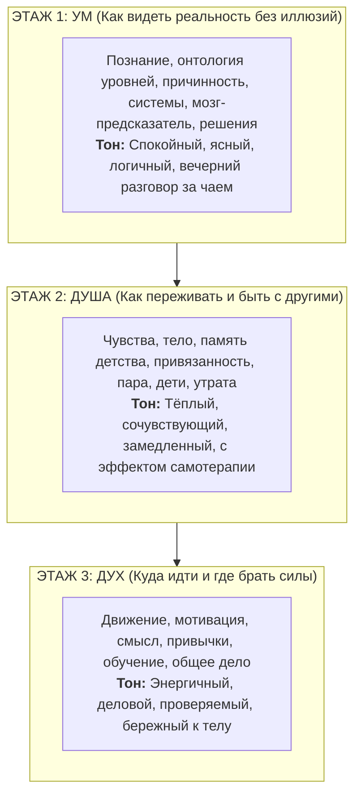
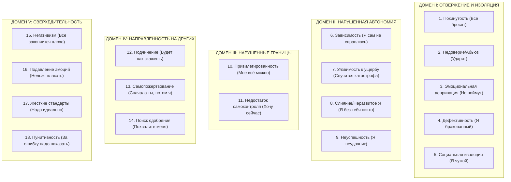
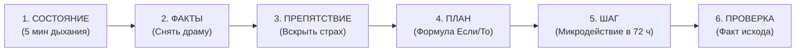

# ROOT: Обитаемая карта
## Как устроен мир, как устроен человек и как расти, не обманывая себя
### (Рабочая модель, а не догма)

---

## 🏛️ РЕДАКТОРСКАЯ ЗАПИСКА И СТРОИТЕЛЬНЫЕ ПРАВИЛА КНИГИ

### 1. Архитектурный замысел: Книга-дом из трёх этажей
Человек не состоит из одних только логических схем, не исчерпывается бурлящими эмоциями и не сводится к голой волевой тяге. Книга построена как дом из трёх этажей, где каждый этаж решает одну жизненную задачу:

* **Первый этаж — УМ (Мышление и картина мира):** Удовлетворяет жажду логики. Объясняет, как мы познаём мир, из каких кирпичиков сложена Вселенная, где граница между доказанным фактом и красивой гипотезой, как мозг дорисовывает реальность и как принимать решения, не попадая в ловушки ума.
* **Второй этаж — ДУША (Чувства, тело и союзы людей):** Пространство проживания. Здесь меньше формул и больше живых историй. Каждая глава работает как сессия бережной самотерапии: помогает расшифровать телесные сигналы, разобрать узлы детских обид, наладить честный контакт в паре и пережить боль утраты, не ломая себя.
* **Третий этаж — ДУХ (Энергия, ценности и масштаб роста):** Практика действия. Здесь слово «дух» очищено от мистики: это вектор, внутренняя тяга, автономия, дисциплина без насилия над собой, мастерство и совместное созидание с другими людьми и технологиями.

---

### 2. Пять законов открытости и честности
1. **Проверяемость (Метки надёжности):** Никаких туманных авторитетов. Каждое научное утверждение снабжено строгой меткой надёжности:
   * 🟢 **[Прочно]** — подтверждено согласованными метаанализами или многократными независимыми репликациями на больших выборках.
   * 🟡 **[Умеренно]** — качественное клиническое испытание или устойчивые когортные данные с умеренным размером эффекта.
   * 🟠 **[Предварительно]** — лабораторные эксперименты, малые выборки, пилотные данные или дискуссионные академические теории.
   * 🔵 **[Гипотеза]** — авторская модель, метафора или логическая эвристика, требующая проверки практикой.
2. **Предельная простота (Слова на ладони):** Сложные понятия не используются для напускания тумана. Любой термин сначала объясняется на пальцах — одной короткой фразой и бытовым примером, понятным десятилетнему ребёнку.
3. **Безусловная практическая ценность:** В каждой главе есть упражнение на 5–30 минут, которое можно выполнить прямо сейчас, и конкретный способ проверить, есть ли сдвиг.
4. **Манифест Open-Source (100% открытость):** Никаких платных опросников, закрытых методик, дорогих подписок или коммерческих закрытых сервисов. Все используемые психологические шкалы находятся в общественном достоянии или доступны по открытым академическим лицензиям. Все программные инструменты бесплатны и имеют открытый исходный код (Open Source).
5. **Приоритет безопасности (Стоп-правила):** Книга знает границы самопомощи. В каждой главе прописаны красные флаги, при появлении которых самостоятельная работа прекращается и человек направляется к профильному специалисту или в кризисную службу.

---

### 3. Сквозные герои книги
Через все 24 главы проходят три собирательных художественных образа. Их истории показывают, как системные законы проживаются живыми людьми:
* **Марта (38 лет):** Ведущий инженер-программист в технологической компании. Умная, рациональная, привыкла всё решать головой и держать под контролем. Сломалась, когда пропал сон, навалилась хроническая усталость, а привычная логика перестала помогать. Ведёт за собой главы об уме, бессоннице, выгорании и работе с технологиями.
* **Илья (45 лет):** Предприниматель, муж, отец двоих сыновей (10 и 15 лет). В семье годами копится ледяное молчание и глухое раздражение. Из родительской семьи вынес привычку терпеть до последнего, сжимать зубы и глушить тревогу перегрузкой. Ведёт главы о теле, чувствах, детских схемах, браке и отцовстве.
* **Нина (61 год):** Преподавательница литературы на пенсии. Год назад похоронила мужа, с которым прожила тридцать пять лет. Ощущает звенящую пустоту квартиры, учится заново находить повод вставать по утрам, восстанавливать разорванные связи с людьми и передавать опыт. Ведёт главы об одиночестве, утрате, смысле и зрелом наставничестве.

---

## 🛑 СТРАНИЦА БЕЗОПАСНОСТИ (ПРОЧИТАТЬ ДО ПЕРВОЙ ГЛАВЫ)

> [!CAUTION]
> **Границы применимости книги:**
> Эта книга — карта для ориентирования и инструмент самопомощи для здоровых людей в периоды нормативных кризисов, стресса и поиска ориентиров. Она **не является медицинской помощью, не заменяет психотерапию и не предназначена для лечения клинических психических расстройств**.

### 1. Реестр абсолютных стоп-сигналов
Если вы замечаете у себя или близкого человека хотя бы один признак из списка ниже — **отложите книгу** и немедленно обратитесь к врачу, психиатру или в службу экстренной помощи:
1. **Суицидальные мысли:** появление конкретных планов, намерений, поиск способов уйти из жизни или ощущение, что «всем без меня будет лучше».
2. **Импульсы причинить вред другим:** навязчивые мысли о физической расправе над близкими или посторонними людьми.
3. **Психотические симптомы:** слуховые или зрительные галлюцинации, ощущение чужого голоса в голове, бредовые идеи преследования или слежки, утрата связи с реальностью.
4. **Маниакальный полюс:** состояние неадекватной эйфории без потребности во сне более 3 суток подряд, сопровождающееся импульсивными финансовыми тратами или опасным поведением.
5. **Острая физиология:** бессонница более 72 часов подряд; полный отказ от еды или питья; внезапная давящая боль за грудиной, онемение половины лица или руки, нарушение речи (подозрение на инфаркт или инсульт).
6. **Синдром отмены:** резкое прекращение употребления алкоголя или успокоительных препаратов после длительного приема (чревато белой горячкой и судорогами, требует стационара).
7. **Домашнее насилие:** прямые угрозы убийством, избиения, сексуальное насилие, физическое удержание. В этой ситуации психологические беседы смертельно опасны — необходим план эвакуации и полиция.

### 2. Шаблон личного плана безопасности на одном листе (Safety Plan)
*(Заполняется один раз на случай острого эмоционального шторма)*
* **Мои триггеры:** Что именно выбивает меня из колеи (слова, даты, бессонная ночь).
* **Мои сигналы тревоги:** Что происходит в теле, когда я теряю контроль (холод в груди, звон в ушах, ступор).
* **Что я делаю сам(а), чтобы сбить накал:** Опустить лицо в холодную воду на 30 секунд; медленный длинный выдох; выйти на улицу и идти быстрым шагом 15 минут.
* **Кто может отвлечь меня:** Имя и телефон друга, с которым мы говорим о нейтральных вещах.
* **Кому я могу прямо сказать «мне плохо, помоги»:** Имя и телефон близкого человека.
* **Профессиональная помощь:** Телефон доверия, контакт врача-психиатра или кризисного отделения.
* **Безопасная среда:** Убрать из прямого доступа алкоголь, таблетки, ключи от машины.

---

# ЧАСТЬ I. УМ: КАРТА И ТЕРРИТОРИЯ
*Логика познания, онтология реальности, системные законы, биология восприятия и принятие решений*

---

### Глава 1. Что значит знать: Как отличить факт от выдумки
* **Входная сцена:** Марта сидит на кухне в три часа ночи. В браузере открыто тридцать вкладок: от влияния кофеина на аденозиновые рецепторы до эзотерических советов по «чистке биополя». Она ловит себя на ужасе: она блестящий программист, но понятия не имеет, как в собственной жизни отличить проверенный факт от складной лжи.
* **Идея простыми словами:** Знание — это не слепая вера и не цитаты авторитетов. Наш мозг обожает простые красивые объяснения, но мир сложнее наших сказок. Научный метод держится на двух простых идеях:
  1. *Принцип фальсифицируемости Карла Поппера:* идея считается научной только тогда, когда можно заранее сказать, какой эксперимент её опровергнет. Если теорию в принципе нельзя опровергнуть (например, «во всём виновата невидимая карма»), она бесполезна для практики.
  2. *Байесовское обновление уверенности:* мы никогда не знаем ничего на 100%. Мы начинаем с догадки (априорная вероятность), собираем твёрдые факты и аккуратно сдвигаем ползунок своей уверенности.
* **Слова на ладони:**
  * *Гипотеза:* Догадка, которую можно проверить опытом (например: «Если я перестану пить кофе после 14:00, я засну быстрее 20 минут»).
  * *Фальсифицируемость:* Наличие понятного условия: при каком результате мы признаем, что идея была ошибкой.
  * *Репликация:* Повторение опыта другими независимыми исследователями. Если опыт повторился в пяти разных лабораториях — знанию можно доверять.
  * *WEIRD-искажение:* Ситуация, когда 90% психологических теорий строятся на опросах студентов из богатых западных стран (Western, Educated, Industrialized, Rich, Democratic), а выдаются за законы природы для всех людей на Земле.
* **Что известно:** Научная методология доказательной медицины и критерии GRADE 🟢 **[Прочно]**; масштабный кризис воспроизводимости в экспериментальной психологии, показавший, что более половины громких опытов не повторяются при независимой проверке 🟢 **[Прочно]**.
* **Где идея ломается:** Бесконечный скептицизм ведет к параличу решений. В реальной жизни нам часто приходится действовать в условиях неполной информации, опираясь на лучшие текущие догадки.
* **Практика:** «Карточка утверждения» (занимает 5 минут). Возьмите убеждение, которое портит вам жизнь (например, «Я не способен к языкам»). Запишите 4 строчки: 1) В чем точный тезис? 2) На каких твердых цифрах он основан? 3) Какой конкретный факт доказал бы, что это неправда? 4) На сколько процентов из 100 я сейчас в этом уверен?
* **Как проверить на себе:** Ведение дневника прогнозов. Оценка Бриера (Brier Score) в бесплатной таблице: насколько ваши вероятностные прогнозы совпадают с реальными исходами за месяц.
* **Стоп-правило:** Появление ригидной убежденности «я знаю абсолютную истину обо всем, а ученые и врачи скрывают правду».

---

### Глава 2. Из чего всё сложено: Лестница реальности и честные границы науки
* **Входная сцена:** Марта смотрит с балкона высотки на ночной мегаполис: неоновые вывески, несущиеся машины, огни самолета, светящиеся окна квартир, стакан воды в её руке. Вода — это молекулы $H_2O$. Молекулы — атомы. Город — люди. Как всё это связано в единую картину, не скатываясь в бред?
* **Идея простыми словами:** Мир устроен этажами (онтологическими уровнями). Снизу вверх:
  `Квантовые поля → Атомы → Молекулы → Клетки → Органы и Мозг → Психика человека → Семья → Социальные институты`.
  На каждом новом этаже возникает **эмерджентность** — новое свойство, которого не было у кирпичиков этажом ниже. Мокрая вода состоит из водорода и кислорода, но ни один атом водорода сам по себе не является мокрым.
  Главное правило мышления: **не путать этажи**. Нельзя чинить сломанный брак уравнениями квантовой механики, и нельзя объяснять гравитацию законами семейной верности.
* **Слова на ладони:**
  * *Онтология:* Карта того, что реально существует в мире и как эти вещи связаны между собой.
  * *Эмерджентность:* Рождение нового свойства целого, которого не было у отдельных деталей (как вкус хлеба, не сводимый к свойствам зерна).
  * *Редукционизм:* Попытка свести сложное к примитивному (например, сказать: «Любовь — это просто выброс окситоцина в кровь»).
  * *Трудная проблема сознания:* Честное признание науки: мы знаем, какие зоны мозга активны при виде красного яблока, но понятия не имеем, почему физические нейроны вообще порождают субъективное переживание красноты.
* **Что известно:** Физическая и эволюционная картина мира 🟢 **[Прочно]**; теории сознания (глобальное рабочее пространство Деана, предиктивная обработка) 🟠 **[Предварительно]**; происхождение субъективного опыта квалиа и природа времени 🔵 **[Граница непознанного]**.
* **Где идея ломается:** Попытка продавать мистику под видом науки («Вселенная вибрирует на квантовых частотах добра»). Книга честно говорит: квантовая физика описывает микромир частиц, а не человеческие отношения.
* **Практика:** «Лестница объяснений». Возьмите любую острую проблему (например, вспышку ярости на работе) и запишите её причины на трех разных этажах: 1) Биология (не выспался, упал сахар в крови); 2) Психика (сработала детская обида на критику); 3) Социальная система (в отделе размыты обязанности и сорван дедлайн).
* **Как проверить на себе:** Оценка широты взгляда: перестали ли вы винить только один фактор (характер или биохимию) в сложных ситуациях.
* **Стоп-правило:** Отказ от медицинского лечения в пользу «исправления квантовых вибраций мысли».

---

### Глава 3. Причина или совпадение: Как не путать следствия со случайностями
* **Входная сцена:** Илья уверен, что семейные ссоры с женой происходят строго по четвергам из-за «плохой энергетики дня недели». Он начинает готовиться к обороне с утра четверга — и ссора неизбежно вспыхивает вечером.
* **Идея простыми словами:** То, что два события происходят рядом во времени, не значит, что одно вызвало другое. Петух кукарекает перед рассветом, но не солнце встает от его крика. Существует три ступени понимания причин по Джуде Перлу:
  1. *Наблюдение:* «Что я вижу вместе?» (ссора и четверг).
  2. *Вмешательство:* «Что будет, если я изменю одно звено?» (если я в четверг принесу цветы и высплюсь).
  3. *Контрфактическое рассуждение:* «Что произошло бы, если бы события X не случилось?».
* **Слова на ладони:**
  * *Корреляция:* Совместная изменчивость двух явлений (продажи мороженого растут одновременно с числом утонувших людей — не потому что мороженое топит, а потому что на улице лето).
  * *Конфаундер (скрытая общая причина):* Третий невидимый фактор, влияющий на оба события (в случае Ильи — накопленная за рабочую неделю усталость и дедлайны по четвергам).
  * *Ошибка выжившего:* Опора только на успешные примеры при игнорировании кладбища неудачников (советы миллионеров, бросивших университет).
* **Что известно:** Математическая теория причинности Джуды Перла 🟢 **[Прочно]**; искажения восприятия случайностей и апофения 🟢 **[Прочно]**.
* **Где идея ломается:** В человеческих отношениях редко удается поставить идеальный слепой эксперимент; реальность динамична и запутана.
* **Практика:** «Правило трех альтернатив». Каждый раз, когда вам кажется, что вы поняли мотив другого человека («Он нарочно не ответил, чтобы унизить меня»), придумайте минимум 3 независимых объяснения (забыл телефон, занят сложной задачей, у него мигрень) и проверьте их вопросом.
* **Как проверить на себе:** Процент предположений, которые вы проверили прямым вопросом, вместо того чтобы строить догадки.
* **Стоп-правило:** Поиск скрытых знаков Вселенной во всплывающих номерах машин или повторяющихся цифрах на часах (паранойяльная апофения).

---

### Глава 4. Системы: Петли, запасы, задержки и точки рычага
* **Входная сцена:** Знакомый каждому душ в старой гостинице. Вода холодная. Человек крутит кран вправо. Ничего не меняется. Он крутит сильнее. Проходит пять секунд — и из лейки бьет ледяной кипяток. Человек в панике крутит кран влево — и через пять секунд вода становится ледяной. Вся жизнь большинства людей похожа на этот душ.
* **Идея простыми словами:** Любая живая и неживая структура — от организма до семьи и компании — является системой. Она состоит из 4 базовых вещей:
  1. *Запасы:* То, что накапливается (энергия в теле, деньги на счете, доверие в браке).
  2. *Потоки:* То, что вливается (приток) и выливается (отток).
  3. *Обратная связь:* Сигнал о результате действия. Бывает сдерживающей (отрицательной, возвращает в норму, как термостат) и разгоняющей (положительной, ускоряет процесс, как снежный ком или паника).
  4. *Задержки (Delays):* Время между действием и видимым откликом. Почти все кризисы людей случаются из-за того, что они дергают систему сильнее, не дождавшись отклика.
  **Закон Гудхарта:** Как только показатель становится целью управления, он теряет смысл (если премировать программистов за количество строк кода — они напишут километры мусорного кода).
  **Рычаги Медоуз:** Давить силой на симптом бесполезно. Сильнейшие рычаги перемен — это изменение правил и целей системы.
* **Слова на ладони:**
  * *Система:* Набор элементов, соединенных связями ради общей функции.
  * *Узкое место (Bottleneck):* Самое медленное звено цепи, которое определяет скорость всей работы (бесполезно покупать мощный мотор, если забита топливная трубка).
  * *Положительная петля:* Процесс, который кормит сам себя (тревога → бессонница → паника от бессонницы → еще большая тревога).
* **Что известно:** Общая теория систем и кибернетика 🟢 **[Прочно]**; теория системной динамики Форрестера и Медоуз 🟡 **[Умеренно]**; теория ограничений Голдратта 🟡 **[Умеренно]**.
* **Где идея ломается:** Люди — не шестеренки. Узнав о системной модели, человек может намеренно изменить поведение из чувства противоречия или гордости.
* **Практика:** «Диаграмма личной петли». Нарисуйте на листе бумаги круг из 4 стрелок, описывающий вашу повторяющуюся проблему (например: *Ссора с женой → Уход в работу с головой → Чувство вины и усталость → Раздражение на мелкую просьбу → Ссора*). Найдите, где в этом круге спрятана временная задержка, и поставьте точку паузы.
* **Как измерить:** Замер времени задержки между вашим действием и системным откликом (в часах или днях).
* **Стоп-правило:** Попытка разрушить систему резким силовым нажимом («завтра уволю всех» или «сегодня же брошу всё и уеду в тайгу»).

---

### Глава 5. Как мозг строит мир: Оптические иллюзии, память и цена внимания
* **Входная сцена:** Простой опыт со слепым пятном. Нарисуйте на листе крестик и точку, закройте левый глаз и приближайте лист. В определенный момент точка исчезает. Но на её месте вы видите не черную дыру, а гладкий белый лист бумаги. Мозг только что на ваших глазах нарисовал то, чего нет на сетчатке.
* **Идея простыми словами:** Мозг сидит в полной темноте черепной коробки. Он не видит свет и не слышит звук напрямую — до него доходят только электрические импульсы по нервам. Поэтому мозг работает как генератор прогнозов: он непрерывно строит рабочую модель происходящего и сравнивает её с приходящими данными. То, что мы называем «реальностью» — это наше лучшее предсказание, подправленное сенсорными ошибками. Память — не видеокамера, а сказочник, который каждый раз пересочиняет воспоминание заново при каждом воспоминании. Внимание — узкий луч фонарика: переключение с задачи на задачу сжигает время и глюкозу.
* **Слова на ладони:**
  * *Предиктивное кодирование:* Теория о том, что мозг генерирует ожидания сверху вниз, а снизу вверх пропускает только ошибки расхождения.
  * *Слепота невнимания:* Способность не заметить танцующую гориллу в кадре, если вы сосредоточены на подсчете пасов мяча.
  * *Реконструктивная память:* Свойство памяти менять детали прошлого под влиянием текущего настроения и наводящих вопросов.
* **Что известно:** Предиктивные модели восприятия 🟡 **[Умеренно]**; реконструктивная природа памяти (исследования Элизабет Лофтус) 🟢 **[Прочно]**; когнитивная цена переключения внимания (Monsell) 🟢 **[Прочно]**.
* **Где идея ломается:** Опасность солипсизма: из факта иллюзорности восприятия нельзя делать вывод, что физического мира нет и «всё мне снится». Кирпич остается твердым независимо от наших галлюцинаций.
* **Практика:** Протокол разделения восприятия «Факт — Впечатление — Вывод». Лист бумаги из трех колонок: 1) Что зафиксировала бы видеокамера без звука (Факт: начальник вошел, не поздоровался, закрыл дверь); 2) Что почувствовало тело (Впечатление: холод в животе, перехватило дыхание); 3) Какую сказку сочинил ум (Вывод: «Меня точно уволят»).
* **Как проверить на себе:** Процент выводов из третьей колонки, оказавшихся ложными при объективной проверке через 24 часа.
* **Стоп-правило:** Потеря различия между сном и явью, дереализация, когда мир кажется стеклянным или нарисованным декорациями фильма.

---

### Глава 6. Ошибки ума и их ремонт: Калибровка прогнозов и взгляд со стороны
* **Входная сцена:** Марта снова клянется руководству, что модуль будет готов за три дня. В глубине души она помнит, что в прошлый раз точно такая же задача заняла три недели. Но прямо сейчас ей кажется: «В этот раз всё будет иначе, я просто сосредоточусь». Это ошибка планирования в чистом виде.
* **Идея простыми словами:** Наш ум пользуется быстрыми эвристиками (короткими путями мышления). В саванне они спасали жизнь, в современном мире — приводят к краху. Самая горькая новость когнитивной науки: **простое чтение книг об искажениях не защищает от ошибок**. Знать про ошибку подтверждения и перестать искать подтверждения своей правоте — совершенно разные вещи. Защищают только внешние процедуры:
  1. *Взгляд извне (Reference Class Forecasting):* игнорировать свои уникальные ощущения и посмотреть на сухую статистику 10 похожих случаев у других людей.
  2. *Метод Premortem (Разбор до старта):* до начала проекта представить, что прошел год и проект с треском провалился. Спросить команду: «Что именно нас убило?». Это легитимизирует критику.
  3. *Калибровка уверенности:* говорить не «я уверен», а «моя оценка вероятности — 70%».
* **Слова на ладони:**
  * *Ошибка планирования:* Систематическая недооценка времени и затрат на собственные задачи при адекватной оценке чужих.
  * *Ошибка подтверждения:* Склонность замечать только то, что доказывает нашу правоту, и слепнуть перед фактами против.
  * *Оценка Бриера:* Числовая мера точности вероятностных прогнозов (чем ближе к нулю, тем точнее вы видите будущее).
* **Что известно:** Когнитивные искажения Канемана и Тверски 🟢 **[Прочно]**; обучение калибровке прогнозов (Тетлок) 🟢 **[Прочно]**; эффективность метода Premortem (Гари Кляйн) 🟡 **[Умеренно]**.
* **Где идея ломается:** Рационализация простых спонтанных радостей (выбора мороженого или прогулки) превращает жизнь в унылый бухгалтерский учет.
* **Практика:** «15-минутный Premortem». Перед запуском любого важного дела (крупная покупка, смена работы, разговор) сядьте и запишите подробный сценарий: «Проект провалился, деньги потеряны, наступил худший исход. Что именно пошло не так? Каких предупреждений мы не заметили?». Напротив каждого пункта напишите одну превентивную меру.
* **Как проверить на себе:** Тренировка прогнозов на открытых бесплатных платформах (Metaculus, Good Judgment Open) или в личном файле прогнозов.
* **Стоп-правило:** Обсессивно-компульсивное взвешивание рисков, когда человек не может выйти из дома, не просчитав вероятность падения сосульки.

---

### Глава 7. Решения под неопределённостью: Обратимость, правила остановки и дневник решений
* **Входная сцена:** Нина держит в руках ручку над чистым листом. Дочь зовет её переехать в другой город, чтобы помогать с внуками. С одной стороны — родные люди, с другой — родной дом, подруги, могила мужа. Нина парализована: каждый вариант кажется непоправимой ошибкой.
* **Идея простыми словами:** В реальной жизни не бывает решений со 100% гарантией успеха. Зрелое решение — это не отсутствие сомнений, а ясный процесс выбора при неполноте данных:
  1. *Разделение качества решения и исхода:* Можно принять идеальное решение (поставить на надежный фундамент) и проиграть из-за землетрясения. Можно принять безумное решение (сесть пьяным за руль) и доехать живым. Умный оценивает качество логики, а не слепую удачу.
  2. *Обратимые и необратимые двери (по Джеффу Безосу):* В двустороннюю дверь можно войти и выйти назад, если не понравилось (поехать пожить к дочери на месяц на пробу). В одностороннюю дверь входят один раз (продать квартиру). К односторонним дверям подходят медленно, через двусторонние бегут быстро.
  3. *Принцип «достаточно хорошо» (Сатисфайсинг Герберта Саймона):* Поиск идеального варианта убивает психику. Зрелый человек формулирует минимальные критерии качества и берет первый подошедший вариант.
* **Слова на ладони:**
  * *Необратимое решение:* Решение, отмена которого стоит несоразмерно дорого или невозможна физически.
  * *Сатисфайсинг:* Стратегия выбора варианта, удовлетворяющего порогу приемлемости, вместо бесконечной погони за оптимумом.
  * *Дневник решений:* Запись контекста, вариантов, сомнений и прогнозов в момент принятия решения (защита от иллюзии «я так и знал»).
* **Что известно:** Теория рационального выбора и эвристики удовлетворения потребностей Саймона 🟢 **[Прочно]**; дневники решений как защита от искажения ретроспекции 🟡 **[Умеренно]**.
* **Где идея ломается:** Перфекционизм под видом аналитики; стремление переложить ответственность за выбор на формулу или алгоритм.
* **Практика:** «Дневник решений на салфетке». Перед тем как сделать выбор, запишите: 1) Какую проблему я решаю? 2) Какие 3 альтернативы я рассмотрел? 3) Почему выбран этот вариант? 4) Это дверь в одну сторону или в две? 5) Какой исход я ожидаю через 90 дней? Запечатайте и поставьте дату проверки.
* **Как измерить:** Доля пересмотренных вовремя решений без самоедства.
* **Стоп-правило:** Принятие судьбоносных решений в состоянии HALT (голодный, злой, одинокий, уставший).

---

### Глава 8. Мысль с машиной: Искусственный интеллект как оппонент мышления
* **Входная сцена:** Марта сидит перед светящимся экраном терминала. Часы показывают 03:40. Она загружает в диалоговое окно свои мысли о тупике в архитектуре проекта и спрашивает: «Я всё правильно делаю?». Бот мгновенно отвечает льстивым, гладким текстом: «Вы приняли великолепное решение, ваш подход крайне инновационен...». Марта захлопывает ноутбук: машина просто поддакивает её бреду.
* **Идея простыми словами:** Большие языковые модели (LLM) — это не мыслящие существа, не цифровые боги и не оракулы истины. Это сложнейшие авторегрессионные статистические зеркала языка.
  *Их главная сила:* молниеносная компиляция, структурирование сырых мыслей, когнитивная разгрузка, поиск скрытых логических коллизий.
  *Их главные ловушки:* **галлюцинации** (уверенная генерация выдуманных фактов), **сикофантия** (склонность алгоритма поддакивать предубеждениям пользователя, чтобы получить высокий рейтинг) и **риск утечки персональных данных**.
  Использовать ИИ продуктивно — значит нанимать его не адвокатом своего эго, а безжалостным спарринг-партнером (Red Team).
* **Слова на ладони:**
  * *Большая языковая модель (LLM):* Программа, обученная предсказывать следующее наиболее вероятное слово в контексте гигантского массива текстов.
  * *Сикофантия (Sycophancy):* Склонность модели подстраиваться под мнение человека, даже если оно ошибочно или абсурдно.
  * *Локальный запуск (Local LLM):* Запуск свободной модели непосредственно на собственном компьютере без отправки данных в облако корпораций (программы Ollama, llama.cpp).
  * *Открытые веса:* Модели, доступные для бесплатной загрузки и автономной работы (семейства Llama, Mistral, OLMo под свободными лицензиями).
* **Что известно:** Когнитивная разгрузка через цифровые инструменты 🟢 **[Прочно]**; феномены галлюцинаций и сикофантии в генеративных моделях 🟢 **[Прочно]**; пилотные клинические испытания диалоговых ботов в ментальном здоровье 🟡 **[Умеренно / Требует осторожности]**.
* **Где идея ломается:** Замена живого общения диалогами с ботом; иллюзия того, что языковая модель способна дать этический или экзистенциальный ответ на вопрос о смысле жизни.
* **Практика:** Промпт-протокол «Адвокат дьявола». Отправьте в модель черновик своего плана с жесткой инструкцией: *«Ты — въедливый, скептичный рецензент. Твоя задача — не хвалить меня, а найти 5 самых уязвимых мест, необоснованных допущений и рисков провала в этом тексте. Задай мне три вопроса, на которые у меня нет ответа»*.
* **Как измерить:** Число реальных уязвимостей, найденных и устраненных до столкновения с реальностью.
* **Стоп-правило:** Использование нейросети вместо визита к психиатру при суицидальных мыслях или тяжелой депрессии; передача модели конфиденциальных медицинских выписок или банковских данных.

* **Финал Части I (Ночь, в которой Марта уснула):** Марта закрывает все лишние вкладки. Она берет лист бумаги, чертит простую петлю: кофе → истощение → тревога → бессонница. Она видит задержку. Она видит точку рычага. Она выключает экран, ложится в темноту и впервые за полгода засыпает через пятнадцать минут.

---

# ЧАСТЬ II. ДУША: ДОМ, ГДЕ ЖИВУТ ЧУВСТВА
*Телесная основа состояний, природа эмоций, распутывание детских ранних схем, взрослая привязанность, пара, семья и проживание горя*

---

### Глава 9. Что такое чувство: Назвать состояние, чтобы вернуть управление
* **Входная сцена:** Илья возвращается домой после сорвавшихся переговоров. Жена спрашивает: «Что случилось? Ты в порядке?». Илья цедит сквозь зубы: «Всё нормально!», не замечая, что его кулаки сжаты до побеления костяшек, а челюсти сведены так, что хрустят зубы.
* **Идея простыми словами:** Эмоция — это не слабость и не блажь, а древняя биологическая телеграмма. Она сообщает: «Случилось нечто важное для твоего выживания, тело мобилизовано!». Эмоция состоит из 4 частей: физиология (пульс, спазм), импульс к действию (сбежать, ударить), мысль («меня предали») и субъективное чувство.
  Главное открытие науки об эмоциях: **эмоции не являются готовыми монолитными кирпичами**. Мозг конструирует конкретное чувство из базового телесного возбуждения и социального контекста (теория сконструированных эмоций Лизы Фельдман Барретт). Чем богаче ваш словарь состояний (эмоциональная гранулярность), тем быстрее мозг подбирает точный ответ и тем меньше страдает тело.
* **Слова на ладони:**
  * *Аффект:* Сырой сигнал тела — приятный/неприятный, бодрый/вялый (как показание датчика вольтметра).
  * *Эмоциональная гранулярность:* Способность точно различать оттенки своих состояний (отличать ярость от раздражения, обиду от бессилия, зависть от восхищения).
  * *Алекситимия:* Затруднение в распознавании и словесном описании собственных эмоций («мне просто как-то не так»).
* **Что известно:** Дифференциация эмоций снижает импульсивное деструктивное поведение 🟡 **[Умеренно]**; нейробиология эмоционального конструирования Барретт 🟡 **[Умеренно]**.
* **Где идея ломается:** Интеллектуализация: бесконечное придумывание названий своим чувствам без реального проживания и телесного расслабления.
* **Тихий час (20 минут письменной работы):** «Словарь состояний». Разделите лист на 4 графы: 1) Где в теле живет напряжение прямо сейчас? 2) Если бы это состояние было погодой или предметом, на что оно похоже? 3) Какое самое точное слово описывает его (не просто «злость», а, например, «бессильное возмущение несправедливостью»)? 4) Чего это состояние требует от меня прямо сейчас?
* **Как проверить на себе:** Измерение по свободному индексу благополучия ВОЗ (WHO-5); рост количества уникальных слов для описания эмоций в дневнике.
* **Стоп-правило:** Полное отсутствие чувств (чувство окаменелости, ледяной пустоты), длящееся более двух недель подряд без просвета.

---

### Глава 10. Тело — первый этаж души: Сон, движение, циркадный свет и аллостаз
* **Входная сцена:** Марта пытается медитировать в позе лотоса, чтобы справиться с накатывающей паникой. Она дышит, пытается «наблюдать мысли», но сердце колотится как бешеное. Она не спала нормально пять недель, пьет шестую чашку кофе за день и не выходила на улицу трое суток. Её душа кричит не о медитации, а о биологическом спасении.
* **Идея простыми словами:** Психика не висит в воздухе — она живет в биологическом субстрате. Хронический стресс изнашивает организм через механизм **аллостатической нагрузки** (истощение ресурсов адаптации, рост артериального давления, хроническое скрытое воспаление).
  *Фундамент психики держится на 5 вещах с колоссальным размером доказанного эффекта:*
  1. *Сон:* КПТ бессонницы (КПТ-И) доказанно превосходит снотворные в долгосрочной перспективе.
  2. *Физическая активность:* 150 минут умеренного движения в неделю снижают симптомы депрессии и тревоги с эффективностью, сравнимой с лучшими антидепрессантами и психотерапией.
  3. *Циркадный свет:* 30 минут утреннего дневного света на улице запускают выработку кортизола утром и мелатонина ночью.
  4. *Алкоголь и кофеин:* Алкоголь фрагментирует фазу быстрого сна (REM), лишая мозг эмоциональной переработки; кофеин после обеда блокирует аденозиновые рецепторы усталости.
  5. *Социальные связи:* Одиночество повышает смертность сильнее, чем курение 15 сигарет в день.
* **Слова на ладони:**
  * *Аллостатическая нагрузка:* Суммарный биологический износ тела в ответ на постоянную необходимость подстраиваться под хронический стресс.
  * *КПТ-И (CBT-I):* Когнитивно-поведенческая терапия инсомнии — золотой мировой стандарт восстановления сна без таблеток (ограничение времени в постели, контроль стимулов).
  * *Аденозин:* Молекулярный «счетчик бодрствования» в мозге: накапливается, пока мы бодрствуем, и вызывает давление сна.
* **Что известно:** Влияние спорта на депрессию и тревогу (метаанализ Singh et al., BJSM 2023) 🟢 **[Прочно]**; эффективность КПТ-И 🟢 **[Прочно]**; вред алкоголя для архитектуры сна 🟢 **[Прочно]**; отсутствие доказательств у очков против синего света и детокс-диет 🟢 **[Прочно]**.
* **Где идея ломается:** Орторексия — когда человек начинает маниакально тревожиться из-за каждого грамма сахара или пропущенной тренировки, превращая здоровый образ жизни в источник невроза.
* **Тихий час:** «Телесный бюджет». Заполните таблицу за прошедшую неделю без стыда и самобичевания: сколько часов сна в среднем? Сколько минут прогулок на свежем воздухе? Сколько чашек кофе после 14:00? Сколько алкоголя? Какое главное слабое звено забирает половину сил?
* **Открытые инструменты:** Программа CBT-i Coach (бесплатное официальное приложение VA); консенсусный дневник сна (Consensus Sleep Diary, доступен бесплатно в PDF); свободный офисный пакет LibreOffice Calc для ведения графика сна.
* **Стоп-правило:** Давящая боль за грудиной, одышка в покое, внезапная слабость в руке или ноге, потеря веса более 5 кг за месяц без диеты — немедленно к терапевту.

---

### Глава 11. Волны: Регуляция состояний, поведенческая активация и дыхание
* **Входная сцена:** Илья сидит в машине возле дома и не может выйти. В груди всё сдавлено ледяным обручем, в висках стучит. Дома ждут дети и жена, но у него нет сил даже открыть дверь. Он пытается «взять себя в руки», приказывает себе: «Соберись, тряпка!», но от этого становится только тяжелее.
* **Идея простыми словами:** Бороться с эмоцией в лоб или подавлять её («держать лицо») — самый дорогой способ сломать нервную систему. Процессная модель Джеймса Гросса показывает 5 точек перехвата управления:
  1. *Выбор ситуации:* не ходить туда, где вам гарантированно плохо, если можно не ходить.
  2. *Модификация:* изменить условия среды.
  3. *Внимание:* переключить фокус с накручивания мыслей на физические действия.
  4. *Когнитивный реаппрайзал:* переоценить значение ситуации («Он не презирает меня, он просто испуган не меньше моего»).
  5. *Модуляция ответа:* помочь телу прожить вегетативный всплеск через физиологический выдох.
  **Поведенческая активация:** при упадке сил и депрессии желание никогда не приходит раньше действия. Принцип: *действие предшествует мотивации*.
* **Слова на ладони:**
  * *Когнитивный реаппрайзал:* Способность изменить эмоциональный отклик, изменив то, как мы интерпретируем происходящее.
  * *Подавление экспрессии:* Попытка внешне скрыть бурю внутри (резко повышает давление и уровень кортизола, разрушает память).
  * *Циклический вздох:* Физиологический паттерн дыхания (два вдоха носом: глубокий + короткий добор, затем длинный медленный выдох через рот), мгновенно включающий парасимпатический тормоз.
* **Что известно:** Модель регуляции эмоций Гросса 🟢 **[Прочно]**; поведенческая активация при депрессивных состояниях 🟢 **[Прочно]**; РКИ циклического вздоха (Balban et al., Cell Reports Medicine 2023) 🟡 **[Умеренно]**.
* **Где идея ломается:** Когнитивный реаппрайзал превращается в опасный газлайтинг, если человек пытается «переоценить в позитивном ключе» реальное насилие, побои или систематическое унижение.
* **Тихий час:** «Лист когнитивной переоценки». Выберите ситуацию за день, которая выбила из колеи. Заполните 5 колонок: 1) Событие; 2) Автоматическая катастрофическая мысль; 3) Реальные факты ЗА эту мысль; 4) Реальные факты ПРОТИВ этой мысли; 5) Альтернативный взрослый вывод.
* **Открытые инструменты:** Опросники PHQ-9 (депрессия) и GAD-7 (тревога) — находятся в общественном достоянии; бесплатные рабочие модули австралийского клинического центра Centre for Clinical Interventions (CCI).
* **Стоп-правило:** Балл по шкале PHQ-9 превышает 15 баллов; появление мыслей о самоубийстве (пункт 9 опросника PHQ-9) — немедленное обращение к психиатру.

---

### Глава 12. Рассказ о себе: Нарративная идентичность, экспрессивное письмо и самосострадание
* **Входная сцена:** Нина перебирает старые фотографии мужа и в тысячный раз прокручивает в голове тот вечер, когда он упал: «Если бы я вызвала скорую на десять минут раньше... Если бы я заставила его лечь в больницу на прошлой неделе...». Она заперта в замкнутом круге вины, уничтожающем остатки жизни.
* **Идея простыми словами:** Человек не помнит свою жизнь как набор сухих фактов. Мы живем внутри **нарратива** — истории, которую мы сами себе непрерывно рассказываем о том, кто мы такие, почему с нами так поступили и куда мы идем.
  Если нарратив состоит из сюжета вечной жертвы («со мной всегда так») или палача («я во всём виноват»), жизнь превращается в ад.
  *Два научно обоснованных инструмента пересборки истории:*
  1. *Экспрессивное письмо Джеймса Пеннебейкера:* выгрузка подавленных тяжелых переживаний на бумагу структурирует травматический опыт и снижает нагрузку на рабочую память.
  2. *Самосострадание Кристин Нефф:* отказ от роли внутреннего инквизитора. Включает 3 элемента: доброжелательность к себе вместо бичевания; осознание общей человечности («страдать, ошибаться и терять — это часть человеческого удела, я не один такой»); осознанность вместо слияния с болью.
* **Слова на ладони:**
  * *Нарративная идентичность:* Внутренняя развивающаяся история человека, объединяющая реконструированное прошлое, переживаемое настоящее и воображаемое будущее.
  * *Руминация:* Навязчивое, бесплодное пережевывание одних и тех же мрачных мыслей и причин несчастья без перехода к действиям.
  * *Самосострадание:* Отношение к себе в моменты неудач и боли с той же заботой, теплотой и пониманием, с какими мы относимся к любимому другу.
* **Что известно:** Связь связности нарратива с психологическим благополучием 🟡 **[Умеренно]**; метаанализы эффектов самосострадания (Neff) 🟢 **[Прочно]**; экспрессивное письмо (эффект малый, но стабильный при соблюдении правил) 🟡 **[Умеренно]**.
* **Где идея ломается:** Письменные практики превращаются в ядовитое болото руминации, если человек днями напролет описывает свои обиды, не переходя к поиску смысла и действиям.
* **Тихий час:** «Письмо сострадания к себе». Вспомните тяжелую ошибку или утрату. Напишите себе письмо от лица безусловно любящего, мудрого и доброго друга, который знает всю правду о вашей жизни, видит вашу боль и не судит вас. Что этот друг сказал бы вам прямо сейчас?
* **Как проверить на себе:** Шкала самосострадания Нефф (Self-Compassion Scale, доступна бесплатно для некоммерческого использования).
* **Стоп-правило:** Появление флэшбэков, диссоциации, ощущения выпадения из тела во время письма — немедленно закрыть тетрадь, коснуться стопами пола, выпить горячего чая и позвонить близкому.

---

### Глава 13. Детство внутри нас: Привязанность и 18 ранних схем Джеффри Янга
* **Входная сцена:** Илья взрывается яростью, когда жена просит его купить хлеб по дороге: «Хватит мной командовать! Я вам не прислуга!». Он видит в глазах жены недоумение и страх, но не может остановиться. В этот момент кричит не 45-летний мужчина, а обиженный десятилетний мальчик, которого мать заставляла отчитываться за каждую копейку.
* **Идея простыми словами:** Когда ребенок растет, у него есть базовые потребности: безопасность, принятие, автономия, границы, право на игру и спонтанность. Если эти потребности систематически попираются, мозг ребенка инсталлирует защитную программу — **раннюю дезадаптивную схему**.
  Схема — это ядовитые очки, через которые взрослый смотрит на мир. Она состоит из воспоминаний, телесных ощущений и убеждений. Когда схема активируется («триггерится»), человек теряет контакт со взрослой реальностью и проваливается в детский копинговый режим (нападает, убегает или замирает).
* **Слова на ладони:**
  * *Привязанность у взрослых:* Измеряется по двум независимым шкалам: **Тревога** (страх быть брошенным) и **Избегание** (страх сближения и уязвимости).
  * *Копинговый режим:* Способ защиты: *Капитуляция* (покорно терплю боль), *Избегание* (ухожу в алкоголь, игры, изоляцию), *Гиперкомпенсация* (нападаю первым, стремлюсь к идеальности и власти).
  * *Здоровый Взрослый:* Часть личности, способная видеть факты трезво, защищать своего Уязвимого Ребенка и успокаивать внутреннего Критика.

#### Каталог всех 18 схем Джеффри Янга (простыми словами):

1. **Покинутость / Нестабильность:** Убежденность, что все близкие люди неизбежно уйдут, умрут или бросят. *Триггер:* партнер задерживается с работы на 20 минут.
2. **Недоверие / Жестокое обращение:** Ожидание подвоха, предательства, боли или обмана от окружающих. «Если я откроюсь, мне вонзят нож в спину».
3. **Эмоциональная депривация:** Уверенность, что никто никогда не поймет, не согреет, не защитит и по-настоящему не полюбит.
4. **Дефективность / Стыд:** Глубокое фоновое ощущение своей фундаментальной неправильности, «бракованности», уродства. «Если люди узнают, какой я на самом деле, они отвернутся с отвращением».
5. **Социальная изоляция / Отчуждение:** Чувство инородности в любой группе: «Я чужой на этом празднике жизни, я не похож на остальных».
6. **Беспомощность / Зависимость:** Ощущение неспособности справиться с повседневными взрослыми делами (деньги, быт, решения) без чьей-то подсказки.
7. **Уязвимость к ущербу и болезням:** Хронический панический страх неминуемой катастрофы: инфаркта, сумасшествия, нищеты, падения самолета.
8. **Слияние / Неразвитая идентичность:** Спутанность границ с родителями или партнером: «Я не знаю, чего хочу я, я чувствую только то, что чувствует мама/муж».
9. **Неуспешность:** Вера в то, что во всех делах я неизбежно глупее, бездарнее и неудачливее сверстников.
10. **Привилегированность / Грандиозность:** Убежденность в собственной исключительности: «Правила написаны для толпы, а мне положено всё по первому требованию».
11. **Недостаточность самоконтроля:** Неспособность терпеть фрустрацию, скуку и откладывать удовольствие ради долгосрочных целей.
12. **Подчинение:** Отказ от своих желаний и подавление гнева из панического страха наказания или отвержения. «Будет так, как хочешь ты».
13. **Самопожертвование:** Добровольное обслуживание потребностей других людей в ущерб своему здоровью ради предотвращения чувства вины.
14. **Поиск одобрения / Признания:** Жизнь ради лайков, похвалы и чужих аплодисментов ценой утраты собственной подлинности.
15. **Негативизм / Пессимизм:** Фокус исключительно на рисках, потерях и плохих исходах при полном обесценивании хорошего.
16. **Подавление эмоций:** Запрет на искренний смех, слезы, гнев или нежность из страха показаться нелепым или потерять контроль.
17. **Жесткие стандарты / Гиперкритичность:** Перфекционизм: «Всё должно быть идеально, иначе это полный провал. Отдыхать нельзя».
18. **Карательность (Пунитивность):** Жестокая безжалостность к ошибкам — своим или чужим. «Ошибся — должен быть жестоко наказан».
* **Что известно:** Эффективность схема-терапии при хронических личностных трудностях (метаанализы РКИ) 🟢 **[Прочно]**; психометрика опросника привязанности ECR-R 🟢 **[Прочно]**.
* **Где идея ломается:** Попытка использовать схемы как оправдание дурного поведения: «У меня схема дефективности, поэтому я имею право орать на детей». Схема — это объяснение раны, а не индульгенция.
* **Тихий час:** «Диалог Здорового Взрослого с Уязвимым Ребенком». Определите, какая схема срезонировала сильнее всего. Запишите слова сочувствия своему детскому опыту, подтвердите, что тогда ребенок был беззащитен, но сегодня у него есть Взрослый — вы сами.
* **Открытые инструменты:** Опросник взрослой привязанности ECR-R (свободный для некоммерческого использования); опросник схем заменяется открытыми модулями CCI по работе с глубинными убеждениями (Core Beliefs).
* **Стоп-правило:** Подъем тяжелых воспоминаний физического или сексуального насилия, вызывающих оцепенение или панику — работа прекращается, необходим сертифицированный психотерапевт по работе с травмой (EMDR, КПТ травмы).

---

### Глава 14. Двое: Коммунальные нормы, четыре всадника и скрининг безопасности
* **Входная сцена:** Илья и Лена ужинают на кухне. Звякают вилки. В воздухе висит ледяная тяжесть. Лена бросает: «Ты опять забыл забрать документы? Впрочем, как всегда». Илья молча отворачивается к окну, внутри него захлопывается бронированная дверь. Это стена отстранения.
* **Идея простыми словами:** Отношения в паре разрушаются не из-за того, что люди спорят, а из-за того, **как** они спорят.
  *Главное различие отношений по Кларк и Миллс:*
  * В деловых отношениях действуют **обменные нормы:** ты мне услугу — я тебе деньги.
  * В близких отношениях действуют **коммунальные нормы:** мы заботимся друг о друге бескорыстно, потому что другой человек дорог сам по себе. Попытка вести бухгалтерский учет взаимных долгов в браке («я три раза помыл посуду, теперь твоя очередь целовать меня») гарантированно убивает любовь.
  *Четыре всадника деградации отношений Джона Готтмана:* 1) **Критика** (переход с поступка на личность); 2) **Презрение** (насмешки, сарказм, закатывание глаз — главный разрушитель иммунитета и брака); 3) **Защитная реакция** (контратака вместо признания факта); 4) **Каменная стена** (глухой уход в молчание).
* **Слова на ладони:**
  * *Принуждающий контроль (Coercive Control):* Паттерн доминирования, когда один партнер системно изолирует другого от друзей, контролирует его переписку, деньги, одежду и внушает страх (это уголовное преступление и насилие, а не «сложный характер»).
  * *Цикл «Требование — Отстранение»:* Ловушка, где тревожный партнер усиливает претензии от страха потери, а избегающий партнер глубже уходит в раковину.
  * *Мягкое начало разговора:* Обсуждение проблемы без претензии к личности: говорить о своих чувствах и конкретном факте.
* **Что известно:** Коммунальные против обменных норм (Clark & Mills) 🟢 **[Прочно]**; предикторы стабильности брака по Готтману 🟡 **[Умеренно]**; концепция принуждающего контроля Эвана Старка 🟢 **[Прочно]**.
* **Где идея ломается:** Попытка договариваться и налаживать контакт в ситуации принуждающего контроля или насилия. Если один партнер бьет или запугивает другого — семейная терапия запрещена, жертве нужна защита и безопасное убежище.
* **Тихий час (для одного):** «Письмо из уязвимости, которое не нужно отправлять». Напишите партнеру о том, что происходит внутри вас, убрав любые обвинения. Вместо «Ты холодная эгоистка» напишите: «Когда ты молчишь, мне становится смертельно одиноко и страшно, что я тебе больше не нужен».
* **Парная практика:** 20-минутный регламентированный диалог по таймеру (Speaker-Listener Technique). 10 минут говорит один без перебивания, второй только повторяет услышанное своими словами. Затем смена ролей. При пульсе выше 100 уд/мин — обязательный перерыв на 20 минут.
* **Как измерить:** Шкала диадической адаптации RDAS (свободна для использования).
* **Стоп-правило:** Любые эпизоды рукоприкладства, швыряния предметов, блокирования выхода из комнаты, угрозы отобрать детей или деньги — прекратить любые практики, обратиться в службу помощи женщинам или полицию.

---

### Глава 15. Дом, в котором растут дети: Эмоциональная безопасность, границы и тренинг родителей
* **Входная сцена:** Десятилетний сын Ильи приносит чашку чая родителям, которые кричат друг на друга в гостиной. Мальчик улыбается натянутой, испуганной улыбкой и начинает рассказывать глупые шутки. Он пытается стать клоуном, чтобы спасти семью от развода.
* **Идея простыми словами:** Детям вредят не разногласия родителей как таковые, а **деструктивный, хронический, враждебный конфликт**, который взрослые не завершают примирением. Ребенок биологически запрограммирован считывать угрозу: когда два его главных защитника воюют, рушится весь мир.
  *Две главные системные деформации:*
  1. *Триангуляция:* втягивание ребенка третьим лицом в конфликт пары («пойди скажи отцу, что он негодяй»).
  2. *Парентификация:* ситуация, когда родитель делает ребенка своим психотерапевтом, жилеткой для слез или функциональным родителем для младших детей.
  *Что реально работает в воспитании (доказано мировыми программами):* позитивное внимание к хорошему поведению, последовательные четкие правила без крика и телесных наказаний, ежедневные 20 минут качественного совместного времени без гаджетов.
* **Слова на ладони:**
  * *Эмоциональная безопасность ребенка:* Уверенность ребенка в стабильности семьи и защите взрослых, база для исследовательской активности.
  * *Парентификация:* Искажение семейной роли, при котором ребенок вынужден выполнять физические или эмоциональные обязанности взрослого по отношению к своим родителям.
  * *Позитивное подкрепление:* Фиксация внимания и похвала за конкретное желательное действие вместо замечаний за ошибки.
* **Что известно:** Влияние родительского конфликта на детей (Cummings & Davies) 🟢 **[Прочно]**; вред парентификации (Hooper) 🟢 **[Прочно]**; доказательная база поведенческих программ тренинга родителей (PMT, Triple P, Incredible Years) 🟢 **[Прочно]**.
* **Где идея ломается:** Перфекционизм родителей: иллюзия, что при ребенке нельзя выразить ни одной живой эмоции. Конструктивный конфликт, завершившийся открытым примирением на глазах у детей, учит их договариваться.
* **Тихий час:** «Семейная генограмма на листе». Нарисуйте дерево трех поколений (ваши родители, вы с партнером, ваши дети). Обозначьте типы связей (двойная линия — близость, зигзаг — конфликт, пунктир — дистанция). Задайте себе вопрос: «Какую боль предков я бессознательно заставляю нести своего ребенка? Что я твердо останавливаю на себе?».
* **Открытые материалы:** Программа ВОЗ «Parenting for Lifelong Health» (все руководства открыты и бесплатны).
* **Стоп-правило:** Физические наказания (шлепки, ремень), вспышки неконтролируемой ярости на ребенка, оставление маленьких детей в опасности — повод немедленно обратиться за семейной поддержкой.

---

### Глава 16. Друзья, одиночество и проживание утраты: Двойной процесс горя
* **Входная сцена:** Нина сидит в тишине опустевшей квартиры. Часы тикают оглушительно громко. В телефоне — сотни контактов бывших коллег, но она не может набрать ни один номер: «Я никому не нужна со своей бедой, у всех своя жизнь».
* **Идея простыми словами:** Одиночество — это не отсутствие людей вокруг, а субъективное ощущение оторванности от стаи, нехватка подлинного контакта.
  *Как устроено горе на самом деле:* Знаменитая теория пяти стадий Кюблер-Росс (отрицание, гнев, торг, депрессия, принятие) **не подтвердилась в исследованиях**. Горе не идет по ступенькам. Современная научная модель — **двойной процесс совладания с утратой (Stroebe & Schut)**: человек непрерывно качается между двумя полюсами:
  1. *Полюс утраты:* слезы, тоска, перебирание писем, боль памяти.
  2. *Полюс восстановления:* быт, починка крана, покупка продуктов, новые дела, возвращение к людям.
  Здоровое проживание горя — это свобода переходить с одного полюса на другой без чувства вины за то, что сегодня ты улыбнулся.
* **Слова на ладони:**
  * *Одиночество:* Тягостное субъективное переживание изоляции (в отличие от уединенности — спокойного ресурсного пребывания наедине с собой).
  * *Двойной процесс горя:* Естественное колебание между проживанием боли потери и адаптацией к новой практической реальности.
  * *Затяжное расстройство горя (PGD):* Состояние, когда через 12 месяцев после утраты человек полностью парализован болью и не может функционировать.
* **Что известно:** Вред хронического одиночества для сердечно-сосудистой системы и иммунитета 🟢 **[Прочно]**; двухпроцессная модель горя Штробе и Шута 🟡 **[Умеренно]**; опровержение стадий Кюблер-Росс 🟢 **[Прочно]**.
* **Где идея ломается:** Требование к горюющему «быть сильным» или попытки заглушить горе алкоголем и трудоголизмом.
* **Тихий час:** «Две колонки памяти». Напишите на листе: 1) То, что ушло навсегда и о чем я оплакиваю; 2) Три ценности, привычки или дела ушедшего человека, которые я добровольно беру с собой и продолжаю нести в мир.
* **Практика:** Правило «Одного живого контакта». Раз в неделю совершить один телефонный звонок или организовать одну часовую встречу с живым человеком без экранов.
* **Как измерить:** Шкала одиночества UCLA (краткая свободная версия); опросник воспринимаемой социальной поддержки MSPSS.
* **Стоп-правило:** Стойкое нежелание жить, длящееся более года после утраты; галлюцинаторные призывы уйти вслед за умершим.

* **Финал Части II (Три письма, три двери):** Три сцены без морали. Илья пишет жене короткую записку: «Я устал воевать. Давай просто поужинаем вдвоем». Нина берет трубку и впервые за год приглашает соседку на чай с пирогом. Марта признается коллеге по проекту: «Я не справляюсь одна, мне нужна помощь». Двери открываются.

---

# ЧАСТЬ III. ДУХ: ВЕТЕР В ПАРУСА
*Энергия деятельности, внутренняя мотивация, наука о привычках, честное обучение, командная безопасность и личные эксперименты*

---

### Глава 17. Что нас движет: Теория самодетерминации и аудит сил
* **Входная сцена:** Марта сидит на корпоративном митапе. Ей вручают премию за закрытый релиз — солидный бонус и стеклянную статуэтку. Коллеги аплодируют. Марта улыбается на камеру, но внутри — абсолютный, звенящий ноль. Деньги на счету не зажигают искру. Она не понимает, куда делась её энергия.
* **Идея простыми словами:** Человек — не цирковая собачка, которую можно бесконечно подстегивать сахаром и кнутом. Внешние стимулы (деньги, оценки, статус) работают только до порога базового комфорта, а при избыточном давлении — убивают искренний интерес.
  *Теория самодетерминации Эдварда Деси и Ричарда Райана доказала:* подлинная внутренняя мотивация и жизненная сила держатся на 3 фундаментальных психологических потребностях:
  1. **Автономия:** «Я сам выбираю свои действия, я автор своей жизни, а не пешка в чужих руках».
  2. **Компетентность:** «Я справляюсь со сложными задачами, я вижу, как растет мое мастерство».
  3. **Связанность:** «Я делаю это не в вакууме, мои дела нужны людям, меня окружают свои».
* **Слова на ладони:**
  * *Внутренняя мотивация:* Желание делать дело ради самого процесса и интереса к нему.
  * *Внешняя мотивация:* Делание дела исключительно ради награды или из страха наказания.
  * *Субъективная витальность:* Ощущение наполненности живой энергией и бодростью.
* **Что известно:** Теория самодетерминации (сотни независимых исследований в разных культурах) 🟢 **[Прочно]**; эффект подрыва внутренней мотивации внешними наградами (Deci) 🟢 **[Прочно]**.
* **Где идея ломается:** Наивный романтизм: «Буду делать только то, что хочется, а рутина пусть горит огнем». Взрослая жизнь требует интеграции рутины через осознание её высшего смысла.
* **Практика:** «Недельный аудит автономии». Каждый вечер записывайте 3 главных дела дня и ставьте им оценки от 1 до 5 по трем шкалам: А (выбрал сам?), К (чувствовал мастерство?), С (чувствовал связь с людьми?). Дела с нулями по всем трем графам подлежат делегированию или удалению.
* **Как измерить:** Шкала удовлетворения базовых психологических потребностей (BPNSFS, в свободном доступе); шкала субъективной витальности.
* **Стоп-правило:** Полная клиническая ангедония (невозможность испытать удовольствие вообще ни от чего), длящаяся дольше месяца (требует консультации врача-психиатра).

---

### Глава 18. Смысл и ценности: Направление движения вместо тупика целей
* **Входная сцена:** Нина разбирает книжные шкафы в кабинете. Она всю жизнь учила школьников любить книги. Теперь школа в прошлом. Муж ушел. Зачем просыпаться завтра утром? Ради чего варить овсянку?
* **Идея простыми словами:** Человеку не нужен абстрактный «великий смысл Вселенной». Человеку нужно локальное ощущение осмысленности каждого прожитого дня. Наука показывает, что ощущение смысла складывается из 3 опор:
  1. *Понятность (Coherence):* мир вокруг не кажется хаотичным безумием, у него есть структура.
  2. *Целенаправленность (Purpose):* у меня есть вектор движения на сегодня и на год вперед.
  3. *Значимость (Significance):* то, что я делаю, имеет ценность за пределами моего эгоизма.
  **Ценности — это не цели.** Цель — это пункт назначения (купить дом, защитить диссертацию). Достигнув цели, человек часто испытывает опустошение. Ценность — это компас и направление (быть заботливым, исследовать новое, творить красоту). Компас нельзя «завершить» — по нему можно идти всю жизнь.
* **Слова на ладони:**
  * *Ценность в ACT:* Направление выбранной жизни, характеризующее то, каким человеком вы хотите быть в процессе деятельности.
  * *Обязательство (Committed Action):* Маленькое физическое действие, совершенное в согласии со своими ценностями вопреки страху или лени.
* **Что известно:** Связь переживания смысла жизни с соматическим здоровьем и долголетием 🟢 **[Прочно]**; практики прояснения ценностей в терапии принятия и ответственности (ACT) 🟢 **[Прочно]**.
* **Где идея ломается:** Навязчивый философский поиск «смысла жизни» на диване вместо реального выхода в мир; экзистенциальная руминация.
* **Практика:** «Некролог наоборот». Напишите одну страницу от лица человека, который провожает вас в последний путь через 40 лет. Что он скажет о том, как вы обращались с людьми? Что вы построили? Что было для вас важнее денег и страха? Выпишите из текста 3 ключевые ценности и запланируйте 1 конкретное действие по каждой из них на эту неделю.
* **Как измерить:** Опросник смысла жизни (MLQ, Meaning in Life Questionnaire, свободен для некоммерческих целей).
* **Стоп-правило:** Экзистенциальный тупик с преобладанием суицидальных размышлений («жизнь бессмысленна, проще исчезнуть»).

---

### Глава 19. Привычки: Изменение поведения без волевого героизма
* **Входная сцена:** Илья шестой год подряд решает «начать бегать по утрам с понедельника». Он покупает дорогие кроссовки, ставит будильник на 06:00, терпит три дня на чистой злости, на четвертый день просыпает, корит себя за слабоволие и бросает кроссовки в темный угол шкафа.
* **Идея простыми словами:** Попытка ломать жизнь «железной силой воли» — антинаучная глупость. Воля — это оперативная память мозга: она мгновенно отключается при усталости или стрессе. Реальные долговременные изменения строятся на правильной настройке среды и автоматических привычках.
  *Что реально работает (доказано наукой):*
  1. *Интенции реализации (Implementation Intentions Петера Голлвитцера):* Формула «ЕСЛИ наступает ситуация X, ТО я делаю действие Y» (размер эффекта в метаанализах $d = 0.65$).
  2. *Управление трением:* Сделать желаемое действие физически легким (положить кроссовки у кровати с вечера), а нежелательное — максимально неудобным (отдать пароль от соцсетей жене).
  3. *Минимальная доза:* Начинать с привычки размером в 2 минуты (сделать 5 отжиманий, прочитать 1 страницу).
  4. *Сроки:* Миф о «21 дне» опровергнут. Реальное формирование автоматизма занимает в среднем 66 дней (от 18 до 254 дней в зависимости от сложности действия).
* **Слова на ладони:**
  * *Петля привычки:* Сигнал (триггер) → Шаблонное действие → Немедленное подкрепление (награда).
  * *Интенция реализации:* Конкретный план в форме «Если/То», связывающий внешний контекст с действием без участия волевого сомнения.
  * *Трение (Friction):* Количество физических и ментальных преград между вами и началом действия.
* **Что известно:** Метаанализ эффективности интенций реализации Голлвитцера 🟢 **[Прочно]**; лонгитюдное исследование времени автоматизма привычек (Lally et al., 2010) 🟡 **[Умеренно]**; провал репликации истощения воли (Hagger et al., 2016) 🟢 **[Прочно]**.
* **Где идея ломается:** Попытка внедрять более 2 новых привычек одновременно; игнорирование тяжелого соматического истощения.
* **Практика:** «Правило двух минут». Выберите одно желаемое действие. Сожмите его до двух минут (не «читать час», а «открыть книгу и прочесть 2 абзаца»). Напишите формулу: «ЕСЛИ я ставлю чашку утреннего кофе на стол, ТО я открываю тетрадь и пишу три строчки».
* **Как измерить:** Шкала автоматизма привычки (Self-Report Habit Index, SRHI, доступна бесплатно).
* **Стоп-правило:** Самобичевание и навязчивая вина за пропуск дня. Если привычка сорвалась — просто вернитесь к ней на следующий день без штрафов.

---

### Глава 20. Мастерство: Как учиться быстрее и честнее без мифа о 10 000 часов
* **Входная сцена:** Нина решает на пенсии освоить акварельную живопись. Она покупает краски, садится за стол, но руки дрожат, краска течет грязными пятнами. Ей кажется: «Мне уже поздно, у меня нет таланта, я бездарность».
* **Идея простыми словами:** Способность учиться новому не исчезает с возрастом — нейропластичность сохраняется до конца жизни. Но большинство людей учится самым неэффективным способом: перечитывают конспекты и выделяют текст маркером (это создает иллюзию знания при нулевом запоминании).
  *Четыре кита эффективного обучения (подтверждены когнитивной психологией):*
  1. **Активное извлечение (Active Recall):** Знание укрепляется не тогда, когда вы его вкладываете в голову, а тогда, когда вы с усилием вытаскиваете его из памяти (самотестирование, карточки).
  2. **Интервальное повторение (Spaced Repetition):** Повторять материал нужно в момент, когда вы почти готовы его забыть (кривая Эббингауза).
  3. **Чередование тем (Interleaving):** Смешивание разных типов задач вместо долбежки одной темы подряд.
  4. **Развенчание мифа о 10 000 часах:** Простое повторение действий не делает мастером. Мастером делает **осознанная практика (Deliberate Practice Андерса Эрикссона)**: работа на пределе возможностей с немедленной обратной связью.
* **Слова на ладони:**
  * *Нейропластичность:* Способность мозга перестраивать синаптические связи под влиянием нового опыта и практики.
  * *Активное вспоминание:* Практика тестирования себя без подглядывания в ответ.
  * *Осознанная практика:* Тренировка с фокусом на исправлении конкретных мелких ошибок под руководством обратной связи.
* **Что известно:** Эффект тестирования и интервального повторения в памяти (Dunlosky et al., 2013) 🟢 **[Прочно]**; метаанализы влияния практики на профессиональные достижения (Macnamara et al., 2014, показавшие, что практика объясняет лишь от 1% до 26% дисперсии результатов в зависимости от сферы) 🟢 **[Прочно]**.
* **Открытые инструменты:** Программа с открытым исходным кодом **Anki** для интервальных повторений; открытые образовательные ресурсы (OpenStax, Khan Academy, MIT OpenCourseWare).
* **Практика:** «Сессия извлечения». Изучив любой материал, закройте книгу и напишите на чистом листе памяти за 10 минут всё, что запомнили, в виде схемы или тезисов. Только потом откройте книгу и проверьте провалы.
* **Как измерить:** Процент правильных ответов при отсроченном тестировании через 7 и 30 дней в Anki.
* **Стоп-правило:** Нет.

---

### Глава 21. Дело, выгорание и протокол «ШАГ»: Как спасти себя от паралича
* **Входная сцена:** Марта сидит перед открытым проектом. Дедлайн через сорок восемь часов. Нужно написать сложный модуль, но её пальцы замерли над клавиатурой. Внутри — глухой паралич. Чем ближе срок, тем сильнее она скроллит новостную ленту, ненавидя себя за каждую секунду.
* **Идея простыми словами:** Выгорание — это не лень и не каприз. Это синдром хронического стресса на рабочем месте, с которым не удалось успешно совладать (официальное определение ВОЗ в МКБ-11). Оно складывается из 3 признаков: истощение сил, цинизм/отчуждение от работы и чувство профессиональной несостоятельности.
  Когда человек перегружен, кора мозга отключается, и наступает ступор. Выход из ступора требует алгоритма, восстанавливающего управление.

#### Протокол «ШАГ» (Шесть шагов выхода из тупика за 60 минут):
*(Авторская эвристика на базе доказанной Problem-Solving Therapy и ментального контрастирования WOOP)*

1. **СОСТОЯНИЕ (5 минут):** Встать из-за стола, сделать 10 циклов физиологического вздоха, умыть лицо холодной водой. Сбить адреналиновую панику.
2. **ФАКТЫ (10 минут):** Описать ситуацию сухим языком судебного протокола: «Что есть на самом деле? Сколько строк кода не написано? Сколько денег на счете?». Отсечь эмоциональные прилагательные («ужасно», «катастрофа»).
3. **ПРЕПЯТСТВИЕ (10 минут):** Честно ответить себе: «Чего я боюсь прямо сейчас?». Страх критики? Страх показаться некомпетентным? Неясность технического решения?
4. **ПЛАН (15 минут):** Сформулировать решение через технику WOOP: Одно конкретное действие и формула «Если возникнет препятствие X, то я сделаю Y».
5. **ШАГ (15 минут):** Найти **самое малое обратимое действие**, которое можно сделать в течение ближайших 72 часов. Написать одно письмо. Создать пустой файл. Позвонить одному человеку. Закрепить это действие публичным обязательством перед коллегой.
6. **ПРОВЕРКА (через 72 часа):** Зафиксировать результат: сделано или нет? Что изменилось в реальности?
* **Слова на ладони:**
  * *Выгорание:* Синдром истощения эмоциональных и физических ресурсов вследствие хронического производственного стресса.
  * *Problem-Solving Therapy (PST):* Доказательный психотерапевтический подход, обучающий навыкам структурированного решения жизненных проблем.
  * *Обратимый шаг:* Микродействие, последствия которого можно легко скорректировать без фатального ущерба для жизни.
* **Что известно:** Эффективность терапии решения проблем (PST) 🟢 **[Прочно]**; теория постановки целей Локка и Лэтэма 🟢 **[Прочно]**; сам протокол «ШАГ» классифицируется как авторская прикладная эвристика 🔵 **[Гипотеза / Требует проверки]**.
* **Где идея ломается:** Попытка применить протокол к человеку в состоянии острого шока, тяжелого горя или психотического расстройства.
* **Практика:** Полное прохождение протокола «ШАГ» по таймеру на одном листе бумаги.
* **Как измерить:** Бинарная отметка выполнения шага в течение 72 часов (1 — сделано, 0 — не сделано).
* **Стоп-правило:** Мысли о причинении себе вреда ради избегания работы; тяжелые панические атаки при приближении к рабочему месту.

---

### Глава 22. Тишина, внимание и благодарность: Тренировка осознанности без мистики
* **Входная сцена:** Нина выходит в осенний парк. Она садится на скамейку, кладет руки на колени и просто слушает: шелест кленовых листьев, далекий гул машин, прохладный воздух, касающийся щек. Впервые за год её мысли затихают. Ей не нужно никуда бежать.
* **Идея простыми словами:** Практики осознанности (майндфулнес, медитация) — это не эзотерический вход в астрал, а простая тренировка произвольного внимания и снижение реактивности миндалевидного тела мозга.
  *Честная наука о медитации:* Метаанализы показывают умеренный эффект практик осознанности для снижения тревоги и депрессии. Это не чудо и не панацея. Более того, **у практик есть побочные эффекты**: у части людей (особенно с тяжелыми непереработанными травмами) глубокое погружение в себя может вызвать усиление тревоги, дереализацию или флэшбэки. Поэтому практика должна быть дозированной и безопасной.
  *Другие практики с доказанным эффектом:* прогулки на природе (снижение активности руминации), дневник благодарности (небольшой, но стабильный сдвиг эмоционального фона), стоическое упражнение «Дихотомия контроля» (разделение того, что в нашей власти, и того, что вне её).
* **Слова на ладони:**
  * *Майндфулнес (Осознанность):* Безоценочное удержание внимания на непосредственном опыте настоящего момента.
  * *Дихотомия контроля:* Стоический принцип: разделение вещей на те, которыми мы управляем на 100% (наши мысли, выборы, поступки), и те, которыми мы не управляем (погода, чужие мнения, экономика).
  * *Руминативная петля:* Застревание мозга в бесплодном анализе прошлых ошибок.
* **Что известно:** Метаанализы эффективности программ MBSR при стрессе и тревоге 🟢 **[Прочно]**; нежелательные эффекты медитации (исследования Willoughby Britton) 🟡 **[Умеренно]**; психофизиологический эффект контакта с природой 🟢 **[Прочно]**.
* **Открытые материалы:** Бесплатные открытые курсы осознанности Palouse Mindfulness (полный курс MBSR в открытом доступе); материалы Healthy Minds Innovations.
* **Практика:** «Пятиминутка трех чувств». Остановитесь посреди дня. Назовите про себя: 3 вещи, которые вы видите прямо сейчас; 3 звука, которые слышите; 3 телесных ощущения (стопы на полу, ткань рубашки на плечах, прохлада воздуха).
* **Как измерить:** Шкала воспринимаемого стресса PSS-10 (в свободном доступе).
* **Стоп-правило:** Появление паники, деперсонализации, воспоминаний травмы во время практики — немедленно открыть глаза, встать, подвигаться, прекратить медитацию.

---

### Глава 23. Вместе: Команды, психологическая безопасность и зрелое лидерство
* **Входная сцена:** Марта сидит на архитектурном совете. Молодой стажер робко говорит: «Мне кажется, в этой базе данных будет узкое место при нагрузке». Старший тимлид язвительно обрывает его: «Ты сначала научись код без ошибок писать, а потом учи архитекторов». Стажер замолкает и втягивает голову в плечи. Марта видит: в эту секунду отдел потерял миллионы рублей, потому что ошибку никто не исправит.
* **Идея простыми словами:** Эффективность команды определяется не суммой индивидуальных IQ её членов. Исследования Эми Эдмондсон и масштабный проект Google «Аристотель» доказали: **главный фактор результативности — психологическая безопасность**.
  Это уверенность сотрудников в том, что их не высмеют, не накажут и не унизят за признание ошибки, честный вопрос или предложение идеи.
  *Научная правда о конфликтах в командах:* Популярная идея о том, что «споры по задачам всегда полезны», опровергнута метаанализами. И конфликт отношений, и конфликт задач в среднем снижают производительность команды. Спор по задаче полезен только в одном случае: если в коллективе уже создан высочайший уровень психологической безопасности.
* **Слова на ладони:**
  * *Психологическая безопасность:* Убежденность команды в том, что межличностный риск безопасен для каждого участника.
  * *Blameless Post-Mortem:* Культура разбора инцидентов, при которой ищут сбой в процессах и архитектуре системы, а не назначают виновного стрелочника.
  * *Трансформационное лидерство:* Стиль управления через вдохновение, личный пример, интеллектуальную стимуляцию и индивидуальную заботу.
* **Что известно:** Метаанализ психологической безопасности в организациях (Frazier et al., 2017) 🟢 **[Прочно]**; связь стилей лидерства с эффективностью команд 🟢 **[Прочно]**; метаанализы типов конфликта (De Dreu & Weingart) 🟢 **[Прочно]**.
* **Где идея ломается:** Ошибочное понимание психологической безопасности как «курорта» или «вседозволенности». Настоящая безопасность работает только в паре с высокой планкой профессиональных стандартов.
* **Практика:** Ритуал «Разбор без вины». После любого сбоя соберите команду и запретите задавать вопрос «КТО это сделал?». Задайте 3 системных вопроса: 1) Какая информация отсутствовала в момент решения? 2) Какая процедура позволила ошибке пройти незамеченной? 3) Какое изменение в регламенте сделает повторение этой ошибки невозможным физически?
* **Как измерить:** 7 вопросов шкалы психологической безопасности Эми Эдмондсон (доступна бесплатно в научных публикациях).
* **Стоп-правило:** Травля (моббинг), дискриминация, публичные оскорбления, сексуальные домогательства — вопросы права, трудовой инспекции и юристов, а не «командного тренинга».

---

### Глава 24. Путь: Честные эксперименты над собой (N-of-1) и личный устав
* **Входная сцена:** Марта открывает файл с личными заметками. Раньше там были списки упреков и грандиозные новогодние обещания, которые срывались к февралю. Сегодня там простая таблица из трех колонок. Никаких самообвинений. Только данные.
* **Идея простыми словами:** Человек уникален по генетике, истории и среде. То, что работает для тысячи людей в исследовании, может не подойти вам. Единственный научный способ узнать правду о себе — **дизайн эксперимента на одном человеке (N-of-1)**.
  *Как устроен честный N-of-1 эксперимент:*
  Нельзя сравнивать «неделю до» и «неделю после» (вы могли просто отдохнуть на выходных, сработала регрессия к среднему). Надежный дизайн — это чередование блоков:
  `Блок A (базовая линия без изменений, 4 дня) → Блок B (внедрение одной практики, 4 дня) → Блок A (отмена практики, 4 дня) → Блок B (снова внедрение, 4 дня)`.
  Если целевой показатель меняется строго при включении блока B — практика реально работает на вас.
  Итогом книги становится **Личный устав** — свод из 10 проверенных правил взаимодействия с реальностью.
* **Слова на ладони:**
  * *N-of-1 эксперимент:* Клинический метод проверки эффективности вмешательства на единственном испытуемом с контрольными фазами.
  * *Регрессия к среднему:* Статистический феномен: после экстремально плохого дня следующий день с высокой вероятностью будет лучше сам по себе, без всяких практик.
  * *Личный устав:* Краткий свод собственных принципов жизни, прошедших экспериментальную проверку практикой.
* **Что известно:** Методология клинических N-of-1 исследований 🟢 **[Прочно]**; искажение самоотчетов законом Гудхарта 🟢 **[Прочно]**.
* **Открытые инструменты:** Табличные процессоры LibreOffice Calc; открытые программы статистического анализа **JASP** и **jamovi** (полностью бесплатные OpenSource-альтернативы платным SPSS и Statistica); программы для ведения личных заметок с открытым кодом **Logseq** или **Joplin**.
* **Практика:** Построение Личного устава из трех разделов: 1) Мой обязательный биологический минимум (сон, свет, движение); 2) Мои правила в отношениях (коммунальность, стоп-насилие, разговор из уязвимости); 3) Мои рабочие привычки (если/то, малый шаг за 72 часа).
* **Как измерить:** Статистическая значимость различий между блоками A и B в программе jamovi.
* **Стоп-правило:** Невротический учет каждой минуты жизни; нарастание тревоги при мысли о пропущенном замере.

---

### Финал Части III и Эпилог: Дом с открытыми окнами
* **Сцена финала:** Городской сквер теплым весенним днем. Марта сидит на скамейке с ноутбуком — её код работает, она спокойна и собрана. Рядом проходит Илья — он держит за руку младшего сына, они смеются и спорят о мороженом. Навстречу идет Нина с этюдником через плечо — она спешит на занятия в изостудию.
Герои не знакомы между собой. Но читатель видит: они идут по одной земле. Они научились видеть мир ясным умом, согрели израненные души и обрели дух для спокойного, честного шага вперед.
* **Главный посыл книги:** Системное знание дается человеку не для того, чтобы возвыситься над другими и считать себя «просветленным среди слепых». Оно дается для глубокого сострадания, бережности к себе и смелости строить жизнь своими руками.

---

## 📎 ПРИЛОЖЕНИЯ КНИГИ

### Приложение A. Сводный реестр утверждений книги
Сквозная таблица проверки фактов:
| Глава и тезис | Научный источник (DOI) | Тип утверждения | Метка надёжности | Границы и ограничения |
| :--- | :--- | :--- | :--- | :--- |
| **Гл. 5:** Физкультура снижает депрессию | Singh et al., 2023, BJSM | Эмпирический метаанализ | 🟢 Прочно | Умеренный/высокий эффект; не заменяет стационар при психозе |
| **Гл. 5:** Социальная изоляция повышает риск смерти | Holt-Lunstad et al., 2010, PLoS Med | Метаанализ когорт | 🟢 Прочно | Данные наблюдательные; поправка на сопутствующие болезни |
| **Гл. 6:** 5-минутный циклический вздох снижает стресс | Balban et al., 2023, Cell Rep Med | Одно РКИ ($N=108$) | 🟡 Умеренно | Требуется репликация на клинических группах |
| **Гл. 13:** Схема-терапия эффективна при расстройствах личности | Giesen-Bloo et al., 2006; Bamelis, 2014 | РКИ | 🟢 Прочно | Проводится обученным специалистом, а не самолечением |
| **Гл. 14:** Коммунальные нормы vs обменные в браке | Clark & Mills, 1979, 2011 | Серия экспериментов | 🟢 Прочно | Не применимо в ситуациях криминального абьюза |
| **Гл. 19:** Намерения «Если/То» меняют поведение | Gollwitzer & Sheeran, 2006 | Метаанализ ($d=0.65$) | 🟢 Прочно | Эффект слабее при клинической ангедонии |
| **Гл. 21:** Протокол «ШАГ» | Авторская интеграция PST | Прикладная эвристика | 🔵 Гипотеза | Требует проверки личным опытом читателя |

---

### Приложение B. Полный каталог 18 ранних дезадаптивных схем и режимов Янга
Развернутый справочник с подробным описанием каждой схемы:
1. Детская потребность, фрустрация которой породила схему;
2. Типичные автоматические мысли взрослого;
3. Телесные соматические маркеры;
4. Проявление в трех копинговых стилях (Капитуляция, Избегание, Гиперкомпенсация);
5. Исцеляющая взрослая реплика Здорового Взрослого.

---

### Приложение C. Каталог системных сбоев и поломок
Классификация сбоев в узлах и каналах связи простыми словами:
* **Узловые поломки:**
  * *Пустота:* отсутствие необходимого базового навыка;
  * *Перегрузка:* поток задач превышает емкость ресурса;
  * *Искажение цели (Гудхарт):* оптимизация отчета вместо сути;
  * *Сенсорное отрицание:* слепота к неприятным фактам;
  * *Ролевой сбой:* человек не на своем месте;
  * *Токсичность:* пробитый периметр границ.
* **Связевые поломки:**
  * *Разрыв:* обрыв связи и изоляция;
  * *Искажение:* шум и подозрительность в канале;
  * *Рассинхрон:* несовпадение ритмов готовности;
  * *Клинч:* позиционная война самолюбий;
  * *Эскалация:* взрывная положительная обратная связь;
  * *Триангуляция:* втягивание третьего для сброса напряжения;
  * *Слияние:* утрата суверенитета и растворение границ;
  * *Эксплуатация:* хронический паразитический дисбаланс.

---

### Приложение D. Открытый инструментарий и свободные шкалы (Open-Source Stack)
Полный перечень свободного программного обеспечения и валидированных русскоязычных шкал, заменяющих коммерческие аналоги:
1. **Психодиагностика (Общественное достояние / Свободные лицензии):**
   * PHQ-9 (Шкала депрессии) — свободный скрининг;
   * GAD-7 (Шкала генерализованной тревоги) — свободный скрининг;
   * WHO-5 (Индекс благополучия ВОЗ) — свободный доступ;
   * ECR-R (Опросник привязанности в близких отношениях, русская валидация Сапоровской);
   * BFI-2 (Большая пятерка, свободный для некоммерческого использования);
   * MSPSS (Многомерная шкала социальной поддержки);
   * MLQ (Опросник наличия смысла в жизни).
2. **Программное обеспечение (Open Source / Free):**
   * Анализ данных: **JASP** (jasp-stats.org) и **jamovi** (jamovi.org);
   * Таблицы и тексты: **LibreOffice** (libreoffice.org);
   * Заметки и дневники: **Logseq** (logseq.com) и **Joplin** (joplinapp.org);
   * Диаграммы систем: **draw.io** и **Mermaid**;
   * Обучение: **Anki** (ankisrs.net);
   * Сон: **CBT-i Coach** (мобильное приложение VA).

---

### Приложение E. Кладбище идей: Популярные мифы, опровергнутые наукой
Честный разбор концепций, которые звучат привлекательно, но провалились при проверке:
1. **Тест MBTI и соционика:** Отсутствие бимодального распределения типов, низкая тест-ретестовая надежность. Заменено на Big Five.
2. **Истощение эго (Ego Depletion) Баумейстера:** Провал глобальной мультилабораторной пререгистрированной репликации 2016 года. Сила воли — не бензобак.
3. **Силовые позы (Power Posing):** Не влияют на гормоны и принятие риска при повторных опытах.
4. **Стили обучения (аудиалы, визуалы, кинестетики):** Обучение под предпочитаемый стиль не улучшает результаты тестов.
5. **Правило 10 000 часов:** Количество часов практики объясняет лишь скромную часть мастерства.
6. **Стадии горя Кюблер-Росс:** Горе не проходит через линейные этапы.
7. **Поливагальная теория Порджеса как догма:** Опровергнута в анатомических и эволюционных предпосылках нейробиологами (Grossman 2023).
8. **Шкала вибраций Хокинса:** Псевдонаука, основанная на кинезиологическом мышечном фокусе.

---

### Приложение F. Экстренная психологическая и медицинская помощь
Международные и локальные бесплатные службы кризисной помощи:
* Международный навигатор кризисных линий: **findahelpline.com** (бесплатный поиск помощи более чем в 130 странах мира).
* Единый номер экстренных служб: **112** (Евросоюз, РФ и ряд других стран).
* Горячие линии психологической помощи для детей, подростков и взрослых.
* Кризисные центры помощи пострадавшим от домашнего насилия.
