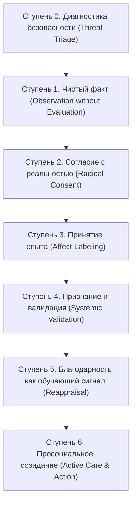

# СИНОПСИС КНИГИ «ROOT: КИБЕРНЕТИКА РЕАЛЬНОСТИ, ЧЕЛОВЕКА И СИСТЕМ»
### Редакция 3.0 (Мастер-версия: synopsis_v9)

---

## 0. МАНИФЕСТ И КИБЕРНЕТИЧЕСКАЯ АРХИТЕКТУРА

### Одна идея
Человек, пара, бизнес и команда устроены по единым законам системной динамики: это узлы, связи, накопители (запасы) и потоки с контурами обратной связи. Закономерности, управляющие распределенными вычислительными кластерами и биологическими экосистемами, тождественны законам, управляющим физиологией тела, структурой психики, супружескими союзами и бизнес-организациями. Поэтому любую системную поломку можно локализовать и устранить по одному инвариантному алгоритму.

### Один образ
Реальность работает как интерактивный тренажёр с неумолимым физическим сопротивлением. Мысль пластична и склонна к самообману, а физический кирпич или баланс на расчетном счете подделать нельзя. Мы чиним жизнь и бизнес исключительно через контакт с твёрдым: фактом, соматикой тела, измеримым поступком, материальными ресурсами.

### Одна цель
Непрерывное дообучение (*Fine-Tuning*) внутренней модели мира человека и организации через контакт с объективной реальностью. Если система перестает сверяться с внешним миром и замыкается внутри собственных фантазий, наступает коллапс модели (*Model Collapse*): система галлюцинирует, теряет адаптивность и неизбежно терпит крушение.

### Три обещания читателю
1. **Диагноз за 10 минут:** Мгновенное определение точки сбоя (дефект Узла или дефект Связи) и её точной локализации в топологии 12 жизненных или бизнес-сфер.
2. **Ремонт за 60 минут:** Единый универсальный двигатель (соматический сброс $\rightarrow$ когнитивная перекалибровка реальности $\rightarrow$ протокол C-O-R-E-X), сводящий паралич к первому необратимому шагу.
3. **Результат за 72 часа:** Каждая глава и каждый разбор завершаются проверяемым физическим действием в материальном мире с измеримым критерием результата.

### Принцип научной честности и демистификации
Каждая концепция и инструмент в книге имеют строгий статус:
* 🟢 **[Доказано]:** Опора на экспериментальные и клинические исследования (когнитивно-поведенческая терапия, терапия принятия и ответственности ACT, диалектическая поведенческая терапия DBT, нейробиология предиктивной обработки, исследования лаборатории Джона Готтмана, модели Джеймса Гросса, Криса Аргириса, Роберта Кигана, Брюса Макьюэна).
* 🟡 **[Рабочая модель]:** Авторские кибернетические эвристики и прикладные фреймворки (Круг 12 сфер и функций, вертикаль L1–L5, коэффициент отдачи $K_r = O / I$, архитектура цифрового двойника LUMA TWIN).
* 🔵 **[Метафора]:** Инженерные образы для визуализации сложных процессов (Оператор, Hardware/Software, терминал CLI, виртуальный шлем, ванна Форрестера), не претендующие на буквальную истину.

**Полный отказ от эзотерики:** Метафизика, «вибрации», «родовые поля» и кармический мистицизм в книгу не входят. Все феномены, которые в быту называют «энергетикой», «порчей» или «кармой», переводятся на строгий язык сигналов, аллостатической нагрузки, латентности сетей, проекций и предиктивных ошибок мозга.

### Сквозной практический кейс
Через всю книгу проходит история одной семьи и их бизнеса: **Жора** (инженер-разработчик, склонный к эмоциональному подавлению и уходу в голову), **Кристина** (маркетолог и продюсер, склонная к тревожному контролю и эмоциональной депривации) и их **совместный технологический проект**. Каждая поломка узла и связи разбирается на их живом опыте — от предразводного кризиса и кассового разрыва компании до выстраивания устойчивой системы.

---

## АРХИТЕКТУРА КНИГИ: ДВЕ ОСИ МАСШТАБИРОВАНИЯ

Книга построена на фрактальном принципе: законы элемента (Узла) и законы канала взаимодействия (Связи) универсальны на микро- и макроуровнях.

$$\begin{array}{rcc}
& \mathbf{УЗЕЛ~(Элемент)} & \mathbf{СВЯЗЬ~(Канал)} \\
\mathbf{Микроуровень~(1\text{-й}~порядок):} & \text{Человек (Психика + Тело)} & \text{Пара (Личная и Деловая)} \\
\mathbf{Макроуровень~(2\text{-й}~порядок):} & \text{Дело (Организация / Бизнес)} & \text{Команда (Сеть / Оргструктура)}
\end{array}$$

Вместо утомительного дробления на десятки разрозненных списков книга вводит **Два Универсальных Каталога**:
1. **Универсальный каталог поломок УЗЛА (20 поломок):** Применим инвариантно к человеку (психосоматика, когнитивные схемы) и к бизнесу (финансы, процессы, продукты).
2. **Универсальный каталог поломок СВЯЗИ (22 поломки):** Применим инвариантно к личной паре (брак), деловой паре (сооснователи) и команде (отделы, сотрудники).

А главным связующим звеном выступает **Часть II — ДВИГАТЕЛЬ**, размещенная в самом начале книги, чтобы читатель сразу овладел универсальным алгоритмом починки любой системы.

---

# ЧАСТЬ I. КАРТА: КАК УСТРОЕН МИР СИСТЕМ

### Глава 1. Сессия в симуляторе: Кто смотрит сквозь глаза?
* **1.1. Виртуальный шлем и лаг движка:** Мозг как вычислительный центр, рендерящий 3D-модель реальности в темноте черепной коробки. Кто осознает этот поток? Понятие Оператора — суверенной точки присутствия, ценностей и этического выбора, не сводимой к механическим реакциям. 🔵 **[Метафора]**
* **1.2. Физическая плотность мира и неподкупный тренажёр:** Почему материя ощущается твёрдой (принцип запрета Паули в физике). Зачем Вселенной жесткое сопротивление: мысль пластична и способна бесконечно оправдывать самообман, а факт и физическое тело не поддаются внушению. Материя создана несгибаемой, чтобы человек не мог смошенничать при обучении. 🟢 **[Доказано]**
* **1.3. Границы автопилота и дискретная свобода воли:** 90–95% повседневных реакций прописаны автоматическими привычками, гормональными приливами и эволюционными скриптами. Свобода воли Оператора — это не постоянное напряжение мышц, а точечный перевод стрелки сценария в критических точках развилок (точках бифуркации).
* **1.4. Демистификация «полей» и «энергий»:** 
  * *«Поле человека»:* Совокупность соматических маркеров Дамасио, микромимики Экмана, тонуса голоса и запаха стресса, считываемых зеркальными нейронами за 50 миллисекунд. 🟢 **[Доказано]**
  * *«Порча и сглаз»:* Эффект ноцебо (*Nocebo*) и самосбывающееся предиктивное пророчество: деструктивный сигнал авторитетного узла запускает в тревожном мозге соматизацию и разрушает адаптивность. 🟢 **[Доказано]**

---

### Глава 2. Четырёхсоставная архитектура человека
* **2.1. Четыре контура живой системы:**
  * **Оператор (Субъект):** Точка выбора, ответственности, смыслополагания и управления вниманием.
  * **Hardware (Биологический субстрат):** Тело, сенсорная сеть интероцепции, вегетативная нервная и эндокринная системы. Аппаратный сенсор состояния.
  * **Software (Когнитивно-эмоциональный стек):** Ментальные карты, предиктивные нейросети ума, когнитивные схемы Янга, автоматизмы мышления.
  * **Power Supply (Энергетический контур):** Витальность, качество сна, метаболический запас, митохондриальный ресурс, емкость биологических аккумуляторов.
* **2.2. Научная калибровка телесных датчиков (Поправка на интероцепцию):** 
  * Критика расхожего мифа «тело никогда не врёт». Тело — высокоточный первичный датчик, но его показатели искажаются тревогой, алекситимией, нейровоспалением и последствиями психических травм. Тело не врёт о том, что испытывает стресс, но может ошибаться в оценке источника угрозы (принимать нейтральный стимул за смертельную опасность). Требуется регулярная калибровка соматических датчиков. 🟢 **[Доказано]**
* **2.3. Экспресс-калибровка за 2 минуты:** Четыре вопроса самодиагностики: «Кто у руля: Оператор или автопилот? Что зафиксировано в соматике тела? Какую задачу решает Software? Сколько процентов заряда осталось в Power Supply?».

---

### Глава 3. Базовый алфавит системной динамики: Пять кубиков
* **3.1. Алфавит систем:** Любая структура — от молекулы до транснациональной корпорации — описывается пятью фундаментальными примитивами Джея Форрестера:
  * **Узел (Node):** Обособленный объект со своим внутренним состоянием, памятью, емкостью и границей.
  * **Связь (Link):** Канал передачи информации, вещества или энергии между узлами.
  * **Запас (Stock):** Накопленный объем ресурса внутри системы (деньги, гликоген, доверие, непрожитая обида, незавершенные задачи). Запасы меняются медленно и создают инерцию.
  * **Поток (Flow):** Скорость изменения запаса в единицу времени (приток и отток). Доходы/расходы, сон/бодрствование, похвала/критика.
  * **Граница (Perimeter):** Полупроницаемая мембрана, определяющая условия входа и выхода (фаервол, личные границы, корпоративный контур).
* **3.2. Образ ванны Форрестера:** Доверие в паре или кэш в бизнесе не испаряются от одного конфликта; их уничтожает хронический фоновый слив через скрытые утечки, действующие месяцами.
* **3.3. Балансировка запасов:** Выявление ключевого системного резервуара проблемы и ликвидация главного незаметного оттока.

---

### Глава 4. Семь фундаментальных законов систем
*Сведение законов к проверяемым эвристикам системного анализа и науки о поведении:*
1. **Закон Принадлежности (Integrity):** Каждый элемент, легитимно вошедший в систему, сохраняет право на признание своего места в топологии. Исключение или замалчивание узла деформирует структуру: система принуждает другой узел компенсировать пустоту (Боулби, теория систем). 🟡 **[Рабочая модель]**
2. **Закон Иерархии и Порядка (Precedence):** Поток ресурсов, правил и контекста течет во времени от источника к приемнику. Попытка приемника поучать или питать источник перегружает слабый канал и вызывает сбой (организационная теория, системный анализ). 🟡 **[Рабочая модель]**
3. **Закон Обмена и Баланса (Reciprocity):** Горизонтальная связь между равными устойчива только при взаимном обмене. Перекос Rx/Tx разрушает связь: дающий копит ярость, берущий — токсичную вину (теория социального обмена, норма взаимности Гоулднера). 🟢 **[Доказано]**
4. **Закон Границ и Целостности (Perimeter):** Система обязана иметь полупроницаемую мембрану. Без границы наступает энтропийное растворение в среде; при глухой броне — гибель от сенсорного и ресурсного голода (структурная теория Минухина). 🟢 **[Доказано]**
5. **Закон Необходимого Разнообразия Эшби (Requisite Variety):** Внутреннее разнообразие управляющей системы должно быть не меньше разнообразия возмущений среды. Черно-белое мышление и догматизм гарантированно проигрывают сложной динамической реальности. 🟢 **[Доказано]**
6. **Закон Обратной Связи и Временных Задержек (Feedback & Latency):** Отклик среды на управляющее воздействие приходит с лагом во времени (Стерман, «Beer Game»). Попытка судорожно дергать рычаги до прихода обратной связи приводит к катастрофической раскачке системы. 🟢 **[Доказано]**
7. **Закон Эмерджентности и Закон Гудхарта:** Свойства системы не сводятся к сумме её элементов (Герберт Саймон). Но как только частный показатель становится самоцелью, он перестает быть надежной метрикой (Чарльз Гудхарт): локальная оптимизация узкого KPI ценой гибели целого. 🟢 **[Доказано]**

---

### Глава 5. Обучение внутренней модели мира и пять багов нейросети
* **5.1. Предиктивный мозг (Фристон, Кларк):** Человеческое сознание непрерывно строит генеративную модель мира, минимизируя свободную энергию и ошибку предсказания (*Prediction Error*). Опыт — это датасет; физическое действие — обучающая итерация. 🟢 **[Доказано]**
* **5.2. Пять критических багов в весах внутренней модели:**
  1. **Коллапс модели (Model Collapse):** Обучение на собственных галлюцинациях без притока свежих данных из реальности. Замыкание в догмах, эхо-камерах и ментальных конструкциях.
  2. **Катастрофическое переобучение (Overfitting):** Генерализация единичной тяжелой травмы на всю ткань реальности («Один партнер предал — значит, доверять нельзя никому в мире»).
  3. **Галлюцинации (Hallucinations):** Дорисовывание чужих скрытых мотивов и катастрофических сценариев из собственного фонового шума тревоги.
  4. **Взлом функции награды (Reward Hacking):** Короткие паразитные дофаминовые петли (скроллинг, сахар, алкоголь, порнография, поверхностное признание), имитирующие эволюционную победу без реального созидательного действия.
  5. **Технический долг психики:** Хронический расход вычислительной мощности и ресурсов организма на обслуживание устаревших защитных механизмов, созданных в детстве.

---

### Глава 6. Лестница умозаключений (Аргирис) и фильтры восприятия
* **6.1. Механика самообмана:** Шесть ступеней Лестницы Криса Аргириса:
  $$\text{Сырые данные (камера)} \longrightarrow \text{Выборочный фильтр} \longrightarrow \text{Интерпретация} \longrightarrow \text{Допущение} \longrightarrow \text{Эмоция} \longrightarrow \text{Действие}$$
* **6.2. Скорость восхождения:** Мозг взлетает на шестую ступень за 100 миллисекунд, порождая скандал из нейтрального взгляда или невинной задержки ответа.
* **6.3. Инструмент «Камера против Комментатора»:** Разделение протокола: что объективно зафиксировала бы беспристрастная видеокамера, и какие субъективные домыслы дорисовал внутренний комментатор. Три проверочных вопроса для принудительного спуска по лестнице. 🟢 **[Доказано]**

---

### Глава 7. Термодинамика состояний и модель регуляции Гросса
* **7.1. Цена хронического стресса:** Физиология аллостаза и аллостатическая нагрузка (Брюс Макьюэн). Эмоции — это индикаторы мощности и сопротивления проводников нервной системы. Низкие деструктивные состояния (хроническая вина, токсичный стыд, обида) создают высокое омическое сопротивление, перегревают Hardware и истощают батарею вхолостую.
* **7.2. Развенчание мифа о «90 секундах»:** Научная правда о длительности эмоций. Первичный соматический всплеск нейромедиаторов кратковременен, но руминации ума способны подпитывать эмоциональный пожар часами и годами.
* **7.3. Модель регуляции эмоций Джеймса Гросса:** Пять точек приложения рычага (от дешевых к разрушительным):
  1. *Выбор ситуации:* Превентивный вход/невход в контекст.
  2. *Модификация ситуации:* Физическое изменение среды.
  3. *Перенаправление внимания:* Заземление, переключение сенсорного фокуса.
  4. *Когнитивная переоценка:* Смена смысловой рамки стимула.
  5. *Модуляция отклика (подавление):* Самая дорогая стратегия, разрушающая сердечно-сосудистую систему. 🟢 **[Доказано]**

---

### Глава 8. Внимание как дефицитный процессор
* **8.1. Архитектура фокуса:** Лимиты рабочей памяти (Коуэн: $3\text{–}4$ чанка). Цена переключения контекста (*Attention Residue* по Софи Лерой). Куда направлен фокус, туда утекает ток биологической батареи. 🟢 **[Доказано]**
* **8.2. Фоновые демоны оперативной памяти:** Незакрытые петли, висящие обязательства и скрытые конфликты как утечки памяти, непрерывно нагревающие процессор.
* **8.3. Протокол закрытия петель:** Инвентаризация фоновых задач и жесткая сортировка по четырем действиям: *Выполнить немедленно $\rightarrow$ Назначить в календарь $\rightarrow$ Делегировать $\rightarrow$ Безвозвратно удалить*.

---

### Глава 9. Шесть великих парадоксов реальности в кибернетическом переводе
*Строгий перевод древних философских противоречий на язык системной динамики без метафизики:*
1. **Свобода воли и детерминизм:** Физические и психологические законы — это рельсы среды; воля Оператора проявляется в дискретных точках стрелочных переводов (бифуркациях).
2. **Усилие и недеяние (Wu-wei):** Усилие расходуется не на силовую ломку реальности через колено, а на устранение внутреннего шума и сопротивления. В чистом проводнике действие совершается с минимальными энергозатратами.
3. **Запрос из нужды vs запрос из достатка:** Запрос из дефицита и паники модулирован шумом тревоги и порождает защитное отторжение сети; запрос из ясности и ресурса когерентен несущей частоте системы и легко маршрутизируется узлами.
4. **Синхронии и совпадения:** Предиктивный фильтр внимания (RAS): сознание мгновенно выхватывает из внешней среды закономерности, под которые уже сформированы синаптические паттерны.
5. **Конец сессии и конечность бытия:** Смерть физического скафандра как естественная системная граница. Осознание конечности сессии организует архитектуру приоритетов и обнуляет экзистенциальный мусор.
6. **Боль и зло:** Боль — это не кара, а аварийный датчик обратной связи («Убери руку с раскаленной плиты!»). Зло — это рост системной энтропии и разрушение связей.

---

### Глава 10. Человек и Искусственный Интеллект: Симбиоз углерода и кремния
* **10.1. Кибернетическое разделение труда:** Машине делегируются перебор вариантов, синтез терабайтов данных, черновые гипотезы и расчеты. Человек оставляет за собой монополию на ценности, сострадание, этический выбор и принятие на себя необратимой ответственности.
* **10.2. Когнитивные патологии автоматизации:** Синдром предвзятости автоматизации (*Automation Bias*), атрофия памяти и критического мышления, иллюзия компетентности при взаимодействии с большими языковыми моделями.
* **10.3. Правило трех проверок:** Любой синтезированный ИИ вывод тестируется на первоисточник, системную непротиворечивость и соматический отклик живого опыта.

---

# ЧАСТЬ II. ДВИГАТЕЛЬ: ЕДИНЫЙ АЛГОРИТМ РЕШЕНИЯ ЛЮБОЙ ПРОБЛЕМЫ

*Сердце книги. Инвариантный кибернетический цикл, который запускается при любой поломке — от панической атаки и супружеского конфликта до кассового разрыва и развала команды.*

$$\begin{array}{ccccc}
\mathbf{Фаза~1} & \longrightarrow & \mathbf{Фаза~2} & \longrightarrow & \mathbf{Фаза~3} \\
\text{Соматическое заземление} & & \text{Лестница перекалибровки} & & \text{Протокол C-O-R-E-X} \\
\text{(3 минуты: вернуть PFC)} & & \text{(15–20 мин: снять сопротивление)} & & \text{(60 мин: необратимый поступок)}
\end{array}$$

---

### Глава 11. Фаза 1. Соматическое заземление (3 минуты)
* **11.1. Нейробиология когнитивного захвата (Эми Арнстен):** При остром стрессе выброс катехоламинов обесточивает префронтальную кору (PFC), передавая управление амигдале и базальным ганглиям. Пытаться логически рассуждать в этом состоянии бесполезно: процессор ума физиологически отключен от питания. Требуется аппаратная перезагрузка. 🟢 **[Доказано]**
* **11.2. Протокол активации вагусного тормоза:**
  1. *Физиологический циклический вздох (Cyclic Sighing по Balban et al., 2023, Cell Reports Medicine):* Два коротких вдоха через нос (до максимального расправления альвеол) и один плавный удлиненный выдох через рот. $2\text{–}3$ минуты практики активируют парасимпатический контур эффективнее классической медитации. 🟢 **[Доказано]**
  2. *Соматический якорь 5-4-3-2-1:* Принудительное включение сенсорной коры через перечисление 5 видимых объектов, 4 тактильных ощущений, 3 звуков, 2 запахов, 1 вкуса.
  3. *Термальный шок лица:* Погружение лица в холодную воду (дайвинг-рефлекс млекопитающих) для мгновенного сброса тахикардии.
* **11.3. Критерий физиологической готовности к мышлению:** Пульс стабилизирован, дыхание диафрагмальное, мышечные зажимы челюсти и трапеций сняты. Переход к Фазе 2.

---

### Глава 12. Фаза 2. Научная лестница перекалибровки реальности (15–20 минут)
*Снятие внутреннего омического сопротивления реальности. Пока система воюет с тем, что УЖЕ свершилось, 100% энергии сжигается впустую.*

#### Научные основания ступеней перекалибровки:
* **Ступень 0. Проверка безопасности (Threat Triage):**
  * *Вопрос:* «Угрожает ли мне прямо сейчас физическое насилие, шантаж, прямая катастрофа?»
  * *Правило безопасности:* Если есть физическая угроза или насилие, алгоритм немедленно останавливается! Включаются протоколы защиты, бегства или обращения к специалистам. **Принятие никогда не означает терпение насилия или разрушения.** 🟢 **[Доказано]**
* **Ступень 1. Чистый факт (Observation without Evaluation):**
  * *Опора:* Крис Аргирис (Лестница умозаключений), Маршалл Розенберг.
  * *Действие:* Сухая фиксация события, как на видеокамере. Никаких определений («он предатель»), только факты («он прислал уведомление о расторжении договора»). 🟢 **[Доказано]**
* **Ступень 2. Согласие с реальностью (Radical Consent):**
  * *Опора:* Диалектическая поведенческая терапия (DBT, Марша Линехан — Радикальное принятие).
  * *Формула:* «Это уже произошло. Реальность такова, какова она есть прямо сейчас». Прекращение инфантильного сопротивления неизбежному («этого не должно было быть!»). Боль неизбежна, но страдание — это произведение боли на сопротивление: $\text{Страдание} = \text{Боль} \times \text{Сопротивление}$. При сопротивлении, равном нулю, страдание исчезает. 🟢 **[Доказано]**
* **Ступень 3. Принятие аффекта и опыта (Experiential Acceptance):**
  * *Опора:* Терапия принятия и ответственности (ACT, Стивен Хейс), вербализация эмоций (Мэттью Либерман, UCLA).
  * *Формула:* «Я чувствую ярость/страх/горе, и я позволяю этому чувству прозвучать в моём теле». Снижение активности амигдалы на фМРТ через точное называние соматического состояния (*Affect Labeling*). Отказ от диссоциации и химического глушения. 🟢 **[Доказано]**
* **Ступень 4. Признание и системная валидация (Systemic Validation):**
  * *Опора:* Теория межличностной валидации (Линехан), исследования супружеских конфликтов (Джон Готтман).
  * *Формула:* «Я признаю контекст, мотивы и ограничения другой стороны, а также свою долю участия в этой поломке». Признание того, что каждый узел действовал из собственной внутренней логики и нехватки ресурсов. Валидация — это не согласие с правотой другого, а понимание причин его поведения. 🟢 **[Доказано]**
* **Ступень 5. Благодарность как обучающий сигнал (Cognitive Reappraisal & Fine-Tuning):**
  * *Опора:* Исследования благодарности (Роберт Эммонс, Майкл Маккалоу), теория расширения ресурсов (Барбара Фредриксон — *Broaden-and-Build Theory*).
  * *Формула:* «Чему эта поломка научила мою внутреннюю модель? Какую наивную иллюзию она сожгла?». Благодарность — это перевод ошибки предсказания из статуса «катастрофа» в статус «бесценный обучающий датасет для дообучения модели мира». Сдвиг фокуса с дефицита на извлеченную компетенцию. 🟢 **[Доказано]**
* **Ступень 6. Просоциальное созидание / Любовь-действие (Active Care & Systemic Action):**
  * *Опора:* Эрих Фромм (*Искусство любить* — любовь как деятельная забота, уважение и ответственность), теория эволюционной кооперации (Роберт Аксельрод, Мартин Новак).
  * *Формула:* «Какое точное физическое действие прямо сейчас послужит снижению энтропии и развитию этой системы?». Любовь — не пассивное умиление, а системная созидательная работа, увеличивающая жизнеспособность связей. 🟢 **[Доказано]**

---

### Глава 13. Фаза 3. Тактический протокол C-O-R-E-X (60 минут)
*Превращение достигнутой внутренней ясности в необратимый физический поступок.*

* **C (Clarify — Замер реальности):**
  * Очистка факта по Аргирису.
  * Расчет коэффициента отдачи ресурса:
    $$K_r = \frac{O}{I} = \frac{\text{Выход (Output: результат, ценность, кэш, энергия)}}{\text{Вход (Input: вложенное время, силы, деньги)}}$$
  * Определение текущего режима узла или связи: Драйвер ($K_r \ge 1$), Резервуар ($0.4 \le K_r < 1$) или Аварийный слив ($K_r < 0.4$). 🟡 **[Рабочая модель]**
* **O (Own — Вскрытие иммунитета к изменениям):**
  * 4-колоночный гарвардский протокол Роберта Кигана и Лизы Лэйхи (*Immunity to Change*):
    * *Колонка 1:* Заявленная сознательная цель.
    * *Колонка 2:* Что я делаю или не делаю прямо сейчас вопреки этой цели?
    * *Колонка 3:* Скрытое конкурирующее обязательство и детский страх: «Если я перестану так делать, случится самое страшное — ...».
    * *Колонка 4:* Базовое непроверенное предположение о реальности (*Big Assumption*), которое пора фальсифицировать. 🟢 **[Доказано]**
* **R (Recalibrate — Системный рычаг и рекалибровка):**
  * Поиск точки наивысшего системного рычага (Донелла Медоуз): воздействие на правила и структуру целей системы.
  * Применение протокола **WOOP** (Габриэль Эттинген): *Wish (Желание) $\rightarrow$ Outcome (Лучший результат) $\rightarrow$ Obstacle (Главное внутреннее препятствие) $\rightarrow$ Plan (План преодоления)*. 🟢 **[Доказано]**
  * Анализ отказов *Pre-Mortem* Гари Клейна: «Представим, что через 6 месяцев наша попытка полностью провалилась. Почему именно это произошло?». Устранение уязвимостей до старта. 🟢 **[Доказано]**
* **E (Execute — Соматический вход и устранение трения среды):**
  * Формирование намерений реализации Питера Голльвитцера: формулы «Если наступит триггер X, то я выполню действие Y». 🟢 **[Доказано]**
  * Архитектура среды: радикальное снижение трения для целевого действия и увеличение сопротивления для деструктивных привычек.
* **X (eXpand — Необратимый физический коммит):**
  * Совершение первого необратимого физического действия в **окне 72 часов** (отправка письма, подписание соглашения, оплата счета, удаление аккаунта, откровенный разговор). Фиксация результата в метриках.

---

### Глава 14. Быстрый запуск: Экспресс-карта аварийного входа
*Алгоритм действий на 1 страницу для критических ситуаций:*
1. **0:00–0:03:** Циклический вздох $3\times$ (сброс адреналинового захвата).
2. **0:03–0:10:** Экспресс-тест безопасности (Ступень 0) и замер чистого факта по Аргирису.
3. **0:10–0:25:** Прохождение Лестницы перекалибровки: согласие $\rightarrow$ принятие аффекта $\rightarrow$ признание вклада $\rightarrow$ обучающий урок $\rightarrow$ просоциальный импульс.
4. **0:25–0:55:** Экспресс-разбор скрытого саботажа (Колонки 2 и 3 Кигана) и формулировка *if-then* плана Голльвитцера.
5. **0:55–1:00:** Одно физическое действие прямо сейчас, меняющее конфигурацию среды.

---

# ЧАСТЬ III. УЗЛЫ: ЧЕЛОВЕК И БИЗНЕС

### Глава 15. Онтология Круга: Двенадцать сфер и функций
*Фрактальная матрица 12 сфер жизни человека и их строгое соответствие 12 функциям жизнеспособной организации (модель VSM Стаффорда Бира и цепочка Портера):*

| № | Сфера | Формула Человека | Функция Организации (Дела) | Критерий нормы |
|---|---|---|---|---|
| **1** | **Образ** | «Я есть» (тело, идентичность) | Бренд, позиционирование, культура | Аутентичность, отсутствие фасада |
| **2** | **Учёт** | «Моё и чужое» (деньги, границы) | Финансы, кэш-флоу, юнит-экономика | Прозрачность цифр, отсутствие долгов |
| **3** | **Знания** | «Как устроен мир» (обучение) | R&D, аналитика данных, обучение команды | Актуальность карты рынка, гибкость |
| **4** | **Тыл** | «Есть куда вернуться» (безопасность) | Юридическая безопасность, резервы, серверы | Неприкосновенная подушка, защита |
| **5** | **Продукт** | «Могу создать своё» (мастерство) | Производство, ядро потребительской ценности | Твердый воспроизводимый результат |
| **6** | **Порядок** | «Я управляю собой» (дисциплина) | Операционные процессы, регламенты, SLA | Стабильность без надрыва и героизма |
| **7** | **Союз** | «Двое на равных» (партнерство) | Стратегические альянсы, сооснователи | Паритет вклада, прозрачный контракт |
| **8** | **Страсть** | «Хочу, рискну» (драйв, витальность) | Маркетинг, продажи, привлечение внимания | Высокая конверсия, здоровая экспансия |
| **9** | **Вклад** | «Отдаю в мир» (служение) | Клиентский сервис, удержание, LTV | Клиенты рекомендуют продукт |
| **10**| **Рост** | «Моё место» (масштаб, статус) | Масштабирование, захват доли рынка | Устойчивый рост с опорой на фундамент |
| **11**| **Среда** | «Свои люди» (социальная стая) | Отраслевой нетворк, сообщество, экосистема | Высокий социальный капитал |
| **12**| **Смысл** | «Зачем всё это» (экзистенция) | Миссия, стратегия, ключевые ценности | Долгосрочный горизонт, ясность цели |

🟡 **[Рабочая модель]**

---

### Глава 16. Геометрия и динамика Круга
* **16.1. Разделение Породы и Погоды:** Порода — врожденный генетический профиль (темперамент, когнитивные особенности, сильные стороны). Погода — наносные травмы и реактивные паттерны. Слабые стороны доводятся до гигиенического минимума, ставка делается на развитие уникальной природной силы. 🟢 **[Доказано]**
* **16.2. Шесть осей качелей (Оси поляризации):**
  * $1 \leftrightarrow 7$ (Образ — Союз): Эго и Мы.
  * $2 \leftrightarrow 8$ (Учёт — Страсть): Накопление и Риск.
  * $3 \leftrightarrow 9$ (Знания — Вклад): Теория и Служение.
  * $4 \leftrightarrow 10$ (Тыл — Рост): Оборона и Экспансия.
  * $5 \leftrightarrow 11$ (Продукт — Среда): Творец и Рынок.
  * $6 \leftrightarrow 12$ (Порядок — Смысл): Процесс и Миссия.
  * *Правило заклинивших качелей:* Если разница $|n_i - n_{i+6}| > 3$, ось блокируется. Ремонт слабой сферы осуществляется **строго через противоположный конец качелей** (закон рычага Медоуз). 🟡 **[Рабочая модель]**
* **16.3. Три системных креста и четыре замкнутых течения:**
  * *Крест Фундамента* (1–4–7–10), *Крест Ресурса* (2–5–8–11), *Крест Смысла* (3–6–9–12).
  * *Течения подпитки:* Дар (1–5–9), Капитал (2–6–10), Понимание (3–7–11), Глубина (4–8–12).

---

### Глава 17. УНИВЕРСАЛЬНЫЙ КАТАЛОГ ПОЛОМОК УЗЛА
*20 инвариантных дефектов узла. Каждый сбой проявляется одинаково в психике Человека и в структуре Бизнеса:*

1. **Пустота (Critical Deficit / $n \le 3$):**
   * *У Человека:* Паралич сферы, схема Беспомощности / Неуспешности.
   * *В Бизнесе:* Полное отсутствие жизненно важной функции (нет финансового учета или нет контроля качества).
   * *Патч:* Сборка базового протокола на тройку из пяти шагов.
2. **Балласт (Parasitic Drain):**
   * *У Человека:* Потребление ресурса без отдачи (вечный студент, схема Привилегированности).
   * *В Бизнесе:* Раздутый отдел, прожигающий бюджет без измеримого KPI.
   * *Патч:* Аудит отдачи $K_r$ и введение налога на результат.
3. **Подмена / Фасад (Impostor Shell):**
   * *У Человека:* Синдром самозванца, фасадная компетентность, схема Дефективности / Стыда.
   * *В Бизнесе:* Маркетинг обещает премиум-уровень, а производство гонит брак.
   * *Патч:* Синхронизация заявленного обещания с реальной пропускной способностью.
4. **Перегрузка (Buffer Overflow / DoS):**
   * *У Человека:* Входящий поток требований превышает емкость буфера; неумение отказывать.
   * *В Бизнесе:* Захлебывание заказами, срыв сроков, перегорание клиентской поддержки.
   * *Патч:* Жесткий лимит параллельных задач (*WIP Limits* по Канбану), отсечение низкомаржинального потока.
5. **Слепота (Sensor Disconnect):**
   * *У Человека:* Эмоциональное подавление, игнорирование симптомов истощения тела.
   * *В Бизнесе:* Кассовая слепота руководства, отсутствие дашборда метрик, игнорирование оттока клиентов.
   * *Патч:* Восстановление непрерывного потока сырых данных телеметрии.
6. **Ложная цель (Goodhart's Curse):**
   * *У Человека:* Погоня за внешними лайками или статусом ценой разрушения здоровья (схема Поиска одобрения).
   * *В Бизнесе:* Оптимизация узкого KPI (например, звонков в день) ценой падения выручки и LTV.
   * *Патч:* Замена изолированной метрики сбалансированной системой показателей.
7. **Вторжение (Perimeter Breach):**
   * *У Человека:* Пробитые личные границы, неспособность сказать «нет», схема Подчинения.
   * *В Бизнесе:* Работа без договоров, отсутствие NDA, дыры в безопасности, юридическая уязвимость.
   * *Патч:* Выстраивание полупроницаемой границы с четким регламентом доступа.
8. **Голод (Resource Starvation):**
   * *У Человека:* Сон менее 5 часов, изоляция, схема Эмоциональной депривации.
   * *В Бизнесе:* Хронический кассовый разрыв, недофинансирование производства, задержка зарплат.
   * *Патч:* Переход в аварийный режим *Degraded Mode*, сокращение второстепенных трат до нуля.
9. **Яд (Toxic Ingestion):**
   * *У Человека:* Поглощение разрушительного контента, алкоголя, сахара под видом отдыха (схема Негативизма).
   * *В Бизнесе:* Работа с токсичными клиентами или использование «серых» схем, разрушающих культуру команды.
   * *Патч:* Полный детокс входящего порта и санитарная изоляция.
10. **Отставание от времени (Model Drift / Rigidity):**
    * *У Человека:* Жизнь по детским психологическим правилам 20-летней давности (схема Жестких стандартов).
    * *В Бизнесе:* Устаревшая бизнес-модель, отказ от внедрения автоматизации и ИИ (синдром Kodak).
    * *Патч:* Принудительный аудит гипотез и поведенческий эксперимент $N=1$.
11. **Узкое место (Goldratt's Bottleneck):**
    * *У Человека:* Слабейшая сфера тормозит все остальные (например, хаос со сном убивает карьеру).
    * *В Бизнесе:* Пропускная способность одного звена ограничивает всю выручку компании.
    * *Патч:* Направление 80% внимания на расширение ключевого узкого горлышка по Голдратту.
12. **Единственная опора (Single Point of Failure / SPOF):**
    * *У Человека:* Вся самооценка держится на одном источнике (одна работа, один партнер; схема Покинутости).
    * *В Бизнесе:* Более 50% выручки зависит от одного заказчика; критический *Bus Factor = 1*.
    * *Патч:* Диверсификация и дублирование опор.
13. **Масштаб опережает основание (Overextension):**
    * *У Человека:* Грандиозные амбиции без элементарной операционной дисциплины ($n_{10} - n_4 > 5$).
    * *В Бизнесе:* Агрессивный маркетинг и открытие филиалов при сходящейся в минус юнит-экономике.
    * *Патч:* Заморозка экспансии, укрепление тылового фундамента.
14. **Инверсия уровня (Level Inversion):**
    * *У Человека:* Парентификация — ребенок становится функциональным родителем своим родителям.
    * *В Бизнесе:* Рядовой специалист берет на себя стратегические решения растерявшегося генерального директора.
    * *Патч:* Возврат на законный уровень иерархии, снятие чужой системной ответственности.
15. **Чужая ноша (Assumed Payload):**
    * *У Человека:* Несение чужой вины, спасательство недееспособных родственников (схема Самопожертвования).
    * *В Бизнесе:* Бизнес тянет на балансе непрофильные социальные обязательства фаундера.
    * *Патч:* Возврат груза законному владельцу через прозрачный отказ от опеки.
16. **Стелс-режим (Hidden Node):**
    * *У Человека:* Жизнь «невидимкой», панический страх предъявить себя миру (схема Социальной изоляции).
    * *В Бизнесе:* Превосходный продукт, о котором никто не знает из-за отсутствия маркетинга.
    * *Патч:* Безопасная экспозиция: серия из 3 контролируемых публичных шагов.
17. **Чужой сценарий (Identity Hijack):**
    * *У Человека:* Следование чужим навязанным ожиданиям ценой собственной жизни (схема Слияния).
    * *В Бизнесе:* Слепое копирование позиционирования конкурентов, размывающее собственную УТП.
    * *Патч:* Растождествление с чужими метриками успеха, калибровка через свои ценности.
18. **Карающий критик (Punitive Loop):**
    * *У Человека:* Беспощадное самобичевание за малейшую ошибку (схема Пунитивности).
    * *В Бизнесе:* Культура взаимного поиска виновных и штрафов, парализующая всякую инициативу.
    * *Патч:* Замена наказания протоколом анализа инцидентов (*Blameless Post-Mortem*).
19. **Алекситимия узла (Core Disconnect):**
    * *У Человека:* Полный разрыв связи между сигналами тела и мышлением.
    * *В Бизнесе:* Руководство абсолютно оторвано от рядовых сотрудников и не понимает, что происходит «на земле».
    * *Патч:* Организация прямых каналов обратной связи без фильтрации.
20. **Психосоматическая конверсия (Operational Crash):**
    * *У Человека:* Непрожитые эмоциональные конфликты пробивают соматику (мигрени, язвы, панические атаки).
    * *В Бизнесе:* Застарелые скрытые разногласия фаундеров выливаются во внезапный сбой критических ИТ-серверов или саботаж ключевых сотрудников.
    * *Патч:* Вскрытие глубинного конфликта через протокол C-O-R-E-X до того, как сгорит железо.

---

### Глава 18. Ремонт узла за 60 минут: Человек и Бизнес
*Пошаговый разбор сквозного кейса Жоры и его компании через C-O-R-E-X:*
1. **Замер факта (C):** У Жоры — $n_6 = 2$ (Порядок: бессонница, срывы дедлайнов) и в компании — кассовый разрыв 1.5 млн рублей. Расчет $K_r = 0.31$ (аварийный слив).
2. **Диагностика поломки:** Поломка №4 (Перегрузка буфера) и Поломка №5 (Слепота).
3. **Вскрытие иммунитета к изменениям (O):** 
   * Скрытый страх: «Если я делегирую архитектуру кода или откажу клиенту, меня посчитают слабым и отвергнут (схема Дефективности)».
   * Базовое допущение: «Я ценен только тогда, когда работаю на износ».
4. **Выбор рычага через качели (R):** Рычаг для Порядка ($n_6$) находится в Смысле ($n_{12}$). Переопределение миссии: бизнес создавался ради свободы, а не ради рабства. Составление WOOP.
5. **Физический коммит в 72 часа (E & X):** Внедрение *WIP Limits* в трекере задач, отказ от двух убыточных клиентов, блокировка уведомлений после 20:00.

---

# ЧАСТЬ IV. СВЯЗИ: ПАРА И КОМАНДА

### Глава 19. Топология связи: Диады и Сети
* **19.1. Кибернетика двухмашинного кластера:** Связь — это не «чувство», а канал обмена данными и энергией с определенной пропускной способностью, задержкой и протоколом согласования.
* **19.2. Универсальные законы устойчивости канала:**
  * *Принцип обмена с позитивной надбавкой (+5%):* Чтобы связь не затухала под действием энтропии, каждый возврат ценности должен содержать небольшую добавленную стоимость.
  * *Соотношение 5:1 (Джон Готтман):* На одно негативное/критическое взаимодействие в устойчивой системе должно приходиться не менее пяти позитивных подкреплений. 🟢 **[Доказано]**
  * *Психологическая безопасность (Эми Эдмондсон, Google Aristotle):* Канал работает без помех только тогда, когда узлы не боятся признавать ошибки и уязвимости. 🟢 **[Доказано]**
* **19.3. Разделение типов диад:** Личная пара (привязанность, близость, быт) vs Деловая пара (компетенции, роли, доли, ответственность). Несмешение ролевых контекстов.

---

### Глава 20. УНИВЕРСАЛЬНЫЙ КАТАЛОГ ПОЛОМОК СВЯЗИ
*22 инвариантных дефекта коммуникационного канала. Каждый сбой проявляется одинаково в личной паре (брак), деловой паре (сооснователи) и команде (оргструктура):*

1. **Разрыв (Link Severance):**
   * *В Паре:* Ледяное молчание, эмоциональный бойкот, жизнь как соседи.
   * *В Команде:* Отделы маркетинга и разработки прекратили прямое общение, общаясь только через эскалации руководству.
   * *Патч:* Восстановление минимального низкопорогового ритуала контакта (10-минутный ежедневный чек-ин).
2. **Утечка (Data/Resource Leak):**
   * *В Паре:* Слив интимных проблем брака родителям или подругам вместо разговора с супругом.
   * *В Команде:* Кулуарный слив корпоративных конфликтов конкурентам или токсичные сплетни в курилке.
   * *Патч:* Герметизация контура: правило «всё, что происходит внутри связи, обсуждается только внутри связи».
3. **Не тому адресату (Misrouted Packet):**
   * *В Паре:* Вымещение накопленной на работе злости на жену или детей.
   * *В Команде:* Менеджер высказывает претензии по дизайну разработчику вместо арт-директора.
   * *Патч:* Маршрутизация сигнала строго к источнику проблемы.
4. **Искажение (Noise & Projection):**
   * *В Паре:* Чтение мыслей: нейтральное молчание мужа интерпретируется как «он меня разлюбил».
   * *В Команде:* Параноидальное толкование сухих правок тимлида как попытки выжить с проекта.
   * *Патч:* Техника контролируемого пересказа: «Правильно ли я понимаю, что ты имеешь в виду X?».
5. **Разные языки (Protocol Mismatch):**
   * *В Паре:* Несовпадение языков эмоционального контакта (одному нужны слова, другому — дела).
   * *В Команде:* Инженеры говорят терминами технического долга, а финансисты — терминами EBITDA.
   * *Патч:* Создание единого глоссария и перевод задач на язык метрик контрагента.
6. **Рассинхрон фаз (Clock Drift / Desync):**
   * *В Паре:* Один готов к важным разговорам поздно вечером, другой падает от усталости.
   * *В Команде:* Отсутствие регламентированных окон для синхронизации, хаотичные звонки посреди фокусной работы.
   * *Патч:* Согласование фиксированных слотов для коммуникации.
7. **Гонка (Race Condition / Resource Battle):**
   * *В Паре:* Борьба за первенство и статус «главного страдальца в доме».
   * *В Команде:* Два топ-менеджера рвут ограниченный бюджет развития, саботируя проекты друг друга.
   * *Патч:* Разделение зон суверенного владения ресурсом и полномочиями.
8. **Клинч (Deadlock):**
   * *В Паре:* Оба уперлись и ждут первого шага от другого («Пока он не извинится, я не заговорю»).
   * *В Команде:* Юристы не согласуют договор без правок бухгалтерии, бухгалтерия — без юристов.
   * *Патч:* Односторонний безусловный демпфирующий шаг (+5%) для разрыва петли.
9. **Раскачка (Positive Feedback Loop of Rage):**
   * *В Паре:* Эскалация конфликта по экспоненте: сарказм $\rightarrow$ крик $\rightarrow$ битье посуды.
   * *В Команде:* Взрывной спор на совете директоров с переходом на личности.
   * *Патч:* Стоп-слово и регламентированный соматический таймаут на 20 минут.
10. **Саботаж (Passive-Aggressive Resistance):**
    * *В Паре:* Партнер на словах согласился с планом, но «забывает» сделать свою часть.
    * *В Команде:* Итальянская забастовка сотрудников при внедрении новой CRM-системы.
    * *Патч:* Вскрытие скрытого несогласия через безопасный вопрос: «Что в этом решении вызывает у тебя внутренний протест?».
11. **Дисбаланс обмена (Asymmetric Rx/Tx):**
    * *В Паре:* Хронический перекос: один вкладывает 90% бытовых и эмоциональных усилий, второй только потребляет.
    * *В Команде:* Неравный вклад сооснователей при равных долях в бизнесе (50/50).
    * *Патч:* Прозрачная ревизия вкладов, пересмотр долей через динамический вестинг.
12. **Слияние (Enmeshment):**
    * *В Паре:* Полная потеря личных границ, растворение в партнере («мы решили», «у нас не получилось»).
    * *В Команде:* Панибратство фаундеров, невозможность спросить за результат с друга.
    * *Патч:* Восстановление суверенных границ узлов и введение контрактных отношений.
13. **Отсечение (Forced Isolation):**
    * *В Паре:* Партнер ревниво отрезает супруга от друзей, хобби и внешних опор.
    * *В Команде:* Изоляция команды от клиентов и рыночной обратной связи авторитарным лидером.
    * *Патч:* Принудительное восстановление внешних связей сети.
14. **Треугольник Карпмана (Drama Triangle):**
    * *В Паре:* Бесконечная смена ролей Жертвы, Спасателя и Преследователя.
    * *В Команде:* Руководитель спасает нерадивого сотрудника от строгого тимлида, а затем сам начинает его карать.
    * *Патч:* Выход из драмы в позицию Оператора: переход от обвинений к прямой просьбе о факте.
15. **Четыре всадника (Gottman's Fatal Cascade):**
    * *В Паре:* Критика личности $\rightarrow$ Презрение (самый токсичный предиктор развода) $\rightarrow$ Защитная позиция $\rightarrow$ Каменная стена (глухой уход).
    * *В Команде:* Культура обесценивания коллег и цинизма на командных ретроспективах.
    * *Патч:* Внедрение 4 противоядий Готтмана: *Мягкое начало $\rightarrow$ Культура признательности $\rightarrow$ Принятие ответственности $\rightarrow$ Физиологическое самоуспокоение*. 🟢 **[Доказано]**
16. **Паразитный третий / Триангуляция (Parasitic Triangulation):**
    * *В Паре:* Втягивание ребенка, тещи или любовника для снятия напряжения между супругами.
    * *В Команде:* Жалобы сотрудника через голову непосредственного руководителя генеральному директору.
    * *Патч:* Правило прямой линии: решение проблемы строго между двумя первоначальными участниками.
17. **Козёл отпущения (Scapegoating):**
    * *В Паре:* Назначение ребенка «причиной всех бед в семье».
    * *В Команде:* Сброс системного провала стратегии на младшего маркетолога или тестировщика.
    * *Патч:* Системный аудит распределения ответственности и защита уязвимого узла.
18. **Силосы и Коалиции (Tribal Bunkers & Factions):**
    * *В Паре:* Сговор «жена с мамой против мужа».
    * *В Команде:* Вражда подразделений («продажники против программистов»), утаивание информации.
    * *Патч:* Формирование сквозных кросс-функциональных целей и ротация сотрудников.
19. **Групповое мышление (Groupthink по Ирвину Дженису):**
    * *В Паре:* Табу на обсуждение острых тем ради поддержания иллюзии идеальной семьи.
    * *В Команде:* Подавление сомнений в совете директоров, приводящее к фатальным стратегическим ошибкам.
    * *Патч:* Введение обязательной роли «Адвоката дьявола» и сбор анонимных возражений до принятия решений. 🟢 **[Доказано]**
20. **Теневая структура и Фаворитизм (Shadow Network):**
    * *В Паре:* Реальные решения принимаются за спиной партнера по согласованию с третьими лицами.
    * *В Команде:* Наличие «любимчиков», распределение ресурсов по принципу личной преданности, а не результатов.
    * *Патч:* Открытые критерии распределения ресурсов и выравнивание формальной структуры с реальной.
21. **Размытая ответственность (Diffusion of Responsibility):**
    * *В Паре:* Взаимные ожидания: «я думал, ты заплатишь за квартиру — а я думала, ты».
    * *В Команде:* Коллективные задачи без конкретного владельца (эффект свидетеля Дарли и Латане).
    * *Патч:* Внедрение матриц ответственности **RACI / DACI**: один единственный ответственный (*Accountable / Driver*) на каждый процесс. 🟢 **[Доказано]**
22. **Битая ссылка (Corrupted Association):**
    * *В Паре:* Нейронная спайка аффектов из детского опыта: «Любовь = Предательство и Насилие».
    * *В Команде:* Убеждение фаундера: «Партнерство = Неизбежный обман и потеря бизнеса».
    * *Патч:* Когнитивное растождествление прошлой травмы и настоящего контекста через поведенческий эксперимент.

---

### Глава 21. Протоколы синхронизации и разделения контуров
* **21.1. Протокол «Я — Супруг» (Личный контур):**
  * Формула прямого диалога Розенберга — Готтмана:
    $$\text{Факт (Аргирис)} \longrightarrow \text{Мое чувство} \longrightarrow \text{Моя потребность} \longrightarrow \text{Конкретная выполнимая просьба}$$
  * Запрет на генерализации («ты никогда», «ты вечно»). Ежедневные 20 минут бессистемного безоценочного контакта.
* **21.2. Протокол «Я — Родитель» (Детский контур):**
  * Полная изоляция детско-родительского канала от супружеских конфликтов. Родительский контур незыблем даже при разводе (принцип ко-парентинга).
* **21.3. Протокол «Я — Партнёр по бизнесу» (Деловой контур):**
  * Разделение семейных ролей и рабочих функций (особенно для супругов в общем бизнесе — кейс Жоры и Кристины).
  * Правило «24 часов»: любая рабочая претензия должна быть озвучена в течение суток в рабочем контексте.
* **21.4. Протокол «Я — Руководитель / Лидер команды»:**
  * Четкое разделение дружбы и служебных обязанностей. Регулярные двусторонние встречи (*1-on-1*) по модели обратной связи: *Наблюдение $\rightarrow$ Влияние на систему $\rightarrow$ Альтернатива*.

---

### Глава 22. Ремонт связи и цивилизованная декоммиссия канала
* **22.1. Ремонтная попытка (Repair Attempt):** Любое действие или фраза, предотвращающие эскалацию негатива во время спора (Готтман). Умение вовремя заметить и принять ремонтную попытку партнера — главный признак долговечности отношений.
* **22.2. Санация связей в команде:** Регулярные ретроспективы команды раз в две недели. Составление Карты доверия (*Trust Map*).
* **22.3. Цивилизованная декоммиссия связи (Регламент закрытия):**
  * Когда связь исчерпана и реанимация нецелесообразна: как закрыть канал без разрушения узлов.
  * *В личной паре:* Возврат взаимных вкладов, признание совместного пути, благодарность за опыт, четкий юридический раздел, фиксация родительского соглашения.
  * *В бизнесе:* Реализация соглашения сооснователей (*Buy-Sell Agreement*), честный выкуп долей, экологичный перевод команды и сохранение репутации.

---

# ЧАСТЬ V. ВЕРТИКАЛЬ МАСШТАБА И СИСТЕМНЫЕ ПРАКТИКУМЫ

### Глава 23. Вертикаль зрелости L1–L5
*Фреймворк эволюции системной сложности (на базе идей Роберта Кигана, Сьюзан Кук-Гройтер и Ларри Грейнера):*
* **L1. Биология и Выживание:** Сон, питание, физическая безопасность, базовый денежный поток на жизнь.
  * *Ловушка:* Застревание в борьбе за существование.
* **L2. Эмоциональная устойчивость и Штиль:** Регуляция собственных состояний, отсутствие детских триггеров, стабильность нервной системы.
  * *Ловушка:* Духовный байпас и избегание реальных вызовов.
* **L3. Операционка и Стратегия:** Четкие регламенты, юнит-экономика, делегирование, создание отчуждаемого продукта.
  * *Ловушка:* Микроменеджмент и иллюзия всеконтроля.
* **L4. Альянсы и Контекст:** Стратегические партнерства, повторяющиеся игры с ненулевой суммой (Роберт Аксельрод), антихрупкость Талеба.
  * *Ловушка:* Предательство ценностей ради сиюминутной выгоды союзов.
* **L5. Архитектура поля:** Создание новых рынков, стандартов, смысловых пространств и институтов (Бесконечная Игра Джеймса Карса).
* **Правило вертикали:** Этажи не перепрыгивают. Нельзя строить стратегию L3, если выбито физическое выживание L1 или штормит эмоциональный контур L2. 🟡 **[Рабочая модель]**

---

### Глава 24. Математика отдачи $K_r$ и планирование ресурсов PRP
* **24.1. Формула коэффициента системной отдачи:**
  $$K_r = \frac{O}{I}$$
  * $K_r \ge 1$ — **Драйвер:** Чистый прирост капитала/энергии. Зона инвестиций.
  * $0.4 \le K_r < 1$ (при растущем $O$) — **Резервуар:** Накопление долгосрочного актива (обучение, запуск нового продукта).
  * $K_r < 0.4$ — **Аварийный слив:** Немедленный запуск протокола «Стоп-кран». Заморозка утечки ресурсов.
  * $I, O \le 3$ — **Атрофия функции:** Узел отмирает. 🟡 **[Рабочая модель]**
* **24.2. Архитектура PRP (Personal Resource Planning):**
  * Сквозной еженедельный баланс трех ресурсов:
    1. *Витальность (VIT):* Уровень физической энергии.
    2. *Внимание (ATT):* Чистые часы фокусной работы без переключения контекста.
    3. *Ликвидность (CASH):* Чистый операционный денежный поток.
  * Учет когнитивных искажений: неприятие потерь Канемана и эффект владения Талера при распределении ресурсов. 🟢 **[Доказано]**

---

### Глава 25. Лист персонажа, привычки и режим Degraded Mode
* **25.1. Четыре ключевых параметра живой системы:**
  * **VIT (Витальность):** Сон, питание, физический тонус скафандра.
  * **EQ (Проводимость):** Эмоциональная устойчивость, скорость сброса стресса.
  * **STR (Стратегия):** Умение рассчитывать ходы, декомпозиция целей, юнит-экономика.
  * **CTX (Контекст):** Сила социальных связей, репутация, альянсы.
* **25.2. Наука формирования привычек:**
  * Реальный диапазон автоматизации по Филиппе Лалли (UCL): от 18 до 254 дней (медиана ~66 дней в зависимости от сложности действия).
  * Метод микропривычек Би Джей Фогга (*Tiny Habits*): привязка микродействия к существующему соматическому якорю. 🟢 **[Доказано]**
  * Опыт (XP) начисляется только за подтвержденные физические поступки в окне 72 часов.
* **25.3. Аварийный протокол Degraded Mode:**
  * При тяжелом кризисе или болезни система сбрасывает все второстепенные процессы, сохраняя ядро: *8+ часов сна, вода, простая еда, 30 минут ходьбы, один контакт с близким человеком, одно микродействие в день*. 🟢 **[Доказано]**

---

### Глава 26. Практикумы кризисных зон
*Концентрированные алгоритмы для специфических жизненных ситуаций:*
1. **Горе и утрата:** Прохождение Лестницы перекалибровки при необратимой потере (смерть близкого, крах дела жизни). Разрешение острой фазы горя без застревания в депрессии.
2. **Биологический фундамент L1:** Минимальный гигиенический протокол: циркадные ритмы, утренний солнечный свет, гигиена фаз сна, протокол движения.
3. **Прокрастинация и перфекционизм:** Разбор через скрытый иммунитет к изменениям Кигана: прокрастинация как защита от страха обнаружить собственную неидеальность.
4. **Поведенческие ловушки денег:** Психология импульсивных трат, ловушка невозвратных затрат (*Sunk Cost Fallacy*), построение 6-месячной подушки безопасности.
5. **Медиация острых конфликтов:** Семь шагов гарвардского метода принципиальных переговоров (Фишер, Юри): фокус на глубинных интересах, а не на жестких позициях.
6. **Цифровая гигиена:** Защита от дофаминового взлома (*Reward Hacking*), экранное время, протокол возвращения глубинной концентрации.

---

### Глава 27. Безопасность, этика и границы применимости
* **27.1. Границы книги:** «ROOT» — это высокоточный инженерный тренажер для психически сохранных людей и функциональных организаций. Книга не заменяет клиническую психиатрию, психотерапию и узкопрофильный юридический консалтинг.
* **27.2. Маркеры «Красного флага» (Когда нужен врач или специалист):**
  * Клиническая депрессия (ангедония более 2 недель, потеря сна и аппетита).
  * ПТСР и острые диссоциативные состояния.
  * Суицидальные мысли и намерения.
  * Химические и тяжелые поведенческие зависимости.
  * Домашнее насилие и криминальные угрозы.
* **27.3. Этика системного вмешательства:** Запрет на «принудительное причинение добра». Уважение к суверенным границам чужих узлов.

---

## ЭПИЛОГ. ИГРОК ЗА СТОЛОМ РЕАЛЬНОСТИ

Снятие виртуального шлема чужих навязанных снов, невротических обид и инфантильных претензий к миру. 

Реальность — это не тюрьма и не экзамен с пристрастием. Это глубокий, честный и захватывающий матч с прозрачными физическими правилами и честной обратной связью. Законы систем не наказывают — они просто возвращают эхо каждого совершенного действия.

Хватит сидеть на зрительской трибуне, критикуя других игроков или жалуясь на погоду. Карта перед тобой. Двигатель запущен. Сделай свой следующий ход.

---

## ПРИЛОЖЕНИЯ

* **Приложение А. Единая матрица системных поломок:** Сводная таблица (20 поломок Узла и 22 поломки Связи с симптомами, проекциями на Человека и Бизнес, когнитивными схемами Янга и системными патчами).
* **Приложение Б. Практические бланки и шаблоны:**
  1. Бланк оценки Круга 12 сфер и качелей.
  2. 4-колоночная карта Иммунитета к изменениям Кигана — Лэйхи.
  3. Протокол прохождения Лестницы перекалибровки реальности.
  4. Чек-лист боевого протокола C-O-R-E-X на 60 минут.
  5. Шаблон еженедельного учета Personal Resource Planning (PRP).
* **Приложение В. Хроника сквозного кейса:** Полная история Жоры, Кристины и их технологического бизнеса — от кризиса до устойчивой масштабируемой системы.
* **Приложение Г. Словарь кибернетических терминов:** Краткий толковый глоссарий системного языка (простым языком за одну строчку на термин).
* **Приложение Д. Научная библиография:** Полный список рецензируемых исследований и источников с маркировкой статуса: 🟢 [Доказано], 🟡 [Рабочая модель], 🔵 [Метафора].
