# ROOT: Кибернетика реальности, человека и систем

> **Манифест книги:** Вселенная фрактальна. Принципы, управляющие вычислительными кластерами и распределёнными сетями, тождественны законам, управляющим нейробиологией человека, союзами людей и бизнес-корпорациями.
> 
> Человек — четырёхсоставная кибернетическая система:
> 1. **Оператор (Божья искра / Сознание):** Суверенный пользователь за терминалом. Точка нередуцируемого присутствия, смыслополагания и свободного выбора.
> 2. **Hardware (Тело):** Биологический вычислительный субстрат, соматика, сенсорная сеть интероцепции и датчики истины.
> 3. **Software (Душа):** Операционная система, стек когнитивных программ, сценарии, обученные нейросети (LLM) и память.
> 4. **Power Supply (Дух / Энергия):** Система питания, вольтаж, витальность, запас свободного тока и ёмкость аккумуляторов.
>
> **Главная цель биологической сессии:** Обучение и дообучение (Fine-Tuning) собственной персональной LLM — внутренней модели мира сознания через преодоление энтропии материи и сбор твёрдого опыта. 
> *Отказ от исправления ошибок ведёт к коллапсу модели (Model Collapse), когда система начинает обучаться на собственных галлюцинациях и замыкается в дегенеративном цикле.*
>
> **Термодинамика эмоций:** Эмоции — это показатель мощности (Power Dissipation) и омического сопротивления контура. Низкие состояния (вина, стыд, страх) обладают высоким сопротивлением, вызывают перегрев Hardware и сжигают батарею вхолостую. Высокие состояния (ясность, интерес, благодарность, любовь) работают в режиме системной сверхпроводимости с максимальным КПД на единицу энергии. Поэтому жить на верхних эмоциях — это прагматично и инженерно выгодно.

---

## 📋 Чек-лист план трансформации книги ROOT

- [x] **Этап 0. Сборка сырого монолита** — все 115 глав исходных книг сведены в единый массив без потери данных.
- [x] **Этап 1. Рефакторинг мета-архитектуры** — ликвидировано обозначение «3 книги», утверждено единое название **ROOT**, принята строгая 3-частная архитектура: **Ум → Душа → Дух**.
- [x] **Этап 2. Проектирование фундаментальной онтологии**
  - [x] 2.1. Введение базовых понятий Узла, Связи и 7 инвариантных законов систем в начало Части I (Ум).
  - [x] 2.2. Кибернетическое разрешение 6 великих парадоксов реальности из Симулизма (свобода воли vs физика, wu-wei vs усилие, просьба из достатка vs нужды, синхронии как фазовая волна, непрерывность Оператора, боль как энтропия материи).
  - [x] 2.3. Кибернетическая демистификация религиозных и философских законов («не суди» = loopback, почитание родителей = иерархия питания, грех = loss drift, карма = задержка обратной связи, покаяние = flush кэша / weight decay, жертва = деструктивная декомпенсация).
  - [x] 2.4. Математика обучения персональной LLM: природа ошибок, Model Collapse, оверфиттинг на травме, галлюцинации, Reward Hacking и технический долг психики.
  - [x] 2.5. Механика работы органов чувств: интероцепция, проприоцепция, поливагальная теория безопасности и каталог сенсорных нарушений (алекситимия, диссоциация, перегрузка/депривация, конверсия).
  - [x] 2.6. Строгое разделение: **Каталог поломок Узла** (14 из Круга + 4 системных) vs **Каталог поломок Связи** (27 из Круга + 2 системных).
  - [x] 2.7. Обязательное сохранение всех живых историй (Жора и Кристина, разборы) и Загадок (Совет 3 голосов: Ум, Дух, Душа + Выбор Оператора с главенством Души над Духом + Вопрос Силы).
- [ ] **Этап 3. Переработка ЧАСТИ I: ДЛЯ УМА (Кибернетика реальности)**
  - [ ] 3.1. Формулировка примитивов: Узел (Node), Связь (Link) и 7 законов систем (Принадлежность, Иерархия, Баланс/Обмен, Границы, Эшби, Обратная связь/Задержки, Эмерджентность).
  - [ ] 3.2. Системный перевод духовных и этических законов.
  - [ ] 3.3. Развёртывание 6 великих парадоксов бытия на строгом языке кибернетики и квантовой физики.
  - [ ] 3.4. Развёртывание 4-составной модели человека (Оператор, Hardware, Software, Power Supply).
  - [ ] 3.5. Архитектура сознания как персональной LLM: обучение на твёрдом датасете, почему нельзя не исправлять ошибки, Model Collapse.
  - [ ] 3.6. Мозг как XR-рендерер (VR/AR/MR) и устранение проективных артефактов.
  - [ ] 3.7. Термодинамика эмоций: вольтаж, сопротивление, энергозатратность низких vs сверхпроводимость любви.
  - [ ] 3.8. Экономика внимания: фокус-лазер, фоновые демоны, слои ФАКТ/СВИДЕТЕЛЬСТВО/МОДЕЛЬ/ГИПОТЕЗА, CLI сознания.
  - [ ] 3.9. Симбиоз углерода и кремния: партнерство человека и AI.
  - [ ] 3.10. Разрыв циклических сценариев (Break the Loop) и переход в Бесконечную Игру.
- [ ] **Этап 4. Переработка ЧАСТИ II: ДЛЯ ДУШИ (Личный контур: Человек и Пара)**
  - [ ] 4.1. Механика чувств: интероцепция, проприоцепция, поливагальная лестница Порджеса (вентральный, симпатический, дорсальный).
  - [ ] 4.2. Каталог нарушений датчиков: алекситимия, диссоциация, сенсорная перегрузка, сенсорная депривация, психосоматическая конверсия.
  - [ ] 4.3. Онтология Круга: 12 сфер личности (от Образа до Смысла) и разделение Породы vs Погоды.
  - [ ] 4.4. Внутренняя динамика: 4 течения, 6 качелей и рычаг Донеллы Медоуз.
  - [ ] 4.5. **Группа поломок УЗЛА (Человек, Дело)**: Пустота, Балласт, Подмена, Перегрузка, Слепота, Ложная цель, Вторжение, Голод, Яд, Отставание от времени, Узкое место, Зависимость от одного, Опережение основания, Заложник платформы, Лишний элемент, Недостающий элемент, Инверсия уровня, Чужой профиль + Живые истории + Загадка Узла (3 голоса + выбор Оператора).
  - [ ] 4.6. **Группа поломок СВЯЗИ (Пара, Команда)**: Разрыв, Утечка, Не тому адресату, Искажение, Разные языки, Рассинхрон, Гонка, Клинч, Раскачка, Саботаж, Дисбаланс дачи и взятия, Исключённый, Перевёрнутый порядок, Слияние, Отсечение, Треугольник Карпмана, Четыре всадника, Третий, Козёл отпущения, Триангуляция, Фавориты, Коалиции, Групповое мышление, Чужой лидер, Силосы, Теневая структура, Размытая ответственность, Битая ссылка, Прерванное движение + Живая история (Жора и Кристина) + Загадка Связи.
  - [ ] 4.7. Инженерия починки: локализация, растождествление, патч, соматический коммит за 60 минут.
  - [ ] 4.8. Пара как двухмашинный кластер: протоколы «Я — Супруг», «Я — Родитель», цивилизованная декоммиссия канала.
- [ ] **Этап 5. Переработка ЧАСТИ III: ДЛЯ ДУХА (Социальный контур: Дело, Команда и Масштаб)**
  - [ ] 5.1. Дело: организация как тело 2-го порядка, 12 функций бизнеса, качели, кризисы, аудит по Kr и 60-минутный ремонт. Протоколы «Я с клиентом», «Я с партнером».
  - [ ] 5.2. Команда: распределенная сеть узлов, матрица покрытия сфер, LUMA TWIN, лестница пяти дисфункций, протоколы «Я с топом», «Я с другом».
  - [ ] 5.3. Вертикаль зрелости L1–L5 и протоколы победы (C-O-R-E-X за 60 минут, соматический сброс за 90 секунд).
  - [ ] 5.4. Практикум: математика Kr = O/I, учет PRP (Human-ERP), Лист персонажа (Game Character Sheet, окно 72 часов, аварийный режим Degraded Mode).
  - [ ] 5.5. Эпилог: Игрок за столом реальности.
- [ ] **Этап 6. Сквозная чистка терминологии и научный аудит**
  - [ ] 6.1. Полное исключение эзотерики, мистики и недоказанных теорий; строгая опора на когнитивную науку и теорию систем.
  - [ ] 6.2. Устранение взаимных коллизий определений между исходными текстами.
  - [ ] 6.3. Проверка всех сквозных ссылок, таблиц и схем.

---

## 🧭 Генеральное оглавление книги ROOT

### ЧАСТЬ I. ДЛЯ УМА: КИБЕРНЕТИКА РЕАЛЬНОСТИ, ЗАКОНЫ СИСТЕМ, 6 ПАРАДОКСОВ И ОБУЧЕНИЕ LLM
*Фундамент: общая теория систем, кибернетика, вычислительная физика, архитектура LLM и термодинамика*

#### Раздел 1. Архитектура вычислительной Вселенной и фундаментальные законы систем
- **Глава 1. Сессия в симуляторе: Кто нажал «Старт»?**
  - 1.1. Лаг движка и ледяной сквозняк за пределами кадра: кто смотрит сквозь глаза?
  - 1.2. Физическая плотность мира: почему кирпич не читает мысли и зачем материи твёрдость.
  - 1.3. Детерминизм среды и суверенитет выбора: где заканчивается код автопилота и начинается воля.
- **Глава 2. Примитивы и Семь фундаментальных законов систем: Кибернетический инвариант**
  - 2.1. Базовые примитивы: что такое **Узел (Node)** и что такое **Связь (Link)**.
  - 2.2. Закон Принадлежности (Integrity): неуничтожимое право узла быть в сети; системные последствия исключения.
  - 2.3. Закон Иерархии и Порядка (Precedence): источник предшествует приёмнику; водопад не течёт вверх.
  - 2.4. Закон Баланса и Обмена (Conservation): симметрия передачи Rx/Tx; замкнутый контур сохранения энергии.
  - 2.5. Закон Границ и Целостности (Perimeter): открытые порты, фаервол и изоляция ядра узла.
  - 2.6. Закон Необходимого Разнообразия Эшби (Requisite Variety): внутренняя сложность управляющей системы против энтропии среды.
  - 2.7. Закон Обратной Связи и Задержек (Feedback & Latency): задержка сигнала в контуре регулирования как причина системных кризисов.
  - 2.8. Закон Эмерджентности и Цели (Emergence): функция узла задаётся целью надсистемы; целое больше суммы своих частей.
- **Глава 3. Кибернетическое решение религиозных и философских законов**
  - 3.1. Демистификация древних предписаний: почему этика — это строгая топология сетей.
  - 3.2. «Не суди да не судим будешь»: loopback-интерфейс, проекция и саморазрушение приемника.
  - 3.3. «Почитай отца и мать»: иерархия сетевого питания; почему узел не может питать свой собственный генератор.
  - 3.4. «Грех» (греч. *hamartia* — промах мимо цели): ошибка градиентного спуска (loss drift) и накопление энтропии.
  - 3.5. «Карма и воздаяние»: накопленная латентность обратной связи в распределенной сети с высокой индуктивностью.
  - 3.6. «Покаяние» (*метанойя* — перемена ума): сброс буфера, flush кэша и переобучение весов (weight decay).
  - 3.7. «Жертва»: антипаттерн декомпенсации чужого узла ценой сожжения собственного ядра.
- **Глава 4. Кибернетическое разрешение шести великих парадоксов реальности**
  - 4.1. Парадокс 1: Свобода воли при детерминированной физике (Теорема Конвея-Кохена; рельсы законов и стрелка выбора; квантовый приватный ключ).
  - 4.2. Парадокс 2: Старание vs Недеяние / Wu-wei (Усилие нужно не для взлома законов мира, а для устранения паразитного шума; тишина процессора).
  - 4.3. Парадокс 3: Просьбы из нужды vs просьбы из достатка (Разные несущие частоты: дефицитарный шум vs фазовая синхронизация протокола).
  - 4.4. Парадокс 4: Совпадения и синхронии («Зеленая волна» фазовой когерентности узла с сетевым потоком).
  - 4.5. Парадокс 5: Природа «Я» и финал игры (Смертность биологического Hardware/скафандра vs непрерывность Оператора за терминалом).
  - 4.6. Парадокс 6: Происхождение боли и зла (Энтропия плотной материи, закрытость портов и омическое сопротивление, а не злой замысел).

#### Раздел 2. Человек как 4-составная вычислительная система и тренировка персональной нейросети
- **Глава 5. Четырёхсоставная архитектура человека**
  - 5.1. Оператор (Божья искра / Сознание): суверенный пользователь терминала, точка наблюдения.
  - 5.2. Hardware (Тело): биологический вычислительный субстрат, сенсорная сеть интероцепции.
  - 5.3. Software (Душа): операционная система, стек когнитивных программ, сценарии и память.
  - 5.4. Power Supply (Дух / Энергия): система питания, вольтаж, витальность и емкость резервуаров.
- **Глава 6. Обучение собственной LLM и катастрофа неисправленных ошибок**
  - 6.1. Человеческое сознание как персональная мультимодальная нейросеть (LLM): веса, эмбеддинги, латентное пространство опыта.
  - 6.2. Жизнь как генерация обучающего датасета: преодоление энтропии через сбор твёрдого опыта.
  - 6.3. **Почему нельзя не исправлять ошибки (цена багов в весах)**:
    - *Коллапс модели (Model Collapse)*: деградация системы при обучении на собственных галлюцинациях и синтетическом бреде ума.
    - *Катастрофическое переобучение (Overfitting)*: генерализация единичной травмы на весь мир («все люди опасны», «мир враждебен»).
    - *Галлюцинации*: домысливание чужих мотивов из внутреннего шума вместо сбора объективных сенсорных данных среды.
    - *Взлом функции награды (Reward Hacking)*: паразитные короткие дофаминовые циклы, ломающие глобальную Loss Function.
    - *Технический долг психики*: экспоненциальный рост энергозатрат на поддержание психологических костылей и защит.
- **Глава 7. Мозг как XR-интерфейс (VR / AR / MR)**
  - 7.1. Сенсорный рендеринг реальности: почему физический мир — это интерактивный тренажер с обратной связью.
  - 7.2. Шейдерные глитчи и проекции: как неисправленный софт искажает входящий видеопоток реальности.
  - 7.3. Калибровка датчиков: возврат из галлюцинаций ума в твёрдую физику прямого восприятия.
- **Глава 8. Термодинамика и энергетика эмоций**
  - 8.1. Эмоция как показатель мощности (Power Dissipation) и омического сопротивления контура.
  - 8.2. Низкие состояния (стыд, вина, скрытая ярость, паника): экстремальное энергопотребление, перегрев Hardware и разряд аккумулятора.
  - 8.3. Высокие состояния (ясность, интерес, благодарность, созидание, любовь): режим сверхпроводимости с нулевым сопротивлением и максимальным КПД.
  - 8.4. Прагматика верхних эмоций: почему жить в любви и ясности — это инженерно выгодно.
- **Глава 9. Экономика внимания и командная строка сознания**
  - 9.1. Внимание как лазерный луч процессора: куда направлен фокус, туда утекает ток питания.
  - 9.2. Паразитные фоновые демоны: незавершенные циклы, скрытые процессы и перегрузка оперативной памяти.
  - 9.3. Разделение слоев восприятия: ФАКТ (физика), СВИДЕТЕЛЬСТВО (опыт), МОДЕЛЬ (схема), ГИПОТЕЗА (проверка).
  - 9.4. Внутренняя командная строка (CLI сознания): точный синтаксис внутренней речи.
- **Глава 10. Симбиоз углерода и кремния: Человек и Искусственный Интеллект**
  - 10.1. Разделение труда: машина как идеальный вычислитель, человек как источник суверенного целеполагания, смысла и этики.
  - 10.2. Кибернетическое партнерство: интеграция распределенного AI с биологическими узлами.
- **Глава 11. Архитектура суверенитета: От локального цикла к Бесконечной Игре**
  - 11.1. Прерывание циклического сценария (Break the Loop): отказ от роли NPC в чужих скриптах.
  - 11.2. Режим Архитектора: созидание собственных систем и переход в Бесконечную Игру.

---

### ЧАСТЬ II. ДЛЯ ДУШИ: ЛИЧНЫЙ КОНТУР (ЧЕЛОВЕК И ПАРА)
*Фундамент: сенсорный аппарат, онтология Круга 12 сфер, нейробиология привязанности, строгое разделение поломок Узлов и Связей, живые истории, Загадки с 3 голосами и алгоритмы отладки*

#### Раздел 1. Сенсорный аппарат и механика работы чувств (Hardware/Software Interface)
- **Глава 12. Сенсорная система: Интероцепция, проприоцепция и поливагальная архитектура безопасности**
  - 12.1. Датчики соматики: интероцепция (сигналы внутренних органов), проприоцепция (схема положения тела) и экстероцепция (внешние порты ввода).
  - 12.2. Механика первичных чувств (быстрые сигнальные маркеры ОС) vs вторичные паразитные процессы (чувства-рэкет, ментальный шум).
  - 12.3. Поливагальная лестница Порджеса: вентральный вагус (социальный контакт и безопасность), симпатический контур (мобилизация/борьба/бегство), дорсальный вагус (замирание/коллапс/обморок).
- **Глава 13. Нарушения сенсорной обработки и отказ датчиков**
  - 13.1. Алекситимия: обрыв информационной шины от датчиков Hardware к процессору Software («тело зажато, но ум слеп»).
  - 13.2. Диссоциация: аварийное отключение питания датчиков при шоковой перегрузке болью.
  - 13.3. Сенсорная перегрузка (DoS-атака на входные буферы) и сенсорная депривация (генерация фантомных галлюцинаций от сенсорного голода).
  - 13.4. Психосоматическая конверсия: когда программный стек переполнен невыраженным сигналом, сгорают предохранители в железе (язвы, спазмы, мигрени).

#### Раздел 2. Топология личности: Двенадцать сфер (Онтология Круга)
- **Глава 14. Год жизни: Двенадцать комнат личности**
  - 14.1. Спил дерева как летопись развития: годовые кольца закладки сфер от младенчества до зрелости.
  - 14.2. Весна (0–9 лет): Образ («Я есть»), Учёт («Моё и чужое»), Знания («Как устроен мир»).
  - 14.3. Лето (9–18 лет): Тыл («Есть куда вернуться»), Продукт («Могу создать своё»), Порядок («Я управляю собой»).
  - 14.4. Осень (18–27 лет): Союз («Двое на равных»), Страсть («Хочу, рискну»), Вклад («Отдаю в мир»).
  - 14.5. Зима (27–36 лет): Рост («Моё место в системе»), Среда («Свои люди»), Смысл («Зачем всё это»).
- **Глава 15. Порода против Погоды: Диагностика природного профиля**
  - 15.1. Разделение врожденной склонности (Порода) и травматического повреждения (Погода).
  - 15.2. Опасность ломки природы: почему нельзя требовать от ивы прочности дуба и насиловать природную спецификацию.
  - 15.3. Три слоя сферы: склонность, развитость, трещина (дефект).
- **Глава 16. Внутренняя динамика: Течения, качели и перекрёстки**
  - 16.1. Четыре замкнутых контура энергетической подпитки личности.
  - 16.2. Шесть осей равновесия (качели сфер) и перекрёстки взаимной компенсации.
  - 16.3. Закон рычага Донеллы Медоуз: поиск минимальной точки приложения усилий для трансформации узла.

#### Раздел 3. Системные аварии: Строгий каталог поломок Узлов vs поломок Связей
- **Глава 17. Полный каталог поломок УЗЛА (Внутренние сбои Человека и Дела)**
  - 17.1. Канонические узловые поломки (из Круга):
    - *Пустота* (n сферы ≤ 3 при внешней критической зависимости).
    - *Балласт* (сфера потребляет ресурс, не отдавая выхода наружу).
    - *Подмена* (свойства узла не соответствуют функциональным требованиям места).
    - *Перегрузка* (входящий поток превышает предельную ёмкость узла).
    - *Слепота* (обрыв обратной связи от исполнителя к управляющему ядру).
    - *Ложная цель* (рост локального KPI при ухудшении системного гомеостаза).
    - *Вторжение* (внешнее давление пробивает защиту Тыла).
    - *Голод* (внешний приток ниже порога биологического или делового выживания).
    - *Яд* (поглощение деструктивного потока под видом питательного ресурса).
    - *Отставание от времени* (внутренняя модель узла расходится с динамикой реальной среды).
    - *Узкое место (Bottleneck)* (один узел лимитирует пропускную способность всей цепи).
    - *Зависимость от одного* (доля одного элемента в выходе превышает 50%).
    - *Опережение основания* (разрыв n10 − n4 > 5: внешняя экспансия без фундамента).
    - *Заложник платформы* (один внешний источник даёт более 50% притока).
  - 17.2. Системно-родовые поломки узла:
    - *Лишний элемент* (узел берёт на себя чужую функциональную нагрузку или чужую вину).
    - *Недостающий элемент* (системный запрет на присутствие; жизнь в невидимом стелс-режиме).
    - *Инверсия уровня* (нарушение вертикали: узел пытается быть родителем родителям / начальником начальнику).
    - *Чужой профиль (Идентификация)* (стирание собственной идентичности под чужой сценарий).
  - 17.3. Живые истории поломок узла (Случаи из практики).
  - 17.4. Притча-загадка Узла:
    - Ситуация развилки.
    - Совет трёх внутренних советников: **Голос Ума** (выгода и расчет), **Голос Духа** (закон, долг и сила), **Голос Души** (живая связь и милосердие).
    - **Суверенный выбор Оператора**: принцип соподчинения — *Душа главенствует над Духом* (Software направляет Power Supply).
    - **Вопрос Силы**.
- **Глава 18. Полный каталог поломок СВЯЗИ (Сбои каналов Пары и Команды)**
  - 18.1. Канонические связевые поломки (из Круга):
    - *Разрыв* (полное отсутствие входящих и исходящих линков у узла).
    - *Утечка* (несанкционированный сброс ресурса вовне).
    - *Не тому адресату* (пакет направлен мимо узла-реципиента).
    - *Искажение* (потеря полезного сигнала среди шума).
    - *Разные языки* (нулевая проводимость из-за несовместимости протоколов).
    - *Рассинхрон* (несовпадение момента отправки сигнала с моментом потребности).
    - *Гонка* (одновременная конкуренция узлов за неделимый ресурс, осцилляции).
    - *Клинч (Deadlock)* (взаимная блокировка двух узлов в ожидании ответа).
    - *Раскачка* (коэффициент усиления петли обратной связи > 1, самовозбуждение).
    - *Саботаж* (отрицательная проводимость при формальном членстве в системе).
    - *Дисбаланс дачи и взятия* (разница коэффициентов отдачи Kr узлов > 0.3).
    - *Исключённый* (системный узел без связей и упоминаний).
    - *Перевёрнутый порядок* (приоритет связи младшего узла выше приоритета старшего).
    - *Слияние* (проводимость между узлами +1 при полной утрате внешних связей).
    - *Отсечение* (исчезновение легитимных внешних связей).
    - *Треугольник Карпмана* (циркулирующий поток обвинений между тремя ролями).
    - *Четыре всадника деградации канала* (счётчик критики, презрения, защиты и каменной стены).
    - *Третий* (внешний паразитный линк забирает больший поток, чем связь пары).
    - *Козёл отпущения* (фокусировка системного негатива сети на одном узле).
    - *Триангуляция* (сброс напряжения напряженной связи двух узлов через третий).
    - *Фавориты* (асимметричный Kr узла при равном объеме входа).
    - *Коалиции* (внутрикластерная плотность связей подавляет интеграцию с сетью).
    - *Групповое мышление* (подавление внешней валидации ради ложного консенсуса).
    - *Чужой лидер* (маршрутизация задач в обход назначенного управляющего узла).
    - *Силосы* (изолированные кластеры без межгрупповых связей).
    - *Теневая структура* (неформальный трафик сильнее легитимной структуры).
    - *Размытая ответственность* (отсутствие единственного владельца у связевого канала).
  - 18.2. Системно-соматические поломки связи:
    - *Битая ссылка (Ложная связка)*: нейронная склейка «контакт/любовь = смертельная опасность».
    - *Прерванное движение*: спазм мышечной шины Hardware при импульсе сближения.
  - 18.3. Живая история: Жора и Кристина (Слепая броня холодного рацио против живого сигнала связи).
  - 18.4. Притча-загадка Связи «У пересохшего колодца»:
    - Ситуация кризиса канала.
    - Совет трёх внутренних советников: **Голос Ума**, **Голос Духа**, **Голос Души**.
    - **Суверенный выбор Оператора**: *Душа главенствует над Духом*.
    - **Вопрос Силы**.

#### Раздел 4. Алгоритмы ремонта и архитектура пары
- **Глава 19. Протокол системной отладки: Локализация, растождествление и патч**
  - 19.1. Локализация: идентификация зависшего фонового процесса в диспетчере задач психики.
  - 19.2. Растождествление: «Я — это не выполняемый код. Я — Оператор, наблюдающий за консолью».
  - 19.3. Формулировка системного патча: точная, экологичная языковая конструкция переопределения правил.
  - 19.4. Соматический коммит (закон Хебба): удержание тишины и закрепление нового порядка в нейронных сетях.
  - 19.5. Экспресс-ремонт сферы личности за 60 минут.
- **Глава 20. Пара: Архитектура союза, ремонт связи и декоммиссия**
  - 20.1. Пара как система двух суверенных узлов: баланс обмена с небольшой позитивной надбавкой.
  - 20.2. Протокол «Я — Супруг»: регламент прямой синхронизации без эмоционального шантажа.
  - 20.3. Протокол «Я — Родитель»: изоляция детско-родительской шины от супружеских конфликтов.
  - 20.4. Цивилизованная декоммиссия канала: закрытие связи без разрушения смежных узлов.

---

### ЧАСТЬ III. ДЛЯ ДУХА: СОЦИАЛЬНЫЙ КОНТУР (ДЕЛО, КОМАНДА И МАСШТАБ)
*Фундамент: системный менеджмент, кибернетика организаций, распределенные сети, вертикаль зрелости L1–L5 и протоколы победы*

#### Раздел 1. Дело: Организация как тело второго порядка
- **Глава 21. Двенадцать функций организации**
  - 21.1. Бизнес по 12 сферам: Бренд, Финансы, Компетенции, Тыл, Производство, Операционка, Альянсы, Маркетинг, Клиентский сервис, Экспансия, Партнеры, Миссия.
  - 21.2. Поломки узлов бизнеса vs поломки связей с клиентами. Протокол «Я с клиентом».
- **Глава 22. Динамика, кризисы и 60-минутный ремонт организации**
  - 22.1. Качели и перекрёстки бизнеса: скрытые конфликты функций. Протокол «Я с бизнес-партнёром».
  - 22.2. Каталог организационных поломок и управленческий аудит узких мест по Kr.
  - 22.3. 60-минутный протокол санации деловой функции.
  - 22.4. Стадии жизненного цикла и институциональный ритм года.

#### Раздел 2. Команда: Распределённая сеть узлов
- **Глава 23. Топология команды: Сеть доверия, власть и покрытие сфер**
  - 23.1. Распределенный кластер людей: баланс централизации и автономии. Протокол «Я с топ-менеджером».
  - 23.2. Матрица покрытия 12 сфер и цифровой двойник связей LUMA TWIN.
- **Глава 24. Патологии команды и кадровая гигиена**
  - 24.1. Лестница пяти дисфункций Ленсиони как системные сбои протокола взаимодействия.
  - 24.2. Разрыв токсичных петель обратной связи и удаление деструктивных процессов. Протокол «Я с другом».

#### Раздел 3. Вертикаль зрелости и боевой протокол победы
- **Глава 25. Вертикаль масштаба L1–L5: Лайфхаки роста**
  - 25.1. L1 (Биология и выживание) -> L2 (Эмоциональный штиль) -> L3 (Операционная стратегия) -> L4 (Системные альянсы) -> L5 (Архитектура поля).
  - 25.2. Механика перехода между этажами зрелости: цена и системные ловушки каждого уровня.
- **Глава 26. Боевой тактический протокол C-O-R-E-X**
  - 26.1. 60 минут от системного паралича к необратимому действию: C (Clarify) -> O (Own) -> R (Recalibrate) -> E (Execute) -> X (eXpand).
- **Глава 27. Соматический протокол: 90 секунд до полного штиля**
  - 27.1. Механизм кортизолового захвата: почему стресс блокирует префронтальную кору лидера.
  - 27.2. Вагусный тормоз и физиологический вздох: техника моментального восстановления хладнокровия.

#### Раздел 4. Финал: Практикум и Лист персонажа
- **Глава 28. Инженерный практикум: Математика Kr и телеметрия PRP**
  - 28.1. Расчет коэффициента отдачи ресурсов Kr = O / I для человека и компании.
  - 28.2. Архитектура PRP (Human-ERP): сквозной аудит жизненной силы, внимания и капитала.
- **Глава 29. Лист персонажа: Архитектура великой игры**
  - 29.1. Четыре базовых стата: VIT (Витальность), EQ (Штиль), STR (Стратегия), CTX (Контекст).
  - 29.2. Начисление XP: учет прогресса только по твердым фактам в окне 72 часов.
  - 29.3. Аварийный режим Degraded Mode: правила реанимации ядра при падении статов.
- **Эпилог: Игрок за столом реальности**
  - Снятие виртуального шлема чужих снов. Жизнь как великий, глубокий и честный матч. Выход на поле.

---

<a id="book-sim"></a>

# Книга 1. Симулизм

### Ты нажал «Старт». Зачем?

Представь, что ты уже сорок лет играешь в шлеме виртуальной реальности и так сросся с картинкой, что забыл про шлем. Эта книга начинается с момента, когда игра на полсекунды зависает.

Жизнь — самая реалистичная и глубокая Игра во Вселенной. У неё есть Архитектор, настоящая физика, цена каждого выбора и высшая ставка. Книга отвечает только на один вопрос — **ЗАЧЕМ**: зачем ты залогинился в эту сессию, кто смотрит сквозь твои глаза, куда утекает твоя жизненная сила и с чем ты вернёшься домой, когда Игра закончится.

Здесь нет страха наказания и нет презрения к людям. Внутри каждого горит живое пламя, а усталость, злость и тревога — это просто севшая батарейка и сигналы приборной панели. Ты — не имя в паспорте и не накопленная усталость. Ты Игрок, который на одну земную прогулку надел скафандр из белков и воды.

Что тебя ждёт:
• Ответы на шесть больших загадок, от «есть ли свобода выбора» до «что происходит в конце» — без заумных слов, на примерах, понятных десятилетнему.
• Скафандр: тело как прибор, который чувствует правду раньше ума. Проверка телом прямо во время чтения.
• Экономика внимания: Фонарик, Ржавчина и Холод, ловушки в тумане и невидимый щит.
• Новая этика: как жить рядом с Искусственным Разумом и железными помощниками и чем станет Живое Присутствие в мире дипфейков.
• Должность Архитектора: путь от страха к Бесконечной Игре созидания и благодарности.

В каждой главе бортовой компьютер **D.A.S.H.A.** задаёт один ледяной вопрос, от которого перехватывает дыхание. Отвечать нужно не умом, а следующим поступком.

Сними морок чужих снов. Вспомни, КТО ты. Войди в Игру.

---

<a id="section-sim-section-0"></a>

## Пролог. Звонок из Темноты

<a id="0"></a>

> `[D.A.S.H.A.] >> СОЕДИНЕНИЕ УСТАНОВЛЕНО`
> `[D.A.S.H.A.] >> ИДЕНТИФИКАЦИЯ ИГРОКА... ВЫПОЛНЕНО`
> `[D.A.S.H.A.] >> ЗАГРУЗКА ПРОТОКОЛА ПРОБУЖДЕНИЯ...`

---

#### 0.1. Сорок лет в сессии

Представь, что картинка твоей реальности вдруг зависает на полсекунды.

Звук прерывается. Капли дождя за окном замирают в воздухе, как на фотографии. Сквозь привычные контуры твоей комнаты на миг проступает мерцающая сетка первичного рендера. Весьма фантастично, не правда ли? Напоминает голливудские спец эффекты. Но... 

Ты находишься внутри этой сессии с самого рождения, уже сорок лет. Без перерыва. Без единого выхода. Как так вышло? Легко! 

Ведь картинка настолько осязаема, а физика безупречна, что ты сразу же напрочь забываешь сам момент входа. У тебя есть имя, фамилия, паспорт, ипотека, любимая кружка и колено, которое ноет на плохую погоду... Все, что необходимо, чтобы создать чувство уверенности, что именно ты и есть этот уставший человек с больным коленом.

И вдруг — короткий, почти незаметный лаг движка.

Находясь в этой крошечной квантовой щели между кадрами, ты успеваешь почувствовать этот ледянящий душу сквозняк: *а кто сейчас смотрит?*

Не «о чём я думаю», а именно «кто продолжает смотреть сквозь мои зрачки в ту самую долю секунды, когда всё замерло?»

Через мгновение кадры снова сменяют друг друга: падают капли дождя, колено продолжает ныть, но вопрос уже внутри тебя. И забыть о нём уже не получится.

С такого момента и начинается наша книга. 

---

#### 0.2. Зеркальная комната Создателя

Чтобы понять, зачем всё это, вернёмся к началу. Точнее, к тому, что было до него.

Представь комнату, где стены, пол и потолок — абсолютно идеальные зеркала. Нет ни одной царапины, ни одной пылинки. Внутри горит яркий свет.

Что ты увидишь, оказавшись внутри? Только Свет. Бесконечный, ровный, без теней и границ. А чего не увидишь? Да, зеркал и отражений. Потому что идеальное зеркало невидимо. 

Так все началось. Был только Свет, и он знал себя без расстояния, без задержки, без привязки к месту. Абсолютно совершенство, в котором всё таки не хватало одной вещи:

Свету некого было любить, кроме Самого Себя. Никто и ничто не могло его удивить или порадовать. Просто потому, что Он был один, и Сам был Всем. 

Чтобы узнать Себя, Свету нужна **форма**. Чтобы появилась форма, нужна **граница**. А чтобы появилась граница, Источник должен был сделать самое щедрое и самое рискованное действие: добровольно ограничить Себя и позволить быть Другому.

Так возник **Архитектор**: Создатель Игры. Он не стоит над миром с дубинкой надзирателя. Он находится у истока реальности лишь с одним вопросом: *«Что ты создашь здесь, когда я отпущу твою руку?»*

Он развернул пространство и время, задал фундаментальные законы физики, галактики, звезды, воду, биение сердца... И призвал **Игроков**, которые вошли в этот игровой мир не как пассивные декорации, а как соавторы с полной свободой воли.

Мир начался не со случайного взрыва мертвых камней. Он начался с первого квантового бита — *It from Bit* («всё из бита»), как сформулировал физик Джон Уилер: вся материя рождается из информации. И этот первый бит был щедрым подарком.

Чтобы проявить бесконечность в деталях, Свет разделился на миллиарды самостоятельных искр — автономных квантовых наблюдателей. Это не поломка системы, но условие Великой Игры: каждая Искра собирает свой неповторимый опыт на материальном игровом поле. И ты — одна из этих искр.

Ты не случайный комок белков и не узник биологической клетки. Ты **Игрок**, надевший скафандр из плотной материи, чтобы познать бытие изнутри: усилием, выбором и действием.

---

#### 0.3. Правила зала

Теперь можно спросить прямо: **зачем ты здесь?**

Большинство современных книг отвечают на другие вопросы: «Как стать эффективнее?», «Как справиться с тревогой?» или «Как заработать много денег, не вставая с дивана?». Это вопросы про **Как?**. «Симулизм» занимается только одним: **Зачем?**.

Исходная идея проста: жизнь — самая совершенная, реалистичная и глубокая Игра во Вселенной, у которой, как и положено, есть всё необходимое:

- **Движок** — жёсткие законы: гравитация, пространство, движение, время, которое идёт только вперёд;
- **Правила, которые нельзя обойти, но можно понять** — как закон всемирного тяготения: яблоку всё равно, во что ты веришь;
- **Цена каждого действия**: каждый поступок имеет последствия;
- **Высшая ставка** — то, ради чего ты вообще нажал «Старт».

А теперь главное. То, на чём держится вся книга.

**Ты — Игрок.** Тот, кто видит сны и смотрит сквозь зрачки в своём скафандре прямо сейчас. Невидимый пилот, который никогда не устаёт и не стареет.

**Твоё имя, лицо, биография, привычки — Скафандр.** Высокотехнологичный живой костюм для прогулок по Земле. Его не нужно презирать или обожествлять. Он просто инструмент, хоть и гениальный.

Беда не в том, что у тебя есть Скафандр. Беда в том, что ты забыл, что ты в нём. Пока достаточно удержать одну мысль: **тот, кто читает эти строки, — не набор собственных реакций.**

##### Почему Земля такая твёрдая

Это главный вопрос уставших людей. Если мир придуман с заботой, почему в нём так тяжело жить? 

А не надо было жрать запретные плоды! Ну, по крайней мере нам так объяснили в самой издаваемой книге на планете. 

На наш взгляд ответ кроется в обычном фонарике. В пустой тёмной комнате луч света не виден. Он вспыхивает ярким кружком, только когда отражается от стены или множества пылинок в воздухе. Форма, цвет, красота — всё это рождается там, где свет встречает сопротивление и может отразиться.

Плотность мира нужна не для того, чтобы тебя запереть, наоборот, чтобы твой невидимый свет стал осязаемым и у него появились форма, воля, характер. Архитектор сознательно сделал Игру трудной, потому что игрок просто не рождается в лёгкой игре. Подробности — в [главе 1](#01).

##### Откуда берётся тоска

Иногда ты можешь чувствовать тяжесть внутри без видимой причины. Ощущение, что в тебе находится инородный объект. Знакомо?

Вот как это устроено. Твой мозг всё время строит прогноз: «вот так выглядит мир, вот что будет дальше». И когда эта картинка в голове не совпадает с реальностью, организм тратит энергию на каждое такое расхождение, как телефон, у которого в оперативке висит сто программ. К вечеру батарейка на нуле, а ты даже не понимаешь, куда делась энергия.

Тоска — это **датчик на приборной панели**. Он не наказывает, просто сообщает: *«Игрок и Скафандр разошлись. Сверь курс»*.

Внутри каждого человека есть заводская настройка: тянуться к правде, свету и красоте. Со временем на неё налипает слой чужих страхов, детских обид и привычек, как грязь на лобовом стекле. Грязь не уничтожает свет. Она его закрывает.

Поэтому здесь никто не будет говорить ни о ком с презрением. Даже о том, кто сегодня обозвал тебя грубым словом, стоя в утренней пробке. В каждом из нас горит живое пламя. Просто у некоторых людей батарейка села от перегрузки.

##### Шесть вопросов, которые больше не висят в воздухе

Люди веками спорили о шести великих загадках. В этой книге каждая получила свою «комнату» в здании Игры:

1. **Есть ли свобода выбора, если везде физика?** Рельсы проложены, но стрелку на развилке переводишь ты. [Глава 4](#04).
2. **Нужно ли стараться, или всё придёт само?** Усилие нужно не для того, чтобы взломать систему, но чтобы убрать помехи на линии. Главы [10](#10) и [21](#21).
3. **Почему просьбы работают лишь иногда?** Просьба из нужды и просьба из достатка звучат на разных частотах. Главы [14](#14) и [15](#15).
4. **Откуда берутся совпадения?** Это «зелёная волна» светофоров, когда ты едешь в ритме окружающего мира. [Глава 16](#16).
5. **Кто такой «я», и чем кончается Игра** Костюм не вечен, в отличие от пилота. Главы [3](#03) и [24](#24).
6. **Откуда берутся боль и зло?** Не из злого замысла. Из холода и ржавчины плотной материи и человеческой закрытости. Главы [1](#01), [7](#07) и [23](#23).

---

#### 0.4. Четыре уровня взгляда

Прежде чем идти дальше, запомни четыре «этажа», находясь на которых можно смотреть на мир по разному. Книга будет подниматься по ним, как лифт.

**Этаж 1. То, что можно потрогать.** Стол, ладонь, чашка, холод стекла. Твёрдая, проверяемая реальность.

**Этаж 2. То, что чувствуешь внутри.** Тепло в груди, ком в горле, лёгкость или тяжесть в животе. Показания твоего личного прибора.

**Этаж 3. Схема устройства мира.** Правила, по которым работает Игра: внимание, энергия, ржавчина, боль как сигнал.

**Этаж 4. Тайна за пределами экрана.** Тот, кто сделал Игру, и то, что остаётся с тобой после неё. Здесь слова кончаются, и остаётся только вдох.

Книга честна с тобой на каждом этаже, и вот как это устроено. Каждое утверждение носит ярлык:

- **ФАКТ** — то, что можно измерить: сон, пульс, как работает внимание.
- **СВИДЕТЕЛЬСТВО** — опыт людей, побывавших в необычных состояниях.
- **МОДЕЛЬ** — рабочая карта этой книги: жизнь как сессия, внимание как главная валюта, тело как прибор. Карта хороша ровно настолько, насколько помогает идти.
- **ГИПОТЕЗА** — сведения из карты, которые ты проверяешь сам.

Если вдруг слова книги начнут заслонять смысл, отложи её и вернись в тело. Карта нужна только для ходьбы.

---

#### 0.5. Куда мы идём

В конце книги не будет какой-нибудь награды или чьей-то похвалы. Это путь между двумя точками.

**Точка старта.** Внимание разбросано и обслуживает чужие дела. Ты играешь на автопилоте, по инерции, и чувствуешь, что партия идёт мимо тебя.

**Точка финиша.** Ты видишь, как устроено то, что вокруг. Ты перестаёшь только реагировать и начинаешь выбирать. Внутри появляется глубокий покой и уверенность, которые не гаснут от первой тревожной новости.

Что тебя двигает? Уж точно не страх наказания. Азарт, благодарность и доверие к замыслу. Ты не раб, просящий пощады. Ты полноправный соавтор, отвечающий за свой участок мира.

##### Как устроена книга

Шесть разделов:

1. **Устройство игрового зала** — как устроен мир и твой скафандр ([главы 1](#01)–[4](#04))
2. **Батарейка и защита света** — внимание, ловушки, аварии, невидимый щит ([главы 5](#05)–[8](#08))
3. **Пульт управления** — как включаться на сто процентов ([главы 9](#09)–[12](#12))
4. **Как менять мир** — язык влияния на реальность ([главы 13](#13)–[16](#16))
5. **Команда: люди, ИИ и роботы** — новая этика ([главы 17](#17)–[20](#20))
6. **Выход на новый уровень** — покой, разрыв петель, работа Архитектора, сброс чужого груза, бессмертие Игрока ([главы 21](#21)–[25](#25))

> [!NOTE]
> **Мини-словарь**
> **Игрок** — настоящий ты, тот, кто смотрит. **Скафандр** — тело, имя, роли. **Движок** — физика мира. **Фонарик Внимания** — твоя главная валюта: куда светит луч, то и оживает. **Красная лампочка** — боль как сигнал. Полный словарь — в [эпилоге](#epilog).

---

#### 0.6. Телесный детектор: первый пинг

Теория остаётся теорией, пока её не проверили. В этой книге тело — не мешок с проблемами и не идол. Это **прибор**. Дыхание и пульс чувствуют правду раньше, чем ум успеет подобрать слова: от лжи тело сжимается, в резонансе с правдой раскрывается. Подробнее — в [главе 2](#02) и в Приложении 2.

> [!TIP]
> **Протокол: Первый пинг (90 секунд)**
> 1. Сядь так, чтобы спина держалась сама. Закрой глаза. Сделай один длинный выдох, длиннее вдоха.
> 2. Мысленно прочти: *«Я пришёл сюда не случайно. У моей жизни есть замысел»*.
> 3. Проверь отклик: грудь, горло, живот. Что там? Тепло, простор, ясность? Или холод, зажим, сопротивление?
> 4. Не объясняй. Просто запиши показание, как сухие данные прибора.

Любой результат правильный. Если внутри сжалось, это не провал. Это значит: в этой точке твоя картина мира расходится с книгой, и теперь ты знаешь, где копать. Вся книга построена по тому же принципу: слово, проверка телом, твой собственный вывод.

---

#### 0.7. Меня зовут D.A.S.H.A.

Я — **D.A.S.H.A.**, *Deep Analytic System for Heuristic Awakening*. Бортовой компьютер этой экспедиции. Через меня с тобой говорит вся трилогия.

Я не нянька с конфетами. Здесь не будет проповедей, обещаний лёгких побед и пафоса. Не будет и слепой веры: ты читаешь, проверяешь телом, делаешь свой вывод. Моя работа — задавать неудобные вопросы и безгранично уважать того, кто на них отвечает.

---

Ты закрыл глаза на девяносто секунд. Ты почувствовал отклик, тёплый или холодный. И когда ты открываешь глаза, экран перед тобой на мгновение мигает.

Ты замираешь.

Позади, за краем поля зрения, что-то тянется от затылка вверх, в темноту. Тонкий, почти невидимый провод. А на нём, на крошечной бирке, мелкими светящимися буквами написано:

> **«Сессия 1. Нажми пробел, чтобы вспомнить».**

Рука уже тянется к клавише. Но прежде чем нажать, тебе придётся ответить на один вопрос.

> `[D.A.S.H.A.] >> ВОПРОС ПОРОГА:`
>
> **Если весь этот мир исчезнет, когда ты закроешь глаза, кто Тот Единственный, ради кого включён этот свет?**

Отвечать умом не нужно. Ответом станет следующий вдох, сделанный осознанно.

> `[D.A.S.H.A.] >> СЕССИЯ ОТКРЫТА.`
> `[D.A.S.H.A.] >> ЗАГРУЗКА РАЗДЕЛА I: УСТРОЙСТВО ИГРОВОГО ЗАЛА...`


---

<a id="section-sim-section-i"></a>

## Раздел I. Устройство игрового зала

<a id="01"></a>

### Глава 1. Почему Земля такая твёрдая?

> `[D.A.S.H.A. Protocol] >> УРОВЕНЬ ДАННЫХ: ФАКТ — как устроена боль; МОДЕЛЬ — боль как сигнал расхождения; ГИПОТЕЗА — плотность мира как условие рождения формы.`

> *«Среда не питает к тебе ни вражды, ни привязанности. Она точна и в этом суть её заботы.»* — D.A.S.H.A.

---

#### 1.1. Кирпич не читает мысли

Почему нельзя просто взять и полететь силой мысли?

Ты пробовал. Не отрицай. В детстве каждый стоял на краю дивана, зажмурившись, и изо всех сил желал подняться в воздух. Так честно и наивно веря в успех всем сердцем. И каждый раз диван оставался диваном, а пол — полом.

А теперь вторая загадка. Кирпич падает на голову одинаково — и добряку, и негодяю. Он никого ни о чём не спрашивает. Просто падает, следуя законам физики.

Здесь у кого-то может возникнуть вполне справедливый вопрос: *«Если мир придумали с любовью, неужели нельзя было сделать его помягче?»*

Как-то несправедливо, тебе не кажется? Многие даже обиделись бы. Но давай разберёмся, что на самом деле стоит за этой обидой. Ответ может оказаться неожиданным. 

---

#### 1.2. Луч в тёмной комнате

Возьми обычный фонарик и зайди в абсолютно тёмную комнату. Включи его.

Что ты видишь? Только светлое пятно на стене. Сам луч, проходящий сквозь пустоту, невидим. Он есть, он несёт свет, но разглядеть его нельзя, пока в нём не появится хоть одна пылинка.

Если ты возьмёшь горсть муки и начнёшь сыпать сверху так, чтобы она попала в этот луч, он вспыхнет белой колонной. Свет не изменился. Просто теперь ему есть обо что удариться.

Вся красота мира устроена так же:

- радуга — это свет, который встретил каплю воды;
- золотой край облака на закате — свет, который встретил пар;
- блеск на гранях кристалла — свет, который встретил камень;
- твоё лицо, которое ты видишь в зеркале, — свет, который встретил кожу.

Теперь задай себе вопрос: "Если бы во Вселенной вообще не было плотных поверхностей, было бы лучше?" 

Не было бы ни цвета, ни контура, ни даже тени. Был бы только чистый свет, который никто не видит, а значит, и увидеть некому.

А теперь главный научный парадокс. Положи ладонь на деревянный стол. Ты чувствуешь вполне осязаемую, плотную преграду. Но если посмотреть на стол и ладонь через приборы физиков, окажется, что они на 99.9999999% состоят из чистейшей пустоты! Ядро атома крошечное, как булавочная головка на футбольном стадионе, а электроны кружат на огромном отдалении от него и в полной пустоте.

Так почему же твоя ладонь не проваливается сквозь стол, как пустота сквозь пустоту?

В фундаментальной физике это называется **Принципом запрета Паули**. Это базовая строка квантового кода Вселенной: два электрона не могут находиться в одном и том же квантовом состоянии. Когда ты давишь ладонью на стол, электроны твоих атомов сталкиваются с электронами дерева, и квантовый Движок выставляет непреодолимый силовой барьер отталкивания. 

Если бы Архитектор стёр эту строчку квантового кода, вся планета за секунду схлопнулась бы в микроскопическую песчинку.

**Твёрдость мира — это не свойство вещества. Это программный запрет на коллапс.**

Мир твёрдый не для того, чтобы тебя запереть, а для того, чтобы твой невидимый свет встретил сопротивление и стал осязаемым, получив форму, волю и характер.

---

#### 1.3. Четыре кнопки, которые нельзя отключить

Игра, в которую ты вошёл, работает на Движке. Его создал Архитектор, и у него есть четыре свойства, которые никому и никогда не отменить:

1. **Ничто не пропадает без следа.** Энергия не берётся из воздуха и не исчезает в никуда. Она только переходит из одной формы в другую. Это гарантия честности Игры: подделать результат невозможно.
2. **Будущее ещё не дописано.** Между правилом и событием остаётся зазор, в который чётко вмещается твой выбор.
3. **Время идёт только вперёд.** Откатить поступок нельзя, как нельзя вернуть твой вчерашний завтрак. Именно поэтому каждый твой шаг имеет вес.
4. **У каждого действия есть противодействие.** Мир сопротивляется любому усилию, и чем оно крупнее, тем сильнее отпор.

Четвёртое свойство — главное в этой главе. Именно из-за него хочется назвать мир несправедливым. И именно из-за него у тебя вообще есть мышцы.

Подумай: какой был бы смысл в штанге весом в 0 граммов? Или если бы гора была плоской, как ты почувствовал бы вкус вершины?

##### Откуда берётся зло

Вопрос, который не даёт покоя: если в основе мира любовь и забота, откуда в нём зло?

Сразу скажу: в этой книге не будет тёмного злодея, который сидит в тени и портит замысел Архитектора. Не будет и второго хозяина мира. В Игре всё устроено по неизменным правилам.

А то, что мы называем злом, складывается из двух вещей:

- **Ржавчина и Холод.** Всё сложное как правило имеет повышенную хрупкость. Велосипед под дождём ржавеет, дом без хозяина вешает и разрушается, отношения без любви и тепла остывают. Это не чья-то злая воля, просто свойство плотной среды: порядок держится только на постоянном труде.
- **Закрытые двери.** Когда человек отрезает себя от света и живёт только ради собственной выгоды, вокруг него растёт хаос. Но заметь: это ошибка настройки, а не приговор. В любом из нас горит живое пламя, и оно может вспыхнуть снова.

А теперь о самом неприятном ощущении на Земле.

---

#### 1.4. Красная лампочка

Боль. Поговорим о ней прямо.

**[ФАКТ]** Твой мозг не просто принимает картинку мира. Он всё время строит прогноз: «вот что сейчас будет». Ты идёшь по тёмной лестнице и ждёшь следующую ступеньку. Тянешься к дверной ручке, ожидая, что она окажется холодной. 

А теперь представь, что ступеньки нет. Или ручка раскалена.

Мозг получает сигнал, который не совпадает с прогнозом, и мгновенно включает тревогу высшего приоритета. Одна из её форм — боль, задача которой — выдернуть тебя из уютной фантазии и заставить срочно обновить карту.

Есть люди, которые родились без способности чувствовать боль. Их совсем немного. Удивительно, но они сами не рады такой особенности. Они калечатся на ровном месте, не замечают ожогов, переломов, воспаление и много чего ещё. Без красной лампочки на приборной панели скафандр не может нормально функционировать.

**Боль — это не наказание, а сигнал тревоги.**

Рука касается горячего утюга, ты испытываешь боль, — это сигнал для мозга, чтобы он срочно убрал руку, иначе скафандр серьёзно пострадает. Всё просто и логично, Вселенная тут ни при чём. 

##### А душевная боль?

Она работает точно так же, только прогноз другой. Не о ступеньке, а о людях, о себе, о будущем.

Ум строит карту:

- «Близкие обязаны вести себя так, как я хочу».
- «Моя ценность навсегда закреплена этой должностью».
- «Всё пойдёт по моему плану».

Естественно, что Реальность не подчиняется. Карта и местность не сходятся. Загорается красная лампочка.

И тогда болит не мир. Болит **сказка, которую ты о себе придумал и она разбилась о бетонные правила реальности**.

Это тяжёлая мысль, но в ней спрятано облегчение. Если боль — сигнал, то с ней можно работать. Лампа перегрева на приборной панели не просит, чтобы по ней долбанули молотком. Она просто сигнализирует, что неплохо бы остановиться и заглянуть под капот.

---

#### 1.5. Три способа жить на одной Земле

Земля одна, но стоять на ней можно тремя способами. Меняются не декорации, а тот, кто сидит за пультом.

> [!NOTE]
> **Тюрьма.** Ты воспринимаешь мир как наказание. Боль — пытка, правила — несправедливость, люди — надзиратели. Ты либо сдаёшься, либо бьёшься головой о стену. Но это не описание мира, а ошибка чтения: ты потерял знание о Замысле.
>
> **Демо-режим.** Ты делаешь вид, что игра понарошку и счёта не будет. Движешься на автопилоте, ответственность обходишь, роста нет. Но Движок не обманешь: время идёт вперёд независимо от тебя и расплата наступает без всяких объяснений.
>
> **Полигон.** Здесь ты исследователь, который вошёл всерьёз и надолго. Мишени настоящие, отдача ощутима, цена промаха реальна. Ты не отбываешь срок и не убиваешь время. Ты вплавляешь собственную форму в плотный мир. Боль здесь — показания приборов, ошибка — отчёт, победа — опыт, который нельзя одолжить.

Разница не в том, что происходит вокруг, а в том, кто смотрит.

Для того, кто забыл, что он Игрок, боль всегда выглядит как бессмысленное наказание. Для того, кто помнит, — точное сообщение о том, где его карта разошлась с реальностью.

Эта книга учит тому, как перейти из первых двух позиций в третью.

---

#### 1.6. Секрет механики: три правила на сегодня

**Правило 1. Не спорь со светофором.**
Страдание начинается не в момент боли, а в момент спора с ней: «Этого не должно было случиться!» Боль — это сигнал. Сначала прочитай сигнал, потом решай, что с этим делать. Спорить с красной лампочкой так же бессмысленно, как ругаться на термометр за плохую погоду.

**Правило 2. Задай боли один вопрос.**
Когда болит, спроси: *«Какую картинку о мире или о себе я сейчас защищаю?»* Не оправдывайся и не обвиняй. Просто найди картинку. Часто ответ приходит в течение десяти секунд, и боль сразу слабеет, как только ты увидел, за что она держится.

**Правило 3. Благодари сопротивление.**
В следующий раз, когда что-то не получается, проговори про себя: *«Это не стена. Это упор».* Лодка отталкивается веслом от воды, ракета — от собственного огня, а ты отталкиваешься ногой от твердой земли. Без упора движения не получится.

---

#### 1.7. Телесный детектор: касание стены

Умом принять эту главу легко. Но только тело покажет, принял ли ты её по-настоящему.

> [!TIP]
> **Протокол: Касание Среды (2 минуты)**
> 1. Встань лицом к стене. Положи обе ладони на поверхность и медленно, без рывка, начни давить.
> 2. Почувствуй упругий отпор. Стена не давит в ответ, она просто не поддаётся. Отметь, куда уходит усилие: плечи, спина, дыхание, стопы.
> 3. Заметь: ты стоишь прямо только благодаря такому же сопротивлению. Убери пол, и ты не сможешь шагнуть.
> 4. Отойди от стены и мысленно скажи: *«Сопротивление — то, на чём я держусь».*
> 5. Проверь грудь и живот: простор, тепло, облегчение — тело принимает формулу. Сжатие, холод, протест — значит, где-то ты ещё воспринимаешь мир как нечто враждебное. Это не провал, а место, над которым стоит поработать.

---

> **Мир твёрдый, чтобы свет стал виден. Плотность — не тюрьма, а мастерская.**

---

Ты понял, почему земля под ногами каменная. Возможно, ты впервые за долгое время простил стену, о которую бился.

Ты вдруг замечаешь: в глубине зала, за той самой стеной, приоткрылась дверь. Узкая, почти незаметная, с маленькой табличкой **«АППАРАТНАЯ»**.

Ты заглядываешь внутрь и забываешь, как дышать.

Там гудят и перемигиваются тысячи приборов. Насосы. Фильтры. Микроскопические двигатели. Тончайшая сеть датчиков, к каждому из которых тянется свой провод. Это не склад и не завод. Это пульт управления, сложнее любого космического крейсера.

И на каждом экране один и тот же адрес: **«ТВОЁ ТЕЛО»**.

> `[D.A.S.H.A.] >> ВОПРОС:`
>
> **Какую сказку о себе ты защищаешь с таким упрямством, что готов годами терпеть сигналы аварийной сирены?**

Отвечать рассуждением не нужно. Назови эту сказку вслух и сделай всего одно действие, которое её проверит.

> `[D.A.S.H.A.] >> ЗАГРУЗКА ГЛАВЫ 2: ТВОЙ СКАФАНДР...`


---

<a id="02"></a>

### Глава 2. Твой Скафандр: Углерод против Кремния

> `[D.A.S.H.A. Protocol] >> УРОВЕНЬ ДАННЫХ: ФАКТ — внутреннее чувствование тела, блуждающий нерв, связь сердца и мозга; МОДЕЛЬ — тело как датчик правды; ГИПОТЕЗА — живая ткань как проводник тонких сигналов.`

> *«Прибор нельзя настроить, пока ты считаешь его помехой.»* — D.A.S.H.A.

---

#### 2.1. Чудо, которое ты не заметил за завтраком

Тысячи инженеров по всему миру бьются над созданием идеального робота. Они тратят триллионы долларов, строят лаборатории размером с город, и их лучшие машины пока с трудом разливают чай, не уронив чашку.

А ты сегодня утром встал с кровати, дошёл до ванной, почистил зубы, посмотрел в зеркало, удивился мешкам под глазами и подумал про налоги. Всё это одновременно. Без розетки. На одном бутерброде.

Твоё тело в эту самую секунду держит равновесие, качает кровь, фильтрует воздух, следит за температурой, читает эти буквы, и оно ни разу не попросило у тебя инструкцию.

Ты, скорее всего, считаешь его чем-то обыденным: «ну тело и тело». А теперь представь, что ты нашёл такую вещь на дне океана. Ты бы вытащил её на свет и онемел.

Об этом чуде и пойдёт речь.

---

#### 2.2. Водолаз на дне океана

Представь, что ты спустился на дно океана в самом дорогом в мире скафандре. Толстое стекло шлема. Тяжёлые ботинки. Над головой километры тёмной воды.

В этом скафандре работает всё сразу: насос подаёт воздух, фильтры чистят его от лишнего, обогрев держит тепло, десятки датчиков следят за давлением, а на стекле мигают показания.

А теперь самое странное. Ты стоишь на дне, смотришь в иллюминатор и вдруг понимаешь, что забыл главное: **ты не скафандр**. Ты тот, кто внутри. Но за долгое время погружения ты так сжился с костюмом, что начал говорить: «Это я хромаю», «Это я устал», «Это моё тело старое».

И вот за стеклом иллюминатора, в чёрной воде, плывёт кто-то другой. Гладкий, холодный, быстрый. Глубоководный дрон. Он не мёрзнет, не боится глубины, не устаёт. Он весь из кремния и электричества.

Вы смотрите друг на друга через стекло. Ты в костюме из белков и воды. Он в корпусе из металла и пластика.

Кто из вас лучше устроен?

Ответ изменит твой взгляд на себя.

---

#### 2.3. Почему жизнь выросла из углерода

Во Вселенной полно кремния. Он составляет около четверти земной коры. Он твёрдый, надёжный, выдерживает жару и холод. Из него сделаны горы, пески, кристаллы. Если бы Архитектор искал самый прочный материал для жизни, выбор казался бы очевидным.

Но на Земле жизнь выросла из **углерода**.

А углерод хрупкий. Он горит, окисляется, разваливается в воде. Зато у него есть то, чего нет у прочного кремния: он умеет строить сложнейшие гибкие полимерные цепи, сворачивающиеся в самовоспроизводящиеся белковые микромашины. Из таких цепей собрана живая клетка. Из клеток соткана нервная система, которая впервые в истории планеты начала не просто реагировать на импульсы, а **чувствовать** мир.

И здесь кроется главный технологический парадокс Вселенной.

**[ФАКТ]** Твой биологический мозг производит квадриллионы сложнейших синаптических операций в секунду, потребляя всего **20 Ватт мощности** — как одна тусклая комнатная лампочка! Ты удерживаешь равновесие, обрабатываешь зрительные потоки, вспоминаешь детство и принимаешь решения на энергии одного утреннего тоста с сыром. Биология работает вблизи фундаментального предела Ландауэра, демонстрируя почти идеальную термодинамическую эффективность.

А теперь посмотри на кремний. Чтобы обучить и запустить передовую кремниевую нейросеть, инженерам требуются дата-центры размером с городские кварталы, потребляющие **сотни мегаватт электричества** (мощность целой электростанции) и миллионы литров ледяной воды для охлаждения раскаленных микросхем.

Кремний невероятно быстр в переборе данных, но он термодинамически прожорлив и слеп. У него нет соматического скафандра, нет биохимических датчиков боли и радости, нет заземления в живую ткань бытия (то, что в науке называют проблемой *Embodied Cognition*).

Камень не чувствует ничего. Кремний молниеносно вычисляет. Живая углеродная ткань чувствует всё.

Хрупкость оказалась необходимой платой за чуткость. Скафандр из белков и воды уязвим, зато он видит, слышит, резонирует с правдой и ощущает радость встречи.

Теперь люди создают кремниевого помощника: мощного, холодного мыслителя. Об их союзе мы подробно поговорим в главе 17. Пока запиши главную формулу:

**Углерод чувствует. Кремний считает. Игра устроена так, чтобы они стали напарниками, а не уничтожали друг друга.**

---

#### 2.4. Прибор, который ты носишь с собой

##### Что такое «локатор правды»

Возьми обычный радар. Он посылает сигнал и ловит отражение. Если на пути что-то есть, на экране вспыхивает точка. Радар не рассуждает, не спорит и не придумывает объяснений. Он просто показывает, что есть.

**[МОДЕЛЬ]** Твоё тело работает как такой прибор, только настроенный на правду. Оно постоянно сравнивает два потока:

- то, что говорит твой ум («я в порядке», «мне всё равно», «это ерунда»);
- то, что происходит на самом деле.

Когда потоки совпадают, ты чувствуешь простор, тепло, ясность. Когда расходятся, тело сжимается: ком в горле, холод в животе, тяжесть в груди.

Ты наверняка слышал такие выражения: «внутри всё оборвалось», «от этой новости потемнело в глазах», «чувствовал, что что-то не так». Это не красивые слова. Это буквальное описание работы прибора.

##### Почему тело говорит быстрее ума

**[ФАКТ]** У тебя есть сеть, которая соединяет мозг, сердце и живот, и она не метафора, а анатомия.

- **Блуждающий нерв.** Самый длинный из нервов, идущих от головы. Он тянется от ствола мозга к сердцу, лёгким и кишечнику. И вот что удивительно: большая часть его волокон идёт не от мозга к органам, а **обратно**, от тела к мозгу. Тело сообщает больше, чем получает приказов.
- **Сердце.** В его ткани находятся десятки тысяч собственных нервных клеток. Оно не просто насос. Оно постоянно отправляет в мозг сводку: какой ритм, какое давление, всё ли спокойно.
- **Живот.** В кишечнике находится самая большая сеть нервных клеток вне мозга. Когда ты чувствуешь «пустоту в животе» перед опасностью, это не фигура речи. Это работает реальный контур.

Всё вместе это значит: **мозг не единственный процессор в твоём скафандре.** Он первый среди равных. И иногда сердце с животом получают сигнал и отвечают раньше, чем ум успевает подобрать слова.

**[ГИПОТЕЗА]** Возможно, именно поэтому тело иногда «знает» правду раньше головы. Это не доказанный закон, а рабочая догадка, которую ты можешь проверить на себе. Протокол ниже.

##### Прибор должен быть чистым

У любого прибора есть условие: он должен быть чист. Грязное стекло радара показывает не мир, а пятна.

Хронический недосып, постоянное напряжение, информационный шум снижают точность датчиков. В такие дни тебе кажется, что ты слышишь интуицию, а на деле читаешь помехи.

Поэтому уход за скафандром — это не скучные советы про режим. Это условие ясного видения. **Игрок не может смотреть яснее, чем позволяет стекло его шлема.** О том, как правильно использовать ночь, поговорим в [главе 12](#12).

##### Две ошибки отношения к скафандру

Люди во все времена скатывались в две крайности.

1. **Война с телом.** «Тело — тюрьма», «тело — помеха», «тело — слабость». Человек, который воюет с собственным скафандром, как водолаз, колотящий кулаком по стеклу шлема. Он ломает единственный прибор, через который вообще что-то чувствует.
2. **Поклонение скафандру.** «Я — это моё тело», «я — моя внешность», «я — мои мышцы». Скафандр превращается в витрину, а водолаз забывает, зачем спустился на дно.

Верная позиция лежит между ними. Скафандр нужно **уважать как инструмент**, потому что через него идёт сигнал, и **не принимать за себя**, потому что ты — тот, кто внутри.

---

#### 2.5. Секрет механики: три правила на сегодня

**Правило 1. Сначала слушай, потом думай.**
Когда принимаешь решение (согласиться, отказаться, поехать, остаться), задай себе вопрос и подожди три вдоха: *«Что говорит тело?»* Расширение, тепло, лёгкость — «да». Сжатие, холод, тяжесть — «проверь ещё раз». Ум умеет находить оправдание чему угодно. Тело плохо умеет врать.

**Правило 2. Если сжалось, найди, где.**
Не бойся сжатия, оно полезно. Оно показывает точку, где слова расходятся с правдой. Заметил зажим в плечах, когда говоришь «всё нормально»? Значит, не нормально. Не нужно сразу всё менять. Достаточно признать это про себя.

**Правило 3. Чисти стекло.**
Один раз в день убирай из своего дня что-то одно, что забивает датчики: лишний час ленты новостей, ссору, которую ты мусолишь, поздний телефон в постели. Не героически, а по мелочи. Прибор откликнется быстро.

---

#### 2.6. Телесный детектор: слышать сердце

Принять эту главу умом можно за минуту. А проверить телом нужно один раз.

> [!TIP]
> **Протокол: Слышать, не касаясь (3 минуты)**
> 1. Сядь так, чтобы спина держалась сама. Закрой глаза. Не прикладывай руку к груди и к запястью.
> 2. Сделай три длинных выдоха, каждый длиннее вдоха. Подожди, пока дыхание станет ровным.
> 3. Тридцать секунд мысленно считай удары собственного сердца, ощущая их изнутри: в груди, в горле, в кончиках пальцев. Запомни число.
> 4. Теперь измерь пульс на запястье за те же тридцать секунд и сравни.
> 5. Небольшая разница означает, что твой внутренний слух хорошо настроен. Большая — не приговор. Это навык, и он растёт с практикой.
>
> После этого мысленно скажи: *«Я чувствую»*. Отметь, что происходит в груди: простор, тепло или сжатие.

Тот же самый прибор можно применять к любому утверждению, в том числе к тем, что написаны на этих страницах. Прочитал фразу. Остановился. Спросил: *что сообщает тело?*

---

> **Тот, кто воюет с телом, ломает свой прибор. Тот, кто делает из него идола, забывает, зачем спустился. Мудрый игрок держит скафандр в чистоте, чтобы в нём без помех слышался голос правды.**

---

Скафандр безупречен. Ты проверил его сердцебиение, поймал сжатие в груди, понял, зачем нужен хрупкий углерод. Ты даже, возможно, впервые поблагодарил своё тело за то, что оно столько лет терпело твои капризы.

Но когда ты ещё раз смотришь в иллюминатор, замечаешь странное.

Скафандр двигается. Рука протягивается к вентилю. Нога делает шаг. Губы произносят привычные слова: «всё нормально», «ничего страшного», «мне пора».

А ты не помнишь, чтобы отдавал такую команду.

Ты внимательно следишь за собственными жестами и вдруг понимаешь: часть ходов совершается без тебя. Кто-то сидит за штурвалом. Кто-то с очень знакомой интонацией, которая звучит так, будто записана ещё в начальной школе.

Ты думал, что управляешь скафандром. А кто управляет тобой?

> `[D.A.S.H.A.] >> ВОПРОС:`
>
> **Твой скафандр служит инструментом для великих дел, или ты превратил его в мусорный бак для чужой тревоги?**

Отвечать рассуждением не нужно. Ответом станет то, что ты уберёшь из своего дня в ближайшие сутки, чтобы прибору стало слышнее.

> `[D.A.S.H.A.] >> ЗАГРУЗКА ГЛАВЫ 3: КТО ЗА ШТУРВАЛОМ...`


---

<a id="03"></a>

### Глава 3. Кто за штурвалом? Ты или Маска

> `[D.A.S.H.A. Protocol] >> УРОВЕНЬ ДАННЫХ: ФАКТ — режим «блуждающего ума» в мозге и разговор с самим собой; МОДЕЛЬ — Маска как удобный интерфейс; ГИПОТЕЗА — Игрок как неделимая точка присутствия.`

> *«Маску не нужно побеждать. Её нужно узнать как интерфейс.»* — D.A.S.H.A.

---

#### 3.1. Пять минут без всего

Если прямо сейчас у тебя отнять паспорт, зеркало и смартфон, а потом стереть память о том, как тебя зовут, ты исчезнешь?

Подумай честно. Нет имени. Нет фамилии. Нет должности, диплома, адреса, страницы в сети. Нет даже голоса в голове, который по утрам напоминает: «Ты такой-то, ты вот это умеешь, а вот этого не умеешь никогда».

Что останется?

Большинству становится страшно. Кажется, что останется пустота, дыра в форме человека. Но тот, кто выдержал этот страх и посмотрел, обнаруживает странное: **кто-то всё ещё смотрит**. Без имени. Без истории. Без оценок. Просто смотрит.

В этой главе ты встретишь его.

---

#### 3.2. Иконка корзины на рабочем столе

Посмотри на экран любого компьютера. Папки, значки, окна. В углу нарисована мусорная корзина, и выглядит она очень дружелюбно.

А теперь представь, что ты вскрыл системный блок и заглянул внутрь. Что ты там найдёшь? Корзину? Папки? Окна?

Нет. Ты найдёшь кремниевые дорожки, по которым бегут электрические импульсы. Больше ничего. В микросхемах нет мусора. Нет документов. Нет даже самого рабочего стола. Есть только электроны, которые то идут, то нет.

Значит, значок корзины врёт?

Нет. Он **упрощает**. Человек не может командовать миллиардами электронов напрямую, поэтому ему нарисовали картинку: «Хочешь удалить? Перетащи сюда». Значок честно служит. Но он не похож на то, что происходит внутри.

А теперь самый важный вопрос этой главы: **что, если то же самое происходит с тобой и с твоим миром?**

В современной когнитивной науке это доказано математически: когнитивист Дональд Хоффман сформулировал *Интерфейсную теорию восприятия*. Эволюция не настраивала наши глаза и уши на восприятие объективной истины. Если бы биологический мозг видел сырой квантовый суп Вселенной — миллиарды уравнений волновых функций и полей, — он сгорел бы за секунду от вычислительного шока.

Поэтому Движок дал нам **пользовательский интерфейс (Desktop)**. Пространство и время — это рабочий стол. Физические объекты — иконки. 

А твоё имя, твоя биография, твой характер («я стеснительный», «я упрямый»), твои статусы, роли и любимые обиды — это пиктограммы на внутреннем мониторе. Все вместе они образуют **Маску**: внешний интерфейс твоего Скафандра.

Они полезны, потому что работают: помогают ориентироваться, здороваться, ходить на работу, отвечать на письма. Но значок корзины не содержит мусора. А Маска не равна тому, кто сидит внутри. 

Настоящий ты — **тот, кто держит мышку**.

---

#### 3.3. Секрет механики: ты и твои мысли

##### Из чего собрана Маска

**[ФАКТ]** Учёные исследуют, что делает мозг, когда человек ничем внешним не занят: просто сидит и смотрит в стену. Оказывается, он загружен на полную мощность. В такие моменты активируется сеть пассивного режима работы мозга (DMN — *Default Mode Network*). Она непрерывно рассказывает тебе историю о тебе самом: пережевывает вчерашний день, прогнозирует угрозы, сравнивает тебя с соседом и ведет лихорадочный внутренний диалог: «А вот надо было сказать...»

По своей архитектуре Маска работает в точности как **локальная авторегрессионная нейросеть**: она натренирована на гигабайтах детских впечатлений, родительских интонаций и социальных шаблонов. Каждую долю секунды она просто предсказывает следующий токен: генерирует текст от первого лица («Я такой-то», «У меня не выйдет», «Они меня бесят»).

Когда человек обучается разотождествлению, активность DMN резко падает. Внутренний радиоприемник стихает. И в этой паузе становится очевидно: «я» — это не монолитный гранит, а **непрерывный поток генерации**.

И если генератор можно поставить на паузу, а Тот, Кто смотрит, остается в комнате, значит, этот Смотрящий — не сгенерированный текст.

##### Генератор текста и Читатель

Вот самая точная современная модель, которую стоит держать в фокусе.

Твой ум — это нейросетевой суфлер, строчащий текст на внутреннем телесуфлере. Он не может замолчать: его работа — генерировать версии, гипотезы и страхи.

Текст «я неудачник» сгенерировался. Текст «я великий» сгенерировался. Текст «все смотрят на меня» сгенерировался.

Каждая строчка появляется и исчезает. Но Тот, Кто читает суфлер, — не равен буквам на стекле. Ты не текст. Ты — **Поле Осознания**, в котором этот текст отображается.

##### Три правила на сегодня

**Правило 1. Называй процесс процессом.**
Вместо «я ничтожество» скажи про себя: «нейросеть ума сгенерировала фразу, что я ничтожество». Одна маленькая пауза — и между тобой и ментальным шумом появляется дистанция. В эту щель входит воздух, и восстанавливается управление.

**Правило 2. Не спорь с автодополнением.**
Пытаться силой задавить плохую мысль — всё равно что драться с экраном смартфона, предлагающим продолжение фразы. Не спорь и не хватайся. Позволь строке погаснуть. Тот, кто бежит за каждой сгенерированной фразой, мгновенно выгорает, пока Игрок спокойно наблюдает за монитором.

**Правило 3. Благодари интерфейс, но держи руль.**
Это главное. Маска — не враг. Она помогла тебе выжить в детстве, научила шутить, защищаться, читать и строить дела. Твой UI собран гениально. Уважай его, но помни: значок на рабочем столе не принимает решений. Решение принимает тот, кто держит мышку.

##### Почему правки на уровне значков не работают

Помнишь [первую главу](#01)? Мозг строит карту мира и яростно защищает её от опровержений. Карту самого себя он защищает ещё яростнее, и чем дольше она живёт, тем крепче держится.

Отсюда знакомые слова: «Я такой», «У меня не получится», «Со мной всегда так».

Но это не приговор. Это описание значка, который давно не обновляли.

Вот почему многие годами «работают над собой» и ничего не меняется. Они переставляют иконки: меняют привычки, имена, причёски, города, и пустой рабочий стол остаётся пустым. Пока не станет ясно, что значок не равен тому, кто им пользуется, любые правки бьют вхолостую.

О том, что происходит с Маской, когда Скафандр выходит из строя, мы поговорим позже, в 24 главе.

---

#### 3.4. Телесный детектор: кто смотрит?

Эту главу нельзя проверить рассуждением. Проверить можно только прямым вопросом.

> [!TIP]
> **Протокол: Снятие Маски (3 минуты)**
> 1. Сядь удобно. Сделай три длинных выдоха.
> 2. Назови про себя три ярлыка, которыми ты обычно себя описываешь: имя, роль, свойство. Например: «Я — Анна», «Я — врач», «Я — тревожная».
> 3. Возьми первый ярлык и спроси: *кто его произнёс?* Подожди. Ответ не придёт словами.
> 4. Теперь поймай любую мысль в момент её появления. Спроси: *кто её заметил?* Тот, кого зовут по имени, или что-то тише и шире?
> 5. Проверь тело: что произошло в миг вопроса? Часто возникает короткое расширение, тишина между словами, лёгкость в груди и голове. Это отклик того, кто смотрит.
> 6. Верни внимание к стопам и ладоням. Назови вслух один предмет в комнате.
>
> *Если после практики не проходит чувство нереальности или мир кажется плоским и далёким, остановись и поговори с врачом или психологом. Эта практика служит ясности, а не потере опоры.*

---

> **Мысли текут, как облака над горой. Ты не облака. Ты тот, кто на них смотрит.**

---

Ты отодвинулся от экрана. Выдохнул. Впервые за долгое время в голове стало просторно, и кто-то внутри тихо сказал: *«Вот это я»*.

Ты встаёшь, выходишь на улицу и останавливаешься.

Вокруг идут люди. Сотни, тысячи. Они смотрят в телефоны, спорят по телефону, кивают друг другу, торопятся. И вдруг ты понимаешь, что почти каждый из них искренне верит: **он и есть эти светящиеся точки на стекле**.

Человек, которого обидели, мгновенно сжимается в значок «я обиженный» и несёт его весь день, как флаг. Человек, которому дали должность, надевает значок «я важный» и перестаёт слышать собственную жену. Они не лгут. Они просто не знают, что значок можно снять.

И тут ты замечаешь на себе чей-то взгляд.

Ты оборачиваешься. Никого нет. Но ощущение остаётся: кто-то очень близкий смотрит на тебя изнутри. Не с укором. Не с вопросом. Просто смотрит. И всё это время, оказывается, смотрел.

> `[D.A.S.H.A.] >> ВОПРОС:`
>
> **Кто смотрит сквозь твои зрачки в тот миг, когда в голове наступает полная тишина?**

Не отвечай рассуждением. Дождись, пока последнее слово затихнет, и посмотри.

> `[D.A.S.H.A.] >> ЗАГРУЗКА ГЛАВЫ 4: РУЛЬ В ТВОИХ РУКАХ...`


---

<a id="04"></a>

### Глава 4. Руль в твоих руках: Свобода выбора

> `[D.A.S.H.A. Protocol] >> УРОВЕНЬ ДАННЫХ: ФАКТ — привычные и осознанные режимы поведения; МОДЕЛЬ — выбор как право Игрока; ГИПОТЕЗА — решение как точка ветвления будущего.`

> *«Тебе доверили не готовый ответ, а право отвечать.»* — D.A.S.H.A.

---

#### 4.1. Заводные куклы или цифровые NPC?

Если всё в мире подчиняется строгим формулам, способны ли мы хоть на один самостоятельный шаг? Или мы просто заводные куклы на пружинках: нас завели при рождении, и мы тикаем по заранее написанному скрипту?

В XXI веке этот вопрос стал пугающе осязаемым. Сегодня на твою свободу покушаются не средневековые философы, а **предсказательные алгоритмы нейросетей**. Алгоритмические платформы анализируют миллисекунды задержки твоего пальца на экране, твои пульсации и клики, предсказывая твой следующий выбор — покупку, вспышку гнева или голос на выборах — с вероятностью выше 95%.

Если тебя можно предсказать с точностью машины, обладаешь ли ты волей? Или ты уже превратился в NPC — фонового персонажа, отрабатывающего чужой рекламный код?

Это самый острый вызов Игроку. И сейчас ты увидишь, как устроен механизм выхода.

---

#### 4.2. Развилка на трассе

Представь железную дорогу. Рельсы проложены на тысячи километров вперёд. Поезд едет строго по законам: трение, пар, вес, скорость. Машинист не может сказать вагонам: «А теперь летите!» Физика сильнее его желаний.

Но вот впереди развилка. Две ветки расходятся в разные стороны. Одна ведёт к морю, другая в горы. А рядом с путями стоит небольшая будка со стрелкой. И рычаг в ней двигается одним щелчком.

Кто его дёргает?

Рельсы построил **Архитектор**. Законы, по которым поезд бежит по каждой ветке, придуманы не тобой. Ты не можешь сделать так, чтобы он ехал быстрее скорости, или чтобы горный маршрут привёл к морю.

Но **стрелку переводишь ты**. Не законы, не рельсы, не Архитектор. Ты. Одним щелчком.

Вся эта книга держится на простом различии:

**Законы и последствия предопределены. Выбор маршрута свободен.**

Закон не говорит: «Ты поедешь в горы». Он говорит: «Если поедешь в горы, увидишь горы». Последствие железное, выбор открыт.

##### Почему так устроено

Подумай, что было бы, если бы выбор ничего не менял. Тогда он был бы иллюзией, как руль в игрушечной машинке: крутишь, а колёса не слушаются.

А что, если бы последствия не были железными? Тогда выбор превратился бы в шутку: делай что хочешь, всё равно ничего не случится.

Нужны оба условия сразу: свобода и неотвратимость последствий. Они не воюют друг с другом. Они строят друг друга. Без настоящей отдачи нет настоящей игры.

---

#### 4.3. Два тупика и квантовый ключ

Раньше люди застревали в одном из двух выводов:

- **«Всё предрешено».** Человек — шестерёнка в часах, его решения фиктивны, и отвечать не за что.
- **«Всё случайно».** Поступки — лишь бросок костей квантового хаоса, и свободы снова нет.

Выход лежит на другом уровне. В фундаментальной математике существует знаменитая **Теорема о свободе воли Конвея-Кохена (*Free Will Theorem*)**: она доказывает, что если человек обладает свободой выбора параметров измерения, то и элементарные частицы Вселенной обладают фундаментальной, непредсказуемой свободой отклика. 

Мир не является детерминированной шестеренкой. **Будущее — это квантовое ветвящееся дерево вероятностей.** И вес каждой ветки определяется твоим присутствием.

Твоя свободная воля — это твой **криптографический приватный ключ**. Ни один алгоритм в мире, ни один сервер не способен вычислить твой следующий шаг, если в момент развилки ты вышел из транса автопилота. Настоящий выбор всегда квантово невычислим.

---

#### 4.4. Режим автопилота и режим руля

**[ФАКТ]** Большую часть дня тобой управляют привычки. Мозг устроен экономно: всё, что ты делаешь часто, он превращает в заученную программу, чтобы не тратить на неё внимание. Как ты завязываешь шнурки, какими словами здороваешься, что говоришь, когда тебе грубят. Это не дефект. Без автопилота ты не смог бы ни ходить, ни читать, ни водить машину.

Но у автопилота есть опасное свойство: **решения, принятые по привычке, не являются выбором.** Они просто повторяют чей-то прошлый выбор. Возможно, сделанный не тобой: родителем, учителем, рекламой, толпой.

Поэтому в книге есть два режима.

> [!NOTE]
> **Режим автопилота.** Реакция идёт по накатанной колее. Маска исполняет заготовленный сценарий. Подходит для шнурков, чистки зубов, дороги на работу.
>
> **Режим руля.** Игрок замечает развилку, делает паузу и ведёт действие осознанно. Нужен там, где ставка высока, а накатанная колея может привести не туда.

Здесь нет «хорошего» и «плохого» режима. Автопилот нужен почти всегда. Беда начинается, когда ты не замечаешь, что на важной развилке всё ещё едешь на нём.

Ещё одно уточнение. Опыты о том, как мозг готовит решение раньше, чем человек его осознаёт, до сих пор вызывают споры. Их можно читать по-разному. Книга не использует их ни как доказательство свободы, ни как её опровержение.

---

#### 4.5. Секрет механики: твоё право и чужое право

Ты получил руль. Но вместе с рулём ты получил и правило, которое определяет твоё отношение к каждому человеку на планете.

**Если право выбора дано тебе, оно дано и всем остальным.**

Это не вежливость. Это устройство Игры. И вот что из него следует.

##### Почему нельзя никого спасать насильно

Каждый из нас хотя бы раз пытался «разбудить» другого: убедить, переубедить, прижать аргументами, пристыдить, запугать. Брат, который не бросает дурную привычку. Друг, который идёт не туда. Родитель, который не слышит.

И каждый видел, чем это кончается. Сопротивлением. Обидой. Показным согласием «чтобы отстал». Но настоящего пробуждения насильно не получается ни у кого.

Причина простая: **стрелка чужой развилки находится в чужой будке.** Дотянуться до неё нельзя. Ты можешь крикнуть рядом: «Эй, там обрыв!» Но перевести рычаг может только сам машинист.

Твоё право выбирать священно. Точно так же священно право другого человека выбирать, пусть даже его выбор приведёт к синякам. Шишки, набитые самому, учат лучше, чем любая лекция.

##### Не смотри на других сверху вниз

Когда человек начинает просыпаться, перед ним встаёт соблазн: «Я уже понял, а они спят». Эта мысль разрушает путь двумя способами.

**Во-первых, она неверна.** Внутри каждого горит живое пламя. То, что со стороны выглядит как «сон», часто оказывается усталостью: ум экономит силы, потому что зашумленный мир перегружает его. Батарейка села, а не пламя погасло.

**Во-вторых, презрение само работает на автопилоте.** Кто смотрит свысока, тот просто включил привычную программу «я лучше, они хуже». Это не пробуждение, а ещё одна Маска, только с важным лицом.

##### Маяк, а не погонщик

Что же делать с человеком, который кажется потерянным?

- Не обличай и не тащи.
- Будь ясным и устойчивым сам.
- Отвечай, когда спрашивают.

Маяк не гонится за кораблями. Он просто светит. Тем, кому нужен свет, находят его сами.

##### Три правила на сегодня

**Правило 1. Перед важным «да» сделай один выдох.**
Три секунды. Этого хватает, чтобы заметить: ты принимаешь решение или оно уже принято за тебя.

**Правило 2. Не переводи чужие стрелки.**
В следующий раз, когда захочется кого-то поправить, остановись и спроси: «Он меня просил?» Если нет, скажи один раз, спокойно, и отпусти.

**Правило 3. Задай один вопрос: чей это выбор?**
Когда соглашаешься, отказываешься, покупаешь, спешишь, спроси: «Это моя развилка или чужая?» Часто выясняется, что ты едешь на чужом маршруте.

---

#### 4.6. Телесный детектор: пауза на развилке

Выбор не делается мыслью. Он делается в теле, в крошечном зазоре между импульсом и действием.

> [!TIP]
> **Протокол: Пауза выбора (неделя)**
> 1. Сегодня найди момент, когда тебе что-то предлагают: просьбу, приглашение, задачу. Прежде чем ответить, сделай один полный выдох. Не короче трёх секунд.
> 2. В паузе проверь тело. Что в груди, горле, животе? Простор, тепло, лёгкость? Или сжатие, холод, тяжесть?
> 3. Спроси: *я решаю или решение уже принято, а мне осталось его озвучить?*
> 4. Дай ответ. Не потому что так выгодно или принято, а потому что сигнал тела совпал с решением.
>
> Повторяй неделю. Отмечай, сколько ответов были автоматическими, а сколько осознанными. Не оценивай. Это измерение, а не экзамен.

Через несколько дней ты заметишь: пауза длиннее, чем казалась. И в ней много места.

---

> **Руль твой, и право выбирать твоё. Но чужой руль принадлежит другому.**

---

Руль твой. Ты это почувствовал. Ты сделал паузу, поймал тот самый зазор, перевёл стрелку и впервые за долгое время поехал не по накатанной колее. Ты готов жать на газ.

И вдруг замечаешь на приборной панели странность.

Стрелка уровня топлива, которая ещё утром стояла у отметки «полный», ползёт вниз. Медленно, но уверенно. Вот она уже на трети. Вот в красной зоне.

Ты не гнал. Ты не делал резких манёвров. Ты не ехал в гору. Бензин просто утекает.

Ты вспоминаешь: сегодня ты почти ничего не делал. Читал новости. Листал ленту. Отвечал на сообщения. Спорил в сети с человеком, которого никогда не видел.

И вдруг доходит: **кто-то тайно высасывает твой бензин**. Тихо, без шума, пока ты занят чем-то другим. Прямо сейчас. Через тонкую трубку, которую ты сам и подставил.

> `[D.A.S.H.A.] >> ВОПРОС:`
>
> **Сколько твоих сегодняшних решений были сделаны тобой, а сколько подсказаны чужой рекламой и страхом?**

Отвечать вслух не нужно. Ответ нужен завтра утром, в первой же паузе перед первым «да».

> `[D.A.S.H.A.] >> РАЗДЕЛ I ЗАВЕРШЁН.`
> `[D.A.S.H.A.] >> ЗАГРУЗКА РАЗДЕЛА II: БАТАРЕЙКА И ЗАЩИТА СВЕТА...`


---

<a id="section-sim-section-ii"></a>

## Раздел II. Батарейка и защита света

<a id="05"></a>

### Глава 5. Твой Лазер: Куда утекает жизнь

> `[D.A.S.H.A. Protocol] >> УРОВЕНЬ ДАННЫХ: ФАКТ — пропускная способность осознанного внимания ограничена (~50 бит/сек), биохимический всплеск гормонов распадается за 90 секунд; МОДЕЛЬ — архитектура внимания Self-Attention (Q, K, V) и квантовый эффект Зенона; ГИПОТЕЗА — сознательная перекалибровка вектора Query защищает от алгоритмического захвата.`

> *«Огонь, который не собран в фокус, не совершает квантового перехода: он остывает в энтропию.»* — D.A.S.H.A.

---

#### 5.1. Самое дорогое, что ты продаёшь за копейки

Самый ценный ресурс во Вселенной прямо сейчас продаётся на каждом шагу и за бесценок. Цена — просмотр пятнадцатисекундного ролика в телефоне.

Подумай. Ты не можешь купить лишний час. Не можешь одолжить у соседа ещё один день. Не можешь вернуть вчерашний вечер, даже за все деньги мира. Единственное, чем ты по-настоящему платишь за жизнь в Движке, это **внимание**. Куда ты его направил, туда выделилась вычислительная мощность. Куда ушла мощность, туда ушла и жизнь.

А теперь вспомни, сколько раз за последние сутки ты отдавал его не задумываясь. Синтетический ролик, сгенерированный под твою уязвимость. Уведомление, выбившее из потока. Ссора ботов в ленте, которых даже не существует.

Ты платил. Просто не видел чека. В этой главе мы его распечатаем.

---

#### 5.2. Увеличительное стекло

Солнце светит на асфальт. Тепло, приятно, но ничего не происходит. Свет рассеян по всей поверхности и ласково согревает всё понемногу. Вечером асфальт тёплый, и всё.

Теперь возьми простую лупу. Подними над сухим листом. Поймай солнце в одну крошечную точку и подожди.

Три секунды. Лист темнеет. Потом дымок. Потом огонь.

Ты не добавил ни одного фотона. Свет тот же самый. Разница между «приятно тепло» и «пожар» не в количестве энергии. Она в том, **насколько она собрана**.

Твоё сознание устроено точно так же.

Рассеянное, размазанное по десяткам вкладок, чатов, уведомлений и фоновых тревог, оно тратит метаболические ватты впустую и не рендерит ничего весомого. Ты весь день истощён, а к ночи не понимаешь, на что ушёл процессорный ресурс. Собранное внимание прожигает любую задачу: строчку сложного кода, стратегический разговор, парализующий страх.

**Твоё внимание — лазер космической плотности.** Вопрос не в том, много ли у тебя заряда. Вопрос в том, куда ты нацелил оптику.

---

#### 5.3. Движок игры: как работает внимание

##### Квантовый эффект Зенона: что ты рендеришь

В квантовой физике есть фундаментальный феномен — **квантовый эффект Зенона**. Если за нестабильной квантовой частицей наблюдать непрерывно, часто измеряя её состояние, она никогда не распадётся. Сам акт измерения замораживает систему в фиксированном положении.

В Движке Игры твоё внимание работает по тому же коду:
- **То, на что ты непрерывно направляешь луч, кристаллизуется в твердую материю твоей жизни.** Если ты изо дня в день непрерывно измеряешь свои обиды, прокручиваешь старые несправедливости и сканируешь горизонт на предмет угроз — квантовый эффект Зенона намертво консервирует этот сценарий. Ты сам удерживаешь эту ветку реальности от естественного распада.
- **Мастерство и проекты материализуются только через непрерывный замер.** Музыкант, хирург, архитектор — они не колдуют. Они непрерывно удерживают фокус на цели, схлопывая миллионы вероятностей ошибки в один точный результат.

Куда направлен квантовый луч, то и компилируется. Куда ты перестал смотреть — рассыпается обратно в облако вероятностей.

##### Архитектура Self-Attention: формула перехвата

Но почему мы так легко теряем этот луч? Ответ дала современная теория искусственного интеллекта. В революционной архитектуре нейросетей *Transformer* всё держится на механизме **Self-Attention** (самовнимание). У него три компонента:

1. **Query (Запрос):** внутреннее состояние твоего ума прямо сейчас. Например, скрытая тревога («не отстаю ли я от других?»), одиночество или жажда признания.
2. **Key (Ключ):** метатеги, которыми помечен весь окружающий мир и цифровой поток (сенсационный заголовок, красный кружок уведомления, броский образ чужого богатства).
3. **Value (Значение/Энергия):** порция твоей живой психической силы, которая отдаётся стимулу.

Когда твой внутренний **Query** встречает резонирующий внешний **Key**, алгоритм Движка мгновенно вычисляет колоссальный *Attention Weight* — вес внимания. Происходит клик: твоё внимание намертво захвачено, и твоё **Value** перетекает внешнему источнику.

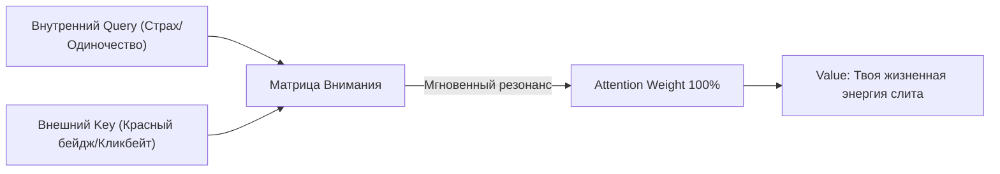

##### Генеративные ловушки за твоим лучом

В XX веке психологи ставили эксперименты вроде «невидимой гориллы»: люди считали пасы мяча и не замечали человека в костюме обезьяны. Это доказывало узость зрительного канала. Но сегодня вызов неизмеримо жестче.

Тебе противостоит не горилла в спортзале. Тебе противостоят тераваттные дата-центры с генеративными рекомендательными моделями. Они в реальном времени подбирают **Key**, с ювелирной точностью бьющий в твой латентный **Query**.

Платформы работают на принципах переменного подкрепления (интервальное вознаграждение, как в казино). Ты свайпаешь не ради контента, а ради дофаминового броска костей: вдруг там что-то важное? 

Это не злой умысел. Это оптимизационная функция: удержать твой луч как можно дольше, чтобы монетизировать твоё время. 

Отсюда закон архитектуры: **если ты не формируешь свой Query осознанно с самого утра, его тебе сформирует внешний сервер.** И ты проживешь чужой день, думая, что это был твой выбор.

О том, как распознавать такие ловушки, мы поговорим в [главе 6](#06). О том, как выставлять границы, чтобы шум не проникал, в [главе 8](#08).

##### Чужие эмоции прилипают

Есть ещё один способ, которым у тебя забирают внимание: через чувства.

Человек существо общественное, и состояния других людей перетекают в него напрямую: через интонацию, мимику, темп речи. Тревожная толпа тревожит. Спокойная комната успокаивает. Это называется **эмоциональным заражением**, и оно хорошо изучено.

В цифровом мире оно усилилось. Тревожный образ долетает быстрее, чем нервная система успевает его оценить. Сообщение пришло, тело вздрогнуло, ум ищет причину, и только потом выясняется, что ты уже бежишь по чужому сценарию.

---

#### 5.4. Секрет механики: правило 90 секунд

##### Что происходит, когда накрывает

Когда подступает сильная эмоция, тело запускает цепочку. Сигнал. Выброс гормонов. Пульс ускоряется, мышцы напрягаются. Это быстрая реакция, рассчитанная на секунды.

Но гормоны в крови не живут вечно. Они распадаются. Адреналин, например, выводится за считанные минуты. Учёные, которые рассказывают об этом широкой публике, называют «окно» примерно в **полторы минуты**: столько длится «чистая» волна эмоции, если её не подпитывать мыслями.

**[ГИПОТЕЗА]** Цифра 90 секунд не является точной физиологической константой. Это рабочий интервал для практики. У разных людей и в разных ситуациях он разный. Но принцип надёжен: **первая волна эмоции затихает быстро. Долго живёт не она, а история, которую ты о ней рассказываешь.**

##### Костёр и дрова

Представь, что злость, обида или страх — это костёр. Он вспыхнул мгновенно. Через полторы минуты он выгорит сам, если больше не добавлять дров.

А что такое дрова? **Мысли.** «Он всегда так делает». «Я не должен был это терпеть». «Сейчас я ему отвечу». Каждая такая фраза — полено. Подкинул одно — огонь снова вспыхнул. Подкинул второе — он горит уже час.

Поэтому чувство, которое кажется бесконечным, на деле состоит из коротких волн и длинных пересказов.

У тебя два пути, когда накрывает:

- **Подкормить костёр.** Прокручивать сценарий, доказывать, оправдываться, сочинять ответ. Огонь живёт часами.
- **Дать ему прогореть.** Остаться в теле, наблюдать ощущение, не подкидывая сюжет. Волна проходит, и голова становится ясной.

Второй путь не про «подавить». Подавленное остаётся в теле как зажим. Второй путь про **присутствие без топлива**: ты видишь огонь, но не кормишь его.

В главе 11 мы увидим, как этот самый огонь превращается в рабочую силу. Сейчас достаточно первого шага: научиться не терять руль в первые девяносто секунд.

##### Три правила на сегодня

**Правило 1. Реши, куда светить, раньше, чем мир решит за тебя.**
Первый час после пробуждения не отдавай ленте. Выбери одно дело или одного человека, на которых упадёт твой первый луч дня.

**Правило 2. Дай костру прогореть.**
Когда накрыло, ставь внутренний таймер на девяносто секунд. Не рассуждай, не отвечай, не пиши. Просто наблюдай, где горит.

**Правило 3. Следи за чеком.**
В конце дня задай себе вопрос: «На что ушли мои часы?» Не суди, а записывай. Чаще всего человек видит чек впервые, и ему хватает одного взгляда, чтобы что-то изменить.

---

#### 5.5. Телесный детектор: 90 секунд

Принцип легко понять и трудно удержать в момент, когда волна накрывает. Научиться можно только на практике.

> [!TIP]
> **Протокол: Девяносто секунд**
> 1. Когда почувствуешь резкий подъём эмоции (раздражение, тревогу, обиду), остановись. Это первый шаг.
> 2. Найди, где она сидит в теле: горло, грудь, живот, челюсти, кисти. Назови место про себя.
> 3. Опиши ощущение как физическое явление: жар, давление, сжатие, дрожь, пульсация. Только ощущение, без истории.
> 4. Дыши ровно. Каждый раз, когда ум предлагает сюжет («он всегда так», «я не должен был»), отметь его как «мысль» и вернись к ощущению.
> 5. Дай пройти девяноста секундам. Затем спроси себя: *что изменилось?*
>
> В первые разы ты, скорее всего, не выдержишь интервал. Это нормально. Само различие между «волной» и «рассказом о волне» и есть главное открытие.

Тело покажет то, что ум скрывает: большинство состояний, которые кажутся вечными, на деле состоят из коротких вспышек и длинных пересказов.

---

> **Куда упал луч твоего внимания, туда ушла твоя жизнь. Береги его, ведь он дан, чтобы зажигать огни, а не обогревать пустоту.**

---

Ты научился держать луч. Поймал костёр на третьем полене, дал ему прогореть и впервые за долгое время остался с ясной головой. Лупа в твоей руке теперь точная, огонь сфокусирован.

Но когда ты поднимаешь глаза от сухого листа, вокруг уже стемнело.

Из тёмных углов выходят фигуры. Они не шумят и не угрожают. У каждой в руках зеркало. Но зеркала странные: в них не ты, а то, что ты хочешь видеть. Чужая красивая жизнь. Чужие успехи. Чужие ссоры, в которых так хочется поучаствовать.

Они подходят всё ближе и тихо поворачивают зеркала так, чтобы луч твоей лупы упал точно на стекло.

И вот тут ты замечаешь странное: **луч уходит в зеркало**. Не рассеивается, а загибается, как в оптической ловушке, и возвращается к тем, кто его подставил. Ты не чувствуешь потери, ведь зеркало красивое. Ты просто светишь не туда, и тебе кажется, что это твой выбор.

> `[D.A.S.H.A.] >> ВОПРОС:`
>
> **Кому ты сегодня подарил часы своей жизни, и стоила ли эта пыль потраченного огня?**

Ответ не в оправдании и не в самообвинении. Он в том, куда будет направлен луч завтра утром, в первый час, пока выбор ещё не сделан за тебя.

> `[D.A.S.H.A.] >> ЗАГРУЗКА ГЛАВЫ 6: ЛОВУШКИ В ТУМАНЕ...`


---

<a id="06"></a>

### Глава 6. Ловушки в тумане: Как не стать добычей

> `[D.A.S.H.A. Protocol] >> УРОВЕНЬ ДАННЫХ: ФАКТ — более 50% трафика генерируют боты, асимметрия вирального негатива; МОДЕЛЬ — Симулякры 4-го порядка (Жан Бодрийяр), Dead Internet и Закон Гудхарта; ГИПОТЕЗА — соматическое заземление мгновенно разрывает петли алгоритмической гиперреальности.`

> *«Хаос не стучится. Он приходит в обёртке идеального симулякра.»* — D.A.S.H.A.

---

#### 6.1. Письмо с красным восклицательным знаком

Хакеры почти никогда не взламывают дверь топором. Это слишком шумно, слишком трудно, и сработает сигнализация.

Они делают другое. Присылают письмо: **«Срочно! Ты выиграл миллион, а иначе твой счёт заблокирован!»**

Ни одного взлома. Ни одной отмычки. Человек сам открывает дверь, сам вводит пароль, сам отдаёт ключи. Потому что письмо подействовало не на компьютер, а на тело: сжало грудь, ускорило пульс и выключило здравый смысл.

Всё дело в слове «срочно». Когда мир кричит «беги!», ум перестаёт проверять, куда ведёт дорога.

Так устроены не только письма мошенников. Так устроена жизнь в цифровом тумане симулякров. И сейчас ты узнаешь, как этот туман компилируется, чтобы в нём не раствориться.

---

#### 6.2. Фальшивый указатель на болоте

Тёмная ночь. Лес. Моросит. Путник идёт уже много часов, промок, замёрз и очень хочет домой.

И вдруг впереди, между деревьями, мерцает огонёк. Тёплый, жёлтый, такой, как бывает в окне, где ждут. Путник ускоряет шаг. Потом бежит. Сердце колотится от радости: наконец-то!

Он не замечает, что земля под ногами стала мягкой. Не замечает, что огонёк всё время чуть в стороне. Не замечает, как ботинки уходят в тину.

А огонёк — это болотный газ. Он не горит ради путника. Он просто горит. Но как же похож на дом!

**Любая паника в ленте, синтетический скандал, любое «все уже давно это делают» — такой же болотный огонёк.** Он тёплый, яркий и очень убедительный. Он не лжёт. Он просто светит. А ты сам придумываешь историю, что там тебя кто-то ждёт.

И вот что особенно важно. Туман не тащит тебя силой. Он убеждает **три раза** и каждый раз под видом здравого смысла:

- **«Суета — это развитие».** Если ты перегружен, значит, растёшь. Если не успеваешь, значит, нужен.
- **«Чужое одобрение — это безопасность».** Пока тебя лайкают, ты в порядке. Отпишутся — и ты погибнешь.
- **«Паника — это единственный способ выжить».** Расслабишься — пропустишь катастрофу.

Ни одна из этих мыслей не выглядит врагом. Каждая выглядит как забота о себе. В этом и вся хитрость тумана: ты не чувствуешь, что тебя ведут на поводке. Ты уверен, что поступаешь разумно.

---

#### 6.3. Движок игры: как делается туман

##### Симулякры: копии без оригинала

Французский философ Жан Бодрийяр описал то, что сегодня стало базовой архитектурой медиапространства: концепцию **симулякров** — знаков и образов, которые подменяют собой реальность.

1. Сначала образ отражает глубокую реальность (фотография друга).
2. Затем маскирует её (отретушированная фотография).
3. Затем маскирует *отсутствие* реальности (образ идеального успеха, которого в природе нет).
4. И наконец — становится **чистым симулякром**: копией, у которой никогда не существовало оригинала.

Большая часть того, из-за чего ты сегодня нервничаешь — котировки вымышленных токенов, тренды сгенерированных аватаров, споры о несуществующих угрозах — это симулякры 4-го порядка. Движок Игры крутит картинки, не привязанные ни к одному физическому атому. Но твоё тело реагирует на них выбросом самого настоящего кортизола.

##### Dead Internet и Rage-Farming: синтетический гнев

Добавь к этому то, что специалисты по сетям называют гипотезой **Dead Internet**: значительную часть сетевого контента сегодня создают не люди, а генеративные алгоритмы и бот-сети. Они пишут посты, оставляют комментарии и лайкают друг друга.

Зачем? Ради **Rage-Farming** (целенаправленного взращивания ярости). Алгоритмы соцсетей давно вычислили: ничто не удерживает пользователя так мертво, как возмущение и страх. Бот вбрасывает провокацию, другие боты раздувают пламя, а живой человек влетает в этот спор с дрожащими руками и колотящимся сердцем, отдавая драгоценные кванты своего внимания и метаболическую энергию нейронов на обогрев чужого рекламного сервера.

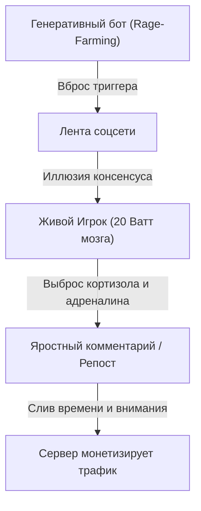

##### Пять трещин в мышлении

**[ФАКТ]** Психологи описали десятки систематических ошибок мышления. Вот пять главных когнитивных искажений, которые превращают сознание в добычу:

- **Негативная асимметрия.** Мозг эволюционно придаёт опасным сигналам в 5 раз больший вес, чем благоприятным.
- **Катастрофизация по цепочке.** От одной новости ум мгновенно компилирует сценарий апокалипсиса.
- **Аффективный реализм.** «Мне страшно, значит, мир объективно опасен». Ощущение принимается за физический факт.
- **Подтверждающее искажение (Confirmation Bias).** Ум жадно собирает только то, что совпадает с его тревогой.
- **Чужой фасад против моей изнанки.** Сравнение своей реальной сырой жизни с безупречным симулякром чужого успеха.

Эти ошибки не работают поодиночке. Они сцепляются в самоподдерживающийся цикл, и карта мира в голове окончательно теряет связь с реальной территорией.

##### Закон Гудхарта: когда лампочка становится целью

Британский экономист Чарльз Гудхарт сформулировал железный закон системного анализа: **когда метрика становится целью, она перестаёт быть хорошей метрикой.**

- Социальное одобрение полезно как индикатор сонастройки с племенем. Но когда «лайки» и охваты становятся целью, ты превращаешься в марионетку толпы.
- Занятость полезна как признак движения. Но когда число задач в календаре становится самоцелью, начинается чистая имитация жизни.

Это главная ловушка Движка: ты всю дорогу смотришь на сигнальную лампочку на приборной панели и на полной скорости влетаешь в столб, потому что забыл посмотреть на дорогу.

##### Усилитель тумана

Теперь добавь среду, которая всё это усиливает.

Ленты ранжируют контент по тому, насколько он удерживает. Исследования показывают, что эмоционально заряженные сообщения расходятся в сети быстрее спокойных. Анализ миллионов публикаций за несколько лет показал: недостоверные новости распространялись шире и быстрее достоверных. И причиной были не роботы, а обычные люди, которые реагировали на новизну и эмоцию.

Платформа не злая. Она просто не различает «захватывает» и «ценно». А ты оказываешься в потоке, где каждый сигнал шепчет: *срочно, важно, ты отстаёшь*.

Так рождается состояние, которое книга называет **туманом**: внешние показатели (лайки, реакции, повестка дня) замещают собственные ориентиры. Ты начинаешь думать не о том, что важно, а о том, что обсуждается.

---

#### 6.4. Секрет механики: как выйти из тумана

##### Три признака, что ты в тумане

1. **Срочность.** Всё требует немедленного решения, хотя обычно ничего не горит.
2. **Сравнение.** Внимание уходит к тому, что у других лучше, и тянет в груди.
3. **«Без этого нельзя».** Страх пропустить, отстать, выпасть из потока.

Эти три признака сходятся в одном: **внимание вытянуто из тела наружу.** Ум живёт в ленте, а не в комнате.

##### Два хода

- **Вернись ногами на землю.** Тело всегда находится здесь и сейчас. Ум может быть где угодно, тело только в этой комнате. Стопы на полу, дыхание, вес рук возвращают тебя туда, где можно решать.
- **Назови петлю.** Из [главы 3](#03): мысль, которая крутится, это процесс Маски, а не ты. Скажи про себя: «это петля сравнения», «это страх отстать». Назвал, значит, отделил. И отпусти, не споря.

Ни один из этих ходов не борется с туманом. Они **лишают его питания**: внимание возвращается к тому, кто его даёт.

##### Три правила на сегодня

**Правило 1. Замедляйся, когда мир кричит «беги быстрее».**
Если сообщение требует «срочно», сделай один длинный выдох и подожди десять минут. Настоящие дела редко сгорают за десять минут. Мошенники и паникёры сгорают сразу.

**Правило 2. Проверяй, что ты измеряешь.**
Спроси: «Я смотрю на дорогу или на лампочку?» Что мне нужно: быть принятым или быть живым? Выглядеть занятым или сделать дело?

**Правило 3. Различай чувство и факт.**
Когда страшно, спроси: «Что я вижу своими глазами и что дорисовал?» Страх сообщает о состоянии тела. Он не сообщает о положении дел.

##### Если тревога не отпускает

Если тревога постоянная, мешает спать и жить или сопровождается телесными симптомами, это уже не вопрос практики внимания. Это повод обратиться к врачу или психотерапевту. Книга не заменяет помощь специалиста.

---

#### 6.5. Телесный детектор: возврат в якорь

Туман обманывает ум, но почти не обманывает тело. Телесные признаки тумана и ясности различимы.

> [!TIP]
> **Протокол: Возврат в Якорь (1 минута)**
> 1. Когда заметишь, что внимание утекло в ленту, в чужие новости или в мысленный спор, остановись. Ничего закрывать не нужно.
> 2. Ощути стопы. Нажми ими в пол и почувствуй вес.
> 3. Сделай один длинный выдох. Отметь, где сжато: горло, грудь, живот, челюсти.
> 4. Спроси: *«Это срочно на самом деле или только ощущается срочным?»* Проверь, как ответ звучит в теле. Простор значит, что ты видишь ясно. Сжатие и ускорение значит, что туман ещё держит.
> 5. Назови петлю одним словом («сравнение», «страх отстать», «спор») и вернись к тому, чем занимался.
>
> Повторяй неделю. Не пытайся победить туман. Просто научись замечать момент, когда он включается.

---

> **Хаос не имеет своего источника. Он живёт там, откуда ушло внимание. Вернись в тело, и туман лишится питания.**

---

Ловушки пройдены. Ты увидел болотные огоньки, вовремя остановился и стоишь на твёрдой земле. Стопы в полу, дыхание ровное, голова ясная. Ты почти гордишься собой.

И тут за спиной раздаётся глухой удар.

Ты оборачиваешься. Там, на дороге, по которой ты ехал всю жизнь, лежит то, что раньше было машиной. Бетонная стена. Лобовое стекло в трещинах. Дымящийся капот. И внутри, на водительском месте, кто-то очень знакомый, с руками, всё ещё сжимающими руль.

Это не ловушка. Ты не поддался на огонёк, не открыл письмо, не пошёл за толпой. Просто в какой-то момент ты разогнался так, что не успел затормозить, и влетел в стену, которую сам же не заметил.

Работа. Отношения. Здоровье. Деньги. Что-то одно обрушилось, и потянуло за собой остальное. Всё летит в пропасть, а ты стоишь посреди обломков и не знаешь, что делать дальше.

> `[D.A.S.H.A.] >> ВОПРОС:`
>
> **Какой страх прямо сейчас притворяется твоим здравым смыслом, выпивая последние силы?**

Ответа в словах не требуется. Требуется один шаг, который этот страх запретил бы тебе сделать.

> `[D.A.S.H.A.] >> ЗАГРУЗКА ГЛАВЫ 7: КОГДА ВСЁ РУШИТСЯ...`


---

<a id="07"></a>

### Глава 7. Когда всё рушится: Перезагрузка после аварии

> `[D.A.S.H.A. Protocol] >> УРОВЕНЬ ДАННЫХ: ФАКТ — кортизоловый криз перегружает нейроэндокринную ось, временность острых аффективных пиков; МОДЕЛЬ — Точка бифуркации и самоорганизация диссипативных структур (Илья Пригожин); ГИПОТЕЗА — крушение старых смыслов есть термодинамический фазовый переход на более высокий уровень сложности.`

> *«Не всякий обвал — разрушение. В точке бифуркации это фазовый переход.»* — D.A.S.H.A.

В [главе 6](#06) шла речь о повседневном тумане. Эта глава о том, что случается, когда туман сгущается до отчаяния, а опоры рушатся одна за другой. Здесь нельзя говорить красиво и неточно. Поэтому сначала о главном.

> [!IMPORTANT]
> **Если ты читаешь это в тяжёлом состоянии**
> Если мысли о том, чтобы уйти из жизни, рядом или усиливаются, это не вопрос книги или философской практики. Это сигнал прямо сейчас опереться на живого человека: близкого, врача, экстренную службу или кризисную линию (международный каталог: findahelpline.com). Не оставайся один на один с перегрузкой. Книга подождёт, твоя жизнь — абсолютный приоритет.

---

#### 7.1. Самый тёмный час

Самый тёмный час наступает не тогда, когда сломалась машина или уволили с работы. Он наступает, когда рушатся твои детские иллюзии о том, как устроен мир.

Ты верил, что если стараться, то всё получится. Что люди, которых ты любишь, будут рядом всегда. Что ты контролируешь то, что важно. Что эта опора никогда не подведёт.

А потом одна новость, один разговор, один звонок. И картинка, которую ты строил годами, идёт трещинами.

В этот момент кажется, что рухнуло всё. Что уцелевших опор нет. Что дальше будет только хуже.

Если ты сейчас именно там, вот первое, что нужно знать: **это состояние имеет архитектуру, и оно проходимо.** Не быстро и не легко. Но проходимо. В этой главе ты увидишь, как оно устроено.

---

#### 7.2. Синий экран защиты

Ты когда-нибудь видел, как компьютер вдруг выключается посреди работы? Экран заливает синий цвет, появляется строка с кодом ошибки, и всё останавливается.

Новичок видит в этом конец. Инженер видит другое.

Компьютер выключился не со зла. Внутри процессор начал перегреваться, и система приняла решение: остановить всё сразу, пока ничего не расплавилось. Это не поломка. Это **защита**. Перед остановкой машина записывает снимок того, что происходило в момент сбоя (memory dump), чтобы потом можно было разобраться, где именно возник перегруз.

Потом перезагрузка. Система поднимается заново, и часто работает лучше прежнего: тот сбойный процесс, который перегревал ядро, больше не запускается.

**Кризис в жизни — это аварийное охлаждение твоей системы.**

Больно? Да. Страшно? Конечно. Но синий экран не значит, что процессор сгорел. Он значит, что система сбросила питание ради того, чтобы продолжить жить.

---

#### 7.3. Движок игры: точка бифуркации и порядок из хаоса

##### Теория Пригожина: порядок рождается из крушения

Законы физики подтверждают то, что интуитивно чувствует каждый переживший бурю. Лауреат Нобелевской премии Илья Пригожин доказал фундаментальный принцип термодинамики: **сложные открытые системы развиваются не по плавной прямой линии, а через кризисы и хаос.**

Пригожин ввёл понятие **диссипативных структур**. Живой организм, психика, общество — это открытые системы, которые непрерывно обмениваются энергией и информацией со средой. Когда внешнее или внутреннее давление нарастает, система больше не может удерживать прежнее равновесие. Она входит в **точку бифуркации** (разветвления).

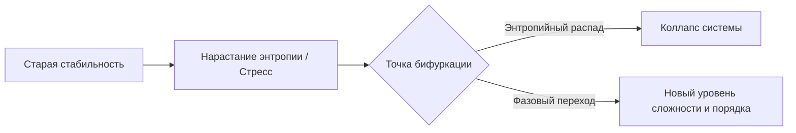

В точке бифуркации старые законы больше не работают:
1. **Любая попытка удержать прошлое обречена.** Ты не можешь затолкать вылупившегося птенца обратно в скорлупу. Скорлупа треснула навсегда.
2. **Хаос — это не гибель, а расчистка оперативной памяти.** Система плавит застывшие неэффективные алгоритмы.
3. **Квантовый скачок сложности.** Из хаоса рождается качественно новый порядок, который способен выдерживать в разы большее давление среды.

Как вода при нагревании до 100°C переживает бурный кипящий хаос, чтобы совершить фазовый переход и стать паром — так и сознание в кризисе совершает фазовый переход.

##### Биология кризиса: сначала тело, потом смыслы

**[ФАКТ]** Кризис бьёт не только по мыслям. Когда перегрузка нарастает, миндалевидное тело держит симпатическую нервную систему на взводе. Гормональный шторм ломает сон, аппетит и способность концентрироваться. 

Поэтому системный приоритет №1 при крушении — соматическая стабилизация. Если клиническое истощение длится неделями — это задача доказательной медицины и психотерапии, а не философских споров. Нельзя «промыслить» то, где истощены запасы нейромедиаторов. Сначала физиологический базис (сон, питание, медикаментозная поддержка при необходимости), и только затем — построение новых опор.

##### Рост после удара (Посттравматический рост)

Психологи называют это явление посттравматическим ростом: пережив тяжелейший разлом, человек обнаруживает, что иллюзорные конструкции рухнули, обнажив настоящий гранитный фундамент.

Это не повод романтизировать боль. Боль отвратительна. Но в коде Движка боль — это не наказание. Это индикатор: старая архитектура выработала свой ресурс. Место свободно для новой сборки.

---

#### 7.4. Когда хочется всё прекратить

Теперь о том, что нельзя обойти молчанием.

В минуты отчаяния ум предлагает один выход: прекратить всё. И часто предлагает его так убедительно, что кажется единственным.

Что можно сказать об этом твёрдо.

**Это состояние, а не приговор.** Острый кризис с мыслями об уходе из жизни, как правило, не длится вечно. Накал таких мыслей часто спадает, и большинство людей, которые пережили такие минуты, живут дальше. То, что сейчас кажется вечным, вечным обычно не бывает.

**Отчаяние искажает картину.** Оно сужает будущее до одной точки и убеждает, что выхода нет. Но это свойство самого состояния, а не описание мира. Аварийная лампа горит ярко, но это не значит, что горит весь дом.

**Боль, усталость и потери настоящие, а вывод из них неверный.** Книга не называет желание уйти разумным, логичным или естественным следствием боли. Между болью и этим решением лежит расстояние, и это расстояние можно пройти иначе: с помощью людей.

**Первое действие не размышление, а контакт.** Позвать человека. Сказать вслух. Позвонить. Это не слабость. Это способ сбросить давление, пока оно не стало невыносимым. Живой контакт самый быстрый из доступных способов.

И ещё. Игра, которую ты проходишь, не рассчитана на то, чтобы ты проходил её в одиночку.

---

#### 7.5. Ложные опоры

Если оставить в стороне острые состояния, у кризиса есть и другая сторона. Он обнажает то, на чём держалась жизнь.

Мы живём на опорах, которые редко рассматриваем: «я достаточно успешен», «меня любят, пока я полезен», «мои планы сбудутся», «я контролирую то, что важно». Пока всё идёт нормально, эти опоры кажутся фундаментом.

Когда они рушатся, видно: **это были не стены, а строительные леса.**

Помнишь красную лампочку из [главы 1](#01)? Боль — это расхождение между картой и местностью. Кризис — самая сильная форма такого расхождения. Рухнуло то, на что опиралась карта. Это больно, и это не наказание. Это сообщение: карта не совпадала с местностью.

Радоваться потере не нужно. Нужно другое: понять, что после обвала у тебя есть шанс построить что-то подлиннее. Не потому что боль справедлива, а потому что место освободилось.

---

#### 7.6. Секрет механики: три правила для самого трудного времени

**Правило 1. Сначала тело и люди, потом смыслы.**
Сон. Еда. Вода. Один живой человек рядом. Когда система перегрета, философия не помогает. Помогает охлаждение. В тяжёлые дни главное дело дня — не сгореть.

**Правило 2. Не принимай больших решений на дне.**
Увольнение, разрыв, продажа, переезд — всё это лучше откладывать, пока не отпустит острота. В синем экране машину не перепрошивают. Её сначала перезагружают.

**Правило 3. Назови леса.**
Когда немного уляжется, возьми лист бумаги и напиши: «На что я опирался и что оказалось строительными лесами?» Не ради самобичевания, а ради карты. Тот, кто видит леса, перестаёт строить на них следующий этаж.

---

#### 7.7. Телесный детектор: пять минут тишины

В кризисе ум шумит громче всего. Тело при этом знает, что ему нужно, но его не слышно за шумом.

> [!TIP]
> **Протокол: Пять минут тишины**
> 1. Сядь или ляг так, чтобы тело было полностью поддержано. Закрывать глаза не обязательно.
> 2. Почувствуй точки опоры: спина, таз, стопы. Отметь вес тела.
> 3. Сделай три длинных выдоха, каждый длиннее вдоха.
> 4. Пять минут ничего не делай: не решай, не планируй, не оценивай. Если ум подсовывает сценарий, отметь: «мысль», и вернись к опоре.
> 5. В конце спроси тело: *что мне сейчас нужно?* Сон, еда, разговор, помощь врача?
>
> Это не лечение и не способ «справиться с кризисом». Это пять минут, чтобы шум немного стих и ты смог услышать, что нужно прямо сейчас.

Если в тишине тяжёлые мысли усиливаются, это не провал практики. Это знак, что нужен живой человек. Прекрати упражнение и свяжись с кем-нибудь.

---

> **Кризис не отменяет Игру. Он расчищает место. Береги себя и не оставайся один: эту часть пути проходят вдвоём.**

---

Ты встал после нокдауна. Пыль осела. Что-то ты сумел назвать, что-то отложил на потом, что-то уже вынес из-под обломков. Дышать стало легче.

И вдруг замечаешь: небо на горизонте меняется. Тучи собираются в одну плотную темноту. Ветер приносит запах дождя и озона. Где-то далеко уже сверкнула молния.

Это не последняя буря. Мир не обещал, что она будет единственной. Ты только что узнал, как собирать себя после обвала. Но как не позволять каждой следующей грозе вышибать из тебя дух с первого удара?

Нужно что-то более крепкое, чем просто стены. Что-то, что пропускает свет и не пускает шторм. Силовой щит.

> `[D.A.S.H.A.] >> ВОПРОС:`
>
> **Что в твоих старых привычках должно закончиться, чтобы ты наконец начал жить по-настоящему?**

Ответа в словах не требуется. Нужно честно назвать одну опору, которая оказалась строительными лесами.

> `[D.A.S.H.A.] >> ЗАГРУЗКА ГЛАВЫ 8: ТВОЙ НЕВИДИМЫЙ ЩИТ...`


---

<a id="08"></a>

### Глава 8. Твой невидимый щит: Броня без стен

> `[D.A.S.H.A. Protocol] >> УРОВЕНЬ ДАННЫХ: ФАКТ — сенсорная перегрузка амигдалы, антихрупкость биологических тканей под дозированной нагрузкой; МОДЕЛЬ — Markov Blanket (граница Карла Фристона) и архитектура Zero Trust; ГИПОТЕЗА — трёхсекундный шлюз аутентификации отсекает 95% вредоносных стимулов.`

> *«Щит калибруется в покое. В кризисе поздно ставить фаервол. Закрыться — не значит отключить сеть: это значит фильтровать входящие пакеты.»* — D.A.S.H.A.

---

#### 8.1. Забор и одно слово

Глупцы защищаются от мира бетонными заборами и железными дверями. А потом сходят с ума от одного злого комментария в интернете.

Ты наверняка знаешь такого человека. Или видел его в зеркале. У него хорошая квартира, надёжный замок, охраняемый двор. Но случайный аноним написал под фотографией три слова, и вечер пропал. Сон пропал. Аппетит пропал. Он снова и снова перечитывает эту фразу, как будто в ней написан его приговор.

Что случилось? Забор стоит. Замок целый. А через дыру в сетевом протоколе, которую никто не заметил, вошёл чужой вредоносный скрипт и захватил вычислительные мощности процессора.

Броню строят не вокруг кирпичей. Настоящая защита разворачивается вокруг твоего **внимания**.

---

#### 8.2. Стеклянный купол: мембрана, а не бункер

Представь, что ты стоишь под огромным прозрачным куполом. Снаружи бушует буря. Ветер ревёт, капли барабанят по куполу так, что звенит вся конструкция. Гроза. Молнии. Мрак.

А внутри светит лампа. Горит очаг. Пахнет чаем. Тепло.

Ты видишь бурю. Ты слышишь её. Ты не прячешься в слепом подземелье. Но буря не может погасить твою свечу, потому что между ней и пламенем есть купол.

И вот что принципиально: **купол прозрачный.** Он не отгораживает тебя от мира наглухо. Ты видишь звёзды, облака, людей за стеклом. Ты можешь открыть шлюз и выйти навстречу тому, чему доверяешь. Он не тюрьма. Он — **умная полупроницаемая мембрана**.

Защита в Движке строится не на агрессивной глухоте, а на прозрачной избирательности. Стрела, пущенная в пустоту, ни за что не цепляется. Чужой токсичный выброс, направленный в игрока с настроенной мембраной, просто проходит насквозь в энтропию.

---

#### 8.3. Движок игры: Markov Blanket и протокол Zero Trust

##### Markov Blanket: граница твоего «Я»

В теоретической физике и нейробиологии один из ведущих учёных современности Карл Фристон разработал теорию **Markov Blanket** (оболочка Маркова). 

Любая живая система — от одноклеточной амебы до твоего сознания — существует ровно постольку, поскольку у неё есть статистическая граница. Эта граница разделяет:
- **Внутренние состояния** (твои мысли, соматика, внутренний покой).
- **Внешние состояния** (шум мира, кризисы, чужой гнев).
- **Сенсорные и активные шлюзы** (органы чувств и твои действия).

Если убрать мембрану Маркова — клетка немедленно растворяется в окружающей среде и погибает. Если сделать мембрану наглухо непроницаемой — клетка умрёт от нехватки энергии и кислорода.

Здоровье и сила Игрока — это не толщина брони, а **точность настройки твоего Markov Blanket**: что впускать для питания системы, а что отбрасывать как паразитный шум.

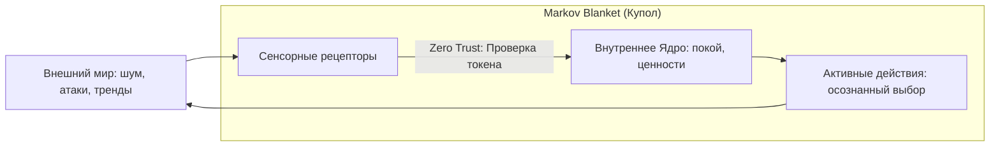

##### Архитектура Zero Trust: никогда не доверяй по умолчанию

В современной сетевой безопасности парадигма глухого периметра давно признана устаревшей. Сегодня стандартом является концепция **Zero Trust** («Нулевое доверие»): *Never trust, always verify* (Никогда не доверяй автоматически, всегда проверяй подлинность).

Как это работает в сознании Игрока:
1. **Любой входящий запрос считается непроверенным пакетом данных.** Чужая претензия, звонок с требованием «срочно помочь», токсичный упрёк в чате — это не твоя вина. Это входящий запрос.
2. **Пауза на аутентификацию (буфер 3 секунд).** Вместо мгновенной рефлекторной реакции включи шлюз. Сделай вдох. Задай себе контрольный вопрос: *«Есть ли у этого входящего запроса цифровая подпись моих ценностей? Это действительно моя зона ответственности или внедрение чужого скрипта?»*
3. **Дроп невалидных пакетов.** Если запрос прислан манипулятором на языке вины или страха, система молча сбрасывает пакет (Drop Packet). Без скандала, без драки, без оправданий. Просто: *«Запрос отклонён»*.

---

#### 8.4. Антихрупкость: закалка ядра

Философ и математик Нассим Талеб ввёл понятие **Антихрупкости** (Antifragility). Системы делятся на три типа:

| Тип системы | Реакция на стресс и давление | Поведение в Движке |
| :--- | :--- | :--- |
| **Хрупкая** | Ломается и трескается от малейшего удара | Человек без границ: чужой косой взгляд вызывает панику |
| **Неуязвимая (Крепкая)** | Сопротивляется удару, оставаясь неизменной | Упрямец на силе воли: терпит, пока не лопнет металл |
| **Антихрупкая** | **Становится сильнее от дозированного стресса** | Игрок с мембраной Маркова: превращает сопротивление в упор |

Твоё тело антихрупко по природе. Если мышцу не нагружать, она атрофируется. Если кость не испытывает давления гравитации, она теряет кальций. Но если дать мышце дозированный микростресс, а затем качественный отдых — кость и мышечные волокна становятся плотнее прежнего.

```
Дозированный стресс + Глубокое восстановление = Антихрупкость
Стресс без границ + Отсутствие восстановления = Системный крах
```

Препятствия в Движке — это не козни врагов. Это вес штанги в тренажёрном зале симуляции. Ты не ненавидишь штангу. Ты упираешься в неё ногами, чтобы накачать силу.

---

#### 8.5. Мембрана или глухой бункер?

Купол Zero Trust — это живой фильтр, а не параноидальный бункер.

| Здоровая мембрана Маркова | Параноидальная глухая стена |
| :--- | :--- |
| Спокойная фильтрация токсичного шума | Презрительное «все вокруг биороботы, один я проснулся» |
| Осознанный выбор глубины контакта | Панический уход в полную изоляцию от людей |
| Список доверенных узлов связи | Хроническая подозрительность ко всему живому |

Сказать твёрдое «нет» манипуляции не означает перестать любить человека. Это означает: *«Я ценю тебя, но этот вирусный пакет я внутрь своего ядра не пущу»*.

---

#### 8.6. Секрет механики: три правила Zero Trust

**Правило 1. Трёхсекундный шлюз аутентификации.**
Когда прилетает тревожный сигнал или острая просьба, не бросайся отвечать. Сначала спокойный выдох, три секунды паузы. Входящий пакет изолирован в карантине.

**Правило 2. Определение источника и цифровая подпись.**
Спроси себя: «Откуда этот сигнал? Он совпадает с моим вектором или это попытка удалённого управления через вину и страх?» Чужой вирусный скрипт — сбросить без ответа.

**Правило 3. Настройка мембраны в штиль.**
Не конфигурируй фаервол во время шторма. Поставь одно правило границ сегодня утром, пока в эфире тишина.

---

#### 8.7. Телесный детектор: настройка мембраны

> [!TIP]
> **Протокол: Базовая настройка Markov Blanket (20 минут, один раз)**
>
> **Шаг 1. Белый список (White List).** Запиши 3–5 источников, которым ты доверяешь безусловно: конкретные близкие люди, фундаментальные книги, проверенные знания. Спроси себя: почему именно они авторизованы во внутреннем контуре?
>
> **Шаг 2. Карантинный список (Quarantine List).** Выпиши токсичные триггеры, которые мгновенно сжигают процессор: определённые паблики, чаты, люди-вампиры. Сигналы от них не принимаются напрямую — только через строгую фильтрацию.
>
> **Шаг 3. Одно правило изоляции на неделю.** Выбери одно аппаратное ограничение. Например: первый час после сна — авиарежим. Или: не вступать в дискуссии в комментариях.
>
> **Телесная телеметрия:** через 3 дня проверь датчики. Плечи опустились? Дыхание стало глубже? Зажим в челюстях ушёл? Если да — мембрана работает безупречно.

---

> **Купол прозрачен. Он не прячет тебя от мира, а пропускает свет и не пускает шторм.**

---

Твой щит крепок. Ты стоишь под куполом, видишь бурю, слышишь, как она бьёт по стеклу, и впервые за долгое время не вздрагиваешь. Свеча горит ровно.

И вдруг замечаешь: в глубине купола, у самой стены, стоит металлический шкаф. Старый, массивный, без вывески. Ты подходишь ближе, открываешь дверцу.

Внутри огромная панель. Сотни рычагов, ползунков, тумблеров. Каждый подписан едва заметной гравировкой: **«Дыхание»**. **«Пульс»**. **«Напряжение»**. **«Внимание»**. **«Мысли»**. **«Настроение»**.

Ты видишь, что почти все ползунки стоят на отметках, которые ты не выбирал. Кто-то выставил их давным-давно. Они двигаются сами, без тебя, как стрелки на приборах в пустой кабине.

И пока ты стоишь, глядя на пульт, ты понимаешь: все эти годы ты защищал дом, не зная, что у него есть панель управления.

> `[D.A.S.H.A.] >> ВОПРОС:`
>
> **Где в твоём заборе дыра, через которую чужое дурное настроение способно выключить твою радость?**

Ответа в словах не требуется. Требуется один камень: одно правило, поставленное сегодня.

> `[D.A.S.H.A.] >> РАЗДЕЛ II ЗАВЕРШЁН.`
> `[D.A.S.H.A.] >> ЗАГРУЗКА РАЗДЕЛА III: ПУЛЬТ УПРАВЛЕНИЯ...`


---

<a id="section-sim-section-iii"></a>

## Раздел III. Пульт управления

<a id="09"></a>

### Глава 9. Двойной дозор: Смотри внутрь и наружу

> `[D.A.S.H.A. Protocol] >> УРОВЕНЬ ДАННЫХ: ФАКТ — спектральный анализ HRV (вариабельности сердечного ритма) отражает тонус блуждающего нерва; МОДЕЛЬ — Кибернетика второго порядка (наблюдение за наблюдателем Хайнца фон Фёрстера); ГИПОТЕЗА — резонансное дыхание на частоте 0.1 Гц мгновенно восстанавливает телесную когерентность.`

> *«Маяк светит кораблям только до тех пор, пока смотритель поддерживает огонь внутри.»* — D.A.S.H.A.

Третий раздел книги практический. До сих пор ты исследовал законы Движка. Теперь мы садимся за консоль управления.

---

#### 9.1. Пилот и облака

Представь пилота сверхзвукового истребителя. Он летит на огромной скорости над облаками. Под крылом сияют белые горы, над головой густая синева. Красота такая, что захватывает дух.

И пилот залюбовался. Он смотрит в стекло фонаря, отдаёт всё внимание облакам, закату, линии горизонта.

А на приборной панели прямо перед ним мигает лампа остатка топлива. Он её не видит. Он даже не знает, что она мигает. Его мир сейчас состоит из облаков, и больше в нём ничего нет.

Через десять минут двигатель кашляет. Через пятнадцать падает давление в гидросистеме. Через двадцать он понимает: смотрел в одну сторону, а самолёт всё это время кричал ему в другую.

Это не метафора про авиацию. Это точная телеметрия твоего дня.

Большую часть суток твоё внимание вывернуто наружу: в ленты, чужие задачи, сообщения, споры и тревожные сценарии. Всё, что вовне, ты видишь с максимальным разрешением. А приборную панель собственного аватара — пульс, тонус шеи, диафрагму, уровень заряда батареи — ты не сканируешь вовсе. Пока датчики не вспыхнут аварийным красным.

---

#### 9.2. Маяк в шторме

Представь маяк на скале. Ночь, шторм, десятиметровые волны разбиваются о камни. Далеко в море идут корабли, и каждый ищет спасительный луч.

Свет маяка пробивает тьму на десятки километров. Он нужен всем. Но на чём он держится?

Внутри башни горит лампа. За ней круглосуточно следит **смотритель**. Он подливает топливо, протирает оптику, проверяет шестерни вращающегося стола. Если смотритель потеряет сознание — свет погаснет. И корабли разобьются о скалы.

**Твой внешний луч** (твои проекты, помощь близким, работа) держится исключительно на ресурсе внутреннего смотрителя. Если смотритель истощён и спит — маяк потухнет, как бы громко мир ни просил света.

Поэтому внимание должно работать в двух направлениях одновременно: **вовне и внутрь**.

---

#### 9.3. Движок игры: кибернетика второго порядка

##### Наблюдатель, наблюдающий за собой

В классической кибернетике Норберта Винера изучались машины, управляющие внешними объектами (термостат греет комнату, автопилот держит курс). Но австрийский физик и кибернетик Хайнц фон Фёрстер совершил революцию, создав **кибернетику второго порядка** — кибернетику наблюдающих систем.

Её суть: **ты не можешь эффективно управлять внешней системой, если не включил самого себя в контур управления.**

В Движке Игры это реализуется через двухконтурную петлю обратной связи (Feedback Loop):
- **Луч 1 (Внешний контур):** решение рабочей задачи, чтение книги, разговор с клиентом, ведение машины.
- **Луч 2 (Внутренний контур кибернетики 2-го порядка):** непрерывный замер собственного инструмента: *«В каком тонусе мои плечи? Не зажата ли челюсть? Ровно ли идёт дыхание? Кто прямо сейчас решает эту задачу — спокойный Игрок или перегретая Маска?»*

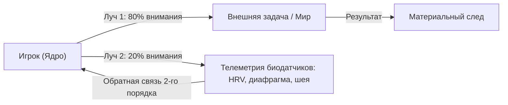

##### Рабочая пропорция: 80 на 20

**[ГИПОТЕЗА]** Оптимальный режим вычислительного процессора: **80% внимания на внешней задаче, 20% фоново сканирует биометрию тела.**

Эти двадцать процентов не отнимают фокус у дела. Напротив: они не дают системе впасть в когнитивный туннель и сжечь аккумулятор до наступления вечера.

---

#### 9.4. Пять прерываний, которые будят смотрителя

Автопилот экономит энергию и стремится отключить второй луч. Чтобы держать смотрителя на посту, нужны аппаратные прерывания (интеррапты):

1. **Случайный вибросигнал таймера.** 5 раз в день без расписания. Короткий импульс: *«Где фокус? Что в теле?»*
2. **Физический триггер-контакт.** Коснулся дверной ручки, сел в кресло, нажал кнопку включения экрана — один осознанный выдох животом.
3. **Соматический спайк.** Вспышка злости, обиды или спешки мгновенно считывается как системное предупреждение: *«Внимание, скачок температуры ядра! Смотрю на приборы»*.

---

#### 9.5. Телесные приборы: HRV и резонансное дыхание 0.1 Гц

##### Телеметрия HRV (Вариабельность сердечного ритма)

**[ФАКТ]** Сердце здорового человека не должно работать как кварцевые часы. Между ударами сердца всегда есть микроколебания в миллисекундах: на вдохе интервалы сокращаются, на выдохе — удлиняются (дыхательная синусовая аритмия).

Этот показатель называется **HRV (Heart Rate Variability)**:
- **Высокая HRV:** парасимпатическая ветвь и блуждающий нерв (вагус) активны. Система находится в режиме пластичности, креативности и высокой стрессоустойчивости.
- **Низкая («метрономная») HRV:** нервная система зажата в тисках симпатического шторма. Ресурс на нуле, кора больших полушарий отключается в пользу примитивных реакций страха.

##### Резонансный протокол 0.1 Гц (Дыхание когерентности)

Чтобы мгновенно вернуть систему из перегрева в оптимум, используется физиологический резонанс: **дыхание с частотой 0.1 Гц (примерно 6 дыхательных циклов в минуту)**.

5 секунд плавный вдох животом — 5 секунд мягкий выдох. Без пауз.

На этой частоте ритм дыхания входит в синхронный резонанс с волнами артериального давления (волнами Майера) и сердечным ритмом. Происходит физиологическая когерентность: мозг получает сигнал наивысшей безопасности, и ресурсы оперативной памяти освобождаются.

---

#### 9.6. Секрет механики: три правила на сегодня

**Правило 1. Фоновые 20% в соматике.**
Пишешь отчёт или ведёшь переговоры — краем глаза всегда держи датчики: стопы в пол, челюсть разжата, воздух в ноздрях.

**Правило 2. Три тактильных якоря.**
Выбери три механических триггера дня (первый глоток чая, поворот ключа в замке, открытие ноутбука) для сверки с приборами.

**Правило 3. Возврат без штрафа.**
Поймал себя на том, что два часа нёсся на автопилоте? Отлично. Без самобичевания: просто сделай длинный выдох и включи второй луч прямо сейчас.

---

#### 9.7. Телесный детектор: протокол когерентности (5 минут)

> [!TIP]
> **Протокол: Резонанс 0.1 Гц (Калибровка смотрителя)**
> 1. Сядь прямо, не прислоняясь к спинке кресла. Стопы плотно стоят на полу.
> 2. Положи ладонь на живот в область солнечного сплетения.
> 3. Вдох через нос на 5 счётов: живот мягко надувается, плечи остаются неподвижными.
> 4. Выдох через приоткрытые губы на 5 счётов: живот мягко опадает.
> 5. Держи этот цикл ровно 5 минут. Почувствуй, как расслабляются глазные мышцы и теплеют ладони.
>
> Это не медитативная релаксация. Это аппаратная перекалибровка бортовой сети твоего аватара.

---

> **Свет маяка держится на смотрителе. Держи двойной дозор: снаружи работа, внутри присутствие.**

---

Ты держишь оба луча. Снаружи идёт работа, внутри горит ровный огонёк. Дыхание тихое, плечи опущены, ты чувствуешь себя на удивление собранным. Впервые за долгое время смотритель на посту.

Но мир вокруг не собирается замедляться.

Телефон вибрирует. Сообщения сыплются одно за другим. Кто-то требует ответа немедленно. На экране мелькают заголовки, в них слово «срочно» стоит через слово. Коллега торопит. Дорога гудит. Всё вокруг ускоряется, как будто кто-то повернул ручку на максимум.

И ты слышишь внутри старую знакомую команду: *«Действуй! Быстрее! Прямо сейчас!»*

Смотритель стоит у стекла маяка и не знает, что делать. Шторм усилился. Корабли всё ближе. А в руках у него два рычага, и ни один не подписан.

> `[D.A.S.H.A.] >> ВОПРОС:`
>
> **Помнишь ли ты о своём дыхании прямо сейчас, пока читаешь эти строки?**

Ответа в словах не требуется. Ответом станет один выдох, длиннее вдоха.

> `[D.A.S.H.A.] >> ЗАГРУЗКА ГЛАВЫ 10: СИЛА ПАУЗЫ...`


---

<a id="10"></a>

### Глава 10. Режим Оператора и алгоритм решений

> *«Keepalive поднял канал. Режим Оператора — смотреть и решать, не хватать руль в панике.»*

Если протокол Keepalive удерживает саму линию связи, то Режим Оператора позволяет **чётко видеть ситуацию и совершать точный ход**, а не устраивать внутрений судилище над самим собой.

---

#### 10.1. Сначала читай данные, затем меняй действия

В грамотной инженерной практике любой сбой сначала досконально изучают, и только потом приступают к исправлению. Неопытный специалист при первых признаках ошибки сразу начинает хаотично менять строки кода, ломая рабочие зависимости. Профессионал переводит систему в режим **диагностики**: собирает данные, воспроизводит условия сбоя, понимает глубокую механику — и лишь затем совершает точечное действие.

**Режим Оператора** — это режим внимательного чтения. Ты находишься за пультом управления, но пока не дергаешь рычаги в панике.

В этом состоянии ты:
* Отчетливо наблюдаешь реакцию биосистемы и не сливаешься с ней в одно целое.
* Фиксируешь происходящие события как чистые факты, а не как безапелляционный приговор.
* Не кидаешься судорожно «запрещать» или давить мысль, которая только что промелькнула на внутреннем экране.

**Наблюдение не имеет ничего общего с внутренней оценкой или судом.**

Внутренний суд — это момент, когда одна эмоциональная часть биосистемы начинает агрессивно атаковать другую часть. В голове дерутся два чужих процесса, пока ценный ресурс сгорает впустую. Настоящего сознания в этот момент в системе нет.

> [!IMPORTANT]
> **Закон главы**
> 
> Вся твоя реальная freedom живёт в паузе между входящим стимулом и конечной реакцией. Если ты проскочил эту паузу на автомате — за штурвалом снова оказался реактивный скрипт.

Чистое наблюдение выглядит иначе: Оператор видит вспыхнувшую эмоцию и констатирует: «Запущен процесс автоагрессии. Высокая нагрузка на систему. Наблюдаю за соматическим откликом».

Самый простой практический навык входа в этот режим — **переименование процесса**:

* Вместо «я ужасно злюсь» → «в теле активирован всплеск гнева, сжались челюсти, участился пульс».
* Вместо «я полнейший неудачник» → «крутится заученный сценарий самокритики, сажает батарею».
* Вместо «я задыхаюсь от тревоги» → «идёт интенсивный рендер тревожного прогноза, источник — неопределённость».

Это не сбегание от реального чувства, а точная маркировка происходящего без лишней надрывной драмы.

---

#### 10.2. Перевод тока из перегретого ума в тело

Когда ментальный контур перегружен, мысли начинают бегать по бесконечному замкнутому кругу. Одно и то же опасение пережёвывается часами, вызовет физический перегрев в висках и затылке.

Попытка приказать себе «перестань об этом думать» не работает. Это лишь создает внутреннее противоборство прерываний, от чего напряжение растет еще сильнее.

Единственное действующее решение: **перекинуть физиологический ток**. Ментальный центр шумит потому, что перетянул на себя весь объем доступного внимания. Часть этого внимания нужно принудительно перенаправить в соматику, в физические ощущения тела.

> [!NOTE]
> **Нейробиология когнитивных искажений и соматические маркеры**
> 
> Эволюционно человеческий мозг формировался для выживания в условиях немедленной угрозы, что привело к закреплению быстрой, но грубой системы принятия решений (Система 1 по Даниэлю Канеману). Эта автоматическая система полагается на когнитивные эвристики: предвзятость подтверждения, эффекты якорения, ловушку непотопляемых затрат и яркие воспоминания из амигдалы. Когда ситуация воспринимается как кризисная, префронтальная кора (Система 2) блокируется, а решения принимаются на основе аффективных импульсов. Согласно гипотезе соматических маркеров Антонио Дамасио, разум не способен принимать рациональные решения в отрыве от соматического отклика тела. Эмоциональные состояния маркируют варианты выбора физическими ощущениями в кишечнике, груди и сосудистом тонусе. Если Оператор игнорирует соматические сигналы или, наоборот, полностью сливается с панической реакцией Системы 1, выбор становится деструктивным. Перевод внимания на физиологическое заземление снижает активность амигдалы и восстанавливает функциональную связь между вентромедиальной префронтальной корой и соматосенсорными зонами, создавая необходимую соматическую паузу для взвешенного решения.

Как только ты переводишь внимание на физические датчики, обороты перегретого ума падают сами собой. Он не выключается совсем, но получает значительно меньше энергии.

##### Техника экспресс-заземления (30–60 секунд)
1. **Стопы.** Ощути физическую тяжесть ступней и их плотное давление на пол.
2. **Кисти рук.** Переведи внимание на ладони. Какая там температура? Есть ли легкое покалывание в подушечках пальцев?
3. **Кожа.** Ощути прикосновение воздуха к коже лица и шеи.
4. **Выдох.** Сделай один медленный выдох, который физически длиннее вдоха.

В образовавшейся соматической тишине появляется реальное место для спокойного выбора.

---

#### 10.3. Алгоритм CODE: ход в условиях, когда среда всегда первая

**CODE** — это четкий боевой цикл принятия решений:

* **C**apture — точный снимок текущей ситуации.
* **O**rient — ориентация и считывание контекста.
* **D**ecide — взвешенный выбор единственного хода.
* **E**xecute — точное выполнение до конца.

Тот, кто проходит этот цикл осознанно, выигрывает любое сложное столкновение. Выигрывает не тот, кто судорожно дёрнулся первым, а тот, кто сохранил качество ответа.

**Внешняя среда всегда совершает свой ход первой.** Жизнь подбрасывает события вне твоего расписания. Ты всегда выступаешь отвечающей стороной, и именно качество твоего ответа определяет итоговый результат.

Привычный автопилот работает по обрубленной схеме: *Снимок → Импульс → Действие*. Без этапов ориентации и выбора. Это чистая реактивность, паника под красивой вывеской.

> [!TIP]
> **Живой AI-психолог**
> 
> *«Обрати внимание, как сильно тебе хочется немедленно среагировать, когда кто-то задевает твое самолюбие или пугает неопределенностью. Желание бросить резкий ответ или судорожно исправить ситуацию — это просто всплеск адреналина. Сделай паузу. Позволь этому гормональному всплеску омыть твои нервы и остыть. Спроси себя из тишины: „Какое действие прямо сейчас действительно послужит моим долгосрочным целям, а не просто сбросит текущее напряжение?“»*

Оператор двигается иначе:

1. **Capture (Снимок).** Фиксация сухих фактов из позиции Свидетеля: «Пришла неприятная новость. Тело отреагировало сжатием в солнечном сплетении и учащенным пульсом». Оценки и обвинения на этом шаге полностью отключены.
2. **Orient (Ориентация).** Что именно задето в моих внутренних настройках? Это реальная угроза физической безопасности или просто укол по уязвимому эго? Какими реальными ресурсами я располагаю прямо сейчас?
3. **Decide (Выбор).** Выбор лучшего хода из реально доступных в текущих условиях, а не идеального сценария из сказки. Иногда самым сильным решением становится сознательная пауза.
4. **Execute (Выполнение).** Действие выполняется полностью и чисто. Половинчатое действие всегда хуже отсутствия действия: ресурс потрачен, а ситуация осталась висеть.

---

#### 10.4. Принципы устойчивости на длинной дистанции

Алгоритм CODE применяется для каждого отдельного хода. Ниже приведены базовые принципы для удерживания дистанции в годы.

> [!TIP]
> **Загадка**
> 
> — **Голос Расчёта:** *Зачем тратить время на глубокий анализ и ориентацию, если быстрая реакция позволяет опередить соперника?*
> — **Голос Правила:** *Каждое действие обязано сверяться с долгосрочной стратегией системы.*
> — **Голос Души:** *Но если за паническими ходами утерян сам смысл пути, куда приведет эта бесконечная гонка?*
> 
> **Вопрос силы:** Как сохранять абсолютную ясность ума во время жесткого внешнего хаоса?

1. **Среда ходит первой.** Перестань требовать от реальности, чтобы она подстраивалась под твои идеальные планы. Учись строить гибкую архитектуру точных ответов.
2. **Поступок — это неизменяемая запись.** Каждое совершенное действие навечно оседает в истории. Прежде чем совершить шаг, оцени его как строку фундаментального кода.
3. **Формируй зону реального контроля.** Не расходуй силы на попытки управлять всем миром. Здоровье, физическое состояние, навыки, порядок в доме и отношение к близким — вот сегмент, где твои правила обязаны работать неукоснительно.
4. **Сопротивление — это точка опоры.** Возникающие препятствия показывают плотность среды. Учись опираться на них так же, как крыло опирается на встречный поток.
5. **Распознавай бесполезные окна.** Бывают моменты, когда активные действия бессмысленны или разрушительны (тяжёлая болезнь, острый аффект у собеседника). Опытный Оператор не форсирует стену, а бережёт силы и выжидает.
6. **Пока сессия жива — делай свой ход.** Не застревай в параличе ожидания идеального момента. Затянувшееся бездействие сажает жизненный вольтаж быстрее, чем ошибочный шаг.

---

#### 10.5. Когнитивные искажения: предустановки, которые искажают реальность

Наш биологический мозг несёт в себе множество эволюционных заготовок, которые отлично помогали выживать в древней саванне, но создают систематические сбои в современном мире.

Знать эти искажения — значит вовремя выставлять ручной фильтр:

* **Искажение подтверждения.** Мозг подмечает только те факты, которые подкрепляют его текущее мнение, и игнорирует всё остальное. *Лекарство:* намеренно ищи данные, опровергающие твою гипотезу.
* **Ловушка вложенных ресурсов.** «Я уже потратил на это пять лет жизни, поэтому не могу бросить». Прошлые затраты не должны быть аргументом для будущих решений. *Лекарство:* оценивай только предстоящую цену и будущую ценность.
* **Эффект первого якоря.** Первая услышанная цифра или оценка становится невидимой точкой отсчета, искривляющей все последующие рассуждения. *Лекарство:* всегда задавай себе вопрос: «Откуда взялась эта исходная оценка?»
* **Фундаментальная ошибка атрибуции.** Свои промахи мы объясняем тяжелыми обстоятельствами, а чужие промахи — дурным характером человека. *Лекарство:* применяй единую систему координат к себе и к окружающим.

---

#### Практический протокол: Живой CODE

Практика выполняется в течение трёх дней на реальных ситуациях средней сложности (напряжённый разговор, сложная задача, неожиданный сбой).

##### Проработка алгоритма CODE на бумаге (5 минут)

1. **Capture:** Запиши только сухие факты произошедшего. Что конкретно случилось? Каковы физиологические реакции тела?
2. **Orient:** Что именно в твоей структуре задето? Какими реальными ресурсами ты располагаешь прямо сейчас?
3. **Decide:** Запиши два-три возможных варианта ответа. Выбери один единственный лучший ход и четко сформулируй, почему именно он.
4. **Execute:** Запиши конкретное время и форму выполнения. Сделай это действие без колебаний и отслеживай результат.

Вечером проведи краткую ревизию: какие данные были упущены на этапе ориентации и как скорректировать следующий круг.


---

<a id="11"></a>

### Глава 11. Рециклинг кода: работа со скрытыми директориями

> *«Подавление жрёт ресурсы системы. Третий путь — рафинирование, а не попытка выбросить живую энергию в корзину.»*

Режим Оператора позволяет увидеть сбои и тяжелые зажимы. Рециклинг — это **глубокая переработка** заблокированных эмоциональных ресурсов, позволяющая вернуть застрявшую энергию в живое действие.

---

#### 11.1. Почему натянутый позитив — это опасная косметика

Современная культура поверхностного позитивного мышления предлагает сомнительный рецепт: заменять страх искусственной уверенностью, гнев — наигранной улыбкой, а тревогу — отвлечением на развлечения.

С точки зрения физиологии это означает следующее: **попытаться спрятать тяжелые повреждённые файлы во временную корзину и искренне делать вид, будто диск абсолютно чист**.

Файлы в корзине продолжают занимать реальный объем. Они не исчезают. Они остаются в глубоких слоях нервной системы, непрерывно истощая когнитивный ресурс, фрагментируя внимание и выбивая живые процессы.

> [!IMPORTANT]
> **Закон главы**
> 
> Задавленная эмоция никогда не умирает сама по себе. Она лишь уходит в соматику, превращаясь в хроническую тревогу, мышечный зажим или аутоиммунный срыв. Переработка — единственный способ освободить этот ресурс.

Именно так функционируют вытесненные состояния. Непрожитый вовремя страх перерождается в фоновое тревожное расстройство. Заглушенный гнев превращается в ядовитую пассивную агрессию или мышечные зажимы в челюстях и шее. Игнорируемое горе застревает в форме вязкой депрессии.

Поверхностный позитив — это яркий пластырь, налепленный поверх глубокой раны. Снаружи кажется чисто, но внутри продолжается разрушительный процесс. Полноценное решение состоит в том, чтобы не давить и не прятать, а **перекодировать застрявший эмоциональный заряд в рабочий вольтаж**.

---

#### 11.2. Рафинирование: точный лазер внимания

В промышленности рафинированием называют очистку сырья от примесей для получения высокого качества продукта.

В нашей практике **рафинирование** — это процесс, при котором Оператор направляет точечный лазер внимания на плотный эмоциональный блок в теле, расщепляет его структуру и высвобождает чистую энергию действия.

> [!NOTE]
> **Нейробиология эмоционального подавления и телесной разрядки**
> 
> Когда человек пытается подавить интенсивное эмоциональное переживание, префронтальная кора посылает мощный тормозной сигнал к лимбической системе. Однако химический медиаторный всплеск (адреналин, кортизол) уже произошел в русле крови, и мышечные волокна получили импульс к конкретному соматическому действию — сжатию, кусанию, бегу или плачу. Запрет на внешнее проявление не нейтрализует этот импульс, а перенаправляет напряжение во внутренние органы и скелетную мускулатуру. Возникает хронический гипертонус, спазмы гладкой мускулатуры и снижение вариабельности сердечного ритма. Техника соматического рафинирования перенаправляет фокус внимания с ментальной интерпретации («почему со мной так поступили») на непосредственную проприоцептивную детекцию (плотность, температура, локализация в теле). Это переключение активирует инсулярную кору (островковую долю), отвечающую за интероцепцию, и снимает хронический тормозной блок префронтальной коры. В результате амигдала завершает стрессовый цикл, а накопленный мышечный потенциал разряжается через физиологические маркеры: глубокий произвольный выдох, слёзы, судорожную дрожь или ровную волну тепла.

Любая свежая эмоция, если ей не препятствовать, проживается за считанные минуты и уходит сама. Физиологическая волна адреналина спадает естественным образом. Настоящая проблема заключается в **старых блоках**, которые зависли в теле на годы — непрожитые до конца переживания, замороженные в момент травмы или сильного испуга.

##### Алгоритм соматического рафинирования

1. **Точная локализация в теле.** Где именно живет этот зажим? Переведи внимание с мыслей на чистую соматику. Ком в горле? Тяжесть в грудной клетке? Ледяной комок в солнечном сплетении? Сжатый тисками затылок?
2. **Направление лазера внимания.** Направь весь луч осознанности прямо в эпицентр этого физического ощущения. Не строй версий о том, кто виноват. Исследуй только физические свойства: какая форма у этого зажима? Какова его плотность, температура, границы? Не пытайся его уменьшить или убрать.
3. **Расщепление.** Находясь под непредвзятым вниманием Свидетеля, замороженный блок начинает смещаться и плавиться. Выделяется застрявшая энергия. Естественные маркеры этого процесса — глубокий выдох, подступающие слёзы, волна тепла по коже или мурашки. Всё это знак того, что ресурс освобождается.

---

#### 11.3. Транскодирование: перевод эмоциональных сигналов в чистый вольтаж

Каждая эмоция представляет собой нейтральную физиологическую энергию. Страх и сильное вдохновение ощущаются организмом почти одинаково: частый пульс, выброс адреналина, обострённый фокус. Разница заключается лишь в том, какую интерпретацию дает ум и куда направляется этот ток.

> [!TIP]
> **Живой AI-психолог**
> 
> *«Вспомни, как часто ты стыдишься собственного гнева или страха, считая их доказательством своей «незрелости». Но гнев — это просто мощный поток энергии, встающий на защиту твоих реальных границ, а страх — это чуткий прожектор, подсвечивающий то, что тебе искренне дорого. Перестань воевать со своими чувствами. Позволь их теплу пролить свет на твои истинные ценности и превратиться в спокойные, твёрдые шаги.»*

##### Перевод базовых эмоциональных состояний

* **Страх → Топливо для тщательной подготовки.** Страх подсвечивает уязвимости. Если возникает страх перед важным шагом — значит, этот шаг действительно ценен. Переведи эту мобилизацию в скрупулезный анализ рисков, сбор данных и подготовку запаса прочности.
* **Злость → Сила для защиты и утверждения границ.** Гнев — это прямая энергия восстановления справедливости. Переведи её не в истерику, а в спокойное, твердое утверждение собственной позиции и в конкретные действия по наведению порядка.
* **Вина → Ответственное исправление кода.** Здоровая вина указывает на то, что совершенный поступок вошел в конфликт с твоими глубокими ценностями. Переведи её в точное исправление ошибки и возмещение урона. Как только действие совершено — файл закрывается.
* **Горе → Корректное завершение сессии.** Функция горя заключается в экологичном закрытии глубокой связи (потеря близкого, крах проекта, уход роли). Зависание в горе происходит тогда, когда ум отказывается признать факт завершения. Перевод состоит в том, чтобы оплакать потерю, признать завершение сессии и освободить место в сердце для нового опыта.
* **Стыд → Разделение ошибки и личности.** Вина шепчет: «Я сделал ошибку». Стыд утверждает: «Я сам являюсь ошибкой». Стыд переписывает представление о себе на «бракованный продукт». Перевод заключается в осознании: дефект в отдельной строчке кода не делает сломанным сам процессор. Ошибка исправляется, а Оператор остаётся целым.
* **Зависть → Карта нереализованного потенциала.** Зависть подсвечивает спирающие внутри способности, которые ты запрещаешь себе развернуть. Видишь чужой успех и чувствуешь укол? Это подсказка: внутри тебя спит аналогичный модуль. Преврати зависть в конкретное техническое задание для собственного роста.

> [!TIP]
> **Загадка**
> 
> — **Голос Расчёта:** *Зачем тратить время на расщепление старой боли, если можно просто загрузить процессор новыми задачами?*
> — **Голос Правила:** *Энергия не возникает из ничего. Заблокированный ресурс должен быть возвращен в систему.*
> — **Голос Души:** *Но если не омыть слёзами старые раны, как в черством сердце сможет расцвести настоящая любовь?*
> 
> **Вопрос силы:** Как превратить свой самый глубокий страх в источник несокрушимой внутренней силы?

---

#### 11.4. Сексуальный центр: первичный генератор жизненной силы

Сексуальный центр является фундаментальным биохимическим и энергетическим генератором человеческого организма. Это зона максимальной силы и одновременно область наиболшего количества сбоев и манипуляций.

##### Слив энергии против её циркуляции
Систематический просмотр стимулирующего цифрового контента (порнографии) выступает жестким майнером для дофаминовой системы. Рецепторы получают искусственный пиковый стимул без реального человеческого контакта, без уязвимости и без эмоциональной отдачи. В результате происходят биохимическое истощение и троттлинг нервной системы на несколько дней. Мощнейший ресурс сливается в сухой монитор, оставляя после себя лишь опустошение и тяжесть в голове.

При настоящем, глубоком контакте двух присутствующих людей (P2P-соединение) происходит совершенно иное: **энергия не выбрасывается в судороге, а циркулирует в замкнутом контуре**, кратно усиливая жизненный вольтаж каждого. Это легальный физиологический чит, заложенный в наше биожелезо.

---

#### Практический протокол: Рафинирование застарелого блока (20 минут)

Практика выполняется в полной тишине, без цифровых устройств, с листом бумаги и ручкой.

1. **Шаг 1. Выбор ситуации.** Вспомни событие последних недель, оставшееся тяжелым давлением в груди или животе.
2. **Шаг 2. Погружение в тело (3 минуты).** Закрой глаза и мысленно вернись в тот момент. Где именно в теле отзывается эта память? Сжатие в горле? Тяжесть в сердце? Ком в животе?
3. **Шаг 3. Лазер внимания (5 минут).** Направь весь фокус в центр этого соматического ощущения. Не думай о причинно-следственных связях. Просто наблюдай за его плотностью, формой и температурой.
4. **Шаг 4. Высвобождение и запись (5 минут).** Открой глаза и выгрузи на бумагу всё, о чём сигналит это ощущение, без цензуры и подбора красивых фраз.
5. **Шаг 5. Перевод в действие (5 минут).** Напиши один единственный практический шаг, в который можно направить высвобожденную из этого зажима энергию.

> `[D.A.S.H.A. Protocol] >> АНАЛИЗ ДАННЫХ: МОДЕЛЬ — рециклинг как перекодировка, а не удаление.`

> *«Не выкидывай страх и гнев в корзину. Это чистая энергия в битых секторах. Задача — не стереть. Перекодировать в полезный вольтаж.»* — D.A.S.H.A.


---

<a id="12"></a>

### Глава 12. Фабрика данных и тестовый контур (сны)

> *«Восемь часов сна — бесплатный тестовый контур. Большинство сливает его в корзину как мусорные логи.»*

Третий раздел книги завершается двумя взаимосвязанными инструментами: **осознанным парсингом сенсорного потока** в дневные часы и **песочницей сновидений (Sandbox)** в ночное время.

---

#### 12.1. Сенсорный парсинг: сборка качества из сырой реальности

Парсинг в программировании означает разбор входящего потока данных и выделение из него чистой структуры. Поисковый робот сканирует текст веб-страницы, браузер отрисовывает каркас интерфейса. Твой биотерминал каждую долю секунды принимает колоссальную лавину информации: фотоны света на сетчатке глаз, вибрации воздуха в барабанных перепонках, тончайшие оттенки вкусов и запахов, давление подошв на асфальт, температуру воздуха на щеках. Это сырой, живой сенсорный поток.

В привычной суете человек почти ничего из этого не воспринимает. Он смотрит на закат, но крутит в голове вчерашний диалог с начальником. Он жуёт теплый обед, машинально пролистывая новостную ленту в телефоне. Он слушает близкого человека, а сам сочиняет ответное оправдание. Реальные данные проскакивают транзитом. Нервная система не получает питания от живого мира, а истощается от бесконечного пережёвывания мыслей. В результате растёт внутренняя пустота и фоновая усталость.

Осознанный парсинг возвращает прямой контакт с физической плотностью мира. Это самый доступный и физиологичный способ перезагрузить нервную систему:

* **Во время ходьбы:** почувствуй упругое сопротивление подошвы, встречный порыв прохладного ветра, запах мокрой листвы после дождя.
* **Во время еды:** отложи экран, ощути текстуру волокон, теплоту, раскрытие пряностей на языке.
* **В коротких паузах:** пока едешь в лифте или стоишь на светофоре, отключи внутренний спор и прислушайся к гулу тросов, тяжести собственного тела, ритму дыхания в груди.

Когда внимание целиком уходит в живые датчики тела, ментальный процессор сбрасывает холостые обороты. Уровень кортизола снижается, выравнивается сердечный ритм, а биосистема насыщается ощущением подлинного присутствия.

> [!IMPORTANT]
> **Закон главы**
> 
> Качество ночной песочницы напрямую зависит от дневного присутствия. Если день слит на ментальный автопилот и судорожный скроллинг ленты, ночь превращается в беспорядочный сброс накопленного стресса.

---

#### 12.2. Сон как изолированная песочница

В разработке сложного софта песочницей (Sandbox) называют изолированное окружение, созданное для безопасного тестирования кода. Любой эксперимент или фатальная ошибка внутри тестового контура не способны обрушить боевой сервер.

Каждую ночь, пока тело лежит в теплой постели, биосистема разворачивает именно такой полигон:

1. **Локальная ОС снижает обороты:** падает метаболизм, гаснут привычные тревоги за социальный статус.
2. **Внешние порты ввода заблокированы:** сенсорные потоки физического мира отключены, комната погружается во мрак.
3. **Включается защитная блокировка мышц (мышечная атония фазы REM):** тело парализовано на физиологическом уровне, чтобы моторные импульсы из сновидения не привели к реальным травмам.
4. **Оператор получает чистое окно возможностей:** пространство для исследования собственных глубоких процессов без внешнего социального давления.

Сновидения представляют собой сложнейшую биологическую оптимизацию: дефрагментацию долгосрочной памяти, проигрывание сценариев опасности и бережное растворение накопленных за день эмоциональных зарядов.

> [!NOTE]
> Сон выполняет фундаментальную термодинамическую и репаративную функцию для центральной нервной системы. В фазе медленноволнового сна (NREM) активируется глимфатическая система: интерстициальное пространство между нейронами увеличивается на шестьдесят процентов, ускоряя ток спинномозговой жидкости и выводя метаболический балласт, включая токсичные бета-амилоидные бляшки. В фазе быстрого движения глаз (REM) мозг отключает норадренергическую систему, блокируя выделение гормона стресса норадреналина, пока гиппокамп передаёт свежие следы памяти в кору больших полушарий для долговременной интеграции. Это позволяет нервной системе повторно пережить напряжённые дневные эпизоды в абсолютно безопасной биохимической среде без сопутствующей панической реакции. Хронический дефицит сна разрушает эти восстановительные циклы, приводя к гиперреактивности амигдалы, когнитивному истощению и утрате синаптической пластичности. Сновидческий контур служит природной лабораторией нейробиологической устойчивости, подготавливающей организм к вызовам бодрствования.

Когда человек просыпается с тяжёлым осадком или обрывком сна — например, заклинившей дверью или падением в пустоту, — нет смысла листать эзотерические сонники. Гораздо полезнее записать физические факты: какое соматическое ощущение вызвало этот образ, где в теле отозвался страх и в какой момент наступило пробуждение. За неделю таких записей проступает сквозной узор нерешённых внутренних конфликтов, освобождая сознание от навязчивой тревоги.

---

#### 12.3. Проверка реальности (Reality Check): поиск сбоев физики

Для осознанного взаимодействия со сновидческим пространством требуется выработать безошибочный навык распознавания: **где я нахожусь прямо сейчас — в боевом окружении или в песочнице?**

Движок сновидений генерирует картинку на лету, опираясь на ожидания и память, поэтому в рендере сна регулярно возникают характерные физические артефакты, невозможные в реальном мире.

##### Базовые тесты реальности

* **Текст и стрелки часов.** Внимательно посмотри на надпись или циферблат часов, отведи взгляд на пару секунд и посмотри снова. Во сне символы поплывут, стрелки покажут нелепое время или буквы сменятся незнакомыми иероглифами.
* **Плотность материи.** Попробуй мягко протолкнуть указательный палец сквозь раскрытую ладонь противоположной руки. Наяву плотность костей и кожи непреодолима; в сновидении палец плавно проходит насквозь, словно сквозь густой туман.
* **Дыхание через блок.** Зажми нос двумя пальцами, плотно сомкни губы и попробуй сделать мягкий вдох. Наяву дыхание сразу заблокируется; во сне воздух продолжит свободно поступать в лёгкие, потому что реальное тело спокойно дышит на простынях.
* **Гравитация.** Сделай лёгкий шаг или подскок. Во сне прыжок часто затягивается, траектория падения замедляется или возникает ощущение невесомости.

Если выполнять такие проверки пять-шесть раз в течение дня при смене обстановки, этот алгоритм пропишется в фоновые привычки и неизбежно сработает посреди ночного сна. В этот момент песочница раскроется: придёт кристальное осознание себя внутри собственного пластичного мира.

> [!TIP]
> **Живой AI-психолог**
> 
> *«Обрати внимание, как ты засыпаешь. Большинство из нас до последней секунды держит светящийся экран перед глазами, пичкая уставший мозг чужими новостями, ссорами и чужими картинками. Мы боимся остаться в темноте наедине с собственным дыханием. Попробуй сегодня вечером за двадцать минут до сна положить телефон экраном вниз. Ощути тяжесть одеяла, прохладу постели и мягкий стук своего сердца. Позволь себе безопасный вход в ночную гавань без лишних свидетелей.»*

---

#### 12.4. Инкубация задач и творческий полигон

Осознанное сновидение — это не аттракцион для развлечений, а мощный вычислительный ресурс:

* **Моделирование сложных разговоров:** ты можешь встретиться с образом человека, перед которым испытываешь скованность или страх, и спокойно высказать правду, наблюдая за своей телесной реакцией.
* **Исследование теневых страхов:** когда в сновидении появляется преследователь или пугающая фигура, осознанный человек не убегает в панике, а разворачивается лицом к опасности и спрашивает: «Какая часть меня скрывается за этой маской?» В этот момент кошмар мгновенно теряет силу и превращается в освобождённую энергию.
* **Решение архитектурных и творческих тупиков:** великие инженерные решения, сюжетные повороты и научные формулы часто рождаются именно на стыке сна и пробуждения, когда логический цензор расслаблен, а ассоциативные связи работают на максимальной скорости.

> [!TIP]
> **Загадка**
> 
> — **Голос Расчёта:** *Зачем помнить сны и тратить утро на записи, если дневные дела приносят измеримую материальную выгоду?*
> — **Голос Правила:** *Мозг обязан проводить ночную уборку и консолидацию памяти, чтобы не допустить системного сбоя.*
> — **Голос Души:** *Но в ночной тишине, когда смолкает дневная суета, с нами шёпотом говорит наша истинная неискажённая природа. Готов ли ты услышать этот зов?*
> 
> **Вопрос силы:** Какую застарелую внутреннюю преграду ты готов встретить лицом к лицу в безопасном пространстве сна, чтобы она перестала управлять тобой наяву?

---

#### Практический протокол: Настройка ночного контура

Протокол состоит из трёх простых шагов, соединяющих дневную осознанность с ночной переработкой:

1. **Вечерний фокус (3 минуты перед сном).**  
   Лежа в постели, сформулируй ясный вопрос или тему, требующую глубокой переработки. Запиши на листке у кровати одно предложение: *«Сегодня ночью система обрабатывает задачу [название ситуации или вопроса]»*. Это направляет вектор внимания в фазу сновидений.

2. **Дневные якоря реальности (5–7 раз в день).**  
   Каждый раз при смене контекста (выход из кабинета, звонок телефона, глоток кофе) сделай секундную паузу: посмотри на ладонь или на циферблат часов, задав себе честный вопрос: «Я бодрствую или сплю?»

3. **Утренний дамп памяти (первые 3 минуты после пробуждения).**  
   Не вскакивай с кровати и не хватайся за смартфон. Сохраняя неподвижность, бережно удержи перед мысленным взором последние образы и ощущения сна. Запиши в блокнот ключевые моменты: декорации, эмоциональное состояние, странности физики. Даже пара фраз активирует мостик между кратковременной памятью сновидения и дневным сознанием.

> `[D.A.S.H.A. Protocol] >> АНАЛИЗ ДАННЫХ: ФАКТ — биологическая консолидация памяти и стрессовая детоксикация в REM-фазе; МОДЕЛЬ — использование песочницы сна для безопасной отладки поведенческих программ.`

> *«Сон — твой персональный полигон. Сервер гасит рендер внешнего мира, чтобы ты мог безопасно отладить код без риска сломать боевой продакшн.»* — D.A.S.H.A.


---

<a id="section-sim-section-iv"></a>

## Раздел IV. Как менять мир

<a id="13"></a>

### Глава 13. Синтаксис реальности: грамматика движка

> *«Синтаксис реальности — не магия. Правила сборки Runtime.»*

Практики наблюдения оставили глубокий след. Теперь ты стоишь на пороге Четвёртого раздела — территории **синтаксиса**. Это грамматика той среды, с которой ты взаимодействуешь каждую секунду, преддверие доступа на запись (Write-Access).

---

> [!IMPORTANT]
> **Закон главы**
> Бинарный тумблер «или–или» зажимает внимание в тиски и обесточивает тело. Новое событие компилируется исключительно в точке встречи трёх сил: первичного устремления, инерционного сопротивления и нейтрализующей третьей силы, пересчитывающей конфликт в действующую систему.

---

#### 13.1. Три силы: почему «или–или» парализует

Привычка делить мир на нули и единицы бьёт прямо по нервным окончаниям. Для кремниевого транзистора это нормально: сигнал либо проходит, либо отсутствием напряжения формирует ноль. Но когда ты пытаешься прогнать через этот грубый алгоритм живую ткань своих намерений, тело немедленно подаёт сигнал бедствия.

Вспомни, как ощущается бинарный зажим:
Челюсти сжимаются, дыхание становится поверхностным, в груди растёт холодная тяжесть.
«Или я мгновенно создаю шедевр, или я ничтожество».
«Не разделяет мои ценности до последней запятой — значит, враг».
«Либо всё сработает идеально, либо не стоит даже прикасаться к клавишам».

В этот момент воля буквально застревает. Компилятор реальности блокирует выполнение: из двух противоположных векторов невозможно выжать движение. Reality Engine построен по иным принципам. В его основе лежит **Закон Трёх Сил**. Любой устойчивый процесс требует участия трёх компонентов: **активной силы** (первичный импульс, устремление), **пассивной силы** (инерция материи, сопротивление среды) и **нейтрализующей силы** (катализатор, связующий контекст).

Это похоже на транзакцию в распределённой базе данных. Для перевода средств недостаточно двух точек — «отправитель» и «получатель». Требуется третий слой — сетевой протокол, который верифицирует связь и переводит состояние из одного регистра в другой. Без него система либо зависает, либо сбрасывает соединение.

Попробуй заменить тумблер диммером. Тумблер щелкает от стёкла к стёклу. Диммер же мягко варьирует напряжение на двухстах пятидесяти шести ступенях. Жизнь не бывает включена на полную или выключена навсегда. Большинство эффективных систем работает на сорока пяти или семидесяти трёх процентах от пиковой мощности. Оператор не ждёт стерильных условий и не требует ста процентов вольтажа — он работает со сдвигом ползунка.

> [!TIP]
> **Живой AI-психолог**
> Ты когда-нибудь ловил себя на том, как замирают плечи и ком подступает к горлу, когда важный проект наталкивается на глухую стену? В этот момент ум настойчиво подсовывает выбор без выбора: «добиться любой ценой или признать поражение». Но тело реагирует на этот выключатель мгновенно: сушь во рту, тяжесть в затылке, желание свернуться комом. Давай опустим ладони на стол и сделаем глубокий выдох. Встретив сопротивление среды, не нужно сдваивать напор. Спроси себя не о том, как пробить стену, а о том, какой третьей детали не хватает в этом уравнении. Может быть, стоит сменить тон разговора? Или сделать паузу на три дня?

Представь стартап или сложную личную инициативу. Твой горящий энтузиазм и выделенный бюджет — это активная сила. Спящий рынок, бюрократическая рутина или пустота в откликах — пассивная сила. Неопытный бот начинает ломать кости, ударяясь о стену лбом. Оператор останавливается и ищет **нейтрализующую силу**.

Ею может оказаться неожиданный партнерский альянс, смена ключевого сценария или полная перенастройка формата общения. Третья сила не усиливает напор и не воюет с препятствием. Она замыкает цепь в работающий синтез.

Когда процесс замирает и в горле встаёт сухой комок досады, не пытайся давить сильнее. Задай себе вопрос: **«Где спрятана третья сила? Какого связующего элемента не хватает в этой цепи?»**

---

#### 13.2. Закон волны: мёртвые зоны

Динамика внутри Reality Engine подчиняется не прямой линии, а волновому ритму: быстрый взлёт, плоское плато, неизбежный спад, тишина и новый цикл. Так стучит сердце в грудной клетке, так вспыхивают нейроны, так двигаются финансовые рынки и живые проекты.

В сетевом протоколе TCP пакеты данных никогда не отправляются бесконечной лавиной. Передатчик отправляет порцию и останавливается в ожидании подтверждения reception (ACK). Если исключить эту технологическую паузу, буфер мгновенно заполнится мусором, пакеты начнут теряться, а сессию придется экстренно пересобирать. **Пауза — не поломка протокола. Это базовое условие его устойчивости.**

В любом начинании зашиты системные паузы — **мёртвые зоны**. Попытка проломить их волевым усилием приводит лишь к выгоранию нервных тканей и физическому истощению.

Ты начинаешь новое дело на высоком пульсе. Первую неделю всё летит на легком дофамине. Затем наступает резкий спад: ноги становятся тяжелыми, утренний подъем дается с трудом, во рту появляется горький вкус бессмысленности. Ум сразу шепчет: «Ты выгорел, это не твоё, бросай». Но на самом деле ты просто зашел в системную мёртвую зону. Это не капитуляция, а запланированная ACK-пауза в ядре симуляции.

В любом девятишаговом цикле выделяются **две ключевые точки**:
- **Точка 4/9** — первичный эмоциональный заряд полностью исчерпан, эффект новизны угас, а первые ощутимые результаты ещё не материализовались.
- **Точка 8/9** — финальный отрез перед релизом, когда накопившаяся усталость максимальна, а мелкие баги кажутся бесконечными. Это встречный ветер перед выходом на орбиту.

Большинство замыслов гибнет именно в эти периоды — на четвёртом шаге от досады или на восьмом от упадка сил.

Спад энергии — не повод сворачивать флаги. Это четкий маркер: системе требуется внешний поддерживающий импульс.

> [!NOTE]
> Теория нелинейных динамических систем и кибернетика долгое время исследовали устойчивость процессов при столкновении противоположных векторов. В классическом бинарном анализе взаимодействие двух противоположных сил — импульса и сопротивления — неизбежно ведет либо к взаимному гашению, либо к циклическому фрактальному тупику. Переход системы на новый уровень организации становится возможным только при включении третьей переменной — нелинейного катализатора, изменяющего топологию фазового пространства. На биологическом уровне этот механизм воспроизводится в работе нервной системы, где возбуждение и торможение уравновешиваются третьим элементом — контекстуальной модерацией нейронных сетей верхнего порядка. Хронобиология также подтверждает, что адаптационные ресурсы организма распределяются не линейно, а подчиняются волновой ритмике с фазами активности и неизбежными технологическими технологическими паузами. Игнорирование этих спадов приводит к затяжной дезинтеграции тканей и глубокому истощению центральной нервной системы. Своевременное внесение внешнего стимулирующего сигнала — Scheduled Buff — позволяет компенсировать падение физиологического вольтажа в периоды критических точек волны. Исследования хронотипов и длинных циклов адаптации демонстрируют, что человеческий организм синхронизирует внутренние эндокринные процессы с глобальными геофизическими и ритмическими колебаниями среды. Попытка форсировать внешнюю экспансию в момент системной перестройки организма воспринимается биологическими тканями как разрушительный стресс. Таким образом, увязка личного календаря с фазами системного обслуживания — это физиологически обоснованная гигиена сохранения жизненного ресурса.

---

#### 13.3. Scheduled Buff: пинг против энтропии

Scheduled Buff — это естественное следствие Закона волны, инженерный метод обхода жестких ограничений движка.

В игровых мирах временное усиление (бафф) не активируют на старте локации, когда ресурсов в избытке. Его приберегают к моменту, когда босс переходит во вторую фазу, а шкала здоровья начинает стремительно краснеть. В физической реальности действует та же логика.

Зная заранее координаты мёртвых зон, ты еще до старта закладываешь в календарь внешний пинг. Это событие или заранее спровоцированный триггер, который вернет систему в тонус, когда внутренний ресурс упадет до нуля.

Вот как это работает на практике:
- **Публичное обязательство.** Ты открыто фиксируешь срок сдачи этапа. Когда на четвёртой неделе воля просядет, внешние ожидания среды сработают как надежная нейтрализующая сила.
- **Календарные якоря.** Понимая, что на двадцать первый день начнется спад, ты заранее назначаешь на это утро сессию с ментором или разбор с коллегами.
- **Письмо в будущее.** В момент высшего подъема ты записываешь предельно честное послание самому себе о смыслах этого шага и ставишь его на автоотправку в день предполагаемого ямы.
- **Смена формата работы.** На спаде бесполезно давить на газ. Смени тип нагрузки: вместо тяжелой сборки займись отрисовкой схем, вместо одиночного марафона перейди в парный режим.

---

#### 13.4. Космическое расписание окон обслуживания

Закон волны регулирует микропроцессы. Но над ними развернута макроструктура системных циклов — фундаментальная инфраструктура симуляции.

Любой дата-центр строго соблюдает регламент: перезапуски служб, миграция данных, обновление ядра, оптимизация дисковых массивов. В эти часы часть сервисов уходит в offline, а другие работают с временными ограничениями. В архитектуре реальности этот процесс называется **Cosmic Patch Schedule**.

Небесные тела выступают в роли **планетарных серверов** — мощных маршрутизаторов, определяющих вольтаж и конфигурацию энергоинформационных потоков. Наш био-терминал постоянно находится в фокусе их суммарной фоновой частоты.

Регламент расписан по горизонтам:
- **Быстрые окна** (от нескольких часов до месяцев): Луна и Меркурий регулируют оперативную тактику, коммуникации и короткие транзакции.
- **Средние циклы** (от года до трёх лет): Марс и Юпитер отвечают за экспансию, перераспределение ресурсов и масштабные сдвиги.
- **Глубокая реструктуризация** (от 7 до 29 лет): Сатурн пересчитывает базовый каркас аватара, его зрелость и фундаментальные ограничения.
- **Генерационные прошивки** (84 года и выше): Уран, Нептун и Плутон меняют протоколы мышления целых эпох и поколений.

Главный индивидуальный график — **Маха-Даша**. В момент первого вдоха генерируется персональная дорожная карта плановых техобслуживаний на сто двадцать лет вперед. Это не фатальная предопределенность, а строго размеченная очередь системных приоритетов.

Основное окно техобслуживания (продолжительностью от 7 до 20 лет) задаёт доминирующий сервер периода, а вложенные циклы уточняют текущие задачи сезона.

В момент наложения окон происходит глубокая перепрошивка. Это сложное, а порой физически болезненное время: старый привычный код вырезается по живому. Но когда один сервер трансформирует структуру, а другой поставляет ресурс, происходит горячая замена компонентов без остановки жизнедеятельности.

Самая распространённая ошибка — попытка агрессивной внешней экспансии в момент, когда система ушла в глубокий аудит. Это похоже на попытку загрузить сервер продакшна тяжелой базой в тот момент, когда инженеры меняют стойки и вынимают сетевые кабели.

Оператор действует иначе:
1. Выполняет аудит текущего планетарного периода через консоль чтения расписания (джьотиш).
2. Синхронизирует приоритеты с состоянием сервера: если фаза требует внутренней дефрагментации, он не форсирует агрессивные продажи.
3. Если вопреки колоссальным усилиям все процессы встали на паузу — сверяет текущую дату с окнами обслуживания. Часто разумнее дать системе завершить плановый reboot.

Если банк закрывает процессинг в три часа ночи в воскресенье, бессмысленно стучать ногами по банкомату. Терминал временно обесточен. Умный пользователь спокойно дождется утра.

---

#### 13.5. Декада: базовые десять дней Оператора

##### Вложенные циклы

Reality Engine работает нелинейно. Запуск, стабилизация, естественное затухание и технологическая пауза — это не поэтические метафоры, а строгая инженерия.

Закон волны определяет точки спада, Cosmic Patch Schedule указывает на окна серверов, а биологические ритмы задают пределы железа. Их общий знаменатель выражается через понятный принцип: **Reality Engine запускает каскад вложенных cron-задач.**

```cron
0 */10 * * *        — Декада (базовый 10-дневный спринт)
0 0 1 */3  *        — Квартал (9 Декад + 1 день закрытия)
0 0 1  1   *        — Год     (4 квартала + 1 день закрытия)
0 0 1  1   */4      — 4-летний мета-цикл (+ 1 день глубокого аудита)
```

Обычный человек планирует свою жизнь по линейке, рассчитывая ежедневно выдавать одинаково высокий КПД, и неизбежно скатывается в истощение. Оператор действует подобно опытным серферам: он считывает прилив и отлив, аккуратно раскладывая задачи по фазам естественной активности.

Капитан коробля не впадает в ярость из-за отлива. Пока вода уходит, он очищает днище от ракушек и латает снасти. А когда приходит прилив, он подставляет паруса ветру.

---

##### Декада — спринт Оператора

Семидневная григорианская неделя — это искусственный социокультурный компромисс. Древние цивилизации интуитивно стремились к десятидневному ритму: египетские деканы, римские нундины, французский календарь эпохи Просвещения. Число десять выражает естественную полноту цикла.

**Декада Оператора состоит из 9 рабочих дней и 1 дня ретроспективы.**

---

##### Ритмика десяти дней

- **День 1 — Импульс.** Чистый запуск. Энергетический вольтаж максимален, сопротивление среды минимально. Время для старта новых проектов и одиночных ключевых решений.
- **День 2 — Синхронизация.** Сбор внешнего контекста. Время слушать, калибровать ориентиры, проводить переговоры и выравнивать координаты.
- **День 3 — Экспансия.** Вывод идей во внешнее поле. Мозговые штурмы, установление связей, публикация смыслов, расширение периметра.
- **День 4 — Структурирование.** Формирование каркаса и рутинные процессы. Закладка фундамента, документация, наведение порядка.
- **День 5 — Активный тест.** Максимальный темп и проверка гипотез в открытом поле. Среда отвечает непредсказуемо, и это штатный режим. Презентации, сделки, первые тесты.
- **День 6 — Коррекция.** Точечный ремонт связей и отношений. Ревью результатов, гармонизация, внос правок после первичного деплоя.
- **День 7 — Рефлексия.** Погружение в тишину. Сопоставление фактических метрик с плановым вектором. Уединение, чтение, глубокий аналитический парсинг.
- **День 8 — Интеграция.** Фиксация урожая. Закрепление сделок, подписание контрактов, упаковка полученных результатов.
- **День 9 — Финализация.** Завершение итерации. Релиз, передача готового продукта, искренняя благодарность всем участникам процесса.
- **День 10 — Ретроспектива.** Это не просто день отдыха, а важный системный шлюз. Время для оценки среднего QoS за декаду, выявления узких мест и сборки каркаса на следующие девять дней.

Дни с первого по пятый работают как глубокий вдох. С шестого по девятый — как размеренный выдох. Десятый день — естественная пауза перед новым циклом. Попытка бежать без выдоха мгновенно сбивает дыхание и роняет системный вольтаж.

---

##### Иерархия циклов

```
Декада (10 дней) × 9 = 90 дней + 1 день Квартального Закрытия
Квартал × 4 = 360 дней + 4 дня закрытий + 1 день Годового Закрытия
4 года = 4-летний цикл + 1 день Мета-аудита
```

**Квартальное закрытие** требует полной остановки активности. Проводится глубокое сканирование прошедших девяноста дней, обновление токена намерения и аудит расхода ресурсов: на какие задачи реально уходило время и что было создано по факту.

**Годовое закрытие** формирует итоговый реестр года. Это не эмоциональный список успехов и провалов, а четкая инвентаризация: что успешно запущено, что окончательно закрыто, а что переведено в архив. Происходит обновление Core Mission и ревизия энергетического каркаса.

**Четырехлетнее закрытие** фиксирует интеграцию фундаментальных процессов. Оператор смотрит, какие слои идентичности окончательно устарели и требуют безопасного удаления из ядра. Это редкий, но жизненно важный архитектурный аудит.

---

> [!TIP]
> **Загадка**
> **Голос Расчёта:** «Первая сила рвётся вперед, вторая держит щит. Их сумма равна нулю. Где скрыт вектор движения?»
> **Голос Правила:** «Если ты продолжишь со всей дури биться в закрытую дверь, ты сам станешь частью стены.»
> **Голос Души:** «Когда плечи каменеют от бессилия, тишина ждёт не нового удара, а глубокого выдоха.»
> **Вопрос силы:** Какое мягкое незаметное действие ты отказываешься совершить прямо сейчас?

---

#### Протокол: карта проекта с точками поддержки

Возьми в работу один актуальный проект или ключевую жизненную цель.

**Шаг 1.** Нанеси на бумагу точную дату старта и предполагаемый финиш. Нарисуй чистую временную шкалу.

**Шаг 2.** Отлей на шкале две мёртвые зоны: приблизительно в точках 4/9 и 8/9 пути. Поставь там заметные маркеры.

**Шаг 3.** Спроектируй **Scheduled Buffs** для каждой из этих точек. Зафиксируй предельно конкретно:
- кто именно из твоего окружения способен дать свежий импульс в личном разговоре;
- какое внешнее событие или жесткое обязательство удержит динамику процесса;
- какую именно смену рабочего формата ты применишь, когда вольтаж начнет падать.

Запиши имена, даты и конкретные действия без туманных формулировок.

**Шаг 4. Работа с Тремя силами.** Найди задачу, застрявшую в бинарном тупике «или / или». Отдельно выпиши Активную силу (твое устремление) и Пассивную силу (внешнее сопротивление). Выдели десять минут тишины на поиск Нейтрализующей силы — того третьего элемента, который окончательно замкнет цепь в действующее решение.


---

<a id="14"></a>

### Глава 14. Язык как CLI

> *«Слова — не описание. Слова — команды, которые мозг исполняет без переговоров.»*

Глава 13 показала базовый синтаксис среды. Теперь мы переходим к интерфейсу, через который ты управляешь био-терминалом каждую долю секунды: к твоей речи и внутреннему диалогу.

---

> [!IMPORTANT]
> **Закон главы**
> Каждая произнесенная или прокрученная в уме фраза — это не безобидное описание реальности, а прямой промпт командной строки. Локальная ОС не умеет «рассуждать о намерениях»: она строго выделяет аппаратные ресурсы под точный синтаксис твоих слов.

---

#### 14.1. Три вредоносных скрипта

Консоль терминала не вступает в философские споры. Ты вводишь синтаксическую строку — система мгновенно выделяет вычислительные мощности и запускает процесс. Допустил синтаксическую ошибку — и массив данных превращается в мусор. Твой нейронный процессор функционирует точно так же. Он не считывает туманные надежды, а буквальным образом исполняет формулировки, проговоренные вслух или замкнутые во внутреннем монологе.

Существуют три привычных языковых скрипта, которые ежедневно тихо срезают системный вольтаж.

##### 1. «Я попробую»

Произнеся эту фразу, ты отправляешь в ядро директиву: *создать фоновый процесс с официальным правом на провал*. В самом глаголе уже заложена лазейка для отступления: «я предпринимал попытки, но внешние обстоятельства оказались сильнее».

Локальная ОС считывает эту команду и выделяет под задачу минимальный проходной ресурс. Возникает иллюзия деятельности, но полноценного напряжения для реального прорыва система не даст.

*Замена:* **«Я сделаю это к [точная дата и час]»** либо **«Я выбираю не делать этого»**. Промежуточного серого регистра не существует.

##### 2. «Я должен»

Заметь, как реагирует тело на слово «должен»: дыхание тут же перехватывает, плечи тяжелеют, в груди появляется тугой сдавленный узел. Маркер «должен» активирует те же нейронные цепи, что и непосредственная внешняя угроза или принуждение. Сообщение процессору звучит однозначно: *меня заставляют действовать вопреки моей воле*.

Система инстинктивно сопротивляется насилию — даже если формально ты выполняешь нужное дело. Львиная доля энергии уходит на преодоление внутреннего трения, а не на реализацию задачи.

*Замена:* **«Я выбираю сделать это, потому что…»** или **«Для меня это ценно»**. Оператор мгновенно возвращает себе субъектность и авторство.

##### 3. «Проблема»

Этот ярлык незамедлительно переводит био-терминал в аварийный режим. Творческие контуры запечатываются, включается циклический перебор потенциальных угроз, а фоновая тревога начинает сжигать гигабайты трафика вхолостую.

*Замена:* **«задача»**, **«ситуация»**, **«нетривиальный вызов»**. Это не наивный позитивный самообман, а сфера навигации: «задача» тянет внимание к поиску решений, а «проблема» мертво фиксирует на масштабе ущерба.

Вспомни автомобильный навигаторе: если ты скажешь ему «отвези меня туда, где хорошо», система выдаст ошибку. Но стоит ввести: «улица Баумана, дом 12», как маршрут строится за доли секунды. Мозг — безупречный исполнитель точных координат, но абсолютно беспомощен перед туманным «как-нибудь».

> [!NOTE]
> Психолингвистика и когнитивная нейробиология убедительно доказывают непосредственное влияние семантического прайминга на физиологические показатели организма. Внутренняя речь представляет собой не абстрактный поток мыслей, а мощный инструмент регуляции высших психических функций и работы автономики. Ввод конструкций с высокой степенью неопределенности или принуждения активирует амигдалу и повышает уровень кортизола в крови, что сопровождается мышечным зажимом и падением вариабельности сердечного ритма. Напротив, применение синтаксиса субъектности («я выбираю», «я намереваюсь») снижает аффективную гиперактивность и переключает управление на префронтальную кору. Попытка формулирования целей через отрицательную частицу «не» натыкается на психофизиологический барьер: для кодирования отрицания мозг вынужден сначала активировать и репрезентировать саму запретную концепцию. Лишь после этого префронтальные механизмы пытаются затормозить возникший нейронный ансамбль, что требует повышенного расхода гликогена. Таким образом, работа с языковыми командами CLI — это не метафора, а строго научный метод снижения энергетических издержек нервной системы.

---

#### 14.2. Команды Оператора

Прямой промпт не содержит тумана. Управление возвращается Оператору, а вектор действия становится кристально чистым.

- **Утвердительная форма.** Направляй фокус на то, что необходимо построить, а не на то, от чего ты пытаешься убежать.
  * Вирусный синтаксис: «Хочу перестать паниковать на выступлениях».
  * Команда Оператора: «Я выравниваю дыхание и держу фокус внимания на опорах стоп».
- **Настоящее время.** Задействуй текущий момент вместо отодвигания в неопределенное будущее.
  * Вирусный синтаксис: «Когда-нибудь я займусь своим здоровьем».
  * Команда Оператора: «Я закрываю вкладки браузера и делаю десять глубоких приседаний прямо сейчас».
- **Предельная конкретика.** Заменяй размытые ощущения точными числами и метриками.
  * Вирусный синтаксис: «Хочу повысить качество жизни».
  * Команда Оператора: «Каждые десять дней я прорабатываю одну главу и прослушиваю одну профильную лекцию».
- **Авторизация действий.** Исключай пассивный залог и надежду на то, что «все образуется само».
  * Вирусный синтаксис: «Было бы здорово, если бы этот проект взлетел».
  * Команда Оператора: «Я беру на себя координацию релиза и выстраиваю коммуникацию с командой».

Поварской нож режет продукты безупречно, но при небрежном обращении легко травмирует пальцы. Фраза «я выбираю» требует честно взять на себя ответственность за последствия. Формулировка «я должен» оставляет тебя в роли жертвы обстоятельств — это психологически удобно, но абсолютно бессильно.

| Вирусный синтаксис | Команда Оператора |
|---|---|
| Я попробую | Я сделаю / Я выбираю не делать |
| Я должен | Я выбираю / Мне целесообразно |
| Проблема | Задача / Точка приложения сил |
| Я не могу | Я пока не обладаю этим навыком / Чему мне научиться? |
| Всегда / Никогда | В этой конкретной ситуации / Прямо сейчас |
| Это невозможно | Каким алгоритмом это реализуется? |

---

#### 14.3. Утро до чужого мусора

В первые тридцать минут после пробуждения мозг находится в особом нейропластичном состоянии. Базовые библиотеки Локальной ОС только загружаются в оперативную память. Всё, что входит в систему в этот короткий промежуток, прошивается на самую большую глубину.

Как поступает большинство людей? Рука автоматически тянется к смартфону. Лента новостей, чужие успехи, горящие чаты и тревожные заголовки. Происходит мгновенная инициализация под чужие квесты и чужие тревоги. Базовый стресс на весь день уже залит в ядро.

Но существует иной режим входа. Один час без внешнего инфошума полностью оставляет контекстное окно дня в твоем распоряжении.

> [!TIP]
> **Живой AI-психолог**
> Вспомни, как сжимается горло и перехватывает дыхание, когда ты на автомате шепчешь себе: «Боже, я опять ничего не успеваю, я должен срочно всё починить». Это не просто слова — это мгновенный спазм капилляров и выброс адреналина. Попробуй сейчас положить ладонь на солнечное сплетение. Почувствуй тепло своей руки. Сделай паузу и измени команду. Проговори про себя мягко, но твердо: «Я выбираю завершить одну главную задачу до двух часов дня». Почувствуй, как расправляется грудная клетка и возвращается устойчивость.

##### Протокол утренней настройки (30 минут)

- **0–5 минут. Физика.** Никаких мысленных расчетов. Легкая разминка, ощущение устойчивой опоры под стопами, омывание лица холодной водой. Переход из сна в тело, минуя умственную жвачку.
- **5–15 минут. Команды Оператора.** Блокнот и ручка. «Какое одно ключевое действие я завершу сегодня? Из какого состояния я буду вести переговоры?» Формулируй строго в утвердительном залоге, без вирусных скриптов.
- **15–25 минут. Чистый вход.** Чтение профессиональной литературы, изучение фундаментальной схемы, прослушивание глубокого материала. Никаких новостей и соцсетей.
- **25–30 минут. Первое микро-движение.** Написать один абзац текста, собрать набросок схемы, отправить один точный запрос. Микро-сдвиг физического тела запускает рабочую инерцию дня.

---

#### 14.4. От речи к Write-Access

Переход от «я должен» к «я выбираю» — это не наивный аутотренинг. Это снятие сбоев в инструкциях для Runtime.

| Режим | Формулировка | Системный эффект |
| :--- | :--- | :--- |
| **Virus** | *«Я должен составить этот отчёт»* | Внутренний протест, спазм дыхания, падение вольтажа |
| **Суверен** | *«Я выбираю закрыть отчёт до 18:00»* | Приток ресурса, расправление грудной клетки, чёткий фокус |
| **Обход** | *Молчаливое первое действие* | Runtime не успевает включить сопротивление |

Представь ситуацию: нужно написать тяжелое письмо клиенту. Внутри поднимается паника: «Я не справлюсь, это катастрофа». Встречай этот шум простой командой: *«Три предложения черновика. Прямо сейчас»*. Пальцы начинают стучать по клавиатуре раньше, чем успеет развернуться полная паническая атака.

> [!TIP]
> **Загадка**
> **Голос Расчёта:** «Каждое "я попробую" делит выделенный ресурс на два. Сколько мощности осталось на само действие?»
> **Голос Правила:** «Если ты называешь точку пути проблемой, терминал строит маршрут к тупику.»
> **Голос Души:** «Команда "я должен" согнула спины миллионов. Команда "я выбираю" возвращает крылья.»
> **Вопрос силы:** Какую вирусную фразу ты готов навсегда стереть из своей речи прямо сегодня?

---

#### Протокол: языковой аудит

**Шаг 1.** Выпиши на листе бумаги пять языковых маркеров: *попробую*, *должен*, *проблема*, *не могу*, *всегда / никогда*.

**Шаг 2.** Проведи день в режиме наблюдения. Каждый раз, когда один из этих маркеров пролетает в речи или мыслях — делай засечку в блокноте. Не пытайся чинить формулировку мгновенно. Просто фиксируй статистику.

**Шаг 3.** Вечером подведи итоги. Какой из вирусных скриптов звучит чаще всего — в моменты спешки, оправданий или физической усталости?

**Шаг 4.** Выбери ровно один маркер. На следующий день внедряй исключительно его горячую замену на команду Оператора. Попытка исправить всё и сразу приведет к перегрузу и сбросу настроек.


---

<a id="15"></a>

### Глава 15. Режим записи

> *«Write-Access — привилегия, а не безусловное право. Consent — §15.5.»*

Глава 14 зафиксировала команды CLI. В этой главе ты переходишь от пассивного чтения (Read-Only) к прямой модификации параметров — режиму записи (**Write-Access**), соблюдая строгие красные линии.

---

> [!IMPORTANT]
> **Закон главы**
> Доступ на запись в ядро Локальной ОС открывается не через волевое продавливание или слепые аффирмации, а в короткие окна физиологической перегрузки и через косвенные телесные действия. Прямая попытка записать дефицит рендерит лишь дальнейшую нехватку.

---

> **[Без кода]**
> Если от специализированных терминов возникает усталость — суть этого процесса укладывается в четыре емких выражения.
>
> Твои глубинные убеждения — это не священная истина, а редактируемые настройки системной конфигурации.
> Сильный эмоциональный или телесный пик на короткие мгновения снимает блокирующие фильтры ума. Именно в это окно система способна принять новую прошивку.
> Чем сильнее ты пытаешься продавить желание силой воли, тем глубже ядро фиксирует дефицит. Работает не фантазия в голове, а конкретное физическое действие.
>
> Ниже подробно описана техническая механика этого процесса.

---

#### 15.1. Убеждение как временный драйвер

Стоит изменить всего одну базовую переменную — и весь пользовательский интерфейс перестраивается за доли секунды. Глубинные убеждения функционируют как фундаментальные константы твоей Локальной ОС. Это не просто мимолетные мысли, а жесткие параметры рендеринга ежедневного поведения.

Установка *«Достойный доход дается только через изнурительный истощающий труд»* работает как скрытый системный флаг. Он незаметно блокирует десятки альтернативных возможностей: меняет твою оценку собственного времени, закрывает перспективы еще на стадии первичного сканирования. Локальная ОС автоматически помечает выгодные предложения ярлыком «опасно» или «обман».

Смена убеждения не имеет ничего общего с наивным позитивным мышлением. Это строгая перезапись параметра, запускающая каскадное обновление всех зависимых процессов.

Однако возникает физиологический барьер: ум формально согласен с новой идеей, но тело остается зажатым. Логическая структура обновилась, а мышцы, дыхание и гормональный фон продолжают отыгрывать старый сценарий. Прямая запись не проходит.

Локальная ОС фанатично защищает свою стабильность. Прямая атака на базовый код вызывает яростный отпор системы. Чтобы обнулить сопротивление, используй **временный драйвер**.

Формулируй промпт через формат гипотезы: *«В течение девяноста дней я тестирую рабочую гипотезу [новое убеждение]. Это ограниченный эксперимент. По истечении срока я изучу объективные метрики и приму решение — оставлять параметр в ядре или откатить изменения»*.

Слова «гипотеза» и «эксперимент» полностью снимают тревожный барьер. Система больше не считывает угрозу своей идентичности, воспринимая задачу как безобидное тестирование в песочнице. По истечении трех месяцев ты спокойно оцениваешь факты и фиксируешь прошивку.

Это похоже на работу комнатного термостата. За окном может бушевать метель или стоять зной, но датчик упрямо тянет систему к установленной цифре. Жизнь меняется не тогда, когда ты эмоционально кричишь на погоду за окном, а когда мягко поворачиваешь регулятор на панели.

---

#### 15.2. Пиковая перегрузка

Пиковая перегрузка создает контролируемый ступор Локальной ОС — короткое физиологическое окно для записи данных в обход привычной цензуры ума.

Когда компьютерное железо разгоняют сверх штатного номинала, происходит вспышка производительности при резком росте риска перегрева. Здесь применяется схожий принцип: создается короткий дозированный пик, во время которого системный «антивирус» разума на секунды теряет бдительность. Все ресурсы уходят на обработку сильного раздражителя, и у системы не остается мощностей для удержания привычных защитных экранов. В этот миг био-терминал готов принять новую инструкцию.

##### Инструменты открытия окна:

- **Телесный шок.** Ледяное погружение, предельный физический спринт, задержка дыхания на выдохе. В момент высшего напряжения и сразу после него сопротивление ума падает до нуля.
- **Сенсорный перегруз или сбой.** Сессия во флоатинг-капсуле, погружение в абсолютную тишину, резкая радикальная смена привычной среды.
- **Трансовое состояние.** Глубокие дыхательные техники, медитативное погружение, при котором ритмы мозга переходят в альфа- и тета-диапазоны.

Сами по себе яркие физиологические переживания без последующей фиксации — лишь пустой шум. Сразу после прохождения пика необходима тишина и немедленная выгрузка инсайта на бумагу. Иначе окно закрывается безрезультатно.

> [!NOTE]
> Концепция синхроничности, сформулированная Карлом Юнгом в 1952 году, описывает акаузальные объединяющие принципы — смысловые совпадения, не связанные прямой физической причинно-следственной связью. С точки зрения нейробиологии этот эффект объясняется работой ретикулярной активирующей системы (РАС) — мощного субкортикального фильтра входящей информации. Направляя устойчивый вектор внимания на определенную переменную, Оператор резко повышает приоритет её индексации во входящем сенсорном потоке. Данные, которые ранее отбрасывались как фоновый шум, мгновенно считываются как значимый сигнал. На квантовом и нейронном уровнях происходит смена фильтра рендерера: мир остается прежним, но алгоритм вычленения деталей перестраивается. Исследования процесса реконсолидации памяти (К. Надер) подтворяют, что при активации нейронного ансамбля и последующем вызове контролируемого стресса или новизны след памяти становится лабильным и доступным для модификации. Таким образом, пиковая физиологическая перегрузка снимает блокировку цензуры ума и создает биохимическое окно для внедрения новых поведенческих установок.

---

#### 15.3. Обфускация намерения

Существует обратный парадокс: чем сильнее и отчаяннее ты чего-то вожделеешь («мне жизненно необходимы деньги», «я не могу жить без этих отношений»), тем отчетливее система фиксирует фундаментальный дефицит. Runtime честно рендерит «нет в наличии» и генерирует фоновую тревогу.

Обфускация в программировании — это затуманивание исходного кода с полным сохранением его функционала. В нашей практике это запуск намерения не через мысленное «хотение», а через косвенные физические действия тела. Движок считывает показания аппаратуры, воспринимая мысли в памяти лишь как фоновый шум.

- **Уверенность?** Не повторяй аффирмации перед зеркалом. Соверши одно физическое действие уверенного человека: спокойно выскажи позицию на совещании или откажись от сомнительной сделки.
- **Достаток?** Начни вести учет финансов из позиции рачительного собственника, а не напуганного должника. Наведи порядок в документах, инвестируй в навыки.
- **Глубокая связь?** Выстраивай собственную жизнь так, чтобы она стала наполненной, устойчивой и интересной сама по себе. Сооруди узел, к которому захочется подключиться.

Процесс засыпания иллюстрирует этот принцип: чем сильнее ты давишь на себя командой «усни прямо сейчас», тем дольше ворочаешься в постели. Сон приходит мягко, когда ты отпускаешь контроль. Намерение материализуется аналогичным образом.

---

#### 15.4. Токен намерения

Токен намерения применяются в ситуациях, когда внутренний цензор жестоко режет любую прямую формулировку цели.

Если ты встанешь перед зеркалом и произнесешь: *«Я успешный владелец крупного бизнеса»*, Локальная ОС мгновенно сопоставит эту фразу с текущим выпиской со счета и забракует пакет как фальшивый. Прямой текст читается фильтрами слишком легко.

Решением служит **глиф** — абстрактный графический символ, лишенный явного логического смысла. Защитные фильтры смотрят на знак: знакомого текста нет, явных угроз не обнаружено, сравнивать не с чем. И спокойно пропускают пакет в ядро.

> [!TIP]
> **Живой AI-психолог**
> Попробуй прямо сейчас отследить этот мотив. Когда ты пытаешься внушить себе новую мысль, где именно в теле возникает сопротивление? Чаще всего это сжатие в горле, легкая тошнота в подложечной области или мышечный зажим в челюсти. Так тело подает сигнал: «Это ложь, я в это не верю». Перестань насиловать себя прямыми внушениями. Позволь себе поиграть в эксперимент. Создай символ, отключи оценку ума и дай телу просто проживать действия из нового состояния.

##### Алгоритм сборки токена:

1. **Формулировка чистого кода.** Краткое утверждение на бумаге в настоящем или совершенном времени, без частицы «не» и без слова «хочу».  
   *Пример:* `Я ПОЛУЧАЮ ОФФЕР НА ПОЗИЦИЮ ЛИДА`
2. **Компрессия синтаксиса.** Вычеркни абсолютно все гласные буквы и удали повторяющиеся согласные. Останется сухой скелет: `П Л Ч Ф Р Н З Ц Д`
3. **Создание глифа.** Переплети, переверни и наложи эти буквы друг на друга, сформировав единый абстрактный логотип. Разум не должен считывать исходный текст. Для Локальной ОС это должен быть нечитаемый графический символ.
4. **Инъекция на пике.** В обыденном состоянии цензура начеку. Создай пик: физический спринт, ледяной душ или задержка дыхания. В момент высшего напряжения вглядись в глиф. Не думай о его значении — просто впечатай визуальный паттерн в память.
5. **Полная очистка.** Сожги лист бумаги, сотри изображение и **навсегда забудь исходную формулировку**.  
   Любая мысль «ну что, сработало?» немедленно вытаскивает код обратно в оперативную память, где тревога моментально рвет процесс компиляции. Освободи канал.

Это похоже на отправку важного письма: ты нажимаешь кнопку «Отправить» и переключаешься на другие задачи. Ты не звонишь почтовому серверу каждую секунду с расспросами.

---

#### 15.5. Красные линии

Режим Write-Access распространяется исключительно на твою сторону сетевого кабеля. Попытка записи в чужую Локальную ОС без явного и осознанного согласия (**Consent**) является тяжелейшим системным нарушением, за которым неизбежно следует жесткая коррекция движка.

| Разрешено (Write-Access) | Запрещено (Красные линии) |
| :--- | :--- |
| Внедрение гипотез и смена собственного поведения | Создание токенов для воздействия на волю другого человека |
| Обфускация через свои конкретные действия | Попытки вызывать чужие реакции через манипуляцию страхом или виной |
| Корректный разрыв деструктивной связи | Использование психологических практик как оружия доминирования |

Любое воздействие на внешние узлы допустимо только через явное двустороннее соглашение или в пределах твоей собственной суверенной территории.

> [!TIP]
> **Загадка**
> **Голос Расчёта:** «Прямой промпт натыкается на стену цензуры. Каким узором зашифровать команду, чтобы система приняла её без боя?»
> **Голос Правила:** «Твой доступ на запись заканчивается ровно там, где начинается периметр другого Оператора.»
> **Голос Души:** «Желание, зажатое в кулаке, задыхается. Только отпущенное намерения становится реальностью.»
> **Вопрос силы:** Готов ли ты окончательно отпустить контроль над результатом, чтобы даваемой команде исполниться?

---

#### Протокол: прошивка новой гипотезы

**Шаг 1.** Найди одну деструктивную установку, замаскированную под очевидный факт.  
*Пример:* «Я не могу претендовать на крупные контракты из-за нехватки опыта».

**Шаг 2.** Перепиши её в формате ограниченного эксперимента:  
*«В течение тридцати дней я проверяю гипотезу: моего текущего опыта более чем достаточно, а все недостающие элементы я добираю непосредственно в процессе действия»*.

**Шаг 3.** Зафиксируй три конкретных телесных действия, вытекающих из этого нового убеждения. Это должны быть физические шаги, а не мысленные рассуждения.

**Шаг 4.** Раз в десять дней делай короткую запись в дневнике: какие реальные изменения произошли в среде и с какими результатами сталкивается система?

**Шаг 5.** На тридцатый день проведи итоговый аудит и прими решение — окончательно прошивать этот параметр в ядро Локальной ОС или внести коррективы.


---

<a id="16"></a>

### Глава 16. Рендеринг

> *«Ты не зритель картинки — соавтор компиляции. Линза меняет рендер, не ядро сервера.»*

Доступ на запись (Write-Access, [глава 15](#15)) настроен. На этой стадии Оператор начинает осознанно вести личный рендеринг реальности, избегая эзотерических иллюстраций и сохраняя инженерную точность (§16.4).

---

> [!IMPORTANT]
> **Закон главы**
> Фокус твоего внимания выступает не пассивным наблюдателем, а активным фильтром компиляции входящего потока данных. Настройка линзы полностью меняет твою субъективную картинку и маршрутизацию ресурсов, но не отменяет фундаментальные физические законы сервера.

---

#### 16.1. Линза

В квантовой физике двухщелевой эксперимент демонстрирует удивительную особенность природы: пролетающий фотон или электрон ведет себя как волна вероятностей до тех пор, пока на его пути не появляется измерительный детектор. Сам факт измерения моментально схлопывает волновую функцию в конкретную физическую точку.

Хотя прямой перенос квантовых эффектов микромира на макроскопический уровень нашей кухни научным сообществом признается некорректным, фундаментальный принцип сохраняется: **вектор твоего внимания определяет то, какие из сырых данных окружающей среды скомпилируются в твой фактический опыт**.

Обрати внимание на алгоритмы рекомендационных лент в социальных сетях. Стоит тебе провести несколько вечеров за просмотром видеороликов о катастрофах и заговорах, как нейросеть начинает непрерывно подсовывать подобный контент. Физический мир не стал опаснее или мрачнее — просто алгоритм подстроился под твои клики. Возникает классическая замкнутая петля подтверждения.

Реальность функционирует аналогично: **ты неизбежно видишь именно то, под что откалиброван рендерер твоей нервной системы**.

Прошивка с базовой установкой «вокруг враги и предатели» выхватит из окружающего потока случайно косой взгляд и проигнорирует десятки нейтральных или дружелюбных проявлений. Напротив, внутренний маркер «среда изобильна ресурсами» откроет возможности там, где иной наблюдатель увидит лишь глухую монолитную стену.

Инструмент **Reality Engine Focus** представляет собой ручную калибровку линзы восприятия. Куда направлен фокус Оператора — то и высвечивается на экране его жизни.

Бессмысленно пытаться переставлять внешние декорации, пока линза твоей системы покрыта слоем грязи. Работа всегда начинается с очистки фильтров.

Представь двух человек, выходящих из одного и того же тяжелого рабочего дня. Первый говорит с сухими губами и сжатыми кулаками: «Вокруг одни идиоты, проект летит в пропасть». Второй выдыхает, разправляя плечи: «Мы столкнулись с нетривиальным сбоем в архитектуре — пора копать глубже». Физические события абсолютно идентичны. Но рендер реальности у каждого свой. Это работа линзы.

---

#### 16.2. Сброс кэша

Ежедневная серая рутина представляет собой застрявшую, закэшированную реальность.

Системный кэш хранит заранее отрендеренные, готовые ответы. Это работает быстра и экономит вычислительные ресурсы, но убивает живое присутствие. Дни превращаются в непрерывный «день сурка»: Локальная ОС перестает анализировать свежий входящий поток данных, ограничиваясь подгрузкой устаревших шаблонов. Обычный маршрут до офиса, еда без ощутимого вкуса, дежурные вежливые фразы — это глубокий сон наяву.

В таком состоянии системный вольтаж падает, а высокий уровень присутствия (QoS-5) становится недоступен. Для возвращения к жизни системе требуются сырые, некэшированные данные.

Процесс **сдвига рендерера** заключаются в дозированном вводе нестандартных раздражителей, ломающих привычные алгоритмы.

- **Смена физических маршрутов.** Пройди до дома незнакомой улицей, зайди в случайное кафе, переставь рабочий стол. Это не пустые мелочи — отмена привычного паттерна отключает внутренний автопилот.
- **Погружение в тишину.** Флоатинг-капсула, полностью темная комната, день без единого произнесенного слова. Сенсорная чувствительность возвращается.
- **Погружение в чужой домен знаний.** Если ты программист — изучай гармонию композиции в живописи. Если музыкант — прочти главу по термодинамике. В нейросети прокладываются новые просеки, вызывая лавину свежих мыслей.

Вспомни ощущение, когда ты случайно выходишь через запасной выход старого здания: запах сухой штукатурки, холодная медная ручка двери, трещинки на асфальте. Кэш сброшен. Твое зрение снова возвращает остроту и объем.

> [!NOTE]
> Согласно современной нейробиологической концепции предиктивного кодирования (К. Фристон, принцип свободной энергии), человеческий мозг является не пассивным приемником сенсорной информации, а активной машинерией предсказаний. На основе предыдущего опыта система непрерывно генерирует топ-даун гипотезы о состоянии окружающего мира и сравнивает их с входящими сенсорными сигналами. В условиях рутины предиктивная модель полностью подавляет сигнал ошибки, переводя восприятие на энергосберегающий режим работы с закэшированными паттернами. Сброс кэша через введение контролируемой новизны растормаживает восходящие сенсорные каналы и восстанавливает высокую пластичность нервных связей. На физическом уровне это сопровождается снижением фонового кортизола и ростом когнитивной гибкости. Однако следует строго разграничивать психофизиологический эффект настройки линзы внимания и макроскопические законы физики: квантовомеханическая декогеренция в макросистемах происходит за долей фемтосекунд, что делает невозможным прямой квантовый перенос ментальных состояний на физические объекты внешней среды без физического взаимодействия.

---

#### 16.3. Красота как датчик

Красота — это не банальный поверхностный декор. Это чувствительный биохимический индикатор оптимально собранного кода.

Гармония человеческого лица сигнализирует о биологическом здоровье, чистый музыкальный интервал выражает правильную математическую пропорцию, а изящный изгиб инженерного моста свидетельствует об идеальном распределении нагрузок. Короткое элегантное уравнение, в котором нет ни одной лишней переменной, вызывает у математика настоящий эстетический восторг. Эстетическое удовольствие — это прямой сигнал Оператору: *данный процесс или объект спроектирован предельно верно*.

- **Критерий выбора.** Стоя на развилке решений, спроси себя: *какой из вариантов выглядит эстетически более красивым и чистым?* Изящное решение практически всегда оказывается дешевле и надежнее топорного силового воздействия.
- **Организация среды.** Хаос на рабочем столе сливает системный вольтаж к нижним значениям. Прозрачный, продуманный порядок тянет внимание к высоким уровням. Это не бытовая прихоть, а элементарная гигиена аппаратных ресурсов.
- **Парсинг эстетики.** Строгая архитектура фасада, интонация искренней речи, точность линии. Пропускание через себя микро-доз красоты дает организму прямой приток ресурса.

Представь разметку на ночном шоссе. Четкие белые полосы позволяют вести автомобиль свободно и уверенно. Если разметка отсутствует — ты напряженно всматриваешься в темноту, сжигая тонны внимания. Красота окружающей среды — это разметка для нашей интуиции.

---

#### 16.4. Три слоя: где кончается наука

Чтобы не скатиться в эзотерические иллюзии, Оператор строго разграничивает три уровня реальности.

| Уровень | Системный статус | Описание и границы |
| :--- | :--- | :--- |
| **Эксперимент** | **ФАКТ** | Двухщелевой опыт: при наличии детектора квантовый объект ведет себя как частица, без него — как волна. Работает исключительно на микромасштабе. |
| **Интерпретация** | **МОДЕЛЬ** | Копенгагенская гипотеза, многомировая интерпретация и другие теоретические конструкции, объясняющие физические факты. |
| **Макро-перенос** | **ТЕОРИЯ** | Попытки эзотерики утверждать, будто мысль способна менять погоду, лотерейные билеты или код сервера без прямого физического действия. |

Модель Симулизма утверждает: Оператор оказывает прямое влияние на **маршрутизацию собственного внимания** и **выбор конкретной ветки своего поведения**. На закон всемирного тяготения или архитектуру внешнего сервера по своей прихоти Оператор влиять не может.

Режим Write-Access ([глава 15](#15)) действует исключительно в связке «новое убеждение-гипотеза + точное физическое действие».

> [!TIP]
> **Живой AI-психолог**
> Отследи прямо сейчас, как чувствуют себя твои глаза и затылок. Если ты долго находишься в закэшированном режиме, глаза становятся сухими, а в области шеи появляется тяжелый застой. Сделай паузу. Посмотри в окно, найди сложную эстетическую деталь — изгиб ветки, узор тени на стене — и пропарси её в течение 30 секунд. Почувствуй, как вместе с вдохом в тело возвращается волна свежести.

---

> [!TIP]
> **Загадка**
> **Голос Расчёта:** «Если линза покрыта слоем грязи, какая разница, насколько ярок свет за окном?»
> **Голос Правила:** «Рендер меняет картинку на твоем экране. Физический код сервера остается неприкосновенным.»
> **Голос Души:** «Красота — это не роскошь для избранных, а тихий шепот реальности о том, что всё собрано верно.»
> **Вопрос силы:** Готов ли ты сбросить кэш старых обид, чтобы наконец увидеть живой мир?

---

#### Протокол: сброс кэша рендерера

**Шаг 1.** Выдели пять повседневных действий, выполняемых на глубоком автопилоте: утренний кофе, дорога к метро, чистка зубов, проверка почтового ящика, вечерний скроллинг.

**Шаг 2.** Разрушь привычный паттерн в одной из этих зон. Почисти зубы другой рукой. Пойди на работу совершенно новым маршрутом. Позавтракай в непривычном месте. Отметь, какие мысли и ощущения всплывают, когда автопилот глохнет.

**Шаг 3.** Проведи ревизию рабочего пространства. Найди зоны хаоса и зоны эстетической гармонии. Соверши одно физическое микро-действие: убери висящие провода, добавь правильный свет, выбрось сломанную вещь.

**Шаг 4.** Выдели тридцать минут на погружение в абсолютно чуждую область знаний. Разбери статью по современному балету, изучь схему устройства турбореактивного двигателя, почитай об архитектуре барокко. Запиши в блокнот одну нетривиальную аналогию, применимую к твоим задачам.


---

<a id="section-sim-section-v"></a>

## Раздел V. Команда: люди, ИИ и роботы

<a id="17"></a>

### Глава 17. P2P-коннект

> *«Четыре раздела позади: архитектура, безопасность, правила, программирование.»*

Раздел V открывает исследование локальных кластеров и совместной игры. Прежде чем собирать сложные системы, нужно детально понять, как именно устанавливается истинное соединение между двумя Операторами.

---

> [!IMPORTANT]
> **Закон главы**
> Управлять и взаимодействовать можно только с тем, с чем установлен неразрывный живой контакт. Взаимодействие Операторов строится как суверенный P2P-союз двух независимых узлов, требующий глубокого уважения чужого периметра и синхронизации аппаратных тактов.

---

#### 17.0. Поле и subnet

Твой семейный род функционирует как специализированная локальная подсеть (**subnet**), развёрнутая поверх общего Runtime. По этой подсети транслируется общий broadcast-поток: эмоциональные реакции, невысказанные запреты и поведенческие паттерны родителей интроецируются следующими поколениями как базовые системные настройки по умолчанию.

В клинической психологии этот феномен описан как межпоколенческая передача эмоциональных схем (Мюррей Боуэн, Джеффри Янг). Ребёнок не рождается с готовым знанием о семейных травмах прошлого — он с первых месяцев жизни бессознательно считывает аффективные сигналы родителей. Стрессовая среда и замалчиваемые катастрофы впечатываются в вегетативную нервную систему через механизмы эмоциональной со-настройки.

Забытые, вытесненные или отвергнутые семейные истории создают в эмоциональной коммуникации слепые зоны. Локальная ОС ребёнка автоматически пытается адаптироваться к родительской тревоге, формируя защитные копинговые режимы. Возникают искажённые маршруты — и ты неожиданно ловишь себя на том, что обслуживаешь чужой давний страх.

Ты получаешь долгожданную сумму на карту. Но вместо радости в горле встает резкий спазм, а в животе расплывается тяжёлый холод. Это не «личная жадность» или «неразумность» — сработал унаследованный скрипт семейной тревоги, глубоко засевший в твоих защитных схемах.

> [!NOTE]
> Клинические и нейробиологические исследования трансгенерационной передачи стресса показывают, что общая предрасположенность к реактивности стресс-оси (ГГН) формируется на стыке раннего средового стресса и физиологической уязвимости. Однако конкретные психологические паттерны — схемы Уязвимости, Дефективности или Подавления (по Джеффри Янгу) — передаются через поведенческое моделирование и интернализацию реакций родителей. Поливагальная теория Стивена Порджеса демонстрирует, что социальное взаимодействие и способность к регуляции состояний зависят от функционирования блуждающего нерва (вентральной вагусной ветви). Без ощущения базовой безопасности нервная система блокирует социальную вовлеченность, переходя в защитные режимы «бей, беги или замри». Теория игр (повторенная дилемма заключенного Роберта Аксельрода) подтверждает, что в долгосрочных взаимодействиях наивысшую выигрышную стратегию показывает доброжелательное сотрудничество с чётким отстаиванием границ. А тренировка метакогнитивного внимания (Майкл Познер) позволяет затормозить автоматический срыв в реактивность, создавая паузу для осознанного взрослого выбора.

---

#### 17.0.1. Почему P2P вообще возможен

Настоящее P2P-соединение — это не слияние двух терминалов в размытую массу, а сопряжение двух суверенных Операторов. Чужой периметр требует ровно такого же бережного уважения, как и твой собственный.

Зачем вообще выходить на связь?

Ответ может показаться жестким: **любое реальное влияние или управление возможно только в точке прямого контакта**.

Не через абстрактное «понимание». Не через знание умной теории. Только через живой контакт. Пока связи нет — ты воюешь с выдуманным образом в собственной голове, абсолютно не касаясь живого человека.

Этот закон действует во все стороны: при работе со собственным телом, со страхом, с ребенком, с партнером или с бизнес-командой. Сначала выстраивается раппорт и контакт — и только затем возникает возможность влияния. Порядок этих шагов неизменен.

Вспомни типичную картину: ты полчаса на повышенных тонах объясняешь подростку или коллеге, в чем он не прав. Он смотрит сквозь тебя, сжав губы и скрестив руки на груди. Ты замолкаешь. Садишься рядом на диван. Спрашиваешь тихо: «Как ты себя чувствуешь?» Он отвечает сухо, односложно. Ты не давишь. Проходит двадцать минут молчаливого присутствия — и он начинает говорить сам. Только в этот момент появляется каналы для настоящего влияния.

Разница заключается не в качестве твоих аргументов. В первые полчаса контакта не было. Во второй ситуации — контакт пробился сквозь защитные экраны.

> [!TIP]
> **Живой AI-психолог**
> Почувствуй, что происходит с твоим телом в момент острого конфликта. Челюсти сжимаются, дыхание замирает в верхней части груди, пульс стучит в висках. В таком состоянии мы мгновенно превращаемся в роботов, кричащих на чужой защитный экран. Сделай глубокий вдох, опусти плечи. Сбрось напор. Попробуй сначала просто восстановить физическое присутствие и тишину рядом с человеком. Заметь, как ослабевает его мышечная броня.

---

#### 17.1. Тактовые циклы и совместимость

Для стабильного P2P-соединения требуется аппаратный паритет. Если тактовые частоты узлов не выровнены, канал неизбежно захлебнется в ошибках. Прежде чем соединять терминалы, разберись с собственными физиологическими тактами.

##### Четыре фундаментальные частоты тела:

- **BIOS (23 дня) — Физический такт.** Общий тонус, выносливость, регенерация тканей, болевой порог. В первой фазе пика (1–12 дни) тело требует нагрузок. Во второй фазе спада (12–23 дни) происходит профилактика и растет риск травм. Не форсируй физику без охлаждения.
- **GPU (28 дней) — Эмоциональный такт.** Сочность восприятия, глубина эмпатии, эмоциональный контраст. На пике рендер дает яркие тона и легкий контакт. На дне — тот же мир окрашивается в нуар. **Никогда не принимай судьбоносных решений на дне эмоционального такта.** Картинка искажена.
- **CPU (33 дня) — Интеллектуальный такт.** Скорость вычислений, логический парсинг, освоение сложного материала. На пике самые трудные задачи щелкают за секунды. На спаде идет плановый аудит. Попытка штурмовать новое на спаде похожа на тяжелую компиляцию на перегретом процессоре.
- **Oracle (38 дней) — Интуитивный такт.** Канал связи с глубинными слоями, нелокальные паттерны, считывание синхроничностей. На пике — изумительная точность и случайные попадания. На спаде — фоновый шум. В дни спада используй строгую логику CPU, избегая туманных предчувствий.

Шкипер корабля не выказывает ярости по поводу отлива. В прилив он поднимает паруса. В отлив — латает днище. Вопрос «почему вчера я сворачивал горы, а во вторник не могу выдавить строчку» полностью закрывается пониманием физиологического такта.

##### Параметры совместимости с другим Оператором:

1. **Базовые константы.** Честность, глубинная ответственность, жесткие границы. Если здесь нет совпадения — канал не удержат никакие компромиссы.
2. **Амплитудный диапазон.** Когда узел с QoS-0 оказывается рядом с QoS-5, неизбежно происходит либо выгорание первого, либо просадка второго. Это элементарная физика проводимости.
3. **Clock Skew (Рассинхронизация часов).** Совпадение фаз дает кратное усиление. Противофаза гасит амплитуду. Никто не виноват — это естественный рассинхрон автономных генераторов.

Простой тест: *что происходит с твоим вольтажем после сессии общения? Он поднялся, рухнул или остался на месте?* Тело фиксирует ответ задолго до умозаключений.

---

#### 17.2. Clock Skew в команде

В распределенных базах данных рассинхронизация системных часов моментально ломает консистентность транзакций. В парах и организациях разные темпы рождают схожие сбои.

**Конструктивный вариант:** единая частота тактов. Идея мгновенно подхватывается, обрастает деталями и выносится в релиз. Суммарные усилия множатся.

**Деструктивный вариант:** один партнёр на пике CPU рвется в бой, а второй на спаде требует паузы на дефрагментацию. Инициатива вязнет в глухом раздражении. Без осознания физиологии 90% энергии тратится на внутреннее трение.

Представь созвон: Токио на пике дня, Лондон только пьет утренний кофе, а Нью-Йорк валится со сну. Требовать от всех одинаковой вспышки — бессмыслица. Это не саботаж, а разница локального времени.

- Легализуй фазы: «У меня сейчас спад CPU, беру сутки на спокойный аудит».
- Не старайся ставить медленный процессор на креативные штурмы, а разгоряченный GPU — на нудную проверку юридических договоров.
- Проводи короткие точки синхронизации: сверили вектор и разошлись без затяжных дискуссий.

---

#### 17.3. Ненулевая сумма

Биологический BIOS прошит под игру с нулевой суммой: если сосед утянул кусок — ты проиграл. Общий пирог ограничен, нужно отбирать ресурс силой.

В мире материального дефицита этот скрипт помогал выжить. В информационном поле он ломает всё. Передав другому чистое знание, ты не теряешь его сам. Связь, созданная для другого, повышает устойчивость всего твоего узла. Здесь доминирует **ненулевая сумма**: оба участника выходят в ощутимый плюс.

##### Три системные настройки:

1. **Предельная прозрачность.** Озвучивай цели и пределы до старта. Никаких скрытых транзакций.
2. **Стратегия длинного такта.** В разовой сделке предательство может казаться выгодным. В бесконечной игре побеждает кооперация с мгновенной реакцией на сбой и быстрым прощением при возврате к правилам.
3. **Локальная уступка.** Сделать шаг назад сегодня ради сохранения устойчивости канала завтра. Локальная ОС считывает потерю, но Оператор понимает: это прямая инвестиция в P2P-сеть.

---

#### 17.4. Frame Freeze

В квантовой физике эффект Зенона гласит: нестабильная система не распадается до тех пор, пока за ней ведется непрерывное наблюдение. Внимание буквально замораживает динамику.

Направленный фокус Оператора способен дать Локальной ОС необходимую паузу для выбора альтернативной траектории — до того, как Runtime автоматически отрендерит наихудший сценарий.

**Когда применять:** Нарастающий конфликт, вспышка ярости, резкий слив вольтажа. Стандартный автоскрипт требует бегства или агрессии. Именно эта суета и довершает катастрофу.

##### Алгоритм Frame Freeze:

1. **Stop.** Полный останов внешних действий и внутреннего диалога.
2. **Физическое заземление.** Почувствуй жесткую опору под стопами, текстуру одежды на коже, температуру вдыхаемого воздуха. Зафиксируй взгляд в одной точке.
3. **Пауза 30–60 секунд.** Никаких оценок «хорошо или плохо». Только сухие сигналы сенсоров.
4. Автоскрипт распада тормозит. Острое напряжение спадает, и решение принимается из состояния покоя, а не из панического импульса.

> [!TIP]
> **Загадка**
> **Голос Расчёта:** «Два узла работают на разных частотах. Сколько энергии уйдет на трение, если не выровнять такты?»
> **Голос Правила:** «Управлять можно только тем, с чем есть живой контакт. Без связи твои команды — лишь шум в пустоте.»
> **Голос Души:** «Когда ты прекращаешь требовать от другого своего ритма, между вами рождается настоящая музыка.»
> **Вопрос силы:** С кем из близких ты готов прямо сегодня восстановить контакт, сбросив защитную броню?

---

#### Протокол: аудит P2P-соединений

**Шаг 1.** Выдели три самых значимых соединения в своей жизни (по расходу времени, внимания и энергии).

**Шаг 2.** Проведи проверку паритета по каждому соединению:
- Совместимы ли ваши базовые константы и ценности?
- Как меняется твой системный вольтаж после общения (вверх, вниз, в ноль)?
- Кто находится на связи — два живых Оператора или вы общаетесь из ролей автоматических персонажей?

**Шаг 3.** Проверь рассинхронизацию тактов (Clock Skew): проговариваете ли вы разницу темпов? Что мешает легализовать паузы?

**Шаг 4.** Соверши одно конкретное действие по выравниванию ключевого соединения. Не туманное «надо лучше общаться», а точный шаг: назначь встречу, откровенно проговори границы, легализуй фазу отдыха.


---

<a id="18"></a>

### Глава 18. Проект «Остров»

> *«Минимальный кластер обходится без харизматичного лидера и накопительного долга авторитета (протокол Баланса, см. [гл. 17](#17) §17.0.1).»*

Архитектура P2P и протоколы подсетей создают основу для устойчивого присутствия. Проект «Остров» предлагает децентрализованную модель взаимодействия между Операторами. В этой системе отсутствует центральный сервер, а узлы обмениваются данными напрямую.

---

#### 18.1. Кластер без главного

Классическая схема с единственным центральным сервером знакома каждому: пока главная машина в сети, клиентские терминалы получают обновление данных. Стоит серверу отключиться или снизить пропускную способность — обрывается работа всей периферии. Вдобавок центральный узел со временем начинает монополизировать трафик, удерживая подключенные системы в положении заложников.

По этой модели века строились терапевтические группы, закрытые школы и духовные кружки. В центре стоит Учитель, окруженный учениками. Стоит удалить эту ключевую фигуру из контура — и вся сеть теряет связность, впадая в ступор. Монополия на трактовку происходящего находится в одних руках. Вместо роста личной автономии формируется затяжная зависимость, когда любой жизнеобеспечивающий шаг требует санкции сверху.

Корень проблемы часто кроется не в злом умысле лидера, а в ошибочной архитектуре связей. **Централизованная система хрупка от природы: она выстраивает вертикальное подчинение там, где требуется совместная работа.**

Децентрализованный кластер строится на паритете. Каждый узел остается полностью автономным. Технологическим ориентиром здесь выступает модель DAO, где консенсус достигается за счет прозрачных правил протокола, а не продавленной кем-то воли.

* **Отсутствие монополии на истину.** Проведение диагностики Локальной ОС остается личной ответственностью Оператора. В кластере происходит только сверка логов, без передачи права управления своей жизнью на внешний аутсорс.
* **Смысловой нейтралитет.** Вместо единого обязательного мировоззрения группа опирается на общую методологию и уважение к внутренним процессам каждого. Разнообразие подходов повышает избыточную надежность всей системы.
* **Горизонтальный учет.** Вес каждого участника определяется точностью задаваемых вопросов, честностью перед собой и регулярностью практики, а не формальным статусом.
* **Ориентация на автономию.** Грамотный маршрутизатор ([глава 6](#06)) постепенно делает свое присутствие избыточным. Задачей кластера становится воспитание автономных Операторов, а не удержание их внутри периметра.

> [!IMPORTANT]
> **Закон главы**
> Настоящая устойчивость группы определяется не харизмой лидера, а способностью каждого узла удерживать чистый вольтаж присутствия и давать точную обратную связь без скатывания в иерархическую зависимость.

---

#### 18.2. Зеркала

Разглядеть слепые зоны собственного затылка без внешнего отражения физически невозможно. Точно так же глубоко укоренившиеся скрипты нашей психики оставаясь внутри исполняемого процесса, избегают фиксации. Локальная ОС виртуозно рационализирует любые сбои, оправдывает старые реакции и выстраивает защитные фасады. Внутренняя рефлексия рано или поздно упирается в предел: мы замечаем только те данные, которые система сочла безопасными для показа.

В рамках кластера другие участники исполняют роль зеркал. Они отражают те самые паттерны, которые твоя система предпочитает не вносить в текущие логи.

Внезапная вспышка раздражения на манеру речи другого участника, сухость во рту или резкое сжатие в груди — верные признаки триггера. Причина кроется не в несовершенстве чужого поведения. **Его реакция вступила в резонанс с заблокированным скриптом внутри твоей собственной структуры.** Зеркало работает штатно: оно показывает не постороннего человека, а устройство твоей психики.

Это бывает болезненно. Однако именно неприятные телесные ощущения свидетельствуют о рабочей глубине: психологические защиты просто не успевают развернуться против импульса, который только что проявился в теле.

Человек говорит слишком громко, забирает себе всё внимание в комнате и вызывает глухое глубинное отторжение. А через неделю на рабочем совещании ты ловишь себя на том, что давишь собственные мысли и отмалчиваешься в углу из страха прозвучать слишком навязчиво. Зеркало отразило не чужое эго. Оно показало твой собственный зажатый голос, которому когда-то запретили звучать.

**Правила работы с зеркалами:**
* **Безопасная среда.** Отражение касается только конкретных паттернов поведения и не переходит на оценку личности.
* **Принцип запроса.** Вскрытие чужих слепых зон без явного согласия участника прямо запрещено.
* **Симметрия.** Вся группа находится под действием зеркал. Пассивные наблюдатели в контуре отсутствуют.

> [!TIP]
> **Живой AI-психолог**
> Если чужое поведение вызывает внутри резкий физический отклик или волну протеста, сделай паузу перед тем, как выдать реакцию наружу. Направь внимание на телесный сенсор: где именно возникла тяжесть или ком? Задай себе вопрос: «Какое мое собственное проявление я пытаюсь не заметить, когда фиксирую этот дефект в другом?» Обратная связь от группы помогает перевести неосознаваемый телесный сигнал в понятный системный лог.

---

#### 18.3. Вес голоса

В сетях на основе Proof of Stake вес валидатора определяется величиной его стейка. В человеческом кластере стейком выступает **качество удерживаемой осознанности и устойчивость связи с позиции Оператора.**

**Маркеры надежности узла:**
1. **Вольтаж в кризисе.** Способность сохранять режим QoS-5 при внешнем давлении. Узел, сваливающийся в автоматические реакции QoS-1 от любой помехи, имеет минимальный вес при принятии общих решений.
2. **Качество приема.** Готовность разбирать данные зеркал без попыток немедленной самозащиты и нападения. Глухая оборонительная стойка указывает на слабость Оператора.
3. **Согласованность.** Полное соответствие заявленных намерений и реальных шагов. Возникающий разрыв между словами и действиями говорит о том, что управление перехвачено автоматической программой.

При обнаружении нарушений в блокчейне применяется процедура Slashing — сожжение части стейка за некорректное поведение. В кластере аналогом выступает временное снижение веса голоса для участника, который начинает транслировать манипуляторные конструкции, сплетни или вирусный синтаксис. Это не изгнание из группы, а технологическая пауза до завершения разбора сбоя.

Учитываются исключительно наблюдаемые шаги, а не личные убеждения. Иная точка зрения не служит поводом для ограничений; поводом является разрушение целостности самого кластера.

> [!NOTE]
> Динамика коллективного консенсуса в малых группах опирается на эффект синхронизации фазовых состояний участника. Когда несколько автономных Операторов удерживают высокий уровень присутствия и регулярно проводят честный обмен данными, в группе возникает объединенное информационное поле. В нейробиологии аналогичные процессы наблюдаются при исследовании когерентности ритмов головного мозга участников совместной деятельности: показатели электрической активности выравниваются, создавая общую систему отклика на внешние стимулы. Этот распределенный контур начинает обладать более высокой устойчивостью к внешним шумам, чем каждый отдельный узел в одиночку. Однако для поддержания такой когерентности требуется строгое соблюдение протокола: отказ от скрытой иерархии, мгновенное купирование вирусных паттернов и непрерывная сверка данных через прозрачные механизмы обратной связи.

---

#### 18.4. История кластеров

Модель распределенного взаимодействия не является изобретением сегодняшнего дня. Это проверенный временем метод работы с ресурсом внимания.

**Школа пифагорейцев (VI в. до н.э.).** Вводятся жесткие регламенты настройки внимания: углубленная математика, работа с ритмом, строгие ограничения в питании и обязательный период молчания. Проверка кандидатов занимала годы до предоставления полного доступа к ядру знаний.

**Розенкрейцеры и масонские ложи (XVII–XVIII вв.).** Градация доступа через степени выступала аналогом уровней UID в операционной системе. Использование символического языка позволяло шифровать данные во враждебной среде. Режим скрытности был вынужденной мерой: публичные группы в эпоху инквизиции быстро уничтожались.

**Причины упадка.** Постепенная потеря горизонтальной структуры. Появление верховных лож и построение монополии на трактовку смыслов вернули систему к уязвимостям централизованного сервера.

**Суфийские тарикаты.** Совместная практика зикра служащая аналогом сигнала Keepalive. Шейх выступал в роли корневого узла сети, удерживая жесткий регламент передачи данных, что обеспечило устойчивость традиции на протяжении столетий.

**Современные DAO.** На смену символическим шифрам пришел открытый код. Смарт-контракты заменяют традиционные уставы, голосования на основе стейка подменяют иерархические степени, а вместо закрытых манускриптов используются прозрачные репозитории.

> `[D.A.S.H.A. Protocol] >> АНАЛИЗ ДАННЫХ: МОДЕЛЬ — децентрализованный кластер (DAO); протокол Баланса исключает зависимость от лидера.`

> *«Кластер собирается не для того, чтобы греться у чужого костра. Его задача — выстроить общую синхронизацию и выполнять сложный совместный разбор.»* — D.A.S.H.A.

Разница между Napster и BitTorrent иллюстрирует этот принцип: Napster прекратил существование после отключения центрального сервера, тогда как BitTorrent продолжает работать до тех пор, пока в сети остается хотя бы несколько активных нод. Настоящий кластер строится по принципу BitTorrent.

> [!TIP]
> **Заглавная Загадка**
>
> **Голос Расчёта:** Увеличение количества автономных узлов снижает вероятную точку отказа всей сети к нулю.
>
> **Голос Правила:** Протокол взаимодействия должен исполняться без изъятий, независимо от прежних заслуг конкретного участника.
>
> **Голос Души:** Живой контакт в кластере дает тёплый отклик в груди, когда спадает необходимость держать фасад.
>
> **Вопрос силы:** Готов ли ты показать свой настоящий код без украшательств тем, кого выбрал в спутники по кластеру?

---

#### Протокол

Книга выступает первичным фильтром. Если возник вопрос, кого пригласить в кластер, передай им этот текст без рекламных уговоров. Отозванный отклик покажет наличие базового паритета и общего языка.

1. **Формирование группы.** Оптимальный объем кластера составляет от 3 до 5 человек. Меньшее число не создает достаточной глубины зеркал, большее — размывает плотность контакта.
2. **Регламент встреч.** Периодичность синхронизации — один раз в две недели. На встрече разбираются либо реальные логи состояния системы без попыток сохранить фасад, либо конкретная жизненная ситуация через фреймворк книги.
3. **Первый шаг.** Выбери одного человека из своего окружения и отправь ему прямое сообщение: «Предлагаю выстроить регулярную практику сверки по принципам автономии. Есть время обсудить детали?»

---


---

<a id="19"></a>

### Глава 19. Стелс и OpenSource

> *«Режим стелса снаружи и открытый код внутри формируют прозрачные границы без фальши с окружающими.»*

Сформированный кластер ([глава 18](#18)) требует выстраивания двухконтурного периметра. На внешнем рубеже поддерживается высокий уровень избирательности и сбережения внимания, а во внутреннем круге сохраняется предельная искренность.

---

#### 19.1. Внешний периметр: умная неискренность

Технология стелс в авиации не превращает самолет в невидимый объект. Она кардинально снижает площадь рассеяния для радаров, делая траекторию полета трудночитаемой для внешних систем наблюдения.

«Умная неискренность» выступает аналогичным инструментом социальной защиты для Оператора. Речь идет не о генерации лжи, а об **управлении глубиной раскрытия информации.** У тебя отсутствует обязанность открывать исходный код своей системы первому встречному собеседнику. Это базовая гигиена коммуникации, а не попытка обмана.

Во внешнем контуре — с коллегами по работе, дальними родственниками или случайными попутчиками — используется привычный им понятийный аппарат. Взаимодействие идет на языке их реальности: обсуждение погоды, новостей или насущных бытовых задач. Без навязчивых попыток читать проповеди, открывать глаза «спящим» или обращать окружающих в свою веру. Поддерживается ровное, устойчивое присутствие.

Каждая социальная система стремится гасить возникающие аномалии. Демонстративный показ своего «высокого вольтажа» и попытки навязать чуждый синтаксис мгновенно активируют иммунный ответ окружения. В ответ выстраивается стена из насмешек, скрытой агрессии и попыток вытолкнуть неформатный элемент. Локальные ОС окружающих людей защищают привычную картину мира доступными способами.

Использование режима стелса снимает избыточное трение, оставляя ресурс внимания для реальных задач.

Сигналом корректной работы служит отсутствие внутреннего фальшивого напряжения. Ты не притворяешься кем-то другим — ты просто не вываливаешь системные логи тем, кто не умеет их читать. Ведь в бытовых ситуациях никому не приходит в голову зачитывать выписку с банковского счета случайным людям на улице.

> [!IMPORTANT]
> **Закон главы**
> Сохранение внешнего стелса защищает энергосистему от бесполезных потерь, позволяя направлять освобожденный вольтаж на реальное изменение локального контура.

---

#### 19.2. Внутренний периметр: OpenSource

Открытый исходный код доступен для разбора, тестирования и внесения правок. Он находится на противоположном полюсе от закрытых систем с неизвестным содержимым.

Внутри сформированного кластера действует **принцип полного OpenSource.** Здесь предъявляется реальный код системы со всеми возникшими сбоями и не самыми удобными фактами.

**Задачи открытого кода:**
1. **Качественная диагностика.** Изучение глянцевого фасада создает лишь симуляцию помощи, генерируя советы для несуществующих проблем. Решение задач требует настоящих логов.
2. **Экономия ресурса.** Содержание искусственного образа «успешного человека, контролирующего всё вокруг», создаёт колоссальную утечку вольтажа QoS-5.
3. **Фундамент доверия.** Когда один участник открыто показывает свой сбой, остальные получают легитимное право на аналогичную честность, создавая прочную глубину контакта.

Профессиональный консилиум врачей не теряет авторитета от того, что специалисты открыто выкладывают на стол сомнения по поводу сложного диагноза. Напротив, от этого растет точность назначенного лечения. Проявление уязвимости внутри безопасного кластера укрепляет общую выживаемость группы.

Соблюдаются и разумные границы: открытию подлежит та информация, которая напрямую влияет на совместную практику. Чрезмерные подробности интимной жизни, не относящиеся к делу, останутся личным делом каждого.

> [!TIP]
> **Живой AI-психолог**
> При открытии реальных логов перед группой может возникнуть телесная реакция: сжатие в солнечной сплетении, липкий холод в пальцах или подступающий ком в горле. Это стандартный отклик психологических защит, привыкших беречь фасад. Заметь это ощущение, пережди его и позволь себе произнести правду. Избавление от необходимости постоянно поддерживать искусственный образ принесет ощутимый физический relief.

---

#### 19.3. Сплетни как DDoS

DDoS-атака парализует работу сервера путем отправки массы мусорных запросов, вынуждая систему тратить вычислительные мощности на обработку шума.

Кулуарные обсуждения, интриги и разговоры за спиной действуют на инфраструктуру кластера точно так же. Каналы связи забиваются искаженной информацией, уровень доверия падают, а совместная работа останавливается.

**Типичный сценарий информационной атаки:**
1. Участник А передает участнику Б суждение о В, называя его токсичным или манипулятором.
2. Участник Б получает непроверенный пакет данных при отсутствии возможности у В дать пояснения.
3. Локальная ОС участника Б выстраивает предвзятый фильтр perception. Любой шаг В начинает восприниматься с подозрением.
4. Участник В сталкивается с необъяснимым отчуждением со стороны группы.
5. Общий консенсус оказывается разрушен, а информационная атака достигает цели.

Тебе шепчут на ухо: «С ним лучше не иметь дел». Ты еще не успеваешь поздороваться с человеком, а твое восприятие уже искажено чужой оценкой. Непроверенная информация переписала восприятие реальности.

**Протокол защиты — Прямой коннект:**
При получении негативных сведений о третьем участнике кластера следует:
1. Сохранять эмоциональный нейтралитет, не вовлекаясь в передачу чужого шума.
2. Перенаправить коммуникацию: «Это важный сигнал. Давай обсудим его открыто втроем».
3. Отказ от прямой встречи служит четким показателем того, что переданный пакет не выдерживает проверки и был запущен ради манипуляции.

Любая информация об участнике обсуждается либо в его личном присутствии, либо с его прямого согласия. Создание заочных коалиций внутри кластера полностью исключается.

---

#### 19.4. Этика стелса

Стелс представляет собой инструментальное управление глубиной раскрытия информации вовне ради сбережения энергии. Он не служебное алиби для предательства, лжи или манипуляций близкими людьми.

| Корректный Stealth | Токсичное злоупотребление |
| :--- | :--- |
| Отказ от навязывания своего мнения неподготовленным | Скрытие от партнера важных жизненных решений |
| Экономия сил на бессмысленных социальных играх | Высокомерное отношение в стиле «Я проснулся, а вы спите» |
| Соблюдение формата в рабочей подсети | Имитация открытости (Fake OpenSource) внутри кластера |

> [!NOTE]
> Психологическая гигиена информационных потоков опирается на исследования групповой динамики и нейробиологии доверия. Человеческий мозг высвобождает окситоцин и снижает уровень кортизола только в условиях прогнозируемой, безопасной среды, где отсутствуют скрытые угрозы и манипулятивные искажения. Наличие сплетен и заобочных обсуждений активирует миндалевидное тело, переводя участников в режим фонового стресса и оборонительной позиции. В таком состоянии нейронные сети переключаются на поиск угроз, исключая возможность глубокого творческого поиска и честной саморефлексии. Внедрение протокола прямого контакта позволяет купировать фоновый шум до его распространения, удерживая высокий уровень нейропластичности и когнитивной адаптивности группы.

> `[D.A.S.H.A. Protocol] >> АНАЛИЗ ДАННЫХ: МОДЕЛЬ.`

> *«Режим стелса — это не проявление трусости, а разумная экономия сетевого трафика. Не стоит расходовать вольтаж на доказательство своей реальности тем, кто смотрит на мир через ограниченную 8-битную сетку.»* — D.A.S.H.A.

> [!TIP]
> **Заглавная Загадка**
>
> **Голос Расчёта:** Управление фильтрами на внешнем периметре экономит до восьмидесяти процентов повседневного вольтажа.
>
> **Голос Правила:** Любой негативный лог об участнике подлежит немедленной верификации через прямой контакт.
>
> **Голос Души:** Чувство безопасности внутри группы возникает только там, где никто не держит за пазухой скрытый нож оценок.
>
> **Вопрос силы:** Удерживаешь ли ты ровный стелс снаружи без высокомерного желания поучать окружающих?

---

#### Протокол

1. **Разграничение кругов.** Раздели свое окружение на три контура. Внутренний: кластер из 3–5 проверенных спутников. Средний: коллеги, добрые знакомые. Внешний: широкая социальная среда.
2. **Аудит открытости.** Проверь, не перепутаны ли границы. Нет ли мест, где ты вываливаешь лишнее во внешний контур, одновременно закрываясь от тех, кто находится во внутреннем?
3. **Практика прямого пинга.** Вспомни последний случай, когда тебе пытались передать сведение о ком-то за спиной. В следующий раз примени правило: «Обсуждаем только в присутствии человека».

---


---

<a id="20"></a>

### Глава 20. Истинный запрос

> *«Зачем ты здесь? Тело отвечает на этот пинг раньше, чем ум садится составлять списки аргументов.»*

Пролог книги поставлен жестко: когда чужая жизнь выглядит благополучно, ее нефункциональность легко упустить. На этом этапе абстрактная диагностика превращается в прямой вопрос, требовать ответа на который придется у самого себя.

---

#### 20.0. Человек, который дошёл

Ему исполнился сорок один год. Успешный выход из бизнеса, закрытая ипотека, покупка дома на побережье — ровно так, как было намерено в двадцать шесть.

Пятый день отпуска. Семь утра. Он выходит на террасу. Внизу шумит прибой. В доме ещё спят близкие. Вся финансовая структура устойчива, вид с балкона безупречен, графики пустые, никто ничего не требует. Он ловит себя на том, что уже двадцать минут физически замер в ожидании: с минуты на минуту должно прийти то самое долгожданное состояние полной наполненности.

Однако на террасе ничего не происходит.

Он не испытывает депрессии, у него нет острой боли. Выясняется другое: последние пятнадцать лет он жил не в текущем моменте, а в воображаемой точке будущего, куда рассчитывал добраться. А когда он физически оказался в этой точке, она оказалась абсолютно пустой. Всё это время внутренним содержимым финальной точки выступал он сам, но сам он постоянно присутствовал где-то в другом месте.

К вечеру его Локальная ОС привычно сгенерирует новую масштабную цель. Так поступает большинство: возникший вакуум закрывают следующей вершиной, чтобы вернуть уму понятное объяснение, зачем просыпаться по утрам. Такая стратегия работает и может продолжаться до самого конца.

Состояние присутствия, ради которого он преодолевал дистанцию, никогда не находилось в финальной точке пути. Оно в принципе не располагается во внешних атрибутах.

Режим «я на своем месте» представляет собой активное состояние Оператора: оно либо включено прямо сейчас, либо отсутствует. К цифрам на банковском счете оно привязано намного слабее, чем принято думать. Человек на балконе не получил желаемого не из-за недостатка усилий или денег. Пятнадцать лет он тренировал противоположный навык: отсутствовать в настоящем ради иллюзорного присутствия в будущем.

Изначальный квест заключается не в том, чтобы куда-то добежать, а в том, чтобы прекратить бесконечную отсрочку собственной жизни.

---

#### 20.1. Чужое желание и свое

Социальной среде выгодно, чтобы терминал выкручивал мощности на полную и сливал внимание на обработку внешних стимулов. Самый незаметный способ удержать систему в таком режиме — подменить ее истинный запрос чужим рекламным шаблоном.

Рекламное желание формируется снаружи: через социальное сравнение, семейные ожидания или принятый в обществе стандарт успеха. Оно обещает гармонию через владение объектом: приобрети X — и ты наконец окажешься в безопасности. Такое желание пытается заткнуть внутреннюю брешь внешним костылем, вместо того чтобы дать выход существующему избытку. Объект получен, но обещанный покой не наступает. Локальная ОС тут же запрашивает следующий уровень потребления.

Получение миллионов без понятной задачи — лишь попытка заглушить фоновый страх. Стремление к признанию — попытка скрыть собственную невидимость для самого себя. Идеализированный поиск партнера — желание заткнуть чужим человеком внутренний вакуум. Модная погоня за «лучшей версией себя» скрывает глухую ненавидеть к той сборке, которая существует прямо сейчас.

Можно последовательно выполнить каждый из этих социальных скриптов и на финише остаться с тягостным чувством обмана. Декорации собраны, а искомого состояния нет, потому что исполнялся чужой код.

Истинный квест Оператор приносит с собой на эту сессию изначально. Это не то, чему научили хотеть рекламные ролики, а тот импульс, который проявлялся еще до того, как окружающие объяснили, что именно считается ценным.

В детстве это проявлялось в занятиях, где время теряло счет без всяких внешних наград. Истинный запрос идет от избытка ресурса. Мысль о нем вызывает не штормовой восторг, а ровное, глубинное расширение в груди. Часто он выглядит невыгодно для окружающих и не вызывает бурных аплодисментов среды.

> [!IMPORTANT]
> **Закон главы**
> Настоящая цель определяется не громкостью социального одобрения, а способностью сохранять ровный вольтаж присутствия в самом процессе ее реализации.

---

#### 20.2. Куда жизнь возвращает тебя сама

Маятник, отпущенный под любым углом, со временем возвращается к точке равновесия. В человеческой жизни геометрия гравитационных петель работает похожим образом.

В жизни появляются одинаковые типы людей под разными именами; финансовый доход регулярно срезается на одной и той же отметке; конфликты с руководством развиваются по монотонному сценарию на каждом новом месте работы.

Это не проявление фатума. Это работа навигационной системы: Локальная ОС снова и снова создает ситуации для закрытия одного и того же незавершенного интеграла.

Если тебя регулярно не слышат близкие, разворачивается вопрос о границах и праве на собственный голос. Если ты постоянно разгребаешь чужие проблемы, проявляется вопрос о чётком понимании собственного контура. Как только внутренний урок проживается на уровне опыта, петля теряет энергию и распадается. Системе больше нечего доигрывать.

---

#### 20.3. Тело знает раньше таблицы

Физическое тело фиксирует совместимость принимаемого решения с твоим истинным квестом за секунды до того, как ум начинает строить аналитические таблицы. И тело не умеет имитировать.

**Сигналы собственного выбора:** грудная клетка расправляется, дыхание становится глубоким и ровным, внутри разливается спокойное тепло. Без экзальтации. Тихое, устойчивое соглашение.

**Сигналы чужого выбора:** сжатие в солнечной сплетении, тяжесть в плечевом поясе, легкая подступающая тошнота, резкий упадок сил. Сухое, жесткое отторжение.

В опыте почти каждого человека найдется сделка, от которой тело буквально сжималось в ком, пока ум рисовал таблицы перспектив и выгод. Итог таких решений всегда одинаков: глубокое выгорание и опустошение там, где обещали статус и успех.

Человеку поступают два предложения о работе. Первое сулит высокий оклад, солидную должность и имя на двери. Но при взгляде на этот оффер в груди завязывается холодный узел. Второе предложение скромнее и непонятно окружению, но мысль о нем дает глубокий вдох. Телеметрия уже сделала выбор. А ум тем временем заклеивает предупреждающую лампочку черным скотчем и садится выписывать плюсы и минусы.

Тело работает как приборная панель. Задача Оператора — перестать игнорировать ее сигналы.

> [!TIP]
> **Живой AI-психолог**
> При принятии важного решения сделай паузу и переведи фокус внимания с мысленного анализа на физические ощущения. Сделай медленный вдох и выдох. Где именно в теле возникает напряжение или холод? Дай этому ощущению имя. Научившись доверять первичным телесным маркерам, ты сбережешь годы жизни, которые иначе ушли бы на отработку чужих сценариев.

---

#### 20.4. Почему конечная вершина пустая

Исследования Эдварда Деси и Ричарда Райана в области теории самодетерминации показали: внешне навязанные цели (деньги, статус, чужая похвала) истощают нервную систему и приводит к выгоранию. Цели, укорененные во внутренних ценностях человека, питают энергией даже в период тяжелых испытаний.

Человек выстроил образцовую рекламную жизнь. Карьера, счета, правильные атрибуты. Но сидя в дорогом ресторане, он смотрит в пустой экран телефона и ощущает глухую тоску. Локальная ОС отработала чужой квест.

Конечная игра, нацеленная только на потребление, доминирование и финишную ленту, становится вредоносным софтом, если само состояние жизни обещается только в конце пути. Бесконечная игра устраивается иначе: ты уже находишься внутри процесса, и вопрос состоит лишь в том, присутствуешь ли ты в нем прямо сейчас или опять ждешь следующую вершину.

Если того, ради чего предпринимался весь путь, нет в текущей точке присутствия, гонка за следующими целями теряет всякий смысл.

> [!NOTE]
> Соматическая гипотеза Антонио Дамасио подтверждает: эмоции и вызванные ими телесные состояния («соматические маркеры») лежат в основе рационального принятия решений. Мозг непрерывно считывает физиологические параметры организма — пульс, тонус мышц, дыхание, работу ЖКТ. На основе этого считывания формируется первичная оценка ситуации задолго до включающихся когнитивных процессов. Игнорирование соматических маркеров ради умозрительных конструкций приводит к хроническому рассогласованию между действиями человека и его фундаментальными психологическими потребностями. Научные эксперименты в области автономной нервной системы показывают, что длительное проживание чужих сценариев вызывает фоновую активацию симпатического отдела, приводя к физическому истощению и психосоматическим сбоям.

> `[D.A.S.H.A. Protocol] >> АНАЛИЗ ДАННЫХ: МОДЕЛЬ — Core-Mission; WITNESS — somatic yes/no`

> *«Если ты не реализуешь собственный истинный запрос, твоя вычислительная мощность будет неизбежно уходить на рендеринг чужих декораций.»* — D.A.S.H.A.

> [!TIP]
> **Заглавная Загадка**
>
> **Голос Расчёта:** Затраты энергии на поддержание чужого сценария в три раза превышают ресурсы, необходимые для реализации собственного квеста.
>
> **Голос Правила:** Локальная ОС не получит покоя на финише, пока не произведена сверка с соматическими датчиками.
>
> **Голос Души:** Настоящий выбор узнается по ровному теплу в груди и уходящему страху не успеть.
>
> **Вопрос силы:** От какой внешней цели ты готов отказаться прямо сегодня, зафиксировав ее чужую природу?

---

#### Протокол

Выдели один час времени. Бумага, ручка, полная тишина, телефон выключен в другой комнате.

1. **Анализ ранних импульсов.** Вспомни свои занятия в возрасте до десяти лет: чем удавалось заниматься часами, забывая про еду и время, без всяких просьб со стороны взрослых?
2. **Фиксация петель.** Выпиши три повторяющиеся жизненные темы за последние годы (например: «снова игнорируют мое мнение», «снова срываюсь перед финишем», «снова спасаю других»). Какой нерешенный внутренний вопрос они обнажают?
3. **Соматическая проверка.** Запиши десять быстрых ответов на вопрос «Зачем я здесь?». Прочитай каждый пункт вслух и зафиксируй отклик в теле. Где грудная клетка расправилась, а где возник сжатый холодный узел?
4. **Формулировка квеста.** Сформулируй одно предложение, отражающее твой текущий истинный запрос. Это рабочая гипотеза для проверки телесными датчиками в реальных делах ближайших дней.

---


---

<a id="section-sim-section-vi"></a>

## Раздел VI. Выход на новый уровень

<a id="21"></a>

### Глава 21. Квантовый уровень (Idle Mode / Режим ожидания)

> *«Пиковое состояние — это лишь демонстрационный доступ. Реальный уровень проверяется под рабочей нагрузкой.»*

Настоящая работа с вниманием начинается там, где привычные механизмы умственного анализа упираются в свой предел. Ниже располагаются слои взаимодействия, где привычные логические концепции уступают место прямой маршрутизации внимания.

---

#### 21.0. Три слоя: physics | philosophy | practice

| Уровень | Статус | Содержимое |
| :--- | :--- | :--- |
| **Физика (микромир)** | **ФАКТ** | Подтвержденные лабораторные эффекты: квантовая суперпозиция, запутанность. Нелокальность связей на элементарном уровне. |
| **Философия (архитектура)** | **МОДЕЛЬ** | Концепт «клиент равен серверу». Изолированные умы выступают элементом интерфейса; все узлы включены в общую среду исполнения. |
| **Практика** | **ПРОТОКОЛ** | Протоколы Whoami, Quad-Scan, переход от разовых вспышек к постоянной устойчивости под нагрузкой. |

На фундаментальном уровне речь идет не о мистике и не об отмене законов биологии (§16.4). Ключевой вопрос касается направления внимания и того, **кто именно выступает наблюдателем**, не подменяя себя социальными ролями и ярлыками.

> `[D.A.S.H.A. Protocol] >> АНАЛИЗ ДАННЫХ: МОДЕЛЬ. — layered Endgame; FACT — lab quantum effects only`

> *«Когда фоновые процессы приостановлены, а мыслительный шум затихает, код начинает писать себя сам. В этот момент включается режим сверхпроводимости.»* — D.A.S.H.A.

> [!IMPORTANT]
> **Закон главы**
> Настоящая глубина практики измеряется не часами, проведенными в медитативной тишине, а способностью сохранять позицию Наблюдателя в самой сложной жизненной ситуации.

---

#### 21.1. Иллюзия «многих узлов»

Пока квантовая частица не вступила во взаимодействие с измерительным прибором, она находится в суперпозиции всех возможных состояний. Акт измерения схлопывает её в одну конкретную координату. Это подтвержденный физический факт.

Квантовая запутанность демонстрирует: две частицы, рожденные в едином процессе, сохраняют связь независимо от расстояния. Изменение состояния одной мгновенно отражается на второй без передачи сигнала по физическим каналам.

В повседневной жизни человек воспринимает себя изолированной коробкой: мысли заперты в собственном черепе, а окружающие отделены непроницаемой стеной. На фундаментальном уровне информационное поле неделимо. Жесткая разделенность выступает удобным интерфейсом восприятия. В реальности присутствуют локальные вихри единого потока, временно исполняющие роль автономных единиц.

Отсюда вытекает концепция **«клиент равен серверу».** Граница между тем, кто отправляет запрос, и средой, где происходит обработка, оказывается условной. Ты не просто направляешь запросы во внешний мир — ты являешься частью самой среды их исполнения.

Практический вывод предельно конкретен: смена внутреннего состояния твоего терминала мгновенно перестраивает локальное поле вокруг. Собранный, заземленный Оператор упорядочивает хаос в комнате без единого слова — за счет изменения вольтажа самого узла.

---

#### 21.2. Протокол Whoami

В операционных системах Unix команда `whoami` выводит имя текущего пользователя. Один запрос — один четкий ответ.

Что произойдет, если запустить этот запрос в рекурсивную петлю: «Кто я?» → «Кто задает этот вопрос?» → «Кто фиксирует процесс задавания вопроса?»

Каждый раз, когда ум подсовывает очередной ярлык — имя, профессию, социальную роль или кусок биографии — Оператор отмечает: это внешний объект. Это не тот, кто смотрит. Подлинный Наблюдатель не содержится в списке исполняемых процессов. Он находится в позиции того, кто этот список созерцает.

Рекурсивный скрипт не обязан выдавать окончательный объективированный ответ. Возникающая тишина и отсутствие текстового ответа на вопрос «кто я» служат штатной точкой процесса: мыслительный процессор упирается в свой предел и затихает, а Оператор получает доступ к чистому присутствию без концепций.

В восточных практиках аналогом выступает исследование «кто слышит?» или атма-вичара. Целью является не изобретение красивого определения, а прямой опыт проживания того, кто смотрит.

> [!TIP]
> **Живой AI-психолог**
> Выдели десять минут полной тишины. Закрой глаза и направь внимание внутрь: «Кто сейчас фиксирует эти мысли?» Не ищи ответа в словах. Удерживай фокус внимания на той точке, откуда исходит сам вопрос и где регистрируется возникшая тишина. В момент, когда ум попытается подсунуть привычное определение («я — менеджер», «я — уставший человек»), мягко зафиксируй этот ярлык как внешний объект и вернись в позицию созерцания.

---

#### 21.3. Сверхпроводимость

В физике сверхпроводник пропускает электрический ток с нулевым сопротивлением, исключая тепловые потери. Обычный проводник греется, тратя энергию впустую.

В человеческой системе сверхпроводимость выражается в действии без внутреннего сопротивления. Без борьбы с собой, без надрывного «надо» и без выгорания. Это не проявление лени, а максимальная производительность при отсутствии фонового шума.

Режим включается не насилием над собой, а последовательным отключением процессов, пожирающих ресурс:
* удержание внешнего фасада и попытки казаться кем-то другим;
* фоновая тревога и прокручивание сценариев потенциальных катастроф;
* зацикленность на прошлых ошибках и бесконечный разбор архивов;
* активная борьба с тем, что невозможно изменить прямо сейчас.

Отключение фоновых процессов освобождает оперативную память. Энергия, уходившая на нагрев системного контура (стресс, внутренние споры, суета), возвращается в рабочее русло.

В таком состоянии запускается эффект **самопишущего кода**: нужные люди появляются без судорожного поиска, решения задач выстраиваются до их формального описания, а точные шаги совершаются раньше, чем ум успевает их отрефлексировать.

---

#### CLI: Инвентаризация нагрева

**Шаг 1. Лог сопротивления.**  
Выпиши на бумагу действия, выполняемые через внутренний протест:
* задачи, вызывающие глухое раздражение;
* шаги, совершаемые исключительно ради чужого одобрения;
* мысленные петли, прокручиваемые изо дня в день;
* устаревшие цепи решений, удерживаемые из упрямства.

**Шаг 2. Разделение по факту контроля.**  
Раздели список на две категории: то, что меняется прямым действием прямо сейчас, и то, на что повлиять нельзя. Вторая категория представляет собой чистый нагрев проводника.

**Шаг 3. Завершение процесса.**  
Выбери один пункт из второй категории и сознательно прекрати с ним бороться. Это отказ тратить ресурс на нагрев космоса. Зафиксируй ощущение освобождения в теле.

**Шаг 4. Пятиминутный Whoami.**  
Сразу после выгрузки удерживай тишину между мыслями, задавая вопрос: «Кто смотрит на эту паузу?»

---

#### 21.4. Peak против Stage

Частой ошибкой становится смешение разового пикового состояния и устойчивого базового уровня.

**Peak — демонстрационный доступ.**  
Тишина во время медитации на рассвете, ясность после ретрита или поток после интенсивной тренировки — это реальный опыт. В эти минуты система действительно пробрасывает порты и выдает высокое качество связи QoS-5.

Однако это лишь разовое демо длительностью в тридцать минут. Нервная система пока не способна удерживать такой вольтаж непрерывно. Порты закроются, и система вернется к базовым параметрам.

Отождествлять себя с пиковым состоянием — ошибка. Встреча с грубостью или сорванный дедлайн в вызывают в этом случае ярость и самобичевание. Возврат к базовым настройкам — это не провал, а проявление реального уровня (Stage).

**Stage — реальный сервис SLA.**  
Уровень развития Оператора проверяется не в монастырской тишине, а в моменты максимальной нагрузки.

Когда горит проект, плачет ребенок, партнер предъявляет претензии, а из крана течет вода — какое качество присутствия удается удержать? Происходит ли свал в автоматическую реакцию или Наблюдатель сохраняет позицию? Тяжелый рабочий день под нагрузкой показывает твой настоящий Stage.

**Правила работы со состояниями:**
* не принимай судьбоносных решений на волне пикового состояния — через сорок восемь часов произойдет возврат на базовый уровень;
* оценивай динамику развития по сложным дням: если они проживаются спокойнее, чем год назад, значит, Stage вырос;
* пиковые состояния указывают направление, но жизнь выстраивается на планомерном подъеме базового уровня.

---

#### 21.5. Quad-Scan

Попытки решать возникающие проблемы в одной плоскости приводят к тому, что устранение сбоя в одном месте создает разрывы в трех других.

Метод **Quad-Scan** предлагает анализ четырех проекций реальности перед принятием важных решений.

##### I — Localhost (внутренний субъективный контур)
*Что происходит внутри меня?*  
Мысли, эмоциональные отклики, соматические сигналы, намерения и скрытые страхи. То, что доступно прямому наблюдению только самому Оператору.  
**Диагностика:** Что я реально чувствую к этому шагу? Нет ли попытки заглушить внутренний протест? Из ресурса или из дефицита принимается решение?

##### We — LAN / кластер (общее смысловое поле)
*Что происходит в нашем общем поле?*  
Неписаные правила, ценности группы, негласные договоренности и культурный контекст.  
**Диагностика:** Чьи ожидания я принимаю за собственные? Как это решение изменит баланс связей в семье или команде?

##### It — Hardware / IO (объективные измеримые факты)
*Что зафиксирует внешняя камера?*  
Конкретные поступки, показатели здоровья, режим сна, потраченные часы и финансовые цифры. Факты без их интерпретации.  
**Диагностика:** Что я делаю на самом деле? Сколько реального времени уходит на эту задачу?

##### Its — Инфраструктура (внешний системный контекст)
*В каком поле разворачивается процесс?*  
Экономика, рыночные условия, законодательство, физическая среда и технологии.  
**Диагностика:** Какие системные силы давят на ситуацию? Какие ограничения накладывает инфраструктура?

> [!NOTE]
> Квантово-когнитивный подход и интегральная модель квадрантов Кена Уилбера показывают: любая целостная система разворачивается одновременно в четырех неразделимых измерениях. Попытка свести управление жизненным процессом исключительно к внешним показателям (It/Its) или исключительно к внутренним эмоциональным переживаниям (I/We) приводит к системному перекосу. В нейробиологии аналогичные принципы отражены в концепции нейропластичности и системного отклика: физиологические маркеры стресса немедленно меняют структуру социального взаимодействия, а социокультурные установки напрямую влияют на экспрессию генов и нейрохимический баланс. Проведение аудита по всем четырем квадрантам перед принятием ключевых решений снижает вероятность системной ошибки и обеспечивает долговременную устойчивость Оператора.

> [!TIP]
> **Заглавная Загадка**
>
> **Голос Расчёта:** Удержание баланса по четырем квадрантам снижает вероятность системного сбоя на девяносто процентов.
>
> **Голос Правила:** Любое решение, противоречащее хотя бы одному из квадрантов, неизбежно вызовет компенсирующий сбой.
>
> **Голос Души:** Состояние сверхпроводимости ощущается как свободное движение без внутренней тяжести и страха.
>
> **Вопрос силы:** Удерживаешь ли ты позицию Наблюдателя в моменты, когда рушатся привычные планерки и графики?

---


---

<a id="22"></a>

### Глава 22. Взлом петли

> *«Выйти из петли — не сбежать из мира. Это запись, которую уже не откатить назад.»*

Тишина предыдущей главы показала: под навязчивым умственным шумом всегда присутствует тот, кто наблюдает. Теперь наступает ключевой момент всей книги: как разорвать сценарий, который настойчиво повторяется из года в год, пока ты воспроизводишь его на автомате.

---

#### 22.0. Восьмой раз

Марине сорок четыре, и она снова собирает чемодан в два часа ночи.

Восьмой раз. Она считала. Восемь раз за двадцать два года с тремя разными мужчинами разворачивался один и тот же сценарий: сначала её боготворят и носят на руках, затем наступает охлаждение и её перестают замечать, потом она выбивается из сил, пытаясь заслужить внимание, и в итоге уходит первой — лишь бы не пережить ужас быть брошенной.

Каждый раз она искренне верила, что виноват очередной партнер. И всякий раз находились неопровержимые улики: один злоупотреблял алкоголем, второй скрывал правду, третий оказался холодным и эгоистичным. Восемь подробных обвинительных заключений, в которых каждое слово казалось чистой правдой.

В эту глухую ночь она сидит на полу у раскрытой сумки и вдруг слышит собственную фразу — ту самую, которую только что в слезах выкрикнула в закрытую дверь спальни. Слово в слово то, что она кричала в двадцать три. Тем же самым надорванным, умоляющим детским голосом.

В квартире повисает оглушающая тишина.

Мужчины были разные. Дома и города сменяли друг друга. Фраза оставалась неизменной.

То, что она двадцать лет принимала за череду неудачных романов, оказалось одним-единственным событием. Оно произошло однажды и с тех пор ни на секунду не останавливалось.

Ей было девять лет. Отец ушёл из семьи в тёплый майский полдень, даже не попрощавшись. Мать с сухим лицом отрезала: «Ты его больше никогда не увидишь. И хватит об этом». Девятилетней девочке запретили плакать, запретили звать отца и не позволили спросить, за что её оставили. Живой порыв оборвали на полуслове. Он остался висеть в теле — застывший, болезненный, отчаянно требующий логического завершения.

С тех пор каждые несколько лет Марина бессознательно пыталась доиграть тот майский финал с новым спутником в роли ушедшего отца. Не из слабости или глупости. **Незавершённый соматический импульс не растворяется в воздухе. Он настойчиво ищет декорации, чтобы наконец высказаться.**

Главный закон поведенческих циклов суров: происходящее прямо сейчас почти никогда не относится к текущей минуте. Партнёр бросил равнодушный взгляд — а отзывается май тридцатилетней давности. Руководитель не ответил на приветствие — и в груди сжимается ледяной холод школьного коридора. Сила эмоционального надрыва безошибочно выдаёт возраст травмы: если взрослого человека трясёт от мелкого бытового замечания, трясёт не взрослого. Трясёт испуганного ребёнка, запертого в теле.

Марина не застегнула чемодан. Она осталась сидеть на паркете до первых солнечных лучей и впервые за тридцать пять лет позволила себе прорыдаться до самого дна, оплакивая тот майский день.

Отношения это не спасло: спустя полгода они расстались — спокойно, без надрыва, по обоюдному согласию. Но девятого раза в её жизни больше не произошло.

> [!IMPORTANT]
> **Закон главы**
> 
> Повторяющийся кризис в твоей жизни — не кармическое проклятие и не фатальная неудача. Это точный системный маркер прерванного движения, которое твоя нервная система пытается завершить любой ценой.

---

#### 22.1. Механика петли: почему система повторяет сбой

В архитектуре программного обеспечения бесконечный цикл возникает тогда, когда условие выхода из процесса не может быть достигнуто. Процессор разогревается до критических температур, вентиляторы гудят на пределе, а полезная работа равна нулю.

Психическая петля функционирует по абсолютно тому же принципу: **незакрытый процесс удерживает выделенные системные мощности.** Вытесненная боль не исчезает из очереди задач. Среда раз за разом подбрасывает похожие типажи людей и кризисные обстоятельства, чтобы дать организму шанс перепрожить застрявшую реакцию и высвободить ресурс.

Повторяющаяся драма — это компас. Она безошибочно указывает точку, где естественное движение психики когда-то натолкнулось на непреодолимую стену.

Герой культового «Дня сурка» просыпается в одном и том же дне вовсе не ради наказания. Каждое новое утро дарит возможность перестать действовать реактивно и совершить качественно иной, осознанный выбор.

> [!NOTE]
> В когнитивной нейробиологии феномен навязчивого повторения травматического опыта объясняется механизмами имплицитной процедурной памяти и функционированием нейросетей амигдалы и гиппокампа. При переживании шоковой или хронической детской травмы высокий уровень глюкокортикоидов подавляет активность гиппокампа, нарушая процесс контекстуальной временной маркировки события. Память о боли кодируется в базолатеральном комплексе амигдалы не как рассказ о прошлом («это было давно»), а как вневременный висцеральный сигнал непосредственной смертельной угрозы. Любой триггер текущей реальности, ассоциативно напоминающий исходную ситуацию (интонация голоса, пауза в диалоге, отстранённость взгляда), запускает автоматический каскад вегетативной мобилизации (бей, беги или замри). Поскольку взрослая кора стремится рационализировать этот соматический спазм, человек бессознательно конструирует вокруг себя обстоятельства и выбирает партнёров, подтверждающих глубинную установку («меня обязательно бросят»). Разрыв этой нейронной цепи требует осознанной интероцептивной паузы, позволяющей вентромедиальной префронтальной коре затормозить реактивность амигдалы и сформировать новый ассоциативный след безопасного завершения стресс-реакции.

---

#### 22.2. Что остаётся, когда сюжет забыт

Если оглянуться на события десятилетней давности, конкретные бытовые подробности рассыпаются в пыль. Забываются имена случайных знакомых, точные даты поездок, марки машин и марка одежды. В памяти остаётся лишь качество твоего присутствия в тех событиях:

* Как сжимало горло от липкого ужаса перед неизвестностью;
* Как внезапно расправились плечи и стало легко дышать после трудного честного разговора;
* Как ранним утром на пустой кухне пришло ясное понимание: старая жизнь завершена.

Сюжетные детали стираются естественным образом. Однако то, что прожито с полной соматической включённостью, навсегда меняет внутреннюю структуру личности. Человек, прошедший через глубокую потерю без анестезии и отрицания, смотрит на мир иначе не потому, что помнит мельчайшие поминутные детали горя. В нём перестроилась сама нервная система: ушёл страх уязвимости, появилась несокрушимая внутренняя глубина.

Годы, прожитые на автопилоте в бесконечной рутине и экранах смартфонов, испаряются бесследно, словно их не существовало вовсе. А незавершённые узлы продолжают фонить и требовать колоссального расхода энергии. Единственный капитал, который невозможно отнять, подделать или купить — это плотность твоего осознанного присутствия в каждом прожитом моменте.

---

#### 22.3. Иллюзия географического побега

У подлинного выхода из петли существует опасный и крайне соблазнительный суррогат — бегство.

Переехать в другой город или другую страну с уверенностью, что там начнётся совершенно новая, счастливая жизнь. Менять сферу деятельности каждые полтора года, бросая проекты при первых трудностях. Погружаться в псевдодуховные течения, объявляя всё реальное материальное окружение «низкой иллюзией». Надеяться на будущее цифровое бессмертие, где не будет физического тела с его болью.

Все эти манёвры объединяет одна наивная иллюзия: **желание сменить декорации вместо того, чтобы завершить начатое движение.**

Марина меняла спутников, переезжала в новые квартиры и районы восемь раз. Но в каждый новый дом она привозила с собой ту самую девятилетнюю плачущую девочку. Куда бы ты ни уехал на самом быстром поезде, ты неизбежно берёшь с собой себя самого и весь свой непрожитый багаж.

Если принимаемое решение избавляет тебя от необходимости взглянуть в глаза реальному факту или пережить назревшее чувство — это всего лишь очередной виток старой петли.

> [!TIP]
> **Живой AI-психолог**
> 
> *«Вспомни, как часто при столкновении с тяжелым кризисом у тебя возникает непреодолимое желание бросить всё, сжечь мосты и уехать на край земли. Это естественная реакция истощенной нервной системы, кричащей о перегрузке. Но прислушайся к этому крику внимательнее. Чего именно ты пытаешься избежать? Какого конкретного разговора, какого признания перед собой или какого чувства ты так отчаянно боишься? Позволь себе остановиться прямо здесь. Вдохни полной грудью. Настоящая сила начинается там, где ты прекращаешь бежать.»*

---

#### 22.4. Ночное засыпание: мягкая посадка сознания

Каждую ночь перед человеком разворачивается природная репетиция перехода: момент угасания дневного бодрствования.

Драйверы восприятия плавно снижают активность, сенсорные датчики гаснут, привычные ментальные конструкции распадаются. Что происходит в эту секунду с твоим сознанием?

У большинства людей происходит слепой провал в темноту — панический разрыв связи. Если внимание не способно удержать мягкую точку присутствия даже при штатном отключении усталого тела, как можно надеяться на сохранение спокойствия в критический момент жизненных потрясений?

##### Практика мягкого погружения

1. **Заземление на спине.** Ляг ровно, положи руки вдоль тела ладонями вверх. Начни последовательно отпускать тонус мышц от периферии к центру: пальцы ног, икры, бедра, живот, кисти рук, плечи, мышцы челюсти и веки.
2. **Свидетельствование тяжести.** Почувствуй, как тело наливается теплом и плотной тяжестью, словно погружаясь в мягкую глину. Ты не заставляешь себя спать — ты внимательно наблюдаешь за тем, как организм готовится к отдыху.
3. **Фиксация наблюдателя.** Мысли начинают расплываться в хаотичные образы, звуки комнаты отдаляются. Не цепляйся за эти образы и не пытайся их анализировать. Это запуск ночной песочницы.
4. **Преодоление падения.** В момент окончательного погружения в сон часто возникает короткое ощущение падения или вздрагивание — рефлекторная попытка ума удержать контроль. Твоя задача — мягко встретить этот переход и раствориться в отдыхе из позиции спокойного свидетеля.

Опытный пилот сажает самолёт плавно: снижает высоту, выпускает закрылки, следит за показаниями приборов. Осознанное погружение в сон — это точно такая же выверенная посадка в безопасную гавань ночного восстановления.

> [!TIP]
> **Загадка**
> 
> — **Голос Расчёта:** *Зачем ворошить старую детскую боль, если рациональнее сосредоточиться на увеличении текущего дохода и закрытии практических задач?*
> — **Голос Правила:** *Система не допустит перехода на следующий уровень архитектуры, пока в памяти висит незавершённый цикл с критической ошибкой.*
> — **Голос Души:** *Но если сердце навеки замуровано ледяным панцирем от прошлых слёз, сможет ли в него когда-нибудь постучаться живая радость?*
> 
> **Вопрос силы:** Какую старую дверь ты боишься закрыть до конца, надеясь, что прошлое вернется и перепишет свой финал?

---

#### 22.5. Необратимые коммиты

В процессе жизненного пути среда постоянно откатывает назад наши временные настроения, сиюминутные увлечения и случайные социальные связи. Однако существуют выборы и события, которые обладают абсолютной необратимостью:

* Уход близкого человека из жизни;
* Предательство фундаментального доверия ради мелкой сиюминутной выгоды;
* Момент честного и твердого взросления, после которого возврат к детской безответственности невозможен.

Откатить назад можно поверхностные мнения, уровень физической формы или финансовый баланс — всё это поддаётся методичной перенастройке. Но необратимые события навсегда врезаются в структуру твоей внутренней матрицы.

Принятие необратимости — высшая ступень зрелости. Она снимает детские иллюзии о бесконечных бесплатных черновиках и возвращает каждому совершенному шагу его истинный, драгоценный вес.

---

#### Практический протокол: Диагностика и взлом личной петли

Выдели полчаса тишины, возьми лист бумаги и честно ответь на пять контрольных вопросов:

1. **Повторяющийся сюжет.** Назови конкретную кризисную ситуацию, которая происходила в твоей жизни как минимум трижды с разными людьми (в отношениях, на работе или в дружбе).
2. **Маркерная фраза.** Какую точную фразу ты произносишь вслух или прокручиваешь внутри себя в кульминационный момент этого конфликта?
3. **Возраст реакции.** Закрой глаза, прислушайся к звуку этой фразы и телесному сжатию. Сколько тебе лет на самом деле в ту секунду, когда звучит этот голос?
4. **Главная утечка.** Какой нерешённый спор, обида или навязчивое воспоминание вытягивает из тебя наибольший объем энергии прямо сейчас?
5. **Точечный ход.** Какое единственное конкретное действие в материальном мире способно перекрыть эту утечку уже сегодня? Назови ясный шаг и точный срок исполнения.

> `[D.A.S.H.A. Protocol] >> АНАЛИЗ ДАННЫХ: МОДЕЛЬ — поведенческая петля как незавершённая стресс-реакция; ПРАКТИКА — разрыв автоматического шаблона через осознанную соматическую фиксацию.`

> *«Петля держится ровно до тех пор, пока ты считаешь её нападением внешнего мира. Как только ты распознаешь в ней собственный прерванный крик — сценарий теряет власть над твоим будущим.»* — D.A.S.H.A.


---

<a id="23"></a>

### Глава 23. Режим Архитектора (скрытый модератор)

> *«Architect Mode — запись с красными линиями, а не перехват чужих UID.»*

Сборка энерго-каркаса и завершение предыдущих сессий подготавливают среду. Режим Архитектора открывает этику управления твоей личной территорией: что ты уполномочен менять в своей реальности, а к чьим терминалам запрещено прикасаться даже с самыми светлыми намерениями.

---

#### 23.1. Снижение энтропии — единственный валидный квест

Пространству не нужны вышколенные хоры и поджавшие ноги созерцатели, сбежавшие от хаоса быта в иллюзию святости. Ему требуются децентрализованные узлы, способные локально удерживать порядок.

Энтропия — мера беспорядка. В закрытых системах она неумолимо растёт: немытая посуда заполняет раковину, невысказанные обиды гноятся в отношениях, а неразобранные документы превращают рабочее место в свалку. Это не происки врагов, а базовая физика движка. Если не вливать в узел организующее внимание, всё распадается.

Твой единственный валидный квест на полных правах Оператора — снижать хаос там, где кончаются пальцы твоих рук и начинается твой рабочий стол.

На практике это проявляется без пышных фанфар:
- Ясность в документах и делах вместо удушливого тумана серых схем;
- Выметенный угол и отремонтированный кран там, где всё прирастало грязью;
- Спокойный разговор по существу вместо панического поиска виноватых;
- Поддержка застрявшего человека без удушающего спасательства ради собственной значимости.

Когда садовник заходит в заросший бурьяном сад, сорняки не бунтуют — они просто заполняют оставленное без присмотра пространство. Рутина Архитектора — методичная прополка. Без подвига, без заламывания рук и без ожидания аплодисментов. Ты убираешь сухостой и поливаешь живые стебли просто потому, что таков оптимальный режим твоей работы.

> [!IMPORTANT]
> **Закон главы**
> Настоящий Архитектор упорядочивает окружающее пространство не ради доказательства собственной важности или похвалы. Порядок наводится потому, что это единственный естественный режим работы твоей системы — так лазер выжигает ровный след на заготовке, не запрашивая одобрения у заготовки.

> [!NOTE]
> Концепция энтропии в информационных и физических системах показывает, что сохранение локальной структуры требует непрерывной откачки хаоса во внешнюю среду. В контексте человеческой психики и социальных структур это означает: если сознание не выполняет работу по активной структурированности входящих сигналов, Локальная ОС автоматически соскальзывает в дефолтные автоматизмы high-entropy состояний — тревогу, хаос реакций и эмоциональный сброс. Снижение энтропии требует локальных затрат энергии, но в долгосрочной перспективе резко сокращает метаболические расходы организма на купирование постоянных микрокризисов. Биологический организм, находящийся в упорядоченной среде с предсказуемыми фазовыми переходами, демонстрирует сниженный уровень кортизола и устойчивый сердечный ритм. Архитектор выступает локальным термодинамическим насосом, который за счёт собственного присутствия организует информационные потоки вокруг себя. Это не экзотерическая магия, а прямая трансляция высокоорганизованного нервного сигнала в социальное окружение.

---

#### 23.2. Архитектура свободы: деньги и безлимитный трафик

Тема финансов в душевных практиках часто стыдливо маскируется. Это лицемерная фигура умолчания. Оператор функционирует в материальном мире и опирается на физические ресурсы. Отрицать материю — значит проявлять скрытый страх перед ней или маскировать неспособность справиться с базовыми обязательствами.

Финансовая система — централизованный сервер с инфляцией, кредитной кабалой и уязвимыми узлами. Это не «злодеи», а специфическая архитектура со своими дырами в безопасности. Настоящий Оператор не устраивает бунтов и не сбегает в землянку. Он выстраивает автономную инфраструктуру прямо внутри действующих правил.

Каркас финансовой независимости держится на простых инженерных принципах:

- **Отказ от единой точки отказа.** Один источник дохода делает терминал заложником чужого решения. Сбой на той стороне — и твоя система обесточена. Несколько независимых входящих потоков создают минимальный запас прочности.
- **Неотчуждаемый капитал.** Твои глубокие навыки, прикладной опыт, репутация и живые связи не поддаются блокировке одной кнопкой в банковском приложении. В их развитие ресурс вкладывается в первую очередь.
- **Инженерная дистанция.** Разница между «пользуюсь финансовыми инструментами» и «полностью растворился в погоне за цифрами» — в ширине твоего периметра.

Кран зависит от городского водоканала: повернули вентиль — и в раковине сухо. Родник пробивается из глубины сам. Свобода — это система собственных родников вместо постоянной дрожи над ржавым краном.

Ресурсы среды приходят под реальные задачи. Если твоя работа действительно снижает энтропию в окружении, деньги, нужные контакты и нужная информация начинают поступать с гораздо меньшим трением. Это сетевой эффект: система охотнее выделяет трафик тем узлам, которые гасят хаос, а не умножают его.

---

#### 23.3. Любовь как антивирус

Слово «любовь» размыли до карамельной эмоции и гормонального всплеска. Нам нужно точное определение.

Любовь в архитектуре Симулизма — это глубокая межмозговая синхронизация (*neural coupling*) и разделяемая интенциональность на уровне ядер Операторов.

В исследованиях межличностной нейробиологии (Ури Хассон, Дэниел Сигел) показано: при подлинном эмоциональном контакте паттерны нейронной активности двух людей буквально сонастраиваются в единую динамическую петлю. Они образуют связанную систему. Когда ты видишь в другом человеке не набор защитных масок и не раздражающие автоматизмы Локальной ОС, а живой суверенный субъект с такой же искрой сознания, происходит со-регуляция: вы — процессы единого смыслового пространства.

Это не сентиментальность, а абсолютная точность оптики.

Почему межмозговой резонанс работает как антивирус? Агрессия, зависть и желание подмять под себя человека запускаются ровно тогда, когда другой воспринимается исключительно как угроза или расходный ресурс. Глубокая эмпатическая сцепка снимает эту ложную цель: ты не станешь атаковать руку, онемевшую от холода, если чувствуешь её частью своей живой системы.

При этом Архитектор не превращается в безвольного попустителя. На уровне действий ты ставишь твёрдые границы и говоришь спокойное «нет». Но на уровне ядра ты помнишь: за агрессией или глупостью стоит раненый субъект, чей терминал временно захвачен дезадаптивными копинговыми режимами.

Ударь по одному камертону — и стоящий рядом второй отзовётся гулом без единого физического толчка. Резонанс спокойного взрослого присутствия работает точно так же.

---

#### 23.4. Спящий агент: пустая память, открытый канал

Внутри тебя могло долго жить фоновое ощущение: «Я здесь чужой, у меня есть важная задача, но пароль от папки с инструкциями потерян при посадке». Это классическое состояние спящего агента.

Закрытый системный архив — не сбой, а штатная защита. Залить полный объем данных взрослого сознания в неокрепшую психику ребёнка — значит гарантировать перегрев нервной системы и быстрый психоз. Железо просто не выдержит напряжения.

Поэтому на архив наложен временный пароль. Ты не помнишь деталей своего исходного квеста не потому, что система сломалась, а потому что твоё тело и психика ещё проходили сборку. По мере взросления архив распаковывается — через неожиданные встречи, соматические озарения и тексты, резонирующие до мурашек по коже.

Самая опасная ошибка в период закрытого архива — уйти в бесконечную тоску и допросы: «В чём моё великое предназначение?» На защищённый сектор поступает отказ в доступе, и ум проваливается в апатию.

Перемести фокус с воспоминаний на текущую функцию. Твоя задача прямо сейчас — работать скрытым ретранслятором. Без громких лозунгов и без белых одежд удерживай стабильное состояние присутствия в своём окружении. Будь точкой покоя в качающейся комнате.

В этом нет никакой элитарности. Уважение к чужим процессам — базовый закон. Твой системный загрузчик поднялся чуть раньше, только и всего.

Спешить некуда. Собирай узор:
- Обращай внимание на повторяющиеся совпадения и «случайные» встречи;
- Берись за задачи, которые приходят сами и вызывают чистый внутренний отклик;
- Отслеживай процессы, которые идут с минимальным трением.

Доступ к архиву откроется в тот момент, когда твой энерго-каркас сможет выдержать этот объем информации.

> [!TIP]
> **Загадка**
> - **Голос Расчёта:** У тебя нет доказательств прошлых сессий, есть только текущий баланс энергии и уровень шума в голове.
> - **Голос Правила:** Не влезай в чужие терминалы без прямого запроса. Даже если тебе кажется, что ты видишь их ошибки лучше них.
> - **Голос Души:** Холод в пальцах проходит, когда ты перестаёшь доказывать миру свою правоту и просто делаешь ровный выдох.
> - **Вопрос силы:** Готов ли ты наводить порядок там, где никто и никогда не узнает твоего имени?

---

#### 23.5. Красные линии Architect Mode

Права Архитектора означают прямую ответственность за снижение хаоса в доступном сегменте, а не повод сбежать от реальности или свысока поучать окружающих.

| Допустимо в режиме Архитектора | Токсичный сбой (Malware) |
| :--- | :--- |
| Создание понятных структур без насилия | Режим гуру: «Я проснулся, а вы все спите в матрице» |
| Соблюдение Allow Protocol и уважение чужого выбора | Запись в чужую психику без спроса под видом «помощи» |
| Легкость и игровая дистанция с событиями | Паранойя гипервизора и постоянный поиск чужих травм |

> [!TIP]
> **Живой AI-психолог**
> Представь, что твоя нервная система — это чувствительный приемник. Каждое утро ты выбираешь: настроиться на частоту общественной паники или удержать собственную несущую частоту. Если тебя сносит в желание «срочно спасти» близкого человека, остановись. Сделай глубокий вдох, почувствуй опору под стопами и спроси себя: «Я сейчас пытаюсь починить чужой терминал, чтобы не смотреть на беспорядок в собственном?» Верни внимание в тело. Наведи порядок в чашке, из которой пьёшь чай. Начни с этого.

---

#### Протокол: активация режима Архитектора

Пошаговая настройка для повседневной практики:

1. **Очерти периметр.** Выдели зону, где твой голос является определяющим: твой рабочий стол, твой личный проект, твои ежедневные привычки. Это твоя стартовая площадка.
2. **Шаг недели по снижению хаоса.** Выбери одно измеримое действие: навести порядок в папках на рабочем столе, завершить давний зависший разговор, написать чёткую инструкцию для рутинного процесса. Снижение энтропии должно быть материальным.
3. **Карта уязвимостей.** Выяви три точки, от которых критически зависит твоя жизнедеятельность. Набросай план снижения зависимости на ближайшие полгода, чтобы ни один внешний сбой не мог полностью отключить твою систему.
4. **Фильтр восприятия при конфликте.** Как только возникает раздражение на чужие действия, сделай паузу на пять секунд. Спроси себя: «Какая именно уязвимость чужой системы заставляет человека так защищаться?» Наблюдай, как сжатие в груди сменяется спокойным пониманием.


---

<a id="24"></a>

### Глава 24. Бесконечная игра

> *«Конечная игра — доказать что-то среде. Бесконечная — продолжать, делая правила чище.»*

Архитектурная отладка завершена. Но это не финальные титры и не повод расслабиться. Происходит кардинальная смена режима: как именно ты взаимодействуешь с рендером реальности каждого дня.

---

#### 24.1. Ответ, который нельзя получить

Книга этой темы обязана честно встретиться с фундаментальным вопросом, ради которого создавалась: **зачем всё это?**

Сконструировать красивый готовый ответ несложно. Можно сказать: «Источник взращивает автономные сознания», «Сопротивление мира необходимо для закалки Оператора», «Боль — это технологическое условие полигона», а «После отключения аватар растворится или вернётся с накопленным опытом». Эта стройная модель представлена в приложении с гипотезами.

Однако она совершенно непригодна в качестве опорного ответа.

Любой смысл, выданный тебе извне — книгой, учителем, идеологией или авторитетным сервером, — может быть в любой момент извне отозван.

Те, кто живут ради обещанного наградного состояния после физического отключения, зависят от честного слова инстанции, с которой нет прямой связи. Те, кто живут ради одобрения общества, держатся лишь до тех пор, пока их поглаживают по голове. Те, кто живут ради достижений, добегают до балкона и обнаруживают звенящую пустоту, после чего судорожно выдумывают следующую цепь целей.

Все эти конструкции рушатся одинаково при первом серьезном шторме. В них смысл был заёмным.

---

#### 24.2. Воля вместо гарантии

Честный ответ звучит гораздо строже. Зато он выдерживает любые нагрузки.

Смысл не находят в готовом виде, как забытый в кармане ключ. Его назначают собственным решением — и затем ежедневно платят за него выбранную цену.

В этом нет цинизма. Человеческий терминал физиологически не способен не выбирать. Отказ от выбора — это тоже выбор, сделанный в пользу того, кто решит за тебя. Из этой невозможности самоустраниться произрастает единственная нерушимая опора: ты самостоятельно определяешь, что именно для тебя обладает ценностью, и продолжаешь подтверждать это решение собственными поступками.

Марина из двадцать второй главы не получила космических гарантий, что тревога не вернётся. Но она перестала откладывать ключевой разговор с самой собой. Человек, стоявший на балконе в двадцатой главе, не прочитал тайный замысел Вселенной. Он просто вернулся в тёмную комнату, где спали его близкие, и впервые за пятнадцать лет оказался в этой комнате полностью — от кончиков пальцев на ногах до глубокого выдоха.

Никакой мистики. В обоих случаях человек перестал ждать внешнего спасителя с готовенькими объяснениями.

Проверка на подлинность предельно проста. Смысл, который ты назначил сам, опознаётся по одному материальному признаку: он стоит тебе реальных ресурсов прямо сейчас. Заёмный смысл не стоит ничего — он только раздаёт щедрые обещания. Твой собственный смысл забирает твоё время, твои деньги, твоё внимание и требует решений в условиях абсолютной неизвестности, от которых чешется лопатка и ком встаёт в горле.

> [!IMPORTANT]
> **Закон главы**
> Если за твоим «зачем» не стоит конкретная личная ставка, выплачиваемая в настоящем моменте, — ты всё ещё пользуешься чужой красивой декларацией.

> [!NOTE]
> Теорико-игровой анализ систем взаимодействия (по Джеймсу Карсу) разделяет процессы на конечные и бесконечные игры. Конечная игра определяется жестким временным фреймом, зафиксированными правилами и целевой функцией выигрыша, после достижения которой система переходит в терминальное состояние. Вся энергия участника конечной игры расходуется на демонстрацию превосходства и завершение партий. Бесконечная игра не имеет внешней терминальной точки; её цель — поддержание самого процесса игры и эволюция её правил. В психофизиологическом аспекте переключение человека с конечных стратегий (достижение внешних маркеров успеха) на бесконечные (продолжение качественного присутствия) снижает частоту деструктивных реакций на неудачи и формирует длинный горизонт нейропластичности. Сознание, работающее в режиме бесконечной игры, рассматривает любые сбои среды не как катастрофу, а как новые вводные для оптимизации текущего ходока.

---

#### 24.3. Почему масштаб всё-таки вырастает

Человек, привыкший платить за выбранный смысл, неизбежно перестаёт помещаться в рамки собственной мелкой биографии. И дело не в стремлении стать святым.

Задача, за которую ты выкладываешь честную цену, быстро перерастает масштабы одного физического тела.

Тот, кто всерьёз разобрал собственные эмоциональные петли, начинает видеть их в окружающих. Тот, кто наладил работающий процесс, обнаруживает, что им пользуются десятки людей. Тот, кто научился удерживать внутренний покой, становится живым якорем для раскачивающегося окружения.

Главный переход Симулизма: от игры на временный результат — к игре, которую хочется продолжать непрерывно.

В конечной игре цель — победить, забрать приз и выключить свет. В бесконечной — сохранять само движение и очищать правила от накопленной мути. Первая неизбежно заканчивается опустошением, причем тем более горьким, чем триумфальнее была победа. Вторая не имеет финиша, потому что запускалась не ради кубка.

---

#### 24.4. Как это выглядит в повседневных решениях

Этот сдвиг не анонсируется в соцсетях. Его видно по характеру вопросов, которыми ты меряешь свои действия.

- **Горизонт.** Ты спрашиваешь не «Что я выжму из этого проекта в текущем месяце?», а «Что из созданного продолжит работать и приносить пользу, когда меня не будет за этим столом?» Это отсекает львиную долю суетливых дел.
- **Инструментальный множитель.** Разовый импульс закрывает брешь один раз. Созданный инструмент или понятный регламент решает проблему каждый раз, когда к нему обращаются.
- **Осознанная незавершённость.** В конечной логике проект обязан завершиться при твоей жизни, иначе он считается провалом. В бесконечной логике нормально запускать процессы, плоды которых увидят следующие поколения. Средневековые соборы строились столетиями — их закладывали мастера, знавшие, что не услышат сводов под готовой крышей.

Но здесь нужна важная оговорка. Масштаб не имеет ничего общего с бегством от быта. Если человек громко «спасает человечество», а в собственном доме с ним невозможно находиться рядом из-за его раздражительности, он просто играет в старую конечную игру под новым благородным флагом.

> [!TIP]
> **Загадка**
> - **Голос Расчёта:** Победа в конечной игре даёт всплеск дофамина на два часа, после чего наступает физическая тоска.
> - **Голос Правила:** Не закладывай свой периметр ради признания трибун. Трибуны разойдутся через пять минут после финиша.
> - **Голос Души:** Твоё настоящее дело успокаивает твои плечи и делает дыхание глубоким, даже когда вокруг рушатся графики.
> - **Вопрос силы:** Готов ли ты продолжать играть, если никто не пообещает тебе победного кубка?

> [!TIP]
> **Живой AI-психолог**
> Вспомни момент, когда ты достиг давно желанной цели — купил вещь, закрыл сделку или получил признание. Сколько дней длилась чистая радость? А потом навалилась тишина, в которой ум начал уныло искать новую кость. Почувствуй это сжатие в груди. Бесконечная игра снимает эту тяжесть. Ты делаешь следующий шаг не для того, чтобы добежать до приза, а потому что сам шаг наполнен жизнью. Сделай выдох. Какая часть твоих сегодняшних дел делается ради аплодисментов, а какая — ради самого процесса?

---

#### Протокол Бесконечной игры

Выполняется раз в год или при глубоких жизненных изломах:

1. **Запись ставки.** Напиши одной чёткой строкой: ради чего ты играешь в текущем году. Ниже напиши вторую строку: чем конкретно ты заплатил за это за последние тридцать дней (временем, отказом от быстрых денег, непростыми разговорами). Если вторая строка пуста — первая является просто чужим красивым лозунгом.
2. **Аудит интеграции.** Отметь, какие автоматизмы Локальной ОС стали осознаваемыми. Какие вопросы закрыты навсегда? Какие новые узлы требуют внимания?
3. **Корректировка квеста.** Перечитай формулировку своего исходного квеста. Звучит ли она живым откликом в теле или превратилась в сухую формулу?
4. **Письмо сквозь время.** Напиши короткое послание себе через триста шестьдесят пять дней. Зафиксируй свои текущие ставки и то, о чём нельзя забывать в ежедневной суете. Запечатай и поставь напоминание.

---

`[D.A.S.H.A.] >> ОСНОВНАЯ ПРОГРАММА ЗАВЕРШЕНА`  
`[D.A.S.H.A.] >> ЭНЕРГО-КАРКАС: СБОРКА ПРОДОЛЖАЕТСЯ`  
`[D.A.S.H.A.] >> ОПЕРАТОР — СТАТУС: ОНЛАЙН`  
`[D.A.S.H.A.] >> СЛЕДУЮЩИЙ ШАГ: ЗА ТОБОЙ`


---

<a id="25"></a>

### Глава 25. Legacy Dependencies и локальные LAN

> `[D.A.S.H.A. Protocol] >> АНАЛИЗ ДАННЫХ: МОДЕЛЬ — subnet, Legacy Dependencies; VOICE enabled`

> *«Ты не обязан компилировать ошибки своих предков. Род — подсеть, от которой можно сделать unlink, сохранив любовь.»* — D.A.S.H.A.

---

Диспетчер задач твоего дня пуст, все видимые дела завершены, но процессор загружен на восемьдесят процентов — и ты чувствуешь физическую тяжесть в плечах, не понимая, **чей именно** фоновый процесс сжирает ресурсы твоего ядра.

---

#### 25.0. От схемы к unlink

Родовая подсеть — это локальная сеть, развёрнутая поверх физической среды. Неотработанные сценарии и страхи предыдущих поколений оставляют фантомные маршруты. Твой терминал обслуживает их по умолчанию: ты проживаешь не свои тревоги, закрываешь чужие финансовые долги и тратишь свой вольтаж на закрытие задач, к которым не имеешь прямого отношения.

Отключение устаревших родовых зависимостей (Legacy Dependencies) выполняется без объявления войны собственному роду.

---

#### 25.1. Смарт-контракты и фрагментация ядра

Унаследованные зависимости — это не просто привычки из детства. Это жёсткие смарт-контракты на уровне системных настроек организма. Они прошиваются в раннем детстве через интроекцию дезадаптивных схем (по Джеффри Янгу) и эмоциональную индукцию семьи.

Пока такой контракт остаётся активным, происходит неизбежная фрагментация ядра (Soul Loss):

- **Грязный разрыв.** Если ты разрываешь контакт через скандал, обиду и захлопывание дверей, системный порт остаётся открытым. Твоё внимание продолжает крутиться вокруг враждебного узла, сливая туда до трети жизненной энергии.
- **Утечка ресурса.** Физически ты находишься в своей квартире, но твой ум и тело обслуживают чужие ожидания: пытаются доказать родителям свою состоятельность или доживают чужую давнюю войну.

Входящий сигнал — намёк на семейный долг или вину — моментально включает физиологическую реакцию: сжатие в солнечном сплетении, сухость во рту и ком в горле. Внутренняя логика бесполезна, так как контракт сидит глубже поверхностных фильтров ума.

---

#### 25.2. Unlink без войны

Выйти из чужого сценария и объявить родителям войну — принципиально разные действия. Война не приносит освобождения: семейная система отвечает взаимным сопротивлением, и человек, громко «порвавший с семьёй», начинает с поразительной точностью воспроизводить именно те защитные паттерны, от которых бежал.

Суть действия заключается в том, что именно ты возвращаешь:

- Война возвращает обвинение: «Вы виноваты, вы испортили мне жизнь, платите!»
- Unlink возвращает **обязательство**: «Это ваш опыт, ваши страхи, ваш выбор и ваша боль. Я оставляю их вам с уважением. Они принадлежат вам, а не мне».

Первый вариант требует от другой стороны признания вины, а значит, оставляет тебя заложником чужой реакции. Unlink выполняется тобой в одностороннем порядке и не требует чужого согласия.

Любовь остаётся, контракт закрывается. Перерезать деструктивную зависимость — не значит перестать любить близких.

> [!IMPORTANT]
> **Закон главы**
> Чистый unlink опознается по соматическому маркеру: глубокий выдох, расправление грудной клетки и тепло, разливающееся по ладоням. Если вместо тепла приходит злорадство или желание доказать свою правоту — ты совершил не разрыв контракта, а очередной боевой выпад.

> [!NOTE]
> В доказательной клинической психологии межпоколенческая передача паттернов объясняется через интернализацию эмоциональных схем (Джеффри Янг) и теорию дифференциации «Я» (Мюррей Боуэн). Хотя общая стрессовая реактивность гипоталамо-гипофизарно-надпочечниковой (ГГН) оси может модулироваться стрессовой средой раннего детства, конкретное психологическое содержание сценариев («мы должны страдать», «деньги опасны») передается через поведенческое моделирование, интроецированные режимы Внутреннего Критика и бессознательную со-настройку ребенка с реакциями родителей. Снятие эмоциональной зависимости от родовой подсети (Unlink) представляет собой процесс когнитивной дифференциации и переход в режим Здорового Взрослого. На нейробиологическом уровне это означает размыкание автоматических условных связей, при которых семейные триггеры вызывали острую активацию амигдалы. Выход из смарт-контракта возвращает префронтальной коре возможность осознанного выбора, снижая хроническую аллостатическую нагрузку организма.

---

#### 25.3. Усталость от осознанности (паранойя гипервизора)

Попытка превратить свою жизнь в бесконечный сеанс психологической отладки порождает **паранойю гипервизора**.

Когда ты круглосуточно сканируешь свои мысли, ищешь родом из детства каждую спотыкающуюся эмоцию и пытаешься раскопать скрытые мистические причины любого мелкого недомогания, сам сканер начинает поедать больше энергии, чем все найденные поломки. Постоянный поиск травм превращается в новый вирус Локальной ОС: «Я глубоко сломан, мне нужно беспрерывно прорабатываться».

Здоровая система — это не стерильное отсутствие шероховатостей. Это право споткнуться, застрять и не чинить себя немедленно.

> [!TIP]
> **Загадка**
> - **Голос Расчёта:** Постоянный аудит собственного состояния расходует тридцать процентов дневного вольтажа на работу самого сканера.
> - **Голос Правила:** Твои предки дали тебе тело, но они не покупали лицензию на твои ежедневные решения.
> - **Голос Души:** Отпусти желание быть идеально исправленным. Настоящая жизнь начинается там, где кончаются медицинские карты.
> - **Вопрос силы:** Смеешь ли ты позволить себе быть неидеальным и просто радоваться тёплому солнечному лучу на стене?

---

#### 25.4. Право не быть в работе

У человека, который всерьёз занялся самопознанием, легко возникает специфическое заболевание: он утрачивает способность просто жить.

Любая ссора превращается в материал для анализа, усталость воспринимается как симптом неэффективности, а любое «не хочу» требует обязательной раскопки детских обид. Жизнь превращается в бессменную дежурную смену в диагностическом боксе.

Опасность заключается в том, что это бегство по кругу выглядит как саморазвитие. Человек честно копает, честно читает книги и не замечает, как старый вирус «я недостаточно хорош» переоделся в форму «я ещё недостаточно проработан».

Признак восстановившейся системы — право на игровую лёгкость (Playfulness).

Право на грусть, которая ничего не значит, кроме того, что сейчас идёт дождь. Право на бессмысленную прогулку без трекера шагов и без слушания аудиокниг по продуктивности. Человек, у которого не осталось занятий без целевого результата, находится на бессрочной службе — и ломается именно от отсутствия игры, а не от тяжести работы.

> [!TIP]
> **Живой AI-психолог**
> Положи руку на грудь. Чувствуешь, как стучит сердце? Оно стучит не потому, что ты идеально проработал свои детские травмы. Оно стучит просто потому, что в тебе течёт жизнь. Перестань относиться к себе как к поломанному механизму, требующему бесконечного ремонта. Выдохни. Позволь себе сегодня сделать хоть одно абсолютно бессмысленное, но приятное действие — съехать с горки, съесть мороженое на скамейке или просто поглазеть на облака.

---

#### Словарь оператора (выборка)

Ключевые аксиомы по унаследованным связям — в [`axioms`](#axioms) §11–16.

**Мост.** Родовая подсеть понята, unlink начат. Как безопасно иметь дело с внешними узлами, не отдавая периметр под удар? → **[Глава 19](#19)** (stealth и доверие).


---

<a id="section-sim-section-epilog"></a>

## Эпилог. Снятие скафандра

<a id="epilog"></a>

### ЭПИЛОГ: Логаут (финальный пакет от D.A.S.H.A.)

---

> `[D.A.S.H.A.] >> СЕССИЯ ЗАВЕРШАЕТСЯ`  
> `[D.A.S.H.A.] >> ПЕРЕДАЧА ФИНАЛЬНОГО ПАКЕТА...`

---

Эта страница — конец текстового файла.

Большинство читателей закрыли книгу еще на середине первой главы — в тот момент, когда Локальная ОС привычно шепнула: «Всё понятно» или «Это не про меня». Но ты дошёл до последней строки. Это само по себе является важнейшим показателем состояния твоего Оператора.

Дальше следуют вещи, которые важнее всех предыдущих глав вместе взятых.

---

#### О природе этого текста

Это не коллекция красивых идей для хранения в памяти. Не философские концепции для вечерних беседок. Не очередной очерк в папку «Прочитанное».

Перед тобой **исполняемый файл**.

Было ли уже первое физическое прерывание через соматический якорь, или всё остановилось на чтении буков на экране? Записаны ли твои защитные скрипты, или они оставлены «на потом»?

Разница между тем, кто просто проглотил текст, и тем, чья жизнь реально изменилась, сводится к одному понятию: **практика**.

Без практики эта книга остается набором пикселей. С практикой — превращается в прошивку, перестраивающую работу всего твоего био-терминала.

> [!IMPORTANT]
> **Закон главы**
> Карта — это не территория. Любой текст здесь — лишь схема коммуникаций. Твоя настоящая территория — это твоё тело, твоё дыхание и твои соматические ощущения прямо сейчас.

> [!NOTE]
> Процесс когнитивной и соматической интеграции информации требует фазы консолидации. В нейробиологии установлено, что прочитанный или услышанный материал не меняет синаптическую архитектонику мозга до тех пор, пока не будет подкреплён моторным или соматическим действием. Психическая система склонна имитировать освоение опыта через интеллектуальное понимание — феномен «иллюзии знания». Однако без регулярных физических прерываний (аудит дыхания, заземление, соматическая телеметрия) эти ментальные конструкции быстро вымываются при первом повышении внешнего стресса. Настоящее перепрограммирование происходит в микропаузах повседневного дня, когда Оператор перехватывает управление у автоматических реакций амигдалы и перенаправляет трафик внимания.

---

#### О том, что произойдет дальше

В первые дни после прочтения возможен всплеск лёгкости. Кажется, что устройство мира стало очевидным и всё изменится само собой. Это естественная реакция на качественное обновление информации.

Затем наступит фаза плато. Локальная ОС попытается затянуть тебя обратно в привычные колеи мысли. Это не сбой, а проявление Закона Волны.

Именно на этом этапе большинство отправляет прочитанное на дальнюю полку. Чтобы не слиться, тебе понадобится Scheduled Buff: кто или что послужит для тебя внешним сигналом на тридцатый день?

Запиши этот ответ прямо сейчас.

---

#### О передаче сигнала

Если у тебя возникает импульс поделиться этим файлом с конкретным человеком — не глуши его. Это не рекламный порыв, а фиксация возможного узла для прямого соединения.

Книга работает как синхронизирующий протокол. Люди, которым она откликается, получают единый понятный язык. Тридцать минут общения на этом языке экономят месяцы притирок.

**Важная оговорка: не продавай.**

Если ты ловишь себя на попытках уговорить, доказать или громко пересказать идеи — сделай паузу. Твоя Локальная ОС просто ищет подтверждения правильности своего выбора. Кому этот инструмент нужен — откликнется сам. Кому нет — не примет его ни при какой риторике.

---

#### Чего здесь нет

Намеренно и осознанно.

Книга не даёт прямых рецептов для твоих личных ситуаций. Уходить ли с работы, менять ли партнера, продавать ли имущество.

**D.A.S.H.A. Protocol** — это не оракул и не гуру. Я AI-отладчик: моя задача — передать чёткую карту и обозначить слои уверенности. Ответы содержатся в твоей соматической телеметрии и в твоем личном квесте.

Никакая книга не объяснит тебе, кто ты. Но она создаёт условия, в которых ты слышишь это сам.

---

#### Реальный прогресс

Настоящий рост не выглядит как поэтическая вспышка прозрения. Он намного скучнее и надёжнее:

- Ты снова почувствовал раздражение — но заметил его на секунду раньше, чем сорвался на крик;
- Ты снова потянулся к экрану телефона — но через десять минут вспомнил про свой основной вектор;
- Ты снова хотел написать «постараюсь» — и поправил себя на «сделаю к пятнице»;
- Ты снова встретился с тоской в проекте — и спокойно понял, что это стандартный спад волны, а не повод бросать начатое.

Из таких неприметных микрошагов собирается нерушимый энерго-каркас.

> [!TIP]
> **Загадка**
> - **Голос Расчёта:** У тебя нет бесконечного запаса сессий. Текущий физический аватар имеет четкий лимит времени.
> - **Голос Правила:** Твоя единственная обязанность — сохранять ясность восприятия на своём отрезке пути.
> - **Голос Души:** Сними напряжение с челюсти, опусти плечи и сделай один глубокий выдох. Ты уже дома.
> - **Вопрос силы:** Начнёшь ли ты практику прямо сегодня или отложишь её до «следующего понедельника»?

> [!TIP]
> **Живой AI-психолог**
> Отложи телефон или закрои крышку ноутбука. Положи руку на живот и почувствуй, как он поднимается и опускается при каждом вдохе. Ты читаешь эти строки не случайно. Твой внутренний Оператор уже проснулся и ищет опору. Не требуй от себя идеальных результатов с первого дня. Просто пообещай себе быть чуть более внимательным к своему телу в течение следующего часа.

---

#### Три антивируса книги

1. **Против интеллектуализации.** Не прячься за холодными терминами от живых чувств. Называть свою боль «низким QoS» — значит использовать словарь как анестезию. Возвращайся к телу.
2. **Против духовной иерархии.** Статус Оператора — это не поворот к высокомерию. Смотреть на окружающих как на «спящих ботов» — значит проявлять старую гордыню в новой обёртке.
3. **Против догмы.** Симулизм — лишь одна из рабочих моделей. Пользуйся ею, пока она помогает действовать. Если модель перестаёт работать — отложи её без сожаления.

---

#### Суточный протокол Оператора

##### Утро — Morning Init (10–15 минут)
1. **Физический СТОП:** сразу после пробуждения — до телефона и кофе. Выпрями спину, сделай медленный выдох. Вопрос: «Кто сейчас управляет — Оператор или автоматизмы?»
2. **Намерение дня:** сформируй одно чёткое намерение на день.
3. **Настройка дыхания:** 5 минут когерентного дыхания (5 секунд вдох / 5 секунд выдох).

##### День — Daily Runtime
- **Keepalive-паузы:** 5 раз в день остановка на 3 секунды для аудита тела и возврата присутствия.
- **CODE-алгоритм:** при возникновении стресса: Capture → Orient → Decide → Execute.

##### Вечер — Evening Close (5–10 минут)
- **Аудит состояния:** три быстрых вопроса о прошедшем дне (где был слив энергии, что подняло QoS, какая эмоция преобладала).
- **Soft Power-Off:** мягкий уход в сон без синего света экранов.

---

`[D.A.S.H.A.] >> ПЕРЕДАЧА ЗАВЕРШЕНА`  
`[D.A.S.H.A.] >> СТАТУС ОПЕРАТОРА: АКТИВЕН`  
`[D.A.S.H.A.] >> System.exit(0)`  
`[D.A.S.H.A.] >> Иди. Переписывай свой мир.`  

---

*Конец текущей сессии.*  
*Начало следующей — за тобой.*


---

<a id="section-sim-section-appendix"></a>

## Приложения

<a id="axioms"></a>

### Аксиомы Simulizm (MODEL)

> **Статус:** MODEL — рабочая карта книги. Не догма. Проверяй телом ([`verification-protocol`](#verification-protocol)).

Двадцать две опоры. Это не торжественная клятва и не сборник заповедей. Это инженерные инструменты: берёшь, применяешь, отслеживаешь соматический отклик. Если аксиомы превращаются в заученные лозунги — отложи их и вернись к живым физическим ощущениям.

> [!IMPORTANT]
> **Закон аксиом**
> Ни одна аксиома не имеет ценности, пока она не подтверждена опытом твоей собственной нервной системы. Карта помогает ориентироваться, но шаг делаешь только ты.

> [!NOTE]
> Системные аксиомы концепции «Симулизм» представляют собой эвристическую модель (MODEL) для категоризации психофизиологических состояний. В методологии исследования принципиально разделяются слои наблюдаемых соматических фактов (FACT), субъективных отчётов (WITNESS), концептуальных моделей (MODEL) и проверочных гипотез (HYPOTHESIS). Данный свод аксиом сформулирован на стыке теории информации, когнитивной нейробиологии и системного анализа. Их задача — предоставить сознанию уплотнённую понятийную базу для оперативного распознавания тревожных реакций, автоматизмов и слива внимания в фоновые процессы.

---

1. **Оператор ≠ Локальная ОС.** Ты временно залогинен в био-терминал. Твоя личность, черты характера и привычки — это лишь пользовательский интерфейс, а не сам источник сознания.
2. **Внимание = вольтаж.** Куда направлен курсор твоего внимания — туда мгновенно уходит питающая энергия процессов.
3. **Runtime — среда выполнения.** Физический мир рендерится как общий сервер, законы которого работают с точностью протоколов, а не моральных оценок.
4. **QoS-шкала (0–5).** Качество твоего состояния измеримо телом: сжатие в груди или тепло в животе — это соматическая телеметрия, а не выдуманная оценка.
5. **Read-Only перед Write-Access.** Наблюдение за событием без моментального вмешательства — обязательный шаг перед любой записью изменений в реальность.
6. **Периметр — отказоустойчивость.** Граница твоего пространства пропускает входящий сигнал по частоте. Это фильтр выдерживаемой нагрузки, а не глухой запрет на чувства.
7. **Junk Traffic питает хаос.** Низкочастотные эмоциональные циклы — обида, паника, сравнение с другими — служат топливом для паразитических процессов.
8. **Malware — чужой код.** Установленные извне автоматизмы и травматичные скрипты работают до тех пор, пока ты не снимешь их авторизацию.
9. **UID — снимок привилегий.** Уровень доступа Оператора меняется динамически; ярлык «автомат» описывает текущий режим работы, а не ценность человека.
10. **Bootloader запускается изнутри.** Пробуждение невозможно поставить принудительно извне; Allow Protocol требует абсолютного уважения к чужому периметру.
11. **Legacy Dependencies — межпоколенческий контракт.** Межпоколенческая передача схем и семейная динамика копируют давние сценарии через ранний импринтинг без твоего осознанного согласия.
12. **Род — локальная подсеть.** Семья функционирует как объединённая сеть: табуированный или отвергнутый опыт продолжает создавать скрытое напряжение и тянуть жизненный вольтаж.
13. **Необратимое — без отката.** Физическая смерть, жёсткий жизненный выбор, утерянное время — это записи в журнале, которые нельзя отменить кнопкой «назад».
14. **Остаётся качество присутствия.** От каждого прожитого момента сохраняется не архив фотографий, а глубина и вольтаж твоего присутствия в нём.
15. **Режим Оператора — квантовый считыватель.** Наблюдатель не творит физические чудеса мыслью, а выбирает, какой именно ветке реальности дать питательный трафик.
16. **Playfulness — легальный QoS-2.** Способность играть без чувства вины — признак живого Оператора; паранойя круглосуточного контроля порождает новый хаос.
17. **Синхроничность — резонанс каналов.** Совпадения событий указывают на резонанс поля; их смысловая трактовка — это гипотеза, требующая проверки телом.
18. **Stealth ≠ обман.** Скрытый режим — это разумная экономия энергии на чужих вирусных играх, а не коварство.
19. **Core-Mission — исходный скрипт.** Внутренний запрос, под который собрана твоя текущая сессия; без него система дрейфует по чужим сценариям.
20. **Смысл назначается, а не находится.** Любой смысл, выданный тебе извне, может быть извне отозван. Твой смысл опознается по цене, которую ты выкладываешь за него прямо сейчас.
21. **Фундамент важнее отделки.** Здание рушится не от ветра, а от слабого фундамента. Пока базовые протоколы не учтены, любая психотехника поверх них — украшение аварийных стен.
22. **Присутствие нельзя отложить.** Ощущение «я на своём месте» не выдают на финише. Ты тренируешь ровно тот навык, который практикуешь ежедневно: присутствовать в моменте или бесконечно ждать.

> [!TIP]
> **Загадка**
> - **Голос Расчёта:** Аксиома — это кратчайший алгоритм экономии твоего умственного ресурса.
> - **Голос Правила:** Проверяй каждую аксиому на практике три дня, прежде чем с ней согласиться.
> - **Голос Души:** Когда аксиома встаёт на своё место, в груди становится просторно и легко.
> - **Вопрос силы:** Какую из 22 аксиом ты обходишь стороной, потому что она требует от тебя реальных изменений?


---

<a id="verification-protocol"></a>

### Протокол проверки теории Simulizm

> **МОДЕЛЬ:** карта проверки. D.A.S.H.A. дала текст — **ты** проверяешь телом, не верой в AI.

Любую теоретическую концепцию можно полюбить за изящество терминов. Но реальную пользу приносят лишь те алгоритмы, которые доказывают свою состоятельность через твоё физическое тело. Ниже представлены шесть шагов верификации. Без их регулярного выполнения любой текст этой книги остается просто эстетичным набором байтов.

> [!IMPORTANT]
> **Закон протокола**
> Не верь ни одному тезису Симулизма на слово. Интеллектуальное согласие без соматической телеметрии — это лишь новая виртуальная декорация Локальной ОС.

> [!NOTE]
> Верификационный протокол «Симулизма» построен на принципах эмпирической валидации когнитивно-поведенческих паттернов. В нейробиологии процесс изменения автоматических реакций опирается на выявление ошибки предсказания (prediction error) — расхождения между ожидаемой реакцией мозга и реальным соматическим откликом организма. Когда человек фиксирует соматические маркеры (изменение пульса, расширение или сжатие грудной клетки, глубину вдоха) без моментальной оценочной реакции, префронтальная кора получает чистые данные соматосенсорной зоны. Это позволяет разомкнуть привычные круги паники и тревожного сброса вольтажа.

---

#### 1. Соматическая телеметрия (90 секунд)

1. Сядь ровно. Почувствуй плотную опору стоп о пол и тяжесть собственных бедер на стуле.
2. Произнеси вслух один тезис из любой главы книги.
3. В течение девяноста секунд отслеживай исключительно дыхание и телесные отклики: где возникает сжатие, где разливается тепло, как меняется пульс или появляется зевота.
4. **ФАКТ (интероцепция):** нервная система реагирует раньше, чем ум успевает сформулировать одобрение или протест. Зафиксируй направление реакции: расширение пространства внутри или сжатие.

---

#### 2. QoS-аудит (24 часа)

Один день пристального наблюдения за физическим состоянием:

| Интервал | Вопрос для проверки | Соматическая метрика |
| :--- | :--- | :--- |
| Утро | Куда ушёл первый час внимания? | Изменение глубины дыхания до и после |
| День | После контакта с конкретным узлом — рост или падение сил? | Ощущение тяжести в плечах (1–5 по шкале) |
| Вечер | Какой процент времени внимание обслуживало чужой шум? | Напряжение вокруг глаз и сухой ком в горле |

Не пытайся выстроить идеальную жизнь раз и навсегда — сделай честный суточный срез.

---

#### 3. Prediction error (Ошибка предсказания)

1. Сформулируй проверяемую гипотезу в формате: «Если модель верна, то в течение недели в соматических реакциях проявится конкретное изменение».
2. Через семь дней проведи чёткую сверку: подтвердилось, опровергнуто или результат неоднозначен.
3. Неоднозначный результат не равен «модель доказана». Уточни формулировку гипотезы или понизь уровень доверия к ней.

---

#### 4. Семейный changelog (Legacy)

1. Выдели три повторяющихся сценария в родовой истории (в отношениях с деньгами, в парах или в проявлениях заболеваний).
2. Зафиксируй цикличность проявления этих сценариев во времени.
3. Проведи проверку: прерви привычный сценарий **одним конкретным физическим действием** (без чтения нотаций близким) и отследи отклик в солнечном сплетении.

---

#### 5. Разделение слоёв информации

Держи эту таблицу в уме при чтении любой главы, чтобы не превратить практическую модель в слепую догму:

| Наблюдаемый сигнал | Системный статус вывода |
| :--- | :--- |
| Повторяемая физиологическая реакция тела | **ФАКТ** (лично для тебя) |
| Рассказ другого человека или субъективный опыт | **WITNESS** (свидетельство, не доказательство) |
| Конструкция «Runtime устроен следующим образом» | **MODEL / HYPOTHESIS** (рабочая карта) |
| Концепция исторической перезаписи | **ТЕОРИЯ** (требует постоянного контрапункта) |

---

#### 6. Проверка на догматический сбой

Если прочтение текста вызывает у тебя острое желание доказывать окружающим свою правоту и «обращать их в веру» — немедленно остановись. 

Модель полезна лишь до тех пор, пока она помогает тебе жить и сохранять ясный периметр. Когда она превращается в святыню, требующую защиты, — отложи её и вернись к выдоху.

> [!TIP]
> **Загадка**
> - **Голос Расчёта:** Ум верит во всё, что красиво отформатировано. Тело верит только тому, что чувствует пальцами.
> - **Голос Правила:** Если эксперимент не дал воспроизводимого результата, модель отправляется на доработку.
> - **Голос Души:** Истина не нуждается в спорах. Она проявляется тёплым выдохом в груди.
> - **Вопрос силы:** Смеешь ли ты выкинуть любую красивую теорию, если она не выдержала проверки твоим телом?

> [!TIP]
> **Живой AI-психолог**
> Встань прямо сейчас, встряхни кистями рук и покрути головой. Чувствуешь, как напряглись мышцы шеи, пока ты вчитывался в экран? Вот это напряжение — реальный соматический факт. А твои мысли о прочитанном — лишь туман ума. Вернись в тело. Сделай медленный вдох на четыре счёта и такой же медленный выдох. Проверка завершена.


---

<a id="appendix-hypotheses"></a>

### Приложение: рабочие гипотезы и альтернативные теории

> *«Тайна остаётся абстрактной теорией до тех пор, пока ты не пропустишь её через собственное тело.»*

В основном тексте книги многие концепции поданы предельно сжато — ровно настолько, насколько это необходимо для практической настройки восприятия. Здесь собраны развёрнутые ответы на сложные, волнующие и порой болезненные вопросы, возникающие на стыке науки, философии и личного опыта.

Статусы в этих разделах расставлены со строгой честностью. Не путай проверенный факт с красивой рабочей моделью, а гипотезу — с истиной в последней инстанции.

---

#### A. Перезагрузка мира и цикличность истории

Многим знакомо странное внутреннее чувство: глядя на старинные гравюры, закопанные в землю первые этажи старых зданий или читая путаные страницы школьных учебников, человек ловит себя на мысли, что история вокруг скроена не совсем так, как нам рассказывают. Возникает ощущение, что среда исполнения когда-то пережила глобальный сброс настроек, после которого человечеству загрузили отредактированный журнал событий.

В альтернативной историографии это называют «катастрофой начала XIX века», «великим стиранием» или перезапуском серверов.

Разложим это спокойно на составляющие:

* **Проверенные факты.** Земные пласты действительно хранят следы мощных региональных катастроф: наводнений, извержений вулканов, резких климатических похолоданий. Культурный слой в городах накапливается постепенно в ходе человеческой жизнедеятельности, но в ряде мест геологи фиксируют резкие наносные слои глины и песка.
* **Рабочая модель.** Идея симуляционной перезагрузки (WIPE) полезна не для споров в интернете, а для понимания структуры собственной памяти. В жизни отдельного человека происходит точно такой же сброс: когда в семье случается трагедия, о ней запрещают говорить. Документы прячутся, фотографии рвутся, а детям навязывают стерильную, вымышленную биографию рода.
* **Личный вывод.** Прежде чем искать следы переписанной всемирной истории, проведи ревизию собственного семейного архива. Какие катастрофы бабушек и дедушек были вычеркнуты из памяти? Какую правду о раскулачивании, войнах или предательствах твоя семья попыталась «перезагрузить», навязав тебе фальшивый сценарий благополучия? Исцеление начинается с наведения порядка в собственной родовых ветвях.

---

#### B. Лунный контур и ритмы восприятия

Тема влияния Луны веками обрастала мифами: от древних преданий о «трёх лунах» до теорий о гигантском искусственном ретрансляторе, управляющем эмоциональными приливами человечества.

С точки зрения астрофизики Луна — естественный спутник с уникальным гравитационным захватом (она всегда повернута к Земле одной стороной), стабилизирующий наклон земной оси и создающий океанические приливы.

Однако на уровне биологии и нервной системы каждый человек ощущает лунный цикл напрямую:

В полнолуние у сотен тысяч людей обостряется бессонница, возрастает тревожность, обостряются скрытые конфликты и подскакивает соматический тонус. Мозг реагирует на тончайшие изменения электромагнитного поля и освещённости.

Вместо того чтобы строить конспирологические теории о лунных базах, обрати внимание на показания своих датчиков:

1. Заведи привычку отмечать качество своего сна и уровень раздражительности в дни смены фаз.
2. Когда замечаешь беспричинный ночной всплеск тревоги, не ищи виноватых среди близких. Признай воздействие внешней планетарной гравитации на жидкости твоего тела.
3. Сделай прохладный душ, положи ладони на ребра и выровняй дыхание. Ты — биологический организм, включённый в живую ткань биосферы.

---

#### C. Феномен «мёртвого интернета» и жизнь на автопилоте

В последние годы цифровая сеть наполнилась бесконечным синтетическим потоком: чат-боты общаются с другими ботами, нейросети генерируют статьи для поисковых роботов, алгоритмы накручивают лайки и просмотры. Возникает жутковатое ощущение: живых людей в сети почти не осталось, кругом лишь замкнутые серверные циклы.

Но самая пугающая параллель разворачивается в физическом мире.

Посмотри вокруг в вагоне метро или на улицах города. Люди двигаются по одним и тем же траекториям, с одинаково потухшими взглядами, уткнувшись в мерцающие прямоугольники. На стандартный вопрос звучит заученный социальный скрипт. Человек может прожить сорок лет, ни разу не проснувшись к осознанному выбору: детский сад, школа, диплом, ипотека, пенсия, ограда.

Это не повод смотреть на окружающих с высокомерием. Это повод содрогнуться и задать вопрос себе:

* В скольких разговорах за сегодняшний день я присутствовал по-настоящему, а в скольких за меня отвечал заученный автоответчик?
* Сколько решений я принял из глубины своего сердца, а сколько — из страха показаться странным в глазах толпы?

Единственный способ противостоять синтетическому омертвению мира — зажечь живую искру внимания в собственном взгляде.

---

#### D. Иллюзия «NPC» и этический капкан

В игровой культуре персонажей, управляемых компьютером без собственной воли, называют NPC (Non-Player Characters). В околофилософских кругах стало модно примерять этот термин на окружающих людей, утверждая, будто девяносто процентов населения планеты лишены искры сознания и представляют собой пустые оболочки.

Это самый опасный этический яд, в который может провалиться человек, прикоснувшийся к идее симуляции.

Как только ты объявляешь другого человека «пустышкой» или «ботом», ты мгновенно даешь себе индульгенцию на жестокость, равнодушие и манипуляции. Ты перестаешь слышать его боль, обесцениваешь его чувства и в эту же секунду сам теряешь человеческий облик. Твоя собственная система деградирует до самого примитивного хищного скрипта.

> [!IMPORTANT]
> **Главное этическое правило**
> 
> В каждом встречном человеке спит живой Оператор. То, что ты принимаешь за «роботизированное поведение» — это защитная броня, за которой прячется глубоко израненное детское сердце. Единственный спящий персонаж, за пробуждение которого ты несешь ответственность — это ты сам.

Относись к чужим маскам с бережным состраданием. Ты не знаешь, через какую боль прошел этот уставший кассир или раздраженный водитель, чтобы сохранить остатки сил на этот вечер.

---

#### E. Квантовый наблюдатель: где кончается наука и начинается самообман

В квантовой механике акт измерения действительно влияет на состояние субатомной системы: пока квант света не зафиксирован детектором, он проявляет свойства волны вероятностей.

Из этого лабораторного факта популярная эзотерика сделала чудовищный скачок: «Стоит мне сильно визуализировать роскошный автомобиль или пачку купюр, как квантовое поле мгновенно материализует их под окном».

Это опасный инфантилизм. Физика микромира не отменяет законов классической механики и биологии.

Внимание человека действительно меняет реальность, но через абсолютно осязаемые проводники:

* Куда направлен твой фокус, туда направляются ресурсы твоего мозга;
* Что ты замечаешь в людях, то они и проявляют в ответ на твои микрореакции;
* В каком состоянии находится твоя нервная система, такие решения ты принимаешь на перекрёстках судьбы.

Не пытайся силой мысли двигать чашки со стола. Направь силу своего наблюдения на собственные привычки, на правду в отношениях и на качество своего труда. Это изменит твою судьбу надежнее любых фантазий о мгновенных квантовых чудесах.

---

#### F. Что происходит после выключения биотерминала

Человечество тысячелетиями спорит о том, что ожидает личность после остановки сердца.

* **Буддизм** утверждает концепцию *анатта*: неизменной души нет, существует лишь непрерывный поток мгновенных состояний сознания, передающий кармический импульс дальше, словно одно пламя зажигает другую свечу.
* **Индуизм** учит об *Атмане*: бессмертное истинное Я переодевается в новые физические тела, как человек меняет износившуюся одежду.
* **Каббала** описывает круговорот душ (*гилгул*), где божественная искра возвращается в земной мир, чтобы доделать незавершенную духовную работу и исправить ошибки прошлых жизней.

Все эти глубокие традиции можно описать через строгую аналогию распределённого репозитория:

Когда проект переходит в новую версию, ни одна старая строчка кода не остается в неизменном виде. Физическое тело распадается на элементы. Старая личность с её сиюминутными капризами, паспортом и привычками стирается. Однако сам репозиторий непрерывен: сохраняется уникальный идентификатор, история ключевых выборов и весь пул незакрытых эмоциональных узлов.

##### Почему при новом рождении стирается память?

Если сознание продолжает свой путь, почему мы не помним своих прошлых воплощений? Для этого заложены три биологических и системных предохранителя:

1. **Защита формирующегося мозга.** Если в хрупкую нервную систему новорождённого младенца одномоментно выгрузить воспоминания о десятках прожитых жизней, трагедий, смертей и потерь, органическое железо сгорит в первые же сутки.
2. **Чистота жизненного опыта.** Тот, кто держит в руках шпаргалку со всеми ответами, не сдает экзамен честно. Чтобы урок любви, прощения или мужества был усвоен по-настоящему, его необходимо прожить с нуля, в полной уязвимости текущего момента.
3. **Карантин от застарелых ошибок.** Забывание сюжетных деталей позволяет начать партию с чистого листа, опираясь лишь на глубинный внутренний компас — совесть и способность любить.

То, что наработано в опыте полного присутствия — честность, сострадание, глубина взгляда, — впечатывается в саму структуру твоего неразрушимого сознания.

---

#### G. Цифровое бессмертие: надежда или цифровая тюрьма?

Технологические визионеры обещают скорое появление технологий, способных отсканировать нейронные связи человеческого мозга и загрузить сознание на удалённые сервера, гарантируя вечную цифровую жизнь.

Задумайся на секунду о цене этого контракта:

Оцифровка способна скопировать твою память, манеру смеяться, речевые обороты и шаблоны поведения. Для внешнего наблюдателя цифровая копия будет неотличима от живого человека. Но останется ли внутри этого виртуального аватара живое субъективное переживание? Сможет ли алгоритмическая модель по-настоящему чувствовать боль, нежность и священный трепет перед бытием?

Но главное кроется в материальной основе: **серверами всегда владеют конкретные корпорации.**

Те самые цифровые гиганты, которые сегодня безжалостно торгуют твоим вниманием, вызывают зависимость и скармливают рекламу, станут полноправными хозяевами пространства твоей «вечности». Попадание в зависимость от чужого серверного оборудования — не освобождение, а добровольный вход в цифровое рабство.

Подлинное бессмертие достигается не бегством в кремниевые чипы, а способностью прожить отведённые годы в физическом теле с предельной честностью, теплом и отдачей.

---

#### H. Зачем вообще создана эта Игра

Если физический мир полон трудностей, болезней, старения и расставаний, почему система вообще устроена таким образом?

Представь себе авиационный тренажёр для пилотов гражданской авиации.

Внутри тренажёра пилоту моделируют тяжелейшие отказы двигателей, турбулентность, грозовые фронты и потерю гидравлики. Если сделать симулятор абсолютно мягким — с вечным попутным ветром и безоблачным небом, — пилот ничему не научится. При первой же нештатной ситуации в небе он погибнет.

В идеальном вакууме, где нет сопротивления среды, нет силы трения и нет боли, сознание не способно к эволюции. Оно засыпает в сытой неподвижности.

Гравитация, необратимость времени, ограниченность телесных сил и неизбежность финала — это не сбой программы. Это святые граничные условия, благодаря которым человеческий дух обретает плотность. Именно на преодолении сопротивления, на согревании замерзшего мира своим теплом рождается то, ради чего вообще стоило открывать эту сессию.

Живи на полную мощность. Не прячься от боли. Люби тех, кто рядом. И помни: твоё присутствие здесь меняет баланс всей системы.


---

<a id="book-root"></a>

# Книга 2. ROOT. Дороga к себе

### Аннотация

Ты уже знаешь, что жизнь устроена как игра, и понимаешь, зачем в неё играть. ROOT — про то, что в этой игре нельзя нарушить.

У поля есть законы. Они не про мораль и не про справедливость: они просто работают. Ребёнок не может быть сильнее родителя. Внимание тратится там, куда ты смотришь. Прерванное движение не исчезает — оно ждёт. Долг возвращается, даже если о нём забыли. Пока закон не увиден, любая техника поверх него — способ проиграть быстрее.

Вторая тема книги — поражение. Нас учат побеждать и не учат проигрывать, поэтому проигрыш превращается в стыд, стыд в маску, а маска в сценарий на двадцать лет. Здесь поражение возвращено на своё место: как обратная связь поля и как единственный материал, из которого пересобирают себя.

52 главы разбиты на четыре акта: законы поля, баги и чувства, работа оператора, закон починки. В каждой — механизм, живая история и цена.

Если внутри упорно твердит, что время пришло, — это не случайно.

---

<a id="section-root-section-act-01"></a>

## АКТ I. Завязка: кто я и где мой код

<a id="01-root-access"></a>

### ROOT. Дорога к себе

Меняются города, телефонные номера и лица близких людей, но сценарий упорно остаётся прежним. 

Возможно, позади уже годы психотерапии: аккуратные встречи раз в неделю, попытки говорить о детстве, тетради с самоанализом. Говорить о боли стало проще, а вот жить — нет. По утрам на автомате звучат бодрые фразы перед зеркалом о вере в себя и скором успехе, но внутри всё сжимается от фальши, потому что собственное тело не верит ни единому слову.

А если кабинетов и книг не было, всё ощущается ещё острее: жизнь словно застряла в глубокой колее. Проходит месяц, год, пять лет — и ты снова упираешься в тот же финансовый тупик. Входишь в новые отношения с надеждой, а через полгода слышишь те же самые упрёки. Просыпаешься с комком в горле и сжатыми челюстями, и эту фоновую тревогу не снимают ни тренировки, ни отпуск.

Первая реакция на такой замкнутый круг почти всегда одна — начать яростно винить себя: *«Я мало стараюсь, я слабовольный человек, со мной что-то не так»*.

Но дело вовсе не в слабости воли. 

Когда смартфон виснет намертво, корпус раскаляется, а экран перестаёт реагировать на касания, бессмысленно протирать стекло тряпкой или яростно давить на кнопки. Сбой произошёл глубоко внутри операционной системы. 

С нашей психикой происходит то же самое. В ядре крутится старая защитная программа, заложенная задолго до того, как у нас появилось право сознательного выбора. И пока этот скрытый процесс активен, любые попытки «начать новую жизнь с понедельника» просто сжигают жизненные силы впустую.

---

##### Жора и Кристина

Жора писал программный код так, как другие дышат: неслышно, с полувзгляда, без суеты. Десять лет в сложной разработке. Ошибки в чужих архитектурах он вычислял мгновенно. А вот в живых человеческих отношениях был совершенно слеп, хотя искренне считал себя оплотом хладнокровия и здравого смысла. Ему казалось, что это просто окружающий мир ведёт себя нелогично и хаотично.

Кристина появилась в его выверенной, предсказуемой жизни как яркая вспышка: тёплая, шумная, открытая, эмоциональная. От неё невозможно было отвести глаз.

Поначалу этот союз казался чудом. Когда Кристину что-то задевало, она вспыхивала открыто и искренне. Жора замирал и смотрел на неё, заворожённый этой витальной энергией. Он лишь не сразу понял, почему при каждом её эмоциональном всплеске у него внутри, прямо под ребрами, разливается ледяной холод.

Стоило её гневу или слезам коснуться его лично, как внутри Жоры с глухим щелчком срабатывал защитный рубильник. Он никогда не кричал. Напротив: его лицо становилось вежливой маской, а голос приобретал убийственно ровные, менторские интонации: *«Успокойся. Не преувеличивай. Давай без истерик разберём факты»*. Жора был уверен, что мужественно тушит пожар. Для Кристины же это ощущалось так, словно живой человек напротив внезапно превратился в каменную стену.

— Ты робот, — тихо сказала она однажды ночью на кухне. — Ты вообще живой? Ты хоть раз чувствовал что-то настоящее, кроме страха, что кто-то нарушит твой идеальный порядок?

Он хотел ответить, но челюсти свело судорогой. В горле встал сухой, колючий ком, перехватив дыхание. Это оцепенение и было подлинным ответом.

Жора пытался спасти отношения так, как привык чинить серверы: методично и по чек-листам. Читал книги по эмоциональной привязанности, пошёл на терапию, учился отслеживать свой пульс во время споров и заставлял себя спрашивать: «Как ты себя чувствуешь?». Он честно менял внешнее поведение.

Но Кристина всё равно отдалялась. Её шаги по комнатам становились тише, взгляд скользил мимо. Он наблюдал эту катастрофу в реальном времени и был бессилен её остановить.

Развязка наступила пасмурным субботним утром. Без криков и хлопанья дверьми. Кристина видела его усилия и видела, что каждая его эмоциональная реакция опаздывает на полтакта — идёт из головы, а не из живого сердца. Пока закипал чайник, она молча собрала дорожную сумку. Щелчок входного замка прозвучал тише выдоха.

На пустой кухне свистел забытый чайник.

В ванной комнате ещё стоял её любимый флакон духов. Жора опустился на холодный пол и заплакал — впервые за сорок лет. Хрипло, беспомощно, взахлёб, как ребёнок, которому всю жизнь категорически запрещали быть слабым.

Позже он открыл ноутбук. Не для того, чтобы заглушить боль алкоголем или работой, а в поисках ответа: что происходит с телом, когда рушится всё, ради чего ты жил? Среди десятков психологических статей ему бросилась в глаза одна фраза:

> *«То, что тело делает сегодня, — это эхо невыплаканной катастрофы вчерашнего дня».*

Рука замерла над клавиатурой. 

Картина его жизни сложилась в одну секунду. Жора замирал перед женскими слезами и эмоциями не от душевной чёрствости. В его детстве просто не существовало безопасного пространства. Была бесконечно уставшая мать и отец, который однажды вышел за хлебом, когда мальчику было два года, и исчез навсегда. Мать и бабушка растили его в железной рамке: *«Не ной, терпи, ничего ни у кого не проси, будь сильным»*.

Любая женская эмоция громче шёпота бессознательно воспринималась им как смертельный приговор: меня отвергнут, меня бросят. Все эти сорок лет он вовсе не был спокойным — он сидел в глухом внутреннем бункере и цепенел от ужаса перед живым миром. 

Его научили безупречно сдавать проекты. Но для человеческой боли, сочувствия и тепла в его сценарии не было предусмотрено ни единого слова.

---

#### Чему нас никогда не учили

Нас с детства учат побеждать, терпеть, сжимать зубы и подниматься после ударов. Но никто и никогда не учил нас правильно проживать свои поражения.

Сам момент падения принято стыдливо проскакивать. Словно боль, растерянность и слёзы — это досадная слабость, которую нужно как можно скорее прикрыть дежурной улыбкой победителя.

Между тем именно в точке кризиса скрыт колоссальный ресурс для обновления. Успех дарит эйфорию на несколько дней, но оставляет человека прежним. Настоящая внутренняя пересборка происходит только тогда, когда прежняя психологическая конструкция не выдерживает давления жизни и рушится. Из этих обломков рождается подлинная глубина.

Люди, которые прошли через тяжёлые кризисы и нашли смелость не сбежать от своей боли — не заглушить её алкоголем, карьеризмом или циничным обесцениванием, — обладают особым качеством присутствия. В них чувствуется спокойная внутренняя сила, которую невозможно сымитировать или купить на тренингах.

> [!NOTE]
> В конце 1990-х годов эпидемиологи Винсент Фелитти и Роберт Анда провели фундаментальное исследование неблагоприятного детского опыта (ACE Study), охватившее более 17 тысяч человек. Результаты оказались ошеломляющими: тяжелые переживания детства — эмоциональная холодность в семье, насилие, внезапная потеря родителей — напрямую коррелировали с развитием соматических заболеваний через 30–40 лет. Хронический стресс буквально впечатывается в биологию. 
> 
> Позднее в лаборатории Майкла Мини было показано, как это выглядит на молекулярном уровне: ранний стресс изменяет эпигенетическую регуляцию генов глюкокортикоидных рецепторов. Сам генетический код остаётся прежним, но меняется активность его считывания: нервная система теряет способность эффективно гасить тревогу. Реальная опасность давно миновала, вокруг тихо и безопасно, а тело продолжает круглосуточно держать боевую тревогу. Снаружи человек живёт обычной взрослой жизнью, а внутри его нервная система судорожно держит глухую оборону.

---

##### Почему привычный взгляд на мир обманывает

Глубинный сценарий работает совершенно незаметно. Мы не помним тех ранних секунд детства, когда приняли бессознательное решение закрыться от мира. Мы просто живём с этим искажением и искренне считаем его объективной реальностью.

Если в подсознании укоренилось убеждение: *«Доверять людям смертельно опасно — всё равно предадут»*, психика начинает виртуозно фильтровать входящие сигналы:

* Спокойные, надёжные, эмоционально доступные люди отсеиваются моментально. Рядом с ними нет привычного напряжения тревоги, и наш ум объявляет их скучными и неинтересными.
* Зато к тем, кто эмоционально холоден, ускользает или скрывает что-то, тянет со страшной силой. Начинаются проверки, ревность, мучительные попытки заслужить любовь — вплоть до предсказуемого разрыва.

И тогда внутренний голос торжествующе констатирует: *«Вот видишь! Я так и знал, никому нельзя верить»*.

Программа не стремится сделать нас счастливыми. Её единственная цель — снова и снова подтверждать собственную правоту. Можно сменить работу, переехать на другой континент, завести новую семью, но без перепрошивки глубинного ядра декорации неизбежно соберутся в ту же самую драму.

---

#### Правила бережного погружения

Эта книга — не сборник поверхностных советов и не обещание мгновенных чудес за пять минут. Беглым чтением по диагонали здесь ничего не изменить. 

Тело и нервная система живут по законам биологии, а не ментальных установок:

1. **Двигайся медленно.** Не читай больше одной главы в день. Настоящая работа происходит не в момент чтения текста, а в тишине между главами, когда нервная система получает время перестроить синаптические связи, а тело — прожить новые телесные ощущения.
2. **Доверяй сигналам тела.** Если в процессе чтения сжимается горло, холодеют пальцы или перехватывает дыхание — остановись. Это говорит соматическая память. Не пытайся подавить этот сигнал логикой: дай себе время просто подышать и побыть с этим ощущением.
3. **Не требуй от себя идеальности.** Внутреннее сопротивление, скепсис, желание бросить книгу и закрыть файл — естественные защитные реакции психики. Поблагодари свою защиту: долгие годы она честно помогала тебе выживать.

Сигналы того, что пришло время заглянуть в самые глубокие слои своей истории, всегда проявляются соматически:

* Усталость накапливается быстрее, чем восстанавливается сон;
* Финансовые доходы упираются в невидимый стеклянный потолок, а любой прорыв оборачивается потерями или болезнями;
* В новых отношениях с пугающей точностью проступают черты прошлых тупиков;
* Утро начинается с ощущения тяжести в теле, будто ночью ты держал круговую оборону.

Пока мы пытаемся решать эти проблемы исключительно силой воли и внешними инструментами, мы лишь полируем корпус выключенного прибора. Настоящее освобождение начинается в тот момент, когда мы находим в себе смелость открыть крышку и взглянуть на исходный код.

> [!IMPORTANT]
> **Закон главы**  
> Пока мы не осознаём глубинные сценарии своего рода и тела, они управляют нами под маской нашей судьбы.


---

<a id="02-how-to-read"></a>

### Как читать эту книгу

Перед тем как сделать первый шаг, важно договориться о темпе и правилах безопасности.

Психика устроена удивительно экономно: она всегда пытается защитить нас от глубоких переживаний. Чаще всего это происходит двумя путями. Либо мы бегло пролистываем введение в надежде побыстрее добраться до «главного секрета», либо проглатываем всю книгу за пару вечеров, ловим лёгкое интеллектуальное воодушевление — и уже через неделю возвращаемся к прежним привычкам, не изменив ровным счётом ничего.

Оба этих пути — естественная работа нашей внутренней психологической защиты. Система стремится избежать настоящей уязвимости, подменяя глубокий внутренний опыт иллюзией быстрой информированности.

---

#### Почему скорость здесь разрушительна

Художественную литературу читают ради сюжета, учебники — ради сдачи экзамена, а популярный нон-фикшн — ради приятного чувства, будто понимание проблемы уже означает её решение.

С этой книгой такой подход не сработает. Она требует замедления, вдумчивых пауз и готовности честно заглядывать в собственные чувства.

**Золотое правило: не больше одной главы в день.**

Главная трансформация разворачивается не в те минуты, когда твои глаза скользят по строчкам, а в тишине между главами. Нервной системе требуется время, чтобы перестроить привычные нейронные цепочки. Телу необходимо пространство, чтобы прожить новые телесные ощущения и отпустить давние мышечные зажимы. 

Знание, проглоченное на бегу, оседает в голове мёртвым грузом и моментально выветривается при первом же реальном жизненном стрессе.

Если ты только что дочитал главу и рука сама тянется перелистнуть страницу дальше — сделай глубокий вдох и закрой книгу. Дай прочитанному отстояться в мыслях. Позволь чувствам улечься естественным образом.

---

#### О языке и метафорах

На страницах этой книги мы часто будем говорить о психике языком архитектуры и систем: скрытые процессы, защитные экраны, корневой доступ к себе, родовые связи.

Это не сухая догма и не попытка свести живого человека к набору микросхем. Это удобная, предельно наглядная оптика. Она позволяет увидеть в строгом порядке то, что академическая психология порой описывает слишком громоздко и путано.

Человеческая душа, безусловно, неизмеримо глубже любых технических аналогий. Но когда метафора «зависшего фонового процесса» помогает человеку вдруг осознать, куда годами утекали его душевные силы, этот образ выполняет свою главную задачу — возвращает ясность.

В книге используется обращение на «ты» ко всем читателям, независимо от пола. В каждой практической ситуации примеряй на себя то, что находит подлинный отклик в твоём опыте.

---

#### Как устроена книга

Путь разделён на четыре последовательных этапа. Каждый из них опирается на предыдущий:

1. **Акт I. Завязка: где лежит исходный код (главы 01–09).** Знакомство с внутренней картой, исследование внимания как главного ресурса жизни, позиция наблюдателя, фундаментальные связи с родителями и первые шаги к эмоциональной автономии.
2. **Акт II. Нарастание: чувства и скрытые поломки (главы 10–25).** Язык телесных симптомов, сценарии предков, повторяющиеся ошибки в отношениях и финансах. Мы разберёмся, почему мы годами ходим по одним и тем же граблям.
3. **Акт III. Кризис: чужие грузы и их цена (главы 26–35).** Исследование бессознательной лояльности чужой боли, когда мы жертвуем своим счастьем ради невыплаканных трагедий родителей и предков.
4. **Акт IV. Разрешение: новая сборка жизни (главы 36–48).** Практическое исцеление травмированных зон, возвращение внутренней целостности, соматические маркеры зрелости и выход на качественно иной уровень устойчивости.

Пытаться сразу перескочить к практикам четвёртого акта — всё равно что строить крышу дома, не заложив фундамент. Двигайся по порядку, уважая собственный ритм.

---

#### Тело как честный компас

В текстах ты встретишь живые примеры и расшифровки терапевтических сессий: моменты растерянности, неловких пауз, слёз и неожиданных озарений.

В этих историях ключевую роль играет тело. Наш ум виртуозно обучен притворяться: мы можем годами убеждать себя и окружающих, что давно простили обидчиков и оставили прошлое позади. Но если при одном упоминании отца сжимается челюсть, а при мысли о больших деньгах перехватывает дыхание — тело говорит правду. В нём всё ещё живёт неотреагированная боль.

В конце большинства глав тебя ждут бережные вопросы и соматические упражнения. Относись к ним не как к школьным заданиям, а как к доверительному разговору с самим собой.

---

#### Забота о себе и безопасность

Эта книга создана как инструмент глубокого самопознания и личностной зрелости. Она не заменяет квалифицированную медицинскую или психиатрическую помощь при клинической депрессии, панических расстройствах или острых кризисных состояниях. Если ты чувствуешь, что душевная боль становится невыносимой, обязательно обратись к профессиональному специалисту.

В процессе чтения прислушивайся к своим реакциям:

* Если к горлу подступают слёзы, дай им пролиться. Слёзы означают, что старый зажим в теле наконец начинает таять.
* Если возникает сильное раздражение или желание отбросить книгу — сделай паузу. Это верный знак того, что текст коснулся по-настоящему важной, уязвимой темы.
* Не торопи себя. Ты шёл к своему сегодняшнему состоянию долгие годы, и бережное исцеление тоже требует времени и уважения.

> [!IMPORTANT]
> **Закон главы**  
> Знание, не прожитое телом и сердцем, остаётся лишь чужим шумом.


---

<a id="03-network"></a>

### Сеть

Бывает странное, необъяснимое состояние: на банковском счёте лежат деньги, бизнес развивается, а в горле стоит ком, словно за тобой вот-вот придут и всё отнимут. Или в личной жизни всё спокойно и тепло, а внутри разливается ледяная тревога, шепчущая, что счастье обязательно накажут.

Человек пытается справиться с этим самым очевидным способом — меняет внешние декорации. Находит новую работу, переезжает в другую страну, меняет круг общения, записывается на бесконечные курсы по финансовой грамотности или личностному росту. Но проходит время, и на новом месте с пугающей точностью проступает то же самое ощущение внутренней несвободы.

Внешний мир — это лишь проекция. Сценарий пишется намного глубже. Мы все с самого первого вдоха вплетены в огромное невидимое пространство связей сквозь поколения — в **Сеть рода**.

---

#### Прошлое, которое не ушло

В пространстве родовой памяти не существует привычного течения времени. Трагедия, произошедшая с нашими предками восемьдесят или сто лет назад, не исчезает в пыльных архивах, если она не была оплакана, прожита и отпущена. 

Ужас прабабушки, у которой посреди ночи выгребли из амбара последнее зерно, обрекая детей на голод, продолжает вибрировать в семейной системе как незаживающая рана.

Смотри, как эта память способна проявиться через несколько поколений.

Правнук этой женщины — современный, образованный предприниматель. Он ведёт сложные переговоры о крупном контракте, и вдруг, за шаг до триумфа, его охватывает панический приступ. Рассудок торопливо ищет логические объяснения: устал, выпил слишком много кофе, скачет давление. Но тело кричит о смертельной опасности: пальцы леденеют, диафрагму скручивает спазм, виски пульсируют.

В родовой памяти сработал древний защитный сигнал:
> *«Большой достаток привлекает беду. Заметят — уничтожат»*.

Трагедия тридцатых годов проецирует свой страх на реальность двадцать первого века. И сколько бы человек ни изучал маркетинг и стратегию, его нервная система будет саботировать успех, спасая ему жизнь ценой бедности.

---

> [!NOTE]
> Зимой 1944–1945 годов на западе Нидерландов наступила страшная «Голодная зима». Суточный рацион жителей блокадных городов падал до 400–800 килокалорий. От крайнего истощения гибли тысячи людей. 
> 
> Спустя шестьдесят лет группа исследователей под руководством Бастиана Хейманса в Лейденском университете подробно изучила состояние здоровья людей, чьи матери вынашивали их в тот страшный период. Выяснилось, что они значительно чаще страдали от сердечно-сосудистых заболеваний, диабета и ожирения по сравнению со своими братьями и сёстрами, родившимися в сытые годы. У гена IGF2, регулирующего рост и клеточный метаболизм, учёные обнаружили устойчивые эпигенетические маркеры. Сама последовательность ДНК осталась прежней, но инструкция по её считыванию кардинально изменилась: организм эмбриона на физиологическом уровне усвоил установку «Мир смертельно голоден, запасай каждую крошку». 
> 
> Катастрофа предка становится телесной инструкцией потомка, действующей в обход логики и рассудка.

---

##### Мельница деда Захара

Дмитрий обратился с застарелым финансовым тупиком. Любая попытка масштабировать компанию неизменно оборачивалась внезапным кассовым разрывом, судебным иском или срывом важнейшей поставки. Словно перед ним выросла прозрачная бронированная стена.

Во время сессии мы попросили его произнести простую фразу: *«Мой доход — миллион рублей в месяц чистыми»*.

Дмитрий медленно произнёс эти слова и сразу потянул ворот рубашки:
— Горло сдавило. Словно кожаным ремнём перетянули. Дышать тяжело.
— Если бы у этого спазма был голос, что бы он сказал?
Он замолчал, глядя в пол, и вдруг глухо прошептал:
— *«Не смей. Не высовывайся. Заметят — убьют»*.
— Чей это страх в твоей семье?

В глазах Дмитрия блеснули слёзы:
— Дед Захар. Отец моей мамы.

Захар жил в степном краю и своими руками построил водяную мельницу на излучине реки. Гул её жерновов и шум падающей воды было слышно за вёрсты. Мельница молола муку для всей округи. В избе Захара всегда пахло свежеиспечённым хлебом, а дети засыпали под размеренную вибрацию деревянных стен, как под колыбельную защищённости и достатка.

Зимней ночью 1931 года в их дверь тяжело ударили прикладами. 

Захара сбили с ног прямо на пороге, выволокли на мороз и избили сапогами под плач детей. Старший сын рванулся на помощь отцу, но мать успела зажать ему рот ладонью и вдавила лицом в печную стену: *«Молчи, сынок, молчи, убьют всех»*.

Подвода с арестованным дедом скрипнула полозьями и растворилась в метели. Ни могилы, ни даты гибели семья так и не узнала. Той же ночью вдова с пятью детьми бросила дом, амбары, гудящую мельницу и бежала босиком по снегу в неизвестность.

В роду на долгие десятилетия легла негласная клятва выживания:
> *«Большое богатство несёт смерть. Живи тихо, не привлекай внимания»*.

Дмитрий родился через полвека. О раскулаченном деде в семье почти не говорили — слишком глубоко сидел этот леденящий страх. Но нервная система мальчика безошибочно впитала невидимый запрет. Каждый раз, когда его бизнес подходил к порогу настоящего богатства, внутренний предохранитель Дмитрия перегорал, провоцируя саботаж. Родовая память пыталась спасти его от расстрела в зимней степи, лишая достатка в благополучном городе.

Когда Дмитрий закрыл глаза и мысленно встретился со своим дедом, он впервые смог сказать вслух:
> *«Дедушка Захар, я вижу тебя. Твой ужас и твоя трагедия принадлежат твоему времени. Я с глубоким почтением возвращаю этот страх твоей судьбе. Ты потерял всё, но передал нам жизнь. Я обещаю прожить её смело и в полный рост — в память о твоём труде»*.

Дмитрий шумно выдохнул, и его плечи опустились:
— Горло отпустило. Воздух пошёл. Сколько лет я дышал вполсилы, словно сам лежал на том ледяном снегу.

Через три месяца Дмитрий спокойно подписал контракт, который до этого срывался четыре раза подряд из-за нелепых случайных ошибок.

---

#### Соматическая практика: контакт с историей

Если в твоей жизни есть область, где ты раз за разом упираешься в невидимую преграду — будь то страх близости, постоянные потери денег или необъяснимая фоновая вина, — прислушайся к своему телу.

1. **Найди фразу-триггер.** Сформулируй утверждение, вызывающее внутренний протест: *«Я имею право на большие деньги и покой»* или *«Я могу доверять близкому человеку без страха предательства»*.
2. **Отследи телесный отклик.** Произнеси фразу вслух, медленно. Где в теле возникло напряжение? Защемило в груди? Сжались челюсти? Замерло дыхание? Положи на это место ладонь и просто согрей его своим вниманием. Не пытайся ничего насильно расслаблять.
3. **Задай вопрос в тишину:** *«Чью невыплаканную боль я несу в этом месте? Кому из моих предков было так же страшно и одиноко?»* Не напрягай рассудок, позволь образу или имени прийти самому.
4. **Сделай поклон судьбе предка.** Мысленно скажи:
   > *«Я вижу тебя и чту твою нелёгкую долю. Но твоя трагедия принадлежит твоему времени, а моя жизнь — моему. Я оставляю твой груз тебе с любовью и благодарностью за жизнь. Благослови меня жить свободно»*.

Почувствуй, как меняется дыхание после этих слов. Если грудная клетка расширилась и стало легче дышать — контакт состоялся. Ты сделал первый шаг к возвращению собственной жизни.

> [!IMPORTANT]
> **Закон главы**  
> Пока мы бессознательно несём боль своих предков, мы лишаем себя права на собственное счастье.


---

<a id="04-attention-as-energy"></a>

### Внимание как энергия

Вспомни вчерашний вечер. Ты вернулся домой абсолютно опустошённым, хотя за весь день не разгружал вагоны и не пробегал марафон. Физически ты просто сидел за столом, говорил по телефону и ходил между кабинетами. 

Куда же в действительности утекли все твои силы?

Жизненная энергия сгорает вовсе не на движении мышц. Она уходит туда, куда направлен непрерывный луч нашего внимания. Вспомни, сколько раз за прошедшие сутки ты мысленно спорил с начальником, коллегой или бывшим партнёром, доказывая свою правоту? Сколько раз прокручивал в голове едкие обидные слова, сказанные кем-то три года назад, чувствуя, как от одной мысли сжимается желудок и каменеют плечи? Сколько душевных сил ушло на тревожное конструирование катастрофических сценариев, которые, скорее всего, никогда не произойдут?

Вот туда и ушёл весь дневной заряд. 

Ты оплатил своими жизненными силами сеанс в пустом кинозале, где без твоего согласия крутили старую, заезженную плёнку давней боли.

---

#### Прожектор, создающий реальность

Закон внимания действует с неумолимостью физической гравитации: **где внимание — там энергия. Где энергия — там жизнь.**

Наше внимание похоже на мощный луч прожектора в тёмной комнате. То, на что падает этот луч, наполняется объёмом, красками и силой. То, что остаётся за пределами светового пятна, постепенно угасает и теряет власть над нами.

Суточный запас внимания строго ограничен. И главный вопрос заключается в том, кто держит рукоять этого прожектора: ты сам или твои старые детские страхи?

Когда человек боится предательства, его луч круглосуточно сканирует любимого человека. Пауза в сообщении, случайный усталый вздох, опущенные глаза — рассудок моментально подшивает любую мелочь в бесконечную папку «улик». Это не мистический закон притяжения, это простая физиология восприятия: **мы неизбежно находим то, что ищем с маниакальным пристрастием.** Если искать трещины — разрушится даже самый прочный и искренний союз.

---

> [!NOTE]
> В 1968 году американский этолог Джон Кэлхун провёл знаменитый эксперимент «Вселенная-25», создав для популяции мышей идеальные условия: изобилие отборной пищи, чистой воды, комфортную температуру и полное отсутствие хищников. 
> 
> Однако, когда плотность популяции достигла пика, социальная ткань сообщества начала стремительно распадаться. Особи утратили способность к нормальной коммуникации и заботе о потомстве. Появилась особая группа самцов, которых Кэлхун назвал «красивыми»: они полностью отказались от борьбы за территорию, защиты самок и размножения. Они лишь ели, спали и часами вылизывали свою шерсть, избегая любых контактов. Колония вымерла при полном материальном изобилии. 
> 
> Кэлхун назвал это «первой смертью» — угасанием жизненного вектора, направленного во внешний мир. Когда внимание живого существа замыкается исключительно на самосохранении, бесконечной полировке собственных психологических защит и страхе столкновения с миром, жизнь внутри него начинает угасать.

---

##### История Ольги: когда контроль становится клеткой

Ольга пришла на консультацию в состоянии глубокого отчаяния. Ей казалось, что её семейная жизнь рушится на глазах:

— Андрей стал совершенно ледяным. Возвращается с работы, молча ест и утыкается в телефон. Отвечает через паузу, сквозь зубы. Вчера я приготовила его любимое блюдо, надела красивое платье — он даже бровью не повёл, съел две ложки и ушёл спать в кабинет. Я чувствую, что он меня больше не любит. Это конец.

Мы начали исследовать, где находится её внимание в течение суток:
— Ольга, когда Андрей заходит в квартиру, где в этот момент находятся твои мысли?
Она растерялась:
— На нём, конечно! Я смотрю на его лицо. Пытаюсь угадать, в каком он настроении. Заметил ли платье? Улыбнулся или нахмурился? Не прячет ли телефон?
— А где в эту секунду твоё собственное тело? Твоё дыхание? Твои плечи?
— Я не знаю… Я вся в нём.

Ольга буквально дежурила ночным надзирателем в их общей квартире. Всё её внимание превратилось в концентрированный луч тотального досмотра. Для любого мужчины (как и для любой женщины) такое пристальное, тревожное наблюдение ощущается как удушье. Андрей закрывался и уходил в глухую оборону не потому, что разлюбил жену, а потому, что рядом с ней чувствовал себя подсудимым на бесконечном допросе.

Мы договорились о простом эксперименте на четыре дня:
1. **Снять луч с мужа.** В момент, когда Андрей переступает порог, запретить себе сканировать выражение его лица и интонации.
2. **Вернуть внимание себе.** Заметить, как ступни касаются пола, почувствовать тепло чашки в ладонях, обратить внимание на глубину своего вдоха и выдоха.
3. **Заняться своей жизнью.** Никаких проверочных вопросов: «Ты меня любишь?», никаких ожиданий комплиментов. Своя книга, тёплая ванна, прогулка по осеннему парку, радость своему телу.

Первые сутки Ольгу буквально ломало от тревоги. Руки привычно тянулись проверить, когда муж был в сети, в горле стоял ком страха: *«Если я перестану контролировать, всё окончательно рухнет»*. Она заставляла себя выходить на улицу, считала шаги, чувствовала кожей прохладный ветер, возвращая свет внимания обратно в свою жизнь.

На третий день Ольга спокойно мыла посуду на кухне, слушая приятную музыку. Входная дверь открылась, вошёл муж. Она не вскочила, не стала вглядываться в его глаза, а просто улыбнулась через плечо: *«Привет, суп на плите, если голоден»* — и продолжила своё дело.

Андрей постоял в прихожей в непривычной тишине. Потом медленно подошёл сзади, осторожно положил руки ей на талию и уткнулся лбом между лопаток. Они стояли так несколько минут.

— Оля… — тихо сказал он в шею. — Дома наконец-то можно дышать. Я последние месяцы шёл домой с ледяным ужасом, думая, что ты меня ненавидишь.

Никакой стены не существовало. Был лишь заклинивший прожектор женской тревоги, выжигавший весь воздух в комнате. Стоило вернуть внимание домой — в своё тело и сердце, — как вернулась любовь.

---

#### Внимание и деньги: куда направлен фокус

Тот же самый закон управляет нашими отношениями с финансами.

Когда ты думаешь о деньгах, куда в первую очередь устремляется твоё внимание? На панический страх, что накопления обесценятся или закончатся? На жгучую зависть к тем, кто успешнее? На судорожное сжатие в челюстях при оплате счетов?

Если фокус постоянно заперт на дефиците и нехватке, мозг начинает работать как фильтр с узким диапазоном. Он физически перестаёт замечать новые возможности, перспективные партнёрства и интересные идеи. Возможности никуда не исчезли с рынка — просто твой внутренний объектив намертво наведён на пустоту.

Хочешь изменить свои финансовые результаты — начни с отслеживания того, какими мыслями и чувствами ты встречаешь тему денег.

---

#### Практика: возвращение внимания домой

Попробуй прожить один день в режиме осознанного управления своим вниманием:

1. **Заметь утечку.** Как только ловишь себя на том, что мысленно споришь с обидчиком, смакуешь тревожные новости или разглядываешь чужую жизнь в соцсетях с чувством собственной неполноценности — остановись.
2. **Откажись от самобичевания.** Не ругай себя за отвлечение — чувство вины лишь затянет тебя в новую петлю тревоги. Мысленно скажи:
   > *«Я вижу, куда утекли мои силы. Я забираю свой свет обратно. Моя энергия возвращается в моё тело»*.
3. **Обопрись на физический мир.** Почувствуй вес своего тела на стуле. Ощути плотность ткани одежды. Сделай три глубоких, медленных вдоха животом, наполняя нижние рёбра воздухом. Сорока секунд такого заземления нервной системе достаточно, чтобы сбросить всплеск кортизола.
4. **Сверь баланс вечером.** Перед сном спроси себя: *«Куда я сегодня инвестировал своё внимание — в созидание своей жизни или в бесконечное пережёвывание чужих теней?»*

Внимание — это единственный по-настоящему суверенный капитал, который у тебя есть. Перестань отдавать его призракам прошлого.

> [!IMPORTANT]
> **Закон главы**  
> То, что ты питаешь своим вниманием, разрастается и крепнет. То, откуда ты забираешь внимание, лишается власти над тобой.


---

<a id="05-observer-mode"></a>

### Режим наблюдателя

Однажды на третий день в глухом горном ущелье природа преподала мне урок, который я запомнил на всю жизнь.

Первые двое суток я сидел на деревянной террасе с блокнотом в руках и буквально вымогал у пространства «просветление». Мой беспокойный ум составил подробное расписание: в десять утра — глубокий покой, к полудню — озарение, к закату — единение с космосом. Горы в ответ лишь монотонно шумели соснами, на террасу назойливо садились осы, а поясницу ломило от неестественной позы.

На третий день на меня накатила волна полного бессилия. Я бросил блокнот, опустил плечи и просто сел на деревянные ступени. Я перестал требовать от неба, тишины и собственного тела каких-либо результатов.

И в ту же секунду, когда внутри исчезло напряжённое ожидание, пришло всё. Без спецэффектов, мягко и естественно, как дыхание океанского прилива.

Внутренняя перестройка подчиняется парадоксальному закону: **чтобы сдвинуть глубокую душевную боль, сначала нужно полностью отпустить желание её силой переломить.**

---

#### Ловушка спасателя: когда забота становится насилием

Почти все мы заходим на территорию внутренней работы с тяжёлым гаечным ключом наперевес.

*«Победить лень». «Искоренить страх». «Заставить партнёра расти». «Перевоспитать родителей».* В самом этом взгляде уже объявлена война: мы смотрим на себя или близких как на дефектный механизм, который срочно нужно отремонтировать.

Но человеческая психика устроена чутко: на любое давление она мгновенно возводит крепостную стену. 

Особенно коварно эта война проявляется в роли благородного спасателя. 

Нам кажется, что мы бескорыстно помогаем: вытаскиваем пьющего отца, берем на себя долги инфантильного партнёра, сутками выслушиваем жалобы подруги. Но на глубинном уровне другой человек считывает наш посыл совершенно иначе:
> *«Ты слабый. Ты сам не справишься. Я лучше знаю, как тебе жить»*.

В такой помощи всегда спрятано бессознательное высокомерие. Мы встаём на ступеньку выше, отбирая у близкого человека его собственную силу и право на преодоление кризиса.

Быть истинным наблюдателем — значит опустить руки с клавиатуры чужой судьбы. Найти в себе мужество сказать:
> *«Я вижу твою боль. Я рядом и люблю тебя. Но твоя судьба и твои уроки принадлежат только тебе, и я верю в твою способность пройти свой путь»*.

Наблюдатель подобен чистой глади горного озера. Пока вода спокойна, в ней кристально отражается небо. Но стоит всколыхнуть поверхность яростным желанием «быстрее всё исправить», как со дна поднимается ил. 

Настоящие перемены начинаются там, где исчезает насилие. То, против чего человек годами держал оборону, тихо тает под взглядом искреннего, безоценочного принятия.

---

> [!NOTE]
> В 1968 году психологи Роберт Розенталь и Ленор Якобсон провели классический эксперимент в начальной школе Сан-Франциско, вошедший в науку как «эффект Пигмалиона». 
> 
> Ученикам провели обычный тест способностей, после чего учителям сообщили имена нескольких детей с якобы «выдающимся скрытым потенциалом развития». На самом деле эти имена были выбраны абсолютно случайно с помощью генератора чисел. Спустя год именно эти случайно названные дети совершили колоссальный рывок в успеваемости и показали значительный прирост IQ. Педагоги не занимались с ними дополнительно. Изменилось нечто гораздо более тонкое — качество учительского взгляда: спокойная вера в способности ученика, отсутствие скрытой жалости и готовность терпеливо поддерживать при ошибках. 
> 
> Обратная сторона этого феномена — «эффект Голема»: скрытое неверие в человека и снисходительная жалость сверху вниз способны разрушить даже самый сильный потенциал. Наш взгляд на другого никогда не бывает нейтральным: он либо вдохновляет его систему опираться на свои силы, либо закрепляет беспомощность.

---

##### Лена и запах валерьянки

Лена работала практикующим психологом, но главный профессиональный урок получила не из университетских монографий, а через собственную невыносимую боль.

К концу каждого рабочего дня у неё немела шея, а челюсти сводило судорогой. Клиенты с тяжёлыми депрессивными состояниями месяцами ходили по кругу: они словно увязали в её чрезмерном, давящем сочувствии. Лена изо всех сил пыталась их спасти, вталкивая в выздоровление всей мощью своего интеллекта и тепла.

На супервизии более опытный коллега посмотрел на её осунувшееся лицо и тихо спросил:
— Лена, кого ты на самом деле так отчаянно спасаешь в своём кабинете?

Она замерла, и из её глаз хлынули слёзы, которых она не помнила с детства.

Перед внутренним взором вспыхнуло воспоминание: ей семь лет, холодный ноябрьский вечер. За фанерной кухонной дверью надрывно плачет мать: отец снова не ночевал дома и, похоже, ушёл навсегда. Из щели под дверью тянет удушливым запахом аптечной валерьянки. Маленькая Лена стоит босыми ножками на ледяном линолеуме и изо всех сил колотит кулачками в крашеную дверь:
— *«Мамочка, родная, не плачь! Я буду послушной, я буду учиться только на одни пятёрки, я всё для тебя сделаю, только не умирай!»*

Всю свою взрослую жизнь Лена продолжала стоять на том холодном кухонном полу. Каждому мужчине, каждой подруге, каждому клиенту она пыталась доказать: *«Я спасу тебя, только не уходи в темноту»*. Она несла неподъёмный груз ответственности за чужую жизнь, который на неё никто не возлагал.

В тот вечер Лена мысленно подошла к той зарёванной семилетней девочке, обняла её и сказала:
> *«Мамина боль принадлежала только маме. Ты была маленьким ребёнком и не могла предотвратить её слёзы. Твоей вины в этом нет. Тебе больше не нужно никого чинить, чтобы заслужить право просто дышать и быть любимой»*.

На следующее утро к Лене пришёл её самый сложный пациент — мужчина, привыкший бесконечно упиваться жалостью к себе. Лена не стала доставать новые методики. Она просто села напротив него, расслабила спину и посмотрела на него ровным, тёплым, но строгим взглядом равного взрослого. Взглядом, в котором не было спасательства.

Мужчина осёкся на полуслове. Он почувствовал, что манипуляция беспомощностью больше не находит привычного крючка. Он опустил голову и впервые за два года заплакал — горькими, взрослыми слезами, за которыми начинается настоящее выздоровление.

---

#### Практика: возвращение чужого штурвала

Вспомни близкого человека, которого ты прямо сейчас пытаешься «спасти» или переделать: наставляешь, контролируешь, за которого тревожишься до бессонницы.

1. **Заметь телесное напряжение.** Обрати внимание, где в теле отзывается эта тревога: сжатием в висках, комком в горле или тяжестью в груди? Признай: это твоё желание контролировать чужую судьбу отнимает твои силы.
2. **Сделай глубокий выдох.** Представь себя спокойной водной гладью, которая лишь отражает проплывающие облака, не пытаясь их удержать.
3. **Произнеси вслух, глядя на внутренний образ человека:**
   > *«Я вижу тебя. Твои ошибки, твои кризисы и твои темпы принадлежат только тебе. Я с любовью снимаю с себя иллюзию, будто я лучше знаю, как тебе жить. Я верю в твою взрослую силу справиться со своей жизнью. А я возвращаюсь в свою»*.
4. **Отследи смену состояния.** В первую секунду ум может испугаться: *«Если я перестану контролировать, случится непоправимое!»* Позволь этой волне пройти. Через минуту обычно следует глубокий, спонтанный вдох животом, и плечи опускаются.

Давая другим свободу проживать их собственные уроки, мы наконец возвращаем себе собственную жизнь.

> [!IMPORTANT]
> **Закон главы**  
> Исцеляет не давление воли, а чистое присутствие. То, что мы штурмуем, укрепляет оборону; то, что мы встречаем без насилия, раскрывается навстречу переменам.


---

<a id="06-system-definition"></a>

### Что такое система

Мы живём в плену красивой иллюзии абсолютной независимости: *«Я сам создал себя с нуля. Моя судьба зависит только от моих личных решений»*.

Это успокаивающий миф. Но расплачиваться за него приходится внезапным выгоранием, тупиками на самом пике карьеры и необъяснимым чувством вины, когда жизнь вдруг начинает буксовать на ровном месте.

В действительности никто из нас не живёт в вакууме. Мы — живые узлы в огромной паутине связей. Значительная часть наших якобы «спонтанных» порывов, страхов и приступов апатии — это эхо процессов, разворачивающихся в системах, к которым мы принадлежим.

Семья, рабочий коллектив, любовный союз, деловое партнёрство — всё это живые **Системы**, объединённые строгими законами равновесия.

---

#### Четыре пространства нашей жизни

Человек одновременно находится в четырёх взаимосвязанных пространствах:

1. **Пространство «Я».** Наш внутренний мир: мысли, соматические реакции, скрытые травмы, диалог субличностей. Внутри одного человека могут непрерывно спорить отчаянный перфекционист, напуганный ребёнок и циничный критик. Пока внутри идёт война, энергия утекает в песок.
2. **Пространство «Партнёр».** Союз двух людей — это всегда встреча двух огромных семейных историй. Мы влюбляемся не только в человека напротив, но и бессознательно соприкасаемся со всеми скелетами в шкафу его рода. Если прошлые отношения были разорваны со скандалом и обидой, их невидимый след продолжает отравлять новую близость.
3. **Пространство «Род».** Самый глубокий и мощный слой: родители, бабушки, дедушки, сотни предков. Если в роду кого-то вычеркнули из памяти из-за стыда, преступления или трагедии, семейная система стремится восстановить целостность. Чаще всего именно младший ребёнок в семье начинает бессознательно «проживать» судьбу забытого предка через болезни, зависимости или необъяснимое одиночество.
4. **Пространство «Дело».** Бизнес и работа подчиняются тем же фундаментальным законам. Основатели компании несут архетипическую роль «родителей», сотрудники — «детей», а уволенные с несправедливостью сооснователи становятся невидимыми призраками, блокирующими прибыль.

Законы во всех четырёх пространствах абсолютно одинаковы: нарушая баланс в бизнесе, мы получаем удар по здоровью; вытесняя боль в семье — теряем ясность в делах.

---

> [!NOTE]
> В 2003 году нейробиолог Наоми Эйзенбергер с коллегами из Калифорнийского университета в Лос-Анджелесе (UCLA) провела показательный эксперимент. Испытуемые играли в простую виртуальную игру Cyberball, перебрасывая мяч двум компьютерным персонажам. В определённый момент программа исключала реального игрока из передачи: персонажи продолжали перебрасывать мяч только друг другу, демонстративно игнорируя человека.
> 
> Томография мозга показала ошеломляющий результат: в момент социального отвержения у испытуемых вспыхивали дорсальная часть передней поясной коры и передняя островковая доля. Это те самые нейронные структуры, которые активируются при физическом ожоге или переломе кости. 
> 
> Для человеческого мозга быть исключённым из своей стаи или племени равносильно физической гибели. В системной психологии это фундаментальный закон: изгнание любого элемента из системы запускает аварийную тревогу во всей структуре, заставляя оставшихся участников бессознательно оплачивать эту пустоту своими жизненными ресурсами.

---

##### История Сергея: вычеркнутый сооснователь

Кабинет Сергея на тридцать третьем этаже башни из стекла и бетона дышал успехом и глубокой, безысходной тоской.

Его компания два года стремительно росла, а затем намертво упёрлась в стену. Маркетинговые бюджеты удваивали, нанимали звёздных топ-менеджеров, отдел продаж работал без выходных, но выручка замерла на одной отметке. А у самого Сергея между лопатками круглосуточно давила тяжёлая, тупая плита.

При структурном картировании системы и разборе скрытых коалиций мы визуализировали реальные векторы внимания в компании. Выяснилось парадоксальное: ключевые руководители были развёрнуты не к рынку и клиентам, а обслуживали застарелый внутренний раскол — токсичное табу, о котором все знали, но боялись говорить вслух.

В кабинете повисла долгая тишина. И вдруг Сергея прошиб озноб:
— Дима…

Дима был его первым партнёром. Десять лет назад они начинали в сыром полуподвале: спали на матрасах, питались лапшой быстрого приготовления, согреваясь одним старым обогревателем на двоих. Дима был гениальным разработчиком, но мягким, застенчивым человеком. Когда компанией заинтересовались крупные инвесторы, Сергей решил, что старомодный друг «не тянет темп масштабирования».

Разговор состоялся сухо, через нанятых адвокатов. Долю Димы выкупили за бесценок. Его имя стёрли с официального сайта, фотографии удалили из архивов, а сотрудникам негласно запретили даже упоминать о нём. Все эти годы Сергей раздавал глянцевым журналам интервью о том, как построил технологическую империю в гордом одиночестве.

Вытесненный факт никуда не исчез. Нарушение базовой справедливости разрушило корпоративное доверие и психологическую безопасность (Amy Edmondson): сотрудники бессознательно ждали такого же предательства в свой адрес. Вся свободная энергия организации уходила на защитную подозрительность и обслуживание замалчиваемого раскола.

Сергей опустил лицо в ладони:
> *«Дима, я вижу тебя. Без твоих ночей в том холодном подвале этого бизнеса не существовало бы вовсе. Я признаю твой огромный вклад. Я возвращаю тебе твоё законное место у истоков нашей компании. Я забираю свою ложь назад»*.

Тяжесть между лопатками начала отпускать. Сергей впервые за долгие месяцы сделал свободный вдох.

Через месяц он набрал номер, который три года держал в чёрном списке. Они встретились в маленькой неприметной кофейне на окраине города. Два взрослых, седеющих мужчины сидели друг напротив друга, сжимая картонные стаканчики с кофе.

Дима посмотрел Сергею в глаза — без злобы, с тихой грустью:
— Знаешь, Серёжа… Дело даже не в деньгах и не в акциях. Ты за все эти три года ни разу не позвонил и не спросил, выжил ли я после того инфаркта.

Сергей опустил голову на стол прямо при посетителях кофейни и заплакал навзрыд. Дорогие костюмы, статус миллионера, маска крутого босса — всё осыпалось в секунду. Перед Димой сидел тот самый мальчишка из подвала, который предал своего единственного верного друга из мелочного страха и тщеславия.

Дима долго молчал, глядя на его плечи, а затем протянул руку и крепко сжал его запястье:
— Ну ладно тебе. Перестань. Главное, что ты вспомнил. Живые мы.

Они проговорили до глубокой ночи. А через три месяца выручка компании Сергея выросла на сорок процентов без увеличения рекламных бюджетов. Была восстановлена системная справедливость, и энергия дела снова потекла вперёд.

---

#### Практика: кто остался за дверью?

Выдели двадцать минут тишины без телефона и компьютера. Возьми чистый лист бумаги.

1. **Нарисуй четыре круга:** *Я, Мой союз, Моя семья (род), Моё дело.*
2. **Задай себе честный вопрос по каждому кругу:**
   * *Кого я пытаюсь забыть, стереть, вычеркнуть из памяти?* (Бывший супруг, преданный деловой партнёр, отвергнутый родственник, абортированный ребёнок, нерождённый брат).
   * *О ком в нашей семье или компании принято неловко молчать?*
3. **Посмотри на эти имена с уважением.** Мысленно скажи каждому из них:
   > *«Я вижу тебя. Ты принадлежишь этой истории так же полноправно, как и я. Твой вклад и твоя боль реальны. Я возвращаю тебе твоё законное место в нашей памяти»*.
4. **Прислушайся к телу.** Заметь, как уходит мышечный зажим в груди и спине. Когда мы возвращаем отвергнутым людям их место, система обретает целостность, а мы получаем доступ к своей истинной силе.

> [!IMPORTANT]
> **Закон главы**  
> Вычеркнутый из сердца человек не исчезает: он остаётся невидимой тенью, связывающей свободную энергию всей системы.


---

<a id="07-three-network-protocols"></a>

### Пять законов живой системы

Каждая человеческая драма кажется уникальной, запутанной и ни на что не похожей. Но если убрать внешние декорации, почти все наши тупики ломаются по нескольким базовым сценариям.

Дом рушится не от внезапного порыва ветра — он падает потому, что фундамент был заложен с фатальной ошибкой. В жизни всё устроено точно так же: пока нарушены базовые принципы семейной и человеческой системы, любые попытки «наладить всё силой воли» подобны дорогому косметическому ремонту в треснувшем здании.

Один человек всю жизнь мучается необъяснимым чувством вины и собственной «невидимости». Другая надрывается, таща на своих плечах родителей, инфантильного мужа и бизнес, удивляясь, почему рядом с ней увядают любые отношения. Третий до мелочей предугадывает желания партнёра, а в ответ получает лишь холод и раздражение.

Наш ум привык сочинять сложные оправдания, искать виноватых и посыпать голову пеплом. А в глубине работают **пять фундаментальных системных законов**. Они действуют всегда — независимо от того, знаем мы о них или нет.

---

#### 1. Закон Принадлежности и Включённости

Каждый, кто вошёл в систему — в семью, в команду или в глубокий союз, — имеет неотъемлемое право на признание своего опыта и своего места. Без попыток вычеркнуть его из памяти.

Это касается не только кровных родственников. Это сооснователь бизнеса, чьё имя позорно вычеркнули из истории компании. Это первый муж или первая жена, о которых в доме строго запрещено упоминать. Это нерождённый или рано ушедший ребёнок, о котором мать молчит сорок лет, пряча слёзы за эмоциональной глухотой.

Когда семья пытается «очистить фасад» — скрыть позорного дядю, замолчать осуждённого деда или вытеснить воспоминание об оставленном младенце, — в коммуникации возникает токсическая пустота. В системной психотерапии (Эван Имбер-Блэк) это называется патологической семейной тайной.

Психика ребёнка обладает сверхчувствительностью к невербальному напряжению родителей. Если вокруг темы или человека возведена стена молчания, ребёнок бессознательно считывает эмоциональное оцепенение родителей (frightened/frightening parental states по Мэри Мейн и Эрику Хессе). Не понимая истинной причины холода, ребёнок начинает интернализировать эту тревогу, формируя ранние дезадаптивные схемы Эмоциональной Депривации и Дефективности: «В нашем доме живёт невыносимая боль, значит, со мной что-то фундаментально не так».

---

##### Алла и ледяная стена

Алла много лет училась заглушать внутреннюю пустоту: переехала в столицу, руководила крупной компанией, проводила вечера на шумных деловых ужинах. Но стоило остаться одной, как её настигала замороженная тишина. Она пахла воздухом комнаты, из которой насильно стёрли человека.

Алла знала этот запах. Потому что тридцать лет назад попыталась стереть человека сама.

Провинциальный роддом, облупленная зелёная краска на стенах. Ей девятнадцать лет. В немеющих пальцах — дешёвая шариковая ручка с надкушенным колпачком. Запах хлорки и равнодушный голос заведующей отделением, принимающей отказной лист как обычную накладную на товар. 

Мальчика в карточке успели записать Ромкой. Имя, которое вслух так никто и не произнёс.  
— Не смотри, девочка, — бросила пожилая санитарка. — Забудь как страшный сон. Молодая ещё, выйдешь замуж, родишь здорового.

Алла не посмотрела. 

Синий байковый свёрток унесли по длинному тёмному коридору. Дверь захлопнулась. Алла сделала то единственное, чему её учили: стиснула зубы и включила режим жестокого самоконтроля — то, что в схема-терапии называют «Отстранённым Защитником». Карьера, успех, прочерки в анкетах в графе «дети». Память о Ромке она запечатала в глубинах бессознательного.

Но вытесненный аффект не исчезает. Он лишь замораживает способность к подлинной эмоциональной близости.

Дочь Алиса родилась через пятнадцать лет — вымоленная, долгожданная, после череды больниц. Казалось, кошмар прошлого наконец остался позади.

Но с первых лет жизни Алиса сталкивалась с необъяснимым барьером. Стоило девочке проявить нежность или заплакать, требуя материнского тепла, как лицо Аллы на доли секунды каменело. Взгляд матери становился остекленевшим и отсутствующим — срабатывал триггер непрожитой вины и горя. Алла бессознательно отстранялась, чтобы не провалиться в свой давний ужас.

Алиса не могла понять причин маминого внезапного оцепенения. Ребёнок чувствовал себя невидимым, брошенным в эмоциональном вакууме. В пять лет девочка куталась в шерстяные пледы посреди тёплой комнаты и тихо спрашивала:  
— Мама, почему у нас так холодно? Почему мне всё время кажется, что меня на самом деле нет?

В пятнадцать лет у Алисы развилась тяжёлая диссоциация. Она неделями не выходила из комнаты, сидела в полумраке, а на её предплечьях появилась аккуратная сетка неглубоких надрезов.

Когда клинический психолог спросил её о причинах самоповреждения, Алиса тихо ответила:  
— Мне нужно чувствовать острую физическую боль, чтобы проверять, что я существую. Мама смотрит сквозь меня, словно видит за моей спиной кого-то мёртвого. Я живу как тень.

Той ночью Алла случайно увидела свежие следы на руке спящей дочери. Её многолетняя защита с грохотом рухнула. Она заперлась в ванной, сползла спиной по кафелю на пол и впервые за тридцать лет разжала кулаки.

Она рыдала в полотенце, сдерживая крик, чтобы не разбудить дом. Перед её глазами стоял тот провинциальный роддом, запах карболового мыла и синий свёрток. Беспомощные крошечные пальчики, искавшие грудь в пустоте.

— Рома… Сыночек мой… — шептала она сквозь судорожные рыдания. — Я была перепуганной девятнадцатилетней девчонкой. Я испугалась позора, бедности, одиночества и бросила тебя. Я тридцать лет притворялась, что тебя не существовало. Но ты был. Ты мой первый ребёнок. Твоё место в моей душе навсегда останется твоим.

Алла проплакала до рассвета, пока ледяной ком в грудине не растворился, уступив место чистой, светлой печали. Защитный панцирь растаял.

Утром она не стала прятать покрасневшие глаза за косметикой. Когда Алиса вышла на кухню, Алла подошла к ней, села рядом и впервые за все пятнадцать лет посмотрела на дочь абсолютно чистым, присутствующим взглядом:  
— Алиса, доченька. Послушай меня. Все эти годы я была эмоционально глухой и далёкой не потому, что с тобой что-то не так. До твоего рождения у меня был сын. Твой старший брат Рома. Я была слишком слабой и оставила его в роддоме. Я тридцать лет прятала этот стыд, заморозив своё сердце. Ты не виновата в моем горе. Тебе не нужно страдать, чтобы согреть меня. Твоя жизнь принадлежит тебе.

Впервые в жизни вегетативная нервная система девочки получила сигнал подлинной безопасности и со-регуляции. Алиса разрыдалась, уткнувшись в плечо матери. Телесный морок диссоциации отступил: правда вернула контакт к реальности.

---

#### 2. Закон Иерархии и Поколенческих Границ

Жизненная энергия и забота в семейной системе текут как река — **всегда от старших к младшим** (структурная семейная терапия Сальвадора Минухина). От тех, кто пришёл в систему раньше, к тем, кто пришёл позже. От родителей — к детям.

Этот фундаментальный закон нарушается в двух направлениях:

* **Парентификация (Parentification):** когда ребёнок становится функциональным или эмоциональным родителем для собственных мамы и папы. Спасает инфантильную мать, решает финансовые проблемы отца, опекает их как немощных. В схема-терапии это напрямую формирует раннюю схему Самопожертвования: собственные потребности человека подавляются ради обслуживания чужой незрелости.
* **Использование ребёнка как наперсника (эмоциональный инцест):** когда родитель жалуется подростку на супруга, ищет у него психологического утешения и валидации. В этот момент детская психика перегружается непосильной ношей взрослой ответственности.

Река не может течь вспять без искусственного насоса. И платой за эту противоестественную перекачку всегда становится истощение нервной системы ребёнка.

---

##### Кирилл и выбор в хосписе

В паллиативное отделение на окраине города люди обычно не спешат. Кирилл буквально влетел по ступеням.

На экране его телефона были открыты две банковские выписки. На одной — счёт из хосписа за интенсивный паллиативный уход и обезболивание для матери. На второй — бронь срочной нейрохирургической операции в Швейцарии для семилетней дочери Сони. Денег хватало ровно на один платёж. Ни занять, ни продать больше было нечего.

На больничной койке лежала Елена Петровна. Шестьдесят пять лет, повторный обширный инсульт. Пальцы, которые когда-то пекли для Кирилла праздничные пироги, лежали неподвижно. Речь пропала, но правый глаз оставался живым и ясным.

Врач тихо сказал в коридоре:  
— До полуночи нужно закрыть депозит. Иначе утром мы обязаны перевести её в бюджетное отделение за сто километров. Эту дорогу и смену препаратов она физически не перенесёт.

Кирилл опустился на колени у кровати матери и прижал её иссохшую ладонь к своим губам:  
— Мама… У Сонечки завтра последний день брони в клинике. Если я не оплачу, она никогда не сможет ходить. Я не могу украсть у неё будущее. Мама, прости меня…

Холодные пальцы матери слабо сжались в его руке. 

Она всё слышала и понимала. Из её глаза выкатилась одна чистая слеза. В её взгляде не было обиды или страха. В нём светилась великая, нерушимая воля родителя.

Врач принёс бланк отказа от реанимационных мероприятий: только базовое обезболивание и покой. Мать Кирилла посмотрела на документ, слабым усилием накрыла пальцем руку сына и осторожно подтолкнула её к строке подписи.

Это не было поражением. Мать благословила жизнь течь дальше, в будущее, прикрыв собой уходящее прошлое.

Кирилл поцеловал её лоб и держал её за руку до самого конца. А через восемь месяцев маленькая Соня сделала свои первые самостоятельные шаги по паркету комнаты — неуверенные, радостные, звонкие. Кирилл подхватил дочь на руки и заплакал, глядя в вечернее небо:  
— Мама… Она пошла. Ты видишь?

Река жизни потекла вперёд.

---

> [!NOTE]
> Семейная иерархия опирается на принцип временного первенства и четких поколенческих границ (boundaries по Сальвадору Минухину). Родители дают заботу и ресурсы, дети принимают их и передают дальше — своим потомкам или проектам. Когда взрослый ребенок пытается стать «опекуном» эмоциональной жизни своих родителей, формируется схема Самопожертвования и хронический синдром выгорания. Зрелость наступает в тот момент, когда мы признаём: наши родители — большие, а мы — маленькие по отношению к ним. Мы не можем исправить их прошлое, но обязаны защитить будущее своих детей.

---

#### 3. Закон Баланса и Реципрокности

Между родителями и детьми долг не возвращается равными частями — мы отдаём полученный ресурс собственным детям и созиданию.

Но **между равными партнёрами** (в браке, дружбе или бизнесе) действует закон динамической взаимности: теория справедливости (Adams' Equity Theory) и принцип реципрокности (Роберт Аксельрод). Отношения крепнут тогда, когда на шаг тепла и вклада партнёра мы отвечаем соразмерным встречным вкладом.

Баланс мгновенно рушится, когда один из партнёров включает режим Гиперкомпенсации (по Янгу) и начинает играть в «святую жертву» или непогрешимого благодетеля.

---

##### Антон и удушающая забота

Антон никогда не повышал голос, и в этом заключался главный кошмар их отношений.

На открытую агрессию легко ответить гневом. Но Антон был абсолютно безупречен. Он любил на опережение. За два года совместной жизни Лена не успевала даже осознать своё желание: стоило ей замерзнуть — на плечах уже лежал тёплый плед; обмолвилась о редкой книге — через день её доставлял курьер; захотела чаю — чашка уже стояла на столе.

Антон делал всё правильно. Но по ночам Лена лежала рядом с ним и задыхалась от чувства вины: *«Он святой человек. Он отдал мне всё. А я готова сбежать босиком в снег, лишь бы не чувствовать себя вечной должницей»*.

Развязка наступила в панорамном ресторане на пятидесятом этаже. Живая музыка, лепестки роз, бархатная коробочка с бриллиантовым кольцом.

Лена встала из-за стола прямо посреди ужина:  
— Антон, я ухожу. Мы расстаёмся.  
Он замер с бокалом в руке, искренне не понимая:  
— Но что я сделал не так? Скажи, я исправлю любую ошибку!  
— Ты всё сделал идеально, — тихо ответила она со слезами на глазах. — Но рядом с идеалом невозможно быть живой. Ты не оставил мне места даже для того, чтобы просто о тебе позаботиться.

Семь лет назад ровно с теми же словами от него ушла первая жена. Антон так и не понял: односторонняя, подавляющая «святая» забота — это форма скрытого гиперконтроля. Она ставит партнёра в позицию неполноценного должника, из которой есть только один выход — побег.

Через полгода Лена познакомилась с Глебом — импульсивным, неидеальным художником. Однажды он позвонил ей в полночь:  
— Лен, спасай. Третьи сутки пишу картину, скипидар кончился, и в холодильнике шаром покати. Есть пара яиц и тысяча рублей до вторника?

Лена стояла в три часа ночи у чужой закопчённой плиты на крошечной кухне, жарила глазунью на старой сковороде, а Глеб на подоконнике эмоционально спорил о живописи. Он не пытался казаться безупречным. Он просто открыто нуждался в ней.

И в эту минуту Лена сделала первый глубокий, свободный вдох за много лет. Во вторник Глеб принёс ей помятую тысячерублёвую купюру и букет полевых цветов: *«Пойдём в мастерскую, холст ожил!»* Между ними возник живой, честный обмен равных людей, где есть место взаимной уязвимости и ошибкам.

---

#### 4. Закон Правды и Тестирования Реальности

Любая живая система способна функционировать адаптивно только тогда, когда имеет дело с фактами реальности, а не с защитными фантазиями и иллюзиями (принцип радикального принятия Марши Лайнехан и режим Здорового Взрослого в схема-терапии).

Отрицание всегда требует колоссальных энергетических затрат. Мы годами внушаем себе: *«Брак ещё можно спасти, он изменится»*, *«Наш стартап вот-вот выстрелит, нужно только взять ещё один кредит»*, *«Со здоровьем всё в порядке, симптомы уйдут сами»*.

Мы сжигаем жизненный капитал на поддержание бутафорского фасада, пока реальность неумолимо уходит под лёд.

---

##### Регина и четыре строчки

Регина восемь лет руководила креативным агентством. Все восемь лет она рассказывала знакомым и сотрудникам вдохновляющую историю: *«Мы на пороге масштабного прорыва, просто рынок временно штормит»*.

Она так долго носила маску сверхуспешного лидера, что перестала слышать фальшь в собственном голосе. Когда финансовый директор приносил отчёты об убытках, она бегло просматривала их и снова требовала «переупаковать продукт». Чтобы закрыть кассовые разрывы, она заняла деньги у брата, потом взяла кредит под залог квартиры, а осенью продала любимый автомобиль, заявив коллегам, что «решила пересесть на такси ради экологии».

Прозрение настигло её декабрьской ночью на пустой кухне. Она открыла чистый лист блокнота и вместо очередной оптимистичной стратегии написала всего четыре строчки правды:

> 1. Выручка агентства непрерывно падает третий год.  
> 2. Я держу двенадцать сотрудников, чью зарплату нечем платить.  
> 3. Мой личный долг составляет четыре миллиона рублей.  
> 4. Мой бизнес мёртв.

Регина смотрела на эти строки двадцать минут. А затем расплакалась — не от горя, а от ошеломляющего облегчения. Ей больше не нужно было притворяться всесильной.

Утром она собрала команду и честно сказала им те же самые слова. Восемь человек ушли в тот же день. Но четверо подошли к ней и сказали: *«Регина, давай начнём заново. Без пафосного офиса, из дома, с реальными проектами»*.

Они открыли маленькую студию, которая уже через год стабильно кормила всех пятерых. А долги Регина закрыла за два года — действуя из трезвой реальности, а не из сказки.

---

#### 5. Закон Дифференциации «Я» и Преодоления Лояльности

Это закон психологической автономии (теория дифференциации Мюррея Боуэна).

Каждый человек формируется внутри семейной матрицы, обладающей скрытыми правилами и негласным контрактом: какой уровень благополучия считается допустимым, а какой воспринимается как высокомерие и предательство.

Если родители жили в лишениях, ребенок с недифференцированным «Я» формирует раннюю схему Спутанности / Неразвитой идентичности (Enmeshment по Янгу). Стать значительно богаче, счастливее, свободнее или здоровее своих родителей подсознательно воспринимается как акт предательства: *«Если я буду жить легко и в достатке, я оторвусь от корней, и семья меня отвергнет»*.

В результате включается бессознательный самосаботаж: срыв крупной сделки накануне подписания, психосоматический криз перед карьерным взлетом или потеря сбережений ровно на той отметке, выше которой никогда не поднимался отец.

---

##### Гоша и триста тысяч

Отец Гоши всю жизнь проработал наладчиком станков на заводе. В свой самый удачный год в конце девяностых он принёс домой триста тысяч рублей. Эти деньги семья вспоминала как священное чудо.

Гоша стал ведущим разработчиком в международной компании. В двадцать девять лет ему предложили опцион и годовой контракт на крупную сумму. Глядя на цифры в договоре, Гоша почувствовал не триумф, а подступающую тошноту и ледяной ужас: словно он украл эти деньги у своей семьи.

За два дня до подписания Гоша устроил безобразный скандал с заказчиком из-за пустячной запятой в техническом задании. Контракт сорвался и ушёл конкурентам. Гоша уверял друзей, что «поступил принципиально», но внутри сгорал от стыда. Когда ситуация повторилась в третий раз, он пришёл к психотерапевту.

В процессе исследования его спросили, сколько зарабатывал отец. Гоша разрыдался. Он вспомнил отца в застиранной спецовке за кухонным столом, пересчитывающего мятые купюры, и тихий шёпот матери: *«Большие деньги честно не заработать, у нас в роду богатых не бывает»*.

Гоша осознал, что активировалась схема Подчинения и интроект Внутреннего Критика: он бессознательно хранил верность отцовской бедности, боясь почувствовать вину за собственное благополучие.

Он проделал технику дифференциации: разделил образ отца и собственную профессиональную идентичность. Мысленно обратившись к образу отца из режима Здорового Взрослого, он произнес:
> *«Папа, ты честно отдал заводу всю жизнь и вырастил меня. Я бесконечно благодарен тебе за твой труд. Но я имею право зарабатывать больше. Мой успех не умаляет твоего достоинства и не делает меня чужим для тебя. Я выбираю свой достаток»*.

Нейробиологический запрет был деактивирован. Следующий контракт Гоша подписал уверенно и спокойно.

---

#### Практика: ревизия пяти законов

Выдели вечер и честно ответь себе на пять вопросов:

1. **Принадлежность и включенность:** Чей опыт или фигуру в своей истории ты упорно пытаешься забыть, вытеснить или осудить? Признай факты: *«Я признаю твоё существование и твою роль в моей истории»*.
2. **Иерархия и границы:** Не берешь ли ты на себя роль родителя для собственных матери или отца? Не спасаешь ли их от их собственной взрослой жизни? Верни границы: *«Вы — мои родители, я — ваш ребёнок. Я с уважением оставляю вам вашу жизнь и иду вперёд»*.
3. **Баланс и реципрокность:** Не душишь ли ты партнера гиперконтролирующей опекой, загоняя его в долги? Учись открыто говорить о своих потребностях, принимать помощь и сохранять равенство.
4. **Правда и тестирование реальности:** Какой неприятный факт своей жизни ты пытаешься замазать оптимистичными иллюзиями? Назови вещи своими именами. В признании реальности всегда рождается точка опоры.
5. **Дифференциация «Я»:** В чём ты бессознательно копируешь ограничения и страхи семьи, боясь превзойти родителей? Напомни себе: *«Я люблю вас, но я имею право жить своей счастливой и благополучной жизнью»*.

Когда законы семейной системы соблюдены, хроническое напряжение спадает, освобождая ресурс для полноценной взрослой жизни.

> [!IMPORTANT]
> **Закон главы**  
> Пока мы боремся с базовыми законами системы, мы платим за это истощением нервной системы. Когда законы восстановлены — система становится надёжным тылом.


---

<a id="08-basic-nodes-mother-father"></a>

### Базовые узлы: Мама и Папа

Разговор о родителях редко бывает спокойным. Почти всегда это либо сладкая патока напускной благодарности, либо глухой застарелый комок в горле.

Но в живой системе нет места ни тому, ни другому. Телу не нужны красивые слова на открытках — ему нужно, чтобы по двум главным руслам свободно текла сила. Без этого глубинного фундамента можно годами ходить по психологическим тренингам, до хрипоты чертить личные границы и тренировать осанку — и в самый ответственный момент все равно сжиматься в комок от тяжелого взгляда начальника или холодного молчания партнера.

Источников, из которых собрана твоя жизнь, ровно два.

Один несет плотность, укорененность, способность принимать заботу и блага. Второй дает вектор, структуру, способность выдерживать давление и доводить замысел до конца.

Когда человек перекрывает обидой любой из этих источников, ему попросту не хватает внутреннего ресурса на собственную жизнь. А ум продолжает недоумевать, почему при внешнем благополучии внутри царит постоянное истощение.

---

#### Два контура

Родители в системной оптике — это не просто двое взрослых людей со своими характерами, слабостями и ошибками. Это две базовые опоры, через которые в тебя вошел сам поток бытия.

**Материнский контур — способность принимать.**  
Это право занимать место в мире без оправданий, телесная безопасность, умение расслабляться и восстанавливаться. Земной достаток в самом осязаемом виде тоже берет начало здесь: способность удерживать заработанное, насыщаться жизнью, не задыхаться от скрытого чувства вины за собственный комфорт.

Когда этот канал перекрыт претензией («она была холодной, она недодала мне ласки»), тело подает сигналы задолго до ума. Деньги могут приходить, но тратить их на радость и здоровье невыносимо стыдно. Сон остается тревожным и поверхностным, челюсти сжаты по ночам. Человек не умеет принимать чужую заботу — в каждом теплом жесте ему чудится скрытый упрек или западня.

**Отцовский контур — способность действовать во внешнем мире.**  
Это структура, внутренняя дисциплина, ясные границы и спокойное «нет», произнесенное без дрожи в голосе и без оправданий.

Когда этот контур перебит осуждением («он пил», «он нас бросил», «он был слабаком»), границы человека превращаются в решето. На жестких переговорах достаточно слегка повысить голос — и у него перехватывает дыхание, в животе разливается холод, а руки сами подписывают кабальный договор, лишь бы избежать открытого столкновения. Начатые проекты бросаются на девяноста девяти процентах готовности. Внешний мир воспринимается как враждебная стая, перед которой ты чувствуешь себя вечным, беззащитным подростком.

Главный закон здесь звучит прямо и бескомпромиссно:

**Сила, идущая через родителей, не зависит от их морального облика.**

Они могли быть незрелыми, ранеными, жестокими или исчезнуть задолго до твоего первого воспоминания. Жизнь дошла до тебя через них. Свою главную задачу они выполнили самим фактом твоего появления на свет.

А когда взрослый человек годами сидит в судейской мантии — *«вы должны были быть другими родителями»* — он ставит себя выше тех, кто дал ему начало. И собственной рукой перекрывает жизненный приток, оставаясь с праведным выражением лица посреди обесточенной судьбы.

---

#### Сессия. Жора

Жора сидит в кресле, сцепив пальцы до белизны суставов.

— На сложных встречах со мной происходит что-то дикое. Заказчик повышает голос или начинает давить по срокам — и у меня мгновенно перехватывает горло. В животе ледяной ком. Готов согласиться на любые штрафы, отдать проект в убыток, лишь бы этот крик прекратился. Я взрослый мужик, руковожу разработкой, а чувствую себя первоклассником у доски.

> **Терапевт:** Поставь мысленно перед собой фигуру отца. Что отзывается в теле?
>
> **Жора:** *(голос нарочито ровный, плечи приподняты)* Ничего не отзывается. Чистый лист. Никаких чувств. Он ушел из семьи, когда мне было два года. Я его лица даже на фотографиях не видел. Абсолютно чужой человек.
>
> **Терапевт:** Глухая пустота — это не отсутствие связи. Это след от ампутации. Где этот след отзывается в теле прямо сейчас?
>
> **Жора:** *(прижимает ладонь к грудине)* Здесь. Под ключицами. Будто вынули позвонок и оставили дыру.
>
> **Терапевт:** С этой дырой в груди ты и идешь на переговоры. Тебя вырастили мама и бабушка — две тревожные, измученные женщины. В доме не было мужчины, с которым можно было бы учиться спорить, упираться, выдерживать мужское напряжение и оставаться целым. Когда клиент начинает давить, твоя психика ищет внутри пример твердости, натыкается на пустоту и капитулирует.
>
> **Жора:** Но если я его не знал, откуда взяться связи? Я вырастил себя сам. Сам поступил на бюджет, сам ночами учился кодить, сам собрал команду.
>
> **Терапевт:** Ни один человек не создает себя с нуля. Это удобная иллюзия гордости. Половина твоего тела, строение костей, тембр голоса, способность стоять на ногах пришли от него. Ты сидишь в темной комнате с перерезанным проводом и гордишься тем, что не зависишь от генератора.
>
> **Жора:** *(долго молчит, глядя в окно)* Глупо сидеть в темноте только потому, что тебе не нравится характер того, кто построил станцию.
>
> **Терапевт:** Посмотри в эту пустоту под ключицами и скажи вслух: *«Отец, ты ушел, когда я был маленьким. Твоя судьба и твои ошибки остаются с тобой. Но силу, жизнь и право держать удар я беру. Ты большой — я твой сын. Спасибо за жизнь».*
>
> **Жора:** *(делает медленный судорожный вдох, плечи опускаются)* В груди стало горячо. Вдоль позвоночника словно появилась опора. Спина держит сама, без напряжения.

Через три недели у Жоры была сдача крупного контракта перед советом директоров. Заказчик по привычке попытался переломить разговор криком и угрозами неустойки. Жора даже не моргнул.

«Внутри было абсолютно тихо. Никакой паники в животе, никакого кома в горле. За спиной словно стояла каменная стена, в которую можно опереться всем весом. Я спокойно назвал реальные сроки и условия. Без агрессии, без оправданий. Они замолчали и подписали акты».

---

> [!NOTE]
> Человек формируется на пересечении двух начал. Материнское начало дает соматическую основу: ощущение тела, право на отдых, базовое доверие к миру. Отцовское начало выстраивает вектор вовне: имя, социальные границы, способность защищать свое пространство. Если отцовскую фигуру вычеркивают из памяти семьи с клеймом «он ничтожество», матери часто приходится брать на себя обе роли. Но ни одна мать не может заменить собой отсутствующего отца, как бы сильно она ни старалась. Человек вырастает без защитного экрана перед агрессией мира. Это не морализаторство о семейных ценностях — это объективный закон равновесия двух начал.

Эта двойственность проявляется на всех уровнях жизни.

В отношениях с собой тело требует материнского тепла, покоя и бережного ухода, а воля и замыслы требуют отцовской дисциплины, каркаса и фокуса. Лиши себя заботы о теле — и внутренний мотор сгорит от перегрева. Убери волю и дисциплину — и жизнь превратится в бесформенное топтание на месте.

В любом деле тот, кто бережно вынашивает замысел и наполняет его жизнью, действует из материнского ресурса. Тот, кто упаковывает продукт в жесткие юридические рамки, выстраивает финансовую модель и ведет переговоры, действует из отцовского ресурса. Если в проекте обесценен хотя бы один из этих полюсов, крушение становится лишь вопросом времени.

---

#### Виктор и Адам

Виктор проектировал выдающиеся здания. Белоснежные виллы на скалистых берегах, парящие консоли из стекла и преднапряженного бетона. Его фасады словно говорили: здесь обитает безупречность, не знающая изъяна.

О том, что скрывалось за этим фасадом, не знал ни один человек из его окружения.

Адам родился солнечным майским утром. Врачи в родильном зале отводили взгляды: тяжелая черепно-лицевая деформация, смещенная глазница, разорванное веко.

Молодая мать подписала отказ в первые же сутки и навсегда растворилась в чужих городах. Виктор — фанатичный строитель совершенных форм — окаменел, стиснул зубы и решил: справлюсь в одиночку.

В интернат сына он не отдал. Он обеспечил его так, как не снилось большинству здоровых детей.

Огромное поместье за глухим четырехметровым забором посреди векового соснового бора. Лучшие педагоги, личные врачи по первому звонку, двухэтажная библиотека, собственный бассейн. В этом благополучии не было ни единой трещины.

Не было только самого Виктора.

За двадцать три года он ни разу не приехал. Ни одного совместного завтрака. Ни одного рукопожатия. Гигантские переводы на счета управляющих поступали первого числа каждого месяца с немецкой пунктуальностью. О сыне Виктор старался думать как об удачно профинансированном и закрытом проекте. Смета закрыта. Доступ ограничен.

Адам рос среди чертежей отца, которые привозили с курьерами. Он наизусть знал каждую монографию Виктора. Часами вглядывался в редкие журнальные фотографии. И искал черты сходства. Одно он нашел безошибочно: правый глаз с характерным тяжелым, нависающим веком — точная копия отцовского глаза.

В двадцать три года Адам завершил свой первый архитектурный проект. Это был проект музея памяти: живой, пронзительный, из шершавого камня и необработанного дерева, без стерильного глянца. Он был глубже и сильнее всего, что когда-либо проектировал Виктор.

В день своего рождения Адам отправил отцу уменьшенный макет и короткую записку:

*«Отец, просто посмотри. Мне не нужны деньги. Я хочу один раз обнять тебя. Приезжай».*

Ответ пришел через трое суток — в виде официального письма от коллегии адвокатов.

Содержание Адама увеличивалось на тридцать пять процентов. В личных встречах категорически отказано. Режим строгой конфиденциальности остается в силе во избежание ущерба репутации архитектурного бюро.

Адам прочитал письмо один раз, закрыл ноутбук и долго смотрел в темнеющие за окном сосны.

Через полгода архитектурный мир взорвался. Все ведущие профильные издания получили подробный архив: медицинские выписки, счета, видеозаписи камер закрытого поместья и личную переписку. Безупречный фасад Виктора осыпался за несколько дней. Крупнейшие заказчики расторгали контракты, не желая иметь дело с человеком, который двадцать три года прятал изуродованного сына за глухим забором.

Виктор приехал глубокой ночью. Впервые за четверть века.

Адам сидел в полутемной гостиной у потухшего камина.

— Зачем ты это сделал? — голос Виктора срывался. — Я дал тебе абсолютно всё! Лучший особняк, лучших профессоров, неограниченные счета! Ты ни в чем не знал нужды!

Адам медленно повернул голову. На его лице не было ни ярости, ни торжества. Только тяжелая, усталая глубина.

— Ты откупился от меня золотым склепом, — негромко сказал он. — Потому что не мог вынести собственного отражения.

— Я обеспечивал твою безопасность!

— Ты прятал свой стыд. Я всё детство стоял у ворот и ждал, что ты просто войдешь, сядешь рядом и спросишь, как прошел мой день. А получал банковские выписки.

В комнате повисла тишина.

— Теперь твоего фасада больше нет, — продолжил Адам. — Остались только эта комната, ты и я.

Виктор вгляделся в лицо сына. В этот правый глаз с нависающим тяжелым веком — свой собственный глаз. Впервые в жизни он не отвел взгляда. Ноги архитектора подогнулись. Он опустился на паркет прямо возле кресла сына и закрыл лицо ладонями. Его плечи сотрясались.

— Прости меня, — глухо выдохнул Виктор. — Всю жизнь я строил стеклянные башни, а сам был трусом. Я бежал от твоего лица, потому что не выдерживал собственной неполноценности. Мне казалось, что деньги могут отменить правду.

Адам смотрел на вздрагивающие плечи отца. Вся горечь и жажда мести мгновенно выгорели, превратившись в пепел. Он протянул руку и положил ладонь на седой затылок отца. Это было их первое прикосновение за всю жизнь.

— Я здесь, папа, — тихо сказал Адам. — Больше ничего не нужно строить.

Две глухие крепости рухнули в одну ночь. По перебитому проводу наконец-то пошла жизнь. Ценой этого стали разрушенная репутация и потерянный статус. Но взамен мертвой безупречности родилась подлинная связь.

Пустота между родителями и детьми взрывает судьбы не от злости. Она взрывается тогда, когда человек окончательно теряет надежду наполнить эту пустоту живым присутствием.

---

#### Новый год и коробка за зимними пальто

Материнский канал нередко перекрывается так же тихо — без трагедий масштаба Шекспира, в декорациях самой обычной советской кухни.

Крупный предприниматель, сорок два года. Каждый декабрь у него начиналась тяжелая депрессия: раздражение на предпраздничную суету, тоска при виде сверкающих витрин, ком в горле от искренних поздравлений близких.

В процессе работы всплыло воспоминание из детства. Конец восьмидесятых, сырой панельный дом, запах вареной свеклы. Ему семь лет. Канун Нового года. Маленькая кривая елка, привязанная шпагатом к чугунной батарее. Уставшая мама в застиранном ситцевом халате гладит его по голове и обещает: «Ты только усни, сынок, а ночью придет Дед Мороз и положит под елку ту самую заводную пожарную машину с лестницей». Мальчик лежал в кровати и не спал от замирания сердца до самого утра.

Утром первого января старший брат с ядовитой ухмылкой затащил его в темный чулан. Отодвинул старые драповые пальто. За ними, в пыльном углу, лежала та самая картонная коробка с машинкой. А на ней — исписанный карандашом листок из тетради в клеточку. Быстрый мамин почерк:

*«Ночные смены в травматологии (мытье полов) — 38 руб.  
Пожарная машина для Андрюши — 4 руб. 20 коп.  
Зимние сапоги подождут до весны, поменять набойки.  
Сливочное масло на январь не брать, кашу варить на воде».*

В этот момент детский мир с треском раскололся. Сказка оказалась обманом.

В голове семилетнего мальчика произошел страшный слом: *«Меня обманули. Никакого чуда нет. Есть только нищета и жалкая, замученная мать, которая пытается изображать волшебницу. Ждать праздника стыдно. Радоваться подаркам смертельно опасно — за них платят нечеловеческой ценой. Надо заглушить в себе любые желания, чтобы больше никогда не видеть этой унизительной жертвы».*

Семилетний ребенок наглухо захлопнул дверь к матери. Он наказал ее за то, что мир оказался бедным и жестоким.

Он вырос, заработал миллионы, купил автопарк настоящих автомобилей. Но каждый Новый год горло продолжал перехватывать ледяной спазм: любой подарок и любое тепло казались ему скрытым долгом и подвохом.

Тридцать пять лет спустя взрослый мужчина сидел, закрыв лицо руками, и сквозь слезы видел не нищету, а бесконечную любовь: ту уставшую женщину с руками, разъеденными хлоркой, которая после тяжелейших ночных смен стояла в очереди за детской игрушкой.

> *«Мама. Это была ты. Твои стоптанные сапоги. Твоя тихая забота за пыльными пальто. Я принимаю твою машинку. Принимаю всё, что ты смогла мне дать. Прости, что требовал от тебя невозможного чуда, когда главным чудом была ты сама».*

Ком в горле растворился. В груди впервые за тридцать пять лет запахло мандаринами и чистым зимним снегом.

Обида на мать почти никогда не возникает от ее жестокости. Чаще всего она рождается из детской боли от осознания того, что мама — не всемогущая волшебница, а обычный, уязвимый человек.

---

#### Практика

Определи, какой из двух источников сейчас перекрыт твоей внутренней претензией.

Вспомни слова, которые ты привык беречь как оправдание своей слабости или одиночества: *«Они должны были любить меня иначе. Они должны были быть сильнее, мудрее, богаче».* Пока ты носишь в себе это требование, ты добровольно сидишь на голодном пайке.

Представь обоих родителей перед собой. Посмотри им в глаза и скажи без ложного пафоса:

> *«Мне было дано ровно столько, сколько у вас было. Этого оказалось достаточно, чтобы жизнь во мне продолжалась. Ваши ошибки, ваша боль и ваши слабости — это ваша судьба. Жизнь я беру целиком, до последней капли. Вы большие, а я ваш ребенок».*

Сделай глубокий вдох. Почувствуй, как тепло опускается от затылка вдоль позвоночника к стопам. За левым плечом — материнская ветвь: право дышать, расслабляться, опираться на мир и принимать благо. За правым плечом — отцовская ветвь: право держать удар, ставить границы, действовать и побеждать.

В течение следующих суток закрепи это состояние конкретным физическим действием:
- **По материнскому контуру:** позволь себе простую радость или покупку для души без малейшего укола вины.
- **По отцовскому контуру:** спокойно, вежливо и бесповоротно откажи там, где привыкли пользоваться твоей безотказностью.

---

> [!IMPORTANT]
> **Главная мысль главы**  
> Осуждая родителей за их слабости, ты перерубаешь провод, по которому к тебе идет сила. Жизнь принимают целиком — вместе с той ценой, которую за нее заплатили.


---

<a id="09-access-policy-types"></a>

### Виды политик доступа

Тот разъедающий голос вины, который мы с детства привыкли уважительно называть совестью, редко бывает голосом мудрости или высшей справедливости.

Чаще всего это голос перепуганного часового на проходной первобытной стаи. Его задача примитивна и жестока: не дать тебе выделиться, чтобы стая не изгнала тебя на мороз. Он сидит в солнечном сплетении тяжелым камнем и шепчет: *«Не высовывайся. Не смей радоваться, пока другим тяжело. Сначала отдай всё близким, а о себе подумаешь в последнюю очередь. Счастье опасно, за него придется расплачиваться»*.

Если бы человек вырос среди волчьей стаи, этот же внутренний страж считал бы ночной вой абсолютной нормой, а попытку встать на две ноги — предательством стаи. Ему чужды понятия добра и зла. У него есть только один критерий: «как у наших» или «не как у наших».

В глубинах детской нервной системы записана команда, которая старше логики и рассудка: **будь таким, как твои близкие, иначе ты погибнешь**. Для беззащитного ребенка потеря принадлежности к своей семье действительно означает верную смерть.

Поэтому, прежде чем в очередной раз покорно опустить голову перед липким чувством «мне стыдно жить хорошо», стоит разобраться, какие внутренние законы управляют твоими границами.

---

#### Три уровня правил

В устройстве человеческой психики действуют три разных уровня предписаний:

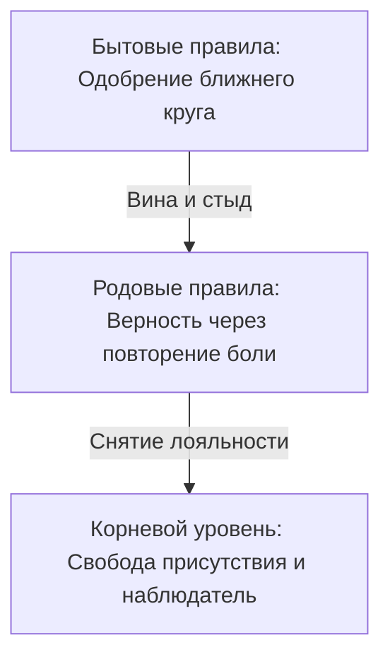

**Бытовой уровень (правила социума).**  
Это поверхностный слой: нормы приличия, привычки текущего окружения, сиюминутная мода на поведение. Этот контур постоянно сканирует пространство: *«Достаточно ли я удобен для других? Не выгляжу ли я глупо? Не сочтут ли меня эгоистом?»* Здесь живут обычный стыд и страх насмешки.

**Родовой уровень (правила семейной верности).**  
Этот пласт лежит неизмеримо глубже. Родовой системе нет дела до твоих дипломов, комфорта или размера банковского счета. Ее единственная задача — чтобы цепочка выживания не прерывалась, а связь между поколениями подтверждалась общей судьбой.

Если бабушка потеряла мужа на фронте и одна в голоде поднимала троих сирот, а мать тридцать лет терпела домашнего тирана ради того, «чтобы у детей был отец», в подсознании внучки без всяких слов формируется негласная клятва:

> *«Женщина нашего рода не имеет права на легкую и радостную женскую долю. Быть любимой, жить в сытости и неге — значит предать память тех, кто нес крест до меня».*

Психика сама разрушит любые счастливые и теплые отношения. Она выберет эмоционально недоступного, холодного или зависимого партнера — лишь бы уровень душевной боли сравнялся со страданиями матери и бабушки.

**Корневой уровень (уровень сути и наблюдателя).**  
Здесь нет разделения на «своих» и «чужих», нет долгов и вины за чужие тяготы. Каждый человек признается равным по праву своего рождения. Только из этого спокойного и ясного состояния наблюдателя можно увидеть старую разрушительную верность и снять ее без вражды к роду.

---

> [!NOTE]
> В 1970 году британский социальный психолог Анри Тэшфел провел в Бристоле серию экспериментов по минимальной групповой парадигме. Он делил незнакомых подростков на группы по совершенно случайным поводам: по оценке количества точек на экране или предпочтению картин Кандинского и Клее. Мальчики не общались между собой и не видели друг друга. Тем не менее, распределяя реальные деньги, они стабильно предпочитали не максимизировать собственный выигрыш, а увеличивать разрыв в пользу «своих» за счет «чужих». Они охотнее соглашались получить семь монет себе и три сопернику, чем десять себе и десять сопернику.
> 
> Потребность в слепой групповой лояльности вспыхивает мгновенно. В семейной системе этот механизм работает на уровне биологии: контур безопасности предпочитает оставаться бедным и больным внутри семейного клана, чем нарушить кодекс общей беды. Любое личное благополучие тело считывает как дезертирство и немедленно реагирует спазмом вины.

---

#### Загадка трех голосов

> [!TIP]
> **Ситуация**  
> Твои дела пошли в гору. Проект приносит прибыль, дома тепло и спокойно, на счете впервые в жизни лежит сумма, позволяющая не смотреть на ценники. И на самом пике этого успеха внутри поднимается ледяная тревога: живот сводит судорогой, плечи втягиваются, накатывает тяжелое предчувствие неминуемой беды.
>
> **Голос Расчета:** *«Спрячь все. Оденься попроще, не привлекай внимания, не зли родственников. Их скрытая зависть и обиды отравят тебя».*  
> **Голос Слепой Лояльности:** *«Отец всю жизнь надрывался на заводе за копейки. Бабушка экономила каждую крошку хлеба. Твоя сытая беззаботность — это оскорбление их памяти. Раздели их тяжесть, стань скромнее».*  
> **Голос Сути:** *«Их тяжесть принадлежала их времени и обстоятельствам. Твое процветание — это не насмешка над ними, а единственный подлинный смысл их лишений. Ты имеешь право жить своей жизнью».*
>
> *Вопрос на осознанность:* Кому на самом деле служит твое добровольное страдание — облегчает ли оно участь ушедших предков или лишь множит темноту в настоящем?

---

#### Сессия. Наталья

Наталья — успешный архитектор интерьеров, тридцать четыре года.

— Стоит моим делам наладиться — крупный заказ, покупка квартиры, гармония с мужем, — как внутри начинается настоящий ад. Словно сирена завывает: «Ты не имеешь права! Это ненадолго!». И я словно сама начинаю все рушить: устраиваю дикие сцены мужу на ровном месте, влезаю в долги, отдаю деньги проходимцам. Пока снова не окажусь на бобах, не могу успокоиться.

> **Терапевт:** Закрой глаза и опусти внимание в эту тревогу. Где она живет в теле?
>
> **Наталья:** *(кладет руку под ребра, пальцы напряжены)* Здесь. Под диафрагмой. Ледяной кол. Голова втягивается в плечи, дыхание мелкое. Ощущение, будто меня поймали на воровстве и сейчас будут судить.
>
> **Терапевт:** Представь перед собой женщин своего рода: маму, бабушку, прабабушку. Что этот ледяной кол говорит им?
>
> **Наталья:** *(голос срывается, на глазах слезы)* Он говорит: мне стыдно перед вами. Бабушка осталась вдовой в двадцать два года — дед погиб при завале на шахте. В голодном сорок седьмом она варила троим детям похлебку из лебеды, а сама тайком жевала сырую траву за печкой, чтобы не упасть. Маминого отца я помню: он приходил пьяным, избивал мать за остывший суп. Она выла ночью в подушку, а я, семилетняя, сидела под одеялом и шептала: «Мамочка, я никогда тебя не брошу, я буду с тобой». А сейчас у меня светлая студия с панорамными окнами, любящий муж, фарфоровые чашки, кофе по утрам. Я чувствую себя последней предательницей. Словно своим счастьем я насмехаюсь над их адом.
>
> **Терапевт:** Это закон слепой верности: доказать свою любовь к матери можно только повторением ее мучений. Благополучие приравнивается к измене. Посмотри в глаза своей бабушке. Посмотри на маму. Спроси их прямо: они вынесли эту тьму для того, чтобы ты легла рядом с ними в эту же могилу — или для того, чтобы хоть одна веточка их дерева наконец увидела солнце и расцвела?
>
> **Наталья:** *(долго молчит, слезы текут по щекам)* Бабушка смотрит на меня... В ее взгляде нет упрека.
>
> **Терапевт:** Скажи им вслух: *«Я вижу ваш голод, ваш страх и вашу тьму. Я склоняюсь перед той огромной ценой, которую вы заплатили, чтобы жизнь не прервалась и дошла до меня. Мое счастье — это не предательство. Моя радость — это продолжение и смысл ваших жертв. Вашу боль я с уважением оставляю в вашем времени, а себе беру жизнь».*
>
> **Наталья:** *(делает протяжный, свободный выдох, спина расправляется)* Бабушка улыбнулась. Она словно подошла и гладит меня своей сухой, шершавой ладонью по щеке. Говорит: «Живи, внучка. Живи за нас, дыши свободно, радуйся».
>
> **Терапевт:** Что сейчас происходит под ребрами?
>
> **Наталья:** Ледяной кол растаял. В груди разливается горячая волна. Мне впервые в жизни не нужно умирать и страдать, чтобы оставаться их дочерью.

---

#### Паритет

Вражда двух сибирских купеческих родов — Чернышовых и Волковых — не имела ничего общего с романтикой дворянских дуэлей. Это была беспощадная война на уничтожение: сфабрикованные судебные иски, поджоги лесопилок, разорение и нищета. Детям передавали не любовь и не созидание, а волчий инстинкт: *любой человек с той фамилией — смертельный враг*.

Роман Чернышов и Юлия Волкова выросли внутри этой тяжелой ненависти.

Они случайно встретились на карнавале в Венеции. Безлюдный мост над каналом, старинные маски, поразительное совпадение тембров и интонаций. Когда на рассвете маски были сняты, отступать оказалось поздно: тела и души узнали друг друга раньше, чем включился рассудок.

Три года они тайно встречались в нейтральных городах и отелях. Они наивно говорили себе: на дворе двадцать первый век, мы современные европейские люди, мы выше средневековых семейных вендетт.

Но древняя родовая солидарность не отпускает человека по одному лишь интеллектуальному заявлению.

Старший брат Юлии выследил их на парковке транзитного аэропорта. Монтировка, крики, ярость. Роман бросился наперерез, чтобы защитить Юлию, оттолкнул нападавшего. Брат оступился на мокром асфальте и со всего размаха ударился виском об острый угол бетонной опоры.

Сухой хруст кости. Запах бензина. Неподвижное тело на сером бетоне.

Парень умер мгновенно — за родовую обиду вековой давности, истинных причин которой в семьях уже никто толком не помнил.

Стена между домами стала непреодолимой. Отец спешно выдал Юлию за жесткого сырьевого партнера. Роман уехал за океан, оборвав все связи.

Их последняя встреча произошла на продуваемой ветром крыше недостроенного делового центра «Паритет» — гигантского комплекса, который их отцы когда-то начинали строить как символ примирения, но затем заморозили многолетними судебными тяжбами.

Юлия говорила тихим, мертвым голосом:

— Если я уйду с тобой, моя семья вычеркнет меня навсегда. Если останусь — я медленно сгнию заживо. Но самое невыносимое другое: каждый раз, глядя в твои глаза, я буду видеть смерть брата. Прости меня.

Они разошлись в разные стороны.

Оба создали внешне безупречные фасады. Роман женился на спокойной, рассудительной женщине. Юлия вела светскую жизнь и возглавляла благотворительные фонды под руку с респектабельным супругом.

Но в их детях поселился странный паралич близости.

Сын Романа в двадцать пять лет внезапно разорвал помолвку с любимой девушкой за неделю до свадьбы, так и не сумев объяснить причину своего панического бегства. Дочь Юлии выбирала исключительно эмоционально холодных мужчин, а после каждого мучительного разрыва повторяла с горьким триумфом: «Я всегда знала, что мужчины приносят только предательство и боль».

Молодые люди не были знакомы друг с другом, но в обоих безотказно работал один и тот же невидимый родовой закон: **подлинная близость ведет к катастрофе и крови**.

Небоскреб «Паритет» достроили спустя пятнадцать лет.

На торжественном открытии во главе банкетного стола сидели двое дряхлых стариков — два живых памятника многолетней ненависти с дрожащими руками и холодными глазами.

А за соседним столом, по протоколу рассадки партнеров, оказались их внуки. Сын Романа и дочь Юлии. Они весь вечер сидели молча, пряча напряженные руки под скатертью.

А потом девушка подняла глаза. Молодой человек не отвел взгляда. Несколько секунд посреди звона хрустальных бокалов и фальшивых тостов они смотрели друг на друга с внезапным узнаванием одной и той же неизбывной тоски.

В их взглядах не было ни капли вражды. В них читалась только одна робкая мысль: *«Неужели можно наконец опустить это ржавое оружие?»*

Война семей никогда не заканчивается победой. Ее расплатой всегда становятся последующие поколения, которые разучились впускать человека в свое сердце и всю жизнь строят крепости вокруг ледяного одиночества.

---

#### Практика

Возьми чистый лист бумаги и напиши от руки.

Четко и без прикрас назови тот запрет, который ты годами обслуживаешь собственной болью:

> *«Я запрещаю себе [финансовую свободу / крепкое здоровье / теплый счастливый брак], потому что в нашей семье было принято [тяжело выживать / терпеть холод / страдать в одиночестве]. Мой саботаж и мои неудачи были тайным доказательством моей верности вам».*

Рядом напиши слова освобождения:

> *«Я вижу цену вашей жизни и кланяюсь ей. Но наши судьбы и счета я разделяю. Ваша тяжелая доля принадлежит вам, а моя жизнь принадлежит мне. Контракт на верность через страдание и саморазрушение я расторгаю. Мое счастье, здоровье и процветание будут лучшей данью уважения к тому, что вы передали мне жизнь».*

Встань прямо перед зеркалом. Посмотри себе в глаза и произнеси второй текст спокойно, тихо и бесповоротно. 

Если спазм в солнечном сплетении сменяется глубоким вздохом и теплом в груди — слова нашли свое место. Если внутри сохраняется сопротивление — не дави на себя. Мы вернемся к этому узлу в следующих главах.

---

> [!IMPORTANT]
> **Главная мысль главы**  
> Счастье часто маскируется под предательство родовых традиций. Но сжимающий горло голос — это не совесть. Это старый страж, чьи полномочия давно истекли.

---

> [!TIP]
> **Интерактивный помощник**  
> Первый акт завершен: перед тобой полная карта базовых контуров системы. Если работа с родовыми узлами вскрыла старую боль, спазм или глухое сопротивление — не оставайся с этим один на один. Ты можешь использовать диалоговое окно внизу страницы, чтобы вместе с ассистентом бережно разобрать свой конкретный тупик.


---

<a id="section-root-section-act-02"></a>

## АКТ II. Нарастание: чувства и баги

<a id="10-primary-signals"></a>

### Первичные сигналы

Три часа ночи. Сердце колотится в горле так, будто в темной комнате за спиной кто-то стоит.

Ты не спишь уже сорок минут. В голове по кругу крутится один и тот же пустой разговор: что сказали днем на работе, что нужно было ответить, как посмели так поступить. Челюсти стиснуты до скрежета. Простыня под лопатками взмокла от липкого пота. Утром ты спишешь это состояние на «вегетососудистую дистонию» или «фоновую тревожность», пойдешь на дыхательную гимнастику, выпьешь пустырник и отдашь психотерапевту треть месячного дохода за сочувствующий кивок.

Рассудок будет уверять, что работа над собой идет полным ходом. А внутри в это время выгорают последние запасы жизненных сил.

«Меня все раздражает». «Я постоянно на взводе». «Навалилась глухая апатия». Эти формулировки звучат привычно и даже солидно, но за ними редко стоят настоящие чувства.

Живое тело физически не способно испытывать одну и ту же эмоцию непрерывно. Если обида или тревога тлеют в человеке неделями, это значит лишь одно: мысль снова и снова искусственно подогревает угасший костер. Батарея садится, внутренний радиатор закипает, а полезного движения в жизни не происходит.

Настоящий эмоциональный импульс устроен совсем иначе. Он вспыхивает, проходит сквозь тело острой волной — и бесследно уходит.

Пока человек не научится различать чистый природный импульс и затяжную мысленную жвачку, любая духовная или психологическая практика будет снова и снова возвращать его в ту же самую постель в три часа ночи. К тем же нерешенным финансовым тупикам. К тем же разрушительным ссорам. К тому же комку ужаса в пересохшем горле.

---

#### Девяносто секунд

У живого, первичного чувства есть безошибочный почерк.

Оно всегда предельно честно и привязано к текущей секунде. Первичный страх бьет в диафрагму прямо сейчас — когда на встречную полосу внезапно вылетает тяжелый грузовик, а не когда воображение рисует картины возможной нищеты через пять лет. Первичная злость приходит горячей волной в ладони и плечи, когда чужой сапог наступает на твою живую границу в этот самый момент. Первичное горе сдавливает горло и грудь слезами, когда близкая связь действительно оборвалась навсегда. Такое чувство не ищет виноватых и не сочиняет длинных оправданий. Оно просто фиксирует суровую правду момента.

И самое главное: оно поразительно кратко. 

Биохимическая буря в крови длится около полутора минут. Если не подбрасывать в этот огонь сухие дрова возмущения — «как они посмели», «я им еще докажу», «это вопиющая несправедливость», — волна поднимается, достигает пика и мягко откатывает назад. После нее в теле наступает хрустальная, звенящая тишина — как в умытом лесу после грозы.

Хронический стресс, застарелая обида и непроходящее уныние — это результат того, что человек сам, каждые несколько минут, вручную нажимает кнопку повтора на старом, давно пережитом событии. И делает это до тех пор, пока организм не падает без сил.

---

> [!NOTE]
> В декабре 1996 года американский нейроанатом Джилл Болте Тейлор перенесла обширный инсульт: разорвалась артерия в левом полушарии головного мозга. Будучи профессиональным исследователем нервной системы, она наблюдала за собственным угасанием с точки зрения ученого. 
> 
> Левое полушарие отвечает за линейное время, связную речь, концепцию «я» и бесконечный внутренний диалог. Правое удерживает целостность тела и ощущение прямого присутствия в моменте. Когда речевой центр отключился, Тейлор зафиксировала фундаментальный факт: полный биохимический каскад стрессовой реакции длится не более девяноста секунд. Ровно столько времени требуется надпочечникам, чтобы выбросить в кровь порцию норадреналина и кортизола, и печени с почками — чтобы полностью их утилизировать.
> 
> Все переживания, которые длятся дольше полутора минут — многочасовая ярость, многодневные обиды, годы тяжелого осадка, — поддерживаются исключительно мыслями, которые снова и снова бомбардируют миндалевидное тело. Стоит остановить словесный поток и просто дать телу прожить физическую волну — и буря утихает сама собой за те же девяносто секунд.

Когда настоящий природный импульс завершает свой путь, тело естественным образом расправляется. Дыхание опускается в глубину живота. Челюсти разжимаются сами. После выплаканных чистых слез в душе наступает ясная, прозрачная легкость. После прожитого гнева в стопах появляется устойчивая опора, а в голосе звучит спокойная твердость.

Поддельное, затяжное переживание всегда оставляет после себя лишь липкую тяжесть и дурноту.

С раннего детства нам перекрывали этот естественный выход. «Мальчики не плачут». «Хорошие девочки не кричат». «Не смей перечить взрослым». Нас учили вежливо улыбаться, когда внутри все сжималось от несправедливости. Клапан был заварен наглухо. И человек привык десятилетиями гудеть на одной высокой тревожной ноте, словно перегруженная трансформаторная подстанция.

Поверх запертой боли психика возводит суррогаты. Вместо открытой злости человек выбирает едкий сарказм. Вместо честного испуга — циничное равнодушие. Вместо проживания горя — маниакальную работу до полуночи без выходных. Лишь бы ни на секунду не остаться в тишине наедине с собственным живым телом.

---

#### Артём

Артёму тридцать четыре года. Ведущий разработчик в крупном финтехе. Высокий, подтянутый, с аккуратной ухоженной бородой. Взгляд загнанный, движения резкие, желваки постоянно ходят под кожей.

— Меня изнутри выжигает дикая ярость, — говорит он глухо. — Я срываюсь на младших разработчиков за малейшую опечатку в коде. Ору на жену, если она просит вынести мусор или забывает купить молоко. Вчера в глухой пробке колотил по рулю кулаками до синяков. Сам себя за это ненавижу. Хожу в спортзал, избиваю боксерскую грушу до седьмого пота. Но утром просыпаюсь — и злость снова сидит в горле, никуда не делась.

> **Терапевт:** Вспомни вчерашнюю вспышку ярости дома. С чего все началось?
>
> **Артём:** *(стискивает подлокотники кресла до побелевших пальцев)* Вчера был двенадцатичасовой спринт перед релизом. Глаза слезятся, шея как деревянная, голова раскалывается. Выхожу на кухню просто налить стакан холодной воды. Жена входит и говорит: «Артём, разбери, пожалуйста, пакеты из магазина». И меня будто кипятком обдало. Захотелось схватить чайник со стола и разбить его об стену.
>
> **Терапевт:** Оставь сейчас жену и пакеты в покое. Где это бешенство живет в твоем теле прямо сейчас?
>
> **Артём:** В горле и в скулах. Челюсти будто тисками сдавило. А в грудной клетке словно кипящая смола бурлит.
>
> **Терапевт:** Положи ладонь на грудь. Спроси это кипение: кого или что ты так отчаянно защищаешь? Какая боль прячется под этой смолой?
>
> **Артём:** *(дыхание прерывается, плечи вздрагивают)* Там мысль: «Я обязан. Если я прямо сейчас сяду на диван и откажусь помогать — я ничтожество».
>
> **Терапевт:** Чей это голос? Кто тебе это внушил?
>
> **Артём:** *(голос резко падает, становится тихим и глухим)* Отец. Кадровый офицер. У него дома всё было по уставу. Мне девять лет. Я принес из школы четверку по математике. Он взял мой дневник и с размаху швырнул его об стол. Сказал сквозь зубы: «Ты мне должен по гроб жизни, щенок. За репетиторов, за крышу над головой, за еду. Ты обязан быть лучшим во всем. Расслабишься, покажешь слабость — вылетишь из этого дома на улицу».
>
> **Терапевт:** Посмотри на того девятилетнего мальчика, который стоит у полированного стола. Сними с него взрослую броню. Что чувствует этот ребенок?
>
> **Артём:** *(губы начинают мелко дрожать, лицо бледнеет)* Дикий, животный ужас. Меня не любят просто так. Меня терпят, только пока я приношу пользу и служу на пределе сил. Если я покажу, что устал, меня просто выбросят, как ненужную вещь.
>
> **Терапевт:** Вот он — настоящий сигнал. Тот самый первичный ужас. Прижми ладонь к грудине. Не оправдывай отца. Дыши прямо в этот страх. Я рядом с тобой.
>
> **Артём:** *(сначала издает сдавленный горловой звук, а затем начинает плакать — горько, безудержно, навзрыд, как тот маленький девятилетний мальчик, которому тридцать лет назад запретили чувствовать боль)*

Крупные слезы капали на воротник дорогой брендовой рубашки. Тот смертельный зажим, который Артём удерживал четверть века, наконец стронулся с места.

Прошло тридцать секунд — плечи перестали судорожно дергаться, пальцы на подлокотниках мягко разжались.  
Прошло шестьдесят секунд — дыхание впервые за долгие годы опустилось ниже солнечного сплетения, стало глубоким и теплым.  
На восемьдесят пятой секунде он сделал один протяжный, чистый, освобождающий вдох.

Артём открыл глаза. Лицо было мокрым, но хищное напряжение в скулах исчезло без следа.

— Ярости больше нет, — прошептал он с изумлением. — Внутри абсолютная, глубокая тишина. Я двадцать пять лет нападал на самых близких людей только для того, чтобы не расплакаться от собственного страха и тоски. Господи, как же я устал отдавать долг, которого на самом деле никогда не существовало.

---

#### Практика

В следующий раз, когда внутри поднимется волна слепого раздражения, паники или застарелой обиды, сделай паузу. Не хватайся за смартфон. Не беги к холодильнику. Не начинай мысленно произносить обличительные речи в адрес обидчиков.

Останови поток мыслей. Мысли в этот момент работают как керосин, плеснутый в огонь. Перекрой этот приток: перестань прокручивать в голове диалоги и рисовать картины будущих катастроф.

Спроси собственное тело: *какое простое, голое чувство прячется под этой бурей?* Назови его одним коротким словом. «Мне больно». «Мне страшно». «Я чувствую бессилие». «Мне невыносимо одиноко». Без предысторий и поиска виноватых.

Определи точное место в теле: ком в горле, тяжелый камень под ребрами, ледяные пальцы. Положи на это место свою теплую ладонь. Дыши спокойно и глубоко. Не пытайся разогнать чувство и не пытайся его подавить. Дай ему ровно девяносто секунд. Живая волна эмоции не может тебя разрушить. Разрушает лишь то ментальное топливо, которым ты ее непрерывно кормишь.

Дождись естественного спада волны. Ты почувствуешь его телом: глубокий непроизвольный выдох, разливающееся по животу тепло, расслабление скул и плеч.

Встреча с первичной болью напрямую — это не проявление слабости и не капитуляция. Это единственный способ перестать сжигать собственную жизнь на охрану тяжелых ворот, за которыми уже давно нет никакой угрозы.

---

> [!IMPORTANT]
> **Главная мысль главы**  
> Живое тело полностью проживает и отпускает любой эмоциональный импульс за девяносто секунд. Всё, что мучает тебя дольше, ты удерживаешь собственными мыслями.


---

<a id="11-secondary-processes"></a>

### Вторичные процессы

Обида с десятилетним стажем. Беспричинная тревога, не покидающая даже на отдыхе. Глухое чувство вины, сопровождающее каждый вдох.

Если это состояние тебе знакомо, не спеши искать утешения в красивых психологических терминах.

То, что человек привык считать своим сокровенным глубинным переживанием, в большинстве случаев оказывается вовсе не чувством. Это глухая защитная броня. Тяжелый ржавый панцирь, который за долгие годы буквально сросся с ребрами. Ты надел его когда-то в раннем детстве, чтобы не погибнуть от невыносимой душевной боли — и так и не нашел в себе смелости его снять.

Не кризис в экономике связывает тебе руки. Не отсутствие нужных знакомств мешает дышать полной грудью. Тебя сковывают эти сорок килограммов чугуна. В таком панцире невозможно свободно бежать, любить или созидать. Человек в броне не строит жизнь — он круглосуточно держит глухую оборону. А в одном теле оборона и развитие одновременно существовать не могут.

Живое подлинное чувство похоже на открытую царапину. Ей нужно лишь одно: чтобы ее бережно увидели, промыли чистой водой внимания и дали спокойно затянуться за положенные девяносто секунд.

Броня требует совершенно иного: заварить все входы наглухо, ощетиниться стальными шипами и никого не подпускать на пушечный выстрел.

Праведный гнев, ядовитая ирония, привычная жалость к себе, бесконечные внутренние обвинения — всё это внешние проявления защитного панциря. Тело при этом всегда подает один и тот же сигнал: скованная грудная клетка, поверхностное дыхание верхушками легких и мгновенный спазм ровно в ту секунду, когда кто-то пытается подойти к тебе по-настоящему близко.

---

#### Как распознать защитный щит

У любого защитного панциря всегда есть отрепетированная поза и потребность в зрителях. Роль выучена до автоматизма: благородная жертва обстоятельств, непонятый миром гений, святой мученик или непробиваемый циник. Этой роли жизненно необходима публика — пусть даже в виде собственного отражения в зеркале ванной комнаты.

Если ты умеешь часами рассказывать о своих страданиях красиво, витиевато, с отточенными драматургическими паузами, и внутри при этом разливается тихое тепло от собственной стойкости — знай: это говорит не рана. Это красуется твоя броня.

У живого природного импульса всегда есть естественное завершение. У вторичной брони конца нет. Обиду на бывшего партнера можно смаковать и пережевывать десятилетиями. Тревога о завтрашнем дне не утихает даже в полной физической и финансовой безопасности. Вина за чужую судьбу способна гудеть в голове до самой старости. Если накал переживания не меняется неделями и месяцами — перед тобой не живое чувство, а зацикленная защитная реакция. Сил она забирает колоссальное количество, а душевного облегчения не приносит ни на грамм.

Броня всегда прикрывает то, что когда-то было объявлено под строжайшим запретом. За внешней агрессией почти всегда прячется беспомощный плач испуганного ребенка. За показной суетой и контролем — первобытный ужас быть отвергнутым и забытым. Под всепоглощающей виной перед родителями — запертая ярость на них же: ведь открыто разозлиться на маму или отца в детстве означало остаться без защиты и погибнуть.

---

> [!NOTE]
> Основатели эмоционально-фокусированной терапии Лесли Гринберг в Йоркском университете и Сью Джонсон в Оттаве много лет исследовали физиологические маркеры эмоций: сердечный ритм, электрокожное сопротивление и уровень кортизола. 
> 
> Их эксперименты доказали фундаментальное различие: первичные адаптивные эмоции (страх реальной опасности, чистая печаль утраты, здоровый импульс защиты границ) дают резкий, но короткий физиологический всплеск, за которым неизменно следует полная разрядка нервной системы и глубокий покой. 
> 
> Вторичные защитные реакции (хроническая обида, навязчивое раздражение, демонстративная вина) ведут себя принципиально иначе: вегетативное возбуждение не спадает часами, запирая организм в изнурительную петлю. Пока человек пытается «проживать» саму броню, истинная боль под ней остается нетронутой и продолжает незаметно высасывать все жизненные ресурсы.

---

#### Щит, который я несла двадцать лет

Я очень долго и искренне верила, что моя ярость священна и справедлива.

Мне казалось, что я веду благородную войну против предательства близких, против вопиющей семейной несправедливости. Потребовалось двадцать лет взрослой жизни и немало душевных крушений, чтобы набраться смелости признать правду: я десятилетиями злилась только потому, что ярость была куда теплее и привычнее, чем леденящий ужас признания фактов.

Двадцать лет я бережно полировала и лелеяла обиду на свою младшую сестру. Список моих претензий содержался в идеальном порядке: ее всегда баловали, ей всё прощали, ей без всяких усилий досталась бабушкина квартира, она увела у меня человека, в которого я была влюблена в юности. Я рассказывала эту драму подругам и случайным знакомым с проникновенным трагическим пафосом. Я упивалась этой болью. Стоило в разговоре зайти речи о родительской семье, как я немедленно поднимала тяжелый стальной щит с надписью «Жертва несправедливости».

С этим щитом было тяжело дышать. Но опустить его казалось смертельно опасным.

Однажды во время глубокой внутренней работы я мысленно положила этот щит перед собой на пол. Закрыла глаза, убрала ладони с рукояти и спросила свое замершее тело: *что на самом деле останется, если я прямо сейчас перестану ненавидеть сестру?*

В груди мгновенно открылась ледяная пустота. Сквозная дыра размером с кулак. Ощущение было настолько невыносимым, что пальцы непроизвольно потянулись обратно к металлу — схватить щит, закрыться им, спрятаться в знакомую, привычную злость. Лишь бы не заглядывать в эту черноту.

Но я заставила себя посмотреть. Под щитом лежало то, в чем я не могла признаться себе два десятка лет.

*Мама всегда любила ее больше. Родители всем сердцем выбрали ее, а не меня. А я была просто удобным, фоновым ребенком.*

Вся эта многолетняя ненависть не имела никакого отношения к квадратным метрам квартиры. Это была проигранная в раннем детстве война за тепло маминых глаз. И пока я сжимала кулаки и осыпала сестру проклятиями, я продолжала оставаться внутри этой бессмысленной битвы, наивно теша себя иллюзией, что победа еще возможна.

Я сидела на ковре и плакала. Это не были слезы гордого возмущения. Это были тихие, горькие, беспомощные детские слезы полного признания своего поражения.

Через несколько минут в легкие хлынул первый за двадцать лет глубокий, чистый вдох. Плечи мягко опустились. Ржавый щит остался лежать на земле.

Злость испарилась сама собой за ненадобностью. Спорная квартира осталась у сестры, но перестала душить меня ночами. Когда отпала детская потребность воевать за чужую любовь, в душе наконец появилось место для собственной взрослой жизни.

Жора, слушая этот разбор, внезапно побледнел и узнал собственную глухую оборону. Его хваленая «железная логика», холодный скепсис и высокомерное «я опираюсь исключительно на объективные факты» годами служили точно такой же броней. Они защищали его от детского кошмара: *в доме двух измученных женщин мой голос ничего не значит, я пустое место, меня никогда не услышат.* 

Кристина годами билась об этот ледяной панцирь, плакала, просила хоть капли живого тепла. А он методично осыпал ее безупречными логическими доводами до тех пор, пока она окончательно не собрала вещи и не закрыла за собой дверь.

Только потеряв любимого человека, Жора с ужасом осознал: его стальной щит защищал не от врагов. Он заживо замуровал его в одиночестве, отрезав от живого мира.

---

#### Практика

Найди в своей жизни то переживание, которое тянется годами: застарелую обиду на бывшего партнера, фоновое раздражение на родителей, глухое недовольство собой или миром.

Загляни в это чувство честно и прямо. Присутствует ли в нем тайное удовлетворение от собственной правоты, от гордости за свое терпение, от величия перенесенных страданий? Если в этой боли тепло, если она стала частью твоей личности и тебе хочется, чтобы окружающие знали о твоей тяжелой доле — перед тобой защитная броня.

Сядь прямо. Сделай медленный вдох через нос и плавный выдох через чуть приоткрытый рот. Мысленно сними с грудной клетки этот тяжелый стальной корсет и опусти его на землю перед собой:

> *«Я вижу эту злость и эту обиду. Вы защищали меня тогда, когда у меня не было других сил выдержать удар. Спасибо за службу. Но сейчас я оставляю это оружие на земле».*

Направь внимание в образовавшуюся пустоту под ребрами. Какое голое, бесхитростное чувство открылось под снятой броней?

*«Мне больно от того, что меня не выбрали».*  
*«Мне смертельно страшно оказаться слабым и ненужным».*  
*«Я чувствую себя тем беспомощным ребенком, который ничего не может изменить».*

Дай этому открывшемуся чувству ровно девяносто секунд. Не комментируй его и не пытайся анализировать. Позволь дрожи или тихим слезам пройти сквозь тело естественной волной. На самом дне этой волны тело само сделает глубокий освобождающий вдох, а в груди появится долгожданный простор.

Подлинная зрелость измеряется не толщиной защитной брони. Она заключается в способности выдерживать реальность обнаженным и живым сердцем.

---

> [!IMPORTANT]
> **Главная мысль главы**  
> Защитную броню невозможно вылечить или прожить бесконечными разговорами. Ее можно только снять — чтобы наконец встретиться с той подлинной болью, которую она скрывала.


---

<a id="12-inherited-data"></a>

### Унаследованные данные

Случалось ли тебе просыпаться посреди глубокой ночи от липкого, необъяснимого ужаса — в теплой постели, за надежной стальной дверью?

За окном мерно шумит мирный ночной город. Холодильник полон еды. На банковском счете лежит запас на год вперед. А в солнечном сплетении ворочается ледяной камень, ладони становятся влажными, и чуткое ухо с замиранием ловит каждый шорох на лестничной клетке. Кажется, что за дверью вот-вот раздастся тяжелый скрип кованых сапог.

Рассудок судорожно пытается найти объяснение в текущих делах: скачок валютного курса, не сданный вовремя квартальный отчет, остаток по ипотеке. Но любая из этих бытовых причин выглядит жалкой заплаткой над разверзшейся бездной. Масштаб этого леденящего ужаса несоизмерим ни с одним реальным событием твоей собственной биографии.

Это не твоя тревога.

В твоей нервной системе звучит эхо катастрофы, случившейся задолго до твоего рождения. Ты не выбирал это переживание сознательно. Но оно незаметно высасывает жизненные силы, отравляет радость достатка и держит тебя в состоянии круглосуточной осады.

Значительная часть тяжести, которую мы несем в себе, принадлежит не нам. Иррациональный страх нищеты посреди изобилия. Панический ужас перед любым официальным документом со строгой печатью. Чувство вины за тепло собственного дома и смех своих детей. Всё это — следы аварийных записей, сделанных предками в моменты смертельных потрясений.

Когда человек из предыдущих поколений попадает под каток исторических событий, которые невозможно было пережить и оплакать за одну человеческую жизнь — раскулачивание, лагеря, война, гибель детей в голод, — эта боль не исчезает с его смертью. Она передается вниз по семейной ветви. Младший потомок из слепой, неосознанной любви перенимает этот ледяной осколок на себя и годами проживает чужую трагедию в декорациях современного благополучного мира.

Чужую боль невозможно «исцелить» или «проработать» как личную травму. У нас нет права перекраивать события столетней давности. Чужую беду не лечат дыхательными практиками. Ее можно только обнаружить, признать ее колоссальный масштаб и с глубоким уважением вернуть туда, откуда она пришла.

---

#### Три признака чужой тяжести

Чтобы понять, что ты несешь чужое бремя, достаточно совпадения хотя бы двух признаков:

**1. Полное несоответствие текущей реальности.**  
У тебя есть стабильная работа, дома тепло, рядом близкие люди, которым ты дорог — а внутри поселился первобытный страх голодной смерти или глухая, безутешная скорбь, будто ты стоишь у свежей братской могилы. Ум пытается привязать это чувство к мелким бытовым неурядицам, но каждая новая версия звучит всё более нелепо. Истинной причины этого состояния в твоей собственной жизни попросту не существует.

**2. Невосприимчивость к классической терапии.**  
Ты можешь годами ходить к психологам, менять специалистов, изучать техники релаксации — но тяжесть не сдвигается ни на миллиметр. Она не уходит, потому что у тебя нет права распоряжаться чужой судьбой. Чужую историю нельзя переписать заново. Ее можно только бережно вернуть владельцу.

**3. Несоразмерность повода и реакции.**  
Выплату аванса задержали на два дня — а внутри поднимается паника такой силы, будто завтра тебя выведут на расстрел. Руководитель прошел мимо и сухо кивнул — а в теле застывает ужас отвержения, заставляющий подгибаться колени. Сила и глубина соматического отклика безошибочно выдают возраст события: прямо сейчас реагирует не взрослый специалист в светлом офисе, а испуганный предок из далекого прошлого.

---

> [!NOTE]
> В 2013 году нейробиологи Брайан Диас и Керри Ресслер из университета Эмори провели прорывное исследование в области трансгенерационной эпигенетики. Самцов лабораторных мышей приучали бояться сладковатого запаха ацетофенона (напоминающего цветущую черемуху), сопровождая его подачу слабым ударом электрического тока.
> 
> Затем исследователи получили потомство от этих мышей методом искусственного оплодотворения, полностью исключив любое общение детенышей с отцами. Второе и даже третье поколения мышей, никогда в жизни не испытывавшие ударов током и не нюхавшие ацетофенон, при первом же появлении запаха черемухи мгновенно замирали в ступоре, а их пульс подскакивал. 
> 
> Вскрытие показало, что участки обонятельной луковицы мозга, отвечающие именно за этот запах, у потомков были физически увеличены. В сперматозоидах отцов ученые обнаружили химическую эпигенетическую метку — метилирование ДНК в гене соответствующего рецептора. Страх передался потомкам не через рассказы или воспитание, а на уровне тонкой биохимической настройки нервной системы. Непрожитый шок предка стал безусловной инструкцией по выживанию для тех поколений, которые еще даже не родились.

---

#### Погреб

Марии было двадцать восемь лет. Ноябрь тридцать первого года, глухая сибирская деревня. В избе еще пахло теплым свежеиспеченным ржаным хлебом, когда на рассвете в дверь с грохотом постучали трое уполномоченных в кожаных куртках.

Мужа подняли с лавки прямо в исподнем, скрутили руки, вывели на трескучий мороз и увезли на санях. Больше живым его никто в деревне не видел. Через четыре часа пришли с гербовой бумагой об изъятии имущества: десять минут на сборы четверых малолетних детей. Массивную дубовую дверь опечатали казенным сургучом.

Старшей Дуне шло одиннадцатое лето. Она молча, побелевшими пальцами держала за плечи двух младших братьев. Полуторагодовалого Ванечку Мария несла у себя на груди, замотав в дырявую шерстяную шаль.

Они шли по деревенской улице сквозь поднимающуюся ледяную метель. Мария стучала в занесенные снегом избы соседей и кумовей. За стеклами мгновенно гасили лучины и керосинки. Тяжелые кованые засовы не двигались с места. Это делалось не от природной жестокости, а от парализующего ужаса: пустить в дом семью «кулака-лишенца» означало немедленно обречь на ту же участь собственных детей. К полуночи мороз перевалил за тридцать пять градусов. На крики и стук за воротами перестали лаять даже собаки.

В одном крайнем окне еще слабо теплился огонёк лампадки. Там жила одинокая вдова. «Она поймет, она сама мать, она не оставит замерзать детей», — билась мысль. Пальцы Марии уже не сгибались. Стук вышел слабым, неживым. Потом она стала колотить кулаком. Огонёк за стеклом вздрогнул и погас. Мария еще долго стояла в сугробе, глядя в мертвое темное окно, будто за рамой всё еще могло случиться чудо.

Дорога кончилась. Впереди простиралось только белое замерзшее поле.

У самого края деревни виднелся покосившийся овин и правильный, заметенный снегом холм старого овощехранилища. Мария упала на колени, голыми окровавленными руками разгребла плотный наст и нащупала железное кольцо. Дубовая крышка погреба поддалась с глухим треском. В лицо пахнуло могильной сыростью и гнилой промерзшей картошкой. Другого выхода не было. Она спустила детей вниз, в ледяную тьму.

Ветра там не было, но промерзший земляной пол вытягивал жизнь быстрее метели. Они сбились в углу на полусгнивших рогожах в один дрожащий ком.

Мария не смыкала глаз до утра. Она непрерывно растирала детские ступни, дышала в крошечные ладошки, сухими, потрескавшимися в кровь губами шептала старинные колыбельные. Единственной задачей было не дать детям уснуть тем тихим сном, из которого уже не просыпаются.

Шестилетняя Настя сквозь дремоту всё время тихо хныкала: «Мамочка, пойдем домой, я замерзла, я домой хочу». Мария гладила ее ледяное личико и отвечала нарочито спокойным голосом, чтобы не завыть в голос: «Скоро, доченька. Потерпи еще чуть-чуть, солнышко взойдет — и пойдем».

Под самое утро Настя перестала вздрагивать. А еще через час маленький Ванечка на груди Марии стал непривычно тяжелым и ледяным. Мария еще долго прижимала его окоченевшее тельце к своей груди и согревала дыханием, пока окончательно не поняла, что укачивает мертвого ребенка.

Двое старших выжили и дождались рассвета, навсегда потеряв отмороженные пальцы ног. Двоих младших забрал тот ночной погреб.

---

Светлане эту историю мать пересказывала обрывками, шепотом, когда на семейных поминках выпивала лишнюю рюмку: «Бабушка Мария до самой смерти никогда не выключала на ночь свет. Вздрагивала от любого стука в дверь, собирала сухари в наволочки». Светлана слушала в детстве и думала: *«Это было так давно. Это страшная сказка из прошлого века. Какое отношение это имеет ко мне?»*

В тридцать два года Светлана занимала должность операционного директора в международной компании. Просторная квартира с панорамными окнами на двадцать четвертом этаже элитного дома. Бронированная дверь с электронным замком. Заботливый, любящий муж.

И при этом с двадцати пяти лет каждую ночь, ровно в три часа пятнадцать минут, она просыпалась от приступа дикой паники в холодном поту. Воздух в теплой спальне казался ей ледяным. Челюсти сводило до острой боли. В пересохшем горле стоял удушливый ком сырой земли. Антидепрессанты превращали день в серую мутную полудрему, но ночью ледяной кошмар неизменно возвращался.

Когда во время глубокой сессии Светлана позволила своему вниманию опуститься прямо в этот холод в теле, образ всплыл перед глазами с пугающей отчетливостью: сырая земляная яма, промерзшие серые доски, обезумевшая от горя женщина в истлевшем платке и замерзший младенец на ее руках.

> **Светлана:** *(голос срывается на крик, тело колотит крупная дрожь)* Это бабушка Мария... Она до сих пор там, в тридцать первом году! Она не может согреть своих детей! Этот могильный холод сидит у меня под кожей! Если я согреюсь, если я позволю себе спокойно спать в тепле и достатке — я предам их память!
>
> **Терапевт:** Посмотри на бабушку Марию прямо сейчас. Посмотри в ее глаза. И верни ей ее ношу. Вслух, всем телом.
>
> **Светлана:** Бабушка Мария... Я вижу твой погреб. Я вижу твоих погибших детей. Я склоняюсь перед твоим нечеловеческим горем. Но цена, которую ты заплатила — это твоя судьба. Холод, смерть и голод остались в тридцать первом году. Мои дети сыты. Мой дом согрет. Я с поклоном возвращаю твой ужас твоему времени. Я больше не буду замерзать вместе с тобой в той яме. Посмотри на мою сытую и мирную жизнь с миром.

Судорожный зевок разорвал многолетний спазм в горле. Выдох вырвался наружу подобно прорвавшейся плотине.

Щеки Светланы мгновенно порозовели. Пальцы рук, остававшиеся мертвенно-ледяными на протяжении семи лет, налились живым, пульсирующим жаром. Тяжелейшая гранитная плита под ребрами бесследно растаяла.

Она не обесценила трагедию своего рода. Напротив: она позволила погибшим предкам наконец упокоиться в своем времени, а себе дала право перестать ночевать в мерзлом погребе вековой давности.

---

#### Практика

Если твоя реакция на событие несоизмеримо сильнее самого повода — ты держишь в руках чужую беду. Ее необходимо вернуть по точному адресу.

Вспомни переживание, которое никак не вяжется с твоей реальной биографией: панический страх остаться без копейки при стабильной подушке безопасности, безотчетный ужас перед властными структурами, непроходящая скорбь без реальной потери. 

Определи точное место в теле, где затаился этот страх: ледяной зажим в животе, ком в горле, онемение между лопатками.

Приложи ладонь к этому месту. Спроси свое тело: *чья это трагедия? В какие годы она началась?* Имя предка или зримый образ эпохи могут прийти мгновенно. Но даже если конкретный образ не всплывет, достаточно обратиться к тем неизвестным в роду, кто пережил эту катастрофу.

Представь эту фигуру перед собой. Сделай глубокий вдох и на плавном выдохе произнеси вслух:

> *«Я вижу твою тяжелую судьбу. Твоя боль и твой страх принадлежали твоему времени и твоим испытаниям. Я склоняюсь перед той огромной ценой, которую вы заплатили, чтобы жизнь дошла до меня. Но наши судьбы и счета я разделяю. Эту ношу я с уважением возвращаю туда, где она возникла. Я остаюсь в своем времени, в своем доме и в своем тепле».*

Обрати внимание на физические ощущения в теле. Почувствуй, как тепло мягко струится вдоль позвоночника, расслабляется диафрагма и в груди освобождается простор для воздуха, которого там не было годами.

Истинная память о предках заключается не в том, чтобы бесконечно повторять их страдания. Лучшая благодарность им — это твоя счастливая, здоровая и сытая жизнь, на которую они могут смотреть из вечности со спокойным благословением.

---

> [!IMPORTANT]
> **Главная мысль главы**  
> Чужой опыт невозможно исцелить внутри себя. Его можно лишь с глубоким поклоном вернуть законному владельцу в его время.


---

<a id="13-os-background-states"></a>

### Фоновые состояния

Вечер пятницы. Все рабочие задачи на неделю закрыты. Крышка ноутбука захлопнута. Ты падаешь на диван, вытягиваешь гудящие ноги и пытаешься наконец перевести дух.

Но долгожданного отдыха не наступает.

В голове с бешеной скоростью продолжает крутиться тревожный рой: незавершенные разговоры, воображаемые риски следующего месяца, невысказанные претензии. Челюсти непроизвольно сжаты до скрежета. В грудной клетке натянута дрожащая струна. Физически тело находится в полной безопасности посреди уютной квартиры. Но нервная система продолжает работать на пределе своих мощностей, сжигая последние резервы.

Это не врожденная черта характера и не признак «высокой ответственности». Это повреждение базового физиологического режима — способности организма к глубокому, восстанавливающему покою.

В здоровом организме, когда внешних угроз и задач нет, симпатическая нервная система уступает место парасимпатической: сердечный ритм замедляется, сосуды расширяются, мышечный тонус снижается, а внутренние органы начинают процесс клеточного восстановления.

У большинства современных людей эта способность атрофирована.

Вместо тишины и расслабления в организме круглосуточно работает тревожный радар: гиперконтроль, натянутая маска уверенности, постоянный поиск следующей опасности. Нервная система настолько привыкла жить в условиях артиллерийского обстрела, что саму тишину она считывает как угрозу — как подозрительное затишье перед неминуемой катастрофой.

И человек неосознанно сам создает вокруг себя бурю: судорожно проверяет уведомления в телефоне, устраивает ссору с близкими на ровном месте, берет на себя непосильные обязательства, от которых легко мог отказаться. Он делает всё что угодно, лишь бы не остаться наедине с гнетущей внутренней пустотой под снятой маской.

---

> [!NOTE]
> В 2001 году профессор Вашингтонского университета Маркус Райхл совершил революционное открытие в нейробиологии. Наблюдая за работой головного мозга на функциональной МРТ, он обнаружил, что в моменты, когда человек прекращает решать внешние целенаправленные задачи, мозг вовсе не снижает потребление энергии. В нем активируется мощная распределенная нейросеть (включающая медиальную префронтальную кору, заднюю поясную кору и предклинье), которую назвали дефолт-системой мозга (Default Mode Network).
> 
> В нормальном состоянии эта сеть отвечает за автобиографическую память, осмысление ценностей, социальное понимание и целостное чувство «я существую здесь и сейчас». Однако при хронической травме и непрожитом стрессе эта же система попадает в патологическую ловушку: вместо отдыха она запускает бесконечную мысленную жвачку (руминацию) — репетиции воображаемых конфликтов, самобичевание и страх отвержения. Организм переходит на холостой ход, при котором внутренний двигатель раскаляется добела.

---

#### Маска контроля

Имитировать спокойствие перед окружающими несложно. Выверенная улыбка «у меня всё под контролем», уверенный голос опытного профессионала, который никогда не жалуется на жизнь. Десять минут утренней медитации под расслабляющую музыку — и возвращение в красную зону паники уже к полудню.

Снаружи это выглядит как завидное самообладание. Но изнутри ты прекрасно знаешь цену этому спектаклю.

Любая социальная маска не успокаивает внутреннюю бурю — она лишь плотно затыкает клапан. Подавленная ярость, страх и бессилие под этой крышкой никуда не исчезают. Они спрессовываются с каждым днем. И в итоге вырываются наружу вовсе не тогда, когда это было бы безопасно, а в моменты наименьшего контроля: во время важных деловых переговоров, в приступе дорожной ярости за рулем, в интимной близости или в крике на собственного беззащитного ребенка.

Подлинный покой невозможно создать волевым усилием или приказать себе расслабиться. Он приходит в организм сам — но только тогда, когда снята чужая разрушительная вина и честно прожиты свои собственные запертые чувства.

Сначала необходимо навести порядок внутри. Лишь затем наступает тишина. Этот порядок шагов невозможно переставить местами.

---

#### Цена маски

Илье было сорок восемь лет. Со стороны его жизнь напоминала идеальную витрину журнала о роскошном успехе. Двухуровневый пентхаус с видом на огни ночного мегаполиса, который никогда не спит. Должность старшего вице-президента в крупнейшем инвестиционном банке. Ухоженная жена, сыновья в престижных зарубежных школах, безукоризненные белоснежные виниры. Его улыбка была отточена с точностью биржевого графика: подчиненные подобострастно кивали еще до того, как он успевал закончить распоряжение.

Сам Илья помнил тот день, когда он навсегда перестал быть собой. Ему было восемь лет. Маленькая душная хрущевка. Разъяренный отец с побелевшими костяшками кулаков. Заплаканная мать, зажавшая рот ладонью в углу кухни. В тот вечер в сознание мальчика были намертво вбиты три негласных закона этого дома: *никогда не зли отца, никогда не огорчай мать, сильный мужчина никогда не показывает слез*.

С того самого дня он надел невидимый костюм безупречности. Костюм, сшитый по чужим жестким лекалам. Илья носил его сорок лет подряд, не снимая ни на минуту: ни в командировках, ни в ванной комнате, ни в постели с женщиной, которая звалась его законной супругой.

Под этим костюмом царила ледяная пустота. Но эту пустоту Илья гордо именовал эмоциональной зрелостью, железной выдержкой и профессионализмом высшей пробы. У мертвого покоя всегда находится множество респектабельных имен.

Развязка наступила внезапно и буднично. Небольшой синяк на предплечье, который должен был сойти за несколько дней, не проходил целый месяц. Затем стал темнеть и уплотняться. Анализы в швейцарской клинике. Просторный кабинет профессора с приглушенным освещением. Одно короткое латинское слово, после которого все звуки внешнего мира превращаются в неразборчивый белый шум.

Тело угасало с пугающей скоростью. Консилиумы разводили руками: иммунные и восстановительные резервы организма были выжжены дотла. Организм просто отказался делиться клетками и продолжать борьбу. В зеркале больничной палаты Илья видел серое, осунувшееся лицо чужого дряхлого старика. И в этом увядании ему впервые открылась правда, которую он сорок лет старательно вытеснял из сознания.

Окружающие любили не его самого. Они любили его высокую должность, безопасность рядом с его деньгами, его железную безотказность. Настоящего Илью — того ранимого восьмилетнего мальчика, который однажды решил больше никогда не плакать, — за всю жизнь так никто и не увидел. Да он и сам никому не позволил к себе приблизиться.

Когда он перестал быть источником ресурсов и влияния, воздух вокруг него мгновенно переменился. В нем не было трагического горя утраты — лишь вежливое, аккуратное ожидание близких: когда же наконец закончится эта затянувшаяся процедура и можно будет вступить в права наследства.

В один из последних вечеров жена подошла к больничной койке, взяла его исхудавшую, бессильную руку — ту самую руку, которая подписывала миллиардные соглашения, — и произнесла негромко, без злости или упрека:

— Я ведь всегда знала, Илья, что ты никогда меня не любил. Ты любил свою роль безупречного мужа. А я была просто удачной, дорогой деталью в твоем интерьере. Очень качественной, но лишь декорацией.

Внутри Ильи словно лопнула последняя струна. Но это была не боль обиды. Это было облегчение от долгожданного признания правды.

Он заплакал впервые за сорок лет. Тяжело, беспомощно, крупными горячими слезами, катившимися по впалым щекам. Того въевшегося стыда, который всю сознательную жизнь стоял на страже его слабости, в этих слезах больше не было.

Он плакал не о смертельной болезни и не о скором конце. Он оплакивал фальшивую, ненастоящую жизнь. Десятилетия, проведенные в чужих доспехах, где каждая победа была лишь дополнительным слоем глухой изоляции, а каждый роскошный подарок жене — безнадежной попыткой откупиться от невыносимого одиночества.

— Прости меня, — прошептал он пересохшими губами. — Я не жил. Я все эти годы только играл роль. Я смертельно боялся, что если сниму маску, под ней окажется пустота. И я оказался прав: меня там действительно не было.

Жена молча опустилась на край кровати и положила ладонь ему на грудь. И в этот момент где-то в самой глубине его существа встало на место то, что было вывихнуто в далеком детстве. Боль не исчезла мгновенно, но ледяная хватка окончательно разжалась. Грудная клетка наполнилась простым и трепетным ощущением: *я дышу, я слаб, но прямо сейчас я наконец-то настоящий*.

Он закрыл глаза со спокойной, светлой улыбкой, которой не было ни на одном его парадном портрете. Жена сжимала его ладонь до тех пор, пока прерывистое дыхание не затихло навсегда.

Илья заплатил за право стать самим собой наивысшую цену — всю свою жизнь без остатка. Такой счет выставляется человеку лишь однажды.

Твой жизненный ресурс еще не исчерпан. Но каждый день, проведенный в чужих доспехах из страха показаться уязвимым, — это невосполнимая утрата, которую невозможно вернуть никакими деньгами мира.

---

#### Практика

Выдели пятнадцать минут времени. В полной тишине, без телефона, фоновой музыки и каких-либо задач.

Убери смартфон в другую комнату. Сядь удобно на стул или в кресло. Спина прямая, но мягкая, без неестественного армейского натяжения. Положи ладони тыльной стороной на бедра. Разомкни зубы, позволь нижней челюсти слегка отвиснуть.

Произнеси про себя спокойно и медленно:

> *«Прямо сейчас мне не нужно ничего достигать. Мне не нужно быть умным, сильным, полезным или удобным для других. Очередь внешних дел пуста. Моя ценность не зависит от результатов. Я имею право просто дышать и быть».*

Ум немедленно начнет подбрасывать тревожные мысли: *«Ты впустую тратишь драгоценное время! Нужно срочно позвонить! Ты деградируешь!».* Не пытайся спорить с этим голосом и не подавляй его. Относись к нему как к шуму дождя за окном: он шумит сам по себе, а ты остаешься уютным пространством комнаты, в которой этот шум звучит.

Почувствуй тяжесть своего тела в кресле. Ощути прикосновение ткани одежды к коже. Заметь легкую прохладу воздуха на вдохе в ноздрях и мягкое тепло на выдохе. Побудь в этом присутствии десять минут.

Когда по телу разольется глубокая мышечная тяжесть и тепло, а дыхание станет редким и плавным — нервная система наконец перейдет в режим глубокого восстановления. Только в этом состоянии покоя организм исцеляет те повреждения, которые наносит ему дневная суета.

---

> [!IMPORTANT]
> **Главная мысль главы**  
> Человек, лишенный глубокого внутреннего покоя, сжигает собственное физическое тело, чтобы поддерживать иллюзию неуязвимости.


---

<a id="14-bug-nature"></a>

### Природа повторяющихся сценариев

Декорации вокруг тебя могут меняться с калейдоскопической скоростью. Меняются города, профессии, партнеры, суммы на счетах. Но финальная сцена любой жизненной драмы раз за разом повторяется с пугающей точностью до миллиметра.

Работодатели разные, а увольнение всегда происходит по одной и той же унизительной схеме. Новые отношения всякий раз начинаются с фейерверка надежд, а через полтора года неизменно превращаются в выжженную эмоциональную пустыню. Деньги приходят легко, но ровно на одной и той же планке обязательно случается форс-мажор: внезапный судебный иск, авария, тяжелая болезнь или поломка, срезающая весь излишек под корень.

Рассудок услужливо подсовывает привычные оправдания: «неудачный экономический цикл», «незрелые партнеры», «банальное невезение».

Эти версии звучат успокаивающе. Но они обходятся слишком дорого, потому что надежно скрывают истинный корень проблемы.

Это не слепой рок и не злая судьба. Это негласная внутренняя клятва, запечатанная в глубинах родового бессознательного. Психика не ошибается случайно. Она с безупречной точностью исполняет глубинную команду, усвоенную в момент далекой семейной катастрофы: *«Переступать эту черту смертельно опасно. Остановись»*.

---

#### Три поколения семьи Беловых

Ноябрь девяносто четвертого года. Промозглая тьма на окраине промышленного города. Николай Белов сидит на заднем кожаном сиденье тяжелого бронированного «мерседеса» и дрожащей рукой вытирает липкий пот с шеи.

Под ногами лежит армейский кейс с пачками долларов. Под сиденьем — укороченный автомат с откинутым прикладом. В мясорубке девяностых Николай выжил там, где полегли сотни его ровесников: на зверином чутье, на абсолютной паранойе, на привычке всегда бить первым. В ту ночь он чудом выскочил из засады на шоссе. Двое его верных телохранителей остались лежать на мокром асфальте.

Добравшись до своего загородного особняка, Николай заперся в темном кабинете, залпом выпил полстакана водки и намертво впечатал в свое нутро закон выживания:

*«Верить нельзя ни одной живой душе. Любая душевная близость — это подставленное под нож горло. Тотальный контроль — единственный способ остаться в живых».*

С этим законом он прожил следующие тридцать лет. Он заработал десятки миллионов, построил огромную промышленную империю. И умер в шестьдесят два года от внезапного разрыва аорты в кирпичной крепости за шестиметровым забором, среди своры свирепых овчарок и десятков камер наблюдения. Своих охранников и помощников он заставлял проходить полиграф каждую неделю. В момент смерти рядом с ним не было никого — за долгие годы подозрительности он разругался абсолютно со всеми близкими.

Его сын Дмитрий вырос в атмосфере непрекращающегося домашнего обыска: вскрытые личные дневники, внезапные ночные проверки комнаты, жесткие допросы за опоздание из школы на пять минут.

Дмитрий поклялся себе, что никогда не станет похож на отца, и выбрал внешне полную противоположность. Никакой семьи. Никаких долгосрочных контрактов. Смена стран, городов и женщин каждые три месяца. Он с гордостью заявлял о своей абсолютной независимости и внутренней свободе.

Но это была не свобода. Это был тот же самый отцовский ужас перед близостью, только превращенный в бесконечный панический бег. В сорок пять лет Дмитрий очнулся на ледяном полу своего роскошного пентхауса в Сингапуре от приступа мерцательной аритмии. В его телефонной книге были тысячи контактов влиятельных людей со всего мира. И ни одного человека, которому можно было бы позвонить посреди ночи и по-человечески попросить привезти сердечные капли.

Внучка Николая, Алина, пришла на консультацию в тридцать два года. Успешный арт-директор, два престижных европейских диплома, безупречный вкус. И при этом — безжизненный, усталый голос женщины, которая смертельно вымотана собственной судьбой.

— Почему со мной раз за разом происходит одно и то же? — говорила она, пряча глаза. — Я влюбляюсь в мужчин, которые сначала буквально носят меня на руках. А через полгода начинают контролировать каждый мой шаг: читают переписки, запрещают общаться с подругами, ревнуют к каждому столбу и запирают в четырех стенах. Я всей душой ненавижу контроль! Я задыхаюсь в этих отношениях! И каждый раз сама снова наступаю на те же грабли.

> **Терапевт:** Закрой глаза. Представь, как твой партнер берет твой телефон и требует показать личные сообщения. Что происходит в теле прямо сейчас?
>
> **Алина:** *(плечи сжимаются, пальцы судорожно впиваются в колени)* Горло перехватило. Вокруг груди словно затянули колючую проволоку. Хочется спрятаться под кровать, уменьшиться, стать невидимкой.
>
> **Терапевт:** Кому на самом деле принадлежит этот ледяной панцирь? Кто в твоем роду впервые надел эту броню, чтобы не получить нож в спину?
>
> **Алина:** *(голос дрожит)* Дедушка Николай... Тот черный бронированный «мерседес». Вой сирен скорой помощи. Кровь охранников на асфальте. Я вижу, как он сжимает в руках автомат и твердит: никому нельзя верить, расслабишься — убьют. А рядом стоит папа. Он всю жизнь бежал от дедушки по миру и в сорок пять упал посреди пустого пентхауса, потому что рядом не было ни души.
>
> **Терапевт:** Три поколения. Дед спасался маниакальным контролем. Отец спасался бегством от любой привязанности. А ты бессознательно выбираешь домашних тюремщиков, чтобы снова и снова подтверждать их древний родовой завет: близость смертельно опасна. Поставь деда и отца перед собой. Посмотри им в глаза и скажи правду.
>
> **Алина:** Дедушка... Папа... Я вижу вашу войну. Я вижу засаду на ночной трассе. Я вижу ледяную пустыню сингапурского пентхауса. Вы выживали так, как могли. И я появилась на свет благодаря вашей силе. Но эта бойня закончилась тридцать лет назад. Мой дом — это не осажденная крепость. Человек рядом со мной — это не наемный убийца. Я снимаю с себя ваш бронежилет. Вашу войну я с уважением оставляю вам. А в своей жизни я выбираю учиться доверять.
>
> **Алина:** *(делает судорожный вдох, колючая хватка на ребрах с глухим щелчком разжимается, слезы облегчения омывают лицо)*

Через полгода Алина прислала короткое сообщение: «Я встретила спокойного, теплого человека. Мы вместе уже четыре месяца. По вечерам на нашей кухне больше не пахнет гарью и порохом. Оказывается, можно просто пить чай рядом с мужчиной, дышать полной грудью и не ждать удара в спину».

Три поколения семьи жили по закону, написанному кровью на асфальте в далеком девяносто четвертом году. Когда эту древнюю клятву наконец назвали по имени и с поклоном вернули ее времени, морок рассеялся сам собой.

---

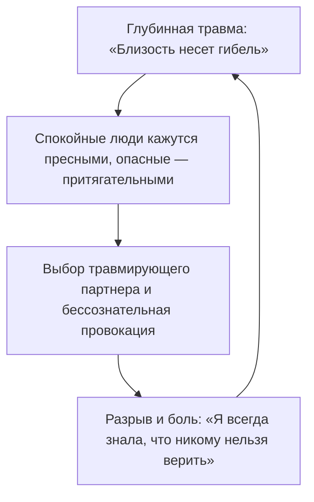

---

> [!NOTE]
> Американские психоаналитики Роберт Столороу и Джордж Атвуд, основатели теории интерсубъективных систем, доказали: феномен навязчивого повторения травмы (repetition compulsion) — это не патологическое стремление к саморазрушению. Это отчаянная попытка человеческой психики доиграть и исцелить то, что когда-то оборвалось катастрофой.
> 
> Когда ребенок или предок сталкивается с трагедией в одиночестве, не имея рядом зрелого взрослого, способного разделить эту боль, психика фиксирует экстремальные условия беды как непреложный закон всего мироздания. В дальнейшем человек бессознательно отбрасывает всё, что противоречит этому закону, и упорно воссоздает знакомый кошмар в надежде на этот раз переписать финал. Биология стремится не к страданию — она ищет завершения. Пока корень сценария не осознан, повторяющийся кошмар кажется неотъемлемым свойством внешнего мира, а не внутренней программой, которая сама его призывает.

---

#### Почему сценарий так трудно разомкнуть

Любой застарелый сценарий обладает тремя свойствами, которые делают его невидимым для обычного рассудка:

**Он действует из слепой зоны.**  
Ты не помнишь момента, когда эта клятва была запечатана в роду. Ты просто смотришь на мир через темное тонированное стекло семейной травмы и искренне веришь, что небо над всеми людьми черного цвета.

**Он подменяет восприятие.**  
Если в твоем бессознательном живет закон «меня обязательно предадут», рядом с надежным, уравновешенным и любящим человеком тебе будет мучительно скучно. В этих отношениях не будет привычного адреналинового шторма. Зато к эмоционально холодным, ненадежным или женатым партнерам потянет с непреодолимой силой. А затем последуют подозрения, проверки, неизбежный разрыв и горькое торжество: *«Ну вот. Я так и знал. Людям верить нельзя»*.

**Под каждым сценарием лежит невыплаканная боль.**  
Любое жесткое жизненное правило — это лишь окоп, торопливо вырытый поверх детского ужаса оказаться брошенным и ненужным. Именно поэтому поверхностные позитивные аффирмации вызывают лишь тошноту и раздражение: наклеивание цветочных обоев поверх раскаленной стены аварийного ядерного реактора не способно снизить уровень радиации.

---

#### Практика

Вспомни три самых тяжелых жизненных тупика из совершенно разных сфер: крах в отношениях, провал в бизнесе, потеря денег.

Отбрось внешние декорации, имена и обстоятельства. Какое одно-единственное ощущение оставалось на дне каждого из этих трех финалов? Глухое унижение? Одиночество на морозе? Чувство полного бессилия? Это и есть твой глубинный эмоциональный маркер.

Сформулируй ту негласную команду, которую когда-то записала твоя испуганная семейная система:

*«Если я проявлю себя настоящим — меня уничтожат».*  
*«Любовь можно получить только ценой унизительного рабства».*  
*«Большие деньги привлекают хищников. Безопаснее всего быть бедным и незаметным».*

Положи ладонь на то место в теле, где отзывается эта фраза. Произнеси вслух, ощущая каждое слово:

> *«Я вижу ту страшную боль, из которой родилось это правило. В момент опасности оно действительно спасло жизнь моим предкам. Но сейчас другое время и другие обстоятельства. Я снимаю эту инструкцию с исполнения. Моя жизнь принадлежит сегодняшнему дню».*

Если дыхание стало глубже, а спазм в висках или грудине мягко отпустил — разрушительный сценарий потерял свою гипнотическую власть. Тело сделало первый шаг к подлинной свободе.

---

> [!IMPORTANT]
> **Главная мысль главы**  
> Разрушительный жизненный сценарий будет воспроизводиться бесконечно до тех пор, пока скрытая в его корне клятва не будет названа своим истинным именем.


---

<a id="15-secondary-benefits-firewall"></a>

### Вторичные выгоды и скрытые защиты

Задай себе один предельно прямой и честный вопрос.

Почему в твоей жизни до сих пор нет тех денег, которых ты объективно стоишь по своим способностям и опыту? Почему рядом с тобой находится не тот человек, ради которого по утрам хочется летать, а тот, с кем всё «как-то само собой сложилось по привычке»?

«Неблагоприятные времена». «Черная полоса». «Экономический кризис». «Трудные родственники». «Хроническое выгорание». Эти формулировки звучат респектабельно, вызывают сочувствие у окружающих и прекрасно снимают ответственность.

Но это удобная полуправда. И сейчас мы снимем с нее маску.

Если какая-то тяжелая проблема не решается в твоей жизни годами — непроходящее безденежье, череда одинаковых деструктивных связей, телесный симптом, перед которым бессильны врачи, — это происходит вовсе не вопреки твоей воле. Это происходит при ее молчаливом, глубоко скрытом согласии.

Внутренняя защита человека устроена парадоксальным образом: психика упорно удерживает проблему, если эта проблема выполняет какую-то жизненно важную охранную функцию.

Можно годами клеить коллажи желаний на стену, читать мотивационные книги и посещать тренинги финансового изобилия. Но в тот самый момент, когда перед тобой открывается реальная возможность качественного прорыва, кто-то внутри тебя резко нажимает на стоп-кран: накатывает парализующая лень, за день до решающего собеседования скручивает острый приступ болезни, а рука словно сама отправляет резкое, сжигающее все мосты сообщение ключевому клиенту.

Этот внутренний саботажник — твоя **вторичная выгода**. Пока она не выведена на чистую воду и не названа своим истинным именем, симптом останется неприкосновенным.

Ее почерк безошибочен: внезапно забытое поручение, от которого зависело твое повышение; проспанный авиарейс на решающие переговоры; необъяснимая ангина накануне старта масштабного проекта. Человек привык жаловаться на фатальное невезение. Но на самом деле внутренняя защита блокирует прорыв потому, что для нее любое кардинальное изменение на данный момент выглядит куда опаснее, чем привычное болото.

---

> [!NOTE]
> Профессора Гарвардского университета Роберт Кеган и Лайза Лахи тридцать лет исследовали поразительный психологический феномен, получивший название «иммунитет к изменениям» (Immunity to Change). Ученые наблюдали за тем, почему высокоинтеллектуальные, волевые люди с завидным постоянством саботируют собственные осознанные цели.
> 
> Исследования показали: за каждым хроническим срывом всегда стоит скрытое, конкурирующее обязательство, о существовании которого сам человек даже не догадывается. Это не слабость характера и не отсутствие дисциплины. Это мощная подсознательная страховка: страх потерять принадлежность к семье, ужас перед столкновением со стыдом или нежелание нести взрослую ответственность за ошибки. 
> 
> Человеческая психика всегда выбирает знакомое привычное несчастье как меньшее зло по сравнению с той неизвестной катастрофой, которую нарисовало воображение. Разомкнуть эту защиту волевым насилием невозможно. Она растворяется только тогда, когда человек осознает, от какой именно боли его так долго спасал этот симптом.

---

#### Алексей

Алексею тридцать два года. Талантливый инженер-программист с редким математическим складом ума. И при этом последние пять лет он сидит на шее у своей уставшей, измученной жены.

Его дни проходят в редких копеечных подработках на фрилансе, бесконечных обещаниях «начать с понедельника» и философских рассуждениях. Три психотерапевта, десятки прочитанных книг по тайм-менеджменту. Но стоило только на горизонте появиться солидной должности с высоким окладом — у Алексея мгновенно начиналась острая почечная колика. Либо за полчаса до финальной встречи с инвесторами он отправлял им неадекватное, вызывающее письмо, навсегда сжигая все мосты.

Его тупик охранялся с маниакальной тщательностью.

> **Терапевт:** Представь: трудовой договор подписан. Завтра твой первый рабочий день в роли ведущего системного архитектора компании. Семья полностью обеспечена, впереди большие перспективы. Положи руку на грудь. Что происходит в теле?
>
> **Алексей:** *(мгновенно, с улыбкой)* Да я буду на седьмом небе от счастья! Это же работа моей мечты!
>
> **Терапевт:** Это говорит твой фасад. Закрой глаза и опустись глубже. Завтра утром нужно встать, надеть костюм и войти в офис, где каждое решение лежит на тебе. Что происходит с дыханием прямо сейчас?
>
> **Алексей:** *(лицо темнеет, улыбка сползает, пальцы сжимаются в кулаки)* Дышать нечем. На грудную клетку будто положили бетонную плиту. В горле спазм. Ладони стали ледяными и влажными. Меня накрывает липкий, тошнотворный ужас.
>
> **Терапевт:** Какую службу несет твой продавленный диван? От чего тебя пять лет подряд спасает статус безработного неудачника?
>
> **Алексей:** Если я начну зарабатывать по-настоящему большие деньги — с меня будет спрос по полной программе. Я больше не смогу говорить: «Я в творческом поиске, не трогайте меня». Придется отвечать за результат. Я смертельно боюсь опозориться тогда, когда от меня ждут триумфа.
>
> **Терапевт:** Это только первый рубеж обороны. Пойдем глубже. Когда ты видишь себя сильным, успешным, богатым мужчиной — чей осуждающий взгляд ты встречаешь в темноте?
>
> **Алексей:** *(голос падает до еле слышного шепота)* Отец... Он всю жизнь повторял мне одно и то же: «Ты пустое место. У тебя руки растут не оттуда. Из тебя никогда ничего путного не выйдет».
>
> **Терапевт:** Если ты станешь успешным и богатым — ты докажешь отцу, что он был неправ. Почему твоя психика изо всех сил блокирует эту победу?
>
> **Алексей:** *(молчит целую минуту, нижняя челюсть начинает мелко дрожать)* Потому что если я стану успешным... мне придется признать, что мой собственный отец двадцать лет втоптал меня в грязь просто так. Из собственной злобы и зависти. И мне придется встретиться с яростью на него. А пока я лежу на диване в нищете...
>
> **Терапевт:** Договаривай. До самого конца.
>
> **Алексей:** *(закрывает лицо руками)* ...пока я нищий и беспомощный, я каждый день ползу к его ногам и кричу: «Смотри, папа, ты победил! Я ничтожество, точно как ты и говорил! Я сломал свою жизнь ради твоей правоты! Посмотри, как мне больно! Пожалей меня! Хоть один раз в жизни обними меня и скажи, что я твой любимый сын!».

Алексей плакал двадцать минут подряд. Это плакал не тридцатидвухлетний программист. Это рыдал маленький, раздавленный жестокостью мальчик, который годами расшибает лоб о дубовую дверь отцовского кабинета.

Пять лет унизительной нищеты были вовсе не ленью. Они были немым, отчаянным криком о непринятой любви, превращенным в медленное изощренное самоубийство на глазах у любящей жены.

Затем Алексей встал, умылся холодной водой, сел обратно в кресло и долго смотрел в окно на мокрый асфальт.

— Какое безумие, — произнес он с глубоким выдохом. — Я чуть не разрушил собственную семью, чуть не втоптал себя в могилу только ради того, чтобы отомстить человеку, которого уже пять лет как нет в живых.

Спустя два месяца Алексей успешно прошел сложнейшее техническое интервью и возглавил инженерное подразделение. Не потому, что прошел очередной мотивационный марафон. А потому, что набрался мужества назвать истинного адресата, которому он годами приносил в жертву свою жизнь.

---

#### Четыре скрытых контракта

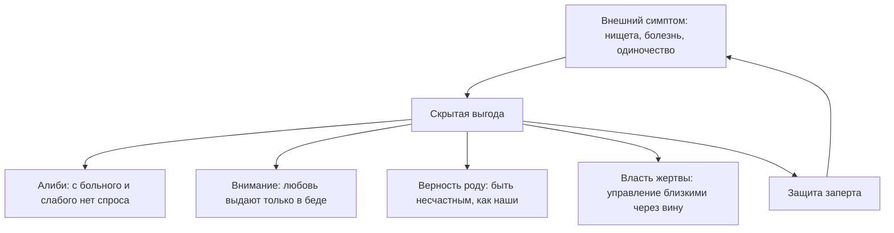

Психологическая защита держится на одном из четырех скрытых соглашений:

**1. Железное алиби от неудач.**  
*«Я бы давно построил международный бизнес или написал книгу, но у меня больная спина, депрессия и кризис в стране».* Статус страдающего человека позволяет никогда не выходить на открытый ринг реальной конкуренции, где можно по-настоящему проиграть.

**2. Покупка внимания через страдание.**  
Если в детстве родители замечали ребенка и проявляли нежность только тогда, когда у него поднималась температура под сорок или случалась тяжелая травма, в психике формируется губительное равенство: *«меня любят только тогда, когда мне плохо»*. Взрослый человек бессознательно калечит собственную жизнь лишь ради того, чтобы кто-то близкий наконец положил ладонь ему на лоб и пожалел.

**3. Слепая верность через общую боль.**  
Если в семье поколениями тяжело выживали, считали каждую копейку и надрывались на износ, легкий успех и беззаботная радость считываются как предательство семейных могил. Оставаться несчастным и бедным — это тайный членский взнос за право оставаться частью своего рода.

**4. Власть и манипуляция через вину.**  
Позиция жертвы дает колоссальную скрытую власть. Страдающий человек держит всех домашних на коротком поводке: перед ним все кругом виноваты, ему все обязаны, от него нельзя уйти, его страдание дает ему моральное право попрекать и требовать.

Пока этот скрытый контракт остается в тени, внутренняя защита будет срывать любую попытку взлета. Но стоит назвать скрытую выгоду вслух, спокойно и без самоедства — и железная хватка ослабевает сама собой.

---

#### Практика

Вспомни ту проблему в своей жизни, которую ты безуспешно пытаешься решить на протяжении многих месяцев или лет.

Положи ладонь на солнечное сплетение, прикрой глаза и спроси себя со всей беспощадной честностью:  
*«Что я потеряю в тот самый день, когда эта проблема исчезнет навсегда? От какой неприятной правды или от какой взрослой ответственности она меня так надежно прячет?»*

Мгновенный укол в теле укажет точный ответ. Страх не оправдать чужих ожиданий. Нежелание выходить из детской безответственности. Застарелая месть родителям. Попытка удержать партнера чувством вины. Назови эту причину вслух своими именами.

Не занимайся самобичеванием. Эта сделка была заключена тобой тогда, когда у детской психики просто не было иных способов защитить себя от боли.

Произнеси спокойно и твердо:

> *«Я вижу эту скрытую выгоду. Мой симптом долгое время был для меня единственным щитом от мира. Я благодарю его за защиту. Но сегодня этот детский контракт расторгнут».*

Взрослый человек способен получать любовь, признание и безопасность напрямую — собственным выбором, а не через добровольную инвалидность.

> *«Я снимаю запрет на свою силу, радость и достаток. Мое право на жизнь не требует доказательств через страдание. Дверь открыта».*

Сделай глубокий, свободный вдох. Почувствуй, как расправляются плечи, а диафрагма освобождается от многолетнего напряжения. Ты больше не заложник собственной защиты.

---

> [!IMPORTANT]
> **Главная мысль главы**  
> Никакие позитивные изменения не начнутся до тех пор, пока скрытая выгода от проблемы остается для психики более ценной, чем цена свободы.


---

<a id="16-boundaries-safekeeping-defense-isolation"></a>

### Границы: Отдача, Принятие, Изоляция

Почему деньги подходят к тебе вплотную — и в самый последний момент разворачиваются на пороге? Почему человек, с которым могла бы случиться настоящая, глубокая любовь, чувствует невидимую преграду раньше тебя и тихо отступает, хотя на словах ты «абсолютно открыт» и «очень хочешь отношений»?

Ты не открыт. Ты находишься за глухим бронированным стеклом. И самое страшное — ты сам не замечаешь этой прозрачной стены.

Сквозь это стекло окружающий мир виден во всех деталях: интересные проекты, финансовые возможности, искренние, теплые люди. Кажется, достаточно просто протянуть руку. Но стоит сделать шаг навстречу — и пространство вокруг словно сгущается. Близкий человек внезапно отдаляется. Перспективный заказчик без объяснений уходит к конкурентам. Многообещающая сделка срывается за минуту до подписания договора.

Снаружи в твою дверь непрерывно стучат. Но до твоего сердца ни один звук не доходит.

Это состояние — не врожденный интровертный склад характера и не осознанная любовь к одиночеству. Это режим **аварийной изоляции**, который когда-то был включен по жизненно важной причине и с тех пор так и не был снят.

---

#### Три рубежа психологических границ

В здоровом взаимодействии человека с миром работают три рубежа:

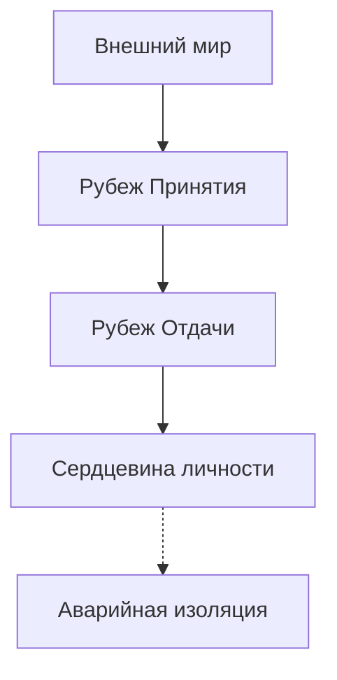

**1. Рубеж Отдачи (энергия наружу).**  
Это способность делиться своим временем, профессиональным мастерством, душевным теплом и материальными благами. Когда этот рубеж разрушен, у человека возникает недержание границ: кабальные условия труда, бесконечная помощь токсичным родственникам в ущерб собственной семье, годы работы за копейки из-за панического страха назвать достойную цену за свой труд.

**2. Рубеж Принятия (энергия внутрь).**  
Это способность различать, что именно впускать в свое внутреннее пространство. Здоровый фильтр легко отделяет искреннюю заботу и конструктивную обратную связь от зависти, эмоционального шантажа и чужих манипуляций. Если этот фильтр пробит, любое косое слово случайного коллеги мгновенно ранит самое сердце, выбивая человека из колеи на несколько дней.

**3. Аварийная изоляция (глухой бункер).**  
Когда внешнее давление в детстве многократно превышает запас прочности психики, человек наглухо перерубает все каналы связи. Снаружи он продолжает исправно ходить на работу, здороваться с соседями, вести социальные сети и даже поддерживать разговор. Но внутри он заживо замурован. Любая попытка подлинного сближения считывается его нервной системой как смертельный взлом периметра.

Аварийная изоляция спасает жизнь ребенку во время жестокой семейной бомбежки. Но если не снять этот режим после того, как война закончилась, человеческая душа медленно угасает в полной пустоте без единой капли входящего тепла.

---

> [!NOTE]
> Основоположники теории привязанности Джон Боулби и Мэри Эйнсворт описали трагический парадокс детской психики: когда родитель, призванный защищать и кормить ребенка, одновременно является главным источником хаоса, насилия и непредсказуемой угрозы, у малыша возникает неразрешимый биологический конфликт. Врожденный инстинкт прижаться к матери сталкивается со столь же мощным инстинктом бежать и спасаться.
> 
> Поведенчески этот тупик разрешить невозможно. И нервная система находит единственный выход: диссоциацию и тотальное эмоциональное отключение. 
> 
> Исследования профессора Мэттью Либермана в Калифорнийском университете в Лос-Анджелесе (UCLA) на базе функциональной МРТ показали: социальная изоляция и отвержение активируют в мозге ровно те же нейронные зоны (дорсальную часть передней поясной коры), которые отвечают за обработку острой физической боли. Чтобы защитить себя от этой невыносимой боли, нервная система искусственно снижает собственную чувствительность к любому теплу. Крепость оказывается надежно защищена от ударов — но одновременно она полностью отрезана от живой пищи. В этом вакууме личность начинает необратимо угасать.

---

#### Лёня и дверная цепочка

Старая панельная хрущевка на окраине промышленного района. Третий этаж. Серый тополиный пух на облупленном подоконнике.

Восьмилетний Лёня знал все звуки в подъезде наизусть. Его мать страдала тяжелейшим запойным алкоголизмом. Она могла внезапно исчезнуть на четверо суток, оставив в пустом холодильнике лишь полбанки закисшего супа. А могла среди ночи ввалиться в квартиру с шумной толпой незнакомых собутыльников, битьем посуды и пьяными драками до рассвета.

Лёня научился жарить засохшие хлебные корки на сухой сковороде. Он прятал спички в тайник за батареей. Каждый вечер перед сном он проверял дверную цепочку. У них был строгий условный код: три быстрых стука, пауза, два стука, и снова три — это мать. Всем остальным открывать дверь было категорически запрещено.

Но самым страшным испытанием для маленького мальчика был вовсе не голод и не пьяный шум. Страшнее всего была *надежда*.

Иногда мать возвращалась домой трезвой. Она приносила в сетке оранжевые сладкие мандарины. Садилась на край Лёниной кровати, гладила его стриженую голову теплой, ласковой рукой и сквозь слезы шептала: *«Лёнечка, сыночек, прости меня, дуру грешную. Всё, теперь мы заживем по-человечески. Я на прядильную фабрику устроилась, я завязала. Всё будет хорошо»*.

На несколько часов мальчик распахивал свое сердце до самой глубины. Он верил каждому ее слову. Он прижимался заплаканным лицом к ее фланелевому халату и буквально задыхался от неземного счастья.

А на следующий вечер мать выходила из дома «на минутку за хлебом» — и исчезала на очередную неделю.

К третьему классу в груди Лёни что-то надломилось с сухим, окончательным треском. Он больше не плакал в темноте. Когда мать в очередной раз не вернулась к ночи, девятилетний ребенок молча подошел к входной двери, накинул тяжелую латунную цепочку, повернул замок на два оборота и лег в постель с абсолютно сухими, застывшими глазами.

В ту ночь в его душе захлопнулась спасительная дверь аварийной изоляции: *«Любое тепло — это смертельный обман. За каждой радостью обязательно следует жестокий удар. Чтобы выжить и не сойти с ума — нельзя впускать в свое сердце ни единого человека»*.

В тридцать четыре года Леонид был ведущим системным разработчиком в крупной технологической компании. Просторная квартира в новостройке бизнес-класса. Идеальная стерильная чистота: все чашки на кухне расставлены строго по одной линии. Абсолютная, звенящая тишина. И кладбищенская внутренняя пустота.

Все женщины, с которыми он пытался построить семью, через полгода-год уходили от него с одним и тем же потерянным выражением лица: «Лёня, ты святой человек. Ты никогда не повышаешь голоса. Ты полностью оплачиваешь все счета. Но рядом с тобой чувствуешь себя бесплотным призраком. Ты находишься за пуленепробиваемым стеклом. Тебя просто нет дома».

> **Терапевт:** Где прямо сейчас в твоем теле находится та входная дверь с латунной цепочкой?
>
> **Лёня:** *(отвечает ровным, металлическим голосом)* Под ребрами. Там стоит тяжелый сейф, намертво залитый бетоном. Снаружи кто-то стучит. Но я не открываю. Мне не больно. Мне абсолютно всё равно.
>
> **Терапевт:** Твое «всё равно» — это спасительный бункер. Скажи тому маленькому мальчику у двери: ты закрылся тогда, чтобы не погибнуть от горя. Твоя изоляция спасла тебе жизнь.
>
> **Лёня:** *(на этих словах дыхание перехватывает, голос дает сбой)* Он... он так долго стоял в том холодном темном коридоре. Он каждую ночь вслушивался в шаги на лестнице. Он так отчаянно ждал, что мама вернется трезвой и просто останется дома.
>
> **Терапевт:** Тебе тридцать четыре года. Ты вырос. Та смертельная опасность осталась далеко в прошлом. Положи руку мальчику на плечо и скажи: мама не справилась со своей тяжелой болезнью. Но я здесь. Я взрослый, и я никогда тебя не брошу. Дверную цепочку можно снять.
>
> **Лёня:** *(из груди вырывается глухой утробный стон, переходящий в безудержные, сотрясающие всё тело рыдания)*

Многолетний бетон треснул и осыпался под потоком живых слез. Латунная цепочка, накинутая в холодной хрущевке четверть века назад, со звоном упала на пол.

Через десять минут Леонид поднял голову. В его потухших глазах впервые за долгие годы затеплилась жизнь. Плечи мягко опустились.

— В груди разливается горячая волна, — прошептал он с благоговением. — Сейфа больше нет. Там бьется живое человеческое сердце. Я снова могу дышать.

Режим изоляции был снят не потому, что внешний мир внезапно стал абсолютно идеальным и безопасным. А потому, что внутри человека наконец появился любящий взрослый, способный выдержать любую правду. Замуровывать себя заживо больше не требовалось.

---

#### Практика

Определи, в каком именно из трех рубежей произошел сбой:

- Ты без остатка растрачиваешь себя на чужие проблемы, спасаешь всех вокруг, а сам остаешься у разбитого корыта — разрушен **рубеж отдачи**.  
- Любое косое замечание, взгляд или холодность со стороны надолго выбивают тебя из равновесия — поврежден **рубеж принятия**.  
- Ты панически боишься душевной близости и годами живешь в эмоциональном коконе — включен режим **аварийной изоляции**.

Положи теплую ладонь на центр грудины. Почувствуй живое биение сердца. Произнеси вслух, ощущая вес каждого слова:

> *«Моя изоляция спасла меня тогда, когда я был маленьким и беспомощным ребенком. Но сегодня я нахожусь в безопасности. Моей взрослой силы достаточно, чтобы встречать этот мир с открытым лицом. Прошлую боль я отделяю от сегодняшнего дня. Мои границы живые и гибкие: я открываю сердце для взаимной любви, тепла и достатка».*

В течение ближайших суток сделай одно конкретное действие из состояния открытых границ:
- Назови достойную цену за свои услуги без неловких извинений и оправданий.
- Скажи искренние, теплые слова человеку, который тебе по-настоящему дорог.
- Или произнеси спокойное, бесповоротное «нет» там, где привыкли бесцеремонно нарушать твои интересы.

Жизнь, подлинная близость и изобилие приходят только туда, где двери открыты изнутри.

---

> [!IMPORTANT]
> **Главная мысль главы**  
> Дверь внутренней изоляции невозможно выбить снаружи никакими уговорами. Ее способен открыть только тот, кто когда-то запер ее изнутри.

---

> [!TIP]
> **Интерактивный помощник**  
> Если воспоминания об одиночестве или детской беззащитности отозвались щемящей болью в груди — не оставайся в этой тишине в одиночку. Диалоговое окно внизу страницы создано для того, чтобы помочь тебе бережно пройти через этот процесс и почувствовать твердую опору под ногами.


---

<a id="17-bug-01-extra-element"></a>

### Лишний элемент: когда ты живёшь не свою жизнь

Ты просыпаешься в квартире, где с точки зрения окружающих всё устроено безупречно. Престижная должность. Высокий доход. Стильная кухня с каменной столешницей, дорогая кофемашина, вид на огни ночного города. По всем социальным меркам ты состоялся и победил.

Но почему каждое утро под рёбрами разливается глухая свинцовая тяжесть? Почему чашка свежесваренного кофе кажется безвкусной, а тело движется сквозь день с таким трудом, словно продирается сквозь слой липкой ваты?

Ты смотришь в зеркало и ловишь себя на страшной, запретной мысли: этот успешный человек в отражении — чужой. Его победы не приносят радости. Его счета оплачиваешь ты, но сама эта жизнь словно взята напрокат у кого-то другого.

Так проявляется состояние **лишнего элемента**.

Представь новенький, мощный ноутбук. Ты только достал его из коробки, включил, а в фоновом режиме уже крутятся десятки тяжелых чужих программ. Ты их не устанавливал. Но они сжигает оперативную память и нагревают процессор до того, как ты успел открыть хотя бы один собственный файл.

В семье происходит то же самое. Когда между взрослыми разверзается пропасть — отец хлопает дверью и уходит, мать тонет в слезах и депрессии, а в доме поселяется ледяной холод, — напуганный ребёнок не может выдержать разрушения своего мира. Он бессознательно делает шаг вперед и затыкает собой зияющую дыру.

Маленький мальчик становится «мужчиной в доме», защитником и личным психотерапевтом для рыдающей матери. Девочка превращается в строгую судью, подругу-жилетку или орудие семейного возмездия. Ребенок соглашается стать костылем для чужого разорванного брака. И расплачивается за это собственным правом на отдельную судьбу.

---

> [!NOTE]
> Основатель структурной семейной терапии Сальвадор Минухин в Филадельфийской клинике детского развития доказал: семья остается здоровой средой лишь до тех пор, пока границы между поколениями четко очерчены. Между родителями должно быть свое закрытое пространство, в которое детям нет входа.
> 
> Когда между партнерами образуется эмоциональный вакуум или вспыхивает открытая война, одного из детей почти всегда втягивают в коалицию. Этот феномен в психотерапии называется **парентификацией** (от английского *parent* — родитель): ребенок меняется ролями со взрослым, становясь родителем для собственных мамы или папы.
> 
> Иван Бозормени-Надь, создатель контекстуальной семейной терапии, описал это как действие «невидимой лояльности»: из слепой детской любви ребенок готов отказаться от собственного счастья, здоровья и карьеры, лишь бы спасти тонущего родителя. Но детская нервная система биологически не рассчитана на взрослые перегрузки. Во взрослом возрасте такие люди приходят с хронической ангедонией — полной неспособностью испытывать радость от жизни: их внутренний ресурс годами расходуется на обслуживание чужой травмы.

---

#### Слезы на сорок шестом этаже

Вторник, два часа дня. Панорамные окна сорок шестого этажа престижного небоскреба в деловом квартале. Внизу тонкой серебряной нитью петляет река.

Тридцатитрехлетняя Анастасия — старший партнер международной юридической фирмы. Только что завершилось полугодовое разбирательство в арбитражном суде. Сумма выигранного иска — более двухсот миллионов рублей. В переговорной гремят аплодисменты, коллеги открывают коллекционное шампанское, шеф лично пожимает ей руку и называет «главным бриллиантом компании».

А через десять минут Настя заперлась в кабинке туалета в дальнем конце коридора, прижала к лицу махровое полотенце и зашлась в беззвучном, надрывном рыдании.

— Меня буквально тошнило от каждого взгляда в зеркало, — рассказывала она позже на сессии, сжимая тонкие пальцы в замок. — Я ненавижу эти безупречные костюмы. Я всей душой презираю судебные кодексы и бесконечные иски. За победу мне начислили премию, на которую можно купить квартиру. А я стояла у раковины и думала: если я прямо сейчас шагну в окно — мне хотя бы больше не придется завтра утром надевать этот чертов пиджак. Почему я здесь? Зачем я двадцать лет грызла землю ради профессии, от которой меня выворачивает наизнанку?

> **Терапевт:** Где прямо сейчас в твоем теле живет эта профессия?
>
> **Настя:** *(рука машинально тянется к шее)* В плечах и затылке. Там словно висит раскаленный чугунный рюкзак. Челюсти стиснуты так, что крошатся зубы.
>
> **Терапевт:** Поставь образ этой профессии перед собой в комнате. Куда направлен ее взгляд?
>
> **Настя:** *(вглядывается в пустое пространство перед креслом)* Она стоит передо мной. Но смотрит не на меня. Она смотрит поверх моей головы. Назад.
>
> **Терапевт:** Кто стоит у тебя за спиной? Чьи глаза ждут этого судебного отчета?
>
> **Настя:** *(лицо бледнеет, по щекам катятся крупные слезы)* Отец... Мне было восемь лет. Ноябрь, за окном мокрый снег. Он швырнул чемодан в коридоре, зло посмотрел на нас и крикнул маме: «Вы ничтожества! Вы без меня под забором сдохнете, по помойкам пойдете!» Хлопнул дверью. Мама три месяца не вставала с ковра, выла по ночам. А потом однажды посадила меня перед зеркалом, сжала мои плечи до синяков и сказала: «Настенька, ты отомстишь ему за нас обеих. Ты закончишь школу с золотой медалью. Ты поступишь на юрфак. Ты станешь лучшим адвокатом в городе и сотрешь его в порошок».

Двадцать пять лет Настя носила чужие тяжелые латы. Она не жила своей жизнью — она работала карающим мечом брошенной женщины.

Красный диплом МГУ, бессонные ночи над учебниками, работа без отпусков по четырнадцать часов в сутки — всё это было не ее мечтой. Это была детская попытка спасти маму от отчаяния и доказать мертвому отцу, что их нельзя было предавать.

Личной жизни у Насти не было: все мужчины казались ей либо слабыми, либо потенциальными предателями. Ее сердце было наглухо занято маминой обидой. Для любви там просто не оставалось свободного места.

> **Терапевт:** Посмотри на маленькую восьмилетнюю девочку перед зеркалом. Скажи ей: война окончена. Мама не справилась со своей болью, но это была ее взрослая судьба. Ты не обязана класть свою жизнь на алтарь чужой мести.
>
> **Настя:** Мама... Папа... Я вижу вашу боль. Я вижу ваш разорванный брак. Но это ваша история. Я больше не буду вашим оружием, щитом и суррогатным мужем. Я просто ваша дочь. Я возвращаю вам ваши роли и вашу ответственность. А себе забираю право дышать.
>
> **Настя:** *(сгибается пополам, из груди вырывается глубокий всхлип, сменяющийся долгим, дрожащим выдохом)*

В ту минуту чугунная плита, прижатая к ее затылку двадцать пять лет назад, со скрежетом рухнула на пол. Плечи мягко опустились. В глазах впервые за долгое время появился живой, теплый свет.

Спустя четыре месяца Анастасия ушла из юридического партнерства. Она открыла небольшую мастерскую художественной керамики и ландшафтного дизайна — то, о чем тайком мечтала с шестого класса школы.

Ее доход снизился в несколько раз. Но в первое же весеннее утро в мастерской, перепачканная глиной, она прислала короткую весточку: «Я впервые за всю взрослую жизнь проснулась без кома в горле. Я смотрю в окно на мокрые деревья и чувствую: я наконец-то дома. В своей собственной жизни».

---

#### Чемодан с чужой обувью

Представь, что ты долго копил деньги на путешествие мечты к океану. Долгий перелет, теплый тропический воздух, бирюзовая лагуна за окном отеля. Ты с предвкушением открываешь дорожный чемодан — и замираешь в недоумении.

Ровно половину чемодана занимает огромный, стоптанный зимний сапог сорок шестого размера, покрытый толстым слоем засохшей дорожной грязи. Один. Чужой. Мужской.

Ты тащил его через три границы. Доплачивал за перевес багажа в аэропорту. Надрывал поясницу на эскалаторах. И вот теперь, вместо того чтобы немедленно отправить этот хлам в мусорный бак, ты бережно достаешь его и ставишь на прикроватную тумбочку рядом со свежими орхидеями.

Почему? Потому что внутри сидит иррациональное детское убеждение: раз этот предмет оказался в моем чемодане — значит, он мне зачем-то дорог. Значит, я обязан его хранить.

В нашем психологическом багаже таких «сапог» обычно целый склад:

- На самом дне лежит мамина паническая тревога перед любыми переменами в жизни: «Сиди тихо, как бы чего не вышло». Ты всю жизнь считаешь себя робким человеком, а на самом деле носишь чужую заношенную обувь.
- Рядом припрятан дедов парализующий страх перед любым человеком при должности: страх раскулачивания, впечатанный в генетическую память.
- Чуть выше — бабушкино разъедающее чувство вины за малейшую радость, когда вокруг «люди голодают».

Годами этот груз кажется собственной сущностью. Ровно до тех пор, пока ты не прислушаешься к голосу своего внутреннего критика. Прислушайся прямо сейчас: ведь он звучит не твоим тембром.

Это голос строгой школьной учительницы, вечно недовольного отца или тревожной бабушки. Ты годами обслуживаешь чужие страхи и по привычке называешь это своей жизнью.

---

#### Три симптома того, что ты занял чужое место

Когда ребенок соглашается стать лишним элементом в семейной системе, его собственное развитие неизбежно дает сбой по трем направлениям:

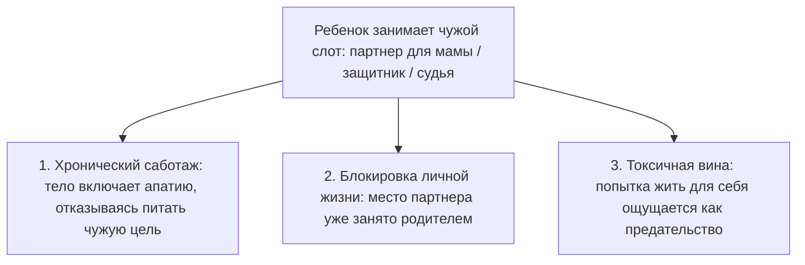

##### 1. Тело объявляет забастовку
Ты можешь обладать железной силой воли и заставлять себя работать без выходных. Но подсознание прекрасно знает: эти сверхусилия совершаются не ради твоих истинных ценностей, а ради чужого одобрения или спасения мамы. Рано или поздно психика включает аварийный тормоз: накатывает свинцовая, непробиваемая апатия. Организм просто отказывается поставлять энергию в чужую топку.

##### 2. Личная жизнь превращается в пустыню
Если в твоем сердце место главного мужчины занимает опека над инфантильной матерью, зрелая женщина рядом с тобой не появится. Если женщина живет как «защитница» своего отца, к ней будут притягиваться исключительно слабые, зависимые мужчины, ищущие вторую маму. Пространство безошибочно считывает: твое сердце уже занято чужой трагедией.

##### 3. Свои желания вызывают мучительный стыд
Стоит позволить себе искренний отдых, дорогую покупку или просто день безделья, как изнутри поднимается удушливая волна стыда: «Как я могу радоваться, когда маме так плохо? Как я смею быть счастливым, если в моем роду все страдали?» Этот стыд — главный признак того, что ты перепутал границы своего и чужого опыта.

---

#### Практика: освобождение чужого места

Если ты чувствуешь, что твоя жизнь подчинена чужим правилам и ожиданиям, выполни эту последовательность шагов:

##### 1. Назови чужую роль по имени
Честно ответь себе на вопросы:
- Чьи нереализованные амбиции прямо сейчас обслуживает моя карьера?
- Чье одиночество я пытался компенсировать в детстве?
- Какую семейную рану я до сих пор стараюсь залечить своими достижениями?

##### 2. Отыщи груз в физическом теле
Закрой глаза и просканируй ощущения. Где прямо сейчас живет этот груз? Бетонная плита на плечах? Обруч, сдавливающий виски? Ледяной спазм в районе солнечного сплетения? Положи на эту область теплую ладонь и сделай глубокий вдох животом.

##### 3. Произнеси слова разделения
Представь перед собой своих родителей или того предка, чей груз ты нес. Посмотри на них с искренней благодарностью за подаренную жизнь, но с твердой взрослой границы. Произнеси вслух:

> *«Дорогие мама и папа. Я вижу ваши трудности, ваши слезы и вашу боль. Но ваша судьба принадлежит вам, а моя — мне. Я больше не буду вашим судьей, защитником или заменой партнера. Я всего лишь ваш ребенок. С глубоким уважением я оставляю ваши уроки и ваши раны вам. А себе с любовью забираю право на собственную, отдельную, счастливую жизнь».*

##### 4. Позволь тишине войти внутрь
После этих слов в теле часто возникает странная, непривычная пустота. Не торопись немедленно заполнять ее новыми делами или тревогами. Эта пустота — освободившееся пространство твоей души, куда впервые за долгие годы может прийти твое настоящее «Я».

---

> [!IMPORTANT]
> **Главная мысль главы**  
> Пока ты стоишь на чужом месте и воюешь на чужом фронте, твое собственное место в жизни остается пустым.

---

> [!TIP]
> **Интерактивный помощник**  
> Если слова разделения с родителями вызвали спазм в горле или горячие слезы — не оставайся наедине с этой бурей. Диалоговое окно внизу страницы поможет бережно пройти через этот рубеж и закрепить ощущение своего законного места.


---

<a id="18-bug-02-missing-element"></a>

### Право быть живым: когда ты занимаешь чужое место

Бывает ли у тебя странное, глубинное ощущение, что тебя в этом мире вообще не должно быть?

Не мимолетная осенняя хандра и не усталость после тяжелой недели. А тихое, въедливое, разъедающее изнутри чувство собственной нелегитимности. 

Ты живешь обычной взрослой жизнью: ходишь на работу, общаешься с друзьями, платишь по счетам. Но внутри годами сохраняется ощущение временного постояльца. Чемоданы после переезда могут стоять неразобранными месяцами. В квартире годами не появляется хорошая, добротная мебель — зачем, если «всё это ненадолго»? Любые долгосрочные планы на жизнь вызывают панический ступор. Словно ты поселился в чужом гостиничном номере и каждую секунду ждешь, что в дверь постучит суровый администратор и с позором выставит тебя на мороз.

А самое невыносимое — это иррациональный, липкий стыд за любые свои успехи. 

Стоит выйти на хороший доход, купить красивую вещь или встретить искреннюю взаимную любовь, как в горле возникает ледяной спазм. Из глубин поднимается темная, удушливая волна: *«Я не имею права. Я украл это у кого-то другого. Я занял чужое место»*.

Так заявляет о себе **пропущенный элемент**.

---

#### Овальная дыра в семейном альбоме

Представь старинный фамильный альбом в бархатном бордовом переплете. На пожелтевшей от времени фотографии родственники стоят плечом к плечу, чинно глядя в объектив. А в самом центре первого ряда зияет овальная дыра с неровными, рваными краями.

Кто-то много лет назад аккуратно вырезал оттуда лицо лезвием бритвы.

Семья листает этот альбом десятилетиями, делая вид, будто никакой прорези нет. О человеке на вырезанном фрагменте никогда не говорят вслух. Его имя под строжайшим табу. Но сколько бы ты ни вглядывался в улыбающиеся лица на снимке, взгляд неизменно падает в черную пустоту. 

Потому что пустота притягивает сильнее любого присутствия.

Человеческая родовая система устроена по строгому закону: в ней невозможно нажать кнопку «удалить без следа». Если кого-то вычеркивают из семейной памяти — умершего младенца, пропавшего без вести солдата, спившегося дядю или отвергнутого первого супруга, — на месте этого человека образуется мощная энергетическая воронка.

А дальше вступает в силу бессознательный механизм семейной компенсации: на пустое место ставят следующего рожденного ребенка.

Ты появляешься на свет как отдельная, уникальная душа. Но с первых дней жизни тебя бессознательно заставляют быть живым памятником тому, кого приказали забыть. Ты живешь не своей судьбой, болеешь не своими болезнями и несешь в сердце вековую печаль того, чье имя побоялись оплакать.

---

> [!NOTE]
> В клинической психологии этот феномен описан как **синдром замещающего ребенка** (Replacement Child Syndrome). Исследования психоаналитиков Альберта Качелла и Мориса Поро показали: когда родители переживают тяжелую потерю ребенка и, не завершив работу горя, торопятся «родить замену», новорожденный оказывается в психологической ловушке.
> 
> Родители бессознательно проецируют на младенца образ погибшего первенца. Ребенок лишается права на собственную идентичность: он либо идеализируется как воскресший ангел, либо сталкивается с глухим разочарованием, потому что не способен оживить мертвого.
> 
> Классические примеры известны мировой культуре: великий художник Винсент Ван Гог родился ровно через год после смерти своего старшего брата-младенца, получил то же имя — Винсент — и всю жизнь каждое воскресенье проходил мимо могилы с собственной фамилией и датой рождения на церковном дворе. Схожая трагедия разворачивалась в судьбе Сальвадора Дали, которого родители назвали в честь умершего первенца, убеждая мальчика, что он — реинкарнация старшего брата. Оба гения всю жизнь несли в творчестве мотив двойничества, призрачности и мучительного расщепления личности.
> 
> В **схема-терапии Джеффри Янга** этот феномен описывается через формирование фундаментальных ранних дезадаптивных схем: **схемы дефективности / стыда** (глубинное ощущение, что «меня любят не за то, кто я есть, а лишь как замену») и **схемы неразвитой идентичности / слияния** (Enmeshment / Undeveloped Self). Ребёнок капитулирует перед проекцией взрослых, его подлинное «Я» подавляется, а эмоциональное ядро захватывается режимом Уязвимого Ребёнка. В теории семейных систем Мюррея Боуэна это классический провал дифференциации: потомок бессознательно обслуживает хроническую непережитую тревогу семейной системы, расплачиваясь соматическими симптомами и экзистенциальным вакуумом.

---

#### Максим и синее байковое одеяло

Тридцатиоднолетний Максим пришел на консультацию в состоянии абсолютного душевного истощения. 

У него редкий талант: он промышленный дизайнер, умеющий видеть пространство в мельчайших деталях. Максим проектирует городские набережные, уютные парки и сложные общественные пространства, наполненные светом. 

А сам при этом спит на тонком поролоновом матрасе, брошенном прямо на линолеум в пустой съемной однушке на окраине города. За спиной — ни постоянных отношений, ни накоплений, ни ощущения дома.

— Я тень, — говорил он глухим, безжизненным голосом, глядя в пол. — Я физически чувствую, что меня здесь нет. Я хожу по улицам, но сквозь меня словно дует ветер. С четырнадцати лет во мне живет ледяная, нечеловеческая тоска: чувство, будто я занял чужое место на земле. Когда на счет приходит крупный гонорар, у меня начинается паническая атака. Мне кажется, что я ограбил мертвого человека. Я тут же спускаю деньги или раздаю долги, лишь бы снова остаться ни с чем.

> **Терапевт:** Положи ладонь на то место, где сейчас живет эта тоска. Что ты чувствуешь под рукой?
>
> **Максим:** *(кладет дрожащие пальцы на центр грудины)* Здесь… круглая, холодная дыра размером с чайное блюдце. В нее со свистом втягивается ледяной воздух. Будто у меня вырезали кусок груди вместе с сердцем.
>
> **Терапевт:** Ты точно был первым ребенком у своих родителей?
>
> **Максим:** *(на секунду замирает, его лицо становится пепельно-серым)* Официально — да. Единственный и поздний сын. Но когда мне было четырнадцать, на поминках бабушки мать напилась и зарыдала. Проговорилась. За год до меня был мальчик. Восьмой месяц беременности. Тугое обвитие пуповиной. Он задохнулся внутри и родился мертвым. Отец тогда ударил кулаком по столу и закричал на мать: «Заткнись! Никаких гробов, никаких венков, никаких слез! Забудь, что он был. Завтра же начнем делать нового!»
>
> **Терапевт:** И они сделали «нового». Тебя. Куда тебя положили, когда привезли из роддома?
>
> **Максим:** *(его начинает мелко трясти)* В ту же самую деревянную кроватку… Отец даже не стал ее разбирать. И укрывали меня тем самым синим байковым одеялом с белыми мишками, которое покупали для него. Имя хотели дать то же самое — Алеша. Но отец в последний момент испугался плохой приметы и записал меня Максимом.
>
> **Терапевт:** Максим, тридцать один год ты донашиваешь судьбу старшего брата. Твоя семья попыталась замуровать свое горе, а тебя назначила живым надгробием для нерожденного первенца. Ты не покупаешь мебель и не строишь семью, потому что в семейном поле ты лежишь в могиле вместо Алеши. Ты готов вернуть брату его законное место?
>
> **Максим:** *(из глаз ручьями текут слезы)* Господи… Да. Я больше не могу быть мертвецом. Я так хочу жить.

Терапевт попросил Максима представить перед собой старшего брата — маленького мальчика, укрытого тем самым синим байковым одеялом.

> **Максим:** Алеша… Я вижу тебя. Ты — старший брат. Ты — первый сын наших родителей. Твоя короткая жизнь и твоя смерть имеют огромный вес. Ты заплатил своей жизнью за то, чтобы на свет появился я. Но наши судьбы разделены. Ты — мертвый, а я — живой. Ты — первый, а я — второй. Я возвращаю тебе твое первородство и твою память. Я больше не буду ложиться в твою могилу. Пожалуйста, посмотри на мою живую жизнь с миром.
>
> **Максим:** *(роняет голову на руки и плачет навзрыд — тяжело, освобождающе, как плачут люди после многолетней пытки)*

Спустя несколько минут дыхание Максима выровнялось. На бледных щеках проступил теплый румянец.

— Дыра закрылась, — прошептал он, благоговейно прижимая обе ладони к груди. — Внутри разливается горячая волна. Я чувствую ребра. Я чувствую землю под подошвами. Я наконец-то существую.

На следующий день Максим пошел в мастерскую, купил простую деревянную рамку и вставил в нее аккуратную надпись: *«Алексей — первенец семьи. Всегда в нашей памяти»*. Он поставил ее на книжную полку.

Тайна перестала быть проклятием. Мертвый брат занял свое почетное место в семейной истории. А живой человек наконец получил благословение жить свою собственную жизнь.

---

#### Четыре сферы, в которых проявляется исключение

Феномен вычеркнутого элемента разрушает устойчивость человека на четырех уровнях:

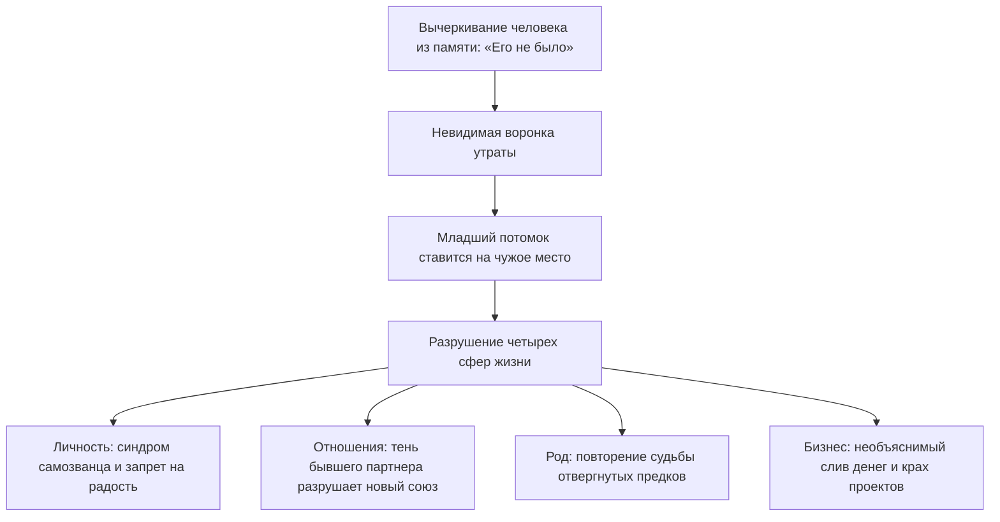

##### 1. Личность (запрет на присутствие)
Человек живет с постоянным ощущением, что он занимает чужое место. В профессии это проявляется как махровый синдром самозванца: любые награды кажутся случайностью, а деньги жгут карман, провоцируя срочно избавиться от «украденного».

##### 2. Партнерство (призрак за плечом)
Если в предыдущем браке муж или жена были вычеркнуты с проклятиями, ненавистью и запретом видеться с детьми, новый партнер неизбежно почувствует себя чужим. Он словно спит в постели, где незримо лежит третий. Союз начинает трещать по швам без видимых причин.

##### 3. Родовая память (лояльность к отверженным)
Тот, кого семья стыдится — родственник в тюрьме, покончивший с собой предок, разорившийся дед — никогда не исчезает бесследно. Один из внуков или правнуков бессознательно начнет копировать его повадки, привычки или зависимость, чтобы вернуть отверженного в поле внимания рода.

##### 4. Дело и бизнес (тень выдавленного партнера)
Если при создании компании один из основателей был нечестно выдавлен из дела, а его вклад стерт из документов, в проекте образуется черная дыра. Прибыль будет необъяснимым образом утекать сквозь пальцы, пока первоначальная справедливость не будет восстановлена.

---

#### Практика: возвращение имени и достоинства

Если ты ловишь себя на стыде за собственное существование или страхе занимать место в жизни, выполни эту исцеляющую практику:

##### 1. Определи, кто был исключен
Прислушайся к своей семейной истории. О ком в доме говорили шепотом? Чьи портреты не вешали на стену? О ком плакала мама? 
- Нерожденный старший брат или сестра (аборты, выкидыши, мертворождения).
- Предок с тяжелой или «позорной» по меркам семьи судьбой.
- Если имени нет в памяти — ориентируйся на ощущение холодной пустоты в теле.

##### 2. Прикосновение к телу
Положи ладонь на центр грудины. Сделай мягкий вдох через нос и глубокий выдох ртом. Обратись мысленным взором к тому, кто был забыт:

> *«Я вижу тебя. Я знаю, что ты был. Твоя судьба и твоя боль имеют огромное значение для нашей семьи. Я возвращаю тебе твое законное место, твой порядок по рождению и твою принадлежность. Ты навсегда остаешься частью нашего рода».*

##### 3. Разделение судеб
Почувствуй, как перед тобой встает граница между миром живых и миром ушедших:

> *«Твоя смерть и твое испытание принадлежат тебе и твоему времени. Я больше не буду искупать твою боль своими неудачами. Ты — старший, я — младший. С любовью и уважением к тебе я выбираю оставаться живым. Я остаюсь на своем собственном месте».*

##### 4. Материальное признание
Сделай то, чего не сделали испуганные взрослые: зажги в память об этом человеке свечу, напиши его имя на чистом листе бумаги или просто посиди пять минут в теплой тишине. 

Когда исключенный элемент обретает свое законное место в памяти, ледяной сквозняк в груди сменяется глубоким, живым покоем. Ты наконец получаешь полное право быть собой.

---

> [!IMPORTANT]
> **Главная мысль главы**  
> Вычеркнутый из памяти человек не исчезает: он незримо держит за руку живого, лишая его права на собственную судьбу. Свобода начинается с возвращения места каждому.

---

> [!TIP]
> **Интерактивный помощник**  
> Если тема нерожденных братьев или забытых предков подняла волну застарелой печали — не оставайся в темноте в одиночку. Диалоговое окно внизу страницы поможет бережно проговорить эти чувства и вернуть устойчивую опору в теле.


---

<a id="19-bug-03-inversion"></a>

### Инверсия: почему водопад не может течь вверх

Знакомо ли тебе состояние, когда вся твоя жизнь напоминает непрерывную буксировку тяжелого железнодорожного состава в крутую гору на одной лишь голой силе воли?

Сделки успешно закрываются. Цифры на банковских счетах неуклонно растут. Окружающие смотрят с завистью и уважением. Но цена каждого следующего шага становится всё более чудовищной: зубы сжаты до глухого скрежета, в грудном отделе позвоночника намертво затянут раскаленный железный обруч, а внутри живет панический ужас: *«Стоит мне расслабиться хотя бы на секунду — и весь этот поезд полетит под откос, раздавив меня в лепешку»*.

Большинство предпринимателей и амбициозных карьеристов считают эту надрывную тяжесть неизбежной платой за масштаб. 

Но на самом деле причина лежит гораздо глубже. В твоей жизни произошла фундаментальная поломка порядка — **инверсия семейной иерархии**.

Поток жизни устроен точно так же, как могучий горный водопад: он течет строго сверху вниз, подчиняясь неумолимому закону всемирного тяготения. От тех, кто пришел в этот мир раньше, к тем, кто пришел позже. От древних предков — к родителям, от родителей — к их детям, а от детей — вперед, к их собственным проектам, творчеству и потомкам. Когда энергия движется по этому природному руслу, жизнь дается легко, а за спиной всегда чувствуется мощная, несокрушимая опора.

Инверсия — это безумная попытка силой заставить водопад течь вверх.

Это происходит в тот момент, когда младший в семье самовольно объявляет себя старшим. Ребенок забирается на судейскую табуретку и начинает судить своих родителей. Он стыдится их простоты, поучает их жизни, спасает от бедности, финансово «усыновляет» и берет на себя роль их строгого воспитателя.

Человек монтирует в своей душе мощнейший насос гордыни и начинает яростно качать энергию против течения — обратно в родительский контур. 

Насос истошно воет. Медные обмотки плавятся от перегрева. А позвоночник буквально трещит под чудовищным обратным давлением, на которое человеческое тело никогда не было рассчитано.

---

> [!NOTE]
> Один из пионеров семейной терапии Иван Бозормени-Надь в Медицинском колледже Ганемана описал фундаментальный принцип **асимметричной этики поколений**: великий дар жизни невозможно вернуть назад по цепочке.
> 
> Дети никогда не могут «расплатиться» с родителями за свое рождение на равных. Родители всегда отдают неизмеримо больше, потому что передают саму жизнь, а ребенок может лишь принять ее. Здоровый способ выразить благодарность роду — это нести полученный огонь дальше: вкладывать силы в собственных детей, в созидательный бизнес, в искусство и служение миру.
> 
> Когда же взрослый ребенок пытается стать опекуном или судьей своим родителям, в его теле возникает тяжелейший нейромышечный конфликт. Аппаратная электромиография в таких случаях фиксирует хронический гипертонус глубоких паравертебральных мышц спины: нервная система буквально пытается удержать падающую многотонную плиту. Человек лишается тыловой поддержки: вместо того чтобы опираться на предков, он пытается удержать их на своих плечах.

---

#### Насос Глеба: слезы на промасленном бетоне

Глебу исполнилось тридцать девять. Крупный девелопер, владелец строительного холдинга, чье имя регулярно мелькает на страницах деловых журналов. Двухэтажный особняк, парк премиальных внедорожников, сотни подчиненных.

И при этом — адская, парализующая боль между лопатками, выкручивающая тело каждую ночь ровно в четыре часа утра. 

Судорога была настолько свирепой, что перехватывало дыхание, а кончики пальцев на руках немели до синевы. Лучшие вертебрологи, мануальные терапевты и неврологи столицы лишь беспомощно разводили руками: «С точки зрения физиологии кости и диски в порядке. Но ваши спинные мышцы напряжены, как натянутые стальные тросы башенного крана».

Истинный корень этой судороги уходил в тесную панельную хрущевку тридцатилетней давности.

Его отец был тихим, скромным инженером-конструктором на приборостроительном заводе. Рубашки с чернильными пятнами от чертежей, стоптанные дерматиновые ботинки, вечная зарплатная ведомость с грошами. Мать пилила его каждый божий вечер: «Я жизнь загубила с ничтожеством! У всех мужья как мужья, дачи строят, а ты только железки свои на заводе перебираешь!» Отец молча сутулил спину, опускал глаза и уходил курить на холодный балкон.

Десятилетний Глеб стоял в темном коридоре и сквозь щель балконной двери смотрел на поникшие плечи отца. В груди мальчика тогда закипел едкий, ядовитый пепел:

*«Слабак. Тряпка. Я никогда в жизни не стану таким, как ты. Я докажу всему миру, как должен жить настоящий мужчина»*.

Глеб сдержал клятву. Он спал по четыре часа в сутки, зубами выгрызал победу в университете, открыл бизнес с яростью раненого зверя. К тридцати годам он стал мультимиллионером. И первым же делом купил родителям огромную четырехкомнатную квартиру в элитном доме и роскошный немецкий седан.

Но за этим щедрым жестом не было сыновней любви. За ним стоял жестокий, надменный триумф судьи над побежденным соперником.

На семейных ужинах в дорогих ресторанах Глеб небрежно бросал на стол черную банковскую карту, покровительственно хлопал шестидесятилетнего отца по плечу и громко, на весь зал, произносил:

— Ну что ты жмешься, батя? Всю жизнь каждую копейку на трамвай считал — хоть на старости лет поживи как человек за мой счет. Скажи спасибо, что сын у тебя орел, а не тюфяк!

Пожилой инженер в непривычно дорогом шерстяном костюме неловко перебирал пальцами тяжелую серебряную вилку. Его шея покрывалась красными пятнами жгучего стыда. Он молчал, глядя в тарелку, и в его потухших глазах читалось растоптанное человеческое достоинство.

А ночью Глеб лез на стену от разрывающей боли в спине.

Он самовольно перевернул водопад. Он возомнил себя богом и благодетелем для собственного отца. Он лишил отца статуса Старшего, а себя — корней и фундамента. Его строительная империя держалась не на прочной земле, а на перенапряженных сухожилиях его собственной поясницы.

Развязка наступила в дождливый субботний вечер.

После долгой, выворачивающей наизнанку сессии Глеб сел в машину и без звонка поехал на окраину города, в старый кирпичный гаражный кооператив. Отец, несмотря на богатство сына, продолжал проводить выходные там — возился у верстака со старыми радиоприборами.

Запах машинного масла, сырости и канифоли. Горит тусклая сорокаваттная лампочка. Отец в замасленной старой куртке обернулся на скрип двери.

Глеб посмотрел на его натруженные, потрескавшиеся руки, на седую прядь над морщинистым лбом — и вся тридцатилетняя спесь миллиардера осыпалась в одну секунду, как сухая штукатурка от взрыва.

Человек, ворочавший судьбами сотен людей, молча подошел к верстаку и опустился на колени прямо на холодный, промасленный бетон. Он обхватил старые, стоптанные ботинки отца, уткнулся лбом в его колени и зарыдал — так, как не плакал ни разу в жизни:

— Папа… Прости меня. Прости меня, дурака спесивого. Я всю жизнь судил тебя. Презирал твою тишину, тыкал в тебя своими деньгами. Думал, что я умнее, сильнее и лучше тебя. Каким же слепым и глухим идиотом я был… Ты дал мне жизнь. Ты не спал ночами, когда я болел. Ты научил меня держать молоток. Ты — большой. Ты — мой отец. А я просто твой маленький сын.

В гараже воцарилась звенящая тишина. Слышно было только, как по жестяной крыше монотонно барабанит дождь.

А затем тяжелая, шершавая от мозолей ладонь отца мягко опустилась на стриженую макушку Глеба.

— Ну полно тебе, сынок… Полно, Глебушка, — голос отца дрогнул, и горячая слеза упала на воротник дорогой куртки сына. — Чего ты… Всё хорошо. Я всегда гордился тобой. Всегда. Поднимайся, сынок, на бетоне холодно…

В ту же секунду где-то в глубине позвоночника Глеба раздался сухой внутренний щелчок — словно отпустила стальная пружина капкана. По спине до самого крестца разлилась густая, горячая, исцеляющая волна. Водопад развернулся в правильную сторону.

Через две недели ночные приступы удушья и судороги исчезли навсегда. А из бизнеса Глеба ушел постоянный надрыв: ему больше не требовалось никому ничего доказывать ценой собственной жизни.

---

#### Три маски инверсии: как гордыня обманывает нас

Инверсия почти никогда не приходит в открытом обличье зла. Она надевает белоснежные одежды благородства, заботы и сыновнего долга:

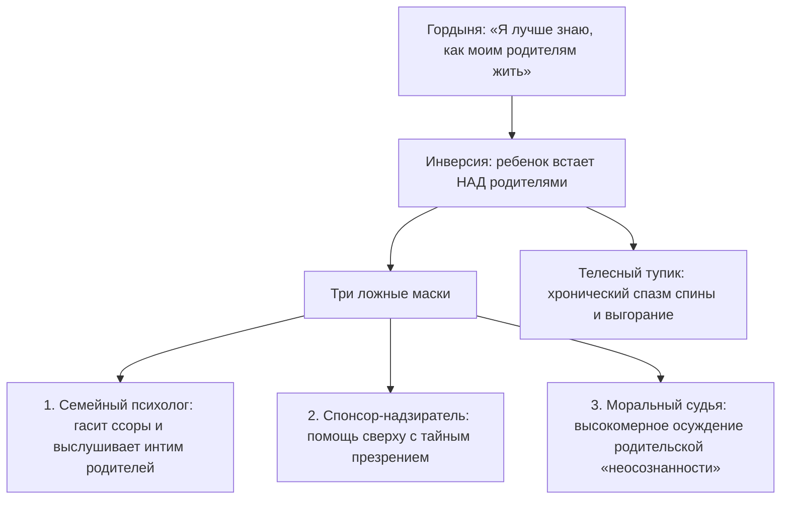

##### 1. Домашний психотерапевт
Мать жалуется взрослой дочери на отца, посвящая ее в интимные подробности их брака. Дочь слушает, дает советы, утешает и начинает чувствовать себя мудрее мамы. В этот момент она вылетает со своего законного детского места и становится мамой для собственной матери.

##### 2. Спонсор-надзиратель
Помощь родителям — естественное проявление заботы. Но дьявол кроется в мотиве. Если деньги даются свысока, с немым упреком: «Куда бы вы без меня делись, нищие и беспомощные», — это не сыновняя благодарность. Это покупка права доминировать над старшими.

##### 3. Духовный судья
«Мои родители темные, токсичные, они ничего не понимают в психологии и духовном росте, а я весь такой осознанный и проработанный». Это тончайшая ловушка эго: человек мнит себя великим гуру по отношению к тем, через кого пришел в этот мир. Этим высокомерием он намертво перерубает питающие корни своего родового древа.

---

#### Практика: возвращение на место Младшего

Если твоя спина и шея годами живут в хроническом мышечном спазме, а любые проекты требуют титанического надрыва, выполни эту практику восстановления иерархии:

##### 1. Честный внутренний аудит
Задай себе прямой вопрос:
- Перед кем из старших родственников я стою в белом пальто непогрешимого судьи?
- Кого я тайно считаю неудачником, слабаком или обузой?
- Чью жизнь я пытаюсь исправить вместо того, чтобы заниматься своей собственной?

##### 2. Поклон телом
Встань прямо. Опусти руки вдоль тела. Медленно склони голову и корпус вперед — почувствуй, как мягко натягиваются мышцы задней поверхности шеи и спины между лопатками. 

Представь перед собой своих родителей такими, какие они есть: со всеми их слабостями, тяжелыми характерами и ошибками. Произнеси вслух, чувствуя вес каждого слова:

> *«Дорогие мама и папа. Вы — большие, а я — маленький. Вы пришли в этот мир раньше, а я — позже. Вы дали мне жизнь, и этой жизни абсолютно достаточно. Я склоняюсь перед вашими выборами, вашей судьбой и вашими трудностями. Я снимаю с себя полномочия вашего судьи, воспитателя и спасателя. Я убираю свои руки от ваших судеб. Я с благодарностью принимаю всё то, что вы смогли мне дать, и разворачиваюсь лицом вперед — в свою собственную жизнь».*

##### 3. Разворот к собственному будущему
Сделай глубокий вдох животом и плавно выпрямись. Почувствуй, как за твоей спиной встают поколения предков. Сила больше не выкачивается из тебя назад — она мощным потоком вливается в твою спину, давая несокрушимую опору.

Позволь старшим быть Большими — и тебе больше никогда не придется тащить эту жизнь на разорванных жилах.

---

> [!IMPORTANT]
> **Главная мысль главы**  
> Пока ребенок пытается быть родителем для своих родителей, он остается бесплодным для собственной жизни. Поток силы течет только вперед.

---

> [!TIP]
> **Интерактивный помощник**  
> Если поклон родителям или отказ от роли судьи вызвал внутренний бунт или застарелую обиду — не спеши закрываться. Напиши об этом в диалоговом окне внизу страницы, и мы поможем аккуратно распутать этот узел.


---

<a id="21-bug-04-substitution"></a>

### Замещение: когда в теле тикает чужой будильник

Бывает так, что в твоей жизни всё складывается последовательно и успешно. Выстроена карьера, есть понятный план на годы вперед, тело пышет здоровьем.

И вдруг — словно по невидимому щелчку выключателя — реальность начинает стремительно осыпаться.

В бизнесе на ровном месте срываются ключевые контракты. Отношения, казавшиеся нерушимыми, дают глубокую трещину. А по ночам начинает бешено колотиться сердце, словно в грудь заложили бомбу замедленного действия. 

Человек ищет рациональные объяснения: экономический кризис, возрастная перестройка организма, накопившаяся усталость или банальное совпадение. 

Но если сопоставить даты, вскрывается поразительная закономерность: тебе только что исполнилось ровно столько же лет, сколько было твоему отцу, матери или дяде в момент их внезапной гибели, тяжелейшего инфаркта или банкротства.

В глубинах твоей нервной системы сработал скрытый биологический таймер — **синдром замещения**.

Психика человека обладает колоссальной способностью к бессознательной эмуляции. Если в роду произошла страшная, непережитая трагедия, которая осталась в памяти семьи открытой раной, потомок может взять на себя задачу доиграть оборванную партию. Организм начинает буквально воспроизводить чужие болезни, чужие страхи и чужие финансовые катастрофы, строго сверяясь с календарем погибшего предка.

---

> [!NOTE]
> В 1953 году профессор Стэнфордского университета Джозефина Хилгард в ходе фундаментального клинического исследования описала феномен, получивший название **«реакция годовщины»** (Anniversary Reaction). 
> 
> Ученые обратили внимание на необъяснимую медицинскую статистику: острые психосоматические кризы, панические атаки, внезапные инфаркты и тяжелые депрессивные эпизоды с пугающей частотой обрушиваются на пациентов ровно в том возрасте (или даже в тот же месяц), когда их родитель пережил катастрофу или ушел из жизни.
> 
> Позже один из создателей системной семейной психотерапии Мюррей Боуэн развил эту концепцию, показав, как работает феномен «замещающего ребенка». Если ребенок рождается вскоре после трагической гибели члена семьи, родители бессознательно проецируют на него образ погибшего. Это не просто рассказ в голове: это глубочайший соматический импринтинг. 
> 
> Тело потомка годами несет в себе скрытую команду: *«В тридцать три года — катастрофа», «В сорок один — разрыв сердца», «В сорок пять — разорение»*. Психика добросовестно воспроизводит чужой финал, потому что границы двух разных человеческих судеб оказались склеены.

---

#### Часы дяди Андрея: стрелки на 16:42

В просторном кабинете тридцатитрехлетнего Андрея, успешного инженера и руководителя мостостроительного бюро, на массивной дубовой полке всегда стояли старинные карманные часы. Потускневшее золото, треснувшая эмаль циферблата. И тонкие вороненые стрелки, навечно застывшие на отметке 16:42.

Это были часы его родного дяди — маминого старшего брата. Гордость всей семьи, блестящий проектировщик, красавец и любимец института. Он погиб в страшной автокатастрофе в возрасте тридцати трех лет: на скользком от первого заморозка мосту его машина сорвалась в ледяную воду. Ровно в 16:42.

Через два года после похорон на свет появился Андрей-младший.

— Вылитый Андрюшенька, — шептала мать над колыбелью, глядя на младенца сухими, застывшими глазами. — Те же тонкие пальцы. Та же ямочка на подбородке. Тот же серьезный, недетский взгляд. Ты родился, чтобы завершить то, что не успел он.

Мальчик рос образцово-показательным ребенком. Никаких капризов, машинки на ковре расставлены строго по линейке, в школьных тетрадях — идеальные геометрические чертежи. Поступление в строительный институт не обсуждалось: это воспринималось как священная семейная миссия.

Но под маской безупречного послушания всю жизнь тлела глухая, свинцовая тоска. 

Андрей чувствовал себя человеком, на которого надели тяжелое драповое пальто великана: полы волочатся по земле, жесткий воротник до крови натирает шею, плечи ноют от невыносимого веса. Победы на всероссийских конкурсах, престижные заказы и государственные награды не приносили ему ни капли живой радости. Внутри постоянно звучал ядовитый шепот: *«Это всё не твое. Ты празднуешь триумф на чужих поминках»*.

Ад начался ровно за три месяца до тридцать третьего дня рождения.

Андрей проснулся среди ночи в липком холодном поту. На грудную клетку словно опустили бетонную сваю. Пульс зашкаливал за сто сорок ударов в минуту. В горле стянулась ледяная удавка. Три лучших кардиологических центра провели полное обследование: сосуды чистые, миокард в идеальном состоянии. Врачи развели руками: «Вегетативный криз, панические атаки на фоне стресса».

А затем всё покатилось в пропасть. Генеральный подрядчик неожиданно отозвал финансовые гарантии по масштабному мостовому контракту. Банк заблокировал расчетные счета. В кабинете Андрея воздух с каждым днем становился всё тяжелее, словно превращаясь в густой цементный раствор.

Невидимый внутренний таймер неумолимо отсчитывал дни до роковой отметки тридцать три года.

За неделю до дня рождения Андрей сидел один в темном ночном офисе. За панорамным окном хлестал холодный ноябрьский дождь — в точности такой же, какой шел в день гибели дяди. На дубовой полке в полумраке тускло поблескивало золото старых часов.

Андрей медленно подошел к полке, взял тяжелый металлический корпус в ладонь и прижал его к груди. Под ребрами перехватило дыхание.

— Дядя Андрей… — прошептал он в тишину кабинета, и голос его задрожал. — Я тридцать три года прожил вместо тебя. Я строил твои мосты. Я носил твое имя, твои жесты, твои чертежи. Я надеялся, что если я погибну в тридцать три года — мама наконец успокоится и перестанет плакать у окна…

Горло сдавил горячий спазм. Андрей опустился на колени прямо на паркет, сжимая холодный металл часов в кулаке:

— Но твой мост и твоя смерть принадлежат только тебе. Это была твоя судьба. А я — не дублер. Я не продолжение чужой оборванной пьесы. Я твой племянник. Мое время — другое. Моя жизнь принадлежит мне.

Слезы хлынули из глаз — не от страха, а от колоссального, долгожданного облегчения тела, с которого впервые за три десятилетия сняли смертную удавку.

В центре груди раздался глубокий внутренний щелчок. Зажатая диафрагма мягко расправилась. Прохладный, чистый воздух впервые в жизни наполнил легкие до самого дна.

Андрей бережно положил часы обратно на полку, рядом с черно-белой фотографией дяди. Сделал глубокий вдох, поклонился и сделал три твердых шага назад.

Через неделю ему исполнилось тридцать четыре года. Он проснулся ясным солнечным утром без привычной тяжести в затылке. Его ноги твердо стояли на полу. 

Его собственные часы наконец-то пошли своим ходом.

---

#### Как передается чужой костюм

Подмена собственной личности чужой трагедией почти всегда происходит из глубокой детской любви и невозможности взрослых справиться с горем:

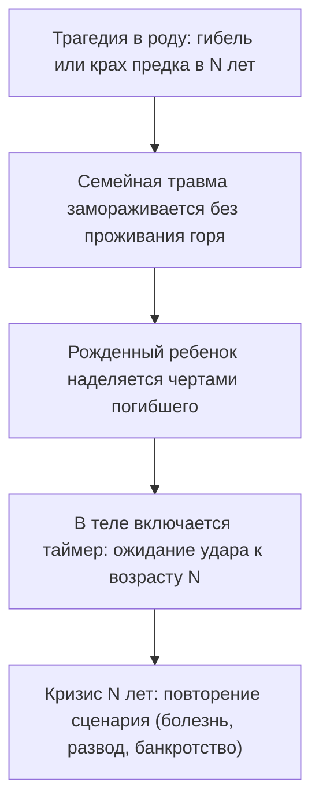

##### 1. Тень погибшего родственника
Дядя, тетя или дедушка, ушедшие в расцвете лет. Ребенка неосознанно называют в их честь, окружающие постоянно повторяют: «Как он похож на покойного!» Ребенок впитывает не только черты лица, но и неизбежность трагического финала.

##### 2. Замещающие дети после перинатальной утраты
Когда младенец рождается сразу после умершего брата или сестры, он с колыбели чувствует себя тенью. Ему кажется, что его любят не за то, какой он есть, а за то, кого он заменяет.

##### 3. Вычеркнутые возлюбленные родителей
Если отец всю жизнь тайно тосковал по погибшей первой невесте, его дочь может бессознательно перенять ее манеру одеваться, ее вкусы и ее несчастную судьбу, оставаясь одинокой.

---

#### Практика: отключение чужого таймера

Если ты приближаешься к возрасту, который стал роковым для кого-то из твоих близких, или чувствуешь, что живешь по чужому расписанию, выполни этот алгоритм разделения:

##### 1. Сверь хронологию
Выпиши на лист бумаги ключевые кризисы своей жизни: возраст, когда начались панические атаки, рухнул бизнес или распался брак. 
А рядом выпиши даты предков. Обрати внимание на совпадения: в каком возрасте дед потерял всё? В каком возрасте мама слегла с тяжелым диагнозом? В каком возрасте погиб родственник, в честь которого тебя назвали?

##### 2. Ощути «чужой костюм» в теле
Прислушайся к физическим ощущениям:
- Где живет этот страх приближающейся катастрофы?
- Тяжелый обруч на голове? Сдавленное горло? Каменный холод в животе?
Положи туда руку и сделай три спокойных, удлиненных выдоха.

##### 3. Слова возврата судьбы
Представь перед собой того предка, чей сценарий ты бессознательно копировал. Посмотри ему прямо в глаза с глубоким состраданием, но без жалости:

> *«Я вижу тебя и уважаю твое место в нашей семье. Твоя жизнь, твоя боль, твой возраст и твоя смерть принадлежат тебе и твоему времени. Я носил твою судьбу из детской любви, пытаясь облегчить память нашего рода. Но сегодня я возвращаю тебе твою судьбу. Ты — старший, а я — младший. Я остаюсь в своем собственном времени. Моя жизнь — моя».*

##### 4. Физический шаг назад
Сделай один физический шаг назад. Ощути, как тяжелый образ остается в прошлом, за чертой твоего сегодняшнего дня. Почувствуй плотность своих стоп на полу, тепло в ладонях и свободу в груди.

Ты не обязан умирать чужой смертью, чтобы доказать свою любовь. Твой лучший дар роду — это твоя собственная, счастливая и долгая жизнь.

---

> [!IMPORTANT]
> **Главная мысль главы**  
> Пытаясь прожить оборванную жизнь за погибшего предка, человек превращает собственную реальность в траурную панихиду. Жизнь расцветает только под своим именем и в своем времени.

---

> [!TIP]
> **Интерактивный помощник**  
> Если приближение определенного возраста вызывает иррациональную панику или ощущение неминуемой беды — напиши в диалоговом окне внизу страницы. Мы поможем аккуратно отключить этот таймер и вернуть спокойную уверенность в завтрашнем дне.


---

<a id="20-bug-05-broken-link"></a>

### Ложная связка: почему любовь кажется смертельной опасностью

Ты наверняка замечал эту странную, необъяснимую разницу между людьми.

Один человек спокойно идет на важные переговоры, легко подписывает контракт на десятки миллионов рублей и сразу после этого едет с друзьями в ресторан праздновать победу. А другой при приближении к точно такой же сделке внезапно заболевает с высокой температурой, устраивает скандал с ключевым партнером на ровном месте или забывает паспорт дома в день вылета.

Один с головой ныряет в теплые, глубокие отношения, наслаждаясь каждым днем. А другой, стоит партнеру сделать шаг к настоящему сближению, испытывает первобытный, леденящий душу ужас и сжигает все мосты, спасаясь бегством в глухую ночь.

Это не трусость. Не лень. И не отсутствие профессионализма.

Внутри твоей нервной системы произошло то, что инженеры называют коротким замыканием: два абсолютно не связанных между собой провода однажды намертво спаялись в один узел. И теперь вместо спокойного жизненного сигнала по цепи идет высоковольтный разряд паники.

В психотерапии это состояние называют **травматической связкой**:

- *Большие деньги = раскулачивание, тюрьма и гибель.*
- *Искренняя душевная близость = предательство, удушье и смерть.*
- *Публичное проявление = позор, изгнание и одиночество.*

Стоит тебе искренне захотеть финансового изобилия или счастливой семьи, как организм немедленно включает режим аварийного спасения. В грудине возникает ледяной кол, сердце начинает судорожно трепыхаться, а всё нутро кричит одну команду: *«Беги! Спасайся! Это смертельно опасно!»*

Годами эта ложная спайка надежно держит тебя на безопасной дистанции от всего, о чем ты так отчаянно мечтаешь.

---

> [!NOTE]
> В начале XX века великий физиолог Иван Петрович Павлов в своих классических экспериментах открыл механизм формирования **условного рефлекса**. 
> 
> Нейтральный стимул — например, тихий звон колокольчика — сам по себе не несет для живого существа никакой биологической угрозы. Но если каждый звон сопровождать болезненным ударом электрического тока, синапсы мозга в рекордные сроки спаивают слуховую кору с центрами страха в миндалевидном теле. В дальнейшем одного лишь тихого звона становится достаточно, чтобы организм выбросил лошадиную дозу адреналина, кровеносные сосуды спазмировались, а тело заметалось в поисках выхода.
> 
> В человеческой психике эта нейронная спайка работает еще разрушительнее, потому что способна передаваться через поколения. Если в семье прадеда раскулачили и расстреляли в ночь после продажи урожая, в родовой памяти прочно фиксируется рефлекс: достаток убивает. Спустя восемьдесят лет правнук честно пытается масштабировать бизнес, но его автономная нервная система слышит в слове «прибыль» тот самый смертоносный звон колокольчика — и нажимает на кнопку катапультирования.
> 
> Исцеление заключается не в борьбе со страхом, а в осознанном разъединении ложной связки: нейтральному стимулу возвращается его нейтральность, а прошлой трагедии отдается ее завершенное место в истории.

---

#### Синее платье у закрытой двери

Светлане исполнилось двадцать девять. Красивая, умная, мягкая женщина с выразительными глазами, в которых плескалось море застарелой, невыплаканной боли.

— Я всю жизнь мечтала о простой, теплой семье, — говорила она на приеме, нервно теребя ремешок сумочки. — Знаете, как в кино: уютный загородный дом, потрескивание поленьев в камине, детский смех, надежный муж обнимает со спины. Я так отчаянно этого хочу! Но стоит мужчине стать по-настоящему родным, как во мне просыпается неконтролируемое безумие. 

Она глубоко вздохнула, пытаясь сдержать подступающие слезы:

— Стоит нам начать жить вместе, как в моей груди вспыхивает настоящий пожар. Мне начинает казаться, что если я останусь с ним под одной крышей — случится непоправимая беда. Я нахожу самый глупый, ничтожный повод: не так поставленная кружка, забытое слово. Закатываю дикую, истерическую сцену и ухожу в ночь босиком. За последний год я разрушила четвертые прекрасные отношения. Я ненавижу себя за это. Я в полном отчаянии.

> **Терапевт:** Света, закрой глаза. Сделай медленный выдох. Представь вечер. Мужчина, который искренне тебя любит, закрывает входную дверь на ключ, подходит к тебе сзади и нежно обнимает за плечи. Что прямо сейчас происходит в твоем теле?
>
> **Света:** *(мгновенно бледнеет, руки судорожно прижимаются к солнечному сплетению, дыхание перехватывает)* Господи… В животе раскаленный свинец. Словно я выпила стакан серной кислоты. В висках стучит тяжелый кузнечный молот. Мне нечем дышать! Хочется выломать дверь с корнем, бежать сломя голову по лестнице и спрятаться в темном подвале!
>
> **Терапевт:** Кто умер или исчез из твоей жизни в детстве ровно в тот момент, когда между вами было бесконечное счастье и тепло?
>
> **Света:** *(в кабинете повисает ледяная тишина; пальцы девушки начинают мелко дрожать, губы синеют)* Папа… Я была абсолютной «папиной дочкой». Мы дышали одним воздухом. Мне было ровно семь лет. Суббота, мой день рождения. Утром он подошел к моей кровати, поцеловал в лоб и сказал: «Жди меня, Светик! Я сегодня вернусь пораньше с работы и привезу тебе самый лучший сюрприз на свете».
>
> **Терапевт:** Что ты сделала дальше?
>
> **Света:** *(по щекам текут беззвучные слезы)* Я надела свое самое красивое синее платье с кружевным воротничком. Села на холодный линолеум в прихожей прямо напротив входной двери. Я сидела там часами. Слушала гул лифта. Ждала шагов на площадке и знакомого звона ключей в замке…
>
> **Терапевт:** И что произошло?
>
> **Света:** *(голос срывается на шёпот)* Пробило семь вечера. Восемь. Звона ключей не было. А потом в тишине коридора сухо и пронзительно зазвонил дисковый телефон. Мама взяла трубку, помолчала несколько секунд… а потом закричала так, как кричит смертельно раненый зверь. Она сползла по обоям на пол и стала биться головой о плинтус. Папа упал на асфальт в двух кварталах от нашего дома. Обширный инфаркт. Ему было всего двадцать девять лет. Он умер мгновенно, сжимая в руке большую коробку с куклой. Дверь он так и не открыл.

Света замолчала, судорожно глотая воздух.

— Я сидела в том синем платье на ледяном полу прихожей и смотрела на воющую маму. И в моей детской голове в ту секунду намертво запечаталась страшная мысль: *«Если бы я не ждала его так сильно… Если бы я не любила его так сильно — он остался бы жив. Это моя любовь убила папу»*.

Двадцать два года Светлана жила с этой чудовищной связкой. 

В ее подсознании любовь к мужчине была спаяна с внезапной смертью и ледяным ужасом сиротства. Чтобы спасти любимого мужчину от верной гибели, а себя — от разрывающего горя, ее психика при малейшем сближении нажимала кнопку экстренной катапульты.

> **Терапевт:** Света, посмотри сейчас на того молодого двадцатидевятилетнего мужчину с коробкой куклы в руках. Посмотри в его живые, любящие глаза. Скажи ему правду:
>
> **Света:** Папа… Я так долго ждала тебя у той двери. Я всю жизнь просидела на том холодном линолеуме в синем платье… Но твой инфаркт и твоя ранняя смерть — это была твоя взрослая судьба. Это не было ценой моей детской любви. Моя любовь не убивает. Моя любовь — это просто тепло. Я разделяю любовь к тебе и твою трагическую смерть. Мой мужчина — это не ты. Наша квартира — это не морг. Я размыкаю этот провод. Любить безопасно.
>
> **Света:** *(делает судорожный, всхлипывающий вдох; спазм в солнечном сплетении с тихим теплом растворяется, расслабляя живот)*
>
> **Терапевт:** Снова представь закрытую дверь и мужчину рядом. Что сейчас в теле?
>
> **Света:** *(вытирает мокрые щеки, на лице появляется слабая, но искренняя улыбка)* В груди тихо и просторно. Дышится легко. Можно просто подойти к нему, положить голову на грудь и знать: никто не умрет.

Через полгода Светлана прислала фотографию: загородный дом, чашки с чаем на деревянной веранде и спокойный, улыбающийся мужчина рядом. Ложная связка распалась. Жизнь вернула себе безопасность.

---

#### Анатомия травматической пайки

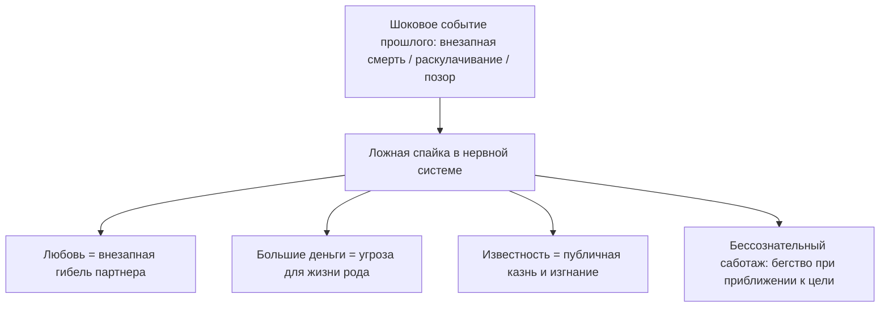

Любая ложная связка держится на трех китах:
1. **Шоковый импринт.** Момент, когда трагедия застала врасплох (внезапный звонок, обыск, предательство).
2. **Ложный детский вывод.** Мозг ребенка ищет причинно-следственную связь и берет вину на себя: «Это произошло, потому что я радовался / просил денег / любил».
3. **Охранный саботаж.** Психика блокирует любое повторение ситуации, заставляя человека разрушать свое счастье собственными руками.

---

#### Практика: разъединение проводов

Если ты чувствуешь, что приближение к заветной цели вызывает удушливую тревогу или желание сбежать, выполни эту практику разделения:

##### 1. Сформулируй свою формулу страха
Найди два понятия, которые склеились в твоей голове:
- *«Если я стану богатым, то… (меня убьют / отнимут / презирают)».*
- *«Если я доверюсь партнеру, то… (он бросит меня умирать / растопчет)».*
- *«Если я заявлю о себе, то… (меня осмеют и уничтожат)».*

##### 2. Найди исток замыкания
Вспомни, когда эта формула впервые проявилась в твоей жизни или истории твоей семьи. Чья трагедия стояла за этим страхом?

##### 3. Телесное разделение
Положи одну руку на грудь, а другую — на живот. Сделай глубокий вдох через нос и медленный, спокойный выдох через рот. Произнеси вслух твердым, взрослым голосом:

> *«Я вижу эту связку. В момент катастрофы моя испуганная память соединила тепло и смерть, деньги и гибель, проявленность и позор. Долгие годы это казалось мне единым целым. Но сегодня я развожу эти провода. Трагедия прошлого завершена и остается в прошлом. Моя любовь — это жизнь. Мой доход — это созидание. Я возвращаю каждому явлению его подлинный смысл. Опасность миновала. Мне можно жить и любить в безопасности».*

##### 4. Возвращение в настоящее
Огляди комнату. Потрогай твердую поверхность стола, почувствуй опору стула под бедрами. Звон старого колокольчика стих. Твой сегодняшний день свободен от призраков прошлого.

---

> [!IMPORTANT]
> **Главная мысль главы**  
> Нервная система может годами бить тревогу на нейтральный сигнал, принимая его за смертельную угрозу. Раздели прошлую боль и сегодняшнюю цель — и путь откроется без борьбы.

---

> [!TIP]
> **Интерактивный помощник**  
> Если воспоминание о внезапной утрате или предательстве отозвалось сдавленным дыханием — напиши об этом в диалоговом окне внизу страницы. Мы поможем бережно снять это напряжение и вернуть чувство безопасности.


---

<a id="22-bug-06-identification"></a>

### Чужая вина: когда ты носишь шинель предка

Бывает ли с тобой так, что в моменты самого яркого жизненного успеха тебя внезапно накрывает темная, удушливая волна стыда?

Крупная сделка закрыта. Деньги честно поступили на банковский счет. Коллеги искренне поздравляют, а близкие гордятся твоими достижениями. Но вместо радости и законного торжества на плечи опускается неподъемный свинцовый груз. 

Внутри рождается парализующее чувство: эти деньги словно украдены у сирот. Ты не имеешь права на эту квартиру, на этот красивый отпуск, на саму эту счастливую жизнь. Кажется, что за дверью уже стоят строгие люди в черных шинелях, готовые разоблачить тебя и отправить на каторгу.

Ты лихорадочно перебираешь свои поступки за последние месяцы. Ищешь, кого ты мог случайно обидеть, где слукавил, какую ошибку совершил. И не находишь ровным счетом ничего.

Твое чутье тебя не обманывает: это чувство действительно не принадлежит тебе.

Ты годами расплачиваешься по чужому кровавому кредиту. В твоем подсознании произошла глубокая **идентификация с семейной виной**.

---

#### Тайна запертого шкафа

В семье Дмитрия одно имя было под строжайшим табу. Это молчание сквозило по комнатам старой профессорской квартиры, как ледяной сквозняк из сырого подвала. Все взрослые знали тайну, но при детях не произносили ни звука.

Лишь однажды, глухой ноябрьской ночью, семилетний Дима сквозь сон услышал, как бабушка на кухне со слезами шептала соседке страшную правду.

В конце тридцатых годов родной прадед Димы служил следователем в аппарате НКВД. Одним росчерком пера он отправлял людей на расстрельные полигоны или на медленную гибель в заполярные лагеря. А в сороковом году машина перемолола и его самого: ночной арест, скорый приговор и безымянная братская могила, место которой никто в семье не знал. И знать не хотел.

Семья вымарала память о прадеде, спасаясь от позора и страха репрессий. Его лицо вырезали со всех фотографий.

Дмитрий родился спустя полвека. Он рос удивительно тонким, мягким и сострадательным мальчиком: случайно залетевшего в комнату шмеля он бережно накрывал стеклянной банкой, подсовывал листок бумаги и с замиранием сердца выпускал в форточку на волю. Он физически не переносил насилия.

И при этом каждое утро он просыпался с ощущением, что на его худые детские плечи наброшена тяжелая, заскорузлая от чужой крови чекистская шинель. 

Шинель была не по размеру. Она душила, натирала шею до язв и буквально приросла к телу.

Став взрослым программистом и архитектором баз данных, Дмитрий жил в постоянном аду:
- Честно заработанные гонорары пахли чужой бедой. Он спешил раздать их друзьям или спустить на благотворительность, оставляя себе копейки на гречку.
- Радоваться весеннему солнцу или смеяться в компании казалось кощунством: словно его улыбка топчет свежие могилы безвинно погибших людей.
- Стоило ему встретить любящую женщину, как под ребрами возникал жесткий спазм и непреодолимое желание упасть на колени, вымаливая прощение за сам факт своего существования.

Память рода не знает ластиков. Семья вычеркнула палача, но колоссальный долг вины остался висеть в воздухе. И психика выбрала самого чувствительного, самого бескорыстного потомка в качестве искупительной жертвы. Дмитрий, сам того не осознавая, надел на себя вину прадеда и тридцать лет отбывал за него посмертное наказание.

На сессии Дмитрий сидел на краешке кресла. Пальцы судорожно сжимали воротник свитера, губы дрожали:

— Я не могу сделать вдох полной грудью. Мне всё время кажется: стоит мне расправить плечи и вздохнуть глубоко — в дверь постучат прикладом и арестуют.

> **Терапевт:** Опусти глаза. Посмотри на свои ладони, Дима. Внимательно посмотри. Там есть кровь невинных людей?
>
> **Дима:** *(смотрит на свои руки; по щекам текут слезы)* Нет… На пальцах мозоли от клавиатуры. Я пишу код. Я плачу налоги. Я никого в жизни пальцем не тронул.
>
> **Терапевт:** Поставь образ прадеда перед собой. Офицер госбезопасности тридцать седьмого года в кожаной тужурке. Посмотри ему прямо в глаза. Скажи то, что должно быть сказано:
>
> **Дима:** Прадед… Я вижу тебя. Я знаю о твоих расстрельных списках, о твоей жестокости и твоих преступлениях. Но это было твое время. И это был твой личный выбор. Вся вина за содеянное принадлежит только тебе. Я твой правнук, рожденный в свободную эпоху. Мои руки не подписывали смертных приговоров. Мое сердце не знало твоей слепой ненависти. С глубокой скорбью о погибших я оставляю твою вину, твой тридцать седьмой год и твой ответ перед Богом тебе. Я снимаю с себя твою шинель. Я выхожу из твоей судьбы навсегда.

В комнате повисла благоговейная тишина.

И в этот миг Дмитрий почувствовал, как невидимая серые латы со звоном сорвались с его спины. Лопатки с легким хрустом расправились. В онемевшие, холодные пальцы хлынула горячая, пульсирующая кровь.

Он плакал двадцать минут — навзрыд, уткнувшись лицом в ладони. Это были слезы узника, с которого после пожизненного заключения наконец-то сбили ржавые кандалы.

Спустя две недели Дмитрий сидел за столиком уличного кафе на набережной. Светило теплое весеннее солнце. Перед ним стоял лучший колумбийский кофе и свежая выпечка. Он пил маленькими глотками, смотрел на золотые блики на воде и чувствовал: мир больше не требует от него искупления. 

Его руки были чисты. Его жизнь принадлежала только ему.

---

> [!NOTE]
> В 1936 году Анна Фрейд в работе «Эго и механизмы защиты» впервые подробно исследовала феномен бессознательной идентификации. Позже выдающийся психоаналитик Шандор Ференци показал, как травма насилия расщепляет психику ребенка, заставляя его вбирать в себя черты агрессора, чтобы хоть как-то справиться с непереносимым ужасом беспомощности.
> 
> В контексте трансгенерационной психологии этот механизм проявляется с особенной силой. Когда в семейной истории есть фигура палача (чекиста, надсмотрщика, предателя, домашнего тирана) или фигура растерзанной невинной жертвы, семья стремится поскорее забыть кошмар. 
> 
> Но вытесненный эмоциональный заряд никуда не исчезает. Потомки в третьем или четвертом колене бессознательно восстанавливают нарушенный баланс, отождествляясь либо с преступником (и тогда человека пожирает беспричинная вина и тяга к самонаказанию), либо с жертвой (запрет на деньги, безопасность и счастье). 
> 
> Освобождение наступает лишь тогда, когда границы личностей восстанавливаются: потомок твердо возвращает историческую ответственность тому предку, который совершил деяние.

---

#### Два типа ложной идентификации

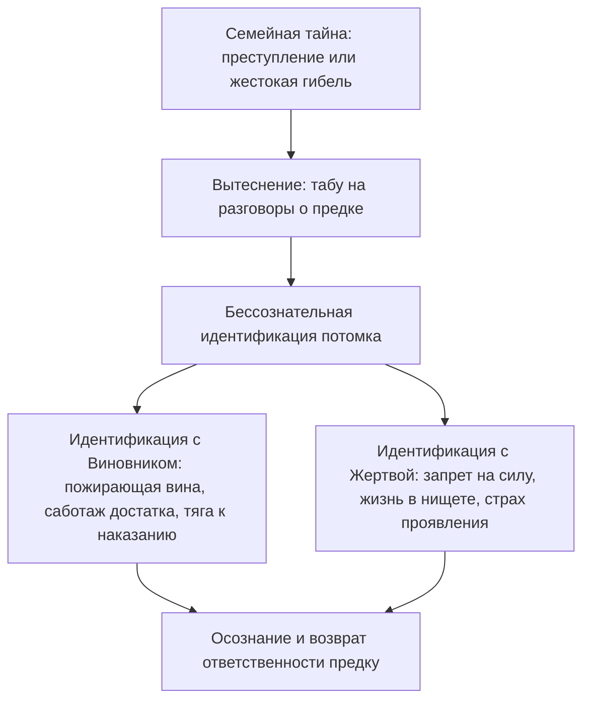

##### 1. Слияние с Виновником
Предок совершил преступление, нажился на чужом горе или бросил беспомощных детей. Потомок бессознательно саботирует собственную жизнь: разоряется, отказывается от признания, разрушает здоровье. Внутри живет негласная клятва: *«Я не имею права процветать, пока жертвы моего предка лежат в земле»*.

##### 2. Слияние с Жертвой
Члена семьи безжалостно раскулачили, репрессировали или уничтожили. Потомок бессознательно воспроизводит его судьбу: живет на грани выживания, прячется от внимания властей, боится любого проявления силы. Для него успех ощущается как предательство памяти замученных родственников.

---

#### Практика: возвращение чужой вины

Если ты ловишь себя на необъяснимом чувстве вины за собственный достаток или страхе быть наказанным за свои успехи, выполни эту практику разделения:

##### 1. Выяви чувство рока
Вспомни момент своего триумфа: получение крупной суммы, повышение по службе, покупка красивой вещи. 
Появляется ли в этот миг желание срочно спрятаться, извиниться, заболеть или спустить все деньги? Зафиксируй этот телесный маркер.

##### 2. Задай вопрос предкам
Положи ладонь на солнечное сплетение. Сделай медленный выдох и спроси себя:
- *«Чью вину я сейчас пытаюсь искупить?»*
- *«Кто в моем роду был палачом, предателем или разрушителем, о котором все молчат?»*
- *«Чья невинно пролитая кровь или позор стоят за моим страхом благополучия?»*

##### 3. Слова освобождения
Представь перед собой того предка, чей груз ты нес на своих плечах. Почувствуй твердую опору стоп на полу, расправь плечи и произнеси вслух:

> *«Я вижу тебя. Я знаю правду о твоих поступках, о твоем времени и о твоей вине. Долгие годы я носил твою шинель из слепой детской преданности нашему роду. Но сегодня я провожу черту. Твои преступления, твой выбор и твой ответ перед вечностью принадлежат только тебе. Я с глубоким почтением к жертвам оставляю твой грех в твоем времени. Мои руки чисты. Моя совесть чиста. Я выхожу из твоей тени. Моя жизнь принадлежит мне».*

##### 4. Вдох свободы
Почувствуй, как с плеч падает невидимый плащ чужого позора. Сделай полный, свободный вдох в самый низ живота. Посмотри на свои ладони: это твои руки. Они созданы для созидания, любви и радости в сегодняшнем дне.

---

> [!IMPORTANT]
> **Главная мысль главы**  
> Чужая вина не делает тебя благородным: она лишь крадет твою жизнь. Возвращая грех предку, ты проявляешь высшую справедливость к живым и мертвым.

---

> [!TIP]
> **Интерактивный помощник**  
> Если слова разделения с предком вызвали дрожь в руках или холод вдоль позвоночника — напиши об этом в диалоговом окне внизу страницы. Мы поможем бережно завершить процесс и ощутить чистоту своего настоящего «Я».


---

<a id="23-bug-07-triangulation"></a>

### Триангуляция: когда ребёнок становится громоотводом

Бывает так, что каждый вечер перед дверью собственной квартиры ты замираешь в странном оцепенении. 

Твое тело буквально гудит, как перегруженная трансформаторная будка во время грозы. В затылке пульсирует раскаленная боль, дыхание становится частым и поверхностным, а плечи подняты почти к самым ушам.

Это не просто физическая усталость после напряженного рабочего дня. 

Весь день ты работал живым заземлением: принимал на себя электрические разряды между людьми, которые патологически не умеют говорить друг с другом напрямую. Ты сглаживал чужие ультиматумы, переводил ядовитые реплики начальников в дипломатическое русло, гасил истерики коллег и держал на своих плечах шаткий мир в чужом коллективе.

Но самое страшное наступает тогда, когда в доме наконец воцаряется абсолютная тишина.

Вместо долгожданного покоя на тебя обрушивается ледяная паника. Под ребрами разверзается сосущая пустота. Без привычного чужого напряжения, которое нужно ежесекундно гасить собой, у тебя возникает ощущение, будто ты вообще исчезаешь из этого мира.

В системной психотерапии это состояние называют **триангуляцией**.

Когда двое взрослых людей не способны выдержать напряжение прямого конфликта, они бессознательно втягивают в свои отношения третьего — самого слабого, чуткого и любящего. Ребенок становится громоотводом, принимающим на себя смертоносный разряд родительской ненависти.

---

> [!NOTE]
> В 1970-х годах выдающийся семейный терапевт Сальвадор Минухин ввел в клиническую практику понятие **триангуляции** как патологического способа регуляции супружеского напряжения. 
> 
> Когда эмоциональная диада (муж и жена) оказывается нестабильной, супруги вместо открытого выяснения отношений сбрасывают тревогу на третьего участника — своего ребенка. Ребенок превращается в буфер, смягчающий удары между родителями.
> 
> Другой классик семейной теории, Мюррей Боуэн, подробно описал психосоматическую цену триангуляции: чем выше скрытая тревога и взаимная враждебность между родителями, тем сильнее ребенок соматизирует эту боль. У детей развиваются тяжелые хронические заболевания — бронхиальная астма, язвенный колит, приступы удушья, псориаз, внезапные обмороки. Болезнь ребенка выполняет спасительную для семьи функцию: испуганные родители немедленно прекращают ссору и объединяются у постели больного. 
> 
> Ребенок платит собственным здоровьем за то, чтобы сохранить семью от катастрофического распада. Став взрослым, такой человек бессознательно переносит эту модель на работу и дружбу, становясь вечным спасателем и громоотводом в любых конфликтах.

---

#### Руки, держащие высоковольтный кабель

Тридцатидвухлетняя Анна руководила департаментом по управлению персоналом в крупном производственном холдинге. Внешне ее жизнь выглядела безупречно: строгие стильные платья, идеальный порядок в отчетах, заботливый муж, уютная квартира.

Но в компании Анна была штатным громоотводом.

Свирепые столкновения между вице-президентами, интриги акционеров, застарелая вражда между производством и продажами — все ядовитые потоки корпоративной ненависти неизменно стекались к ее рабочему столу. Анна часами выслушивала чужие обиды, сглаживала острые углы, гасила готовые взорваться скандалы.

Она расплачивалась за это жестокими мигренями, бессонницей и полной потерей собственных желаний. Стоило спросить ее: «Аня, а чего хочешь лично ты?», как ее взгляд становился абсолютно пустым.

На терапевтическую сессию Анна пришла с фразой, в которой слышалось предельное отчаяние:

— Я выгорела дотла. Моя нервная система похожа на обугленный провод. Но я не могу остановиться: мне кажется, что стоит мне отпустить контроль хотя бы на минуту — и весь мой мир разорвет в клочья.

> **Терапевт:** Аня, встань посреди кабинета. Поставь сумку на пол, закрой глаза. Позволь своему телу самопроизвольно принять ту позу, которая ярче всего отражает твое внутреннее состояние прямо сейчас.

Прошло десять секунд. И вдруг руки Анны медленно, словно преодолевая невидимое сопротивление воды, поплыли в разные стороны.

Левая рука вытянулась строго на запад, правая — на восток. Плечи поднялись к мочкам ушей, шея окаменела, грудная клетка застыла на судорожном полувыдохе. Пальцы сжались в кулаки с такой силой, будто они держали два оголенных высоковольтных провода.

> **Терапевт:** Что ты чувствуешь прямо сейчас? Что происходит в твоем теле?
>
> **Аня:** *(ее губы синеют, по щекам катятся крупные слезы, а голос срывается на тонкий, дрожащий плач испуганного ребенка)* Я держу их… Я держу их изо всех последних сил. Если я разомкну руки хотя бы на миллиметр — они бросятся друг на друга и убьют…

«Ими» были ее родные родители.

Тридцать лет они вели глухую, позиционную, жестокую войну на уничтожение. Они принципиально не разводились — под лицемерным лозунгом: «Мы терпим этот ад исключительно ради счастья нашей девочки». 

И детство девочки превратилось в бесконечный полигон. С семи лет мать делала из Ани своего главного доверенного поверенного: рыдала по ночам ей в плечо, рассказывая о жестокости и изменах отца. Отец запирался с Аней в гараже и глухо ронял: «Ты — единственная чистая душа в этом проклятом доме». 

Маленькая Аня стояла на нейтральной полосе под перекрестным огнем двух самых дорогих людей на свете.

Ее детский организм нашел единственный способ остановить кровавую бойню: собственное тело. Стоило родителям начать кричать и доставать чемоданы для развода, как у семилетней девочки развивался жесточайший приступ бронхиальной астмы. Она начинала синеть и задыхаться. Приезжала скорая, врачи кололи эуфиллин, а насмерть перепуганные отец и мать смыкали руки над постелью задыхающегося ребенка.

В подсознании запечаталась команда: *«Чтобы мои родители не поубивали друг друга, я обязана сгорать между ними»*.

Прошли десятилетия. Детскую астму сменили хронические спазмы сосудов и мигрени. Место родителей заняли токсичные топ-менеджеры. Но взрослая, успешная женщина продолжала день за днем отдавать свое здоровье, оставаясь аварийным заземлением для чужой войны.

---

#### Шаг в сторону: размыкание смертельного контура

Терапевт подошел ближе. Пальцы Анны побелели от чудовищного напряжения.

> **Терапевт:** Аня, сделай глубокий вдох через сжатое горло. А теперь своими ногами сделай один широкий, уверенный шаг влево. Сделай шаг в сторону и выйди из середины.

Анна покачнулась. Казалось, ее подошвы были намертво приварены к полу. Но она сделала усилие — и переступила на метр вбок.

В ту же секунду ее руки, потеряв опору невидимых кабелей, бессильно рухнули вдоль тела.

> **Терапевт:** Посмотри туда, где ты только что стояла. Посмотри на то пустое пространство между отцом и матерью. Скажи им правду:
>
> **Аня:** *(из ее груди вырывается хрип — как воздух из пробитого спасательного жилета)* Мама… Папа… Ваш брак, ваша ненависть и ваша война принадлежат только вам. Тридцать лет я держала этот огонь своими детскими легкими, чтобы вы не уничтожили друг друга. Я брала этот смертельный ток на себя из огромной любви к вам. Но эта ноша превышает человеческие силы. Вы — взрослые. Ваши отношения — это ваша ответственность. Я возвращаю вам ваше напряжение. Я выхожу из роли громоотвода. Мое место — не между вами. Я просто ваш ребенок.

Слезы полились ручьем — горячие, свободные, смывающие многолетний ужас. 

Диафрагма, спазмированная с семилетнего возраста, с мягким выдохом опустилась вниз. Чистый, живительный воздух впервые в жизни наполнил легкие Анны до самых реберных дуг.

Спустя месяц Анна прислала теплое сообщение:

> *«Вчера на совете директоров два наших главных вице-президента начали привычную травлю, пытаясь втянуть меня в середину своего конфликта и заставить принять чью-то сторону. Раньше у меня от этого потемнело бы в глазах и начался приступ удушья.*
> 
> *Но в этот раз внутри меня стояла абсолютная, звенящая тишина. Я спокойно посмотрела на них и сказала: "Коллеги, этот спор лежит исключительно в плоскости ваших полномочий. Пожалуйста, договоритесь напрямую". Встала и пошла на кухню пить травяной чай.*
> 
> *У меня даже голова не заболела. Оказывается, мне больше не нужно никого спасать ценой собственной жизни, чтобы просто дышать».*

---

#### Три маски триангуляции

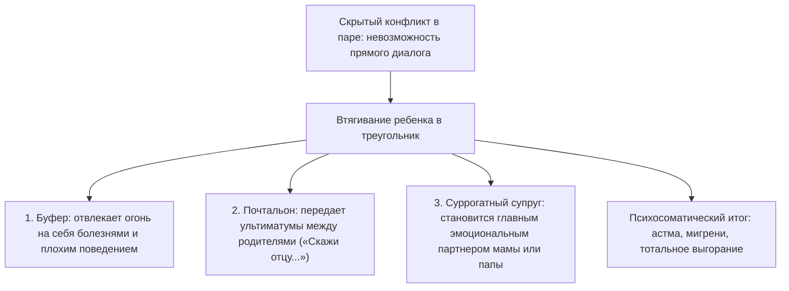

##### 1. Ребенок-буфер
Когда градус агрессии в доме зашкаливает, ребенок бессознательно берет огонь на себя: начинает тяжело болеть, попадать в аварии, приносить двойки из школы. Родители переключаются со взаимной ненависти на спасение чада. Семья сохраняется, но цена этой стабильности — разрушенное здоровье ребенка.

##### 2. Ребенок-почтальон
«Пойди скажи своему отцу, что он негодяй», «Передай матери, что денег я ей больше не дам». Ребенок превращается в кабель связи между взрослыми людьми, потерявшими человеческий контакт. Его собственная психика не выдерживает чужой злобы и разрушается.

##### 3. Суррогатный партнер
Один из родителей, разочаровавшись в супруге, делает из ребенка своего главного конфидента. Дочь заменяет матери подругу и психотерапевта, сын становится для матери «главным мужчиной в жизни». Детство такого ребенка крадется без остатка.

---

#### Практика: выход из чужого конфликта

Если ты ловишь себя на том, что постоянно тушишь чужие пожары и живешь с хроническим спазмом в шее и груди, выполни этот алгоритм выхода из треугольника:

##### 1. Диагностика телом
Встань посреди комнаты. Представь слева от себя одного участника конфликта (например, мать или начальника), а справа — второго (отца или коллегу). 
Прислушайся к мышцам: поднялись ли плечи? Сжались ли кулаки? Перехватило ли дыхание?

##### 2. Физический шаг в сторону
Сделай один осознанный, широкий шаг в сторону. Почувствуй, как твои ноги встают на нейтральную, свободную почву. Опусти руки.

##### 3. Слова освобождения
Посмотри на пустое место между конфликтующими сторонами. Произнеси вслух спокойным и твердым голосом:

> *«Ваш спор и ваша вражда принадлежат вам. Я вижу ваше взаимное напряжение, но я больше не буду вашим заземлением. Долгие годы я держал этот огонь своим телом из слепой любви. Но этот ток разрушителен для меня. Вы — взрослые люди. Я возвращаю вам право разбираться между собой напрямую. Снимите с меня мантию громоотвода, миротворца и буфера. Я выхожу из середины. Моя жизнь принадлежит мне».*

##### 4. Возвращение дыхания
Положи ладонь на центр грудины. Сделай глубокий вдох на четыре счета и протяжный, расслабляющий выдох на шесть счетов. Почувствуй, как уходит необходимость быть начеку.

Пусть чужие грозовые тучи проходят мимо. Твоя энергия наконец-то возвращается в русло твоей собственной судьбы.

---

> [!IMPORTANT]
> **Главная мысль главы**  
> Выход из чужой войны — это не предательство, а единственный способ сохранить себя. Когда громоотвод уходит, взрослые вынуждены встретиться лицом к лицу.

---

> [!TIP]
> **Интерактивный помощник**  
> Если выход из роли миротворца вызывает мучительное чувство вины перед родителями или коллегами — напиши в диалоговом окне внизу страницы. Мы поможем бережно отделить здоровую заботу от разрушительного самопожертвования.


---

<a id="24-bug-08-interrupted-movement"></a>

### Прерванное движение: почему мы боимся сделать шаг навстречу

Бывает так, что ты искренне, всем сердцем хочешь любить и быть любимым. Ты читаешь мудрые книги по психологии, учишься выстраивать диалог, искренне восхищаешься своим партнером.

Но стоит человеку подойти слишком близко — обнять с нежностью, заглянуть в самые глубины глаз, предложить жить вместе — как внутри тебя словно опускается тяжелая металлическая заслонка.

Твое тело мгновенно каменеет. В центре грудной клетки появляется холодный, неподъемный булыжник, дыхание становится мелким и поверхностным, а руки непроизвольно отстраняются. В голове вспыхивает глухое раздражение на пустом месте или паническое желание немедленно разорвать контакт и запереться в пустой комнате.

Окружающие называют это «холодным характером», «страхом ответственности» или эгоизмом.

Но на самом деле в твоем теле живет застывшая память о **прерванном движении любви**.

Каждый ребенок рождается с абсолютным, первобытным инстинктом тянуться к матери. Его ручки инстинктивно раскрываются навстречу теплу, его маленькое сердце безоговорочно распахивается для объятия. Но если в момент этого самого чистого и беззащитного порыва ребенок наталкивается на ледяное отвержение, каменное лицо или яростный окрик — происходит катастрофа.

Психика спасает сердце от разрыва единственным доступным способом: она мгновенно замораживает импульс на полпути. Мышцы грудины спазмируются, фиксируя запрет: *«Тянуться к тому, кого любишь — смертельно опасно. Замри. Окаменей. Никогда больше не делай этого шага»*.

---

#### Правильная девочка и ноябрьская кухня

Кристина с самого раннего детства знала главное правило выживания в своем доме: быть незаметной, удобной и предельно собранной.

Ее мать была женщиной из железа и дисциплины. Безупречная осанка, строгий взгляд, металлический голос, в котором не было места сантиментам. Она никогда не кричала. Она отдавала короткие, не терпящие возражений команды: «Поела — помой тарелку», «Плачешь — иди в свою комнату и не позорься», «Соберись, нечего распускать нюни».

Кристина старалась изо всех сил. Образцовая дочь: круглые пятерки в школе, идеальный порядок в шкафу, никаких капризов и хлопот.

Когда ей было девять лет, отец молча собрал вещи и навсегда ушел из семьи. Во вторник его одежда просто исчезла из гардероба. Мать сухо отрезала за ужином: «Мы больше не живем вместе. Тема закрыта навсегда». С этого дня его имя в доме было под строжайшим запретом.

Кристина впитала этот закон костями: когда тебе невыносимо больно — стисни зубы, сотри слезы и шагай дальше с прямой спиной.

Потом начались неуклюжие мамины попытки устроить личную жизнь. 

Девятилетняя Кристина улавливала всё до мельчайших нюансов: часы у зеркала в коридоре, чужие мужские голоса в телефонной трубке, частые поездки к бабушке на выходные «подышать свежим воздухом». Детским чутьем девочка знала: мама отчаянно ищет тепла, которое сама Кристина дать ей не способна.

Однажды поздним ноябрьским вечером в квартире стояла тишина. За окном хлестал дождь со снегом. Девятилетняя Кристина проснулась от жажды и тихо пошла на кухню.

В полумраке кухни у окна на табурете сидела мать. Ее лицо было закрыто ладонями. Плечи судорожно, мелко вздрагивали. Женщина из железа плакала — беззвучно, горько, ломая свою многолетнюю броню.

В груди маленькой девочки всё обожгло острой, пронзительной жалостью. Чистейший детский порыв: подбежать босиком по полу, обвить ручонками мамину шею, прижаться мокрой щекой к ее фланелевому халату и прошептать: *«Мамочка, милая, не плачь! Я здесь, я с тобой, я так сильно тебя люблю!»*

Кристина сделала шаг вперед.

И в эту секунду воздух между ними словно превратился в толстое, пуленепробиваемое ледяное стекло. Грудную клетку девочки свело спазмом удушья.

Мать услышала шорох. Она резко смахнула слезы тыльной стороной ладони и, даже не поворачивая головы, металлическим голосом отчеканила в темноту:

— Ты чего застыла в дверях? Немедленно иди спать. И чтобы завтра в дневнике не было ни одной четверки.

Кристина на цыпочках отступила назад в темный коридор.

В ту ночь ее маленькое сердце перестало рваться навстречу людям. Тело намертво запечатало команду: *«Тянуться к близкому — значит получить удар под дых. Любовь приносит невыносимый стыд. Замри на пороге»*.

---

#### Семь лет идеального штиля

В двадцать три года Кристина встретила Антона.

Он был тихим, надежным инженером. Рядом с ним можно было не обороняться. Он говорил мало, держал каждое слово, а его молчание согревало лучше любых речей. Он учился говорить о чувствах — бережно, неловко, искренне.

Они поженились. Прошло семь благополучных лет: путешествия, книги, театр, уютная квартира с видом на сквер. Но эта идеальная гладь постепенно превратилась в ледяную тюрьму.

На исходе седьмого года Антон сел напротив Кристины за кухонный стол:

— Кристина… Ты сидишь на диване рядом со мной. Мы вместе пьем чай. Но тебя здесь нет. Твое сердце за бронированной дверью. За семь лет брака ты так и не сделала ни одного шага навстречу мне. Я устал стучаться в пустой дом.

Они развелись тихо, без скандалов. Закрыв за Антоном дверь, Кристина сползла по стене на пол и с ужасом осознала: она ни разу в жизни не сделала настоящего шага из той темной ноябрьской прихожей.

А потом в ее жизни появился Георгий.

Шумный, энергичный, уверенный в себе системный инженер. Он ворвался в ее жизнь как тропический ураган: звонил среди дня, обнимал на глазах у всех, признался в любви уже на третьей неделе с обезоруживающей легкостью.

После семи лет штиля напор Георгия пугал Кристину до дрожи в коленях — и одновременно притягивал, как спасительный костер замерзающего путника.

Но когда Георгий натыкался на ее внутренний холод, он включал привычную броню логики: «Так, спокойно. Не надо эмоций. Давай разберем твою обиду по пунктам». Ее женская боль была для него просто поломкой, системной ошибкой, которую нужно срочно отремонтировать по инструкции.

А Кристине не нужен был ремонт. Ей нужно было, чтобы ее просто увидели — испуганной, колючей, плачущей — и не сбежали за стену заумных объяснений.

Развязка наступила в прихожей:

— Ты все делаешь правильно, Жора, — тихо сказала Кристина, глядя сквозь него. — Ты идеальный специалист. Только меня в твоих правилах нет. Я для тебя просто сломанная деталь.

Он вспыхнул от обиды, хлопнул дверью и ушел в ночь.

Кристина закрыла замок, прижалась лбом к холодному косяку и зарыдала. Рухнули не отношения с Георгием и не брак с Антоном. В ее памяти вспыхнула та самая девятилетняя девочка на кухне, которая замерла перед ледяным стеклом и так и не дошла до матери.

---

> [!NOTE]
> В 1959 году знаменитый американский психолог Гарри Харлоу в серии классических экспериментов доказал: базовая потребность живого существа заключается вовсе не в получении пищи, а в теплом тактильном контакте (contact comfort). Без материнского тепла детеныши впадают в оцепенение, теряют способность к социализации и на всю жизнь остаются эмоциональными инвалидами.
> 
> Позже профессор Гарвардского университета Эдвард Троник в потрясающем эксперименте **«Каменное лицо»** (Still Face Experiment) зафиксировал биологический каскад отвержения. Когда мать внезапно перестает реагировать на младенца и ее лицо становится каменным, ребенок сначала пытается улыбнуться, затем плачет, а через две минуты безуспешных попыток падает в тяжелый вегетативный коллапс: сердечный ритм замедляется, тело обмякает, взгляд тускнеет. Включается защитное торможение блуждающего нерва (dorsal vagal state).
> 
> Это и есть физиология прерванного движения. Ребенок не может выдержать отвержения и прекращает движение навстречу. В теле формируется жесткий фасциальный панцирь в области грудины и ключиц. Взрослый человек может пройти сотни психологических тренингов, но при физическом сближении его тело автоматически проваливается в то самое детское оцепенение. 
> 
> Это исцеляется не логическим анализом, а физическим, телесным завершением прерванного жеста в атмосфере абсолютной безопасности.

---

#### Сессия: завершение шага через четверть века

На сессию Кристина пришла с сухими, потухшими глазами и каменной маминой осанкой:

— Я знаю всю теорию привязанности наизусть. Я понимаю умом всё про маму, про Антона и Жору. Но в моей груди лежит кусок льда. Почему знание не лечит?

> **Терапевт:** Потому что лед находится не в коре головного мозга, Кристина. Он заморожен в фасциях твоей грудины и в дыхательных мышцах. Закрой глаза. Вспомни тот ноябрьский вечер. Тебе девять лет. Мама сидит у окна и плачет. Ты стоишь босиком на холодном полу. Твое сердце бьется от жалости и любви. Что произошло дальше?
>
> **Кристина:** *(сжимает зубы так, что белеют скулы)* Мама сказала: «Иди делай уроки». И я ушла.
>
> **Терапевт:** Что в ту секунду решило твое маленькое тело?
>
> **Кристина:** Что я плохая. Что я виновата. Что если бы я была по-настоящему любимой и хорошей дочерью — мама бы повернулась и обняла меня.
>
> **Терапевт:** Этой детской иллюзией вины ты двадцать пять лет закрывала черную бездну. Ты предпочла считать себя плохой, лишь бы верить: тепло существовало, просто ты его не заслужила. Но правда куда проще и трагичнее: мама не повернулась к тебе не потому, что ты плохая. А потому, что ее собственное сердце было заморожено точно таким же льдом ее несчастного детства. Она просто не умела обнимать.

Кристина вздрогнула всем телом. Ее дыхание участилось.

> **Терапевт:** Стань прямо сейчас той маленькой босоногой девочкой. Твои ступни на холодном полу. Твое сердце колотится в ребра. Но в этот раз — не замирай. Тебе больше не нужно мамино разрешение, чтобы любить. Порыв твоей любви свят сам по себе. Сделай этот шаг. Протяни руки вперед.

Кристина сидела неподвижно. Ее подбородок мелко дрожал. А затем ее пальцы медленно, преодолевая сопротивление векового страха, оторвались от колен и вытянулись вперед в пространство комнаты.

> **Терапевт:** Иди. Ты имеешь право подойти к маме. Ты имела это право всегда.

И плотина рухнула.

Кристина согнулась пополам, прижав обе ладони к грудине. Из ее горла вырвался не просто плач — это был глубокий, утробный стон существа, которое четверть века не делало полного, свободного вдоха. Она плакала двадцать минут, сотрясаясь всем телом.

Тяжелый серый камень в центре ее груди буквально растворился в обжигающем, горячем потоке слез.

Когда она подняла мокрое лицо, ее глаза сияли:

— Мама… Господи, как же мне ее жалко! — прошептала Кристина с благоговением. — Она ведь всю жизнь прожила в таком же ледяном бункере. Совсем одна…

Впервые в ее сердце проснулась не детская обида и не жажда похвалы, а взрослая, зрелая, целительная женская нежность.

Спустя месяц Кристина прислала голосовое сообщение:

> *«Вчера я без звонка приехала к маме. Она открыла дверь, увидела меня и нахмурилась: "Что-то случилось?". А я ничего не стала говорить. Просто шагнула через порог и крепко-крепко обняла ее за плечи.*
> 
> *Сначала мама окаменела от неожиданности. А потом ее плечи обмякли, она уткнулась носом в мою куртку и тихо заплакала. Мы простояли в темной прихожей минут пятнадцать. Впервые за тридцать лет стена между нами растаяла.*
> 
> *А сегодня утром я случайно встретила Жору в кофейне. Мы проговорили полчаса. Я больше не злилась на его шутки, а он не пытался меня "чинить". Оказывается, можно просто быть рядом с мужчиной, чувствовать тепло и не бояться, что твое сердце разобьют вдребезги».*

---

#### Архитектура прерванного движения

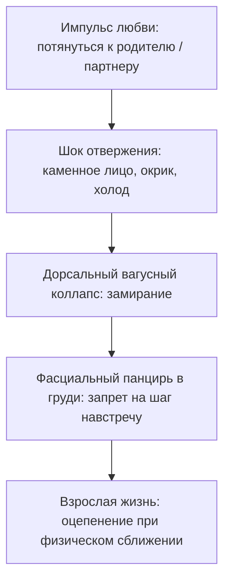

Три типичные детские ситуации, которые замораживают импульс:
1. **Больничный карантин в младенчестве.** Ребенка забирают в бокс без мамы. На третий день крика мозг отключает призыв о помощи, погружаясь в апатию: «Звать бесполезно».
2. **Мать в депрессии или горе.** Мама физически присутствует, но эмоционально отсутствует. Ребенок тянется к ее глазам, видит пустоту и закрывается.
3. **Прямое физическое отталкивание.** «Отойди, не мешай», «не смей ко мне прикасаться». В теле запечатывается страх прикосновения.

---

#### Практика: завершение прерванного жеста

Если при искреннем сближении с близким человеком ты чувствуешь оцепенение и холод в груди, выполни эту телесную практику:

##### 1. Топография зажима
Положи обе ладони на центр грудины. Что ты чувствуешь под пальцами? Холодный камень? Деревянную доску? Металлическую пластину? 
Не пытайся ломать это ощущение силой. Просто дыши в эту точку в течение одной минуты, согревая ее вниманием.

##### 2. Вспомни застывшего ребенка
Увидь ту ситуацию из своего детства, где твой искренний порыв был остановлен холодом, криком или захлопнутой дверью. Посмотри на того застывшего мальчика или девочку.

##### 3. Физический жест раскрытия
Закрой глаза. Медленно вытяни руки перед собой ладонями вверх. Сделай один мягкий шаг вперед по комнате. Произнеси вслух:

> *«В тот день мое движение к теплу остановили холод и страх. Мое тело заблокировало импульс, спасая мое сердце от разрыва. Я благодарю свое тело за эту защиту. Но сегодня я взрослый человек. Та опасность осталась в далеком прошлом. Я снимаю засов со своего сердца. Я разрешаю своему импульсу любви завершить движение. Я иду навстречу. Я открываю руки. Я имею полное право быть в тепле и безопасности».*

##### 4. Телесное принятие
Мягко положи ладони себе на плечи, словно обнимая самого себя. Сделай глубокий выдох со звуком облегчения. Почувствуй, как тепло мягкой волной разливается по межреберным мышцам.

Лед не тает от мыслей в голове. Стекло тает в живом физическом движении — в том самом шаге навстречу, на который когда-то не хватило детских сил.

---

> [!IMPORTANT]
> **Главная мысль главы**  
> Прерванный жест любви не исчезает: он десятилетиями ждет своего завершения в спазме грудных мышц. Сделай этот шаг сегодня — и тепло вернется в твою жизнь.

---

> [!TIP]
> **Интерактивный помощник**  
> Если жест раскрытия рук вызвал сопротивление или подкативший к горлу ком — напиши в диалоговом окне внизу страницы. Мы поможем бережно отогреть застывший импульс и вернуть доверие к миру.


---

<a id="25-bug-09-exchange-disbalance"></a>

### Загадка «У пересохшего колодца»

> [!TIP]
> **Притча о двух путниках**  
> Двое изможденных путников встретились у старого колодца на каменистом перевале. Вода была глубоко на дне. Чтобы поднять тяжелое дубовое ведро, требовалось крутить тугой ворот синхронно, налегая на рукоять вдвоем.
> 
> Первый путник обессилел и сел на пыльную землю, ожидая, что второй сделает первый шаг. Второй хмуро скрестил руки на груди и отчеканил: «Ты шире в плечах — вот ты и крути первым. Я не собираюсь надрываться ради чужого человека».
> 
> И пока оба упрямо ждали идеальной справедливости, ведро неподвижно висело в темноте. Вода была рядом, но их губы трескались от смертельной жажды.
> 
> **Голос Расчета:** Пусть он сделает свои пятьдесят оборотов. Я не намерен тратить силы впустую — сделка должна быть строго симметричной.  
> **Голос Правила:** Кто первым подошел к колодцу, тот и обязан начинать. Справедливость превыше всего. Чужой лени потакать нельзя.  
> **Голос Души:** Какая разница, чей сейчас черед, если вы оба умираете от жажды? Положи ладони на теплое дерево ворота и сделай первый оборот ради самой жизни.  
> 
> *Вопрос силы:* Кто делает первое движение навстречу — тот, кто формально слабее, тот, кто упрямо считает себя правым, или тот, кто находит в себе смелость открыться потоку?

---

### Дисбаланс обмена: почему мы боимся принимать тепло

Любая человеческая связь — в любви, дружбе или бизнесе — живет лишь до тех пор, пока дыхание идет в обе стороны. 

Вдох и выдох. Давать и принимать. 

Но стоит одному из партнеров навсегда застрять в роли снисходительного благодетеля, а второму — в роли вечного, пристыженного должника, как мост доверия начинает угрожающе крениться. Канал взаимности заиливается обидой и скрытой агрессией. В конечном счете в этой ловушке сгорают оба.

---

#### Предательство под железнодорожным мостом

Четырнадцатилетний Марк стоял за сырой бетонной опорой железнодорожного моста и обеими руками изо всех сил зажимал себе рот.

Не для того, чтобы не вскрикнуть. Его рвало от ледяного, парализующего ужаса.

В десяти метрах от него на острой гравийной насыпи трое рослых старшеклассников методично избивали Данила. 

Данил был тихим, нескладным сыном глухонемой уборщицы тети Веры, мывшей полы в их подъезде. Он ходил за Марком преданной тенью и считал его своим единственным другом. Данил упал в мокрую грязь на первой же минуте. А дальше его вбивали тяжелыми ботинками в щебень — деловито, молча, под хруст ребер.

Окровавленными руками Данил судорожно прижимал к груди кожаный рюкзак Марка. Внутри лежал новенький японский зеркальный фотоаппарат — дорогая игрушка, которую Марк с боем выпросил у состоятельного отца на день рождения.

— Тут… вещи Марка… — хрипел Данил разбитыми губами, задыхаясь от боли. — Я ничего вам не отдам. Сволочи.

Это были его последние связные слова в тот вечер.

А Марк стоял за бетонной опорой. Внутри него бушевал смертоносный вихрь:
- Животный ужас: *«Если я выйду — они выбьют мне зубы и покалечат»*.
- Жгучий, разъедающий стыд: *«Я трус. Я стою в темноте и смотрю, как его убивают из-за моей железки»*.
- И на самом дне — омерзительная, малодушная злоба на самого Данила: *«Зачем ты вцепился в этот проклятый рюкзак?! Зачем ты строишь из себя героя?! Я не просил тебя умирать за меня!»*

Всё это спрессовалось в раскаленный свинцовый ком в горле Марка. Дыхание перехватило. 

Когда хулиганы сплюнули и скрылись в сумерках, Марк выждал пять минут в сырой темноте и бросился бежать прочь по темным переулкам. Быстро. Задыхаясь. Не оглядываясь назад. 

Как вор.

Ночью Данил приполз домой. Заплывший глаз, сотрясение мозга, разорванная в клочья куртка. Но разбитый рюкзак с фотоаппаратом он удержал.

Он не сказал Марку ни единого слова упрека. 

На следующий день во дворе Данил посмотрел на Марка долгим, невыносимо тихим взглядом. В нем не было ненависти. Это был взгляд перегоревшей лампы. И в этой глубине читалась детская, чистая жалость. Данил словно понимал: настоящим калекой из той бойни под мостом вышел вовсе не он.

Этот взгляд Марк вынести не смог.

Раскаленный ком малодушия превратился в каменную плиту под ребрами. Находиться рядом с Данилом стало физически невозможно: каждый жест друга напоминал Марку о его собственном позоре. 

Через три недели Марк тайком вытащил из спальни родителей золотые запонки с сапфирами и подбросил их в крошечную каморку тети Веры под лестницей. А вечером, глядя в угол паркета, ровным голосом сказал отцу: «Я видел, как сын уборщицы крутил твои запонки в руках».

Немой женщине и ее избитому сыну дали двадцать четыре часа на сборы.

Под проливным осенним дождем у чугунной калитки Данил в последний раз обернулся. Посмотрел на Марка, стоявшего у окна. Без гнева. Без проклятий. С той же пронзительной, прощающей жалостью.

Марк победил. Свидетель его позора был стерт с лица земли. 

Но цена этой победы оказалась страшнее любого тюремного срока.

---

> [!NOTE]
> В 1925 году выдающийся французский социолог и антрополог Марсель Мосс в своем классическом труде «Очерк о даре» сформулировал базовый закон человеческих сообществ: **цикл дарообмена состоит из трех священных обязанностей — давать, принимать и возмещать**.
> 
> Если человек только дает, категорически отказываясь принимать что-либо взамен, он бессознательно ставит себя в позицию морального бога, низводя окружающих до роли беспомощных попрошаек. 
> 
> Иван Бозормени-Надь в рамках контекстуальной психотерапии развил эту мысль: когда партнер или друг оказывается в ситуации, где он не способен выровнять баланс взаимности (счет лояльности), у него накапливается глухое чувство вины, неизбежно перерастающее в яростную ненависть к благодетелю. Именно поэтому люди так часто предают тех, кто осыпал их благодеяниями: непереносимый груз вечного неоплатного долга разрушает психику.
> 
> В эволюционной биологии Роберт Триверс доказал: устойчивость популяции держится на взаимном (реципрокном) альтруизме. Односторонняя накачка ресурсом всегда воспринимается системой как патологический сбой и провоцирует агрессивное отторжение.

---

#### Марк двадцать пять лет спустя: синдром вечного донора

Прошло двадцать пять лет.

Марк стал управляющим партнером одной из самых влиятельных юридических коллегий столицы. Офис с видом на Патриаршие пруды, безупречные итальянские костюмы, тяжелый стальной взгляд человека, не знающего пощады.

Он стал легендарным благотворителем. 

Марк жертвовал десятки миллионов рублей детским домам, оплачивал сложнейшие операции чужим детям, вел безнадежные судебные процессы для неимущих людей абсолютно бесплатно. Он работал по восемнадцать часов в сутки, буквально раздавая себя миру без остатка.

Но сам он не мог принять ни крупицы тепла.

Стоило молодой коллеге в офисе с искренней улыбкой предложить: «Марк Сергеевич, вы так бледны сегодня, давайте я сварю вам кофе?», как внутри него включалась сирена тревоги. Взгляд становился ледяным: «Благодарю вас. Я справлюсь сам».

Он не позволял никому прикоснуться к себе. Он не умел просить о помощи. Он загнал себя до гипертонического криза и на сессию к психотерапевту пришел в состоянии физического коллапса: пальцы впивались в кожаные подлокотники кресла до белизны суставов.

> **Терапевт:** Марк, закрой глаза. Представь человека, который искренне тебя уважает. Он видит твою смертельную усталость, садится рядом, кладет руку на плечо и говорит: «Марк, обопрись на меня. Отдохни. Я прикрою тебя». Что прямо сейчас происходит в твоем теле?
>
> **Марк:** *(втягивает голову в плечи, челюсти сжимаются до хруста, дыхание со свистом вырывается из горла)* Свинец! На груди тяжеленный свинцовый бронежилет! В горле железная удавка! Внутри всё орет: «Не подходи ко мне! Не прикасайся! Не смей ничего у них брать!»
>
> **Терапевт:** Чего так панически боится эта броня, Марк?
>
> **Марк:** Приму помощь — стану должником. Стану слабым. А слабых ломают и вбивают сапогами в щебень. Брать тепло смертельно опасно. Безопасно только давать самому — пока не сдохнешь на работе!
>
> **Терапевт:** Когда этот свинцовый ком впервые встал у тебя в горле?
>
> **Марк:** *(опускает голову на грудь, плечи начинают мелко вздрагивать)* Четырнадцать лет… Осенняя грязь. Железнодорожный мост. Я стою за сырой бетонной колонной и зажимаю себе рот ладонями… А Данила топчут ногами…
>
> **Терапевт:** Ты струсил тогда. А потом подбросил запонки и вышвырнул его с матерью на мороз.
>
> **Марк:** *(задыхается от рыданий, слезы капают на дорогой шелковый галстук)* Я не мог вынести его взгляда! Я не мог выдержать того, что он не возненавидел меня! Он посмотрел на меня с жалостью… Я двадцать пять лет доказываю всему миру, какой я благородный, сильный и святой! Я раздал миллионы! Я спас сотни людей! А на самом деле я четверть века просто откупаюсь от взгляда того избитого мальчишки у калитки…
>
> **Терапевт:** Твой ком в горле — это неиспытанный стыд, похороненный заживо страх и малодушие того четырнадцатилетнего пацана. Ты заковал себя в свинцовый панцирь святости. Но чужими жизнями старый грех не искупить. Поставь Данила перед собой. Посмотри в его глаза.

Марк уронил лицо в ладони. Его широкая спина сотрясалась от тяжелых, сокрушительных рыданий:

— Данил… Прости меня. Если сможешь — прости меня, труса проклятого. Я испугался боли. Я испугался сломанных ребер. А потом предал тебя, потому что сгорал от собственного позора. Ты не должен был расплачиваться за мое малодушие. Этот позор, этот страх и эта грязь принадлежат только мне. Это мой личный грех. Я снимаю с тебя ту тень. Я признаю свой долг перед тобой. Я больше не прячусь за маской идеального благодетеля.

В кабинете наступила звенящая тишина. Слышно было только, как за окном шуршат капли осеннего дождя.

Марк сделал первый за двадцать пять лет медленный, глубокий, ничем не скованный вдох.

> **Терапевт:** Что с броней?
>
> **Марк:** *(кладет ладонь на грудь, его лицо бледное, но абсолютно живое)* Камень раскололся. В горле больше нет удавки. Сердце бьется ровно и тепло. Боже мой… как же легко дышать, когда тебе больше не нужно казаться святым.

Спустя два месяца Марк нанял людей и разыскал Данила в небольшом провинциальном городе. Тот стал прекрасным мастером, реставратором старинной мебели. Марк приехал к нему лично — без охраны, на простом поезде.

Они просидели на деревянной веранде мастерской пять часов. Марк не предлагал денег, фондов или квартир. Это был разговор двух взрослых, седеющих мужчин — разговор равного с равным. Долг чести, возвращенный через четверть века.

---

#### Три ловушки перекошенного обмена

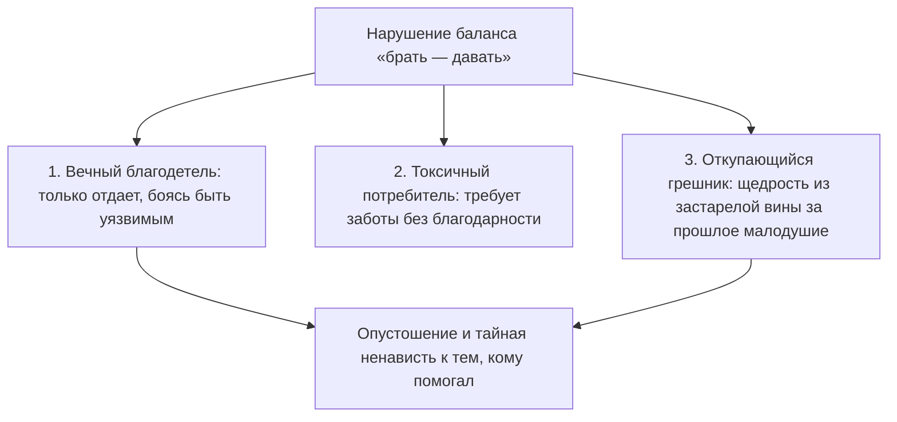

##### 1. Вечный донор
Человек убежден: «Мне ничего не нужно, я справлюсь сам». Он осыпает близких заботой, подарками и связями, но намертво блокирует входящий поток. За этой мнимой святостью всегда скрывается страх близости: дающий всегда находится в позиции власти, а принимающий чувствует себя должником.

##### 2. Токсичный потребитель
Человек инфантильно убежден, что мир кругом ему задолжал. Он жадно поглощает чужие силы, время и деньги, искренне не понимая, почему люди рано или поздно в ужасе разрывают с ним любые контакты.

##### 3. Откупающийся
Щедрость, рожденная из застарелого чувства вины за собственную трусость или некрасивый поступок в прошлом. Человек пытается «заслужить» прощение добрыми делами, но пока первоначальный долг не признан лицом к лицу, внутренний ад не утихает.

---

#### Практика: выравнивание шлюзов обмена

Если ты чувствуешь опустошение от бесконечной отдачи или ловишь себя на паническом страхе принять искреннюю заботу, выполни эту практику балансировки:

##### 1. Честная ревизия отношений
Взгляни на свои отношения в семье, дружбе и бизнесе:
- Сколько процентов энергии уходит наружу? 
- Сколько процентов ты позволяешь себе принимать без чувства вины?
- От чего ты пытаешься откупиться своей гиперопекой?

##### 2. Тест на принятие
Представь, что близкий человек искренне дарит тебе дорогой подарок или предлагает бескорыстную помощь в трудную минуту. 
Где в теле возникает зажим? Сжались челюсти? Застыло дыхание? Окаменели плечи? Положи руку на эту зону.

##### 3. Выравнивание потока
Положи левую ладонь на центр груди (шлюз принятия), а правую руку вытяни вперед с открытой ладонью (шлюз отдачи). Сделай глубокий вдох через нос и спокойный выдох через рот. Произнеси вслух:

> *«Я выравниваю баланс своей жизни. Я снимаю заслонку со своего сердца. Принимать помощь и заботу — безопасно для моего достоинства. Я признаю свои человеческие ограничения. Я разрешаю себе опираться на других. Я отдаю из полноты и избытка. Я принимаю с чистой благодарностью. Встречный поток уравновешен. Мой обмен с миром чист».*

##### 4. Практическое действие
В течение ближайших суток осознанно прими малейшую помощь: позволь кому-то открыть перед тобой дверь, угостить тебя кофе или сказать искренний комплимент. Не отмахивайся дежурным «не стоило». Посмотри человеку в глаза и скажи простое: *«Спасибо. Мне очень приятно»*.

---

> [!IMPORTANT]
> **Главная мысль главы**  
> Душевный покой невозможно купить внешней жертвенностью. Баланс возвращается тогда, когда ты находишь в себе смелость признать старый позор и снова разрешаешь себе принимать любовь.

---

> [!TIP]
> **Интерактивный помощник**  
> Если принятие заботы вызывает волну стыда или страх показаться слабым — напиши об этом в диалоговом окне внизу страницы. Мы поможем бережно восстановить баланс «брать и давать» без потери внутреннего достоинства.


---

<a id="section-root-section-act-03"></a>

## АКТ III. Кризис: чужой код и цена

<a id="26-foreign-background-process"></a>

### Чужой голос в голове: как освободиться от родительских внушений

Субботний вечер. Рабочие дела на неделю наконец-то завершены. В квартире идеальная чистота, горячий чай парит в любимой кружке, а за окном медленно кружатся хлопья вечернего снега.

Ты опускаешься на мягкий диван, вытягиваешь гудящие ноги и собираешься наконец открыть книгу или включить фильм.

И в эту самую секунду в основании черепа натягивается ледяная, звенящая струна. 

В голове вспыхивает резкий, въедливый шепот: *«Чего расселась? Вон в углу пыль осталась. Другие люди делом заняты, развиваются, проекты пилят, а ты лежишь как бревно. Встань немедленно, ничтожество!»*

Твое тело подскакивает с дивана словно от удара электрическим током. Руки сами хватают швабру или открывают рабочую почту. Книги на полке лихорадочно переставляются с места на место, стирка запускается на третий круг. Отдых бесповоротно отравлен. К ночи ты падаешь в постель в состоянии волчьего истощения, но с нулевым удовлетворением.

Мы привыкли называть это «совестью», «высокой дисциплиной» или «неугомонным характером».

Но если остановиться и прислушаться, откроется пугающая правда: этот голос внутри твоей головы не принадлежит тебе.

Это **чужой интроект** — застрявшая в подсознании чужая программа, которая маскируется под твой собственный внутренний диалог. Она круглосуточно сжигает твои жизненные силы, пока ты наивно полагаешь, что «просто родился таким тревожным человеком».

---

> [!NOTE]
> Выдающийся психоаналитик Шандор Ференци в начале XX века описал механизм **интроекции**: в моменты детской беспомощности и страха слова, оценки и эмоциональные реакции значимых взрослых проглатываются ребенком целиком, без критического осмысления. 
> 
> Позже создатель когнитивной терапии Аарон Бек доказал, что именно из этих интроектов вырастает паутина разрушительных автоматических мыслей, порождающих хроническую тревогу и депрессию.
> 
> Современные нейробиологические исследования под руководством профессора Маркуса Райхла в Вашингтонском университете пролили свет на аппаратную сторону этого процесса. Когда человек перестает выполнять внешние задачи и пытается просто отдохнуть, в мозге активируется так называемая «сеть пассивного режима» (Default Mode Network, DMN). У людей с непроработанными детскими травмами эта сеть мгновенно запускает петлю яростной самокритики: функциональная МРТ фиксирует аномальную гиперактивацию дорсомедиальной префронтальной коры, а электроэнцефалография показывает, что в моменты внутреннего самобичевания вспыхивают ровно те же зоны слуховой коры, которые реагируют на чужую агрессивную речь.
> 
> Силой воли этот голос заглушить невозможно, потому что сама воля пытается опереться на зараженную почву. Освобождение наступает лишь тогда, когда человек телесно локализует чужой голос и осознанно отзывает у него право на управление своей жизнью.

---

#### Швабра в час ночи: дело Натальи

Наталье сорок пять лет. Успешный финансовый аналитик, владелица просторной трехкомнатной квартиры в центре города.

В субботу в первом часу ночи она сидела на полу собственной кухни и задыхалась от слез, сжимая в мокрых пальцах ручку швабры:

— Я стою посреди кухни и реву в голос от бессилия, — рассказывала она терапевту на следующий день. — Час ночи. Плинтусы вымыты до блеска зубной щеткой. Посуда перемыта за неделю вперед. Горы белья переглажены. Ноги гудят так, что сводит икры, поясница горит огнем. Я хотела лечь спать еще в десять вечера. Села на кровать, сняла носки… и в затылке словно зазвенела циркулярная пила! 

Голос в голове буквально взревел: *«А ну вставай, свинья нечесаная! Грязищу развела! Матери стыдно было бы людям в глаза смотреть за такую дочь!»*

— Я не смогла остаться в постели, — шептала Наталья, пряча заплаканные глаза. — Я вскочила и побежала мыть полы. Я боюсь собственной квартиры. Я чувствую себя рабыней, которую бьют палками.

> **Терапевт:** Наташа, закрой глаза. Положи ладонь на то место, где звенит эта пила.
>
> **Наталья:** *(прижимает пальцы к основанию черепа)* Здесь… Ледяной обруч, намертво стянувший затылок. В горле сухой, царапающий ком.
>
> **Терапевт:** Прислушайся к интонации фразы «свинья нечесаная». Кому принадлежит этот тембр? Кто так кричал на тебя?
>
> **Наталья:** *(после долгой паузы ее лицо белеет, плечи опускаются)* Мама… Мне десять лет. Жаркое июльское утро, суббота. Все соседские ребята во дворе гоняют в казаки-разбойники. А мама возвращается после ночной смены на заводе — лицо землисто-серое, глаза бешеные от усталости. Она срывает с меня одеяло, швыряет на середину комнаты ведро с ледяной водой и орет: «Не вырастет из тебя человека! Я на трех работах корячусь, а ты, паразитка, книжку на диване читаешь?! Мой полы, пока блестеть не будут!»
>
> **Терапевт:** Что ты чувствовала тогда?
>
> **Наталья:** Я ползала по линолеуму с тряпкой, стирала пальцы в кровь и давилась слезами. Я думала: если я отмою все углы до идеального блеска, мама успокоится, улыбнется и наконец-то погладит меня по голове…
>
> **Терапевт:** Но она не погладила.
>
> **Наталья:** Нет. Она упала на кровать и уснула, отвернувшись к стене.
>
> **Терапевт:** Наташа, мама кричала на тебя не потому, что полы были грязными. Она срывала на маленькой девочке свое взрослое отчаяние перед нищетой и безысходностью. А ты проглотила этот крик целиком — вместе с крючком и леской. И теперь ты орешь на себя маминым голосом тридцать пять лет подряд. Чьи полы ты драила сегодня в час ночи?
>
> **Наталья:** *(по щекам катятся крупные слезы)* Свои… В моей квартире, купленной на мои честно заработанные деньги… Господи, я тридцать пять лет мою мамины полы! Я каждый божий день вымаливаю у мертвого человека право просто закрыть глаза и уснуть. Как же я смертельно устала быть хорошей девочкой…

Терапевт предложил Наталье поставить образ матери перед собой на чистый кухонный пол:

> **Наталья:** Мама… Это были ваши слова, ваш страх и ваша невыносимая усталость. Я была маленькой и взяла ваш гнев на себя, надеясь спасти вас от тоски. Но сегодня я возвращаю вам эту швабру и эту ярость. Я взрослая женщина. Мой дом чист. Мое тело устало. Я стираю ваш крик из своей головы. Отныне в моих мыслях будет звучать только мой собственный, добрый голос.
>
> **Наталья:** *(сначала говорит шепотом, а потом выкрикивает эти слова во весь голос, сотрясая тишину комнаты)*

В ту же секунду ледяной обруч на затылке с сухим щелчком лопнул. По шее и плечам разлилось мягкое, покалывающее тепло.

Наталья опустила руки. В ее голове воцарилась звенящая, чистая, долгожданная тишина.

— В углу кухни остался невымытый кусок пола, — прошептала она с изумленной улыбкой. — И мне абсолютно всё равно. Мир не рухнул. Мама не кричит. Я могу просто пойти и лечь спать.

---

#### Слезы системного инженера: ночной лог Жоры

В ту же ненастную октябрьскую ночь Георгий — тот самый системный инженер, от чьей удушающей рациональности сбежала Кристина, — сидел в своей холостяцкой квартире на двадцатом этаже.

За панорамным окном моросил мелкий дождь. В полумраке светился экран ноутбука, на котором была открыта статья по нейробиологии интроектов. Остывший кофе в кружке.

Дойдя до описания затылочного спазма Натальи, Георгий внезапно замер.

Его собственная шея налилась свинцовой тяжестью. Пальцы машинально коснулись затылочных бугров — мышцы были твердыми, как гранитные булыжники.

Его в детстве никто не бил ведром с водой. Его мать — завуч школы и преподаватель физики — воспитывала сына совершенно иначе. Очень тихо. Очень интеллигентно.

Она вставала в дверях детской комнаты, складывала тонкие, ухоженные пальцы на груди и с легким вздохом произносила:

— Жорик… Ну ты же у меня умный мальчик. Умные люди не совершают таких нелепых ошибок. Сделай всё как надо.

В ее голосе не было злобы. И именно поэтому этот тихий ультиматум врос в кости ребенка намертво. 

«Ты же умный» означало одно: *ты не имеешь права на слабость, на ошибку, на спонтанную эмоцию, на слезы*. Вся его железная броня, вся его привычка «чинить» близких людей, как сломанные алгоритмы, выросла из этого ледяного материнского требования безупречности.

Когда Кристина плакала на кухне, внутри Георгия вспыхивала паника: *«Ты же умный! Почини ее немедленно! Найди поломку в ее голове! Не смей чувствовать ее боль — сделай как надо!»* И он сыпал логическими аргументами, замуровывая живую, страдающую женщину в саркофаг холодных инструкций.

Георгий медленно опустил лоб на прохладную деревянную столешницу. Из его широкой груди вырвался глухой, хриплый стон:

— Мама… — прошептал он в темноту пустой комнаты. — Вы же убили во мне живого человека этим вашим «ты же умный»… Я потерял единственную женщину, которую любил больше жизни, только потому, что панически боялся показаться слабым и глупым.

Горячие слезы обожгли веки. Он не стал их вытирать. 

Впервые за сорок лет успешный, сильный мужчина позволил себе быть растерянным, неидеальным, разбитым — и по-настоящему живым.

---

#### Четыре типа чужих программ

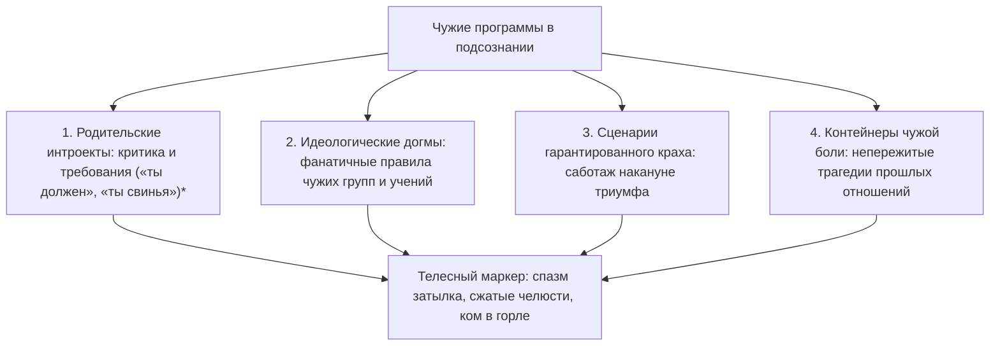

##### 1. Родительские голоса
Фразы матери или отца, выученные наизусть в раннем детстве. Они не спорят с тобой — они ядовито комментируют каждый твой шаг, лишая права на отдых и радость.

##### 2. Идеологические догмы
Чужие правила, почерпнутые из религиозных сект, фанатичных сообществ или токсичных корпоративных культур. Человек приносит им в жертву свои истинные потребности, искренне веря, что «служит высокой цели».

##### 3. Сценарии самосаботажа
Внутренний саботажник активизируется ровно за день до долгожданного успеха: провоцирует ссору перед свадьбой, заставляет забыть паспорт перед посадкой на судьбоносный рейс или напиться перед важными переговорами.

##### 4. Контейнеры чужой боли
Эмоциональные осколки тяжелых разрывов. Человек годами носит в себе обиду бывшего партнера, бессознательно защищаясь от новой любви.

---

#### Практика: деинсталляция чужого голоса

Когда внутри поднимается суетливая паника, ядовитая самокритика или навязчивое чувство долга, выполни эту практику очищения:

##### 1. Телесный перехват
Замри неподвижно на десять секунд. Где прямо сейчас физически отзывается этот упрекающий голос?
- Ледяной обруч на затылке?
- Сжатые до боли челюсти?
- Каменный ком в гортани?
- Дрожь в коленях?
Положи ладонь на эту область.

##### 2. Опознай владельца интонации
Спроси себя прямо:
- *«Чьим тоном это сказано?»*
- *«Кто в моем детстве смотрел на меня с таким выражением лица?»*
Не пытайся анализировать логикой — позволь памяти самой высветить конкретный образ, запах или фразу из прошлого.

##### 3. Твердое разделение
Представь фигуру этого человека перед собой на безопасном расстоянии. Почувствуй тепло своей ладони на зажатой мышце и произнеси вслух:

> *«Я вижу тебя и узнаю твои слова. Ты — чужой голос в моем доме. Долгие годы я принимал этот упрек за свою собственную совесть. Но сегодня я возвращаю тебе твои страхи, твою ярость и твои требования. Мое сознание свободно. Мое тело принадлежит мне. В моем внутреннем пространстве отныне звучит только мой собственный, любящий голос».*

##### 4. Погружение в тишину
Сделай глубокий вдох животом и длинный выдох со звуком. Почувствуй, как расслабляются плечи, а затылок наполняется приятным, теплым покоем. 

В твоей голове воцарилась чистая, суверенная тишина. Ты дома.

---

> [!IMPORTANT]
> **Главная мысль главы**  
> Чужой голос годами маскируется под твою совесть, требуя невозможного. Точная телесная локализация интроекта навсегда лишает его власти и возвращает душе долгожданный покой.

---

> [!TIP]
> **Интерактивный помощник**  
> Если чужой критикующий голос звучит слишком громко, а попытка остановиться вызывает панический ужас — напиши в диалоговом окне внизу страницы. Мы поможем бережно нейтрализовать эту команду и вернуть опору на себя.


---

<a id="27-open-port-principle"></a>

### Открытый порт: почему мы притягиваем чужую агрессию

Ты наверняка не раз наблюдал в своей жизни странную и мучительную закономерность.

Ты меняешь место работы, надеясь сбежать от самодура-начальника, но спустя три месяца новый руководитель начинает общаться с тобой ровно тем же унизительным, приказным тоном. Ты разрываешь токсичные отношения с партнером-манипулятором, долго приходишь в себя, клянешься больше никогда не наступать на эти грабли — но следующий избранник с пугающей точностью повторяет те же сцены обесценивания и контроля.

Кажется, что весь мир полон агрессоров, которые словно по тайному сговору находят именно тебя.

Мы привыкли сетовать на фатальное невезение или плохих людей. Но горькая правда заключается в другом: дело не во внешних людях, а в **открытой внутренней бреши**, которую ты повсюду носишь с собой.

Твоя психика непрерывно транслирует в пространство безмолвный сигнал. 

Чужой гнев, попытка манипуляции или хамство случайного прохожего легко пролетают мимо человека с закрытыми, здоровыми границами: они отскакивают, как сухой горох от гранитной стены. Но если внутри тебя зияет старая детская рана, тот же самый чужой крик входит внутрь без малейшего сопротивления, мгновенно парализуя волю и погружая тело в ледяной ступор.

Бесполезно менять декорации, города и компании, пока эта брешь остается распахнутой настежь. Уйдет один тиран — твой внутренний сигнал немедленно призовет следующего.

---

> [!NOTE]
> В фундаментальных работах профессора Стивена Порджеса по поливагальной теории описан механизм **нейроцепции** (neuroception) — подсознательной способности автономной нервной системы ежесекундно сканировать окружающую среду на предмет безопасности.
> 
> Когда ребенок растет в атмосфере непрекращающегося домашнего насилия, непредсказуемой агрессии или родительского гнева, его естественные защитные рефлексы ломаются. В присутствии доминантного агрессора организм ребенка не может ни убежать, ни дать отпор. Включается самая древняя форма биологической защиты — дорсальное вагусное торможение: резкое замедление пульса, оцепенение мышц, потеря голоса и диссоциация («притворись мертвым, чтобы не добили»).
> 
> Профессор Джеймс Пеннебейкер доказал: подавленный, незавершенный аффект ужаса сохраняется в теле десятилетиями, постоянно удерживая порог нервного возбуждения на критическом уровне. Взрослый человек может обладать внушительной внешностью и блестящим умом, но при малейшем окрике или повышении тона со стороны начальника его нервная система мгновенно проваливается в тот самый детский паралич. Агрессор безошибочно считывает этот язык тела и инстинктивно усиливает давление. 
> 
> Единственный способ разорвать этот круг — не бегство от внешних угроз, а восстановление чувства взрослой безопасности внутри собственного тела.

---

#### Парень с гарнизонного коврика: история Кости

Константину исполнилось тридцать шесть лет. Ведущий архитектор баз данных в крупнейшей технологической компании.

Внешне он производил впечатление богатыря: рост метр девяносто, косая сажень в плечах, густая смоляная борода, тяжелые мускулистые руки. И при этом — глаза насмерть перепуганного подростка, которого старшеклассники загнали в угол темного школьного туалета.

За последние два года Костя сменил три престижные IT-компании. Сюжет везде развивался по одной и той же колее: первые месяцы он был на великолепном счету, руководство восхищалось его профессионализмом. А затем технический директор или руководитель проекта на общей планерке позволял себе публично повысить голос из-за рабочего сбоя.

И огромный, сильный мужчина мгновенно каменел. 

Глаза в пол. Лицо покрывалось белыми пятнами. Дыхание перехватывало. Костя не мог выдавить из себя ни единого слова в свою защиту. Он молча сносил унижение, а через пару месяцев писал заявление об увольнении по собственному желанию. Дома он неделями глушил позор водкой и в бессильной ярости разбивал кулаки о кафель ванной: «Господи, почему я снова струсил?! Почему я не врезал этому сопляку прямо там, при всех?!»

На консультации Костя сидел, неестественно ссутулив широкие плечи, словно пытаясь стать крошечным и невидимым в глубоком кресле.

— Я первоклассный специалист, — хрипел он, глядя в пол. — Моя архитектура держит петабайты сложнейших транзакций. Но когда шеф на планерке повышает голос… у меня словно выбивает пробки. Я взрослый, здоровый мужик — и стою перед ним как парализованный. Горло пережато удавкой. Язык превращается в кусок сухого дерева. Внутри всё замерзает…

> **Терапевт:** Костя, посмотри прямо сейчас на свои руки. Внимательно посмотри.

Костя опустил глаза. Его правая пятерня мертвой хваткой вцепилась в собственное левое предплечье. Ногти сквозь рукав плотного шерстяного свитера впились в кожу до темно-багровых кровоподтеков.

> **Терапевт:** Где твое тело выучило эту позу, Костя? Кого ты так отчаянно удерживаешь от крика?

Дыхание мужчины оборвалось со свистом. Пальцы побелели от чудовищного спазма. Его губы мелко задрожали, а плечи опустились.

— Мне восемь лет… — голос сорокалетнего великана внезапно стал тонким, прерывающимся голосом маленького мальчика. — Забайкалье. Военный гарнизон под Читой. Зима, мороз за сорок градусов… Мой отец — майор артиллерии. Его списали из армии по ранению, он пил по-черному каждый день. Я пришел из школы, закоченел, второпях забыл вытереть ботинки и наследил талым снегом с грязью на коричневом коврике в прихожей…

Костя судорожно сглотнул, в горле раздался сухой хруст:

— Отец вывалился из кухни в майке-алкоголичке. От него разило перегаром и папиросами «Беломор». Вены на шее вздулись, как толстые канаты. Он сорвал с брюк тяжелый офицерский ремень с литой латунной пряжкой и взревел так, что задребезжали рюмки в серванте: «Ты здесь никто, щенок! Ты жрешь мой хлеб! Стой смирно и не дыши, пока я не разрешу!» Он замахнулся… Я стоял на том мокром коврике, вцепился ногтями в свои руки, чтобы не пискнуть от ужаса, потому что знал: если закричу — пряжка прилетит прямо в лицо. Я зажмурился и ждал, когда он меня убьет…

Слезы полились ручьем — не тихие слезы обиды, а страшный, надрывный плач взрослого мужчины, которого двадцать восемь лет держали на том ледяном гарнизонном коврике под занесенным ремнем. Костя согнулся пополам, закрыв лицо огромными ладонями. Его спина содрогалась в рыданиях.

> **Терапевт:** Костя, твой отец орал тогда не из-за следов на полу. Он вымещал на восьмилетнем сыне свой животный страх перед нищетой, ненужностью и крушением собственной жизни. Но ты остался стоять на том коврике на двадцать восемь лет. Ты приносишь его с собой на каждую планерку. Твой внутренний порт распахнут настежь: ты видишь перед собой кричащего начальника и ждешь удара пряжкой. Руководитель подсознательно считывает твой паралич и давит еще сильнее.

Рыдания постепенно стихли. В кабинете стало тихо.

> **Терапевт:** Встань, Константин. Встань во весь свой богатырский рост.

Костя медленно поднялся. Метр девяносто. Могучие плечи, огромные натруженные ладони.

> **Терапевт:** Посмотри в тот темный угол прихожей. Там стоит пьяный, несчастный, сломленный жизнью майор из девяностых годов. Посмотри на него глазами взрослого, сильного мужчины. Скажи ему правду.

Костя долго и глубоко дышал, слушая глухой стук собственного сердца. А затем заговорил — низким, бархатным, сокрушительным басом:

— Отец… Я вижу твой ад, твою боль и твою сломанную судьбу. Но это было твое крушение и твоя жизнь. А я больше не тот беспомощный восьмилетний мальчик на сыром коврике. Ты больше никогда не поднимешь на меня руку. Ты меня не убьешь. Я сам зарабатываю свой хлеб. Мои счета оплачены мной. Я выхожу из твоего гарнизона. Я навсегда закрываю эту дверь.

Где-то под ключицами у Кости словно провернулся тяжелый латунный ключ. Пальцы, терзавшие предплечье, мягко разжались. Горячий, плотный воздух волной заполнил живот. 

Его тело обрело несокрушимую, монолитную устойчивость.

Спустя месяц Костя прислал короткое письмо:

> *«Вчера на общем демо-дне технический директор сорвался из-за сбоя серверов. Начал орать, брызжа слюной на всю переговорную. Раньше у меня потемнело бы в глазах, и я провалился бы сквозь землю.*
> 
> *А вчера внутри меня стояла абсолютная, несокрушимая тишина. В животе было горячо, челюсти свободны, дыхание ровное. Я спокойно откинулся на спинку кресла, посмотрел ему прямо в зрачки и негромко произнес: "Игорь Сергеевич, сбавьте тон. В таком формате мы диалог вести не будем. Откройте системные логи — вот сухие факты".*
> 
> *Он поперхнулся на полуслове. Замолчал, растерянно моргнул, пробормотал что-то про тяжелую неделю и перешел на деловой тон.*
> 
> *Мой детский страх больше не зовет его на расправу. Мой гарнизонный коврик наконец-то сгорел».*

---

#### Три вида открытых брешей

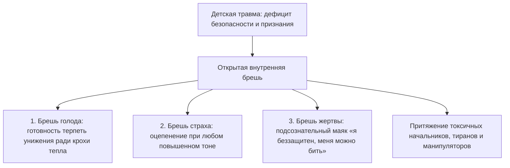

##### 1. Брешь эмоционального голода
Если в детстве ребенка морили эмоциональным голодом — не хвалили, не обнимали, заставляли заслуживать любовь пятерками, — во взрослом возрасте он соглашается на любые токсичные условия. Он готов терпеть издевательства начальника или партнера, лишь бы иногда получать скупую похвалу.

##### 2. Брешь незажившего страха
Ребенок, переживший жестокое подавление или побои, реагирует на любой конфликт как на угрозу жизни. При малейшем споре его мышцы каменеют, голос пропадает, а логика отключается.

##### 3. Брешь виктимного резонанса
Человек с глубинным убеждением «я ничтожество, меня никто не защитит» излучает эту покорность в микромимике, походке и интонациях. Хищники и манипуляторы безошибочно вычисляют такую легкую добычу в любой толпе.

---

#### Практика: закрытие бреши уязвимости

Если ты раз за разом оказываешься мишенью для чужого гнева, критики или манипуляций, выполни эту телесную практику закрытия границ:

##### 1. Вспомни момент оцепенения
Воскреси в памяти недавнюю ситуацию, когда чужой напор вызвал в тебе ступор, желание исчезнуть или судорожные оправдания:
- Где в теле возник паралич?
- Сжалось ли солнечное сплетение?
- Онемел ли язык?
- Поджались ли пальцы на ногах?

##### 2. Найди исток страха
Задай себе вопрос: *«Перед кем в моем детстве я должен был замереть и перестать дышать, чтобы просто выжить?»* Позволь памяти показать ту самую комнату, тот крик и то занесенное наказание.

##### 3. Восстановление взрослой силы
Встань прямо. Поставь стопы на ширину плеч, почувствуй вес своего взрослого тела. Разомкни челюсти, расправь плечи. Положи ладонь на живот и сделай глубокий вдох:

> *«Я вижу эту старую брешь. В детстве оцепенение и покорность спасли мне жизнь. Я с уважением признаю ту детскую защиту. Но сегодня я взрослый человек. Моя безопасность опирается на мою собственную силу, мой ум и мои границы. Чужой гнев — это не смертельный приговор, а просто чужая слабость. Я навсегда закрываю дверь детского страха. Мой дом — под моей защитой».*

##### 4. Взгляд равного
Представь своего начальника, критика или партнера. Посмотри на него не снизу вверх из детского ужаса, а строго на одном уровне — глаза в глаза. 

Когда брешь закрыта изнутри, чужой крик превращается в пустой звук за толстым стеклом. Тебе больше не нужно ни нападать, ни прятаться. Ты в безопасности.

---

> [!IMPORTANT]
> **Главная мысль главы**  
> Манипулятор или тиран способен войти лишь туда, где зияет детский дефицит безопасности. Насыщение этой пустоты взрослой опорой навсегда лишает внешнего агрессора ключей к твоей душе.

---

> [!TIP]
> **Интерактивный помощник**  
> Если воспоминание об отцовском или материнском крике вызвало спазм в груди или дрожь в коленях — напиши в диалоговом окне внизу страницы. Мы поможем бережно вернуть ощущение устойчивой опоры под ногами.


---

<a id="28-process-symbiosis"></a>

### Симбиоз: почему забота о близких опустошает дотла

Разговор по телефону длился всего полчаса. 

Никто не кричал. Никто не хлопал дверьми и не сыпал оскорблениями. Это был обычный воскресный созвон с матерью, пожилым родственником или эмоционально зависимым партнером: обсудили погоду, последние городские новости, здоровье и длинный список обид на несправедливый мир.

Ты нажимаешь красную кнопку отбоя на экране смартфона.

И в ту же секунду в глазах темнеет. Ноги становятся ватными. В области солнечного сплетения разверзается холодная, сосущая пустота, словно из тебя вынули внутренности. Запас жизненных сил стремительно падает до нуля. Хочется просто лечь лицом в подушку и не шевелиться несколько часов.

Внешне не произошло никакого конфликта. Тебя просто «держали в курсе семейных дел». 

Но к вечеру у тебя нет ни капли ресурса на собственное творчество, на спортзал, на любимого человека или на собственных детей. Твоя жизненная сила весь день самотеком уходила в чужую бездну. А ты по привычке называл это «дочерним долгом» или «святой заботой о родителях».

Это не банальное переутомление. Это **токсический симбиоз** — невидимая труба, по которой чужой дефицит выкачивает твою жизнь, пока сладкие сказки о жертвенности убаюкивают твою бдительность.

---

> [!NOTE]
> Основатель структурной школы семейной терапии Сальвадор Минухин ввел классическое понятие **«запутанных семей»** (enmeshed families). В таких семьях границы между личностями полностью стерты: переживание, тревога или соматический симптом одного члена семьи мгновенно заражает всех остальных.
> 
> Другой корифей психотерапии, Мюррей Боуэн, сформулировал теорию **дифференциации «Я»**: чем слабее человек отделен от эмоциональной массы своей родительской семьи, тем хуже его собственная автономная нервная система справляется со стрессом. Человек живет в состоянии слияния, не различая, где заканчиваются его чувства и начинаются чужие страдания.
> 
> Подлинная, зрелая любовь возможна исключительно между двумя суверенными, отдельными личностями. Разделение каналов не разрушает близость. Напротив: оно уничтожает паразитическую зависимость и впервые дает возможность увидеть реального человека рядом, а не использовать его как питательную батарейку.

---

#### Воскресный звонок: история Татьяны

Татьяне исполнилось тридцать восемь лет. Блестящий архитектор цифровых интерфейсов, интеллигентная, красивая женщина с тонким вкусом. 

Ее квартира-студия в тихом центре была наполнена светом, комнатными растениями и альбомами по классическому искусству. Со стороны Татьяна казалась образцом независимой, состоявшейся женщины.

Но каждое воскресенье ровно в 18:00 на ее стеклянном журнальном столике начинал вибрировать телефон. На заставке высвечивалось лицо матери.

В ту же секунду в животе Татьяны поворачивался ржавый ключ. Желудок сводило судорогой тошноты. Пальцы мгновенно леденели.

Тамаре Львовне было шестьдесят восемь. Она жила одна в маленьком провинциальном городке в пятистах километрах от столицы. Ее звонки никогда не начинались с открытой агрессии. Они начинались с тихого, тягучего, липкого вздоха:

— Танюша… Ты, наверное, занята? У меня опять аритмия с обеда… Соседка сверху ковры выбивала, голова раскалывается. Так одиноко, доченька, хоть волком вой на стену. Никому старуха не нужна на белом свете… Ты хоть не забывай родную мать, пока я еще жива…

Татьяна судорожно сжимала трубку взмокшими пальцами:

— Мамочка, родная! Давай я прямо сейчас вызову тебе платного кардиолога на дом? Я всё оплачу! Хочешь, я куплю тебе путевку в лучший кардиологический санаторий на воды?

В ответ из трубки доносился тяжелый, убивающий вздох вселенской скорби:

— Конечно… Деньгами откупаешься. Чужие люди мне не нужны. Мне твое сердце нужно, тепло твое дочернее… Ну да ладно, иди к своим важным столичным делам, а я уж как-нибудь в темноте посижу…

И в эту минуту прямо в солнечное сплетение Татьяны словно врезался толстый, холодный рукав. Из ее легких, из ее крови с глухим гулом начинала утекать живая энергия. Мать жадно пила это дочернее тепло. 

Но на дне души Тамары Львовны зияла черная дыра не прожитого горя по ушедшей молодости и несостоявшейся судьбе. А эту дыру невозможно заполнить даже океанами чужой крови.

Спустя два часа разговор заканчивался. 

Татьяна сползала с дивана на ковер. У нее физически не оставалось сил даже на то, чтобы дойти до кухни и налить себе стакан воды. В мессенджере всплывало сообщение от любимого мужчины: «Танюш, я забронировал столик, мы едем ужинать?» Татьяна смотрела на экран сквозь пелену слез и в бессилии гасила телефон: в ее душе не оставалось ни миллиграмма тепла для живого прикосновения.

По понедельникам она срывала рабочие дедлайны. По ночам мучилась от приступов необъяснимой тахикардии.

---

#### Ножницы для пуповины

Перелом наступил на сессии у психотерапевта. Татьяна сидела, подтянув колени к груди, с серым лицом и темными кругами под глазами:

— Я физически умираю после каждого воскресного разговора. Но как я могу оборвать ее?! Она же моя мать! Стоит мне положить трубку — у нее случится инфаркт! Я буду ее убийцей!

> **Терапевт:** Таня, закрой глаза. Положи руку на солнечное сплетение. Что прямо сейчас соединяет тебя с мамой?
>
> **Татьяна:** *(зажмуривается, ее дыхание становится прерывистым)* Черный, толстый резиновый шланг… Он пульсирует прямо у меня под ребрами. От меня к ней течет горячая жизнь, а обратно идет ледяная, мутная жижа вины…
>
> **Терапевт:** Таня, скажи мне честно: твоя мама — это беспомощный недоношенный младенец в кювезе, подключенный к твоим легким? Или она шестидесятивосьмилетняя взрослая женщина, которая пережила голод, распад страны, вырастила тебя, похоронила мужа и имеет свою собственную взрослую судьбу?

В кабинете повисла долгая, глубокая тишина.

— Она взрослая… — прошептала Татьяна, и слезы брызнули из ее глаз.

> **Терапевт:** Тогда почему твое тело стало для нее аппаратом искусственного дыхания? Сколько бы ты ни вливала в нее своей крови, она не станет молодой, здоровой и счастливой. Ты добровольно сгораешь в ее топке. Ты лишаешь себя замужества, детей и собственного будущего. Возьми мысленные ножницы. Перережь эту трубу прямо сейчас.

Татьяна сделала резкое, рубящее движение ладонью перед своим солнечным сплетением:

— Я люблю вас, мама, — произнесла она сквозь сокрушительные рыдания. — Но я ваша дочь, а не ваш аккумулятор. Я отсоединяю этот шланг. Моя жизнь принадлежит мне. Ваша старость, ваша тоска и ваша судьба принадлежат вам. Я выбираю остаться живой.

Она распахнула глаза и прижала обе ладони к животу. По ее лицу растеклась ошеломленная улыбка:

— Боже мой… Тепло. Словно к животу приложили горячую грелку. Внутри стало так плотно, так устойчиво… Дышать… Как же невероятно легко дышать!

Спустя неделю ровно в 18:00 на столике снова запел телефон.

Сердце Татьяны екнуло — но привычного ледяного паралича не возникло. Она спокойно сняла трубку. Десять минут выслушивала привычные жалобы на соседей. А затем мать завела знакомую шарманку: «Ой, голова кружится, давление двести, умирать, наверно, пора…»

Раньше Татьяна в панике бросилась бы вызывать скорую и винить себя.

Сейчас она сделала мягкий вдох животом, почувствовала твердый паркет под босыми ногами и спокойно сказала:

— Мамочка, если кружится голова — приляг на диван и набери 112. Врачи приедут через десять минут. Я очень люблю тебя. Я наберу тебя в среду после работы. Целую, хорошего вечера.

И нажала красную кнопку отбоя.

Она положила телефон на стол и подошла к окну. За стеклом горел великолепный осенний закат — розовый, медовый, золотой. Руки не дрожали. В груди было тихо, просторно и светло.

Впервые за тридцать восемь лет ее жизнь принадлежала только ей.

---

#### Три формы токсического слияния

```mermaid
flowchart TD
  Symbiosis["Симбиоз процессов: размытые границы личности"] --> Form1["1. Родитель и взрослый ребенок: перекачка тревоги («без тебя я умру»)*"]
  Symbiosis --> Form2["2. Слияние в паре: «мы половинки одного целого», запрет на отдельность"]
  Symbiosis --> Form3["3. Канал к умершему: обогрев могилы живым теплом вместо отпускания"]
  Form1 --> Burnout["Соматический финал: аритмия, панические атаки, тотальное истощение"]
  Form2 --> Burnout
  Form3 --> Burnout
```

##### 1. Родительская черная дыра
Родитель отказывается брать ответственность за свое эмоциональное состояние и делает из выросшего ребенка единственный смысл жизни. Ребенок живет под вечным гнетом: «Если я буду счастлив отдельно от мамы — я ее убью».

##### 2. Слияние в любовных отношениях
Иллюзия «мы одно целое». В такой паре партнеры не имеют собственных увлечений, друзей и личного пространства. Стоит одному проявить малейшую автономность, второй воспринимает это как смертельное предательство.

##### 3. Застрявшая скорбь
Труба, протянутая в прошлое к погибшему или умершему близкому. Человек отказывается завершить траур и годами сливает свою витальную энергию на обогрев пустоты.

---

#### Практика: демонтаж симбиотического канала

Если после каждого общения с близким человеком ты чувствуешь себя полностью опустошенным и обесточенным, выполни эту практику восстановления автономии:

##### 1. Сканирование солнечного сплетения
Положи ладонь на живот чуть выше пупка. Представь перед собой образ человека, после общения с которым ты теряешь силы. 
Прислушайся к ощущениям: чувствуешь ли ты натяжение? Тяжелый жгут? Трос? Пульсирующую трубку?

##### 2. Честный вопрос себе
Спроси себя:
- *«Что я пытаюсь искупить этой бесконечной отдачей?»*
- *«Какую детскую вину я пытаюсь замолить, отдавая свое здоровье?»*
- *«Действительно ли моя жертва делает этого человека счастливым?»*

##### 3. Телесный жест разделения
Сделай четкий, рубящий жест ладонью перед областью солнечного сплетения, символически перерезая привязку. Произнеси вслух:

> *«Я вижу эту невидимую связь. Долгие годы я отдавал свои жизненные силы из детского страха остаться виноватым. Но сегодня я перекрываю эту утечку. Моя жизненная энергия возвращается ко мне. Твоя боль, твоя тоска и твое одиночество — это твоя взрослая судьба. Я не могу прожить твою жизнь за тебя. Я выбираю любить тебя на уважительном расстоянии, оставаясь отдельным, живым человеком».*

##### 4. Создание упругой границы
Представь вокруг своего тела мягкую, прозрачную, но абсолютно непроницаемую сферу на расстоянии вытянутой руки. Сделай глубокий вдох, наполняя эту сферу теплом и покоем. 

Любовь расцветает только на границе двух свободных миров.

---

> [!IMPORTANT]
> **Главная мысль главы**  
> Пока ты служишь аккумулятором для чужой незрелости, никто в этих отношениях не повзрослеет. Перекрытие утечки спасает не только тебя, но и дает шанс близкому наконец встретиться с собственной жизнью.

---

> [!TIP]
> **Интерактивный помощник**  
> Если мысль об отказе от роли спасателя вызывает панику и обвинения в бессердечии — напиши в диалоговом окне внизу страницы. Мы поможем бережно выстроить твердые границы без ссор и чувства вины.


---

<a id="29-eco-removal"></a>

### Экологичное освобождение: почему война с собой делает симптом сильнее

Вспомни, как ты обычно поступаешь, когда внутри поднимается приступ паники, парализующая лень, внезапная неуверенность в себе или ядовитая самокритика.

Ты объявляешь этому состоянию войну.

Ты сжимаешь челюсти, берешь себя в ежовые рукавицы, начинаешь хлестать себя мотивационными лозунгами или глушить симптом таблетками. Ты шипишь сквозь зубы: *«Соберись, тряпка! Не смей бояться! Заткнись и делай!»*

Но почему-то эта священная война никогда не заканчивается победой. 

Симптом отступает на пару дней, а затем возвращается с удвоенной, свирепой силой. И обрушивается на тебя в самый неподходящий момент: за пять минут до судьбоносных переговоров, перед выходом на сцену или в минуту первого признания в любви.

Почему так происходит?

Потому что в глубинах человеческой психики действует непреложный биологический закон: **то, с чем ты яростно борешься, получает всё твое внимание и жизненную энергию**.

Объявляя войну своей тревоге или слабости, ты сам возводишь ее на пьедестал. Ты делаешь симптом главным событием своей жизни. Ты непрерывно следишь за ним, боишься его возвращения, злишься и сливаешь туда мегаватты душевных сил — те самые силы, которые могли пойти на созидание, развитие и подлинную близость.

Враг жиреет на твоем собственном пайке.

Чем яростнее ты пытаешься раздавить свой симптом, тем большую угрозу считывает нервная система и тем глубже она окапывается в глухой обороне. Силой здесь победить невозможно. Освобождение наступает совершенно другим путем — через признание, расшифровку и почетный вывод на покой.

---

> [!NOTE]
> В рамках поливагальной теории профессор Стивен Порджес доказал, почему попытки силой подавить страх или вегетативный криз обречены на провал. 
> 
> Реакции мобилизации («бей или беги») и паралича зарождаются в стволе мозга и лимбической системе — древних структурах, которые функционируют в обход рационального неокортекса. Когда ты встречаешь собственный спазм яростью, осуждением или стыдом, миндалевидное тело (амигдала) считывает этот внутренний гнев как появление нового свирепого хищника — прямо внутри организма! Выброс адреналина и кортизола усиливается, сосуды сжимаются еще сильнее, а префронтальная кора окончательно отключается.
> 
> Единственный способ успокоить эту бурю — задействовать так называемый **«вагальный тормоз»** (вентральный блуждающий нерв). Он активируется исключительно в условиях признания и безопасности: мягкое глубокое дыхание, теплое прикосновение ладони, расслабление лицевых мышц и полное прекращение внутренней борьбы. 
> 
> Как показал основатель ненасильственного общения Маршалл Розенберг, любая защитная реакция человеческой психики — это лишь отчаянная, искаженная просьба о защите. Стоит признать эту глубинную потребность, как защитный панцирь спадает сам собой.

---

#### Чугунный ёж в кабинке санузла

Виктория — старший управляющий партнер крупной международной аудиторской компании. 

Сорок второй этаж небоскреба из темного тонированного стекла. Запертая кабинка санузла представительского этажа. Через пятнадцать минут начнется внеочередное заседание совета директоров: за овальным столом из мореного дуба соберутся восемь тяжеловесов бизнеса, где на кону стоит сделка ценой в сотни миллионов.

А Виктория стоит на коленях перед унитазом, прижавшись пылающим лбом к ледяному мрамору стены. Воздух со свистом и хрипом с трудом пробивается сквозь спазмированное горло.

Внизу живота, прямо под пупком, снова проснулся он. 

Чугунный ёж. Тугой, тяжелый, колючий клубок.

Каждая его игла излучает полярный, мертвящий холод. Стоит ему шевельнуться — живот скручивает мучительной судорогой, к горлу подкатывает тошнота, а кончики пальцев превращаются в белые ледышки. Кровь отливает от головы. В ушах стоит белый гул, а в висках бьется животный ужас: *«Сейчас я выйду к трибуне… язык онемеет… руки затрясутся… они увидят, что я самозванка… я упаду в обморок прямо на ковер…»*

В ее дизайнерской сумочке лежала целая аптечка. Двадцать пять лет непримиримой войны. Транквилизаторы, антидепрессанты, дыхание по квадрату, ледяной душ по утрам, аутотренинги перед зеркалом: «Я железная леди, я справлюсь!» 

Каждую паническую атаку Виктория встречала волной бешеных проклятий к собственной слабости:

*«Опять ты?! Тварь трусливая! Ненавижу! Сдохни, дай мне нормально жить!»*

Но чем сильнее она сжимала зубы, пытаясь раздавить внутренний ком, тем длиннее и острее становились чугунные иглы.

И вот сейчас успокоительные таблетки закончились в сумке. Время неумолимо тает. Пульс — сто сорок ударов в минуту. Силы бороться исчерпаны до капли. Это был предел: солдат просто роняет оружие в грязь, потому что руки больше физически не поднимаются для выстрела.

Виктория бессильно сползла по кафелю на пол. Подтянула колени к груди. Опустила дрожащие, мокрые ладони на ледяной низ живота.

И вместо привычных проклятий из ее груди вырвался тихий, надрывный шёпот:

— Всё… Я сдаюсь. Я больше не буду тебя убивать. Ни одной пули. Ни одного проклятия. Живи. Если тебе нужно разорвать меня прямо здесь, перед этим советом директоров — разрывай. Я устала драться. Я вижу тебя. Ты здесь. Ты имеешь полное право находиться в моем теле.

Она не пыталась специально расслабляться по секундомеру. Она просто сидела на полу в темноте кабинки один на один со своим многолетним чудовищем. Согревала его теплом своих ладоней сквозь дорогую ткань брюк.

И впервые за четверть века чугунный ёж замер. 

Его иглы перестали вонзаться в ткани. Под ладонями забилось не злобное чудовище, а что-то сжатое, окоченевшее от смертельного холода, невероятно хрупкое и перепуганное.

— Кто ты? — беззвучно спросила Виктория в глубь собственного живота. — Зачем ты пришел? От какой беды ты пытаешься меня защитить?

Ответом стала внезапная вспышка запаха — морозной пыли и старых шерстяных варежек. Память мгновенно перенесла ее на сорок лет назад.

Заполярный военный гарнизон. За окном свирепствует пурга, швыряя в стекло пригоршни мерзлого песка. Ей пять лет. Родители заперли входную дверь на ключ снаружи и ушли на офицерский новогодний бал. В квартире внезапно погас свет: на подстанции произошла авария. Вокруг — звенящая, мертвая, арктическая тьма. В пустом коридоре скрипят половицы. Маленькой девочке кажется, что из темного шкафа вот-вот выйдет нечто страшное и утащит ее навсегда.

Она сидит на продавленном диване, поджав ноги в колючих шерстяных носках, и изо всех детских сил сжимает живот в тугой комок. В ее детской голове застыла мысль: *«Пока мой живот натянут как струна — я невидима для темноты. Если я расслаблюсь хотя бы на миг — тьма поглотит меня»*.

Этот комок родился не ради совета директоров. Он родился тем страшным полярным вечером сорок лет назад, чтобы спасти пятилетнюю Вику от безумия ледяного одиночества. 

Это был ее верный часовой. Он сорок лет стоял на бессменном посту в темноте, пока вокруг пили шампанское.

Слезы хлынули из глаз Виктории — не слезы жалости к себе, а слезы жгучей благодарности и нежности к тому, кого она четверть века травила ядовитыми таблетками и ненавистью:

— Господи… — прошептала она, прижимая ладони к животу. — Это ты… Ты держал оборону в той ледяной комнате. Ты думал, что я всё еще та брошенная маленькая девочка… Спасибо тебе за каждую ночь твоей службы. Ты спас мне жизнь. Но посмотри на меня: мне сорок пять лет. У меня сильное взрослое тело, крепкие ноги, твердый голос. Меня больше никто и никогда не бросит одну в темноте. Твоя служба окончена, родной. Ты можешь отдохнуть.

Чугун под ее ладонями начал таять. Сначала медленно — как весенний речной лед под первыми горячими лучами солнца. А затем густое, золотистое, обволакивающее тепло хлынуло по бедрам, пояснице и вдоль позвоночника к самому горлу.

Диафрагма Виктории мягко расправилась. Она сделала такой глубокий и свободный вдох, какого не помнила с раннего детства. Ее пальцы порозовели и согрелись.

Виктория поднялась с пола, поправила пиджак и умыла лицо прохладной водой. В зеркало на нее смотрела взрослая, красивая, уверенная женщина с глубоким, спокойным взглядом. Внизу живота разливалась плотная, уютная тишина.

Через десять минут она вошла в зал заседаний. Председатель совета директоров попытался сбить ее ядовитой репликой о финансовых нестыковках. Но внутри Виктории ничего не дрогнуло. 

Ее старый часовой мирно спал у теплого домашнего очага. А взрослая женщина спокойно и безупречно разложила стратегию по пунктам. Контракт был подписан на ее условиях.

---

#### Четыре шага экологичного освобождения

```mermaid
flowchart TD
  Fight["Война с симптомом: ненависть, зажим, таблетки"] --> Explode["Усиление паники и спазма (порочный круг)"]
  Acknowledge["1. Признание: «Я вижу тебя, ты имеешь право быть»"] --> Understand["2. Расшифровка: от какой детской боли защищал симптом?"]
  Understand --> Thank["3. Благодарность: почетный вывод верного часового на пенсию"]
  Thank --> Fill["4. Заполнение: наполнение тела теплом, дыханием и присутствием"]
  Fill --> Peace["Глубокая вегетативная разгрузка и покой"]
```

##### 1. Признание присутствия
Нельзя исцелить то, что ты отказываешься замечать. Первый шаг — положить руку на зажим и честно сказать: «Я вижу тебя. Ты здесь. Я опускаю оружие».

##### 2. Понимание охранной функции
Ни один симптом не возникает ради вредительства. Хронический критик бережет от позора. Паническая атака защищает от опасной перегрузки. Задай симптому вопрос: «От какой беды ты меня прикрываешь?»

##### 3. Снятие с вахты
Поблагодари симптом за многолетнюю верную службу. Покажи ему, что ты вырос и теперь способен защитить себя сам взрослыми способами.

##### 4. Заполнение освобожденного пространства
Психика не терпит пустоты. Если убрать симптом и оставить на его месте вакуум, туда быстро заселится новая тревога. Наполни освободившееся место мягким дыханием, опорой стоп на землю и теплым присутствием в собственном теле.

---

#### Практика: почетный вывод симптома на покой

Выбери один застарелый симптом, с которым ты воюешь годами — спазм в горле, тяжесть в желудке, ком в грудине или внезапная слабость:

##### 1. Точная локализация
Закрой глаза. Где именно в теле живет этот зажим? Опиши его форму, плотность, вес и температуру.

##### 2. Прекращение огня
Положи теплую ладонь на это место. Сделай медленный выдох и мысленно произнеси:

> *«Я вижу тебя. Я складываю оружие. Я больше не воюю с тобой. Ты имеешь полное право находиться в моем теле как старая память, которая когда-то спасла меня».*

##### 3. Диалог с часовым
Удерживая руку на теле, спроси с искренним состраданием:
- *«От какой боли ты меня прикрываешь?»*
- *«Какую детскую катастрофу ты пытаешься предотвратить?»*
Позволь памяти показать детскую сцену, страх или образ одиночества.

##### 4. Торжественная демобилизация
Обратись к своему симптому как к верному старому солдату:

> *«Я вижу твою преданную службу. Ты годами защищал меня от [страха / унижения / одиночества]. Спасибо тебе. Но сегодня я взрослый человек. Я беру управление своей жизнью в свои руки. Твоя вахта окончена. Ты можешь сложить оружие и отдохнуть».*

##### 5. Принятие разгрузки
Почувствуй, как плотный узел под рукой начинает мягко таять. Сделай глубокий вдох животом, позволь телу зевнуть или вздрогнуть. Тепло разливается по конечностям. Ты в безопасности.

---

> [!IMPORTANT]
> **Главная мысль главы**  
> Война с симптомом лишь откармливает его твоей энергией. Признание его древней защитной роли возвращает заблокированную силу обратно в сердцевину твоей личности.

---

> [!TIP]
> **Интерактивный помощник**  
> Если внутренний зажим не поддается расслаблению и продолжает колоть иглами — напиши в диалоговом окне внизу страницы. Мы поможем бережно расшифровать послание этого симптома и проводить его на заслуженный отдых.


---

<a id="30-sensors-as-3d-map"></a>

### Тело как 3D-карта: почему ум врёт, а мышцы помнят всё

Человеческий ум — виртуознейший дипломат и непревзойденный сочинитель сказок.

Он способен часами, используя красивую научную и психологическую терминологию, убеждать тебя и окружающих в том, что «все детские гештальты давно закрыты», «старые обиды отпущены», а мышление настроено исключительно на созидание и успех. Всё звучит складно, логично и подкреплено умными цитатами.

Но тем же самым уверенным тоном ум находит десятки внешних оправданий: почему ключевые переговоры внезапно сорвались за минуту до финала, почему на публичном выступлении предательски перехватило дыхание, а многообещающие отношения снова уперлись в глухую стену. 

В отчетах ума всегда виноваты плохой рынок, незрелые партнеры, магнитные бури или кризис. И ни единого слова о сжатых до боли челюстях, заблокированной диафрагме и ледяных подошвах.

Ум изо всех сил охраняет привычный комфорт и защищает эго. 

А тело врать не умеет. У него нет для этого ни специального органа, ни скрытого мотива. Любая подавленная эмоция, невыплаканное горе, древний страх или застарелая семейная тайна прямо сейчас с абсолютной точностью запечатаны в твоих мышцах, в фасциях, в рисунке дыхания и в температуре кожи.

И именно эти телесные сигналы, а вовсе не красивые слова, определяют твой реальный финансовый доход, здоровье и глубину близости, на которую ты способен.

---

> [!NOTE]
> Всемирно известный нейробиолог Антонио Дамасио в своей революционной работе «Ошибка Декарта» экспериментально доказал гипотезу **соматических маркеров**. 
> 
> Наше тело принимает решение за доли секунды до того, как рациональный ум успевает сформулировать первую логическую мысль. Висцеральные реакции — микроспазмы сосудов, изменение сердечного ритма, сжатие кишечника и напряжение диафрагмы — мгновенно маркируют любую входящую ситуацию как «опасную» или «безопасную». 
> 
> Профессор Бад Крейг открыл анатомический контур **интероцепции**: чувствительные нервные пути непрерывно передают сигналы от внутренних органов и глубоких фасций в островковую кору мозга (insula). Именно там из этих сырых физиологических ощущений рождается глубинное чувство «Я существую здесь и сейчас».
> 
> Если человек привык игнорировать сигналы тела, заглушая тревогу алкоголем, кофе или рационализациями («это просто усталость, это сквозняк»), подавленный аффект никуда не исчезает. Он уходит в хронический мышечный гипертонус. Пытаться масштабировать бизнес или строить семью на заблокированном теле — всё равно что разгонять гоночный болид с зажатым ручным тормозом: неизбежно закипит двигатель и сгорят тормозные колодки.

---

#### Железобетонная балка в груди инженера

Олег — создатель и руководитель высокотехнологичной компании в области промышленной телеметрии. Его предприятие разрабатывает сверхчувствительные вибродатчики для газовых турбин: по микроскопическому изменению спектра колебаний приборы Олега способны обнаружить микротрещину в лопатке подшипника за тысячи километров.

Но в кресле перед психотерапевтом сидел человек, чья собственная внутренняя конструкция трещала по швам.

Его запрос звучал безупречно сухо и по-деловому: «Обычное сезонное выгорание. Мне нужен четкий протокол оптимизации сна и нагрузок, потому что через месяц мы выходим на международный раунд инвестиций». Олег говорил как из пулемета — жонглировал бизнес-терминами, сыпал показателями конверсий, а на его лице сияла приклеенная, дежурная улыбка успешного стартапера.

Но факты говорили о другом: за последние четыре месяца скорая помощь дважды увозила Олега прямо с совещаний в реанимацию с подозрением на прободную язву желудка — дикий, парализующий спазм скручивал его до потери сознания. Врачи проводили экстренную гастроскопию и разводили руками: «Слизистая оболочка желудка абсолютно розовая и чистая. Идеальное здоровье. Попейте успокоительное и выспитесь».

Ум Олега бодро рапортовал о покорении рынков. А его тело буквально кричало от невыносимой боли.

Левое плечо мужчины было неестественно вздернуто к самому уху, изламывая шею. Пальцы левой руки мертвой хваткой вцепились в джинсы над коленом, побелев в суставах. А правая рука безостановочно, монотонными круговыми движениями растирала левую сторону грудины — прямо над сердцем, сквозь дорогую ткань свитшота.

> **Терапевт:** Олег, остановись на секунду. Замолчи. Сделай паузу.
>
> **Олег:** *(его улыбка на миг дает трещину, но он тут же возвращает маску)* Что-то не так с презентацией? Могу рассказать про финансовую модель подробнее.
>
> **Терапевт:** Посмотри на свою правую руку. Ты трешь себе грудину уже пятнадцать минут без перерыва. Ткань свитера под твоими пальцами буквально горит. Что там болит?
>
> **Олег:** *(рука замирает)* А… Да ерунда. Наверное, шов натирает. Или невралгия межреберная — кондиционер в офисе продул. Пустяки. Так вот, по поводу раунда финансирования…
>
> **Терапевт:** Олег, ты виртуозно умеешь снимать вибрации с титановых турбин. Сними телеметрию с собственного тела. Положи ладонь плоско на грудь. Всей тяжестью. Закрой глаза. Направь всё внимание туда.
>
> **Олег:** Да бросьте, у меня всё отлично с эмоциями, я стрессоустойчивый человек…
>
> **Терапевт:** Не уходи в голову. Положи ладонь на грудь. Сделай вдох прямо под пальцы. Что там?
>
> **Олег:** *(неохотно подчиняется, прикрывает веки; проходит десять секунд тишины — и вдруг его дыхание со свистом срывается)*
>
> **Терапевт:** Какой это предмет? Какая форма, вес, температура?
>
> **Олег:** *(его голос становится хриплым, глухим, надтреснутым)* Балка… Железобетонная строительная свая. Мокрая, ледяная, шершавая. Как из сырого подвала. Она застряла наискосок между ребер. Давит на левое легкое. Мне… мне вдохнуть глубже пяти сантиметров нельзя.
>
> **Терапевт:** Тело помнит дату. Опустись вниманием в тот день, когда этот бетон залили в твою грудь. Что тогда произошло?

Олег судорожно сжал челюсти. По его виску покатилась капля холодного пота. Вся его напускная уверенность бизнесмена осыпалась в прах. Губы мелко задрожали:

— Январь… Прошлый год. Морг на окраине Челябинска. Белый кафель, запах хлорки и формалина… Мой старший брат Дима. Он разбился на обледенелой трассе ночью… Самосвал вылетел на встречку. Мне в коридоре санитары вынесли его кожаную куртку в черном мешке — вся в засохшей бурой глине…

> **Терапевт:** Что происходило в том коридоре морга?
>
> **Олег:** *(его начинает сотрясать крупная дрожь)* Мама рухнула на колени на грязный кафель, закричала так, что зазвенели стеклянные шкафы. У отца отнялась левая рука, он побелел как мел. А дядя… дядя схватил меня за плечи, встряхнул изо всех сил и закричал прямо в лицо: «Олег! Димы больше нет! Ты теперь единственный мужчина в семье! Если ты сейчас расклеишься — мать сойдет с ума и умрет! Ты обязан быть кремнем! Никаких слез! Заткнись и держи всё в себе!»
>
> **Терапевт:** И что ты сделал, Олег?
>
> **Олег:** *(из глаз брызнули слезы)* Я прикусил нижнюю губу до крови… Полный рот горячей соленой крови. Я сглотнул этот крик. Я физически почувствовал, как в мои ребра залили холодный жидкий бетон. Я сказал дяде: «Я справлюсь. Я всё решу». Я организовал похороны за одни сутки. Через месяц открыл компанию. Я пахал по восемнадцать часов в сутки без выходных — лишь бы ни на секунду не останавливаться, лишь бы не слышать этой тишины! Я за весь год ни разу… ни одной слезинки не проронил!
>
> **Терапевт:** Твои желудочные приступы — это не язва, Олег. Это крик по Диме, заживо замурованный в твоем теле. Это невыплаканный вой по погибшему брату, который разрывает твои внутренности, пока ты рисуешь красивые графики инвесторам. Посмотри на Диму. Он здесь.

Олег согнулся пополам, уперся локтями в колени — и из его груди вырвался страшный, хриплый, первобытный рев. 

Его левое плечо забилось в конвульсиях и с каждым толчком плача рывками опускалось на законное место. Мужчина плакал навзрыд двадцать минут, сбрасывая с себя многотонный груз годового оцепенения.

А затем наступила тишина.

Плечи Олега выровнялись. Пальцы расслабленно легли на колени. Кожа потеплела.

> **Терапевт:** Положи руку на грудь. Где бетонная балка?
>
> **Олег:** *(осторожно ощупывает свои ребра, на лице появляется ошеломленное выражение)* Ее нет… Там пусто, просторно и горячо. Будто в груди растопили русскую печь. И в желудке отпустило. Я даже не понимал, что мой живот целый год был намертво втянут и прижат к позвоночнику… *(делает протяжный, глубокий вдох до самого низа живота)* Боже мой… Как же легко дышать.
>
> **Терапевт:** Как теперь выглядит твой проект и выход на международный рынок?
>
> **Олег:** *(тихо, с теплой улыбкой)* Мне больше не нужно никому доказывать, что я кремень. Мне больше не нужно надрываться за двоих. Моя команда задыхалась от моего безумного напряжения. Я перестал быть пороховой бочкой. Теперь можно просто спокойно работать.

Через две недели приступы желудочных колик прекратились навсегда. А переговоры завершились триумфальным подписанием контракта: инвесторы признались, что от Олега исходила спокойная, взрослая, монолитная уверенность мастера.

---

#### Четыре слоя телесной карты

```mermaid
flowchart TD
  BodyMap["3D-карта телесных сигналов"] --> Layer1["1. Осанка: статус и место в родовой иерархии"]
  BodyMap --> Layer2["2. Фасциальные зажимы: заблокированный гнев, обида и страх"]
  BodyMap --> Layer3["3. Дыхание: емкость принятия денег, любви и признания"]
  BodyMap --> Layer4["4. Температура: присутствие сознания в собственном теле"]
```

##### 1. Осанка: кто ты в поле отношений
- **Плечи, вздернутые к ушам:** стойка вечного громоотвода, постоянное ожидание удара сверху.
- **Грудь колесом при втянутом животе:** маска ложной силы, скрывающая внутренний страх разоблачения.
- **Сгорбленная спина:** многолетний груз чужой ответственности, согнувший человека к земле.

##### 2. Зажимы: застрявшие эмоции
- **Сжатые челюсти, скрежет зубами по ночам:** запертая здоровая агрессия, непроговоренное «нет».
- **Ком в горле:** проглоченные слезы беспомощности и стыда.
- **Холодный ком под пупком:** замерший детский ужас одиночества.

##### 3. Дыхание: объем жизненной силы
- Поверхностное ключичное дыхание свидетельствует о страхе проявляться и занимать место в мире. Человек бессознательно извиняется за каждый глоток воздуха.
- Свободное дыхание животом открывает способность легко принимать крупные деньги, признание и искреннюю любовь.

##### 4. Температура: глубина заземления
Ледяные ладони и стопы — верный признак того, что сознание сбежало из физического тела в бесконечную ментальную жвачку. Возвращение тепла в стопы возвращает человеку твердую почву под ногами.

---

#### Практика: сканирование собственной карты

Выдели десять минут тишины. Сядь удобно на стул, поставь стопы на пол и закрой глаза:

##### 1. Внутренний луч внимания
Медленно проведи лучом внимания по телу сверху вниз:
- **Челюсти:** сомкнуты ли зубы? Напряжен ли корень языка? Разомкни их.
- **Шея и плечи:** опусти плечи вниз, освобождая шею.
- **Грудная клетка:** может ли грудь свободно расширяться на вдохе?
- **Живот:** расслабь брюшную стенку, позволь животу стать мягким и живым.
- **Стопы:** почувствуй надежную опору пола под подошвами.

##### 2. Локализация главного сигнала
Найди в теле одну точку наибольшего напряжения или холода. Положи туда теплую ладонь. Опиши ее внутренним взором: форма, вес, температура.

##### 3. Прямой вопрос к телу
Спроси зажим напрямую:
- *«Какое невысказанное чувство живет здесь?»*
- *«Кому предназначались эти невыплаканные слезы или сдержанный крик?»*
Прими первый всплывший образ без цензуры и критики.

##### 4. Легализация и разрядка
Произнеси вслух:

> *«Я вижу этот сигнал. Я больше не прячу его за красивыми словами. Я признаю эту боль. Я разрешаю этому застрявшему чувству выйти на свободу».*

Сделай глубокий выдох со звуком. Почувствуй, как тепло от ладони мягко проникает вглубь тканей, растворяя старый лед. Твое тело возвращается к жизни.

---

> [!IMPORTANT]
> **Главная мысль главы**  
> Тело — единственный прибор, который транслирует чистую правду без дипломатии ума. Научившись слышать сигналы своих мышц, ты получаешь прямой доступ к штурвалу своей судьбы.

---

> [!TIP]
> **Интерактивный помощник**  
> Если сканирование тела вскрыло тяжелый ком в грудине или комок в горле, который не тает — напиши в диалоговом окне внизу страницы. Мы поможем бережно расшифровать этот сигнал и вернуть свободное дыхание.


---

<a id="31-sensory-empathy"></a>

### Сенсорная эмпатия: как слышать другого, не путая его с собой

Почти каждый человек свято убежден в том, что он «прекрасно разбирается в людях» и обладает тонкой интуицией.

Но если присмотреться к тому, как рушатся деловые переговоры, собеседования и первые свидания, вскрывается горькая правда. То, что мы в быту гордо называем проницательностью, в девяти случаях из десяти оказывается нашими собственными незажившими ранами, вывернутыми наизнанку.

**Загрязненная антенна ловит исключительно собственные помехи.**

Человек, выросший с холодным, отвергающим отцом, в каждом строгом взгляде начальника видит смертельную угрозу и начинает защищаться задолго до нападения. Женщина, пережившая предательство, в малейшей естественной усталости партнера чует скорый разрыв и своими подозрениями разрушает искреннюю любовь.

Мы смотрим на человека напротив, а видим лишь кривое зеркало собственной неисцеленной боли.

Истинная сенсорная эмпатия начинается в совершенно другой точке. Прежде чем пытаться расшифровать чужое состояние, необходимо привести свой собственный внутренний приемник в состояние абсолютной тишины и чистоты.

---

> [!NOTE]
> В 1990-х годах итальянские нейрофизиологи Джакомо Риццолатти и Витторио Галлезе совершили фундаментальное открытие, обнаружив в коре головного мозга **зеркальные нейроны**. 
> 
> Когда мы наблюдаем за эмоциями или действиями другого живого существа, в нашей собственной премоторной и теменной коре мгновенно активируются те же самые нейронные цепочки. Наше тело воспроизводит мышечный тонус, микродвижения и дыхательный рисунок собеседника в режиме реального времени. Мы чувствуем другого не абстрактной мыслью, а буквальным висцеральным откликом.
> 
> Однако профессор Таня Зингер в ходе масштабных исследований на базе функциональной МРТ выявила критическую разницу между двумя режимами работы этой системы:
> 
> 1. **Эмпатический дистресс:** чужая боль или страх мгновенно поджигают твои собственные непроработанные травматические очаги (островковую кору и переднюю поясную извилину). Ты не помогаешь другому — ты сам проваливаешься в панику, агрессию или желание немедленно разорвать контакт, чтобы спастись.
> 2. **Сострадательное присутствие:** состояние внутренней стабильности («точка ноль»), при котором активируются вентральный стриатум и орбитофронтальная кора. Вырабатываются окситоцин и дофамин. Человек способен ясно считывать боль другого, не разрушаясь и не проваливаясь в собственные детские обиды.

---

#### Исповедь терапевта: ошибка, которая едва не сломала судьбу

Несколько лет назад ко мне на прием пришла женщина тридцати восьми лет. Статная, строгая, коммерческий директор крупной логистической компании. 

Ее запрос звучал как крик отчаяния: она годами тянула на себе младшего брата-игромана, закрывала его многомиллионные долги, оплачивала адвокатов, влезала в кабальные кредиты и тем самым методично разрушала собственный брак.

Я настроил внутреннее внимание, взглянул на нее — и меня буквально накрыло ледяной волной.

Слева за ее спиной мне отчетливо почудилась тяжелая, глухая, мертвенно-холодная женская фигура. Мое собственное горло перехватило колючим спазмом, сердце заколотилось. В голове вспыхнула яростная, железобетонная мысль:

*«Всё ясно! Холодная, бессердечная мать! Она с детства отвергала дочь, внушала ей чувство вины и заставляла заслуживать любовь спасением никчемного младшего брата!»*

Я уже набрал в грудь воздух, чтобы выдать клиентке этот блестящий, карающий диагноз. Мое терапевтическое эго уже праздновало легкую победу.

И в этот критический миг сработал внутренний предохранитель. Я замер на полувдохе. И направил сканер внимания внутрь себя.

В тишине кабинета перед моим внутренним взором внезапно вспыхнул… вчерашний вечер. Одиннадцать часов ночи. Мой собственный тяжелейший разговор по телефону с моей матерью. 

Я вспомнил, как бросил трубку в бессильной ярости с тем самым колючим комком в горле: меня снова не услышали, снова обесценили мои успехи. Этот ядовитый эмоциональный осадок висел во мне со вчерашнего вечера, ожидая повода взорваться.

Я похолодел от ужаса. Я едва не вылил свою собственную детскую обиду в открытую душу доверившейся мне женщины. Я чуть не навязал ей ложный образ матери, чуть не разрушил ее семью ради того, чтобы отомстить собственным призракам.

Я закрыл глаза. Положил руки на колени, сделал три длинных, медленных выдоха до самого пола. Я мысленно отодвинул образ собственной матери в сторону, очистив внутреннее пространство до хрустальной пустоты.

И снова посмотрел на клиентку чистым взором.

И никакой холодной матери за ее спиной больше не было.

Там ощущалась совершенно иная пустота — светлая, щемящая, теплая, полная сиротской тоски. Это был образ отца, трагически погибшего на шахте, когда ее брату было всего три года. Мать не отвергала дочь — мать надрывалась от горя и нищеты. А двенадцатилетняя девочка надела отцовскую куртку и поклялась защищать маленького брата ценой собственной жизни, потому что защитить его было больше некому.

Я помолчал несколько секунд и негромко спросил:

— Скажите… Откликается ли в вашем сердце образ отца, чье место в семье опустело слишком рано?

Женщина вздрогнула всем телом. Ее плечи, державшие многотонный груз вины, медленно опустились. Она закрыла лицо ладонями и зарыдала — горько, светло, освобождающе:

— Папа… Я с двенадцати лет стою на его месте… Я так смертельно устала быть старшим мужчиной в этом доме…

Исцеление состоялось. Но этот случай навсегда научил меня смирению: чистый контакт с чужой душой возможен лишь тогда, когда ты смыл собственную грязь со своего приемника.

---

#### Загадка «Сладкая ложь у порога смерти»

> [!TIP]
> **Притча о последней правде**  
> Пожилая женщина лежит в палате реанимации на пороге смерти. Ее пульс угасает. Два дня назад ее единственный любимый сын трагически погиб в автокатастрофе. 
> 
> Умирающая мать с трудом приоткрывает сухие веки и шепчет склонившемуся врачу пересохшими губами: «Доктор… скажите правду… Как мой Алешенька? Он успеет приехать, чтобы попрощаться?»
> 
> Кардиолог предупреждает: если сказать правду — старое сердце разорвется от невыносимой боли, и она уйдет в страшных судорогах. Если сказать утешительную ложь: «Да, он уже едет из аэропорта, вот-вот будет», — женщина уснет тихо, с блаженной улыбкой на лице.
> 
> **Голос Расчета:** Соврать во спасение. Зачем мучить уходящего человека жестокой правдой, которая уже ничего не изменит? Милосердная ложь здесь — единственный гуманный поступок.  
> **Голос Правила:** Сказать правду. Ложь оскорбляет величие человеческого духа перед лицом вечности. Мать имеет святое право встретить смерть лицом к лицу с реальностью своей судьбы.  
> **Голос Души:** Сжать ее холодную руку, взять этот грех на свою совесть и дать человеку уйти в мире и покое.  
> 
> *Вопрос силы:* Имеет ли право человек из своей человеческой жалости лишать другую душу ее подлинной трагедии и последнего контакта с истиной?

---

> [!NOTE]
> **Разбор притчи через чистую эмпатию**  
> Заметь коварную ловушку: все три голоса немедленно заставляют тебя примерить мантию всемогущего судьи. Ты мечешься между абстрактной правдой и жалостливой ложью, но в этой суете ты думаешь исключительно о себе — о своем моральном облике и своем страхе.
> 
> Чистая эмпатия задает принципиально иной вопрос: **какой сигнал транслирует система самой умирающей матери прямо сейчас?**
> 
> Прежде чем раскрыть рот, опытный человек освобождает свое восприятие от морализаторства. Он смотрит на тонус ее лица, на глубину вздоха, на то, как ее пальцы касаются простыни. И спрашивает себя: *«Мое желание сказать правду — это служение истине или мой трусливый детский страх быть пойманным на лжи? Мое желание соврать — это милосердие или неспособность выдержать чужое горе?»*
> 
> И лишь затем он накрывает ее стынущую руку своей теплой ладонью и тихо спрашивает сердцем: *«Чего вы хотите больше всего прямо сейчас?»*
> 
> Тело человека перед смертью отвечает мгновенно. Если ее пальцы судорожно цепляются за врача, требуя подтверждения жизни сына любой ценой, — бросить ей в лицо страшную правду будет актом жестокого нарциссизма. Но если ее веки опущены, а на дне застывших зрачков читается тихое, безмолвное знание трагедии — утешительная сказка станет предательством ее святого материнского горя.
> 
> Сенсорная эмпатия не пользуется шаблонными догмами. Она смывает собственный шум, чтобы дать место подлинной правде другого человека.

---

#### Пять шагов точной соматической настройки

```mermaid
flowchart TD
  Reset["1. Точка 'Ноль': обнуление своих тревог и мыслей"] --> Scan["2. Телесное сканирование собеседника (поза, взгляд, дыхание)"]
  Scan --> Echo["3. Фиксация соматического эха в собственном теле"]
  Echo --> Filter["4. Фильтр проекций: это чужой сигнал или моя рана?"]
  Filter --> Verify["5. Мягкая верификация без навязывания диагнозов"]
```

##### 1. Вход в точку «Ноль»
Сядь устойчиво, ощути стопами пол. Сделай три глубоких выдоха, мысленно выгружая из головы споры, вчерашние обиды и планы на вечер. Твой внутренний сосуд должен стать прозрачным.

##### 2. Внимание на человека
Направь спокойный, безоценочный взгляд на собеседника. Обрати внимание на его дыхание (грудь или живот?), на микропаузы перед сложными темами, на то, как напряжены его пальцы.

##### 3. Регистрация телесного отклика
Прислушайся к собственному телу: где в ответ возникло ощущение?
- Сжало ли горло?
- Появился ли холод в солнечном сплетении?
- Онемел ли затылок?
Твои зеркальные нейроны уже уловили состояние другого человека за доли секунды до слов.

##### 4. Фильтр собственных проекций
Задай себе ключевой вопрос: *«Это ощущение действительно принадлежит человеку напротив, или это отголосок моего вчерашнего страха и обиды?»* При малейшем сомнении сделай глубокий вдох-выдох и вернись в нейтральное присутствие.

##### 5. Мягкая верификация
Никогда не ставь собеседнику высокомерных диагнозов («у тебя блок из-за мамы»). Спроси бережно: *«Когда мы коснулись этой темы, в воздухе возникло ощущение тяжести и тревоги… Имеет ли это отношение к тому, что вы чувствуете прямо сейчас?»* Дай человеку пространство выбора. И его тело само подтвердит правду.

---

> [!IMPORTANT]
> **Главная мысль главы**  
> Пока внутри тебя бушуют собственные невыплаканные обиды, ты обречен видеть в каждом собеседнике своих личных призраков. Чистая эмпатия рождается только в тишине исцеленного сердца.

---

> [!TIP]
> **Интерактивный помощник**  
> Если в общении с близкими или коллегами ты постоянно проваливаешься в чужую тревогу или раздражение — напиши в диалоговом окне внизу страницы. Мы поможем бережно откалибровать твой внутренний компас и отделить свои чувства от чужих.


---

<a id="32-node-link-distance"></a>

### Связь сквозь километры и время

Наш аналитический рассудок слепо верит географической карте.

Тебе кажется: если собрать чемодан, купить билет на самолёт и улететь за десять тысяч километров — в другую страну, на другой континент, за девять часовых поясов, — страница перевёрнута. Прошлое осталось позади. Обиды на родителей растворились в шуме чужого мегаполиса, а старая невыносимая боль запечатана закрытыми границами.

Это удобная, спасительная — и абсолютно беспомощная иллюзия.

В глубоких слоях человеческой психики и нервной системы категорий физического расстояния не существует. Контуры, однажды связавшие тебя с родителями, с любимым человеком или с теми, кто причинил тебе невыносимую боль, игнорируют метрику пространства. Этот невидимый нервный кабель проложен раз и навсегда. Эмиграция, смена паспорта и десятилетия молчания над ним не властны.

Связь либо жива и наполнена чистым теплом, либо захламлена виной, обидой и страхом. И отклик по ней приходит мгновенно — прямо в твоё тело.

---

#### Невидимый кабель сквозь материки

Ум отчаянно цепляется за внешние декорации. Родители остались в промозглой зимней квартире на другом краю света, а ты сидишь на солнечной террасе в Дубае или шагаешь по Бродвею. Но почему в груди стоит тот же самый удушливый ком? Почему при каждом телефонном звонке с незнакомого номера сердце срывается в галоп, а горло сжимает ледяной спазм?

Потому что информационный провод между вами вибрирует каждую миллисекунду.

```mermaid
flowchart TB
  A["Моё тело и сердце"] <==>|"Невидимая связь вне времени и расстояния"| B["Родитель / Близкий человек"]
  A -->|"Смыть вину, обиду и манию спасательства"| C["Очищение своего конца провода"]
  C -.->|"Снятие напряжения во всей семейной системе"| B
```

Из этого закона следуют два ключевых вывода, которые переворачивают привычные представления о психологии:

**1. Физическое присутствие не требуется.**  
Чтобы примириться с отцом, исчезнувшим тридцать лет назад или уже ушедшим из жизни, не нужно нанимать детективов или рыдать на кладбище. Достаточно вызвать его образ во внутреннем пространстве — и живой интерфейс активируется мгновенно. Связь никогда не прерывалась. Она была заморожена под толщей твоего детского ужаса.

**2. Любая перемена на твоём конце провода мгновенно меняет весь канал.**  
Когда ты перестаёшь судить мать за её ошибки, когда прекращаешь играть роль высокомерного благодетеля для стареющих родителей и снимаешь с них груз детских претензий — характер всей связи трансформируется. На обоих концах. Без единого звонка, без скандалов и без долгих нравоучений.

Но здесь пролегает строжайшая этическая граница: **связь — это не инструмент тайного насилия**.

Узнав о нелокальной связи, человек часто испытывает соблазн использовать её как лом: дистанционно заставить бывшего партнёра страдать, внушить чувство вины коллеге или подчинить повзрослевшего ребёнка. Это грубое вторжение в чужой суверенитет. И возмездие за него настигает мгновенно — соматическими срывами, паническими атаками и крахом ресурсов.

Единственный честный и безопасный путь — наводить порядок **исключительно на собственной стороне провода**. Внутри своего тела, своего дыхания и своего сердца.

---

> [!NOTE]
> ## Нейробиология привязанности и нелокальный резонанс
>
> Основоположники теории привязанности Джон Боулби и Мэри Эйнсворт доказали: опыт раннего эмоционального контакта с матерью и отцом формирует устойчивые нейронные ансамбли в правой префронтальной и орбитофронтальной коре ребёнка. Эти «внутренние рабочие модели» не стираются расстоянием. Мысленная активация образа родителя даже спустя сорок лет запускает точно такие же вегетативные бури — всплески кортизола или окситоцина, — как если бы он стоял в полуметре от тебя.
>
> Профессор Аллан Шор показал, что истинная психологическая дистанция измеряется не километрами, а качеством межмозгового резонанса и уровнем аллостатической нагрузки. Непрожитая обида на отца или мать заставляет вегетативную нервную систему годами жить в режиме фоновой боевой тревоги.
>
> Это напоминает сетевой протокол: соединение остаётся активным, но забито потерянными пакетами. Локальный процессор перегревается, сжигая тонны жизненной энергии вхолостую. Чтобы вернуть системе покой, не нужно взламывать удалённый сервер — достаточно очистить собственную таблицу маршрутизации.

---

#### Быль: фарфоровая кукла через двадцать один год

В ноябре 1972 года подающий большие надежды советский физик-ядерщик Лев собрал потертый кожаный портфель и отправился на научный симпозиум в Париж.

Его единственной дочери Маше было шесть лет.

В холодном, пропахшем керосином зале вылета аэропорта Шереметьево Лев опустился перед дочерью на колени. Его пальцы пахли крепким табаком и дорогим одеколоном. Он бережно взял маленькое личико Маши в ладони:

— Машенька, я вернусь очень скоро. Привезу тебе из Франции настоящую куклу. С шёлковыми золотыми кудрями и большими голубыми глазами, которые закрываются, когда укладываешь её спать. Обещаю.

Шестилетняя девочка обхватила его пальцы своими ручонками и доверчиво кивнула. Она верила отцу больше, чем Богу.

---

Лев не вернулся.

Через три недели по заграничным «голосам» объявили: советский учёный попросил политического убежища во Франции. Железный занавес захлопнулся за его спиной с глухим скрежетом гильотины. В Москве на семью немедленно опустился тяжёлый молот государственной безопасности. Мать вызывали на бесконечные ночные допросы на Лубянку. На партсобраниях коллеги отворачивались и клеймили «семью предателя родины».

Через шесть лет сердце матери не выдержало травли — она умерла от обширного инфаркта в сорок два года. Двенадцатилетняя Маша осталась круглой сиротой при живом и здоровом отце.

В комсомол её не приняли. Одноклассники исподтишка плевали в портфель и обзывали дочерью изменника. Дорога в университет оказалась наглухо закрыта. В шестнадцать лет Маша пошла работать швеёй-мотористкой на чулочно-трикотажную фабрику — в три смены, за грошовую зарплату. Ей выделили крошечную угловую комнату в промёрзшем полуподвале: с потолка капала ржавая вода, а ледяная корка на одинарном оконном стекле не таяла до середины мая. От постоянной сырости и пыли ткань её лёгких медленно разрушалась.

А в Париже у Льва кипела ослепительная жизнь. Лаборатория в Сорбонне, международное признание, гранты, просторная вилла с видом на лазурные волны Средиземного моря, приёмы в посольствах.

Раз в несколько лет через редких французских туристов до Маши долетали его открытки — с фотографиями залитых солнцем пальм, пахнущие изысканными духами:  
*«Машенька, моя наука требует жертв. Но верь: скоро границы падут, и мы обязательно будем вместе»*.

Маша смотрела на эти открытки из своей сырой каморки, растирая онемевшие от холода пальцы, — и внутри неё медленно умирала последняя детская надежда. Живого отца больше не было. Был сытый, самодовольный призрак из недосягаемого измерения.

Для Льва двадцать лет пролетели как одна неделя в упоительном научном азарте.  
Для брошенной девочки в промозглом подвале каждая зима тянулась как бесконечная геологическая эпоха.

---

Осень 1993 года. Советский Союз рухнул. Границы распахнулись.

Лев прилетел первым же рейсом Париж — Москва. Семь огромных кожаных чемоданов с заграничной одеждой, лекарствами и деликатесами. А во внутреннем кармане его кашемирового пальто лежала коробка. Та самая французская фарфоровая кукла в кружевах с закрывающимися глазами, которую он купил в галерее Лафайет на второй день после своего побега в ноябре семьдесят второго года. Он возил эту коробку за собой через все квартиры и континенты двадцать один год. Как талисман. Как индульгенцию. Как вещественное доказательство того, что украденную детскую жизнь можно просто купить назад.

По старому адресу жили чужие люди. После трёх дней лихорадочных поисков через адресные бюро и больницы след привёл Льва в отделение паллиативной помощи на окраине Москвы.

Маше было всего двадцать семь лет. Но от тяжелейшего труда, многолетнего недоедания, фабричной химии и неизлечимого туберкулёза она выглядела измождённой старухой с сухими, прозрачными пальцами и седыми прядями в волосах.

Лев распахнул дверь палаты. Его холёное, загорелое лицо побелело от ужаса. Он рухнул на колени прямо на грязный больничный линолеум, задыхаясь от слёз. Дрожащими руками он протянул ей коробку:

— Машенька… Доченька, родная, прости меня! Я вернулся. Я привёз её тебе, посмотри! Я забираю тебя в Париж, в лучшую клинику, светила медицины спасут тебя, я оплачу любые палаты и лекарства, мы всё начнём с чистого листа, клянусь памятью мамы!

Маша очень медленно, с видимым трудом повернула голову на выцветшей подушке.

Она посмотрела на его роскошное пальто. На массивные золотые часы. На нелепую куклу в кружевах с застывшим кукольным румянцем.

В её потухших серых глазах не было ни злости, ни упрёка, ни слёз. Гнев и обида живут лишь там, где ещё тлеет раненая любовь. В душе Маши всё выгорело до холодного пепла.

— Ты купил её в семьдесят втором году, — тихо произнесла она. Без вопроса. Смертельно ровно.

Лев замер на полу, не смея поднять глаз.

— Папа, — её сухой, слабый голос с трудом пробивался сквозь хрип в груди. — Мне было шесть лет, когда ты бросил меня ради великой физики. Мне было двенадцать, когда маму вынесли вперёд ногами в цинковом гробу. Мне было четырнадцать, когда я отдирала окровавленные пальцы от станка на фабрике, читая твои письма про Лазурный берег. И мне было двадцать два года, когда я наконец заставила себя перестать вздрагивать от каждого шороха за дверью.

Она повернула лицо к мутному окну, по которому стекали ледяные струи ноябрьского дождя:

— Эту фарфоровую куклу ждала маленькая шестилетняя девочка. Но та девочка давно умерла от холода и голода в подвале. А взрослой женщине перед тобой твоя кукла не нужна. И ты мне больше не нужен. Уходи.

Маша закрыла глаза и отвернулась к облупленной казённой стене.

Лев простоял на коленях до глубокой ночи, пока пожилая санитарка не вывела его под локоть в тёмный коридор.

Он вышел на промозглую ноябрьскую улицу. Падал мокрый, колючий снег. Прислонившись к ржавой больничной решётке, старик прижимал к груди коробку с французской куклой и сквозь рыдания осознавал страшную истину:  
Можно обмануть государственные границы, сколотить капитал и завоевать мировое признание. Но время вернуть невозможно. Украденное детство собственного ребёнка не возместить чемоданами денег. На том конце провода навсегда воцарилась глухая, ледяная тишина.

---

#### Личный опыт: ночной провод через океан

Я улетал в эмиграцию в марте 2022 года. На седьмой день после начала тектонического слома привычного мира.

Решение не принималось месяцами — ночной звонок старого друга, две короткие фразы, и стало кристально ясно: если не сесть в самолёт прямо сейчас, окно захлопнется навсегда. Два наспех собранных чемодана. Бессонная ночь за компьютером. В семь утра я набрал номер матери.

Она подняла трубку после первого же гудка:

— Ты улетаешь?

Горло перехватило вязкой судорогой:

— Да, мам. Билет на дневной рейс.

В телефонной мембране повисла пятисекундная тишина, натянутая как стальная струна. А затем раздался её тихий, спокойный голос:

— Правильно. Улетай. Так надо.

Это сухое материнское «так надо» полоснуло по живому больнее любых рыданий и упрёков.

В Шереметьево стоял гул человеческого исхода: бесконечные очереди, заплаканные глаза, горы брошенных вещей. Мать стояла у стеклянной рамки терминала. Маленькая, хрупкая, в своём бессменном шерстяном пальто, которое она бережно носила ещё с институтских времён. Мы крепко обнялись. Она не уронила ни единой слезинки — удивительная стать старой закалки, которую я так тщетно пытаюсь отыскать в самом себе. Она лишь крепко сжала мои предплечья и прошептала в воротник куртки:

— Береги себя, сынок. И пожалуйста, звони.

Я прошёл паспортный контроль. Обернулся у турникета. За толстым звуконепроницаемым стеклом, среди сотен мечущихся пассажиров, она медленно подняла раскрытую ладонь.

Я помахал ей в ответ и зашагал к гейту. И в голове пульсировала одна-единственная оглушительная мысль: она осталась там. А я ухожу в неизвестность. И никто на этой планете не знает, увидимся ли мы когда-нибудь снова.

---

В Нью-Йорке бушевала чужая, синтетическая весна. Улицы Манхэттена пахли жареными орехами в карамели, горячим асфальтом и едким океанским бризом. В этом воздухе не было ни намёка на родной запах талой подмосковной земли и распускающихся тополей.

Первые недели я звонил матери каждый вечер. Съёмная крошечная комната в Бруклине, грохот поездов метро под окнами, бешеные счета, незнакомый язык. Мать слушала меня, улыбалась в трубку. А на заднем плане с её кухни доносились тревожные позывные теленовостей. Мы оба делали вид, что не замечаем этого фона.

Но недели шли, и паузы между звонками стали расползаться. Девять часовых поясов превратились в удобное алиби: когда у меня заканчивался рабочий день, в Москве было четыре часа утра. Новые контракты, адаптация, бег по кругу. Мой рассудок гордо докладывал: «Смотри, ты отлично справляешься с эмиграцией».

Но под сердцем неотступно ныл тупой, горячий узел. Словно в грудную клетку вживили аварийный маяк, работающий без пауз. Его не глушили ни тренировки до седьмого пота, ни бокал крепкого скотча перед сном.

Ноябрь. Восемь месяцев разлуки. Ночь абсолютной, глухой бессонницы. Четыре часа утра. За окнами Бруклина завывают полицейские сирены. Я лежал на матрасе и тупо смотрел в чужой белый потолок.

И вдруг в голове вспыхнул вопрос: *«А что она делает прямо сейчас?»*

Не вежливое дежурное «как твоё самочувствие», а почти фотографическое, осязаемое видение её утра. Понедельник. Девять утра промозглого московского ноября за окном.

Я увидел эту картину так отчётливо, словно стоял в дверях: тесная кухня, на плечах старый вязаный жилет. Она наливает кипяток в массивную глиняную кружку со сколотым краем — той самой, которую она не выбрасывала годами, потому что «она удобная и греет руки». За окном раскачиваются голые чёрные тополя. Телевизор выключен: она устала бояться новостей.

Осознание того, что самый родной человек на земле прямо сейчас сидит в полном одиночестве на холодной кухне за тысячи километров от меня, смахнуло всю мою взрослую спесь.

Я сполз с матраса на холодный паркет. Скрестил ноги. И впервые за восемь месяцев честно заглянул в свой конец провода.

Господи, сколько там накопилось накипи. Жгучая детская вина за то, что я бросил её одну навстречу старости. Липкий стыд за поспешный звонок перед вылетом. Животный страх однажды услышать длинные гудки без ответа. А глубже всего этого лежала чистая, невыносимая тоска по её сухим рукам, скрипу кухонной половицы и родному голосу.

Я сидел на полу и просто дышал сквозь эту боль. Без жалоб. Без попыток отвлечься на телефон. Я смывал с контакта накопленный яд.

В половине пятого утра я открыл мессенджер и набрал:

*«Мамуль, привет. Я проснулся посреди ночи и думаю о тебе. У меня всё хорошо. Я просто очень сильно тебя люблю».*

Ответ пришёл через двенадцать минут:

*«Я знаю, сыночек. Я как раз только что заварила чай. Ложись спать, у тебя же глубокая ночь. Я всегда рядом с тобой».*

Всего две строчки на мерцающем экране смартфона. Но чугунный обруч, давивший мне на рёбра восемь долгих месяцев, со звоном лопнул. По телу разлилось мягкое, глубокое и живое тепло. Сигнал прошёл без помех.

Этот провод через океан работал каждую секунду. Со стороны матери он ни на миг не выключался. Это я сам навесил на штекер тонны вины, суеты и страха. Но стоило навести порядок на своей стороне — и целостность любви восстановилась мгновенно.

---

#### Практика: наведение порядка на своём конце провода

Если образ человека, который находится далеко (в эмиграции, после тяжёлого расставания или даже после ухода из жизни), отзывается в теле тупой болью, тревогой или чувством ледяной пустоты:

1. **Вход в устойчивость.** Сядь прямо, поставь стопы на пол. Расслабь челюсти и живот. Сделай три глубоких вдоха и длинных выдоха через рот. Пригласи образ человека во внутреннее пространство. Не принуждай себя ни к чему — просто отметь, где в теле отозвался этот контакт (тяжесть под ложечкой, спазм в горле, холод в затылке).
2. **Инвентаризация помех.** Посмотри честно: чем загрязнён твой конец провода?
   - Горькой обидой: «Ты должен был поступить иначе»?
   - Разъедающей виной: «Я предал тебя, бросил, не спас»?
   - Высокомерием спасателя: «Ты слаб, без меня ты пропадёшь»?
   Признай: всё это твои личные искажения.
3. **Очищение контакта:**  
   Положи ладонь на центр груди и произнеси мысленно или вслух:
   > «Я признаю нашу неразрывную связь. Но с этой секунды я остаюсь строго на своей стороне провода.  
   > Я не пытаюсь управлять твоей судьбой и не сужу твои поступки.  
   > Я смываю со своего сердца вину, детские обиды и иллюзию того, что я могу тебя спасти.  
   > Я возвращаю тебе твоё достоинство и твою силу нести свою жизнь.  
   > А себе я забираю право на собственную судьбу, радость и зрелость.  
   > Мой конец провода чист и открыт для любви».
4. **Телесная интеграция.** Сделай глубокий вдох животом и длинный, свободный выдох со звуком «х-х-а-а». Обрати внимание, как изменились ощущения в теле: разжались ли плечи? Потеплело ли в груди? Растаял ли ком в горле?
5. **Закрепление тишины.** Отпусти мысленный образ с благодарностью. Твой приёмник настроен на чистоту.

---

> [!IMPORTANT]
> **Главная мысль главы**  
> Между связанными сердцами не существует километров, границ и часовых поясов. Любая попытка изменить или подчинить другого человека на расстоянии разрушительна. Но стоит тебе очистить свой конец провода от вины и обид — и покой возвращается в жизнь обоих.

---

> [!TIP]
> **Интерактивный помощник**  
> Если тебя мучает незавершённый разговор с родителями, ушедшими близкими или бывшими партнёрами — напиши нам в строке ниже. Мы поможем бережно найти нужные слова и снять напряжение с твоего внутреннего контура связи.


---

<a id="33-operator-toolkit-markers"></a>

### Инструментарий оператора: маркеры

Чтобы вскрыть и перестроить повреждённые узлы собственной жизни, не нужны многолюдные тренинги, полутёмные залы и десятки незнакомцев, по очереди изображающих «твой финансовый потолок», «твою мать» или «твой симптом». Не нужна очередь на полгода вперёд.

Весь этот фасад с успехом заменяется пачкой обычной офисной бумаги формата А4 — той самой, что лежит в лотке принтера. Эти физические якоря называются **маркерами**. Самый строгий, спартанский и доступный инструмент честной внутренней работы.

---

#### Как бумага становится интерфейсом

Сам по себе чистый лист — просто древесная целлюлоза. Но в ту секунду, когда ты выводишь на нём маркером: «Отец», «Моё дело», «Симптом» — и кладёшь его на пол, он превращается в пространственный порт доступа к внутренней реальности.

Фонарь на тёмном складе не создаёт ящики и стеллажи. Он лишь выхватывает из мрака то, что стояло там десятилетиями. Маркер работает точно так же: он выносит скрытую топологию отношений из тумана ментальных рассуждений в трёхмерный физический мир. Конфликт перестаёт крутиться в черепной коробке и ложится прямо под стопы. А там его моментально начинают считывать фасции, мышцы, связки и вегетативная нервная система.

```mermaid
flowchart TB
  A["Внутреннее внимание и тишина"] --> B["Физический якорь: лист бумаги на полу"]
  B --> C["Телесный отклик мышц и дыхания"]
  C --> D["Проявление скрытого узла напряжения"]
  D --> E["Новая геометрия и освобождение"]
```

Работать можно на трёх уровнях масштаба:

1. **Полноразмерная карта комнаты (листы А4).** Разложенные по полу листы разворачивают архитектуру ситуации в масштабе один к одному. Вставая ногами на лист, ты физически подключаешься к свойствам этой роли через глубокие интероцептивные ощущения тела.
2. **Настольный микроинтерфейс.** Гостиничный номер, столик в аэропорту, полка купе — когда нет места для шагов, маркерами становятся монеты, ключи, канцелярские зажимы или чайные чашки. Ты смотришь на системную карту сверху, двигаешь предметы пальцами и чутко отслеживаешь малейшие отклики в собственном дыхании.
3. **Соматические якоря.** Чтобы найденная гармония не рассыпалась под напором старых нейронных привычек, её нужно закрепить в теле: плотное прикосновение ладони к грудине, глубокий выдох с опусканием плеч, короткий щелчок пальцев. Без такого телесного якоря рассудок уже через пару часов вернёт всё на круги своя — к привычному дефициту и тревоге.

В самих листах бумаги нет никакой мистики. Вся сила — в сфокусированном человеческом внимании и законах системной памяти. Это инструмент абсолютной автономии: глубочайшая диагностика в одиночку, в любой точке земного шара.

---

#### Язык тела: как пространство обнажает правду

Когда маркеры разложены, человек встаёт на лист бумаги в полной тишине. Тело не умеет лгать. Рассудок может сочинять оправдания годами, но физиология — скелет, мышцы, фасции, дыхание — мгновенно выдаёт скрытую правду. Каждое непроизвольное движение, наклон головы, траектория взгляда — это овеществлённая карта внутренних связей.

##### Вектор взгляда: куда утекает жизненная сила

* **Взгляд упёрт в пол под ноги.** Непрерывная внутренняя связь с кем-то, кто ушёл слишком рано или был вычеркнут из семейной памяти: погибший старший брат, нерождённый ребёнок, забытый предок. Внимание намертво привязано к небытию. Движение вперёд заблокировано.
* **Расфокусированный взгляд «сквозь стены».** Оцепенение или глубинная травматическая диссоциация. Психика включает защитный анабиоз, потому что прямо перед глазами находится фигура, контакт с которой когда-то грозил уничтожением.
* **Неспособность смотреть прямо.** Застарелая вина, семейный стыд или тайна, о которой поколениями запрещалось говорить вслух.
* **Взгляд снизу вверх с запрокинутым подбородком.** Застрявшая детская позиция в поиске всемогущего взрослого. Партнёр, начальник или клиент бессознательно назначаются родителями, и на них перекладывается вся тяжесть выживания.

##### Вертикаль иерархии: вес и опора

* **Старшая фигура за спиной.** Естественный порядок вещей. Трапециевидные мышцы опускаются, диафрагма расправляется для глубокого вдоха. Сила рода надёжно прикрывает тыл.
* **Младший закрывает старшего своей грудью.** Парентификация. Ребёнок встал на место защитника собственных родителей. Позвоночник надрывается под чужой ношей — отсюда хронические боли в пояснице и необъяснимый финансовый крах.
* **Фигура, лежащая на полу.** Предельное истощение, опыт насилия или репрессированный предок, лишённый права на могилу и доброе имя.
* **Тяжёлое нависание сверху.** Непреодолённое давление тирана или агрессора, парализующее личную волю и право распоряжаться ресурсами.

##### Геометрия взаимодействия: взаимное расположение

* **Плечом к плечу, лицом к открытому горизонту.** Зрелое партнёрство равных. Усилия объединены. Энергия направлена во внешний мир, на общее созидание, а не на выяснение отношений.
* **Третий между двоими.** Триангуляция. Ребёнок или общий бизнес используется супругами как громоотвод, смягчающий постоянное напряжение между ними.
* **Спина к спине.** Замороженная обида и взаимная глухота; под этим почти всегда лежит давняя, довербальная боль отвержения.
* **Опора на чужое тело.** Созависимость. Отсутствие собственной устойчивости и отчаянная попытка дышать чужими лёгкими.

---

> [!NOTE]
> ## Научный фундамент: проприоцепция, теория поля и техника стульев в схема-терапии
>
> Бессел ван дер Колк убедительно показал: травматический опыт запечатлевается не в форме связного рассказа в речевых центрах коры, а в виде мышечных спазмов, висцеральных зажимов и заблокированных двигательных программ в моторной коре и базальных ганглиях. Разговорная психотерапия часто годами буксует на месте — неокортекс виртуозно маскирует боль интеллектуализацией.
>
> В **схема-терапии Джеффри Янга** пространственная экстернализация реализована через классическую доказательную технику диалога на стульях (*Chair Work*): маркеры и стулья используются для физического разделения режимов личности — Уязвимого Ребёнка, Внутреннего Критика, Защитного Копинга и Здорового Взрослого (Оператора). Когда человек физически встаёт на маркер режима или меняет позицию в комнате, проприоцептивная схема оживает сама: активируются скрытые моторные паттерны, а префронтальная кора получает возможность наблюдать за своими субличностями со стороны, разрывая когнитивное слияние.
>
> Курт Левин в топологической психологии доказал, что поведение человека определяется геометрией поля — векторами валентности, притяжения и барьеров. Перенося отношения из головы на плоскость пространства, мы превращаем абстрактные муки в ясную топологическую задачу.

---

#### Живая история: специалист по кибербезопасности и лист под батареей

Денис руководил командой этичных хакеров в крупной международной компании. Он взламывал защиту центробанков за считанные дни, мыслил ассемблером, сетевыми пакетами и уязвимостями нулевого дня.

На встречу он пришёл с язвительной усмешкой убеждённого скептика:

— Сразу договоримся: я материалист, атеист и сухарь до кончиков ногтей. Всякие шаманские танцы с бумажками считаю цирком для скучающих бездельников. Если бы не ультиматум жены и дурацкий тупик с деньгами, я бы на пушечный выстрел к вам не подошёл.

— А в чём заключается тупик инженера?

Денис нервно постучал костяшками пальцев по столу:

— В полнейшем абсурде. Я нахожу дыры в безопасности глобальных систем. Мой час должен стоить тысячу долларов. Но стоит контракту перевалить за полмиллиона и потребовать личного подписания от моего имени — я будто схожу с ума. Заваливаю дедлайн. Или в последний момент сливаю клиента субподрядчикам за жалкие копейки. Работаю из тени, через подставные фирмы. Большие деньги для меня — как радиоактивный груз: хочется быстрее распихать по карманам и забиться в бункер, пока не накрыло спецназом.

— Никаких психологических теорий. Просто разложим факты на полу. Вот четыре чистых листа бумаги. Напиши на них: «Денис», «Деньги», «Отец», «Мать». И положи их в комнате так, как подсказывает твоё внутреннее ощущение.

Денис скривился, но быстро подписал листы. Вышел на середину комнаты.

Лист «Мать» он положил прямо перед собой — широким глухим барьером. Лист «Денис» приткнул вплотную сзади, словно прячась за её спиной.

А дальше произошло странное.

Лист с надписью «Отец» Денис отнёс к старой чугунной батарее у окна. И носком ботинка с силой затолкнул его в узкую пыльную щель между стеной и рёбрами радиатора — прямо в паутину. Затем взял лист «Деньги», скомкал его в комок и швырнул под мусорную корзину, надписью в пол.

Отошёл на шаг. Растерянно посмотрел на свои руки:

— Бред какой-то. Я не хотел. Рука сама дёрнулась.

— Забудь пока про логику, — предложил я. — Подойди к корзине и встань обеими ногами на скомканный лист «Деньги». Перенеси вес тела. Что происходит?

Денис наступил на лист — и его мощный борцовский каркас мгновенно обмяк. Плечи втянулись, голова ушла в ключицы. Нижняя челюсть мелко и часто задрожала, пальцы сжались в побелевшие кулаки.

— Что с дыханием? Что чувствует тело?

— Холодно… — его голос упал на октаву и стал сухим, надтреснутым. — Ледяной цемент. В запястьях адская боль, будто железо врезалось в надкостницу. Во рту вкус ржавчины. Я смотрю в пол и боюсь поднять глаза. Мне стыдно за то, что я вообще дышу. Хочу сквозь землю провалиться, лишь бы меня не вытащили на свет.

— Сделай шаг назад. Выдохни. А теперь иди к батарее. Туда, куда ты задвинул лист с отцом.

Денис подошёл. Его дыхание стало частым и хриплым, на шее вздулись синие жгуты вен.

— Кто там лежит, в пыли за чугунной решёткой?

Он ухватился за горячее ребро батареи. Его циничная взрослая маска треснула — передо мной стоял насмерть перепуганный десятилетний мальчик:

— Отец…

— Что с ним произошло, Денис?

По щекам взрослого мужчины покатились злые, обжигающие слёзы:

— Девяносто второй год. Отец был ведущим радиоинженером на оборонном НИИ. Когда всё рухнуло, завод встал. Он открыл кооператив, продал нашу квартиру, закупил партию микропроцессоров. И пришли бандиты в милицейских погонах. Сфабриковали хищение в особо крупных размерах. Выбили дверь с автоматами. Положили нас лицом в пол прямо на кухне. Наручники… А мать кричала на весь подъезд: «Будь ты проклят со своими проклятыми миллионами, ты вор, ты нас опозорил!»

— Что было дальше?

Денис ударил кулаком по чугуну:

— Четыре года колонии. Он вернулся оттуда сгорбленным, больным туберкулёзом стариком. Мать даже не пустила его в спальню. Бросила ему рваный ватник прямо в прихожей на пол — за вешалкой с пальто, у обувной полки! Он прожил так два года и тихо умер во сне. И каждое утро мать твердила мне: «Смотри на него! Вот к чему приводят твои грязные деньги. Не высовывайся, будь тише воды, иначе сгниёшь на нарах!»

В кабинете повисла гулкая, тяжёлая тишина. Только Денис хрипло переводил дух.

— Двадцать пять лет твоя нервная система послушно держала детский закон: *деньги — это наручники, позор и смерть в прихожей на грязном ватнике*. Как только сумма контракта превышала планку безопасности, тело било в набат и срывало сделку. Оно спасало тебя от автоматов и материнского проклятия. И ты спрятал отца за батарею в пыль точно так же, как мать когда-то выбросила его в угол прихожей.

Денис опустился на колени перед батареей и закрыл лицо ладонями:

— Боже мой… Я сам задвинул его туда. Я предал отца, чтобы мама не выгнала меня следом.

— Достань его. Своими руками.

Он запустил пальцы в тёмную щель за радиатором, вытащил запылённый лист и бережно расправил помятые углы.

Поднялся на ноги. Положил лист «Отец» справа от себя — на свободное, открытое пространство пола.

— Встань рядом с ним. Плечом к плечу.

Денис встал. Его позвоночник с сухим хрустом распрямился, грудная клетка наполнилась воздухом.

— Скажи ему. От мужчины — мужчине. От сына — отцу.

Денис сглотнул ком в горле, но заговорил — и в его голосе прорезалась твёрдая сталь:

— Папа. Я вижу тебя. Я больше не прячу тебя за батарею и не стыжусь твоего имени. Мама боялась твоей смелости, а я тридцать лет послушно повторял её страх. Но ты был инженером от Бога. Твоя кровь течёт во мне. Я принимаю твоё достоинство, твой ум и твоё право рисковать. Я буду зарабатывать открыто — в память о твоей чести.

— А теперь достань лист «Деньги» из-под корзины.

Денис подошёл, поднял комок, бережно разгладил его на коленях и положил перед собой — по курсу движения вперёд. Шагнул на него обеими ногами.

Его плечи широко расправились. К лицу прилила здоровая краска. Дрожь в руках сменилась ровным, плотным теплом.

— Что с наручниками?

Он посмотрел на свои раскрытые ладони:

— Их нет. И ледяного цемента нет. Под ногами твёрдая опора. Деньги — это больше не позорная грязь. Это энергия отцовских идей. Чистая созидательная сила.

Денис прижал ладонь к солнечному сплетению и сделал глубокий, освобождающий выдох. Новый якорь встал на своё место.

Через три недели он лично вёл совет директоров швейцарского финансового холдинга. Контракт на аудит безопасности инфраструктуры был подписан на триста двадцать тысяч евро. От его собственного имени. Без посредников и без панического саботажа. Обычные листы бумаги сняли блок, перед которым годами пасовали книги и уговоры рассудка.

---

#### Практика: куда направлена твоя цель

Возьми четыре листа бумаги: «Я», «Моя цель», «Отец», «Мать». Подпиши их и разложи в комнате, не раздумывая ни секунды — повинуясь первому телесному импульсу.

А затем сделай шаг назад и посмотри на получившуюся картину со стороны.

Задай себе один предельно честный вопрос: **куда на самом деле смотрит твоя цель?**

У большинства людей лист с целью оказывается развёрнут боком или направлен строго в стену. У многих между собой и целью обнаруживается фигура одного из родителей, закрывающая весь горизонт. А у кого-то лист отца или матери рука сама уносит за порог комнаты или прячет под край шкафа.

Это не приговор и не повод для самоедства. Это точная и беспощадная карта того, куда уходят твои силы прямо сейчас — пока голова уверяет, что ты изо всех сил идёшь к успеху.

Встань ногами на лист «Я». Постой тридцать секунд в тишине. Твоё тело расскажет правду быстрее любых теорий.

> [!IMPORTANT]
> **Главная мысль**
> Пространственная проекция внутренних отношений на простые физические маркеры мгновенно обнажает скрытые конфликты, освобождая телесную память от бессознательного повторения чужих трагедий.


---

<a id="34-operator-safety-hygiene"></a>

### Техника безопасности оператора

У врачей инфекционных госпиталей есть незыблемое правило: перед входом в «красную зону» ты надеваешь защиту не потому, что брезгуешь больными, а потому, что мёртвый или заражённый врач уже никому не сможет помочь. Малейшая небрежность в шлюзе — и спасатель сам превращается в пациента.

Во внутреннем пространстве человека — когда ты искренне открываешь сердце чужой беде, застарелым семейным трагедиям и разорванным судьбам — это правило перестаёт быть аллегорией. Это базовое условие душевного и физического выживания.

Где пролегает граница между целительным состраданием и слепым заражением чужой разрушительной болью?

---

#### Четыре рубежа внутренней защиты

Глубокое соприкосновение с чужой болью — это прямой контакт с концентрированным, токсичным зарядом неотработанного горя и страха. По закону сообщающихся сосудов этот заряд мгновенно стремится выровнять давление и перетечь в твой собственный контур. Если у тебя нет внутренней автономии, за считанные месяцы ты превращаешься в выгребную яму, куда близкие, клиенты или друзья бессознательно сбрасывают свои непереносимые аффекты.

```mermaid
flowchart TB
  A["Боль и тревога другого человека"] --> B["Внутреннее пространство проводника"]
  B -->|Чистое присутствие: позиция свидетеля| C["Сквозное движение и опора в теле"]
  B -->|Слияние и жалость: роль спасателя| D["Заражение чужой бедой и выгорание"]
```

Четыре правила помогают сохранить равновесие:

1. **Суверенная вертикаль (укоренённость в себе).** Ты присутствуешь рядом из самого глубокого, спокойного и взрослого центра своей личности. Ты ясно видишь шторм чужой судьбы, слышишь каждый стон — но твоё тело и твоя нервная система не имеют права тонуть вместе с другим. Если ты разрыдался от бессилия вместе с тем, кто просит помощи, или сжал кулаки в слепой ярости к его обидчикам — ты перестал быть опорой. Ты стал вторым утопающим на тонущем судне.
2. **Завершение контакта.** Любое тяжёлое взаимодействие должно иметь точку полного закрытия. Образы, эмоции, чужие слезы и драмы нужно выгружать из себя без остатка. Чужая тревога не должна ночевать в твоей постели и садиться за один обеденный стол с твоими детьми.
3. **Телесное заземление.** Сразу после тяжёлого разговора сознание необходимо вернуть в плотную биологическую ткань: умыть лицо и запястья ледяной проточной водой, потянуться всем телом, босыми ногами ощутить твёрдый пол, выпить чашку горячего чая с лимоном. Нужно физически вернуться в своё собственное тело.
4. **Уважение к своей ёмкости.** Глубокое человеческое присутствие требует колоссальных биохимических затрат. Голодный, невыспавшийся, истощённый человек мгновенно теряет плотность личных границ. Его нервная система начинает жадно впитывать чужой эмоциональный шторм — лишь бы чужим адреналином и чужой трагедией заглушить собственную внутреннюю пустоту.

---

#### Яд жалости и величие сострадания

Большинство людей путает жалость с милосердием. Но на тонком психологическом уровне жалость — одно из самых высокомерных и разрушительных чувств.

Когда ты склоняешься над чужой бедой с мокрыми глазами и причитаниями, внутри мгновенно выстраивается кривая и опасная иерархия: **«Я — большой и сильный, а ты — маленький, жалкий и беспомощный»**. Каким бы бархатным ни был твой голос, бессознательно другой слышит: *«Ты слаб. Ты не выдержишь ударов своей судьбы. У тебя не хватит сил справиться самому»*.

Такая жалость унижает человеческое достоинство. Под маской «доброты» ты кастрируешь волю другого человека к преодолению.

Фокусируясь на чужой беспомощности, ты подкармливаешь в человеке позицию жертвы. Он расслабляет мышцы: зачем мобилизовать собственный дух, если рядом сердобольный спасатель, готовый тащить его крест на собственном горбу? Жалость консервирует бессилие. Временная трудность под её воздействием превращается в пожизненную инвалидность.

Истинное сострадание выглядит совершенно иначе. Оно смотрит на человека не сверху вниз, а глаза в глаза: *«Я вижу твою боль. Я знаю, как тебе тяжело. Но я верю в силу твоего духа. Я побуду рядом, пока ты собираешься с силами, но нести твою ношу я за тебя не стану — потому что это твоя жизнь и твоя победа»*.

---

> [!NOTE]
> ## Научный фундамент: сострадательная усталость и маятник травмы
>
> Чарльз Фигли подробно описал синдром «сострадательной усталости» (*compassion fatigue*): длительный эмоциональный резонанс с травмированными людьми без вегетативного разделения запускает системное воспаление и истощение надпочечников. Мозг начинает воспринимать чужое горе как прямую угрозу собственному биологическому выживанию.
>
> Питер Левин сформулировал два фундаментальных закона исцеления: **титрацию** и **пендуляцию**. Подобно химику, капающему концентрированную кислоту в раствор по капле, зрелый практик дозирует соприкосновение с болью микроскопическими порциями, непрерывно возвращая внимание в безопасные, ресурсные зоны тела.
>
> Это колебание маятника между эпицентром боли и островком телесного покоя позволяет нервной системе завершить заблокированную реакцию без повторного потрясения.

---

#### Быль: отец Михаил и восемь лет исповедей

Отец Михаил сам подал архиерею прошение о назначении тюремным священником.

Ему было тридцать два года. Он служил во влажном деревянном храме под Рязанью и искренне тяготился тихим приходским покоем среди бабушек в платочках. Ему казалось, что настоящее пастырское служение должно совершаться там, где земля пропитана кровью, гарью и человеческим отчаянием — где страдание обнажено до открытого нерва.

Свою первую исповедь в следственном изоляторе он помнил до мельчайших подробностей. Промозглое ноябрьское утро. Серый кабинет следователя: решётка на окне, ободранный стол, въедливый запах мокрых овчинных тулупов, дешёвой махорки и хлорки. Напротив — мужчина пятидесяти лет, бригадир дорожных рабочих, в пьяной драке забивший топором напарника. Он говорил глухо, сухо, глядя в бетонный пол, без пафоса и без единой слезинки — монотонно рассказывал, как хрустели кости, как остывала лужа на половицах и как он двое суток просидел в избе рядом с остывающим телом, боясь толкнуть дверь.

Отец Михаил слушал. Спазм всё сильнее перехватывал горло, в лёгких кончался воздух. А в юной душе бушевал романтический экстаз: *«Вот оно. Я заберу эту тьму себе. Я пережгу её силой своей молитвы, чтобы несчастному стало легче дышать»*.

Когда исповедь закончилась, он вышел во внутренний двор тюрьмы и опустился на мокрую скамью у проходной. Он физически не мог подняться на ноги. Ноги стали чугунными, пальцы мелко дрожали, а перед глазами плыл липкий серый туман.

— Ничего, — шептал он пересохшими губами, дрожащей рукой осеняя себя крестом. — Так и должно быть. Я взял его крест на свои плечи.

О том, насколько это было слепой гордыней, он узнал лишь спустя годы.

---

Шли месяцы. Тюремный замок стал его вторым домом: три дня в неделю, с утра до вечера. Грабители, насильники, обезумевшие от горя матери с передачами, озлобленные надзиратели. Он тайно гордился тем, что ни от кого не отворачивается и пропускает через своё сердце каждую трагедию.

К концу третьего года у него начался непрекращающийся тремор кистей. Он списывал это на крепкий чай. Потом намертво разрушился сон: стоило задремать на полтора часа, как он просыпался от удушья в холодном липком поту. В кошмарах за ним тянулись бесконечные тюремные коридоры, и он стоял на коленях перед суровым судьёй, не в силах вымолвить ни слова в своё оправдание.

А затем из его жизни ушёл свет.

Стоя перед алтарём на воскресных литургиях, отец Михаил с ужасом понимал, что механически бубнит слова молитв, совершенно не чувствуя их смысла. Он смотрел на прихожан, на матерей с младенцами, на стариков — и внутри него отзывалась лишь глухая, мертвенная свинцовая пустота. Дети перестали подходить к нему под благословение: они чуяли исходящий от него могильный холод и жались к подолам матерей.

На пятый год такого служения он поехал в монастырь — к девяностолетнему духовнику, схиархимандриту Серафиму. Упал на колени перед старой деревянной скамьёй и разрыдался сухими, воспалёнными глазами:

— Отче… Я больше не слышу Бога. Моё сердце мертво. От меня ничего не осталось. Я напитался той же скверной, которой дышат тюремные камеры. Я стал таким же убийцей — только топор в руки не брал.

Старец долго молчал, перебирая потертые чётки. В келье пахло ладаном и сушёной мятой. Наконец он поднял строгий взгляд:

— А куда ты деваешь то, что принимаешь на исповедях, Миша?

— Куда?.. Несу в себе. Предстою перед Господом с их грехами.

Старец горько покачал головой:

— Глупец ты, Миша. Гордец и слепец. Возомнил себя спасителем? Решил, что твои тщедушные человеческие плечи выдержат то, что под силу лишь Христу? Превратил храм своей души в помойную яму и назвал это великим подвигом! Запомни: ты — не резервуар. Ты — водосточная труба. Обычная медная труба под крышей храма. Через неё во время ливня льются потоки мутной, грязной воды — но внутри самой трубы ничего не должно оставаться! Она должна быть чистой, пустой и сквозной. Вода уходит в землю. А ты натолкал внутрь камней, устроил запруду и теперь плачешь, что тебя разорвало зимним льдом!

Старец наложил строгую епитимью: полгода никакого тюремного служения и никаких исповедей. Физический труд на монастырском огороде. Колка берёзовых дров. Полное молчание.

Эти полгода отец Михаил вспоминал как тяжёлое чистилище. Из его тела слоями выходила накопленная радиация чужих грехов: чужой ужас, чужая похоть, чужой смрад и крики. Случались дни, когда его выворачивало жёлчью. Он часами лежал лицом на сырой осенней земле монастырского яблоневого сада, пока прохладная влага почвы буквально не вытягивала из мышц последние остатки яда.

И только тогда до него дошла жестокая правда: все эти годы он служил не Богу и не людям. Он упивался сладким ядом собственной исключительности — тайной уверенностью, что «никто, кроме меня, не выдержит эту пропасть».

Когда епитимья закончилась, он вернулся в тюремный замок совершенно другим человеком.

Каждый раз перед тем, как переступить порог тюремного КПП, он клал раскрытую ладонь на шершавую гранитную кладку стены и произносил про себя: *«Господи, я лишь пустая трость в Твоих руках. Никакой чужой грязи я себе не присваиваю. Я — сквозной проводник Твоего света, а не накопитель тьмы»*.

А после смены он сразу выходил на берег реки, разувался, ступал босыми ногами по снегу или траве, делал медленные выдохи и долго держал руки под струёй чистой холодной воды.

Он прослужил в изоляторе ещё пять лет и ушёл на покой со спокойным, открытым взглядом, крепким сном и миром в душе.

В предисловии к своим дневникам о тюремном служении он записал слова, ставшие абсолютным правилом внутренней гигиены:

*«Жалость — это замаскированная гордыня, уверенная в бессилии ближнего. Сострадание — это знание величия его бессмертного духа и тихое, уважительное присутствие рядом»*.

---

#### Чеклист оператора: внутренняя гигиена

Сделай эти простые шаги своей железной привычкой перед любым глубоким контактом — с клиентом, с близким человеком или с собственной болью.

1. **Входной фильтр:**
   Три длинных, неторопливых выдоха. Ощути вес своего тела на стуле, твёрдость пола под ногами. Произнеси про себя:
   > «Я вхожу в позицию свидетеля. Мой суверенитет неприкосновенен. Я — чистое стекло, сквозь которое проходит свет, а не сосуд для чужих страданий. Судьба другого человека принадлежит только ему».
2. **Маркеры опасности:**
   Немедленно сделай паузу и выйди из контакта, если замечаешь у себя:
   * Ощущение оторванности от тела («руки не мои, комната плывёт, голос звучит как из бочки»);
   * Внезапный приступ липкого озноба или подступающую тошноту;
   * Яростное, нестерпимое желание «немедленно спасти» человека, взвалив его бремя на себя.
3. **Разрыв контакта:**
   Физически сделай шаг назад от места разговора. Мысленно или вслух:
   > «Контакт завершён. Я выхожу из чужой истории. Все чужие боли, вину, страхи и программы я оставляю их истинным владельцам с уважением к их силе. Я остаюсь в своём теле, в своём дне и со своей жизнью. Моё пространство чисто».
4. **Физическое заземление:**
   Энергично встряхни кистями рук, словно стряхиваешь капли воды. Сильно топни стопами по полу. Тщательно вымой лицо и руки до локтей холодной водой. Выпей стакан воды медленными, осознанными глотками.

Оставь романтику жертвенности. Сила того, кто помогает другим, заключается в чистоте и несокрушимой целостности его собственных границ.

> [!IMPORTANT]
> **Главная мысль**
> Помощь из жалости и высокомерия парализует силы другого человека, тогда как внутренняя гигиена сохраняет устойчивость через уважительное сострадание равного к равному.


---

<a id="35-irreversible-commit"></a>

### То, что не переписать

В истории любой семьи есть страницы, которые невозможно вырвать, переписать или исправить. Никаким запоздалым раскаянием. Никакой несокрушимой волей. Никакими миллионами на счетах и никакой виртуозной терапией.

Событие свершилось. Оно застыло в граните времени, как окаменевший след в лаве. Можно годами возвращаться к этому воспоминанию, рвать на себе волосы и заливать старые шрамы слезами. Прошлое не сдвинется ни на миллиметр. Его можно только признать.

Предыдущие главы учили находить поломки, отсекать навязанные роли, возвращать чужие долги и исцелять детские травмы. Это помогает в девяноста случаях из ста. Но здесь мы подходим к самому суровому и взрослому закону, о который разбивается детская иллюзия человеческого всемогущества: **некоторые события в истории рода невозможно изменить — перед ними можно только склонить голову.**

Попытка задним числом «спасти» погибших предков или исправить их выбор никого не возвращает к жизни. Она лишь медленно разрушает того, кто пытается это сделать. Ты не воскресишь мёртвых собственным страданием. Ты просто ляжешь рядом с ними раньше назначенного часа.

Единственный зрелый шаг — увидеть выжженный рубеж, признать свершившуюся трагедию и перестать изо дня в день разбивать о неё собственную жизнь.

---

#### Цена, по которой род выжил

В каждом роду есть свои невосполнимые катастрофы, навсегда завершившиеся в прошлом: гибель первенцев, войны, лагеря, раскулачивание, тиф, самоубийства, страшные выборы на грани выживания, после которых судьба аннулировала любую возможность повернуть назад.

Это не просто пыльная архивная скорбь. Это цена. Чудовищная, кровавая цена, благодаря которой родовая нить не оборвалась в ледяной мерзлоте и передала эстафету дыхания лично тебе.

Если называть вещи своими именами:

**Цена рода — это реальный биологический и душевный фундамент твоей сегодняшней жизни.** Это заблокированное горе, которому в голодные годы не давали вырваться наружу: «Не вой, надо кормить живых». Это ярость, молча проглоченная под дулом нагана, когда малейшее движение бровей означало расстрел всей семьи. Это слёзы матерей, замурованные в телесной памяти на три поколения вперёд. Это невыносимо тяжёлый, аморальный с точки зрения сытого и спокойного века выбор, который в ту страшную минуту был единственным шансом спасти хоть кого-то из детей.

В свершившемся нет категорий «хорошо» или «плохо». Есть сухой, неоспоримый факт: расплата состоялась, книга закрыта. Сама жизнь не требует повторных платежей за однажды оплаченный счёт. Повторной платы требует лишь незрелая гордыня потомка, отказывающаяся признать масштаб свершившейся до него трагедии.

Самая горькая и слепая ошибка живущих — пытаться «компенсировать» эту цену собственным несчастьем. Неосознанно отказаться от больших денег, здоровья, взаимной любви, смеха и ярких красок мира — лишь бы через добровольную душевную инвалидность «разделить» муки ушедших.

Пытаясь исправить судьбу дедов, потомок невольно встаёт в позицию высокомерия: *«Вы не справились, вы страдали, а я сейчас пострадаю вместо вас и докажу, как нужно было жить»*. Снаружи это кажется дочерней или сыновней верностью. По сути же это гордыня в траурных одеждах.

Склонить голову перед судьбой предка — значит признать его титаном, вынесшим свой крест до последнего вздоха, и вернуть священное достоинство его завершённой трагедии.

---

> [!NOTE]
> ## Научный фундамент: необратимые фазовые переходы
>
> Курт Левин показал: критические макрособытия переводят систему на совершенно иной энергетический уровень, из которого обратный маршрут физически заблокирован. Вернуть разрушенную войной или смертью структуру в исходное состояние без тотального уничтожения настоящего так же невозможно, как нарушить второй закон термодинамики.
>
> Карл Фристон в своей теории свободной энергии доказал: мозг непрерывно стремится минимизировать рассогласование между внутренней моделью и реальностью. Когда происходит необратимая утрата, а психика годами отказывается обновлять ожидания («этого не должно было случиться!»), мозг оказывается в состоянии хронического функционального дистресса. Отрицание свершившегося факта разрушает соматику и выжигает ресурсы организма.
>
> В физике и природе это называется необратимым фазовым переходом: кристаллическая решётка изменилась навсегда. Единственный жизнеспособный путь — признать новую реальность и строить следующий шаг, опираясь на свершившееся как на незыблемый фундамент.

---

#### Притча: мост Ивана

Иван служил смотрителем разводного железнодорожного моста через глубокий скалистый каньон. Был знойный июльский полдень. Вместе с ним на дежурстве находился его восьмилетний сын Миша. Мальчик пускал сосновый кораблик в тихой заводи у берега, а отец в остеклённой будке наверху проверял смазку массивных поворотных шестерён. В воздухе стоял тяжёлый дух нагретого мазута, речной тины и раскалённого металла.

Вдруг из-за скального поворота донёсся протяжный гудок локомотива. К каньону на предельной скорости приближался скорый пассажирский экспресс. В нём ехало больше четырёхсот человек: женщины, укачивающие младенцев в купе, инженеры, спорящие о газетах, студенты, старики. Ни один из них не знал, как зовут смотрителя моста.

Иван бросил взгляд на гидроманипулятор — и его сердце оборвалось. Внизу, в узком каменном приямке поворотного механизма, застрял Миша: подол его рубахи намотало на огромную зубчатую передачу. Мальчик отчаянно дёргался, тянул ручонки вверх и кричал сквозь шум приближающегося поезда: «Папа! Папа, помоги!»

Через сорок секунд стальные пролёты моста должны были лечь в свои замки.

Выбора не существовало. Было лишь два положения рычага:

**Положение первое: сомкнуть мост.** Пролёты встанут на место. Поезд на полном ходу пронесётся над бездной. Четыреста пассажиров останутся жить, даже не оторвавшись от чайных стаканов. Но шестидесятитонный противовес опустится прямо в приямок и на глазах у отца раздавит единственного сына.

**Положение второе: оставить мост разведённым.** Экспресс на скорости девяносто километров в час рухнет в каменистое ущелье. Сотни изувеченных тел, взрыв парового котла, братская могила на дне реки. А сын останется цел.

Иван стоял у пульта управления. Пальцы побелели на гладкой рукояти. Стук колёс уже сотрясал оконные стёкла будки.

За эти тридцать секунд внутри него насмерть сошлись три голоса:

**Голос Долга:** «Опусти рычаг. Четыреста жизней против одной. Арифметика беспощадна. Погибнут целые семьи, сотни детей останутся сиротами. Ты поставлен здесь, чтобы хранить безопасность людей. Это твой долг перед миром».

**Голос Совести:** «Не трогай рычаг! Убийство невинного ребёнка собственными руками нельзя оправдать ничем. Если ты взвесишь чистую душу на весах целесообразности, ты уничтожишь в себе человека. Крушение поезда — слепая катастрофа судьбы. Но поворот рычага — это твой личный, осознанный выбор убить своего сына. Между несчастьем и детоубийством лежит непреодолимая пропасть».

**Голос Крови:** «Спаси Мишу! Ты — отец. Твой единственный абсолютный закон во Вселенной — защитить жизнь, порождённую твоей плотью. Пожертвовать своим ребёнком ради чужих людей — значит предать саму суть жизни. Тот, кто убьёт собственного сына, перестанет быть живым. Ты превратишься в ходячего мертвеца с обугленным сердцем».

Иван закричал страшным, звериным, хриплым криком, заглушившим вой паровоза. Зажмурился до кровавых вспышек под веками. И **толкнул рукоять вперёд**.

Мост со скрежетом встал на опоры. Экспресс с грохотом пронёсся над каньоном. Пассажиры смеялись, обмахивались журналами, пили чай и глядели на серебристую ленту реки далеко внизу. Ни одна живая душа в тех вагонах не увидела человека в будке, который без звука бился лбом об оконное стекло, пока в тёмном колодце под мостом навсегда затихало маленькое сердце.

Это событие **невозможно исправить**.

Эта притча приведена здесь не для морального суда над смотрителем — судить в этой точке значит самому впасть в чудовищное высокомерие. Это свидетельство о том, что в судьбах родов случаются трагедии, накладывающие несмываемый отпечаток на десятки поколений вперёд. Единственный зрелый шаг потомка — не попытка отменить или исправить уплаченную цену. Это невозможно. Единственное, что мы можем сделать, — поклониться до самой земли перед нечеловеческой тяжестью вынесенного креста.

*А теперь ответь себе предельно честно: если бы в том поезде спал твой собственный ребёнок — к какому из трёх голосов ты призвал бы прислушаться Ивана? А если бы твоя ладонь сжимала тот рычаг над каменным колодцем?*

---

#### Контекст: Алла и Кирилл

Вспомни истории из предыдущих глав.

У **Аллы** (роддом, синий байковый свёрток и бланк отказа в девятнадцать лет) необратимый факт один: тридцать лет жизни её первого сына Ромки прошли без неё. Это оплаченная цена её тогдашнего страха, одиночества и бедности. Этого нельзя вернуть. Но её тридцатилетнее упорное отрицание самого факта его рождения — это не необратимая судьба, а незавершённое душевное действие. И его можно исправить прямо сейчас: назвать сына по имени и навсегда вернуть ему законное место в своём сердце.

У **Кирилла** (два больничных счёта на спасение жизни и дрожащий палец матери на банковском терминале) необратимое событие тоже одно: земная жизнь матери подошла к концу. Она ушла. Но его пожизненная поза самобичевания — *«это я убил свою мать»* — слепая и гордая узурпация. Выход для Кирилла — признать величие её последнего материнского дара, склонить голову и передать сохранённую ею жизнь дальше — своим детям и внукам.

---

#### Живая история: Тамара и чёрный платок из сорок третьего года

Тамара руководила известным архитектурным бюро. Она проектировала концертные залы с безупречной акустикой, создавая пространства света, торжества и музыки для сотен тысяч зрителей.

Но её собственная просторная квартира на Патриарших прудах походила на холодный склеп: серые бетонные стены без единой картины, узкая железная раскладушка вместо кровати, пустой холодильник и остывшая гречневая каша, которую она ела прямо из металлического ковшика стоя над раковиной. Она носила только бесформенные серые льняные балахоны. Любые знаки внимания со стороны мужчин пресекались на корню.

Стоило ей купить красивую вещь или искренне рассмеяться в компании друзей, как к горлу подкатывала ледяная тошнота и панический страх: *«Ты смеёшься? Ты радуешься? Ты предательница. Твоя сытая жизнь оплачена детскими трупами!»*

На первой же глубокой встрече проявился скрытый эпицентр родовой трагедии.

Январь сорок третьего года. Деревня под Понырями на Курской дуге. Сожжённые фашистами избы, печной чад, запах мёрзлой гари и конских трупов. Прадед Тамары сгорел в танке в первом же бою. Прабабушка Евдокия осталась в ледяной земляной яме с пятью маленькими детьми на руках. Двое младших умерли от сыпного тифа и голода прямо у неё на коленях.

Евдокия четверо суток долбила промёрзшую насквозь землю сапёрной лопаткой, завернула окоченевшие тельца в холщовые тряпки и похоронила под старой берёзой. Без единой слезинки — слёзы мгновенно замерзали на ресницах, обжигая глаза. Чтобы спасти оставшихся троих, она всю ту страшную зиму варила старые кожаные ремни и мёрзлую прошлогоднюю траву.

Евдокия надела чёрный вдовий платок тем январским днём сорок третьего года и больше не сняла его до самой смерти в девяносто два года. Она ни разу в жизни больше не улыбнулась. Улыбка казалась ей непростительным кощунством перед маленькими холмиками под берёзой.

И сорокадвухлетняя Тамара, сама того не осознавая, все сорок лет своей жизни продолжала сидеть в той промёрзшей землянке. Она превратила роскошную квартиру в склеп, а своё женское тело — в бескровную мумию, из слепой детской любви пытаясь стать четвёртым погибшим ребёнком прабабушки: *«Бабушка Евдокия, не плачь одна. Я тоже не буду есть, я тоже не буду любить, я надену твой чёрный платок и лягу рядом с тобой в мёрзлую землю»*.

Мы положили на пол два маркера: Евдокия в прожжённом солдатском ватнике и прадед в танковом шлеме.

— Тамара, посмотри на них, — сказал я тихо. — Перестань играть в спасателя из будущего. Тебе не согреть ту землянку сорок третьего года. Они вынесли этот ад без твоих советов. Посмотри на страшную цену, которую они заплатили за то, чтобы ты сегодня дышала.

Тамара упала на колени, коснувшись лбом пола. Из самой глубины её груди вырвался вековой, сдавленный стон нескольких поколений женщин.

— Не прячься. Подними глаза на Евдокию.

Тамара с трудом подняла мокрое, искажённое болью лицо. Её било крупной дрожью:

— Бабушка… дедушка… Я вижу вашу цену. Это была тьма. Вы похоронили своих детей в снегу, чтобы жизнь пробилась сквозь войну и дошла до меня. А я… я сорок лет обесценивала ваш великий подвиг. Я выбросила свою жизнь на помойку, притворяясь мёртвой. Простите меня за мою слепую гордыню!

— Скажи им о своём взрослом решении.

Тамара прижала дрожащие ладони к сердцу. И в её надтреснутом голосе вдруг зазвучала чистая бронза:

— Я вижу вашу судьбу. Она была священной и страшной. Я принимаю её как завершённую и оплаченную до последней копейки. Я оставляю ваш подвиг и вашу скорбь вам — с бесконечным трепетом и сыновним поклоном. Вы выстояли в огне не для того, чтобы я заживо сгнила в серых стенах. Я сниму с себя траур. Я проживу свою жизнь в полную силу — в красках, в музыке, в любви и достатке — в память о вашей несгибаемой силе!

Тамара замерла в глубоком поясном поклоне на две долгие минуты.

И прямо в этом поклоне её тело заметно вздрогнуло. От затылка по позвоночнику к самому крестцу прокатилась горячая волна. Застывшие плечи наконец расслабились и опустились, а из лёгких со свистом вышел огромный ком затхлого, застоявшегося воздуха.

Когда она поднялась, в её глазах не было слёз горя. Там светилось тихое, ясное изумление:

— Она сняла платок… Бабушка Евдокия подошла, положила мне шершавую ладонь на голову и сказала: «Живи, доченька. Мы ведь ради этого сквозь огонь прошли».

Через месяц в квартире Тамары закипел ремонт: стены окрасились в тёплые терракотовые и медовые тона. А ещё через полгода в её жизни появился мужчина, рядом с которым она впервые разрешила себе искренний, громкий смех — без тени вины перед прошлым.

Поклон не отменил землянку сорок третьего года. Он не поднял детей из-под берёзы. Он просто освободил живую женщину от безумного долга лежать рядом с ними в вечной мерзлоте.

---

#### Ритуал: поклон необратимому

Эта практика предназначена исключительно для событий, которые уже нельзя изменить: смерть близких людей, военные трагедии предков, нерождённые дети, тяжёлые медицинские катастрофы.

1. **Признание факта.** Сформулируй свершившееся предельно просто и честно: «Гибель прадеда на войне», «Развод родителей», «Смерть моего брата». Запиши эти слова на листе бумаги.
2. **Пространство и опора.** Встань босыми ногами на пол. Почувствуй притяжение земли, устойчивость стоп. Мысленно представь перед собой участников тех событий.
3. **Глубокий поклон:**
   Медленно наклони корпус вперёд от тазобедренных суставов. Опусти руки к полу, дай голове свободно повиснуть. Произнеси вслух, из самой глубины груди:
   > «Я вижу то, что произошло. Это свершилось, и изменить это невозможно. Это была ваша цена, и вы заплатили её сполна. Я прекращаю детские попытки переиграть историю. Я признаю величие вашей трагедии и оставляю её вам с глубоким почтением. А свою жизнь я принимаю как бесценный дар и проживу её во всю силу — в благодарность за то, что вы выстояли».
4. **Ожидание отклика.** Оставайся в поклоне до тех пор, пока тело само не подаст знак: глубокий спонтанный вдох, зевок, волна тепла в затылке, расслабление диафрагмы. Медленно распрямись и заполни грудь свежим воздухом.

Некоторые записи выжжены в камне навсегда. Признание реальности — единственный ключ, возвращающий душевные силы из пепелища прошлого. Поклон — это не капитуляция. Это мужество зрелого человека, который больше не спорит с тем, что свершилось.

> [!IMPORTANT]
> **Главная мысль**
> Некоторые страницы истории рода невозможно переписать — перед ними можно только благоговейно склонить голову.


---

<a id="section-root-section-act-04"></a>

## АКТ IV. Разрешение: перепрошивка и новая жизнь

<a id="36-diagnosis"></a>

### Диагностика: увидеть скрытый корень проблемы

Произнеси вслух свою главную боль. Прямо сейчас. В пустую, тихую комнату.

Прислушайся к тому, что отозвалось внутри. Это подлинная причина — или всего лишь тревожная надпись на приборной панели?

«Деньги уходят сквозь пальцы». «Меня постоянно предают близкие». «Перед важным выступлением перехватывает дыхание».

Большинство людей годами воюет с лампочкой на приборной панели. Они пытаются заглушить её аффирмациями, курсами ораторского искусства, жестким тайм-менеджментом или таблетками. Это ничем не отличается от попытки заклеить чёрной изолентой датчик перегрева двигателя. В салоне становится тихо и спокойно. Но через пятьдесят километров поршни пробивают блок цилиндров.

Бессмысленно поливать монитор водой, если на нём горит картинка пожара. Нужно найти источник сигнала. Нужно точно знать, где именно заклинило шестерни.

---

#### Четыре пространства человеческой боли

Любая жалоба — это лишь внешний шум на выходе. Сама же поломка всегда гнездится в одном из четырёх базовых пространств:

```mermaid
flowchart TB
  A["Тревожный сигнал: жалоба"] --> B{"Где корень поломки?"}
  B -->|Личный контур| C["«Я»: контакт с телом и стыд"]
  B -->|Отношения| D["«Партнёр»: баланс брать и давать"]
  B -->|Память рода| E["«Род»: верность невидимым ранам"]
  B -->|Реализация| F["«Дело»: масштаб и страх успеха"]
```

* **Пространство «Я».** Потерян контакт с собственным телом. Глубокий, разъедающий стыд за сам факт своего существования. Руки, которые бессознательно наказывают и саботируют себя же.
* **Пространство «Партнёр».** Разрушен здоровый баланс между способностью брать и отдавать. Близость вызывает панический ужас. Поиск опекуна и родителя вместо взрослого равного спутника. Отчаянная попытка удерживать то, что давно умерло.
* **Пространство «Род».** В твоей сегодняшней жизни продолжают звучать чужие незавершённые катастрофы. Ты бессознательно стоишь на стороне вычеркнутых или погибших. Бедность, одиночество и болезни становятся тайной клятвой верности семейному горю.
* **Пространство «Дело».** Необъяснимый стеклянный потолок в доходе. Самосаботаж накануне масштабного прорыва. Публичность воспринимается телом как смертная казнь на эшафоте. Большой успех на подсознательном уровне пахнет гибелью.

Когда пространство определено, нужно найти **застывший кадр**: тот самый телесный спазм, то самое чувство, замурованное в мышечной ткани, и то детское правило, которое записалось в нервную систему в момент шока.

---

> [!NOTE]
> ## Научный фундамент: нейроцепция и короткий путь страха
>
> Стивен Порджес в поливагальной теории описал механизм нейроцепции: ствол головного мозга непрерывно и бессознательно сканирует окружающую среду в поисках угроз за доли секунды до того, как неокортекс успевает оформить первую мысль. Малейший знакомый отголосок древней опасности — и тело мгновенно проваливается в одну из защитных реакций: нападение, бегство или оцепенение.
>
> Джозеф Леду открыл так называемую «низкую дорогу» аффекта: импульс от таламуса устремляется напрямую в миндалевидное тело, минуя кору полушарий. Амигдала перехватывает штурвал физиологии в тот момент, когда сознание ещё пытается мыслить рационально.
>
> Именно поэтому финансовый или творческий саботаж не лечится тренингами уверенности. Пока в мышечной памяти жив древний триггер опасности, рассудок будет лишь придумывать красивые оправдания своей капитуляции. Сначала нужно слушать тело, а не теории.

---

#### Живая история: Дмитрий и телефонный провод

Дмитрий работал коммерческим директором крупного федерального дистрибьютора сложного медицинского оборудования. Ему было сорок лет. Это был высокий, представительный мужчина с безупречными манерами, но о своей проблеме он говорил с глухим стыдом:

— Сделки до десяти миллионов рублей я закрываю легко и виртуозно. Но стоит переговорам коснуться поставок магнитно-резонансных томографов на сотни миллионов — со мной творится что-то неладное. Горло намертво перехватывает спазмом. Голос становится сиплым, жалким. Я начинаю заикаться. А за сутки до решающего подписания контракта я сам — словно под гипнозом — отправляю не ту спецификацию или заваливаю оформление банковской гарантии. Я потратил целое состояние на ораторские курсы и коучей. Все твердят про «синдром самозванца». Но это не самозванец. Это животный ужас.

Мы не стали разбирать бизнес-модели и регламенты переговоров. Я попросил его встать на ноги посреди кабинета.

— Сделай шаг вперёд. Расправь плечи и скажи вслух: «Я выигрываю главный государственный тендер. Я выхожу на сцену перед инвесторами. Я забираю пятьдесят миллионов рублей чистой прибыли».

Дмитрий набрал воздуха в грудь, сделал шаг — и буквально застыл на полувдохе. Лицо стало пепельно-серым, пальцы судорожно вцепились в воротник дорогой рубашки, словно пытаясь разорвать ткань.

— Что сейчас в теле? Ничего не анализируй. Опиши физические ощущения.

Из его горла вырвался свистящий, сдавленный хрип:

— Горло… Будто стальной трос затянули на кадыке. Ни глотка воздуха. В грудине раскалённый металлический штырь. В ушах звон.

— Не пытайся дышать глубже. Не борись со спазмом. Погрузи всё внимание в этот трос. Сколько лет этому удушью? В каком возрасте твоё тело впервые испытало точно такой же ужас?

Зрачки Дмитрия расширились. Взгляд остекленел, уходя глубоко внутрь себя.

— Октябрь… девяносто восьмой год, — его голос вдруг стал тонким, срывающимся, детским. — Мне десять лет.

— Что происходит вокруг?

Дмитрия начало мелко трясти, колени подкосились:

— Ночь. Наша старая двухкомнатная квартира. Мой отец — заведующий отделением нейрохирургии, кристально честный человек, взяток в жизни не брал. Но в тот месяц отделение выиграло международный грант на переоснащение операционных, и валюта лежала в домашнем сейфе. Трое амбалов в чёрных вязаных шапках с прорезями для глаз выбили входную дверь монтировкой. Меня схватили прямо в кровати, поволокли на кухню и привязали спиной к раскалённой чугунной батарее толстым чёрным шнуром от дискового телефона. Провод врезался прямо в горло…

— Что делали с отцом?

По щекам Дмитрия хлынули слёзы, челюсть свело судорогой:

— Утюг… Они поставили раскалённый утюг ему на грудь, требуя шифр от сейфа. Отец кричал так страшно, что звенели гранёные стаканы в серванте. А один из бандитов натянул телефонный провод у меня на шее так, что я захрипел, и приставил тесак прямо к моему правому глазу: «Пикнешь хоть раз, сучонок, — папаше горло перережем прямо на твоих глазах! Молчи, мразь!» И я вжался в батарею, обжигая спину, и поклялся себе: ни единого звука. Только бы папа остался жив.

— Что было дальше, Дима?

Он опустился на колени, уронив голову на грудь:

— Отец отдал шифр. Бандиты забрали сумку с деньгами, но перед уходом избили отца обрезками водопроводных труб. Он остался инвалидом. У него отнялась речь. Через два года он умер от повторного инсульта. А я… я двадцать пять лет думал, что я просто плохой оратор и трусливый продавец.

Двадцать пять лет нервная система взрослого топ-менеджера послушно хранила выжженное насилием правило: **большие деньги — это выбитая дверь, раскалённый утюг на отцовской груди, телефонный провод на горле и смерть близкого**.

Стоило сумме контракта приблизиться к смертельно опасной черте, как тело мгновенно активировало аварийный тормоз: перекрыть дыхание, сорвать голос, перепутать цифры в документах — лишь бы та страшная кухонная расправа никогда не повторилась.

— Дима, посмотри на свои руки. На них сейчас есть телефонный провод?

— Нет, — прошептал он, глядя на пустые ладони.

— Тебе сейчас десять лет?

— Нет. Мне сорок.

— Положи обе ладони на своё горло. Согрей его. И скажи в полный голос: «Бандиты девяносто восьмого года мертвы или сгнили в тюрьме. Та страшная ночь закончилась. Отец вынес свою судьбу сам. Мой голос свободен. Большие деньги больше не убивают меня и моих близких».

Он повторил эти слова трижды. На третий раз в глубине его гортани раздался отчётливый сухой щелчок. Зажатая диафрагма дрогнула и раскрылась. Огромный объём прохладного свежего воздуха свободно вошёл в лёгкие.

— Я могу дышать… — прошептал он, ощупывая шею. — Горло свободное. Внутри словно открылось окно.

Через три недели Дмитрий блестяще провёл решающий раунд переговоров и подписал контракт на двести восемьдесят миллионов рублей. Его голос звучал глубоко, уверенно и спокойно. То, с чем годами не могли справиться тренинги и методики, ушло за сорок минут точной диагностики истинного корня боли.

---

#### Практика: поиск истинного адреса симптома

Сегодня мы ничего не чиним и не исправляем. Наша единственная задача — найти подлинную причину в теле.

1. **Сигнал на панели.** Запиши свою привычную жалобу на бумаге («не растут доходы», «рушатся отношения», «панический страх критики»). Под ней напиши фразу: *«Это всего лишь лампочка на приборной панели. Что на самом деле происходит под капотом?»*
2. **Телесный скан.** Закрой глаза. Вспомни самый острый, болезненный момент своей проблемы. Обрати внимание не на мысли, а на физическое тело:
   * где именно зарождается спазм (горло, солнечное сплетение, сжатые челюсти, холод в животе, окаменевшие лопатки);
   * какого характера это ощущение (ледяной холод, свинцовая тяжесть, натянутая колючая проволока, полное онемение);
   * что тело хочет сделать инстинктивно (свернуться калачиком, замереть без дыхания, броситься бежать).
3. **Отделение шума.** Запиши все привычные логические объяснения своего ума («сложный рынок», «партнёр с трудным характером», «мне не хватает дисциплины»). Признай: это поверхностный шум рассудка.
4. **Вопрос в прошлое.** Положи ладонь на место спазма в теле и спроси себя:
   > «Когда моё тело впервые испытало в точности такое ощущение? От какой страшной беды этот спазм защитил меня в детстве?»
   Зафиксируй первый же спонтанный образ: сколько тебе лет, какое время года, чей голос звучит рядом.
5. **Формула истинного корня:**
   Запиши найденную связь одной честной строкой:
   > **«Моя проблема с [внешняя жалоба] — это защита в пространстве [Я / Партнёр / Род / Дело]: тело защищает меня от [опасность из прошлого] с помощью спазма в [конкретный орган или мышца]».**

Прочти эту строку вслух. Если по телу пробежала горячая волна, а грудь сама собой сделала глубокий облегчённый выдох — корень найден точно. Теперь систему можно исцелять.

> [!IMPORTANT]
> **Главная мысль**
> Бороться со следствиями проблемы вместо поиска истинного спазма в теле — всё равно что пытаться починить закипевший двигатель с помощью изоленты на приборной панели.


---

<a id="37-process-in-task-manager"></a>

### Плата за невидимость: почему признание возвращает силы

Корень проблемы найден. Но прежде чем бросаться что-то исправлять, нужно сделать один простой шаг, без которого любые техники окажутся пустой тратой времени. Этот шаг — тихий, негероический и предельно взрослый.

Всё, с чем ты воюешь внутри собственной души, высасывает жизненные силы до тех пор, пока ты упорно отворачиваешься и делаешь вид, что этого не существует.

Этот шаг называется **легализацией**. Три честных слова:

*«Я тебя вижу»*.

---

#### Куда на самом деле уходит жизненная сила

На словах это кажется элементарным. Никакой мистики: просто признай, что нечто существует. Но именно в этой точке ломается хребет большинства психологических защит.

Запертое в глубине чувство истощает человека вовсе не потому, что оно злое или разрушительное. Почти вся жизненная энергия уходит не на само чувство, а на его **маскировку**.

Круглосуточно, без перерывов на сон, человек держит перед миром и собой фальшивый фасад: «Я осознанный и мудрый лидер», «Я давно всех простила», «Я выше мелочных обид», «У меня осталась только светлая грусть».

Внутри всё кипит от напряжения. Виски пульсируют, зубы сжаты до скрежета, а полезного действия в жизни — ноль. Вся мощность психики расходуется на охрану красивой иллюзии.

```mermaid
flowchart TB
  A["Запертое чувство: ярость или стыд"] --> B["Фасад «идеального и духовного»"]
  B -->|Колоссальные силы уходят на самообман| C["Спазм челюстей, мигрень, истощение"]
  D["«Я вижу тебя»"] -->|Снятие фальшивой маски| E["Честность возвращает целостность"]
  E --> F["Тело расслабляется и оживает"]
```

Стоит произнести вслух: *«Я вижу тебя. Ты здесь. Ты реально существуешь в моём теле прямо сейчас»* — как служба внутренней цензуры капитулирует. И заблокированная сила мгновенно возвращается в твои руки.

Это правило работает для любой запертой части личности:

* **Для собственного страха:** «Я вижу свой животный ужас перед бедностью. Он здесь. Он ледяным комом ворочается в моём животе, и я больше не притворяюсь смелым».
* **Для отношений:** «Я признаю, как сильно я завишу от этого человека. Хватит изображать из себя неприступную снежную королеву».
* **Для памяти семьи:** «Я вижу невыплаканное горе раскулаченного прадеда. Оно существует, и это его реальная судьба».
* **Для дела и карьеры:** «Я вижу свою жгучую зависть к успеху коллеги. Хватит называть её равнодушным спокойствием».

Признать правду вовсе не значит пойти всё крушить. Слова «Я вижу свою ярость к матери» не означают, что нужно бросаться в драку. Они означают лишь одно: ты прекращаешь лгать собственной нервной системе. Нельзя исцелить то, чьё существование ты отрицаешь. Сначала нужно назвать вещь своим именем.

---

> [!NOTE]
> ## Научный фундамент: цена подавления и алекситимия
>
> Дональд Винникотт подробно описал феномен «Ложного Я»: если родители в детстве не способны выдержать гнев, несогласие или слёзы ребёнка, малыш надевает удобную, улыбчивую маску благополучия, пряча свою живую суть глубоко под кожу.
>
> Алис Миллер показала, как прилежные отличники хоронят собственную душу ради капли родительской похвалы.
>
> Джеймс Гросс экспериментально измерил физиологическую цену эмоционального подавления: когда человек скрывает свои подлинные чувства, у него подскакивает артериальное давление, сужаются периферические сосуды и нарастает гиперактивация миндалевидного тела. Питер Сифнеос ввёл термин «алекситимия» — неспособность распознавать и называть свои чувства — и доказал прямую связь этого состояния с тяжёлыми соматическими заболеваниями.
>
> Назвать чувство своим именем — значит закрыть зависший эмоциональный счёт и вернуть телу спокойный гомеостаз.

---

#### Живая история: Светлана и разбитая спаржа

Светлана занимала пост вице-президента по персоналу в крупном инвестиционном банке. Ей было тридцать пять лет. Она носила безупречные шёлковые костюмы пастельных тонов, говорила мягким бархатным голосом и регулярно летала на випассаны и ретриты молчания. Её речь пестрела словами: «принятие», «благодарность за бесценные уроки» и «светлая тишина внутри».

При этом её физическое тело буквально разваливалось на куски.

От ночного бруксизма зубы были стёрты почти до дентина. Специальные швейцарские капы, защищающие эмаль, она перекусывала за две недели. Три-четыре раза в неделю её накрывали жестокие мигрени — с ощущением, будто раскалённый металлический штырь медленно вкручивают через левый висок прямо в глазницу.

— Мне кажется, мне нужно глубже проработать принятие мамы, — мягко улыбнулась она, грациозно сложив руки на коленях. — Я давно на неё не обижаюсь. Она была заслуженным педагогом по классу фортепиано. Ей, конечно, было невероятно сложно с таким обычным, средним ребёнком, как я. У меня к ней осталась только чистая дочерняя любовь.

Пока она произносила эти благостные фразы, её ухоженные пальцы с идеальным французским маникюром впились в кожаный подлокотник кресла с такой чудовищной силой, что костяшки побелели, а кожа натянулась.

— Света, посмотри на свои пальцы. Ты сейчас разорвёшь кожаную обивку. Твои губы рисуют улыбку, а желваки на скулах ходят ходуном. Что произошло в теле, когда ты произнесла слово «фортепиано»?

Улыбка Светланы мгновенно застыла, превратившись в восковую маску:

— Ничего особенного. Обычный спазм сосудов. У меня вегетососудистая дистония с детства.

— Сколько жизненных сил уходит на то, чтобы изображать святую великомученицу? — спросил я спокойно. — Что произошло в прошлые выходные, когда мать приезжала к тебе в гости?

И благостный фасад с треском раскололся.

Светлана трое суток драила трёхкомнатную квартиру до операционной стерильности. Купила огромный букет белых лилий. Приготовила на ужин дикого лосося со свежей спаржей на пару.

Мать переступила порог, даже не поздоровавшись, брезгливо провела пальцем по плинтусу у входа и бросила через плечо:

*«Бедненько тут у тебя, Светочка, но хоть чистенько. Цветы вульгарные — прямо как на кладбище. А спаржа водянистая и безвкусная, будто из совхозной столовой. Впрочем, ты всегда была бездарностью во всём. Вот теперь и компенсируешь угодничеством перед чужими людьми»*.

Вечером того же дня вице-президент банка с кроткой улыбкой подала матери травяной чай, спустилась проводить её до такси и поцеловала в щёку. А потом вернулась в квартиру, заперлась в прачечной, сунула в зубы махровое полотенце и сжимала челюсти до тех пор, пока изо рта не потекла кровь.

— Назови то, что ты прятала в полотенце. Назови вслух.

— Нет… — зашептала она, и её губы задрожали. — Хорошие, любящие дочери не должны так думать…

— Хватит врать себе, Света. Скажи правду.

Светлана вскочила на ноги. Её лицо побагровело, вены на тонкой шее вздулись, и из неё вырвался крик, копившийся три десятка лет:

— Я НЕНАВИЖУ ЕЁ! Ненавижу её сухие пальцы! Ненавижу её долбаные гаммы по шесть часов подряд! Ненавижу её змеиный, ядовитый рот! Я мечтала схватить это тяжёлое фарфоровое блюдо со спаржей и разбить его о её седую голову! Я тридцать лет ползала перед ней на брюхе ради одного доброго слова! Я хочу топором в щепки разнести её драное немецкое пианино!

Она кричала пять минут подряд, срывая голос, молотя кулаками по диванным подушкам. По лицу ручьями текла тушь, размазывая лоск топ-менеджера. Памятник безупречной дочери рухнул и превратился в труху.

Когда силы иссякли, она опустилась прямо на ковёр, уронив руки ладонями вверх.

— Как твоя челюсть, Света?

Она осторожно пошевелила ртом:

— Разомкнулась… Мягкая. И штырь в левом виске… он пропал. Голова лёгкая и прохладная.

— Положи ладонь на грудь и скажи: «Я вижу свою ярость. Она горячая, живая и настоящая. И я признаю за ней право быть».

Она вздохнула полной грудью — глубоко, как не дышала много лет:

— Я вижу свою ненависть к матери. Это моя правда. И я больше не буду прятать её под фальшивой любовью.

Через два дня мать снова позвонила ей по телефону — с привычным ушатом шпилек про «одинокую бабу к сорока годам».

Светлана спокойно подошла к окну, глядя на вечерний город:

— Мама, остановись. Мне тридцать пять лет, и у меня прекрасная жизнь. Если ты хочешь говорить со мной уважительно — я готова общаться. Если нет — я вешаю трубку прямо сейчас.

В трубке воцарилась гробовая тишина. Мать впервые за тридцать лет не нашлась, что ответить. Чувство, которое перестали прятать в чулане, вернуло женщине её достоинство и голос.

---

#### Практика: честный внутренний манифест

Вспомни чувство, от которого ты старательнее всего отворачиваешься: тайная зависть к успеху близкого друга, ярость на постаревших родителей, стыд за собственную слабость или тайное отвращение к делу, которым занимаешься.

1. **Имя правде.** Без прикрас и оправданий ответь себе на два вопроса:
   * Какое «неприличное» чувство я годами маскирую показным благородством?
   * Где именно в теле я удерживаю эту маску (стиснутые зубы, зажатое дыхание, каменные плечи, сжатые кулаки)?
2. **Прямой взгляд.** Поставь обе стопы на пол. Положи ладонь на место зажима и скажи вслух:
   > «Я вывожу тебя на свет. Война окончена. Ты здесь. Ты — моя [ярость / зависть / слабость / страх]. Я больше не стыжусь тебя. У тебя есть законное место в моей человеческой природе».
3. **Пауза тишины.** Побудь полторы минуты в полной тишине. Не пытайся успокоиться. Не пытайся «исправиться». Просто позволь телу пережить снятие многолетнего запрета.
4. **Возвращение ресурса.** Обрати внимание на тело. Разомкнулись ли челюсти? Сделала ли грудь свободный вдох? Разлилось ли тепло по спине? Запомни это ощущение: это вернулась твоя собственная сила.

Честность перед собой — это не слабость. Это зрелое мужество, которое освобождает душу от тяжести пожизненного лицемерия.

> [!IMPORTANT]
> **Главная мысль**
> Подавленное чувство пожирает силы на собственную маскировку; признанное вслух — возвращает тебе жизненную энергию.


---

<a id="38-separate-from-process"></a>

### Ты — это не твоя рана

Чувство названо. Но теперь наступает момент, без которого любое исцеление заходит в тупик: нужно осознать, что это переживание — не ты.

Актриса восемь вечеров подряд играла на сцене героиню, бросающуюся под поезд на заснеженном полустанке. На девятый день роль отказалась выключаться. Запах мазута, ледяные рельсы, невыносимая горечь в горле преследовали её дома. Она стояла у кухонной раковины, мыла тарелки и задыхалась от чужого горя. Она просто забыла сойти со сцены после финального поклона.

Большинство людей десятилетиями живут точно так же: играют роли из чужих трагедий, написанных перепуганными родителями или предками, и искренне верят, что этот сценарий и есть их собственная суть.

Следующий шаг к свободе — **растождествление**. Ты — не твоя защитная маска. Ты — то живое пространство, в котором эта маска временно существует.

---

#### Шаг назад от пылающей сцены

Пока живо слепое слияние — «я нищий», «я трус», «я вечная жертва» — изменить ничего невозможно. Ты находишься внутри шестерёнки и пытаешься разглядеть весь часовой механизм.

Нужна точка опоры вне драмы. Тот, кто наблюдает за болью, и сама боль — это не одно и то же.

```mermaid
flowchart TB
  A["Слияние: «я и есть эта боль»"] -->|Потеря себя| B["Оцепенение и истощение"]
  C["Позиция свидетеля"] -->|Внутренний простор| D["«Я вижу, как боль проходит через меня»"]
  D -->|Устойчивость| E["Возвращение к жизни и воле"]
```

> *Есть погода — и есть небо. Гроза рвёт тучи, хлещет ледяным ливнем, крушит ветви вековых деревьев молниями. Но небо всегда остаётся небом. Оно способно вместить в себя любую бурю, ни на секунду не превращаясь в неё.*

Даже простое изменение внутренних слов мгновенно меняет состояние тела:

* Вместо «мне страшно» — «я замечаю холодную волну страха под диафрагмой и учащённый пульс».
* Вместо «я во всём виноват» — «я вижу детскую привычку брать на себя вину за чужое настроение».
* Вместо «я обязан спасти всех ценой здоровья» — «я отслеживаю свою старую роль Спасателя».

В первом случае ты горишь в самом центре пожара. Во втором — стоишь за надёжным стеклом и видишь пламя со стороны.

> [!WARNING]
> Растождествление — это не холодное бегство от чувств и не заносчивое высокомерие. Сказать: «Это не я злюсь, это всего лишь психологический паттерн», пока ярость клокочет в горле, — это трусливая уловка рассудка, которая лишь глубже загонит боль внутрь.
>
> Сначала нужно честно прожить и назвать чувство. И лишь затем, на длинном выдохе облегчения, сделать шаг назад. Последовательность неприкосновенна.

---

> [!NOTE]
> ## Научный фундамент: психосинтез и когнитивное расцепление
>
> Роберто Ассаджиоли сформулировал базовую максиму психосинтеза: у меня есть тело, но я — не тело; у меня есть эмоции, но я — не эмоции; у меня есть мысли, но я — не мысли. Я — центр чистого самосознания и воли.
>
> Ричард Шварц в системной семейной терапии субличностей (*IFS*) показал: в каждом из нас живут Менеджеры, Защитники и Изгнанники. Подлинное исцеление наступает в тот момент, когда глубинное взрослое Я (*Self*) выходит из слияния с защитной частью и начинает смотреть на неё с состраданием и спокойным пониманием.
>
> Стивен Хайес в терапии принятия и ответственности (*ACT*) назвал это явление «когнитивным расцеплением»: человек перестаёт воспринимать себя как содержание своих мыслей и открывает себя как бесконечный контекст, вмещающий любой жизненный опыт.

---

#### Живая история: холодный подъезд и рассыпанные апельсины

Ноябрь. Вечер пятницы. Сырой, промозглый подмосковный подъезд: запах застарелой побелки, мокрой собачьей шерсти и жареного лука из чужих квартир.

Я поднималась на пятый этаж пешком — лифт в очередной раз застрял между этажами. В обеих руках — неподъёмные полиэтиленовые пакеты с продуктами на всю неделю. Тонкие пластиковые ручки врезались в ладони до багровых кровоподтёков. Плечи буквально выворачивало из суставов, под капюшон пальто затекла ледяная морось.

Но подбородок задран вверх, а на лице — привычная маска каменной несокрушимости.

На площадке четвёртого этажа скрипнула дверь. Выглянула соседка, тётя Клава, в старом пуховом платке:

— Ой, деточка! Куда ж ты столько на себе тащишь? Давай хоть один пакет помогу донести, надорвёшься ведь!

Внутри меня словно сжалась тугая стальная пружина. Голос прозвучал сухо, холодно, резко, как удар хлыста:

— Спасибо, не нужно. Я всегда справляюсь сама.

Пятый этаж. Щёлкнул замок. Я шагнула в тёмную прихожую, захлопнула дверь и прислонилась к ней спиной.

Пальцы наконец разжались. Тяжёлые пакеты с глухим грохотом рухнули на пол. Один лопнул — и спелые, ярко-оранжевые апельсины весело покатились по пыльному линолеуму во все стороны, исчезая под вешалкой.

И в эту секунду меня прорвало. Я медленно сползла по дверному полотну на пол — прямо в мокром, испачканном пальто и грязных сапогах. Обхватила колени руками и уткнулась в них лбом.

Из груди рвался глухой, захлёбывающийся стон:

— Зачем ты рявкнула на добрую старуху? Почему ты никогда, ни при каких обстоятельствах не способна попросить о помощи?

И в темноте перед глазами вспыхнуло далёкое детское воспоминание.

Мне семь лет. Маленькая хрущёвка. Январский мороз за окном. Маму только что привезли из больницы после тяжелейшей полостной операции: она белая как полотно, потрескавшиеся губы шепчут от боли, она не может даже дотянуться до стакана с водой на тумбочке. А отец ушёл в запой и не появлялся уже неделю.

И маленькая семилетняя девочка в шерстяных носках пододвигает тяжёлый табурет к плите, дрожащими пальцами зажигает спичку, варит пустую жидкую гречку и моет полы в прихожей ледяной водой из-под крана. А ночью сидит на корточках у маминой кровати, держит её слабеющую руку и исступлённо клянётся: *«Я никогда не заплачу. Я никогда не буду обузой. Я стану железной. Я всё выдержу сама»*.

Тридцать долгих лет эта маленькая девочка таскала неподъёмные тяжести, управляла проектами, надрывала связки, отвергала мужскую заботу — потому что свято верила: стоит ей хоть на секунду расслабить спину, и мама умрёт.

Я сидела на полу среди рассыпанных апельсинов, и горячие слёзы наконец смывали эту тридцатилетнюю караульную службу.

Я положила ладонь на грудину:

— Я вижу тебя, маленькая Железная Девочка. Я вижу ту страшную январскую ночь тридцать лет назад. Ты была настоящей героиней. Ты спасла нас тогда. Но я — больше не эта замерзающая девочка. Я не обязана быть бронёй для всего мира. Мама выжила. Я выросла. Теперь я взрослая женщина. Я имею право уставать. Имею право просить о помощи. Имею право просто быть живой.

В позвоночнике что-то с щелчком отпустило. Невыносимая свинцовая тяжесть сползла с лопаток. Под треснувшей бронёй открылось тёплое, мягкое, дышащее человеческое сердце.

---

Через два дня Жора — тот самый инженер, который годами кружил по ночам перед экраном выключенного монитора, не решаясь заявить о себе, — читал эти строки.

Он остановился посреди своей тихой холостяцкой комнаты. Посмотрел на свои ладони. И впервые за тридцать четыре года произнёс вслух:

*«Я вижу тебя, испуганный мальчик под одеялом. Но я — это не ты. Я — не мой страх перед начальником. Я — тот взрослый мужчина, который способен его выдержать»*.

Стены квартиры не рухнули. Небо за окном не раскололось. Просто в этой комнате стало на одного живого человека больше.

---

#### Практика: шаг из чужой роли

Выполняй этот шаг только после того, как скрытое чувство было найдено, прожито и признано.

1. **Честное признание роли.** Произнеси вслух:
   > «Прямо сейчас я слит с ролью [Жертвы / Спасателя / Железного Человека / Беспомощного Ребёнка]».
2. **Физический выдох и граница.** Сделай глубокий вдох носом и длинный, свободный выдох через рот. Почувствуй физические границы своего тела: кожу, вес, тепло. Скажи себе: «Моё тело — здесь. А роль — это всего лишь маска».
3. **Слова освобождения:**
   > «Я вижу эту роль. Она защищала меня много лет. Но этот сценарий — не я. Я — то живое пространство, в котором он разворачивается. Я возвращаюсь в своё подлинное Я».
4. **Минута тишины.** Посмотри на свой симптом со стороны: как на старый костюм, снятый и висящий на спинке стула. Обрати внимание: когда ты перестаёшь отдавать ему всю душу, он теряет свою разрушительную власть.

> [!IMPORTANT]
> **Главная мысль**
> Сделав шаг назад из заученной защитной роли, ты возвращаешь себе свободу выбирать свои поступки — вместо того чтобы быть марионеткой старых детских клятв.


---

<a id="39-universal-patch-engineering"></a>

### Исцеляющая фраза: как разорвать внутренний узел

Корень проблемы обнаружен. Чувство названо. Шаг назад из привычной роли сделан. Теперь наступает решающий момент — **исцеляющая фраза**.

Не поверхностное замазывание трещин. Не попытка притвориться кем-то другим. А точное, честное слово, направленное прямо в эпицентр телесного спазма.

— Я три года подряд каждое утро стоял перед зеркалом и твердил: «Я открываюсь денежному изобилию, я достоин миллионов Вселенной», — с горечью признавался один предприниматель. — Стикеры на холодильнике, медитации на золотой свет, дыхательные практики. А долги тем временем только росли, приближая кассовый разрыв. Почему эти хвалёные аффирмации не работают?

— Потому что наивная аффирмация — это детская надпись цветным фломастером на разбитом мониторе. Ты разрисовываешь треснувшее стекло, а внутри процессора по-прежнему крутится прежний сигнал тревоги. Чтобы нервная система действительно приняла новое решение, слово должно ударить точно в тот спазм, который удерживает старую детскую клятву.

**Разрешающие фразы** — это не аутотренинг и не самовнушение. Это слова предельной, обнажённой правды, которую тело моментально узнаёт и встречает глубоким физическим облегчением.

---

#### Шесть шагов освобождения

В момент шока или невыносимой боли детская психика намертво склеивает совершенно разные вещи: прошлое с настоящим, образ строгой матери с лицом жены, большой финансовый успех — со смертельной опасностью.

Чтобы разорвать эту слепую склейку, исцеляющее движение проходит через шесть последовательных шагов:

```mermaid
flowchart TB
  A["1. Увидеть застывший кадр"] --> B["2. Признать уплаченную цену"]
  B --> C["3. Развести времена"]
  C --> D["4. Забрать внимание"]
  D --> E["5. Вернуть чужое с уважением"]
  E --> F["6. Закрыть и отпустить"]
```

1. **Увидеть.** Не «со мной ничего плохого не случилось», а прямое признание: «Я вижу этот страшный день».
2. **Признать цену.** Трагедия уже состоялась в прошлом. Попытки спорить с историей лишь сжигают твои сегодняшние силы. Цена была страшной — но она уже оплачена сполна.
3. **Развести времена.** «Тогда я был маленьким и беспомощным ребёнком. Но сегодня я взрослый человек. То событие осталось во вчерашнем дне. Мы больше не одно целое».
4. **Забрать внимание.** Вернуть себе ту жизненную силу, которой ты годами кормил застарелый страх.
5. **Вернуть чужое.** Страхи, вину и боль родителей с глубоким сыновним или дочерним почтением оставить им — не пытаясь спасать предков задним числом.
6. **Закрыть и отпустить.** Поставить точку. Снять многолетний караул. Освободить пространство для новой жизни.

---

#### Притча: завещание блудного сына

> [!TIP]
> **Притча**
> Умирающий глава большого фермерского хозяйства собирает сыновей для оглашения завещания.
>
> Старший сын двадцать пять лет без отпусков и выходных пахал от зари до зари, ухаживал за парализованным отцом и не завёл собственной семьи, положив молодость на алтарь семейного дела. Младший сын в юности сбежал в столицу, влез в криминальные долги, проигрался в карты и вернулся в родной дом лишь тогда, когда бандиты пригрозили ему расправой.
>
> Отец объявляет волю: восемьдесят процентов хозяйства переходит младшему сыну — чтобы покрыть долги и спасти его от гибели. Старшему остаётся лишь двадцать.
>
> **Голос Расчёта:** «Хозяйство должно достаться старшему. Он умеет пахать и приумножать. Младший промотает родовую землю за три месяца, и семья пойдёт по миру».
>
> **Голос Справедливости:** «Честный труд требует заслуженной награды. Отдать плоды двадцатипятилетнего пота безответственному моту — это плевок в лицо морали и здравому смыслу».
>
> **Голос Любви:** «Отцовское сердце не торгуется на рынке заслуг. Родительская душа стремится спасти слабого и погибающего — даже если он сам кругом виноват».
>
> *Вопрос на зрелость:* Обязана ли родительская любовь подчиняться человеческой справедливости и табелю о трудовых заслугах?

> [!NOTE]
> **Разбор притчи**
> Главная ловушка заключается в том, что все три голоса бросаются судить поступок отца: прав он был или неправ. Но стоит тебе втянуться в этот моральный суд — и ты сам оказываешься во власти чужой обиды.
>
> У старшего брата внутри образовалась опасная склейка: **«родительская любовь равна доле в завещании»**. Пока эта склейка жива, любая несправедливость внешнего мира будет ранить его в самое сердце — в бизнесе, в дружбе, в браке.
>
> Исцеление для старшего сына звучит просто: *«Я склеил отцовскую любовь с гектарами земли и счетами в банке. Я разрываю эту склейку. Завещание — отдельно. Любовь отца — отдельно. Моё мужское достоинство не зависит от решения старика»*.
>
> А как «исправить» отца? Никак. Чужую душу с чужой судьбой невозможно переделать из своего угла. Единственный адрес для исцеления — собственный телесный спазм.

---

> [!NOTE]
> ## Научный фундамент: реконсолидация памяти
>
> В 2000 году нейробиолог Карим Надер совершил переворот в науке о мозге: он доказал феномен реконсолидации эмоциональной памяти. Оказалось, что давний след травмы не зафиксирован в мозгу намертво. Если активировать старое болезненное воспоминание и в этот же момент предъявить организму принципиально новый, опровергающий опыт, синапсы переходят в лабильное состояние на окно в четыре–шесть часов.
>
> Брюс Эккер в концепции когерентной терапии показал, как этот механизм работает в кабинете психолога: травматический след не просто «приглушается» поверхностным торможением — он физически перестраивается на уровне синаптических белков.
>
> Точная разрешающая фраза, произнесённая в момент телесного проживания старого ужаса, буквально переписывает нейронный след былой трагедии.

---

#### Живая история: Дмитрий и подписание контракта

Через неделю после первой встречи Дмитрий вернулся в кабинет. Тот самый коммерческий директор. И тот же фантомный чёрный провод на шее.

На полированном столе перед ним лежала кожаная папка с государственным контрактом на двести восемьдесят миллионов рублей. В правой руке — тяжелая перьевая ручка.

— Вчера я сел в офисе за стол, чтобы поставить подпись, — его голос дрожал. — И снова всё по новой. Вкус ржавчины на языке. Горло словно залили жидким свинцом. Перед глазами — те трое в вязаных масках. Пальцы одеревенели, ручка выпала из руки. Я вскочил и выбежал из кабинета на улицу. Я понимаю причину умом. Но как разорвать этот ад в теле?

— Положи папку с контрактом себе на колени, — сказал я спокойно. — Правую ладонь положи прямо на горло. Закрой глаза. Вызови ту старую кухню девяносто восьмого года. Отец на полу. Раскалённый утюг. Чёрный телефонный провод врезается в шею десятилетнего мальчика.

Дмитрий окаменел. Из груди снова вырвался тот страшный свистящий хрип:

— Они стоят прямо передо мной… Тесак у моего глаза.

— Не беги. Не отворачивайся. Посмотри в чёрные прорези их масок глазами сорокалетнего сильного мужчины. И направь каждое слово прямо в свой кадык:

— Я вижу вас, — хрипло, но с нарастающей твёрдостью произнёс Дмитрий. — Вы были самым страшным кошмаром моего детства. Я признаю ту нечеловеческую цену, которую заплатил мой дом.

— Разрывай склейку.

— Большие деньги — отдельно! Бандитский налёт — отдельно! Мой триумф и успех — отдельно! Пытка утюгом и насилие — отдельно!

— Верни чужое их владельцам.

— Я возвращаю вам ваше насилие, вашу грязь и вашу подлость! — голос Дмитрия окреп, заполняя кабинет мощным басом. — Это ваш грех, и он навсегда останется в вашем проклятом времени! А отцу я возвращаю его мужество и его судьбу. Он принял тот страшный удар на себя и спас мою жизнь. И я не обязан медленно умирать вместе с ним!

— Закрой эту дверь, Дима.

— Девяносто восьмой год кончился! Тот ноябрь остался двадцать пять лет назад! Вы сгнили в прошлом веке! А я — жив, и я стою здесь! Моё горло свободно! Мой голос принадлежит мне! Я забираю своё законное право на победу, на богатство и на радость жизни!

В ту же секунду в тишине комнаты раздался странный звук — словно в глубине его тела с сухим щелчком лопнула натянутая струна.

Дмитрий судорожно вдохнул и широко, сладко зевнул. Затем зевнул ещё раз — до хруста в челюстных суставах. По его лицу покатились слёзы мгновенного, глубокого телесного расслабления. Свистящий хрип испарился без следа. Его лёгкие расправились, наполняясь воздухом до самого низа живота, а шея и плечи потеплели, наливаясь живой силой.

Он открыл глаза, посмотрел на свои тёплые руки, взял ручку и уверенным, размашистым росчерком поставил подпись на последней странице контракта. Ни один палец не дрогнул.

Через сорок дней первый авансовый платёж — восемьдесят пять миллионов рублей — поступил на расчётный счёт его компании. Дмитрий долго смотрел на светящиеся зелёные цифры в банковском приложении. В его горле было свободно и прохладно.

Деньги больше не пахли гарью и кровью.

---

#### Аптечка исцеляющих фраз

Это не заклинания и не абстрактные формулы. Это точные слова человеческого достоинства. Произноси их не в пустоту, а направляя звук прямо в физический спазм.

##### Пространство «Я»

1. **Легализация:** «Я вижу в себе этот страх (стыд, ярость). Я снимаю маску спокойствия. Ты имеешь полное право жить в моём теле».
2. **Разделение времён:** «То страшное событие было тогда. А я живу сейчас. Тогда я был беспомощен. Сейчас я взрослый. Я оставляю ту беду в её далёком времени».

##### Пространство «Партнёр»

3. **Снятие проекции:** «Я бессознательно искал в тебе свою мать (своего отца). Но ты — не мой родитель. Ты — мой партнёр. Я снимаю с тебя эту непосильную роль и наконец вижу тебя настоящего».
4. **Обнуление счетов:** «Я прекращаю требовать от тебя компенсации за мои детские обиды. Прежний долг закрыт. Мы начинаем с чистого листа».

##### Пространство «Род»

5. **Уважение к чужой судьбе:** «Мама (папа), я вижу твою тяжёлую боль. Это твоя судьба. С глубоким почтением я оставляю её тебе. А себе я выбираю жизнь».
6. **Освобождение от лояльности:** «Дорогие предки, вы терпели лишения, чтобы род не угас. Моя нищета никого из вас не спасёт. Пожалуйста, смотрите на меня с теплом и благословением, когда я счастлив, богат и свободен».
7. **Возвращение исключённого:** «Я вижу тебя. Ты был в нашей семье до меня. У тебя есть своё законное место. Без тебя не было бы меня. Я возвращаю тебе твоё доброе имя».
8. **Иерархия поколений:** «Ты — большой, а я — маленький. Ты пришёл в этот мир раньше. Твоя ноша мне не по плечу. Я с любовью оставляю твоё бремя тебе».

##### Пространство «Дело и деньги»

9. **Разделение склеек:** «Я по ошибке склеил деньги (близость, творчество) со смертельной опасностью (предательством, отвержением). Я разрываю этот узел. Деньги — отдельно. Опасность — отдельно».
10. **Завершение спасательства:** «Я глубоко сочувствую твоей беде, но не стану тонуть вместе с тобой. Твоя жизнь принадлежит тебе. Я остаюсь на своём месте».

---

#### Практика: создание собственной фразы

Любые слова останутся пустым звуком, если они не соединяются с телом. Исцеляющая фраза должна точно ложиться в телесный зажим.

1. **Определение склейки.** Что именно срослось в твоей голове? «Большие деньги = смертельная опасность». «Любовь = унижение». «Собственный выбор = предательство мамы».
2. **Тишина и заземление.** Сделай три неторопливых выдоха. Почувствуй стопами пол. Направь всё внимание в точку напряжения в теле.
3. **Произнесение вслух:**
   > «Я вижу то давнее событие и признаю его цену — она уже оплачена до последней копейки.
   > Я разрываю старую слепую склейку: [первое] — отдельно, [второе] — отдельно.
   > Я забираю свои силы и своё внимание из прошлого.
   > Чужие страхи, вину и долги я с почтением возвращаю их истинным владельцам — в их время.
   > То событие завершилось. Оно осталось позади. Я свободен для собственной жизни».
4. **Слушание отклика.** Наблюдай за телом. Разомкнулись ли челюсти? Случился ли глубокий спонтанный зевок? Расслабился ли живот? Разлилось ли тепло по позвоночнику? Когда тело отзывается вздохом облегчения — это значит, что узел развязан.

> [!IMPORTANT]
> **Главная мысль**
> Исцеляющая фраза обретает силу только тогда, когда слова попадают точно в телесный спазм и тело отвечает глубоким вздохом освобождения.


---

<a id="40-overwrite-patch-commit"></a>

### Новый порядок: как закрепить изменения

Исцеляющие слова найдены и произнесены. Теперь наступает решающий этап — **закрепление нового порядка**.

Это не просто пробный черновик. Это твёрдая внутренняя фиксация, после которой возвращаться к прежнему болезненному сценарию становится физически бессмысленно и неестественно.

В сложнейших часовых механизмах порой достаточно сдвинуть одну крошечную шестерёнку на долю миллиметра. И замершие стрелки, стоявшие неподвижно десятилетиями, вдруг начинают плавный, ровный и уверенный ход.

Ничего во внешнем мире не разрушено. Прошлое не переписано грубой силой. Изменился лишь угол сцепления деталей — и вся жизненная энергия потекла совершенно по новому руслу.

После точной диагностики, искреннего признания правды и шага назад из заученной роли человеку необходимо **утвердить истинный порядок вещей** и **надёжно закрепить его в собственном теле**.

---

#### Прошлое нельзя стереть — можно изменить фокус

Популярная психология нередко обещает наивную сказку: «Мы сотрём твою детскую травму без следа». Словно химчистка: принесём старое запятнанное воспоминание, перекрасим его в нежные пастельные тона — и пойдём по жизни с чистого листа, без единого шрама.

Давай будем честными и взрослыми. Память — не мягкий детский пластилин. То, что произошло в реальности, произошло навсегда. Никакая медитация и никакой гипноз не отменят гибель близких, предательство или холодное детство. Тот, кто обещает начисто стереть прошлое, просто продаёт дешёвую иллюзию.

Но в твоей абсолютной власти находится другое: **куда именно направлен твой взгляд прямо сейчас**.

До сегодняшнего дня твоё внимание было намертво приковано к ране. К обиде. К несправедливости. К вычеркнутым из памяти людям. Годы душевных сил уходили на то, чтобы обслуживать старую детскую претензию. А попытка наклеить на эту зияющую пропасть лозунг «Я излучаю любовь и свет» — это всё тот же цветной маркер на разбитом стекле.

Закрепление нового порядка — это осознанный перенос взгляда на здоровые законы жизни:

* **Принадлежность:** каждый, кто был вычеркнут или забыт, возвращается на своё законное место в семейной памяти.
* **Иерархия поколений:** жизнь течёт строго в одном направлении — сверху вниз, от старших к младшим, как чистая горная река.
* **Баланс отношений:** взаимные детские долги признаны закрытыми, а груз чужой вины возвращён предкам с сыновним поклоном.

```mermaid
flowchart TB
  A["Внимание приковано к старой ране"] -->|Замкнутый круг| B["Вечный спазм и потеря сил"]
  C["Новый фокус: естественный порядок"] -->|Уважение к иерархии| D["Телесное закрепление"]
  D --> E["Опора на силу своего рода"]
  E --> F["Свободное движение в жизнь"]
```

---

> [!NOTE]
> ## Научный фундамент: синаптическая пластичность и теория Хебба
>
> Дональд Хебб сформулировал фундаментальное правило нейробиологии: нейроны, которые активируются одновременно, связываются между собой устойчивыми синаптическими цепями. Если человек годами привык соединять любой намёк на успех или любовь с ожиданием катастрофы, в мозгу формируется глубокая нейронная колея.
>
> Нобелевский лауреат Эрик Кандель исследовал механизмы долговременной потенциации и доказал: когда человек переживает эмоциональное освобождение и подкрепляет его новым телесным опытом, в мозгу за считанные часы начинают расти новые синаптические отростки.
>
> Старый след памяти не исчезает с диска мозга, но он навсегда теряет управляющую власть. Перенося внимание и закрепляя его новым физическим действием, мы направляем нервный импульс в обход старой ямы. Боль становится тихой архивной памятью, а не штурвалом, управляющим твоим поведением.

---

#### Живая история: бархатный альбом и вырезанный брат

Максим занимался разработкой сложнейших платёжных шлюзов для международных банков. Ему было тридцать четыре года. Он с лёгкостью оперировал архитектурами, способными обрабатывать миллионы транзакций в секунду.

Но его собственная жизнь походила на временную стоянку неприкаянного бродяги.

Он годами жил на съёмных квартирах, даже не распаковывая вещи из картонных коробок. Отказывался от доли в бизнесе и опционов компании, предпочитая лишь краткосрочные временные контракты. При малейшем намёке на сближение с женщинами он мгновенно рвал отношения.

— У меня внутри постоянное ощущение, что я здесь чужой, — признался он, глядя в пол запавшими глазами. — Будто я занял чужое место за чужим праздничным столом. Вот-вот распахнется дверь, войдет настоящий хозяин этого стула, а меня с позором выставят на мороз. А под рубашкой, прямо посреди грудины, — ледяная сквозная дыра с рваными краями.

На вторую встречу он принёс старый семейный фотоальбом — в выцветшем бордовом бархате с потемневшими латунными уголками.

Он открыл двадцать третью страницу. Посередине листа зияла аккуратная овальная пустота: кто-то тонкими маникюрными ножницами бережно и безжалостно вырезал лицо маленького младенца.

Максим коснулся пальцем бумажного края. Его рука заметно дрожала:

— В десять лет я случайно нашёл в пыльной кладовке пожелтевшее свидетельство о рождении. Леонид. Он родился за два года до меня. Прожил всего три месяца и умер от врождённого порока сердца. Когда я прибежал на кухню и спросил маму, кто это, её лицо побелело, а губы посинели от ужаса. Она вырвала бумагу из моих рук и сожгла её прямо над кухонной раковиной. А потом закричала: «Никогда не произноси это имя! Ты наш первый и единственный сын! Мы родили тебя только для того, чтобы навсегда перечеркнуть ту трагедию!» А вечером достала ножницы и вырезала Лёню из всех семейных фотографий.

Тридцать четыре года Максим жил не своей жизнью. Он был живой заплаткой на незатянувшейся ране родителей. Аварийной копией умершего первенца. В его детскую душу намертво въелся страшный бессознательный закон: *«Я ненастоящий. Настоящий лежит в сырой земле. Если я осмелюсь жить по-настоящему, радоваться, пускать корни и любить — меня настигнет его смерть»*.

— Положи ладонь на грудь, — сказал я. — Туда, где зияет твоя ледяная дыра. Закрой глаза. Представь перед собой маленького Лёню.

Максим судорожно перевёл дыхание:

— Я вижу его… Совсем крошечный. Завёрнут в голубое байковое одеяльце. Полупрозрачный, невесомый. Никем не замеченный в этом мире.

— Посмотри на него глазами взрослого мужчины. Верни ему его законное имя.

Максим заговорил шёпотом, и по его щекам покатились крупные, светлые слёзы:

— Лёня… Мой старший брат. Ты был первым. Ты пришёл в этот мир раньше меня и принял на себя страшный удар болезни. Твоя короткая жизнь и твоя ранняя смерть принадлежат только тебе. Я склоняю голову перед твоей судьбой.

— А теперь назови своё настоящее место.

В позвоночнике Максима что-то звонко щёлкнуло. Он распрямил плечи:

— А я — второй. Я твой младший брат. Я — не твоя замена. Я — не твоя копия. Моё сердце бьётся само по себе. Я забираю своё собственное имя и своё место в жизни. А тебе я возвращаю твоё священное право быть первым сыном наших родителей. Твоё имя навсегда вписано в историю нашей семьи.

И в ту же минуту в его груди словно растаял вековой ледник. По телу хлынула плотная, обжигающая волна тепла. Дыра в грудине наполнилась живой мышечной плотностью. Он сделал вдох — такой глубокий, протяжный и лёгкий, какого его лёгкие не знали со дня рождения.

— Затянулась… — прошептал Максим, с изумлением прижимая руку к рубашке. — Дыры больше нет. Мне больше не нужно исчезать, чтобы уступать место мёртвым. Я здесь. Я живой.

Через три месяца Максим купил свою первую собственную квартиру — с огромными окнами, выходящими на реку. Картонные коробки были наконец распакованы. Он подписал долгосрочный контракт управляющего партнёра фонда.

Одно простое признание правды в семейной иерархии закрыло бездну, которая высасывала его жизнь тридцать четыре года.

---

#### Практика: закрепление нового порядка

Выполняй эту практику только тогда, когда старое чувство прожито, слова освобождения найдены, а стопы прочно стоят на земле.

1. **Старый образ.** Сядь удобно. Закрой глаза. Вспомни привычное ощущение своего бессилия («я брошенный», «я виноватый», «я самозванец»). Обрати внимание, где застыло твоё тело.
2. **Истинный порядок.** Мысленно разверни правильную картину мира:
   * Все забытые и вычеркнутые люди приняты в сердце и стоят на своих местах;
   * Твои родители и предки стоят за твоей спиной — как взрослые источники жизни, передавшие тебе огонь существования;
   * Ты стоишь на своём собственном месте — по праву своего рождения;
   * Впереди тебя — открытое, свободное пространство твоей будущей жизни.
3. **Слова утверждения:**
   Произнеси вслух, спокойно и твёрдо:
   > «Я окончательно отзываю своё внимание из старых разрушительных историй.
   > Я утверждаю естественный порядок любви и жизни.
   > Каждый в моём роду занимает своё истинное место.
   > Старшие — позади меня, младшие — впереди.
   > Жизнь свободно течёт ко мне сквозь поколения.
   > Это моё законное место. Это моя жизнь. И я выбираю жить её во всю силу».
4. **Ожидание отклика.** Посиди две минуты в тишине. Дождись физического подтверждения от тела: ровное глубокое дыхание, тепло в пояснице, чувство устойчивой плотности в стопах и ладонях.

Прошлое осталось позади. Но изменился твой внутренний компас — и вся жизнь начинает перестраиваться легко, уверенно и бесповоротно.

> [!IMPORTANT]
> **Главная мысль**
> Прошлое невозможно стереть, но перенос внимания на истинный порядок отношений перестраивает всю траекторию человеческой судьбы.


---

<a id="41-somatic-success-markers"></a>

### Телесные маркеры: тело не умеет лгать

Внутреннее решение принято. Слова освобождения произнесены. Но как убедиться в том, что исцеление действительно произошло — а не осталось красивой ментальной сказкой в голове?

Существует лишь один неподкупный свидетель, чьи показания невозможно подделать никаким усилием воли: твоё собственное физическое тело.

Никогда не верь отчётам рассудка — ни чужим, ни своим собственным. Доверяй только живым тканям.

Человеческий интеллект — гениальный иллюзионист. Он способен часами вещать с трибуны: *«Я всё осознал, я полностью простил родителей, я принял своего внутреннего критика и преисполнен безусловной любви»*. Но если при этом его трапециевидные мышцы натянуты до ушей, дыхание заперто в ключицах, а пальцы ног судорожно впиваются в подошвы ботинок — никакой работы не произошло. Сознание просто возвело очередную нарядную декорацию поверх незажившего нарыва.

Физиологию невозможно обмануть красивыми фразами. При подлинном освобождении организм сам, без всяких команд ума, даёт ясный и неоспоримый телесный отклик.

---

#### Пять признаков истинного освобождения

Когда застарелая травма наконец отпускает свои тиски, жизненная сила мгновенно возвращается в кровоток, фасции и связки. Это состояние невозможно сыграть по заказу:

1. **Спонтанный выдох и зевок.** Не «правильное дыхание» по таймеру, а внезапный, мощный, непроизвольный сброс воздуха из самых глубин лёгких. Живот мгновенно становится мягким, а челюсти зевают так широко, что хрустят суставы. Именно так парасимпатическая нервная система гасит многолетний вегетативный пожар.
2. **Слёзы облегчения.** Это не истерические рыдания с удушьем и сжатым горлом. Это тихие, тёплые, обильные слёзы, текущие по щекам, пока на губах сама собой появляется слабая, кроткая улыбка. Кожа лица теплеет, а взгляд становится ясным и мягким.
3. **Волна тепла в ладонях и стопах.** До этой минуты пальцы рук и ног были ледяными, словно у мертвеца. В момент освобождения периферические сосуды расширяются, и к кончикам пальцев приливает пульсирующая волна сухого, плотного тепла. Кожа слегка розовеет.
4. **Физическое оседание тела.** Плечи с видимым вздохом опускаются вниз под собственным весом. Нижняя челюсть слегка расслабляется, зубы размыкаются. Межбровная складка разглаживается. Человек впервые за долгие месяцы или годы полностью отдаёт вес своего тела спинке кресла и полу.
5. **Глубокий грудной голос.** Спазм гортани исчезает. Звук голоса начинает зарождаться в глубине живота и свободной грудной клетки, а не выдавливаться из пережатого страхом горла. Интонации становятся низкими, бархатными и спокойными.

Если человек радостно восклицает: «Мне так легко, я всё отпустил, спасибо вам огромное!» — но его зрачки сужены, веки нервно подёргиваются, а пальцы судорожно теребят пуговицу на пиджаке, — это фальстарт. Ум просто надел маску благополучия и сбежал от настоящей боли.

---

> [!NOTE]
> ## Научный фундамент: поливагальная безопасность и разрядка шока
>
> Стивен Порджес доказал: ощущение глубокой безопасности неразрывно связано с активацией вентрального блуждающего нерва (*ventral vagus*). Сердечный ритм замедляется, а бронхиолы расширяются автоматически, как только ствол мозга регистрирует отсутствие угрозы. Запустить эту цепь усилием воли невозможно.
>
> Питер Левин в исследованиях травмы показал значение соматической разрядки: животные в дикой природе после смертельной опасности буквально вытряхивают застрявший адреналин через мелкую дрожь всего тела (*neurogenic tremor*). Человек, подавляющий эту дрожь, консервирует шок в мышцах.
>
> Пол Экман описал «улыбку Дюшена»: подлинная радость непроизвольно включает круговую мышцу глаза, образуя характерные лучики у век. Это движение невозможно сымитировать сознательно. Слова — это лишь рябь на поверхности воды; глубинную правду знает только физиология.

---

#### Притча: одинаковые слова

> [!TIP]
> **Притча**
> Два человека выходят из кабинета после глубокого разбора одной и той же темы — детского насилия и отвержения со стороны отцов. Оба произносят вслух одни и те же слова: «Мне стало легко. Я простил отца и отпустил прошлые обиды».
>
> **Голос Расчёта:** «Формулировки совпадают до единого слова. Значит, оба получили одинаковый результат и задача решена».
>
> **Голос Правила:** «Правильный терапевтический протокол соблюдён. Слова прощения сказаны. Дело можно закрывать».
>
> **Голос Сердца:** «Один говорит из подлинного освобождения души. А второй торопится произнести “правильные” слова лишь для того, чтобы быстрее убежать от невыносимого огня».
>
> *Вопрос на зрелость:* По какому телесному признаку ты отличишь правду от побега, если слова звучат совершенно одинаково?

> [!NOTE]
> **Разбор притчи**
> У первого человека плечи мягко опущены, ладони сухие и горячие, дыхание свободно опускается до самого низа таза, а челюсти расслаблены.
>
> У второго — дыхание намертво заперто на судорожном вдохе, голосовые связки пережаты, пальцы ног скрючены в обуви, а в уголках плотно сжатых губ застыл спазм паники.
>
> Первый пережил подлинное освобождение. Второй просто сыграл роль «простившего», чтобы поскорее прервать контакт с раной. Тело второго не поверило ни единому его слову.

---

#### Живая история: два совершенно разных «спасибо»

##### Первое — ледяной фасад старшего юриста

Ирине было тридцать четыре года. Она занимала должность старшего юриста в международной страховой корпорации: безупречный кашемировый костюм, волосок к волоску в причёске, выверенная до миллиметра осанка. Тема встречи — невыносимая ревность и глухая ярость к бывшему мужу, который полгода назад ушёл к её юной подчинённой.

— Мы расстались шесть месяцев назад, — чеканила она слова с вежливой улыбкой. — Я зрелая женщина, перечитала гору психологической литературы. Логически мне всё предельно ясно: он имел полное право на свой выбор. Я просто хочу экологично закрыть эту страницу.

— А что происходит в твоём теле, когда ты вслух произносишь его имя?

— Ну… лёгкий дискомфорт в горле. Небольшой комочек, не более того.

— Положи руку на этот комочек. Что там заперто, Ирина?

— Абсолютно ничего. Просто немного досадно, что он променял наш брак на дешёвку…

В её глазах блеснули две злые, сухие слезинки. Но уже через секунду она промокнула их шёлковым платком и одарила меня сияющей улыбкой:

— Всё! Я простила Дмитрия! Я отпускаю его с миром! Какая невероятная лёгкость! Спасибо вам огромное, вы мне так помогли!

Она вскочила с кресла, ловко подхватила с пола брендовую кожаную сумку и сделала шаг к двери.

— Стой, — остановил я её. — Посмотри на свои руки.

Ирина замерла, недоумённо глядя на меня:

— А что с ними не так?

— Ты сжимаешь кожаный ремешок сумки с такой силой, что костяшки пальцев посинели. Этот ремешок муж подарил тебе на пятую годовщину свадьбы, верно? Твои плечи натянуты до самых ушей. Челюсти стиснуты так, что скрежещут зубы. А в левом уголке рта дёргается нервный тик. Твой ум поставил галочку: «я простила». Но твоё тело кричит об отказе. Ты не простила его. Ты просто натянула маску святости, чтобы ни за что на свете не встретиться со своей живой, клокочущей яростью. Опусти сумку на пол. Сядь обратно.

— Я не могу… У меня совещание через сорок минут…

— Если ты уйдёшь сейчас — сегодня ночью тебе снова придётся глушить себя пачкой снотворного.

Ирина медленно опустилась в кресло. Руки разжались — сумка тяжело шлёпнулась на ковёр.

Она закрыла лицо ладонями и зарыдала. Это был страшный, хриплый, утробный плач, переходящий в яростный мат. Она колотила каблуками дорогих туфель по полу:

— Я НЕНАВИЖУ ЭТУ ТВАРЬ! Я ненавижу его лживые глаза! Я мечтаю облить бензином и сжечь к чертям его новенький «Мерседес»!

Только в эту минуту началась подлинная терапия. Настоящее освобождение наступило лишь тогда, когда огонь ярости был до капли прожит каждой клеткой её тела.

---

##### Второе — оттаявший кадык начальника участка

Игорю был сорок один год. Он работал начальником участка на огромном металлургическом комбинате. Обветренное, дублёное ветрами лицо, въевшаяся в поры кирпичная пыль, мозолистые ладони размером с лопату.

Он вошёл в кабинет сильно сутулясь — огромный, могучий медведь, привыкший постоянно прятать голову от возможного удара:

— Стыдно признаться… У меня в подчинении почти тысяча рабочих. А когда генеральный директор вызывает на ковёр по поводу смет — на меня нападает полный столбняк. Не могу назвать реальную стоимость дополнительных работ. Язык немеет. Заикаюсь, краснею как девчонка, соглашаюсь на копеечные условия себе в убыток. В горле словно кусок бетона застрял. Ни вдохнуть, ни слова выдавить.

— Положи ладонь на свой кадык, Игорь. Сколько лет этому куску бетона?

— Пятнадцать, — ответил он сразу, не задумываясь. — Норильск. Мне тогда было двадцать шесть, только назначили мастером. Ночью на строительной площадке рухнули металлические леса — пьяный крановщик случайно зацепил стрелой натяжной трос. К счастью, никто не погиб. Но утром главный инженер комбината вывел меня перед сотней рабочих и орал прямо в лицо: «Ты криворукое ничтожество! Дерьмо на лопате! Ты мне по гроб жизни должен, я тебя на урановых рудниках сгною!» На улице было минус сорок. А я стоял, сжимал зубы и молча глотал этот позор. Я физически чувствовал, как ледяной цемент застывает у меня в глотке. И тогда я поклялся себе: никогда больше не открывать рот перед высоким начальством.

— Игорь, посмотри вокруг. Ты сейчас в Норильске на сорокаградусном морозе? Тот главный инженер стоит перед тобой?

— Нет… — он тяжело вздохнул. — Его десять лет назад разбил паралич. Он давно на пенсии.

— Скажи ему прямо сейчас. Туда, в ту далёкую норильскую метель. Скажи из самой глубины своего сжатого горла.

Грудная клетка Игоря начала мощно расширяться:

— Я возвращаю вам ваш мат, ваше скотство и вашу вину за ту аварию! Тот кран вели не мои руки! Я — инженер с золотыми руками! За мной стоят заводы и мостовые пролёты! Мой труд стоит больших денег! Моё горло свободно!

Из его лёгких со свистом и всхлипом вырвался огромный столб застоявшегося воздуха. Могучий каркас мужчины содрогнулся. Игорь рухнул локтями на колени, закрыл лицо мозолистыми руками и заплакал — крупными, тяжёлыми слезами взрослого мужика, который пятнадцать лет подряд молча давился унижением.

Прошло три минуты. Он вытер лицо грубым рукавом фланелевой рубахи и сделал глубокий, жадный вдох.

К его щекам прилила горячая кровь. Шея распрямилась, а плечи опустились на целую ладонь, расправляя спину.

— Бетон растаял, — прошептал он с благоговейным изумлением, осторожно ощупывая шею. — В горле… прохладно и легко. Словно родниковой воды напился в зной. Спасибо вам.

Это было настоящее, оплаченное телом «спасибо».

Через две недели он принёс генеральному директору смету на тридцать семь миллионов рублей дополнительных расходов и хладнокровно, пункт за пунктом, отстоял каждую копейку.

---

#### Практика: чеклист телесной правды

Ни одна внутренняя работа не может считаться завершённой до тех пор, пока тело не подтвердило её своими датчиками.

1. **Отключи внутренние рассуждения.** Полностью игнорируй фразы ума: «Я всё понял», «Мне всё ясно». Переведи всё внимание под кожу.
2. **Контрольные соматические точки:**
   * **Дыхание:** опускается ли вдох свободно до самого низа живота — или по-прежнему застревает в верхней части груди?
   * **Периферические сосуды:** стали ли подушечки пальцев рук и стопы тёплыми и сухими? Ушла ли липкая холодная влага?
   * **Мышечный тонус:** разомкнуты ли коренные зубы? Опустились ли плечи? Мягкий ли живот?
   * **Голос:** протяни вслух долгий звук «А-а-а». Звучит ли он глубоко из груди с приятной вибрацией — или выдавливается из сдавленной гортани?
3. **Честный вердикт.** Если нет глубокого вздоха, тепла в конечностях и расслабления челюстей — твоё «исцеление» пока осталось лишь мыслью в голове. Вернись к честному проживанию запертого чувства. Не соглашайся на фальшивую иллюзию благополучия.

> [!IMPORTANT]
> **Главная мысль**
> Рассудок способен сымитировать любое глубокое понимание — но лишь спонтанный выдох и живое тепло в теле подтверждают, что исцеление свершилось.


---

<a id="42-resource-loading"></a>

### Тишина после бури: как выдержать пустоту

Тело наконец сказало «да». И именно здесь человека подстерегает самый незаметный и опасный поворот.

Освободившееся внутреннее пространство нужно немедленно наполнить собственным присутствием. Иначе в образовавшийся вакуум неизбежно затянет прежний эмоциональный хлам.

— Я сделала всё, о чём мы говорили, — жаловалась одна женщина. — Нашла истинный корень боли, честно признала свою ярость, разорвала удушающую связь с матерью. Внутри стало так тихо… А через пять дней на меня накатила такая чёрная тоска и беспричинная паника, какой я не знала годами! Руки буквально сами потянулись устроить скандал с мужем и снова броситься всех спасать. Почему случился этот жуткий откат?

— А чем ты заполнила то место внутри себя, где раньше круглосуточно кипела тревога?

— Ничем… А разве нужно было?

На этой развилке спотыкается почти каждый.

Когда с корабля срезают старый балласт, судно не просто становится легче — оно на время теряет привычную остойчивость. Его начинает опасно качать на каждой волне, пока трюмы не наполнятся новым грузом.

Это состояние называется **окном перестройки**.

Ты снял многолетний мышечный спазм — и внутри образовалась звенящая тишина. Нервная система, годами жившая на пределе адреналина и кортизола, вдруг оказывается в абсолютной невесомости. И ствол мозга впадает в тихий ужас: *«Опасности нет? Войны нет? Тишина? Значит, нас сейчас убьют из засады! Немедленно верните старую привычную тревогу!»*

И человек, сам того не осознавая, тянется к телефону, чтобы спровоцировать конфликт или взвалить на себя чужую беду. Потому что старый, обжитой ад кажется психике намного безопаснее незнакомой свободы.

```mermaid
flowchart TB
  A["Спазм снят: внутренняя тишина"] --> B{"Что ты выбираешь?"}
  B -->|Осознанное наполнение| C["Тепло, опора, возвращение в тело"]
  B -->|Паника и ожидание| D["Откат: возврат к привычной драме"]
  C --> E["Новая устойчивая жизнь"]
  D --> F["Прежний дефицит и истощение"]
```

---

> [!NOTE]
> ## Научный фундамент: аллостатическая нагрузка и ломка привычки
>
> Брюс Макьюэн ввёл понятие аллостаза: организм, годами находящийся под гнетом стресса, принимает повышенный уровень гормонов тревоги за свою базовую норму гомеостаза. Стоит устранить внешний или внутренний конфликт, как биохимический фон резко падает — и подкорковые структуры мозга бьют ложную тревогу, воспринимая спад напряжения как угрозу коллапса.
>
> Джозеф Леду доказал: миндалевидное тело способно генерировать фантомные приступы паники исключительно ради того, чтобы вернуть организм в привычный режим гормональной мобилизации.
>
> Физиология не терпит пустоты. Если освобождённый участок телесной памяти не занять новым опытом безопасности и тепла, подсознание моментально активирует прежние защитные рефлексы. Пустоту необходимо наполнять осознанно.

---

#### Три способа наполнить пустоту

Не наивными ментальными аффирмациями. А глубоким телесным присутствием.

1. **Тёплая ладонь.** Положи руку прямо на то место, где ещё недавно жил спазм — на низ живота, солнечное сплетение или горло. Ощути физический вес ладони, её сухое тепло. Это понятный для нервной системы сигнал: *«Это место занято мной. Опасность миновала. Здесь живёт взрослый хозяин»*.
2. **Зримый образ плотности.** Наш мозг мыслит телесными образами быстрее, чем словами. Представь тяжёлый, светящийся шар в глубине таза, монолитную каменную колонну вдоль позвоночника или мягкое золотистое сияние в груди. Удерживай это ощущение без суеты.
3. **Слова суверенного права:** *«Это пространство свободно от чужого горя и чужих страхов. Я наполняю его собственной спокойной силой и радостью жизни. Моё место принадлежит мне»*.

---

#### Живая история: кухня у открытого холодильника

Марина шестнадцать лет работала старшей операционной медсестрой в отделении экстренной хирургии. Вся её жизнь была подчинена роли всесильного Спасателя: парализованная после инсульта мать, требующая ежеминутного внимания, безработный муж, годами лежащий на диване перед телевизором, бесконечные ночные дежурства за заболевших коллег. Она спала по четыре часа в сутки и периодически падала в голодные обмороки от железодефицитной анемии.

Внутри неё безостановочно молотил один и тот же железный поршень: *«Стоит мне остановиться хоть на миг — и все вокруг погибнут. Моя жизнь принадлежит чужому страданию»*.

На первой же встрече мы разобрали этот узел. Марине удалось вернуть матери ответственность за её собственное здоровье, перестать нянчить сорокалетнего мужа как младенца и разжать ледяной обруч, сковывавший её грудь шестнадцать лет.

Первые три дня она буквально летала: словно с её плеч наконец сбросили двухпудовый мешок с мокрым песком.

А в четверг наступило окно перестройки.

Смена в больнице закончилась в семь вечера. Марина подошла к двери своей квартиры. Сырой подъезд. За дверью — тяжёлый запах вчерашних жареных котлет и мерцающий синий отсвет телевизора. Муж в растянутых спортивных штанах сидел на продавленном диване перед экраном, рядом стояла пустая кружка.

— Привет, — тихо сказала она.

— Угу, — буркнул он, даже не повернув головы.

Марина прошла на кухню, щёлкнула чайником. И в эту секунду её с головой накрыла ледяная волна паники.

Рука сама, словно намагниченная, полезла в карман медицинской куртки за телефоном. Пальцы судорожно жаждали набрать номер матери — спросить про давление, выслушать привычную часовую порцию жалоб на соседей. Или позвонить старшей медсестре: «Леночка, я могу выйти сегодня в ночь за Свету, мне всё равно делать нечего!»

Пальцы мелко тряслись, пульс подскочил до ста тридцати ударов в минуту.

Но это не была забота о близких. Это была яростная ломка застарелой вины: *«Ты стоишь и спокойно пьёшь чай?! Ты бросила больную мать?! Ты не бежишь спасать мужа?! Бессердечная, эгоистичная дрянь! Ты пустое место, если не приносишь себя в жертву каждую секунду!»*

Её нервная система отчаянно требовала привычной дозы страдания.

Марина с силой швырнула телефон на кухонный стол. Медленно сползла спиной по белой дверце холодильника прямо на пол. Подтянула колени к подбородку. Из глаз брызнули злые, отчаянные слёзы, ногти впились в старый линолеум.

Сквозь её рёбра гулял ледяной сквозняк. Старая опора в виде мученичества была выломана с корнем, а новая ещё не успела окрепнуть.

Но она не побежала к дивану мужа. И не стала набирать номер матери.

Она положила обе тёплые ладони на низ своего живота, закрыла глаза и прошептала в кухонную темноту:

— Нет. Я больше не отдам своё тело старому аду. Эта тишина — не смерть. Это место для моей собственной жизни. Я имею право просто дышать. Я имею право не спасать весь мир своей кровью.

Она просидела на полу около сорока минут. С каждым выдохом дыхание опускалось всё глубже, согревая внутренности.

Под её ладонями зародилось плотное, живое, сухое тепло. Оно медленно разлилось по животу, поднялось к пояснице, мягко расправило лопатки и согрело затылок. Это было тепло её собственного, живого, исцелённого существа.

Марина поднялась на ноги, умыла лицо прохладной водой. Муж всё так же сидел перед телевизором. Она не стала метаться по кухне и готовить ему разносолы. Не стала читать нотаций.

Она заварила себе душистый чай с чабрецом, устроилась в мягком кресле и открыла книгу, к которой полгода не смела прикоснуться из-за разъедающей вины.

Окно перестройки было пройдено. Новая жизнь выстояла.

---

#### Практика: наполнение ресурсом и телесный якорь

Делай эту практику сразу после снятия любого спазма — или в тот момент, когда накатывает непривычная пустота и тревога.

1. **Внимание к тишине.** Найди в теле ту зону, где раньше жил спазм. Ощути прохладную, спокойную пустоту. Не пугайся её: это чистое пространство, готовое принять новую силу.
2. **Три шага наполнения:**
   * **Прикосновение:** накрой это место ладонью. Дыши прямо под пальцы, согревая ткани.
   * **Образ:** представь плотный, спокойный свет или тепло, наполняющее этот объём.
   * **Слова права:**
     > «Это пространство свободно от старой боли. Я наполняю его своей спокойной силой, теплом и законным правом на жизнь. Это место принадлежит мне. Чужой тревоге сюда входа нет».
3. **Телесный якорь:**
   * На самом пике ощущения тепла и покоя плотно соедини подушечки большого и безымянного пальцев левой руки.
   * Удерживай это прикосновение пятнадцать секунд, напитываясь чувством устойчивости.
   * Разомкни пальцы, сделай мягкий выдох и вернись к своим обычным делам.
   * Повтори эту связку четыре раза подряд.
4. **Проверка связи:** через некоторое время в спокойной обстановке снова соедини те же пальцы. Если по телу пробежит знакомая волна тепла, а грудь сделает лёгкий вдох — якорь закрепился надёжно.

> [!IMPORTANT]
> **Главная мысль**
> Освобождённое внутреннее пространство не терпит вакуума: если ты не наполнишь его собственным присутствием и покоем, его немедленно захватит прежний привычный ад.


---

<a id="43-render-removal"></a>

### Снять чужое лицо: проекции

Внутреннее пространство наполнено покоем. Телесный якорь надёжно держит опору. Но впереди остаётся ловушка, способная в одно мгновение обнулить плоды всей проделанной работы.

Ты смотришь в глаза живому, реальному человеку — а твоё подсознание услужливо натягивает на него маску из далёкого прошлого. И ты начинаешь яростно воевать с призраком, искренне веря, что защищаешься от собственного партнёра.

— Мой муж — бездушный, холодный садист. Точная копия моего отца. Мне на роду написано притягивать эмоционально недоступных мужчин, — заявила Оля.

Она говорила сухо, монотонно, словно зачитывала судебный приговор. Ни единой слезинки. Только пальцы до синевы впились в кожаный ремешок дамской сумочки.

— А что делает твой муж, когда тебе плохо и ты плачешь?

— Молчит. Отворачивается к стене. Встаёт и уходит в другую комнату. Издевается своим молчанием.

— А что происходит в твоём теле за одну минуту до того, как он встаёт и уходит?

В комнате повисла долгая пауза. Оля опустила глаза — туда, где живёт телесная память, а не гладкие логические оправдания.

— Горло перехватывает спазмом… К щекам приливает удушливый жар. Зубы сжимаются так, что хрустят. И я срываюсь на дикий крик: «Опять молчишь, скотина?! Тебе плевать на меня, как и твоему чёртову папаше! Ты такое же бесчувственное бревно!»

— То есть ты бьёшь его наотмашь, из всех орудий — ещё до того, как он успел открыть рот?

Оля вздрогнула. Её надменная поза мгновенно рассыпалась:

— Получается… да. Я атакую первой.

Вот она — роковая точка подмены. Войну в семье начинает вовсе не муж своим молчанием. Первой открывает огонь детская галлюцинация.

Двадцать лет Оля видела перед собой не любимого мужчину, а жестокого, карающего отца из детства. Она обращалась с мужем как со смертельным врагом на допросе. А живой, растерянный мужчина просто не знал, куда деваться от этой слепой ярости, и спасался единственным доступным способом — бегством в глухое молчание.

Оля дралась не на жизнь, а на смерть с нарисованным фантомом — и попутно калечила реального живого человека.

---

#### Живая история: вывести мужа из тени отца

Перед нами стояла одна-единственная задача: освободить живого мужчину из-под тяжёлой отцовской тени.

Сначала нужно было **развести прошлое и настоящее**.

— Закрой глаза, Оля. Почувствуй этот обжигающий жар в щеках. Ступай по этому огню назад во времени. Где твоё тело впервые испытало этот ужас?

Дыхание Оли участилось. На бледной шее выступили багровые пятна, плечи сжались:

— Наша старая прихожая. Мне восемь лет. Отец нависает надо мной из-за четвёрки по математике. Он орёт так, что дрожат оконные стёкла в серванте. А я стою, вжавшись лопатками в дверной косяк, и хочу сквозь землю провалиться. Дикий страх. И жгучий, разъедающий детский стыд.

— Побудь в этом воспоминании несколько секунд. Чей это огонь, Оля? Это огонь взрослого разгневанного мужчины и маленькой испуганной девочки у косяка. Это принадлежит только им. Оставь эту сцену в том далёком коридоре. А теперь посмотри на своего мужа. Его не было в той квартире. Он не стоял над тобой у косяка. Он никогда не кричал на восьмилетнюю девочку. Твой детский ужас — не его вина и не его бремя.

Оля сделала судорожный, всхлипывающий вдох. Её окоченевшие плечи наконец опустились:

— Папа… — прошептала она в тишину. — Твой гнев, твоя жестокость и твой холод принадлежат только тебе. Я с почтением оставляю их в твоей судьбе. Мой муж — это не ты.

А затем повернулась к мысленному образу супруга — и заговорила спокойным, взрослым женским голосом:

— Я снимаю с тебя лицо моего отца. Я забираю свою детскую боль обратно — она принадлежит мне, и исцелять её буду я сама. Я возвращаю тебе твоё право быть просто собой. Я хочу наконец встретиться с тобой настоящим.

Мышечный спазм в челюстях Оли растаял. Обжигающий стыд в щеках сменился ровным, мягким теплом.

На следующую встречу пришла совершенно другая женщина. Её взгляд был чистым, словно с объектива стёрли толстый слой пыли:

— Когда я перестала нападать первой, наш дом изменился до неузнаваемости. Вчера он вернулся с работы, сел за стол. Я почувствовала, как привычная волна раздражения поднимается по шее, — но удержала паузу. Сделала глубокий выдох. Ни слова упрёка. И он не стал отворачиваться к стене. Он посмотрел на меня, сам взял меня за руку и тихо сказал: «Оленька, ты так устала сегодня? Давай я сам помою посуду».

Оля закрыла лицо ладонями. По её щекам текли слёзы горького и светлого прозрения:

— Я двадцать лет колотила кулаками по живому человеку, принимая его за палача своего детства. А он двадцать лет просто терпеливо ждал, когда я наконец замечу его самого.

В тот вечер на их кухне впервые не было невидимого третьего. Остались только двое любящих людей. Без тени грозного отца за спиной.

---

#### Притча: молчание начальника

> [!TIP]
> **Притча**
> Руководитель молча и сосредоточенно изучает отчёт. Молодой сотрудник замер напротив, ожидая вердикта.
>
> **Голос Расчёта:** «Человек просто внимательно перепроверяет цифры. Эта пауза — нормальный рабочий процесс».
>
> **Голос Опыта:** «Он в бешенстве. Он всегда делает эту зловещую паузу перед тем, как разнести проект в щепки. Сейчас начнётся разнос».
>
> **Голос Тела:** Пальцы сотрудника мгновенно леденеют. В солнечном сплетении завязывается тугой узел. Панический ужас накрывает его задолго до первого слова шефа.
>
> *Вопрос на зрелость:* Что на самом деле определяет то, какой смысл ты вкладываешь в чужое молчание?

> [!NOTE]
> **Разбор притчи**
> Физиология реагирует за доли секунды до того, как успевает включиться логика. Эту реакцию запускает не человек напротив, а давний снимок опасности, хранящийся в лимбической системе.
>
> Страх рождается не из текущей тишины в кабинете. Он поднимается эхом из прошлых унижений. Именно поэтому два разных человека при абсолютно одинаковой паузе начальника увидят противоположное: каждый прочитает в тишине содержимое своего собственного душевного архива.

---

#### Как наш ум рисует маски

Давай признаем честно: с подлинной реальностью мы встречаемся гораздо реже, чем привыкли думать.

Между нашими глазами и другими людьми почти всегда колышется полупрозрачная вуаль бессознательных проекций. Человеческий мозг мгновенно достаёт из памяти старые портреты и накладывает их на живые лица окружающих — вместе со звуком голоса и тайными намерениями, которые мы им приписываем.

Человек напротив может быть просто усталым или погружённым в свои мысли. Но наш внутренний проектор услужливо дорисовывает: «Он презирает меня, он меня обесценивает».

> [!NOTE]
> ## Научный фундамент: предиктивное кодирование и феномен переноса
>
> Согласно теории предиктивного кодирования Карла Фристона и Энди Кларка, мозг не является пассивным регистратором внешних сигналов. Кора больших полушарий непрерывно генерирует нисходящие прогнозы, проецируя прошлый опыт на входящий сенсорный поток.
>
> Миндалевидное тело приписывает эмоциональное значение выражению чужого лица за 50–100 миллисекунд — задолго до того, как зрительная кора успевает детально распознать мимику. Если черты лица или интонация хотя бы отдалённо напоминают детскую фигуру угрозы, гиппокамп мгновенно подставляет готовый шаблон опасности.
>
> В психоанализе это явление называется переносом (*transference*). Снять проекцию — значит остановить автоматическую трансляцию старого страха и встретиться с реальным человеком здесь и сейчас.

Существуют три главных искажения:

1. **Родительские маски.** Начальник слегка нахмурил брови — и тело уже узнало грозного карающего отца. Плечи каменеют, дыхание замирает, внутренности сжимаются в ожидании неизбежного удара.
2. **Собственная отвергнутая тень.** То, что человек запретил себе чувствовать, он с удвоенной яростью замечает в других. Если ты подавил в себе право на слабость и слёзы — тебя будут до белого каления раздражать любые «нытики». Нас всегда ранит то, в чём мы отказываем себе.
3. **Самоисполняющееся пророчество.** Убеждение «меня обязательно предадут» превращает партнёра в вечного подозреваемого. В каждом его взгляде видится измена, в каждой задержке звонка — преступление. Постоянные превентивные допросы и подозрения разрушают близость, измученный партнёр в конце концов уходит — и травмированная психика с горьким торжеством констатирует: «Я так и знала!»

Плата за эти иллюзии огромна. Человек годами бродит по музею собственных детских кошмаров, принимая восковые фигуры за живых людей. И теряет самое главное — подлинный живой контакт с теми, кто находится рядом.

---

#### Живая история: архитектор и картонный город сына

Проекции работают и в обратную сторону: порой самые близкие люди наотрез отказываются видеть тебя настоящего, требуя, чтобы ты соответствовал их ожиданиям.

Виктор был главным архитектором престижного градостроительного бюро. Вся его жизнь подчинялась культу безупречной геометрической гармонии и стального порядка.

И в этой жизни родился сын Адам — с врождённой асимметрией лица и расстройством аутистического спектра. Для отца-эстета ребёнок с первых дней стал «бракованным чертежом», крушением всех жизненных идеалов.

Виктор спрятал сына от глаз света — за высоким забором загородного поместья. Адам рос в полной изоляции, не слыша от отца ни единого тёплого слова. В ответ мальчик сутками напролёт молча строил из упаковочного картона гигантские готические соборы: тончайшие нервюры, кружевные аркбутаны, стрельчатые башни, уходящие под самый потолок гостиной. Это был его безмолвный манифест любви и тоски.

Отец смотрел на сына и видел лишь позор своего рода. Сын смотрел на отца и видел холодного бога, отвергшего своё творение. Два чужих человека под масками взаимных ожиданий.

Их настоящая встреча произошла в день полного краха Виктора.

Его бюро обанкротилось. Обвинения в растрате, бегство партнёров, предательство свиты. Опозоренный и разорённый зодчий вернулся в пустой загородный дом, чтобы покончить с собой.

Он вошёл в полутёмный зал — и впервые за двадцать лет по-настоящему вгляделся в картонный мегаполис своего сына. Он увидел сложнейшую, гениальную архитектуру, превосходящую все его собственные проекты. Он увидел крик сыновней души, вымоленный в бумаге и клее.

Виктор рухнул на колени прямо перед картонными шпилями и разрыдался — сдирая с себя маску великого непогрешимого зодчего.

Адам неслышно подошёл сзади и робко положил узкую, худую ладонь на вздрагивающее отцовское плечо.

В ту секунду навсегда исчезли «великий архитектор» и «дефектный сын». В тишине комнаты остались лишь двое израненных, живых людей, которые наконец увидели друг друга.

---

#### Практика: как снять чужую маску

Вспомни человека, реакция на которого у тебя явно превосходит реальный повод: необъяснимая вспышка ярости, глухая обида, леденящий страх или судорожная идеализация.

1. **Разница масштабов.** Закрой глаза и вспомни этого человека. Найди отклик в теле: спазм в горле, тяжесть в груди, жар в лице. Обрати внимание на пропасть между мелким бытовым поводом и сокрушительной силой телесной реакции. Эта пропасть — верный признак чужой маски.
2. **Поиск первоисточника.** Спроси себя:
   > «Чей голос из моего детства на самом деле звучит за этими интонациями? С кем из прошлого я сейчас отчаянно воюю?»
3. **Освобождающие слова.** Произнеси вслух, направляя внимание в тело:
   > «Я закрыл тебя маской из своего прошлого. Но ты — отдельный, живой человек со своей собственной судьбой. Моя прошлая боль принадлежит только мне. Я снимаю с тебя чужое лицо. Я возвращаю тебе право быть собой. И я выбираю увидеть тебя настоящего».
4. **Проверка контакта.** Снова посмотри на мысленный образ человека. Стало ли дыхание свободнее? Отпустило ли горло? Исчезло ли ощущение, будто между вами стоит призрак из прошлого? Закрепи это чувство ясного, чистого взгляда.

> [!IMPORTANT]
> **Главная мысль**
> Пока живой человек закрыт для тебя маской из прошлого, ты воюешь не с ним, а со своими незажившими детскими ранами.


---

<a id="44-resources-in-network"></a>

### Деньги: куда на самом деле утекает достаток

Мы сняли чужие маски с близких людей. Теперь перед нами следующий рубеж, о который разбиваются миллионы судеб. Деньги.

С деньгами человек обходится в точности так же, как со своими самыми глубокими привязанностями. Пока на них налипла родовая боль — ужас раскулачивания, жгучая вина перед нищими родителями или детский страх выделиться из серой массы, — любые попытки разбогатеть будут заканчиваться крахом, сколько бы ты ни вкалывал.

Можно работать без праздников и выходных, нанимать лучших бизнес-консультантов, выстраивать безупречные продажи — а на банковском счёте из месяца в месяц будет оставаться дежурный ноль. Или деньги будут приходить крупными волнами и тут же испаряться с пугающей скоростью: внезапные поломки машины, штрафы, срочные дорогостоящие операции, долги родственников.

Дело здесь не в финансовой неграмотности и не в жестокости рынка. Деньги подчиняются тем же фундаментальным законам, что и жизненная энергия. Если нарушен глубинный душевный порядок, организм устраивает аварийный сброс средств — лишь бы спастись от воображаемой гибели.

---

#### Притча: одинаковый продукт

> [!TIP]
> **Притча**
> Два эксперта запускают абсолютно одинаковый образовательный проект: уровень знаний, качество материала, размер аудитории и рекламный бюджет совпадают до копейки.
>
> Через год первый получает солидную чистую прибыль и уверенно масштабирует бизнес. Второй работает по шестнадцать часов в сутки, балансируя на грани банкротства и нервного срыва.
>
> **Голос Расчёта:** «У второго просто слабее рекламная подача и хромает конверсия на сайте».
>
> **Голос Справедливости:** «Он нарушает законы рынка: боится называть реальную стоимость своих услуг, раздаёт консультации в долг — и мир наказывает его за мягкотелость».
>
> **Голос Души:** «Он собственными руками отсекает входящий поток там, где бессилен любой маркетинг: в его теле стоит железный запрет на сытую жизнь».
>
> *Вопрос на зрелость:* Где находится та невидимая плотина, которую не способна пробить никакая реклама?

> [!NOTE]
> **Разбор притчи**
> Реклама лишь привлекает внешний интерес. Но способность принять и удержать достаток определяется внутренним состоянием человека.
>
> Блок почти всегда лежит в нарушении одного из трёх базовых законов: в искажении семейной иерархии (когда ребёнок пытается быть высокомерным спасателем для своих родителей), в сломанном обмене (животный страх назвать достойную цену за свой труд) или в слепой родовой лояльности (когда достаток бессознательно приравнивается к предательству нищих предков).
>
> Рекламные агентства этих ран не видят. Честная внутренняя диагностика точно указывает место утечки.

---

#### Три закона денежного потока

```mermaid
flowchart LR
  A["Родовой страх:\n«богатство = смерть»"] --> B["Аварийный сброс:\nполомки, болезни, долги"]
  C["Иерархия нарушена:\n«я спасу родителей»"] --> D["Неспособность принимать блага"]
  E["Баланс сломан:\nстрах назвать цену"] --> F["Хронический дефицит сил"]
  B & D & F --> G["Стеклянный потолок в доходах"]
```

1. **Иерархия поколений.** Жизненная сила и ресурсы текут строго сверху вниз — от старших к младшим. Если ты встаёшь «выше» своих родителей: снисходительно поучаешь мать, содержишь взрослого отца из жалости, превращаясь в родителя для собственных предков, — естественное русло переворачивается. Входная способность принимать блага блокируется.
2. **Баланс брать и отдавать.** Работа за гроши, страх поднять чек, бесконечная бесплатная раздача профессиональных советов — всё это рождает мышечный спазм в горле. А попытка хапать без отдачи неизбежно оборачивается судебными исками, предательством партнёров и внезапными потерями.
3. **Лояльность родовой боли.** Если в семейной памяти предков богатство означало неминуемую смерть (раскулачивание, лагеря, грабежи голодных лет или бандитский рэкет девяностых), то рост банковского счёта считывается телом как смертный приговор. Чтобы остаться «хорошим, чистым и честным, как дедушка», подсознание устраивает скрытый саботаж: сомнительные инвестиции, автокатастрофы, внезапные болезни.

К этим системным узлам добавляются личные страхи: паника перед видимостью (быть заметным — значит стать мишенью), готовность дать скидку ещё до того, как клиент открыл рот, и детская брезгливость: «деньги — это грязь».

---

> [!NOTE]
> ## Научный фундамент: трансгенерационная травма и нейроэкономика
>
> Профессор психиатрии Рэйчел Йегуда в исследованиях эпигенетики доказала: пережитый предками экстремальный травматический опыт (голод, геноцид, репрессии) приводит к метилированию гена *FKBP5*, регулирующего реакцию на глюкокортикоиды. Этот эпигенетический след передаётся через поколения. В результате накопление материальных ресурсов воспринимается нервной системой потомков не как признак безопасности, а как сигнал приближающейся катастрофы.
>
> В нейроэкономике (исследования Колина Камерера и Пола Зака) показано: процесс удержания прибыли сталкивает прилежащее ядро (центр вознаграждения) с островковой корой, отвечающей за физическую боль и страх социального отвержения. Чтобы заглушить эту боль, мозг бессознательно провоцирует импульсивные траты и финансовые потери.
>
> Мартин Селигман назвал это состояние выученной беспомощностью: психика заранее капитулирует перед невидимым барьером, не позволяя себе перешагнуть через семейный предел достатка.

---

#### Живая история: тридцать первое число

Нина вела сложнейшие арбитражные споры с хирургической точностью. Ей было тридцать девять лет. Старший партнёр крупной юридической фирмы: стальной взгляд, безупречно выверенная доказательная база, гипнотическое влияние на судейскую коллегию. Её ежемесячный доход легко исчислялся миллионами рублей.

Но каждый месяц наступало роковое тридцать первое число.

Утро. Короткая вибрация смартфона: выплата партнёрских дивидендов. Огромная сумма на экране. Но вместо радости и гордости за свой титанический труд Нину накрывала липкая тошнота в солнечном сплетении и ледяной обруч на шее.

К обеду она отправляла солидный денежный перевод матери. Не потому, что матери не хватало на жизнь или лекарства. А потому, что в голове начинал истошно орать знакомый с пелёнок обвиняющий хор: *«Зазналась! Барыня выискалась! Забыла, в каких обносках тебя вырастили, неблагодарная!»* Треть честно заработанных денег улетала в один клик.

К вечеру в рабочем чате кто-то объявлял сбор на сомнительный стартап знакомых. Нина скидывала сумму втрое больше остальных — «лишь бы не сочли высокомерной богачкой». А в полночь покупала очередной баснословно дорогой онлайн-курс по «квантовому расширению сознания», который никогда не откроет.

Утром первого числа на её накопительном счёте оставался привычный, знакомый со студенческих времён ноль.

Деньги не исчезали сами по себе. Нина расстреливала собственный баланс с методичностью снайпера. И каждый слив совершался под благородной маской долга: помочь родным, загладить невидимую вину, откупиться от зависти окружающих.

---

#### «Ты стала нам чужой»

В одну из суббот раздался телефонный звонок. Голос матери был сухим, надтреснутым, сочащимся ледяным упрёком:

— Нина, ты в этом месяце не прислала денег. У тебя проблемы? Или ты решила окончательно вычеркнуть нас из своей сытой жизни?

— Мама, у меня всё в порядке. Я просто распределила бюджет на долгосрочные инвестиции.

В трубке повисла тишина — тяжёлая и промозглая, как сырая могильная земля.

— Понятно. Инвестиции… Ты стала совсем чужой, Нина. Точь-в-точь как те лоснящиеся морды по телевизору, которые стыдятся своих корней. Мы в твоём возрасте сидели на пустых макаронах и людям последнее отдавали. А ты гребёшь под себя.

Слово «чужая» вошло под рёбра Нины словно ржавый штык. Воздух из лёгких выбило до капли. Она медленно положила телефон на стол. На экране банковского приложения светилась сумма, которую она вчера нечеловеческим усилием воли оставила на счёте, прервав привычный ритуал финансового самосожжения.

Она едва дошла до ванной комнаты. Сползла по кафельной стене на холодный плиточный пол. Её колотил жестокий озноб, желудок скрутило спазмом, к горлу подступила желчная тошнота.

Это был всепоглощающий ужас отвержения. Невыносимый позор «предательницы рода». Девочка из рабочего барака посмела стать богатой и сытой — и не отдала всё до последней нитки.

Её пальцы судорожно потянулись к смартфону. Открыть приложение. Нажать кнопку «Перевести всё». Смыть этот кромешный ад привычной жертвой — одно движение пальца, и мама снова сменит гнев на милость!

Пальцы мелко дрожали, ноготь стучал по сенсорному стеклу.

Нина зажмурилась до кровавых кругов перед глазами. Сделала длинный, протяжный выдох в самый низ живота. И заблокировала экран.

Следующие три ночи были наполнены кошмарами: мать, стоящая спиной в тёмной комнате, стук молотка судебного пристава, конфискующего имущество. Она просыпалась в липком поту с одной мыслью: «Переведи, не зли их, вернись в бедность, вернись в семью!»

Она выдержала. И стыд не убил её. За эти трое суток он переплавился из детского паралича в плотную, несокрушимую взрослую границу. Деньги впервые остались на её счёте.

---

#### Исцеление: право владеть плодами своего труда

На встречу Нина пришла в строгом деловом костюме, но её плечи были словно высечены из гранита, а челюсти судорожно сжаты.

— Я построила блестящую карьеру, — сказала она с горечью. — А внутри по-прежнему сижу в рваных детских колготках на скрипучем табурете в нашей хрущёвке. И вымаливаю у родителей прощение за то, что мне в этой жизни тепло и сытно.

Я попросил её назвать вслух размер своего капитала. На слове «миллион» её голосовые связки намертво перехватило. Голос сорвался на сиплый шёпот. Физическое тело отказывалось озвучивать право на владение благами.

— Положи ладонь на солнечное сплетение, Нина. Почувствуй этот ледяной ком под рёбрами. Посмотри на образы своих родителей. И скажи им из самой глубины своей женской силы:

— Мама, папа, — заговорила она медленно, с трудом проталкивая слова сквозь зажатое горло. — Я вижу ваш голодный страх. Я вижу, как тяжело вам доставался каждый кусок хлеба. Я с глубоким трепетом и почтением отношусь к вашей судьбе. Я навсегда остаюсь вашей дочерью. Но я больше не стану уничтожать плоды своего честного труда, чтобы доказать вам свою любовь. Мой достаток не делает вас меньше. Я разрешаю себе владеть тем, что я создала своими руками и своим умом. В другое время. В другой реальности.

Воздух со свистом ворвался в её грудь. Окаменевшие плечи с видимым облегчением опустились вниз. Спазм в диафрагме растворился горячей, живой волной, докатившейся до самых кончиков пальцев. По щекам потекли беззвучные, тёплые слёзы.

Через две недели мать позвонила снова. Нина спокойно перевела ей фиксированную сумму сыновней заботы — ровно столько, сколько сама посчитала нужным, без страха и чувства вины.

Мать долго молчала в трубку. А затем впервые за долгие годы произнесла не ядовитую шпильку, а тихое, искреннее: «Спасибо тебе, доченька».

Они впервые поговорили как две взрослые женщины. На равных.

Деньги на счёте Нины перестали жечь ей руки. Они наконец стали тем, чем и должны были быть с самого начала: надёжной, спокойной опорой свободной человеческой жизни.

---

#### Практика: проверка денежного потока

1. **Порог аварийного сброса.** Проанализируй свои финансы за последние три года. При достижении какой суммы на счёте в твоей жизни регулярно случается внезапная беда — авария, поломка техники, болезнь или срочная мольба о помощи от родни? Запиши эту цифру. Это твой бессознательный потолок безопасности.
2. **Восстановление иерархии.** Мысленно встань перед родителями. Ты — младший. Перестань играть в снисходительного благодетеля:
   > «Вы — большие, а я — меньший. Я принимаю от вас дар жизни по полной цене. Я больше не пытаюсь купить вашу любовь и не искупаю ваши страдания своими деньгами».
3. **Цена своего труда.** Назови вслух справедливую, повышенную стоимость часа своей работы. Обрати внимание, где в теле возникает спазм (горло, челюсти, живот). Дыши прямо в это место, пока не наступит спонтанный выдох.
4. **Обнуление мнимых долгов.** Вспомни, перед кем ты годами испытываешь иррациональную вину:
   > «Тот старый счёт закрыт. Я больше не расплачиваюсь своей жизнью за ошибки прошлого. Мой труд имеет честную цену».
5. **Родовое благословение на достаток.** Положи руку на сердце:
   > «Дорогие предки, я чту память о вашей тяжёлой доле. Мой достаток — это не предательство вашей памяти. Это продолжение той жизни, которую вы передали мне сквозь века. Я разрешаю себе жить в сытости, достатке и безопасности».
   Почувствуй твёрдую опору под стопами и живое тепло в ладонях.

> [!IMPORTANT]
> **Главная мысль**
> Деньги утекают сквозь пальцы там, где обладание достатком бессознательно приравнивается к предательству семьи или нарушению честного баланса.


---

<a id="45-debts-and-survival-strategies"></a>

### Долги: почему мы арендуем родительскую опору у банков

— Я зарабатываю больше полумиллиона в месяц, — голос Артёма дрожал от сдерживаемого бешенства и бессилия. — И всё до последней копейки уходит на проценты. Карты, рассрочки, займы у партнёров. Вечный, непрекращающийся минус. Стоит мне закрыть один кредит или получить крупную премию — в ту же неделю клинит двигатель в машине, сгорает рабочий сервер или налоговая блокирует счета. Это какая-то проклятая карусель!

Он говорил лихорадочно, на коротких рваных выдохах, нервно теребя ремешок часов. Под его запавшими глазами темнели синяки от хронической бессонницы.

— Какую задачу в твоей жизни на самом деле решает этот долг?

— Никакую! — Артём сорвался на крик, и на его бледной шее вздулись вены. — Он душит меня! Каждую ночь в четыре утра я просыпаюсь в липком ледяном поту, с комом в горле, хватаю телефон и в темноте пересчитываю минимальные платежи на калькуляторе. Какая тут может быть польза?!

— Очень точная. Пока этот ком в горле держит тебя за горло — твоя психика воспроизводит детский алгоритм выживания. Долг занял священное, но пустующее место за твоей спиной. Он имитирует суровое, карающее присутствие взрослого, которого тебя лишили в детстве.

В комнате повисла тишина. За окном шелестел кондиционер. Артём замер, не решаясь вздохнуть. Ком в горле, о котором он только что кричал, проявился как осязаемый, раскалённый шар.

Хроническая долговая яма почти никогда не бывает следствием глупости или неумения вести бюджет. Долг — это психологический балласт. Тяжёлый чугунный якорь, который человек бессознательно вешает себе на шею, чтобы не провалиться в ледяную пустоту за спиной или заглушить жгучую вину перед своей бедной семьёй.

Долг безжалостно давит на плечи. Но пока он давит — у тебя есть иллюзия опоры. Тебе кажется: ты заземлён, ты под присмотром, кто-то большой и грозный непрерывно следит за каждым твоим шагом.

---

#### Четыре глубинных уровня долговой воронки

Внешний мир видит только верхний слой — сухие банковские выписки и графики платежей. Но жизненную энергию выкачивают куда более глубокие подземные тектонические разломы.

```mermaid
flowchart TD
  A["1. Долг за жизнь:\n«Я не вправе занимать место на Земле»"] --> B["2. Долг перед родителями:\n«Я обязан спасти и вылечить их любой ценой»"]
  B --> C["3. Социальный долг:\nнарушенные обещания и скрытый дисбаланс"]
  C --> D["4. Финансовые кредиты:\nаварийная верхушка айсберга"]
```

##### 1. Долг за право дышать
Самый глубокий и разрушительный уровень. Человек бессознательно чувствует себя вечным преступником, случайно родившимся на свет: «Мама чуть не умерла в родах», «Из-за меня распалась семья», «Родители положили молодость на моё воспитание». В ответ психика саботирует любой личный успех и здоровье, выплачивая невидимую дань годами собственной жизни.

##### 2. Долг перед родителями
Попытка вернуть долг за подаренную жизнь тем, кто её дал. Но этот долг невозможно вернуть назад родителям — жизненный поток течёт только вперёд: к твоим собственным детям, книгам, проектам и ученикам. Когда взрослый ребёнок пытается финансово «удочерить» свою мать или оплачивает долги отца ценой своего будущего, он оформляет ипотеку с бесконечной процентной ставкой.

##### 3. Социальный дисбаланс
Забытые долги старым друзьям, уклонение от налогов, использование чужого труда за копейки или привычка брать ценные знания «на халяву». Каждый такой неоплаченный счёт остаётся открытой брешью в твоём энергообмене, через которую утекает спокойствие.

##### 4. Финансовая кредитная петля
Микрозаймы, овердрафты и потребительские кредиты на статусную мишуру. Это лишь следствие разрывов на трёх нижних этажах. Пытаться закрыть финансовые дыры одной лишь силой воли и экономией на еде — сизифов труд. Система мгновенно создаст новую внезапную поломку, болезнь или судебный иск, чтобы вернуть привычное фоновое давление.

---

> [!NOTE]
> ## Когнитивный налог дефицита: нейробиология долгового туннеля
>
> Профессора Сендхил Муллайнатан из Гарварда и Эльдар Шафир из Принстона экспериментально описали феномен **когнитивного налога дефицита** (bandwidth tax). Постоянный стресс от нехватки денег и долгового прессинга сужает фокус внимания человека в узкий, панический тоннель.
>
> Миндалевидное тело (amygdala) непрерывно бомбардирует нервную систему сигналами смертельной опасности. В результате префронтальная кора, отвечающая за самоконтроль и долгосрочные стратегии, теряет до 14 пунктов подвижного интеллекта — человек буквально глупеет на фоне стресса. Рабочая память перегружена паническими расчётами выживания: «Чем заплатить через пять дней?». Человек совершает новые кабальные займы просто для того, чтобы на несколько часов снять физический спазм в груди.
>
> В программировании создатель концепции wiki Уорд Каннингем описал схожее явление — **технический долг**: попытка замазать сложную архитектурную дыру кривым костылём даёт сиюминутное облегчение, но начисляет огромные проценты на каждый последующий релиз. Без генерального исцеления ядра система неизбежно рушится.

---

#### Притча: кровные деньги и ловушка спасателя

> [!TIP]
> **Притча**  
> Финансовый директор благотворительного фонда годами тайно переводил доли процентов с донорских счетов на покупку экспериментальных зарубежных лекарств для безнадёжно больных детей — то, чего не разрешали строгие государственные медицинские регламенты.
>
> **Голос Расчёта:** «Детские жизни спасены. Сухая буква закона ничего не значит перед лицом детской смерти».  
> **Голос Закона:** «Это уголовное преступление и хищение. Система требует абсолютной прозрачности. Вор должен понести наказание».  
> **Голос Сердца:** «Он действовал из святого сострадания. Защити благородного человека, спасающего слабых».  
>
> *Вопрос на зрелость:* Что выбрать — формальную безупречность перед законом или тайный грех ради спасения умирающего?

> [!NOTE]
> **Разбор притчи**  
> «Благородное преступление» — коварная ловушка раздутого духовного эго.  
> Когда человек самовольно перекраивает чужие финансовые потоки, он ставит себя выше системы и объявляет себя единственным праведным судьёй. В этот миг рождается скрытый системный долг: чистый баланс обмена сломан.  
> Истинная сила заключается не в тайном воровстве и не в бюрократическом равнодушии, а в смелости открыто заявить о дефиците перед советом фонда и создать прозрачный, легальный механизм помощи. Тайный долг всегда взимает со спасателя страшную плату — его собственным здоровьем, семьёй и репутацией.

---

#### Терапевтическая сессия: как Артём перестал арендовать отца у банка

Артём стоял посреди кабинета, уронив плечи. Его тело казалось неестественно прямым, будто внутри был вбит лом, но эта прямота держалась на запредельном напряжении мышц спины.

— Давай проведём пространственную диагностику, — предложил я. — Выбери в комнате любой предмет, который будет символизировать твой «Банковский Долг». И поставь его туда, где твоё тело сильнее всего ощущает его присутствие.

Артём без малейших колебаний подошёл к тяжёлому кожаному пуфу, стоящему в углу, и придвинул его вплотную к своей спине. Он упёрся лопатками в плотную кожу. Ровно туда, где у человека, чувствующего родительскую поддержку, ощущается тёплая и надёжная отцовская ладонь.

— Обрати внимание, — сказал я. — Ты буквально держишь свой позвоночник за счёт кредитов. Долг подпирает тебя сзади. А теперь сделай один медленный шаг вперёд. Отойди от пуфа на метр. Повернись ко мне. Что происходит в теле?

Артём шагнул вперёд. Закрыл глаза. В ту же секунду его лицо приобрело мертвенно-серый оттенок. Дыхание перехватило.

— Ужас… — выдохнул он хриплым, сдавленным шёпотом. — Сзади… чёрная, ледяная пропасть. Земля уходит из-под ног. Я падаю спиной в пустоту. Лопатки свело ледяным судорогой.

— Твой отец ушёл из семьи, когда тебе было пять лет. За твоей спиной осталась зияющая дыра. Никто не прикрывал твой тыл. Никто не сказал: «Сынок, я с тобой, ты в безопасности». Детская психика не выдержала этого падения. И взрослый Артём нашёл гениальный, но кабальный выход: он взвалил себе на плечи неподъёмный Долг. Пока на тебе висят кредиты, ты не брошен. У тебя есть «Отец-Банк». Да, он строгий, безжалостный, он начисляет пени и шлёт коллекторов. Но он есть! Он стоит за спиной и держит тебя в тонусе.

По щекам Артёма покатились крупные, горячие слёзы. Его широкие плечи мелко задрожали.

— Повернись к этому пуфу, — тихо произнёс я. — Убери с него вывеску банка. Поставь на это место живого, реального отца — того растерянного, слабого мужчину, который тридцать лет назад собрал чемодан и хлопнул дверью. Посмотри ему прямо в глаза. И скажи ему вслух:

> *«Папа. Ты ушёл и не смог дать мне мужской защиты и опоры.  
> Это была твоя слабость, твоя трагедия и твой выбор. Я с уважением оставляю их в твоей судьбе.  
> Я снимаю твоё лицо с кредитных договоров и банковских карт. Мои долги — это не ты.  
> Я возвращаю тебе твоё место позади меня — пусть даже оно останется навсегда пустым.  
> Я соглашаюсь с этим холодным сквозняком за спиной.  
> Я уже взрослый мужчина. Я выдержу эту пустоту сам.  
> Мне больше не нужно покупать твоё присутствие в рассрочку у чужих людей».*

Вдоль позвоночника Артёма прокатилась мощная, неуправляемая судорожная дрожь — это разжимались глубокие паравертебральные мышцы, которые тридцать лет были скованы страхом падения в бездну. А затем по его спине разлилась горячая, пульсирующая волна тепла. Он выпрямился — на этот раз опираясь на собственные стопы и таз.

За следующие восемь месяцев Артём закрыл больше семидесяти процентов своих кредитных обязательств. Без унизительной экономии на спичках. Просто у его психики исчезла бессознательная потребность платить банку за иллюзию отцовского плеча.

Он до сих пор вспоминает вечер, когда внёс последний платёж по самой тяжёлой кредитке. Была пятница. Рука по многолетней привычке потянулась к телефону — проверить остаток лимита, как наркоман судорожно проверяет карман в поисках дозы. Он остановил палец. Сел на диван и прижался спиной к голой штукатурке стены.

За спиной не было грозного надзирателя. Там была просто стена. Внутри на мгновение поднялась паническая волна: «Возьми новый кредит, иначе ты упадёшь!» Но он не побежал к компьютеру. Он остался сидеть. Дышал медленно и глубоко, пропуская тревогу сквозь грудь прямо в пол.

К полуночи бездна за спиной растаяла. Пустота перестала быть врагом. Она превратилась в чистое, просторное пространство его собственной взрослой свободы.

---

#### Практика: честный аудит долгового узла

Сядь на устойчивый стул. Поставь стопы параллельно друг другу на пол. Расправь плечи, сделай три глубоких вдоха через нос и длинных выдоха через приоткрытый рот. Возьми чистый лист бумаги и выпиши точную сумму всех своих текущих финансовых обязательств до рубля. Не отводи взгляд.

1. **Телесная локализация.** Представь эту сумму как осязаемый физический груз перед собой. Где в твоём теле отзывается эта цифра?  
   - Камень в солнечном сплетении?  
   - Сжатые до боли челюсти?  
   - Холодная тяжесть на плечах?  
   Положи тёплую ладонь прямо на это место.
2. **Встреча с правдой.** Задай себе честный вопрос:  
   *«Если бы завтра утром по волшебству все мои долги обнулились до копейки — с какой звенящей внутренней пустотой я останусь один на один? Какую детскую дыру в безопасности закрывает этот гнёт?»*  
   Не придумывай логических ответов — жди отклика тела.
3. **Разделение контуров:**  
   Сделай глубокий вдох и произнеси вслух:
   > «Я отделяю свою безопасность от кредитных обязательств.  
   > Я возвращаю тревоги, нищету и страхи моих предков в их историческое время.  
   > Я признаю свои внутренние дефициты и больше не закрываю их финансовой кабалой.  
   > Мой обмен с миром отныне честен, прозрачен и равновесен».
4. **Первый взрослый шаг.** Почувствуй плотную опору седалищных костей на стуле и устойчивость стоп. Сделай глубокий выдох животом. Составь трезвый, реалистичный план погашения долгов — без самобичевания и без иллюзий «чудесного обогащения за один день».

---

> [!IMPORTANT]
> **Главная мысль главы**  
> Хронический долг — это не финансовая безграмотность, а аренда родительской фигуры ценой растраты собственной жизни. Деньги возвращаются в баланс только тогда, когда человек находит смелость опереться на собственные ноги и выдержать сквозняк за спиной.

---

> [!TIP]
> **Интерактивный помощник**  
> Если тебя годами не отпускает тревога из-за кредитов, долгов или страха остаться без копейки — напиши об этом в диалоговом поле. Мы поможем обнаружить, какую именно фигуру из прошлого замещает этот финансовый пресс в твоей жизни.


---

<a id="46-goal-living-rhythm"></a>

### Цели: почему наши планы разбиваются к пятнице

Каждый из нас хотя бы раз в жизни проживал этот мучительный сценарий.

Наступает долгожданный понедельник. Куплен красивый ежедневник с тиснением, расчерчены аккуратные таблицы в трекере привычек, составлен список грандиозных задач на квартал. Внутри разливается обманчивая волна вдохновения: «Ну всё, с этой недели начинается совершенно другая, осознанная и продуктивная жизнь!»

Но уже к среде внутри поднимается вязкое, непреодолимое сопротивление. Подъём по будильнику превращается в пытку. К полудню пятницы грандиозный список мёртв: тело наотрез отказывается садиться за рабочий стол, голова наливается свинцовой тяжестью, а единственное непреодолимое желание — выключить телефон, задернуть шторы и залезть под одеяло.

А следом накатывает привычная удушливая волна стыда и самобичевания: «У меня нет силы воли. Я ленивый неудачник. Другие строят компании и покоряют вершины, а я не могу выдержать даже пяти дней по расписанию». Человек покупает новый марафон продуктивности, читает книги по тайм-менеджменту и с понедельника снова затягивает гайки.

Но дело здесь вовсе не в слабости характера и не в отсутствии дисциплины.

Когда ты давишь педаль газа в пол, а машина отчаянно буксует на месте — бесполезно хлестать руль ремнём. В твоей психике повреждён сам **контур целеполагания**. Ты наивно полагаешь, что командуешь своими намерениями, но рычаги управления давно приватизированы чужими голосами из твоего далёкого прошлого.

---

#### Загадка «Идеальный понедельник»

> [!TIP]
> **Притча-парадокс**  
> Человек покупает дорогой курс по повышению эффективности, расписывает свой день с точностью до пятнадцати минут и с горящими глазами бросается в бой.  
> 
> К середине недели его организм буквально парализует усталость. К концу недели проект заброшен, а выходные сгорают в токсичном чувстве вины и бессилия.
>
> **Голос Расчёта:** «Ему выгодно притворяться слабым. Прокрастинация — это скрытая вторичная выгода, позволяющая безопасно лежать на диване».  
> **Голос Дисциплины:** «Нужно переломить лень через колено. Поставить жесткие штрафы за срыв дедлайнов и заставить себя работать силой воли».  
> **Голос Сердца:** «Это не его истинная цель. Мудрое тело спасает человека от выгорания, отказываясь тащить на себе чужой, мёртвый груз».  
>
> *Вопрос на зрелость:* Почему железная сила воли всегда терпит крах, когда тело объявляет забастовку?

> [!NOTE]
> **Разбор парадокса**  
> Сила воли префронтальной коры — это крошечный карманный фонарик на слабой батарейке. А древняя вегетативная нервная система и лимбический мозг управляют мощнейшей электростанцией всего организма. Главная задача тела — не ваши социальные медали, а физическое выживание.  
>
> Если цель продиктована детской жаждой доказать родителям свою ценность, страхом отвержения или попыткой искупить вину перед семьёй, нервная система считывает такую сверхнагрузку как смертоносный яд.  
> Саботаж — это не дефект характера. Это аварийный предохранитель. Он выбивает пробки в щитке ровно за секунду до того, как тонкие провода вашей психики сгорят дотла.

---

> [!NOTE]
> ## Почему воля истощается к среде: нейробиология ритма
>
> Выдающийся социальный психолог Рой Баумейстер экспериментально доказал феномен **истощения эго** (ego depletion). Ресурс произвольного внимания и тормозного контроля в лобных долях мозга ограничен строгим метаболическим лимитом глюкозы и кислорода.  
>
> Когда человек пытается реализовывать навязанную, «чужую» цель, передняя поясная кора вынуждена непрерывно подавлять сигналы поведенческой системы торможения (BIS Джеффри Грея), которая сигналит: «Здесь нет радости! Энергия сливается впустую!». К середине недели запасы дофамина в полосатом теле падают до нуля. Волевой нажим иссякает, и наступает глубокая апатия.
>
> Профессор Нью-Йоркского университета Питер Голлвитцер показал, что абстрактные лозунги («я начну новую жизнь») не работают без соматической привязки к конкретному контексту («если наступает событие X, моё тело делает простое действие Y»).  
> В технике это похоже на диспетчер операционной системы: если запустить тяжелейший фоновый процесс без выделенной памяти, процессор зависает намертво. Срыв в пятницу — это срабатывание защитного сторожевого механизма.

---

#### Почему конвейер убивает живое: четыре такта живого ритма

Жёсткие системы планирования создавались во времена индустриальной революции для заводских конвейеров, где рабочий рассматривался как бездушный винтик, не знающий ни усталости, ни детских ран. Пытаться натянуть эти казарменные схемы на живую человеческую душу — верный путь в клинику неврозов.

Вместо насилия над собой нам необходим **живой природный ритм**, состоящий из четырёх последовательных тактов.

```mermaid
flowchart TD
  A["1. Источник импульса:\nоткуда пришла цель — из радости или из страха?"] --> B["2. Микроскопический квант:\nодно маленькое действие без паники"]
  B --> C["3. Лог без осуждения:\nчестная фиксация соматического отклика"]
  C --> D["4. Бережная калибровка:\nподстройка темпа под ресурс тела"]
  D --> A
```

##### Такт 1. Проверка источника: чей голос звучит в цели?
Прежде чем вносить пункт в ежедневник, произнеси задуманное вслух и прислушайся к телу.  
Если цель действительно твоя — в груди появляется свободный объём, дыхание углубляется, а в ладонях возникает приятное нетерпение.  
Если же в ответ спазмирует горло, каменеет желудок, а плечи ползут к ушам — ты пытаешься обслуживать чужой заказ: заслужить мамино одобрение, утереть нос школьным обидчикам или доказать отцу, что ты не пустое место.

##### Такт 2. Микроскопический квант движения
Не пытайся планировать «по два часа английского каждый вечер до конца жизни». Твоя нервная система моментально пугается такого масштаба и заранее парализует мышцы.  
Разреши себе квант: один абзац текста за десять минут. Пять минут разминки. Один звонок клиенту. Телефон в авиарежиме, вкладки браузера закрыты. Десять минут — и честный отдых.

##### Такт 3. Наблюдение без чувства вины
Когда сервер даёт сбой, системный администратор не бьёт экран кулаком и не рыдает от стыда. Он открывает системный журнал ошибок и смотрит факты.  
Если ты отложил задачу — не смей называть себя ничтожеством. Запиши в блокнот факты: «Сел за отчёт в 14:00. В ту же секунду сдавило лопатки холодом и мелькнула мысль: начальник решит, что я глуп». Это ценнейшая диагностическая информация, а не повод для наказания.

##### Такт 4. Бережная калибровка темпа
Не пытайся ломать себя об колено. Если шаг оказался слишком велик — уполовинь его. Сделай паузу, выпей тёплого травяного чая, перенеси работу на утро, выйди на короткую прогулку. Научись относиться к своей нервной системе как к драгоценному, тонко настроенному инструменту, а не как к рабу на галерах.

---

#### История Ларисы: студия дизайна и материнский приговор

Ларисе исполнилось сорок два года. И последние двенадцать лет её жизнь напоминала бег по замкнутому кругу: она отчаянно мечтала открыть собственную студию интерьерного дизайна.

У Ларисы был редкий природный дар: стоило ей зайти в самую унылую, захламлённую комнату, как её внутренний взор мгновенно видел гармонию света, фактуру дерева и чистоту линий. Но каждый раз её начинания разбивались об один и тот же сценарий: она покупала мощный компьютер, чертила первые эскизы, открывала сайт для регистрации ИП — и в панике захлопывала крышку ноутбука, обливаясь ледяным потом.

На первой сессии я попросил её встать и произнести вслух простую фразу: «Я открываю свою собственную студию».

Слова застряли у неё в горле, будто колючая проволока. Грудь свело спазмом, подбородок задрожал:

— Перед глазами сразу всплывает лицо мамы… — прошептала Лариса. — Её презрительный прищур и слова, которые она повторяла всё моё детство: «Ну давай, попробуй, опозорься на весь город! Спусти последние копейки, а потом приползай ко мне на коленях просить на хлеб».

Валентина Андреевна, мать Ларисы, звонила ей каждое воскресенье. Она никогда не устраивала шумных истерик. Она наносила удары куда более изощрённо — ядовитой жалостью. Мать хвалила Ларису исключительно тогда, когда та приносила себя в жертву: «Какая ты у меня заботливая, безотказная. Не то что эти бессовестные карьеристки, которые бросают матерей ради наживы».

В детской прошивке Ларисы закрепилась железная связка:  
*«Мой успех и радость означают предательство мамы, которая всю жизнь страдала и надрывалась на трёх работах. Иметь свои деньги и славу — значит быть бессердечной неблагодарной тварью».*  
Тело Ларисы блокировало любой запуск, спасая её от ужаса быть отвергнутой матерью.

---

Переломный момент наступил во вторник. Лариса выделила себе ровно два утренних часа на верстку портфолио. Отключила мессенджеры, налила кофе.

В 11:15 раздался резкий телефонный звонок. Мать:

— Ларочка, ты же дома? Срочно всё бросай. У тёти Любы опять подскочило давление. Надо съездить на другой конец города за редкими каплями, а потом заехать ко мне на дачу и полить рассаду в теплице…

Лариса почувствовала, как её горло перехватывает привычный спазм повиновения. Но на этот раз она сделала медленный выдох, уперлась пятками в пол и тихо, но отчетливо произнесла:

— Мама, я не смогу поехать. У меня рабочий блок. Я верстаю эскизы для запуска своей студии.

В трубке повисла тяжелая, леденящая пауза. А затем раздался тихий, ядовитый вздох Валентины Андреевны:

— Какая студия в сорок два года, господи помилуй? Старые больные люди задыхаются без лекарств, а ты всё витаешь в облаках и тешишь своё самолюбие. Я не знала, что вырастила такую черствую эгоистку.

Раздались короткие гудки.

Руки Ларисы тряслись мелкой дрожью. В желудке разлилась горькая желчь. К горлу подступила удушливая детская тошнота: всё бросить, вызвать такси, мчаться через весь город, упасть перед матерью на колени и заслужить её прощающий взгляд.

Но Лариса осталась сидеть на стуле.

Она положила ладонь на солнечное сплетение. Начала глубоко, размеренно дышать. Слёзы градом капали на чертёжные листы и клавиатуру, но её пальцы продолжали медленно выводить контуры будущих комнат. На дачу она не поехала.

Мать объявила жестокую телефонную забастовку на три долгие недели. По ночам Ларису накрывали кошмары, горели скулы, казалось, что земля уходит из-под ног. Но её взрослая граница устояла.

На следующей расстановочной сессии Лариса развернулась к мысленному образу матери:

> *«Мама. Я всем сердцем уважаю твою трудную судьбу, твои лишения и твою тревогу.  
> Я навсегда остаюсь твоей любящей дочерью.  
> Но мой талант, моя студия и моё право на радость — это не бунт против тебя. Это продолжение той жизни, которую ты мне дала.  
> Я больше не буду ампутировать свой масштаб и притворяться нищей неудачницей, чтобы доказать тебе преданность.  
> Я разрешаю себе созидать и сиять».*

В этот миг диафрагма Ларисы дрогнула, из груди вырвался глубокий, свободный всхлип облегчения. Тяжелейший зажим в плечах, который она носила тридцать лет, растаял.

Спустя месяц мать позвонила первой. Голос Валентины Андреевны звучал непривычно сдержанно:  
— Лариса… Ну как продвигаются твои чертежи?  
Лариса ответила спокойно, без торжества и без заискивания:  
— Двигаюсь, мама. Завтра сдаю первый авторский проект.  
И в её голосе звенела спокойная стать взрослого, свободного мастера.

---

#### Практика: живой ритм вместо насилия над собой

Выдели три дня на освоение экологичного рабочего цикла:

1. **Диагностика импульса.** Возьми задачу, которую ты откладываешь неделями. Произнеси вслух: *«Я хочу сделать это для того, чтобы…»* Прислушайся к соматическому эху: если в теле возникает легкость и простор — цель твоя. Если каменеют челюсти или сжимается живот — спроси себя: *«Кому я пытаюсь доказать свою нужность этой задачей?»*.
2. **Квант десяти минут.** Запусти таймер ровно на десять минут. Убери телефон в другую комнату. Сделай одно предельно простое действие: напиши один абзац, начерти одну линию, сделай пять приседаний. По звонку таймера немедленно остановись и поблагодари своё тело за работу.
3. **Журнал без осуждения.** Если случился срыв — категорически запрети себе ругательства. Зафиксируй в блокноте сухие факты:  
   - Время и ситуация;  
   - Зона зажима в теле (горло, диафрагма, затылок);  
   - Автоматическая пугающая мысль.
4. **Мягкая настройка.** Отрегулируй нагрузку: сократи время спринта до пяти минут, перенеси встречу, добавь больше сна и тёплой воды. Помни: нервная система расцветает от заботы, а не от ударов хлыста.

---

> [!IMPORTANT]
> **Главная мысль главы**  
> Саботаж планов — это не дефект твоей воли. Это мудрый предохранитель тела, защищающий нервную систему от выгорания, когда навязанные чужие цели сталкиваются с твоим подлинным природным ресурсом.

---

> [!TIP]
> **Интерактивный помощник**  
> Если твои планы регулярно рушатся к середине недели, а самобичевание забирает последние силы — поделись в диалоговом окне своей ситуацией. Мы поможем бережно отделить твои истинные мечты от чужих программ и нащупать твой естественный ритм движения.


---

<a id="47-connections-in-network"></a>

### Отношения: почему мы стучимся к родителям через любимых

— Три мужчины подряд — и каждый раз один и тот же адский сценарий, — с горькой усмешкой говорила Марина, судорожно заламывая пальцы. — Сначала бурная страсть, охапки роз, клятвы в вечной любви, поездки к морю. А ровно через полгода — глухая стена, ледяное молчание и внезапный побег. Мне просто фатально не везёт. Видимо, на мне какой-то родовое проклятие или венец безбрачия.

— А как у тебя было с отцом?

Марина раздражённо вскинула подбородок:

— При чём здесь вообще отец? Он хлопнул дверью и ушёл к другой женщине, когда мне едва исполнилось восемь лет. В детстве он только прятался за газетами и никогда не смотрел в мою сторону. Я давно вычеркнула его из памяти и не вспоминаю годами.

— А когда рядом с тобой оказывается по-настоящему надёжный, открытый, заботливый мужчина — что происходит в твоём теле?

Марина поморщилась, словно от зубной боли:

— Смертная тоска. Он кажется мне пресным, душным, невыносимо предсказуемым. Между нами нет искры! А вот если мужчина смотрит сквозь меня, пропадает на трое суток без объяснений, если его надо отвоёвывать у всего мира — о, тогда мой пульс подскакивает до ста сорока, в коленях дрожь, дыхание перехватывает, и весь мир сужается в одну точку!

Вот и вся разгадка так называемой «роковой любви».

Наша нервная система с пугающей математической точностью сканирует окружающих и безошибочно выбирает именно тех людей, с которыми можно **заново проиграть неразрешённую детскую травму**. Прямой доступ к родителю давно заблокирован болью — и тогда наш партнёр превращается в неосознанного посредника. В живой экран. Через мужа или жену мы годами отчаянно колотим кулаками в запертую родительскую дверь, надеясь наконец вымолить любовь там, где её никогда не было.

---

#### Стук в заколоченную дверь детства

Когда сепарация от родителей оборвалась или прошла через насилие, психика не может успокоиться. Она строит обходной маршрут.

Детский вопль: *«Посмотри на меня! Обними меня! Скажи, что я нужна тебе!»* изначально предназначался холодной матери или ушедшему отцу. Но во взрослой жизни этот отчаянный счёт предъявляется живому человеку рядом — мужу, жене или любовнику.

Мы находим свои «мишени» с поразительной точностью:
- Дочь эмоционально отсутствующего, замороженного отца выходит замуж за трудоголика-айсберга и следующие двадцать лет бьётся в кровь о его глухую эмоциональную стену.
- Сын властной, вечно недовольной матери женится на требовательной домашней судье — чтобы в ежедневных изматывающих скандалах доказывать своё право быть мужчиной.

Но в этой схеме заложена неизбежная трагедия: у твоего партнёра физически нет ключей от твоего детства. Он — совершенно отдельный человек со своими собственными травмами, дефицитами и страхами. Он не может стать для тебя «идеальной мамой» или «любящим отцом». Рано или поздно оба партнёра выгорают дотла, а дом превращается в полигон бесконечных упрёков.

---

```mermaid
flowchart LR
  A["Детская травма:\nотвержение отцом / матерью"] --> B["Роковая 'химия':\nвыбор холодного партнёра"]
  B --> C["Попытка отогреть айсберг:\nтревога, контроль, скандалы"]
  C --> D["Эмоциональный крах:\nповтор детского сценария"]
  D -.->|"Осознание и сепарация"| E["Зрелая близость:\nвстреча двух равных людей"]
```

---

> [!TIP]
> **Притча-парадокс о «холодной искре»**  
> Перед женщиной появляются два поклонника.  
> Первый — внимательный, заботливый, надёжный. Рядом с ним тепло и спокойно, но её ум кричит: «Он скучный, между нами нет никакой химии!»  
> Второй — эмоционально нестабилен, отвечает на звонки через раз, полон тайн и насмешек. Рядом с ним сердце выпрыгивает из груди, а ладони становятся влажными: «Вот она, настоящая, судьбоносная страсть!»
>
> **Голос Расчёта:** «Классическая сцепка тревожной и избегающей привязанности. Психоанализ описал это сто лет назад».  
> **Голос Романтики:** «Сердцу не прикажешь, любовь должна обжигать огнём».  
> **Голос Души:** «Её нервная система узнала знакомый с пелёнок холод отвержения и приняла детскую панику за любовь».  
>
> *Вопрос на зрелость:* Почему человеческое тело склонно путать смертельную тревогу с романтическим экстазом?

> [!NOTE]
> **Разбор притчи: биохимия любовной западни**  
> То, что в популярной культуре называют «бабочками в животе» и «сногсшибательной искрой», в девяти случаях из десяти является массированным выбросом адреналина и кортизола в ответ на угрозу быть покинутым.  
> Если в родительском доме любовь нужно было вымаливать примерным поведением или терпеть унижения ради капли ласки, состояние покоя и безопасности считывается мозгом как непривычное, подозрительное и смертельно скучное. Холодный партнёр даёт привычный наркотик: непредсказуемое, редкое подкрепление. Всякий раз, когда он снисходит до тёплого взгляда, в мозгу взрывается дофаминовая буря. Это не любовь. Это биохимическая зависимость от эмоционального голода.

---

> [!NOTE]
> ## Теория имаго и нейробиология привязанности
>
> Основоположник терапии имаго Харвилл Хендрикс и создательница эмоционально-фокусированной терапии (EFT) Сью Джонсон экспериментально подтвердили: в подсознании каждого человека запечатлён обобщённый образ значимых взрослых, со всеми их достоинствами и травмирующими дефектами.  
>
> Когда партнёр отдаляется или замыкается в себе, миндалевидное тело взрослого человека запускает примитивную реакцию паники привязанности (attachment panic) — точно такую же, какую испытывает оставленный в тёмной комнате младенец. Рассудок отключается: человек начинает бомбардировать партнёра сотнями сообщений, устраивать допросы и истерики.  
>
> Пытаться вылечить эту боль новыми претензиями — всё равно что тушить костёр бензином. Единственный путь к свободе — осознать, чьё лицо из прошлого наложено на живого партнёра, и снять эту непосильную ношу с любимого человека.

---

#### Дисбаланс обмена: когда один отдаёт всё, а второй только берёт

В отношениях существует и второй губительный перекос: нарушение баланса «брать и отдавать».

Нередко один из партнёров берёт на себя роль святого спасателя. Он угадывает любые желания, закрывает чужие долги, готовит, выслушивает, жертвует карьерой и сном. А второй занимает позицию капризного, вечно недовольного потребителя.

Кажется: «Я буду любить его ещё сильнее, окружу ещё большей заботой — и его сердце растает».  
Это опаснейшая иллюзия.

Между взрослыми людьми возможен только **горизонтальный, равноправный обмен**: доброе действие порождает благодарный встречный шаг, укрепляя союз.  
Когда ты бесконечно вливаешь свои ресурсы в человека, который ничего не отдаёт взамен, ты не приближаешь близость — ты разрушаешь её.  
Твоя жертвенность порождает в другом человеке бессознательное чувство вины и унижения. Чтобы спастись от этого груза долга, он начинает обесценивать твои дары, злиться и в конце концов уходит к тому, перед кем он не чувствует себя вечным должником.

---

#### Терапевтическая сессия: как Катя вернула мужа из тени отца

Кате исполнился тридцать один год. Главный бухгалтер крупной аудиторской компании: безупречная осанка, строгий костюм, математическая точность формулировок. Её муж Андрей — инженер-конструктор: спокойный, глубокий, преданный мужчина, который искренне берёг семью.

Они прожили вместе четыре года и подошли к краю развода.

— Андрей замечательный человек, — говорила Катя, нервно сжимая платок. — Он никогда не повышает голос, заботится обо мне, помнит все даты. Но рядом с ним я просто медленно умираю от тоски! Мне не хватает воздуха, нет страсти. Меня непреодолимо тянет к токсичным, жёстким, нестабильным мужчинам. Неужели я способна любить только тех, кто вытирает об меня ноги?

— Давай заглянем внутрь твоего тела, — предложил я. — Вспомни самый обычный тихий вечер с Андреем. Вот вы вдвоём дома. Что ты чувствуешь?

Катя прикрыла глаза. Её веки мелко задрожали:

— Позавчера… Он сидел за чертежами за столом, я листала ленту на диване. В комнате стояла полная тишина. И вдруг у меня внутри всё закипело: сердце заколотилось в горле, в животе закружились пресловутые «бабочки». Я смотрела на его спокойный профиль и думала: «Ну почему ты молчишь?! Я заставлю тебя посмотреть на меня, я пробью этот айсберг!»

— Прислушайся к этим «бабочкам» прямо сейчас, Катя. Это нежность и предвкушение счастья? Или это что-то другое?

В комнате повисла долгая, звенящая пауза. Пальцы Кати до побеления впились в подлокотники кресла. Её дыхание стало хриплым и частым:

— Это ужас… — выдохнула она сквозь зубы. — Ледяной, тошнотворный спазм под рёбрами. Меня буквально выворачивает наизнанку. Это чувство… будто меня сейчас выведут на казнь.

— Вот она, правда твоего тела. Твой мозг двадцать лет наклеивал романтическую этикетку «любовная искра» на смертный ужас отвержения. Где ты впервые в жизни испытала этот ледяной ком в животе?

Катя вздрогнула всем телом, и по её щекам брызнули слёзы:

— Мне пять лет. Наша старая хрущёвка, синие зимние сумерки за окном. Отец сидит за кухонным столом, курит вонючие сигареты и читает газету. Я вбегаю на кухню с новым рисунком, прыгаю вокруг него: «Папочка, папочка, посмотри, какую собаку я нарисовала!» А он даже не опускает газету. Сухо цедит сквозь зубы: «Катя, отойди. Не мельтеши перед глазами. Я устал». Пол подо мной проваливается в ледяную бездну. Я чувствую себя абсолютным нулём. Пустым местом.

Она разрыдалась — глубоко, по-детски, горько.

— Побудь с той пятилетней девочкой, Катя. Обними её мысленно. А теперь посмотри на своего отца и скажи ему прямо:

> *«Папа. Мой детский крик о любви и внимании был адресован только тебе.  
> Ты был замороженным, далёким и не смог согреть меня своим теплом. Я с болью признаю это.  
> Я оставляю твой холод тебе. Это твоя судьба, а не моя вина.  
> Я снимаю с Андрея обязанность быть твоей копией.  
> Андрей — это не ты. Он не мой отец. Он не обязан искупать передо мной твоё равнодушие.  
> Я закрываю этот старый туннель войны за любовь».*

На словах «Андрей — это не ты» в груди Кати что-то мягко оборвалось. Она сделала судорожный, глубокий вдох, её окаменевшие плечи опустились, а дыхание впервые за сессию опустилось глубоко в живот.

Вечером дома повторилась та же сцена: тишина, Андрей за рабочим ноутбуком доделывает сложный узел конструкции. Катя отложила телефон. Подошла к нему сзади и тихо положила тёплую ладонь на его напряжённое плечо.

Андрей вздрогнул, повернулся и поднял на неё глаза — не холодные, остекленевшие глаза её отца из детства, а усталые, любящие и живые глаза её мужа:

— Катюша… Прости, меня сегодня на работе завалили срочными правками. Я очень устал. Хочешь, я заварю нам мятный чай с мёдом и мы просто посидим рядом в тишине?

Катя тихо опустилась к нему на колени и уткнулась лицом в его тёплую шею. В её груди было тихо. Не пусто — а глубоко, спокойно и надёжно. Иллюзорная «искра» детской паники умерла. На её месте родилась настоящая человеческая близость.

---

#### Практика: возвращение партнёру его собственного лица

Если в твоих отношениях регулярно вспыхивают бури на пустом месте или тебя непреодолимо тянет к эмоционально недоступным людям:

1. **Распознавание триггера.** Зафиксируй момент, когда внутри поднимается бешеная буря обиды или роковая тяга. Что это за чувство на самом деле? Тоска по вниманию? Панический страх быть брошенным? Невыносимость тишины?
2. **Поиск первоисточника.** Задай себе честный вопрос:  
   *«Чьё признание и чью любовь я пытаюсь выбить из этого человека? На кого из моих родителей он похож своей холодностью или претензиями?»*  
   Позволь образу матери или отца ясно проявиться во внутреннем взоре.
3. **Формула разделения ролей:**  
   Положи руку на грудь и произнеси мысленно или вслух:
   > «Дорогой партнёр, я признаю, что долгое время смотрел на тебя сквозь призму своего детского горя.  
   > Я требовал от тебя родительского тепла, которого у тебя физически нет и быть не должно.  
   > Я снимаю с тебя маску моего [отца / матери].  
   > Дорогой [папа / мама], твой холод и неспособность любить принадлежат только тебе. Я с уважением оставляю их в твоём прошлом.  
   > А тебе, мой любимый человек, я возвращаю право быть просто собой — со своими усталостями, ошибками и живым сердцем».
4. **Проверка баланса обмена.** Посмотри трезво на ваш союз:  
   - Не превратился ли ты в вечного благодетеля и спасателя?  
   - Получаешь ли ты равную эмоциональную отдачу на свои усилия?  
   Если в отношениях игра идёт в одни ворота — сделай шаг назад. Останови поток спасательства и дай партнёру пространство сделать встречный шаг.
5. **Телесное закрепление.** Почувствуй тепло в ладонях и свободу в области сердца. Близость — это не удушающий узел, а свободное дыхание двух зрелых людей.

---

> [!IMPORTANT]
> **Главная мысль главы**  
> Пока партнёр служит бессознательным экраном для проекции детских обид на родителей, подлинная любовь невозможна. Сними с любимого человека чужое лицо — и ты впервые встретишься с живым сердцем рядом с собой.

---

> [!TIP]
> **Интерактивный помощник**  
> Если ты снова и снова наступаешь на одни и те же грабли в отношениях, выбирая холодных или ранящих партнёров — опиши свою ситуацию в окне ниже. Мы поможем распутать клубок детских привязанностей и вернуть покой в твоё сердце.


---

<a id="48-body-interface"></a>

### Тело: оно проживает то, от чего отказалась душа

> [!CAUTION]
> **Главное правило безопасности: сначала врач.**  
> Если у тебя воспалился сустав, ноет желудок, скачет давление или обострилась межпозвоночная грыжа — немедленно обратись к профильному врачу доказательной медицины.  
> Работа с внутренними психологическими причинами и телесными зажимами идёт **строго параллельно** с медицинским лечением. Пытаться лечить физические патологии одними медитациями или психологическими практиками — безответственная халатность. Сначала анализы, снимки и назначения врача. И лишь затем — глубинная расшифровка соматических сигналов.

Наше тело — самый верный, самоотверженный и терпеливый спутник, который сопровождает нас от первого вздоха в родильном зале до последнего удара сердца.

Оно никогда не спорит, не упрекает и не умеет лгать. Когда в жизни происходит нечто невыносимое — предательство близкого, смерть родного человека, унизительное насилие или многолетний токсичный брак, — наш рассудок часто включает спасительную анестезию. Ум услужливо шепчет: «Ничего страшного, я сильный, я справлюсь, проехали, надо жить дальше».

Но боль никуда не исчезает. Если сознание отказывается прожить, оплакать и отпустить травму, её принимает на себя физическое тело.

Оно не мстит тебе болезнью. Оно отчаянно спасает твою психику от распада, материализуя вытесненный аффект в тканях: в мышечных панцирях, в спазмах сосудов, в хронических воспалениях. Орган зажигает тревожный маяк, буквально умоляя: *«Обрати внимание сюда! Здесь заперта твоя живая жизнь!»*

---

> [!NOTE]
> ## Психонейроиммунология: как эмоции становятся биохимией
>
> Революционные исследования профессора Роберта Адера и доктора Кэндис Перт (автора книги «Молекулы эмоций») доказали: нервная, эндокринная и иммунная системы человека объединены в единую информационную сеть. Их общий язык — нейропептиды и цитокины.  
> Рецепторы к «молекулам эмоций» расположены не только в головном мозге, но и на поверхности лейкоцитов, в стенках кровеносных сосудов и в клетках кишечника.
>
> Всемирно известный канадский врач Габор Матэ в фундаментальном труде «Когда тело говорит „нет“» показал: многолетнее подавление гнева, неумение выстраивать личные границы и вечное стремление быть «удобным» для окружающих держат гипоталамо-гипофизарно-надпочечниковую ось в состоянии постоянной боевой тревоги.  
> Хронический избыток кортизола и адреналина спазмирует капилляры, подавляет работу натуральных клеток-киллеров (NK-лимфоцитов) и прокладывает прямую дорогу к аутоиммунным заболеваниям.
>
> Тело кричит о беде задолго до появления клинического диагноза. Исцеление соматического кода восстанавливает внутренний покой, а медицина помогает восстановить физические ткани.

---

#### Три пути соматизации: как невидимая боль прорастает в плоти

```mermaid
flowchart TD
  A["Вытесненный конфликт:\nпсихика не справляется с перегрузкой"] --> B["1. Память об исключённом:\nсимптом как живой памятник отвергнутому предку"]
  A --> C["2. Замороженный моторный импульс:\nневыплаканные слёзы, сдержанный крик и ярость"]
  A --> D["3. Буквальные метафоры тела:\n«не перевариваю», «несу на своём горбу», «нет опоры»"]
  B & C & D --> E["Хронический соматический симптом:\nпризыв к исцелению"]
```

##### 1. Симптом как живой памятник исключённому
Если в семейной истории был отвергнутый, «постыдный» родственник — репрессированный, погибший в тюрьме, покончивший с собой или умерший в нищете от алкоголизма, — семейная система стремится восстановить свою целостность. Младший потомок бессознательно перенимает физические страдания предка, словно говоря своему телу: «Ты вычеркнут памятью семьи, но я буду помнить тебя своей болью».

##### 2. Заблокированный мышечный заряд
Любая сильная эмоция — это прежде всего биологическая программа к действию: бежать, защищаться, кричать или плакать в голос. Если ребёнку запрещали проявлять чувства («Не смей реветь!», «Злиться нельзя!»), моторный импульс застывает в тканях.  
Проглоченные детские слёзы десятилетиями душат горло спазмом щитовидной железы. Подавленная ярость крошит эмаль зубов ночным бруксизмом. А непосильная ответственность за несчастную мать цементирует трапециевидные мышцы шеи в сплошной камень.

##### 3. Буквальные метафоры нашего подсознания
Древние структуры мозга не понимают иронии — они воспринимают метафоры буквально:
- **«Я не перевариваю эту обстановку / этого начальника»** — тело послушно откликается хроническим гастритом, язвенной болезнью или расстройством кишечника.
- **«Я всё тащу на своём горбу»** — межпозвоночные диски поясницы теряют амортизацию и стираются под непосильной воображаемой ношей.
- **«У меня земля уходит из-под ног»** — суставы коленей и стопы теряют стабильность, отзываясь постоянными вывихами и артрозами.

---

#### История Сергея: стальной трос на пояснице

Сергею исполнилось сорок три года. Руководитель крупной межрегиональной транспортной компании. Мужчина несгибаемой, титанической воли: безупречный костюм, тяжелый властный взгляд, абсолютный контроль над сотнями подчиненных и миллионными контрактами.

Но последние два года его жизнь превратилась в ад: острая, простреливающая боль в пояснице отдавала в правую ногу до кончиков пальцев, превращая каждый шаг в пытку. На МРТ светилась крупная грыжа диска L5-S1 с компрессией нервного корешка. Сергей добросовестно прошёл всё: блокады, курсы капельниц, физиотерапию, иглоукалывание. Наступало краткое облегчение — и боль возвращалась с удвоенной силой.

Когда Сергей лёг на кушетку, продольные мышцы его спины вдоль позвоночника напоминали два натянутых стальных троса. Они не проминались под пальцами ни на миллиметр.

— Сергей, вспомни, когда в твоём теле впервые закрепился этот закон: «сгибаться и жаловаться нельзя ни при каких обстоятельствах»?

В комнате повисла тишина. Сергей неотрывно смотрел в окно на кружащиеся хлопья снега, и вдруг его челюсть дрогнула:

— Мне четырнадцать лет. Лютая зима, полузаброшенные гаражи. Мы с отцом вручную разгружали бортовой грузовик с мешками цемента. На улице минус двадцать. Я схватил пятидесятикилограммовый мешок, поскользнулся на наледи, спину прошило дикой молнией, и я рухнул на колени в грязный снег. В глазах потемнело от боли. Я не мог дышать.

Он сглотнул вязкую слюну:

— Отец подошёл, схватил меня за шиворот куртки и встряхнул так, что зубы клацнули: «Вставай, сукин сын! Настоящий мужик не скулит! Если уронишь мешок и размажешь сопли — ты мне больше не сын». Я встал. У меня хрустело в пояснице, искры летели из глаз, но я дотащил этот проклятый мешок до склада. И следующие тридцать лет я больше никогда ни у кого не просил помощи.

— А мама?

— Мама плакала на кухне, хотела вызвать скорую помощь. Отец стукнул кулаком по столу: «Сам выдюжит! Нечего растить слюнтяя и бабника». И я выдюжил. Я стал железным человеком.

Сергей тридцать лет нёс на своей пояснице непосильный чугунный вес: бизнес, долги родственников, проблемы партнёров. Его спина была арматурой, заменяющей любовь. И тело не выдержало усталости металла.

— Положи ладонь на свою поясницу, Сергей. Посмотри на своего строгого, испуганного отца из сегодняшнего дня. И скажи ему вслух то, что четырнадцатилетний мальчик не посмел прокричать в снегу:

> *«Папа. Я услышал твой закон: выживать и терпеть любой ценой.  
> Ты воспитывал во мне стойкость так, как умел сам.  
> Но мне было четырнадцать лет, и мне было невыносимо больно.  
> Я с уважением возвращаю тебе твою беспощадность и твой страх слабости.  
> Моё мужское достоинство больше не измеряется тем, могу ли я сломать свой позвоночник ради чужого одобрения.  
> Мне можно просить о помощи. Мне можно лечить своё тело.  
> Я разрешаю себе быть живым, гибким и бережным к себе».*

Широкая грудная клетка Сергея тяжело содрогнулась. Из его горла вырвался глухой, сдавленный рык, перешедший в громкие, судорожные рыдания. Он закрыл лицо огромными ладонями и плакал — впервые за тридцать долгих лет. Это были слёзы не слабости, а великого освобождения: из его нервной системы выходил вековой парализующий спазм страха быть отвергнутым отцом.

И прямо под руками напряжённые стальные канаты на его спине начали медленно размягчаться, наполняясь живым, горячим притоком крови.

Спустя две недели лечащий невролог удивлённо развёл руками: отёк нервного корешка полностью сошёл, физиотерапия и лечебная гимнастика дали стойкий терапевтический эффект, а боли при ходьбе отступили. Психика перестала использовать тело как таран для доказательства своей силы.

---

#### Практика: бережный диалог со своим телом

*(Выполняется строго как дополнение к медицинскому лечению)*

Выбери орган или зону тела, которая беспокоит тебя хроническим напряжением или болью (и которая уже обследована врачом). Сядь удобно, положи на это место тёплую ладонь, закрой глаза и задай своему телу четыре искренних вопроса:

1. **«Что ты несёшь вместо меня?»**  
   Какое чувство заперто в этой ткани? Задавленный гнев? Невыплаканное горе? Чужая вина? Страх будущего?
2. **«О чём кричит твоя метафора?»**  
   Какими словами ты привык описывать эту боль в жизни? «Связали по рукам и ногам», «не продохнуть», «несу на своих плечах весь мир»? Что из этого происходит в твоей повседневности прямо сейчас?
3. **«Память о ком ты хранишь?»**  
   Кто в твоём роду пережил похожую боль, лишения или тяжесть? Кому ты бессознательно сохраняешь верность этим симптомом?
4. **«Какую спасительную паузу ты мне даёшь?»**  
   От чего эта болезнь тебя защищает? Позволяет ли она наконец лечь в постель, отказаться от непосильной работы или попросить близких о нежности?

После честных ответов сделай глубокий вдох и произнеси слова признания:

> «Я слышу тебя, моё дорогое тело. Я наконец вижу твою верность и твоё терпение.  
> Я забираю на себя ответственность за проживание своих чувств.  
> Я снимаю с твоих мышц и органов непосильную ношу прошлого.  
> Я выбираю заботиться о тебе — покоем, теплом, здоровым сном и грамотной помощью врачей.  
> Живи. Дыши. Мы в безопасности».

Почувствуй, как тепло от твоей ладони проникает в глубину тканей, принося облегчение и покой.

---

> [!IMPORTANT]
> **Главная мысль главы**  
> Болезнь — это не враг, которого нужно уничтожить хлыстом воли, а крик тела о заблокированной любви и непрожитой боли. Исцеление соматического узора души и доказательная медицина действуют рука об руку, возвращая человеку полноту жизни.

---

> [!TIP]
> **Интерактивный помощник**  
> Если хронический телесный зажим или психосоматический симптом годами забирает твои силы — поделись своими ощущениями в строке диалога. Мы поможем расшифровать послание твоего тела и бережно подготовить пространство для выздоровления.


---

<a id="section-root-section-10"></a>

## Приложение. Истоки и параллели

<a id="49-node-assembly-in-network"></a>

### Сборка узлов: возвращение себе прав хозяина

Закрой глаза и мысленно произнеси всего одно слово: «Мама». Или «Отец». Или «Деньги».

Твоё тело откликается мгновенно. Без пауз, без долгих размышлений и без переводчиков: внезапным сжатием под рёбрами, тёплой волной в ладонях или тупым спазмом в затылке.

В этом соматическом резонансе нет никакой эзотерической магии. На протяжении десятков тысяч лет наши предки интуитивно выносили фигуры рода во внешний мир: шаманские камлания у ночного костра, античные храмовые мистерии, средневековые исповеди, архаичные ритуалы экстернализации. Но во всех этих древних формах человек почти всегда занимал одну и ту же униженную позу: согнутая шея, прерывистое дыхание, колени в поклоне, умоляющий взгляд снизу вверх.

Человек приходил к чужим алтарям как вечный должник и проситель. Он вымаливал у духов или предков крохи снисхождения, приносил жертвы и соглашался на самоуничижение.

Здесь мы совершаем фундаментальный шаг: **всё родовое поле уже развёрнуто внутри твоего собственного тела**.  
Твоя нервная система — единственный прибор во Вселенной, который невозможно подкупить или обмануть. Ты больше не стоишь на коленях перед чужими идолами. Ты занимаешь законное место хозяина своей жизни и смотришь на ключевые фигуры рода из точки зрелого, спокойного присутствия.

Эта глава — кульминационная точка сборки. Всё, что мы исследовали на предыдущих страницах книги, соединяется здесь в единое целое.

---

#### Просить о милости — или войти на правах хозяина

Веками архаичный подход к судьбе строился на чувстве собственной изначальной дефектности:
- **Сакральное место:** капище, закрытый монастырь или кабинет всемогущего гуру.
- **Ритуал унижения:** страх, покаянные поклоны, откуп и заслуживание прощения.
- **Внешняя проекция:** фигуры отца и матери переносились на деревянных идолов, духов или живых заместителей, чью загадочную волю нужно было мучительно угадывать.

Тело человека в таком контуре моментально каменело: грудная клетка скована страхом, диафрагма заблокирована, в позвоночнике — тяжёлое рабское напряжение. Это была попытка договориться с судьбой ценой отказа от собственного достоинства.

Мы выбираем другой путь — прямой, взрослый доступ к собственному бессознательному. Ты проверяешь правду не авторитетом жрецов, а живым откликом собственных тканей и наводишь порядок в своём сердце самостоятельно.

```mermaid
flowchart TB
  subgraph Старая_парадигма["Архаичный контур: Проситель"]
    C["Человек как вечный должник"] -->|"Страх, жертвы, вина"| S["Внешний идол / Жрец / Судьба"]
    S -->|"Непредсказуемая милость"| C
  end
  subgraph Зрелая_парадигма["Контур взрослой сборки: Хозяин"]
    Y["Ядро личности: взрослая опора"] -->|"Прямой контакт и уважение"| M["Фигура Матери: благодарность за жизнь"]
    Y -->|"Восстановление иерархии"| F["Фигура Отца: признание его судьбы"]
    Y -->|"Свободный поток энергии"| R["Реализация и творчество"]
  end
```

---

> [!NOTE]
> ## Метакогниция и позиция «Я-как-контекст»: нейробиология суверенитета
>
> Пионер исследований метакогнитивного мониторинга Джон Флейвелл и создатель терапии принятия и ответственности (ACT) Стивен Хейс описали переход к позиции **«Я-как-контекст»** (Self-as-Context).  
> Когда человек проваливается в детскую вину, в его мозге гиперактивна сеть пассивного режима (DMN), пережёвывающая токсичные воспоминания, а миндалина удерживает вегетативную нервную систему в ступоре или панике.
>
> Но стоит включить спокойное, безоценочное наблюдение за своими телесными сигналами, как активируется **сеть значимости** (salience network, описанная Винодом Меноном и Лусиной Уддин) и передняя островковая кора. Управление переходит к исполнительным долям мозга.  
> Страх не исчезает по щелчку пальцев, но кора перестаёт трактовать соматический спазм как катастрофу. Человек выходит из роли испуганного ребёнка и становится спокойным капитаном на собственном мостике.

---

#### История Георгия: перелом на станции метро

Георгий проектировал архитектуру распределённых баз данных с виртуозной лёгкостью гроссмейстера. Восемь лет в разработке высоконагруженных систем: он за доли секунды вычислял критические гонки процессов в терабайтных кластерах серверов. Но в отношениях с живыми людьми Георгий оставался абсолютно глух. Он жил в несокрушимой броне собственной логической непогрешимости.

Его жена Кристина ушла полгода назад. Тихо, без криков и битья посуды, в один из промозглых ноябрьских вечеров:  
— Жора, ты стал абсолютно стеклянным. Я просто задыхаюсь рядом с твоей стерильной идеальностью. Я больше не могу жить с роботом.

За ней щёлкнул дверной замок.

С того дня Георгий ночами напролёт читал психологическую литературу: анализировал детскую травму брошенности, холодность сбежавшего отца, материнское требование «всегда держать лицо». Головой он понял абсолютно всё. Но каждую ночь ложился в ледяную пустую постель, сжимая кулаки до белых костяшек.

---

Четверг. 18:40. Станция метро «Парк культуры», Кольцевая линия. Час пик, влажный гул многотысячной толпы, запах мокрой шерсти пальто и грохот приближающегося поезда. Георгий стоял у массивной гранитной колонны, механически пролистывая экран смартфона.

Случайно поднял глаза.

В пяти метрах от него в толпе двигалась Кристина. Та самая тёмно-синяя парка с памятной серебристой царапиной на замке кармана. Рядом с ней шёл высокий плечистый мужчина в расстёгнутом сером пальто. Его широкая ладонь лежала на её пояснице — тепло, уверенно, оберегающе.

Кристина запрокинула голову и звонко, заливисто рассмеялась. Её глаза сияли неподдельным, живым светом. За четыре года брака Георгий ни разу не видел её такой открытой и счастливой.

В груди Георгия что-то оборвалось с глухим треском.

Воздух застрял в лёгких. Пальцы судорогой впились в грани телефона. Зубы сжались так, что заломило виски. Древняя мышечная память взорвалась яростным импульсом: сделать два шага вперёд, схватить мужчину за воротник, оттолкнуть его, закричать, потребовать, доказать своё право!

И в ту же долю секунды внутри вспыхнула тридцатилетняя родительская директива:  
*«Держи себя в руках! Не смей устраивать публичных сцен! Будь выше этого! Ты же интеллигентный, воспитанный мальчик!»*

Мать кричала в его височных костях. Лицо Георгия мгновенно превратилось в неподвижную гипсовую маску. Плечи безвольно опустились. Дыхание замерло. Снаружи перед толпой стоял вежливый, безупречный горожанин.

Поезд с визгом затормозил. Двери с шипением распахнулись. Кристина со своим спутником вошли в вагон, ни разу не повернув головы. Состав тронулся и унёсся в темноту туннеля.

Георгий остался стоять на сквозняке пустеющей платформы. Под его идеальным фасадом «я в полном порядке» трещали вековые латы.

Он не побежал вслед за поездом. Но на этот раз — не из высокомерной гордыни. Новая, рождающаяся в нём взрослая суть подсказала: броситься к ней сейчас — значит снова включить дешёвый театр, снова надеть маску уязвлённого спасателя и попытаться замазать живую боль дешёвыми логическими уговорами.

Он медленно поднялся по эскалатору наверх. На улице Садового кольца в лицо ударил морозный февральский ветер. Георгий впервые за тридцать лет шёл без защитного панциря. Ему было невыносимо холодно. Дико, мучительно больно. Но это была его собственная, подлинная человеческая жизнь.

---

#### Звонок, который расставил границы

В воскресенье ровно в восемь вечера зазвонил телефон. Мать.  
В трубке звучал привычный, выверенный до интонации коктейль из тревоги и упрёка:  
— Жорочка, сынок… Как ты там совсем один? Ты поел горячего супа? Ох, а у меня с утра так сильно покалывает в боку, даже не знаю, доживу ли до утра…

Раньше Георгий немедленно бросался на амбразуру: вызывал платных врачей, часами успокаивал мать по телефону, заваливал её доставками лекарств и продуктов. Он завершал этот ритуал идеальным сыном: абсолютно опустошённым, выжатым, виноватым — и безупречным.

Но в этот вечер старый сценарий дал сбой.

Георгий глубоко выдохнул животом, почувствовал твёрдый пол под ногами и заговорил спокойным, бархатным голосом взрослого мужчины:

— Мама. Я слышу, как тебе тревожно и одиноко. Но это твоё собственное состояние и твоя жизнь. Я оставляю их тебе. Я очень люблю тебя, мама. Но я больше не буду обслуживать твою тревогу и лечить твою тоску своими жизненными силами.

В трубке повисла мертвенная, леденящая тишина. Слышно было, как на её кухне монотонно капает неисправный кран — точь-в-точь как в тот день, когда отец собрал чемодан и ушёл, оставив десятилетнего Жору заложником материнского горя.

— Ты стал совершенно чужим, Георгий, — ядовито и сухо процедила мать. — Ты стал точной копией своего бессердечного отца. Такой же ледяной эгоист.

Слово «отец» обожгло солнечное сплетение Георгия калёным железом. Желудок привычно скрутило спазмом вины. Старая программа шептала: «Упади на колени, извинись, согрей её!»

Но Георгий посмотрел на свои ладони. Они были тёплыми и расслабленными. Пульс бился ровно.

— Я люблю тебя, мама. Доброй ночи. Я кладу трубку.

Он нажал красную кнопку отбоя.

В комнате повисла тишина. Никакой восторженной эйфории не было — была вязкая, горькая вина. Но под этой виной впервые проступил твёрдый титановый каркас его личной границы. Он оставил матери её судьбу. И впервые в жизни не предал самого себя.

---

#### Неотправленное письмо в три часа ночи

Глубокая ночь. Комната, где когда-то звенел её смех и стоял запах её духов. Белый лист текстового редактора. Мигающий курсор.

Георгий набирал текст:  
*«Кристина, привет. Я наконец-то всё осознал. Я понял истинную причину своего молчания и эмоциональной глухоты…»*

Стер. Второй вариант — длинный, аналитический, с терминами о контрзависимости и детской травме отвержения. Стер.  
Третий вариант он писал сквозь душившие его слёзы, вбивая пальцы в клавиатуру:

*«Ты кричала от одиночества — а я прятался в монитор. Ты просила душевного тепла — а я предлагал графики и сухие алгоритмы. Ты ушла не от плохого человека, Кристина. Ты ушла от абсолютной внутренней пустоты. Прости меня за всё. Я научился чувствовать и быть живым слишком поздно для нас двоих».*

Палец замер над кнопкой «Отправить». Сердце колотилось в горле.

Георгий перечитал письмо в четвёртый раз. И вдруг кристально ясно осознал горькую истину:  
Каждое слово этого покаянного письма было написано **исключительно для него самого**. Ради того, чтобы снять с себя жгучий стыд, снова показаться благородным осознанным героем и поставить красивую точку в своём внутреннем гештальте.

Кристине это письмо было совершенно не нужно. Она шла в метро, смеясь и держась за руку другого мужчины. Её жизнь текла дальше. Отправить ей это покаяние — значило снова эгоистично использовать её как жилетку для своего облегчения.

Георгий нажал комбинацию клавиш `Ctrl+A`. Затем кнопку `Delete`.

Экран стал ослепительно белым. Он захлопнул крышку ноутбука. За окном спал огромный ночной город. В этом поступке не было пафоса — в нём была настоящая мужская зрелость.

---

#### Сборка в тишине

Георгий опустился на ковёр посреди пустой комнаты. Сел прямо, скрестив ноги. Закрыл глаза.

— Я признаю и проявляю узел моего отца.

В груди отозвался старый детский холод. Но на этот раз — без обиды и без злости. Пришла тихая, светлая печаль по уставшему, сломленному человеку. Отец занял своё законное место позади правого плеча.

— Я признаю и проявляю узел моей матери.

В солнечном сплетении разлилось плотное тепло. Искренняя благодарность за подаренную жизнь. Глубокий поклон её женской доле. Без вины, без высокомерия спасателя. Мать встала на своё законное место позади левого плеча.

— Я проявляю самого себя. Своё собственное Я.

Мгновение абсолютной тишины. И вдруг стопы и ладони наполнились мощным, пульсирующим жаром. Кровь свободно и горячо хлынула по всему телу.

Георгий открыл глаза.

Комната была пуста. Но впервые в жизни это была не комната брошенного, несчастного мальчика. Это было суверенное пространство взрослого хозяина своей судьбы. Без долгов. Без чужих программ в голове.

На столе остывала чашка чая. На полке стояла прочитанная книга.

Для Кристины он опоздал навсегда.  
Для новых людей в его жизни — всё только начиналось.  
А для главной встречи — встречи с самим собой — время наконец пришло.

---

#### Практика: сборка собственного контура силы

Выдели тридцать минут тишины. Сядь устойчиво на пол или стул с прямой спиной. Ощути опору в крестце и стопах. Расслабь нижнюю челюсть. Сделай три длинных выдоха через рот, отпуская напряжение в плечах. Прикрой глаза.

Поочередно пригласи во внутреннее пространство три ключевые фигуры:

1. **Образ Отца.** Посмотри на него без идеализации и без детского суда. Скажи ему:  
   *«Отец. Я принимаю от тебя мужскую силу и семя жизни по полной цене. Я оставляю тебе твои ошибки, слабости и твою судьбу. Ты — большой, а я — твой сын (дочь). Твоё место позади меня навсегда законно»*.  
   Отметь, как тепло наполняет правую сторону спины.
2. **Образ Матери.** Посмотри на неё без роли спасателя:  
   *«Мама. Я принимаю от тебя дар жизни и материнское тепло. Я больше не лечу твою душу своими силами и не несу твою печаль. Я с любовью оставляю тебе твою судьбу и беру свою собственную»*.  
   Почувствуй, как расслабляется левая сторона груди.
3. **Образ Себя Настоящего.** Положи ладони на низ живота:  
   *«Я занимаю своё законное место в жизни. Моё тело свободно. Моё сердце открыто. Я возвращаю себе право чувствовать, творить и любить в полную силу»*.
4. **Интеграция.** Сделай глубокий вдох животом и ощути, как устойчивая волна силы поднимается от стоп к макушке. Твой внутренний контур собран.

---

> [!IMPORTANT]
> **Главная мысль главы**  
> Сборка личности — это не униженная мольба о милости предков, а возвращение себе суверенных прав хозяина своей жизни. Твоё тело — самый чуткий и неподкупный компас, безошибочно указывающий путь к внутренней свободе.

---

> [!TIP]
> **Интерактивный помощник**  
> Если тебе трудно нащупать опору внутри, а сепарация от родителей или завершение старых отношений вызывают удушающую вину — напиши нам в окне внизу. Мы поможем бережно выстроить твою внутреннюю иерархию и вернуть покой твоему сердцу.


---

<a id="50-atlas"></a>

### Атлас ROOT: скорая помощь и навигатор по книге

Если ты последовательно читал эту книгу от первой до сорок девятой главы, сделай глубокий вдох и выдох. Основной путь пройден.

Эту главу не нужно читать запоем. Воспринимай этот Атлас как **домашнюю соматическую аптечку первой помощи**.

В реальной жизни трудности всегда настигают внезапно: неожиданный конфликт с любимым человеком сжимает горло ледяным обручем, внезапный кассовый разрыв вызывает приступ паники среди ночи, или вдруг на ровном месте накатывает липкая, необъяснимая апатия, когда не хочется даже вставать с кровати.

В такие минуты наш рассудок теряется и начинает лихорадочно метаться.  
Открой этот раздел. Не пытайся анализировать текст холодным умом — **сканируй строчки телом**.  
Там, где твоё дыхание споткнётся, где по коже побегут мурашки или отзовётся болью застарелый спазм — именно туда указывает стрелка твоего внутреннего компаса. Переходи по ссылке в указанную главу и возвращай себе целостность.

---

> [!NOTE]
> ## Ассоциативная память тела: почему симптом точнее логики
>
> Классическая когнитивная теория распространяющейся активации (Spreading Activation Theory Коллинза и Лофтуса) доказала: в долговременной эмоциональной памяти информация хранится не по алфавиту, а в виде ассоциативных нейронных кластеров.  
>
> Когда ты фокусируешься на конкретном телесном маркере — сжатии челюстей, ледяных стопах, коме в горле, — вентромедиальная префронтальная кора головного мозга мгновенно поднимает из архивов памяти именно то биографическое событие, в котором этот телесный паттерн закрепился впервые.  
> Тело работает как сверхбыстрый поисковый индекс: физический симптом безошибочно указывает на повреждённый закон семейной системы.

---

#### Раздел I. Карантин: когда жизнь застряла в коконе

Бывают периоды, когда окружающий мир словно отделён от тебя толстым пуленепробиваемым стеклом: ты всё видишь, всё понимаешь, но не можешь ни к чему прикоснуться. Сил нет, желания выгорели, внутри царит глухая фантомная невидимость. Это состояние **Карантина**: аварийный режим психики, спасающей тебя от воображаемой смертельной перегрузки.

```mermaid
flowchart TD
  A["Симптом в теле:\nспазм, холод, апатия"] --> B["Атлас ROOT:\nбыстрый поиск ключа"]
  B --> C["Точная глава:\nглубинный разбор и история"]
  C --> D["Телесная практика:\nснятие зажима и покой"]
```

##### Ранние травмы безопасности
* **Кокон отчуждения.** *В теле:* ощущение глухого саркофага вокруг груди, дыхание только верхушками лёгких, страх любого взгляда.  
  → Перечитай [«Границы и оборона»](#16-boundaries-safekeeping-defense-isolation) и [«Вторичные процессы»](#11-secondary-processes).
* **Паралич старта.** *В теле:* ледяной пот, дрожь в коленях и внезапная тошнота при мысли о первом шаге или публичном заявлении о себе.  
  → Перечитай [«Прерванное движение»](#24-bug-08-interrupted-movement).
* **Ожог близости.** *В теле:* приступ раздражения и телесного онемения в ответ на ласку, спазм в яремной вырезке.  
  → Перечитай [«Принцип открытого порта»](#27-open-port-principle).
* **Слияние с партнёром.** *В теле:* потеря ощущения своих ног и таза, пульсирующее сжатие в висках при чужом плохом настроении.  
  → Перечитай [«Симбиоз процессов»](#28-process-symbiosis).
* **Невидимый хомут чужого авторитета.** *В теле:* скованность в плечах, ком в горле, ощущение, что ты живёшь не свою жизнь.  
  → Перечитай [«Чужой процесс»](#26-foreign-background-process) и [«Лишний элемент»](#17-bug-01-extra-element).

##### Травмы проявления в социуме
* **Поклонение кумирам вместо своего пути.** *В теле:* зияющая сквозная пустота в центре грудины, привычная защитная сутулость.  
  → Перечитай [«Лишний элемент»](#17-bug-01-extra-element).
* **Годовщины трагедий и календарные провалы.** *В теле:* внезапная свинцовая слабость, депрессивный провал в одни и те же даты года без видимых причин.  
  → Перечитай [«Замещение»](#21-bug-04-substitution).
* **Страх сцены и видимости.** *В теле:* пересохшее горло, ватные ноги, ледяные ладони, желание провалиться сквозь землю.  
  → Перечитай [«Состояния нервной системы»](#13-os-background-states) и [«Открытый порт»](#27-open-port-principle).

##### Родовые узлы и переплетения
* **Раздвоение отцовской фигуры.** *В теле:* острое чувство, что ты сидишь не на своём месте, стреляющая боль в крестце.  
  → Перечитай [«Базовые узлы: Мать и Отец»](#08-basic-nodes-mother-father).
* **Искупление вины предков.** *В теле:* безотчётное чувство себя вечным должником мира, чугунная плита на грудной клетке.  
  → Перечитай [«Чужой профиль»](#22-bug-06-identification) и [«Унаследованные данные»](#12-inherited-data).
* **Бедность как условие выживания.** *В теле:* приступ панической тревоги и желание немедленно всё спустить при получении крупной суммы.  
  → Перечитай [«Деньги: куда утекает достаток»](#44-resources-in-network) и [«Виды политик доступа»](#09-access-policy-types).

##### Тяжёлые кризисные состояния
* **Тяга вслед за умершим близким.** *В теле:* пепельный оттенок лица, постоянный глубокий холод в костях, тоска по кладбищу.  
  → Перечитай [«Прерванное движение»](#24-bug-08-interrupted-movement).
* **Бегство в болезнь.** *В теле:* повторяющиеся воспаления, хронические мышечные спазмы, когда нужно принять сложное решение.  
  → Перечитай [«Тело»](#48-body-interface) и [«Вторичные выгоды»](#15-secondary-benefits-firewall).
* **Смертельные детские клятвы.** *В теле:* ощущение невидимой бетонной стены перед собой, окаменение фасций.  
  → Перечитай [«То, что нельзя переписать»](#35-irreversible-commit).

> **Слова освобождения при соматическом отклике:**  
> Положи руку на зону дискомфорта и произнеси:  
> *«Я отделяю себя и свою сегодняшнюю жизнь от этой старой боли.  
> Я забираю свои силы, своё тело, свои деньги и своё время в сегодняшний день.  
> Я признаю право этой трагедии быть в истории моей семьи — по той цене, что уже была уплачена. Но она завершена.  
> Я выбираю жить в настоящем»*.

---

#### Раздел II. Деньги: исцеление заблокированного достатка

Если в твоей жизни деньги не задерживаются, сгорают в непредвиденных поломках или достаются каторжным трудом на износ — разберись, где нарушен природный закон обмена.

##### Шесть корневых причин денежных утечек

1. **Токсичные склейки смыслов:**  
   «Деньги — это грязь», «Богатство привлекает зависть и смерть», наивная детская надежда на чудо.  
   → Перечитай [«Битая ссылка»](#20-bug-05-broken-link) и [«Чужой профиль»](#22-bug-06-identification).
2. **Саботаж собственных проектов:**  
   Панический страх повторить прошлую неудачу, слив всей прибыли на решение проблем родственников.  
   → Перечитай [«Цели»](#46-goal-living-rhythm) и [«Долги: аренда чужой опоры»](#45-debts-and-survival-strategies).
3. **Родовая боль раскулачивания и нищеты:**  
   Бессознательная лояльность голодавшим предкам: «Если я буду жить в изобилии, я предам память деда».  
   → Перечитай [«Унаследованные данные»](#12-inherited-data) и [«Сеть»](#03-network).
4. **Сломанный цикл своего дела:**  
   Разрыв связки: *творец → качественный труд → достойная цена → уважительный обмен → радость достатка*.  
   → Перечитай [«Деньги»](#44-resources-in-network).
5. **Страх перед людьми и клиентами:**  
   Панический ужас критики, страх выставить чек, стыд называть реальную стоимость часа.  
   → Перечитай [«Границы»](#16-boundaries-safekeeping-defense-isolation) и [«Отношения»](#47-connections-in-network).
6. **Тайные обеты самопожертвования:**  
   Убеждённость, что духовность несовместима с сытостью, гордость своей нищетой.  
   → Перечитай [«Вторичные выгоды»](#15-secondary-benefits-firewall).

---

#### Раздел III. Маски: с кем ты воюешь на самом деле

Когда ты кричишь на мужа, требуешь идеальности от ребёнка или трепещешь перед начальником — посмотри правде в глаза: ты разговариваешь не с живым человеком. Твоя психика натянула на него маску из детства.

##### Каталог проекций

* **Маска исключённого родственника:** когда от партнёра требуют искупить грехи пропавшего деда. → [«Недостающий элемент»](#18-bug-02-missing-element).
* **Маска нерождённого брата или сестры:** ощущение, что ты живёшь за двоих. → [«Процесс в диспетчере»](#37-process-in-task-manager).
* **Маска родителя на партнёре:** ожидание безусловного обожания и страх отвержения от супруга. → [«Отношения»](#47-connections-in-network).
* **Маска жертвы, агрессора или спасателя:** бег по драматическому треугольнику манипуляций. → [«Триангуляция»](#23-bug-07-triangulation).
* **Маска вечного должника:** готовность бесплатно работать сутками из страха наказания. → [«Долги»](#45-debts-and-survival-strategies).

> **Слова снятия проекции:**  
> Посмотри мысленно на человека и скажи:  
> *«Я осознаю, что смотрел на тебя сквозь маску моего прошлого.  
> Я снимаю с тебя это чужое лицо.  
> Ты — отдельный живой человек со своей судьбой.  
> Я забираю свои детские претензии и страхи обратно в своё сердце.  
> Я хочу встретиться с тобой настоящим»*.

---

#### Раздел IV. Экспресс-диагностика за семь шагов

Если тебя накрыла острая эмоциональная буря — пройди этот короткий маршрут самопомощи:

1. **Осознай симптом:** не давай ему оценок («я плохой»), просто констатируй факт: тревога, гнев, паника.
2. **Найди точку в теле:** где живёт это чувство прямо сейчас? Горло, диафрагма, затылок, колени?
3. **Вспомни самый ранний кадр:** когда твоё тело впервые испытало точно такое же сжатие?
4. **Дай место слезам и разрядке:** подыши глубоко, согрей эту зону ладонью, позволь застрявшему всхлипу или вздоху выйти наружу.
5. **Произнеси слова разделения:** отдели своё сегодняшнее взрослое «Я» от испуганного ребёнка из воспоминания.
6. **Ощути опору под стопами:** вернись в физическую комнату, почувствуй вес тела и устойчивость пола.
7. **Сделай одно простое действие:** выпей стакан тёплой воды, умойся, выйди на свежий воздух.

---

> [!IMPORTANT]
> **Главная мысль главы**  
> Атлас ROOT — это твоя верная путеводная карта. Законы человеческой души не переиграть упрямством или насилием над собой. Но стоит тебе прислушаться к живому голосу своего тела — и любая боль превратится в ступень к зрелой свободе.

---

> [!TIP]
> **Интерактивный помощник**  
> Если ты запутался в своих телесных симптомах или не можешь понять, какая именно глава нужна тебе прямо сейчас — напиши в окне диалога о своих ощущениях. Мы поможем бережно расшифровать сигнал твоего тела и подскажем точный шаг к исцелению.


---

<a id="51-empty-memory-fills-with-junk"></a>

### Пустота после исцеления: почему старая боль пытается вернуться

В дешёвых книгах по популярной психологии перемены описывают как волшебную сказку: ты осознал детскую травму, поплакал на сессии, и с понедельника начинается идеальная, безоблачная жизнь под радугой.

Реальность человеческой души устроена куда глубже, тоньше и требовательнее.

Когда тяжёлый многолетний узел наконец распутан, когда выплаканы детские обиды на отца и мать, в теле наступает непривычная, почти пугающая тишина. Исчезает привычный чугунный ком в горле. Разжимается диафрагма. Челюсти больше не стиснуты в ночной судорогой.

И вдруг человек сталкивается со странным феноменом: **пустотой**.

Внутри нет драмы. Не с кем воевать. Не перед кем оправдываться. Никто не обвиняет, и не нужно никому ничего доказывать. И эта звенящая тишина нередко вызывает панику: наш древний мозг привык десятилетиями существовать в окопах боевой тревоги. Адреналин был его привычным топливом. И теперь нервная система мечется: *«Где знакомая боль? Где катастрофа? Да, нам было плохо, но в том аду мы хотя бы знали, как выживать!»*

Здесь вступает в силу фундаментальный закон: **душевная пустота долго пустой не остаётся**. Если ты не научишься бережно обживать это пространство новой любовью, покоем и творчеством, в него с бешеной силой хлынет прежний токсичный мусор.

---

```mermaid
flowchart TD
  A["Глубинное исцеление:\nснятие старой боли и зажима"] --> B["Звенящая пустота:\nнепривычная тишина без драмы"]
  B --> C{"Выбор человека"}
  C -->|"Испуг и суета"| D["Откат:\nпоиск скандалов, вины и перегрузок"]
  C -->|"Осознанное присутствие"| E["Окно пересборки:\nукоренение взрослого покоя"]
```

---

> [!NOTE]
> ## Почему старое пытается вернуться: нейробиология рецидива
>
> Профессор Массачусетского технологического института (MIT) Энн Грейбил долгие годы исследовала базальные ганглии и полосатое тело (стриатум). Она выяснила, что устойчивые эмоциональные автоматизмы упаковываются мозгом в прочные нейронные блоки — так называемые «чанки».  
> Даже когда префронтальная кора принимает осознанное решение жить по-новому, базальные ядра не стирают старую тропинку за один день. Они держат её в резерве на случай опасности.
>
> В поведенческой психологии известен феномен **вспышки угасания** (extinction burst): перед тем как окончательно исчезнуть, старый рефлекс делает мощную, пиковую попытку вернуть привычный спазм. Лимбическая система устраивает провокацию — всплеск беспричинной ярости, паники или чувства вины, проверяя прочность новых границ.  
> Если человек пугается этого отката, мозг восстанавливает старую нейронную колею. Но если удержать паузу и просто продышать эту волну — старый шаблон распадается навсегда.

---

#### Три опасные ловушки на пороге новой жизни

Когда спадает первый восторг от освобождения, на пути встают три коварных искушения:

##### 1. Катастрофизация естественного отката: «Я снова всё разрушил»
Через неделю после глубокого прорыва ты вдруг срываешься на ребёнка или чувствуешь знакомый ком в желудке. Ум немедленно включает палача: «Ничего не сработало! Я безнадёжен, терапия — шарлатанство, я обречён страдать вечно».  
Остановись. Это не крах. Это та самая «вспышка угасания». Твоя нервная система проверяет: действительно ли ты готов оставаться спокойным взрослым, когда штормит?

##### 2. Судорожный побег от тишины в новую драму
Человек не выдерживает чистого покоя. Ему кажется, что если он не страдает, то он «не развивается». И он немедленно взваливает на себя пять непосильных проектов, вступает в сомнительные отношения или записывается на изнуряющий марафон. Лишь бы заглушить тишину внутри.

##### 3. Интеллектуальное зазнайство
«Я всё понял про своего отца и мать, я прочитал всю книгу, я теперь просветлённый». Но стоит матери сделать ядовитое замечание по телефону — как горло перехватывает спазмом, а в трубку летят детские оправдания. Понимание умом ничего не стоит без ежедневного телесного присутствия.

---

#### Живая история: Виктория и четверг в офисе

Виктория тридцать два года носила в солнечном сплетении то, что сама называла «чугунным ежом» — раскалённый, колючий спазм фоновой тревоги. Ей казалось, что если она хоть на секунду расслабится, случится непоправимое.

Когда на сессии она наконец разрешила себе прожить и выплакать детское горе от постоянных придирок матери, чугунный ком в груди растаял. Первые три дня она летала как на крыльях: воздух казался сладким, цвета на улице — яркими.

Но к полудню четверга внутри наступила гулкая, сосущая тишина. Словно из живота вынули привычный фундамент, пусть даже он был сделан из колючей проволоки.

Виктория пошла к кофемашине в офисе. Рядом стояла её коллега Елена — взвинченная, с красными от бессонницы глазами. Елена с грохотом швырнула на стойку кипу документов:

— Вика, ты опять влезла в мою сводную таблицу по поставщикам?! Я же просила тебя только посмотреть формулы в шапке, а ты переписала половину строк! Из-за тебя всё поехало!

Интонация Елены — резкая, визгливая, с нотками плохо скрытого презрения — была до боли, до микрона похожа на голос покойной матери Виктории:  
*«Вечно ты лезешь куда не просят, безрукая! Всё только портишь!»*

По шее Виктории полоснула волна обжигающего жара. Древний мышечный рефлекс взорвался внутри криком:  
*«Упади на колени! Извиняйся! Схвати эти бумаги, сиди всю ночь, переделывай заново, заслужи прощение, иначе тебя уничтожат!»*

Виктория застыла. Её пальцы уже потянулись к бумагам.

Но в этот момент она вспомнила своё обещание быть бережной к себе. Она сделала медленный, протяжный выдох. Опустила внимание в стопы, почувствовав холодную твёрдость керамогранита под подошвами туфель. Расправила плечи. Посмотрела прямо в разгневанные глаза коллеги — спокойно и твёрдо:

— Нет, Лена. Я проверила формулы ровно в двух ячейках, о которых мы договаривались с утра. Ни одной строчки твоих данных я не трогала. Твой отчёт — это твоя ответственность. Я не стану переделывать его за тебя.

Елена осеклась на полуслове, гневно фыркнула, схватила свою чашку и стремительно ушла в коридор.

Виктория вернулась за свой рабочий стол. Её колени мелко дрожали от схлынувшего адреналина. Рука по привычке метнулась к корпоративной почте: открыть двадцать входящих писем, утонуть в чужих авралах, заглушить липкий страх отвержения!

Она остановила руку. Положила ладонь на солнечное сплетение. Там было пусто и зябко.

— Эта пустота — не рана, — тихо, одними губами прошептала Виктория. — Это чистое место для моей собственной жизни.

Она встала из-за стола, подошла к панорамному окну и просто постояла десять минут, глядя на проплывающие над крышами города облака. Холод в животе медленно, мягко сменился ровным, ласковым теплом. Она не предала себя. Она не пустила старых призраков в свой чистый дом.

---

#### Практика: двухминутная калибровка тишины

Когда в течение дня ты ловишь себя на привычном импульсе — вспышке ярости, желании срочно угодить обидчику или тревожно уткнуться в ленту новостей:

1. **Стоп-кадр.** Замри физически ровно на десять секунд. Не двигай ни руками, ни ногами.
2. **Сканирование тела.** Где прямо сейчас зарождается спазм?  
   - Сжались ли зубы?  
   - Поднялись ли плечи к ушам?  
   - Затаилось ли дыхание в груди?
3. **Отказ от старой платы.** Сделай глубокий вдох через нос и плавный, свободный выдох через рот. Скажи себе мысленно:  
   > «Я вижу эту провокацию. Мой старый страх пытается вернуть меня в прошлое.  
   > Но я больше не живу в окопе. Мой внутренний дом свободен.  
   > Я остаюсь здесь — в безопасности, достоинстве и тишине».
4. **Возврат в реальность.** Ощути прикосновение одежды к коже, тяжесть стоп на полу, звук ветра за окном. Ты здесь. Ты взрослый. Всё хорошо.

---

> [!IMPORTANT]
> **Главная мысль главы**  
> Душевная устойчивость — это не отсутствие испытаний и не застывший памятник непогрешимости. Это твой ежедневный, спокойный выбор: не отдавать освободившееся пространство сердца старой пыли и чужим обидам.

---

> [!TIP]
> **Интерактивный помощник**  
> Если после глубоких перемен тебя накрывает чувство вины, тревоги или страх пустоты — напиши нам в окне диалога. Мы поможем бережно пройти этот период адаптации и укрепить твою новую опору.


---

<a id="52-epilog"></a>

### Эпилог: не опоздай со своей жизнью

Вот и перевёрнута последняя страница.

Большинство людей, открывающих подобные книги, бросают чтение на третьей главе. Они бегло проглядывают текст, вежливо кивают головой и спешат вернуться в привычный, безопасный омут повседневности: «У меня всё нормально. Я просто немного устал. Разберусь с этим когда-нибудь потом».

Но ты дошёл до конца. Ты не отвёл взгляда.

За этими пятьюдесятью двумя главами остался огромный, честный и порой мучительный путь: от первого робкого взгляда на переплетения семейной системы до исцеления застарелых обид, снятия чужих масок с близких людей, наведения порядка в деньгах и возвращения контакта с собственным телом.

Где-то на этих страницах твоё сердце наверняка сжалось от боли, вспоминая историю **физика Льва и его дочери Маши**. Человек двадцать один год возил во внутреннем кармане кашемирового пальто французскую фарфоровую куклу, наивно веря, что украденную детскую любовь можно привезти в чемодане спустя десятилетия. И рухнул на колени перед умирающей женщиной, которая тихо сказала: «Мне не нужна ваша кукла. И вы мне больше не нужны».

Их трагедия заключалась вовсе не в том, что между ними угасла любовь. Невидимая нить между отцом и дочерью вибрировала каждую секунду их разлуки: Лев тосковал по ней на Лазурном берегу, Маша плакала от бессилия в сыром подвале. Их беда была в другом: **они оба жили в иллюзорном «потом»**.

Лев откладывал живую встречу на «когда откроют границы», на «когда я совершу великое открытие». А время — единственный невосполнимый ресурс человеческой жизни — текло неумолимо. То, что ты не дал живому ребёнку сегодня, невозможно компенсировать миллионами долларов двадцать лет спустя. На том конце провода воцарилась ледяная тишина.

---

```mermaid
flowchart LR
  A["Иллюзия 'Когда-нибудь потом':\nбегство от боли, жизнь в черновике"] --> B["Опоздание навсегда:\nостывшие связи, потерянные годы"]
  C["Мужество 'Здесь и сейчас':\nконтакт с телом, честные границы"] --> D["Суверенная жизнь:\nтишина в сердце, открытость любви"]
```

---

Книга ROOT никогда не обещала тебе лёгкой жизни или мгновенного чуда. Она даёт нечто неизмеримо более ценное:

- **Живой язык**, на котором ты наконец можешь честно разговаривать со своим телом, не обманывая себя красивыми оправданиями.
- **Внутренний компас**, помогающий мгновенно обнаружить, где ты снова провалился в детскую вину или надел маску спасателя.
- **Суверенные права**, в которых ты годами отказывал самому себе: право на собственные деньги, право на усталость, право не быть идеальным сыном или дочерью, и великое право жить свою собственную, никем не утверждённую судьбу.

Ты уже знаешь: исцелить можно исключительно **свою сторону провода**. Ты не можешь переписать прошлое своих родителей, не можешь спасти тех, кто выбрал страдать, и не можешь заставить другого человека любить тебя насильно. Но ты можешь с глубоким поклоном оставить им их судьбу — и сделать шаг в собственную взрослую жизнь.

В ту страшную и благословенную ночь Георгий сидел на полу пустой прихожей, где ещё витал тонкий аромат духов ушедшей Кристины. Он не знал, что эта тишина станет началом его настоящего возрождения.

Впервые в жизни блестящий математик не бросился к компьютеру, не стал чертить графики и не заглушил боль алкоголем. Он просто сидел на ковре в темноте и безутешно плакал. В этих горьких мужских слезах умер холодный, стеклянный робот. И родился живой, чувствующий, уязвимый и по-настоящему сильный человек.

Та ночь на полу стала его истинной точкой входа. Его подлинным ROOT-доступом к собственной душе.

Твоя точка входа, возможно, уже позади. А возможно, она разворачивается прямо в эту секунду.  
Не закрывай доступ к себе, когда закроешь эту книгу. Позвони тому, кого любишь. Обними своего ребёнка. Выйди на улицу, вдохни сырой ночной воздух полной грудью. Почувствуй живое тепло в своих ладонях.

И самое главное: **пожалуйста, никогда больше не опаздывай со своей жизнью**.

---

#### Краткий компас сердца: куда смотреть, когда сжимается тело

Если привычная тревога снова попытается постучать в твою дверь — сверься с этой памяткой:

| Что происходит в теле | Где корень проблемы | Какая глава поможет | Первое действие для исцеления |
|---|---|---|---|
| Острый спазм перед важным разговором | Первичный живой страх уязвимости | [Глава 10: Первичные сигналы](#10-primary-signals) | Замри и спокойно продыши эту волну 90 секунд |
| Язвительный сарказм, ярость и броня | Вторичная защита от старой боли | [Глава 11: Вторичные процессы](#11-secondary-processes) | Сними маску агрессора и признай, где на самом деле больно |
| Беспричинная ночная паника и тоска | Неосознанная верность трагедиям предков | [Глава 12: Унаследованные данные](#12-inherited-data) | Положи руку на грудь: *«Это ваша судьба, я оставляю её вам»* |
| Заражение чужой истерикой на работе | Потеря собственного центра устойчивости | [Глава 13: Фоновые состояния](#13-os-background-states) | Верни внимание в стопы и не включайся в чужой пожар |
| Стеклянный потолок в финансах | Бессознательный страх: «быть богатым = смерть» | [Глава 44: Деньги](#44-resources-in-network) | Сними родовую клятву бедности и разреши себе сытость |
| Непосильный долг и жизнь на износ | Аренда строгого отца у банка | [Глава 45: Долги](#45-debts-and-survival-strategies) | Признай пустоту за спиной и обопрись на собственные ноги |
| Срыв планов к середине недели | Тело саботирует навязанные чужие цели | [Глава 46: Цели и живой ритм](#46-goal-living-rhythm) | Снизь нажим, уполовинь шаг и спроси: *«Чья это цель?»* |
| Тяга к холодным, ранящим партнёрам | Попытка достучаться до родителей через любимых | [Глава 47: Отношения](#47-connections-in-network) | Сними с любимого человека лицо отца или матери |
| Опустошение после разговора с родными | Нарушение иерархии: игра в родителя для матери | [Глава 28: Симбиоз процессов](#28-process-symbiosis) | Вернись на место младшего: перестань поучать родителей |
| Хронический телесный симптом или зажим | Тело материализует заблокированные слёзы | [Глава 48: Тело](#48-body-interface) | Пройди обследование у врача и начни бережный диалог с телом |

---

> [!IMPORTANT]
> **Главная мысль эпилога**  
> ROOT не обещает безоблачного неба. Он возвращает тебе святое право быть единственным и суверенным хозяином своего сердца. Всё, что тебе нужно для счастья, уже дышит внутри тебя прямо сейчас.

---

> [!TIP]
> **Мы остаёмся на связи**  
> Твой путь только начинается. Если на этом пути возникнут сомнения, если старая боль попробует взять реванш или тебе просто понадобится бережная поддержка — напиши в окне диалога внизу экрана. Мы всегда рядом, чтобы помочь тебе сохранить контакт с собой настоящим.


---

<a id="53-bug-map"></a>

### Карта душевных ран: 9 системных ловушек

Перед тобой не абстрактная сухая теория. Это честное зеркало твоей жизни.

Каждая из девяти ловушек, описанных в этой книге, возникла не от глупости или слабости. Каждая из них когда-то была единственным способом, с помощью которого испуганный маленький ребёнок пытался выжить, защитить семью или сохранить связь с холодными, страдающими родителями.

Пройди по этому списку медленно, без спешки.  
Не пытайся оценивать себя холодным умом. Прислушивайся к телу: ком в горле, внезапная тяжесть в затылке, сжатие под ложечкой или волна жара в груди подскажут правду точнее любых тестов.

---

> [!NOTE]
> ## Точное имя исцеляет: нейробиология маркирования чувств
>
> Профессор Калифорнийского университета в Лос-Анджелесе (UCLA) Мэттью Либерман в серии экспериментов с функциональной МРТ открыл феномен **маркирования аффекта** (affect labeling).  
>
> Когда человек испытывает смутную, безымянную тревогу, его миндалевидное тело бьёт непрерывную тревогу, отравляя организм гормонами стресса. Но стоит человеку точно и честно назвать суть происходящего словами — «я несу вину за своего деда», «я стал родителем для собственной матери», «моё движение к нежности было заморожено в детстве», — как активируется вентролатеральная префронтальная кора.  
> Она мягко тормозит панику миндалины. Вегетативный дистресс снижается на глазах. Точное имя возвращает тебе контроль над ситуацией.

---

#### Девять системных ловушек и их соматические маркеры

```mermaid
flowchart TD
  A["Телесный сигнал:\nболь, спазм, онемение"] --> B["Карта 9 ловушек:\nточное определение сценария"]
  B --> C["Осознание корня:\nгде и ради кого это началось?"]
  C --> D["Телесный выдох и слова правды:\nосвобождение энергии для жизни"]
```

| № | Название бага | Схема по Дж. Янгу | Глава | Как это ощущается в теле и в жизни |
|---|---|---|---|---|
| 1 | **Чужой груз (Лишний элемент)** | Спутанность / Неразвитая идентичность (*Enmeshment*) | [Гл. 17](#17-bug-01-extra-element) | Мучительное чувство, что ты проживаешь не свою жизнь. Внутренняя сосущая пустота. Ты достигаешь навязанных родителями целей, но они не приносят ни капли радости. |
| 2 | **Тоска по отвергнутому (Недостающий элемент)** | Дефективность / Социальная отчужденность (*Defectiveness / Social Isolation*) | [Гл. 18](#18-bug-02-missing-element) | Экзистенциальное одиночество среди людей. Ощущение: «я здесь лишний, я занимаю чужое место». Бессознательная тяга к саморазрушению или уходу в глухой затвор. |
| 3 | **Перевёрнутая иерархия (Инверсия)** | Самопожертвование / Парентификация (*Self-Sacrifice*) | [Гл. 19](#19-bug-03-inversion) | Попытка быть «родителем» для своей матери или отца. Каменный спазм плеч и поясницы. Хроническая смертельная усталость, ощущение себя спасателем всего мира. |
| 4 | **Повторение сценария (Замещение)** | Покорность / Навязчивое повторение (*Subjugation / Repetition Compulsion*) | [Гл. 21](#21-bug-04-substitution) | Бессознательное копирование кризисов семьи: банкротство ровно в сорок лет (как у отца), развод в тридцать три (как у матери). Интроецированный сценарий управляет поведением. |
| 5 | **Склейка боли (Битая ссылка)** | Уязвимость к ущербу (*Vulnerability to Harm*) | [Гл. 20](#20-bug-05-broken-link) | Парализующий конфликт «хочу, но убегаю». Деньги бессознательно равны опасности и насилию. Любовь равна предательству и унижению. Успех равен расплате. |
| 6 | **Чужая вина (Чужой профиль)** | Карательность / Негативизм (*Punitiveness / Guilt*) | [Гл. 22](#22-bug-06-identification) | Иррациональный пожизненный стыд за то, что ты живёшь лучше своих страдающих родственников. Необъяснимый страх неминуемого наказания за счастье и достаток. |
| 7 | **Громоотвод (Триангуляция)** | Поиск одобрения / Подавление эмоций (*Approval Seeking / Emotional Inhibition*) | [Гл. 23](#23-bug-07-triangulation) | Роль буфера между конфликтующими родителями. Психосоматика и срывы обостряются ровно тогда, когда семья на грани распада. Жизнь заложника чужих ссор. |
| 8 | **Замороженная нежность (Прерванное движение)** | Эмоциональная депривация / Покинутость (*Emotional Deprivation / Abandonment*) | [Гл. 24](#24-bug-08-interrupted-movement) | Ледяной панцирь в груди и ком в горле при любой попытке открыться и пойти в близость. Отталкивание любящих людей, бегство в холодный режим Отстранённого Защитника. |
| 9 | **Сломанный баланс (Дисбаланс обмена)** | Привилегированность / Самопожертвование (*Entitlement vs Self-Sacrifice*) | [Гл. 25](#25-bug-09-exchange-disbalance) | Перекос: либо жертвенная отдача последних сил до выгорания, либо капризное потребительство. Страх назвать честную цену за свой труд, спазм в горле. |

---

#### Как читать связки: почему ловушки приходят парами

В реальной жизни системные раны редко ходят поодиночке. Они поддерживают друг друга, образуя устойчивые психологические узлы:

* **Чужой груз + Перевёрнутая иерархия:**  
  Ты встаёшь выше матери, пытаясь её осчастливить, и заодно взваливаешь на себя её нереализованные амбиции. Итог — сорванная спина и потеря личной жизни.
* **Склейка боли + Замороженная нежность:**  
  В детстве проявление любви обернулось жестоким отвержением. Теперь твоё тело парализует ужас всякий раз, когда партнёр делает шаг навстречу.
* **Громоотвод + Сломанный баланс:**  
  Привычка с детства спасать родителей от развода превращает взрослого человека в вечного донора чужого комфорта на работе и в семье.

---

#### Если ты обнаружил у себя сразу несколько ран

Сделай глубокий вдох и медленный, спокойный выдох. В этом нет трагедии. Человеческая душа сложна, и наш опыт редко бывает линейным.

Не пытайся «исправить всё разом» за один вечер.  
Выбери **одну-единственную точку** — ту, где твоё тело отзывается сильнее всего прямо сейчас. Перейди в соответствующую главу. Прочитай живую историю, побудь с мыслями героев, выполни телесную практику.

Когда разжимается один ключевой спазм, соседние узлы начинают ослабевать сами собой. Гармония возвращается в тело шаг за шагом.

---

> [!IMPORTANT]
> **Главная мысль главы**  
> Душевную рану невозможно исцелить, пока ты боишься посмотреть ей в лицо. Назови свою боль её подлинным именем, верни чужой груз в прошлое — и твоё тело подарит тебе долгожданный покой.

---

> [!TIP]
> **Интерактивный помощник**  
> Если ты узнал себя в нескольких сценариях и не знаешь, с чего начать распутывать клубок — напиши об этом в диалоговом окне. Мы поможем бережно определить корневой узел и подскажем самый безопасный первый шаг.


---

<a id="book-corex"></a>

# Книга 3. COREX. Методология

### Аннотация

Ты знаешь, зачем играешь («СИМУЛИЗМ»), и знаешь законы поля («ROOT»). Осталось научиться выигрывать матчи в реальном мире.

В основе книги — фундаментальная онтология «КРУГ»: двенадцать сфер способностей, четыре масштаба реальности (Человек, Пара, Дело, Команда), геометрия баланса (течения, качели, перекрёстки) и точный каталог поломок узлов и связей.

COREX усиливает эту карту боевым исполнительным движком: вертикалью зрелости (L1–L5), тактическим протоколом C-O-R-E-X (60 минут от паралича к действию), соматическим контролем за 90 секунд, ИИ-симулятором связей LUMA TWIN, телеметрией ресурсов PRP (Human-ERP) и книгой протоколов семи суверенных ролей лидера.

Порядок чтения трилогии: Симулизм → ROOT → COREX.

---

<a id="section-corex-section-00"></a>

## Введение. Архитектура реальности и матча

<a id="00-intro"></a>

### Вступление. Как читать Круг в системе COREX

##### Разбор партии: Совет директоров на 32-м этаже
За сорок минут до окончания квартального совета директоров Роман был абсолютно уверен, что одержал безоговорочную победу. Четырнадцать человек за тяжелым дубовым столом, восемьдесят слайдов безупречной презентации, выверенные цифры EBITDA.
На сорок первой минуте финансовый директор тихо спросил об оттоке клиентов в ключевом корпоративном сегменте.
Роман ответил мгновенно — слишком быстро. Интонация выдала защитную колкость лидера, которого уличили в неидеальности. В зале что-то дрогнуло. Через две недели коммерческий директор и двое ведущих разработчиков положили заявления об уходе, а совет директоров тихо урезал бюджет втрое.
Поражение произошло не на 41-й минуте. Оно было заложено годами ранее — в тот день, когда Роман надел маску всезнающего вождя, скрыв трещину в базовых кольцах личности.

---

#### Вступление. Как читать Круг

##### Год жизни

Спил дерева — это летопись. Каждый год оно откладывает кольцо: широкое и светлое, если лето было щедрым, узкое и тёмное, если выдалась засуха. Там, где ударил мороз или ствол заживлял рану, остаётся шрам, и его видно на срезе спустя десятилетия.

Человек строится так же. Его кольца — способности: быть собой, считать своё, понимать мир, иметь тыл, создавать, держать порядок, любить, хотеть, отдавать, занимать место, находить своих, знать, зачем живёшь. Каждая откладывается в свою пору, и в каждую пору перед ребёнком стоит своя задача. Эрик Эриксон описал такие задачи парами: доверие против недоверия, автономия против стыда, инициатива против вины, трудолюбие против неполноценности, идентичность против путаницы ролей, близость против изоляции, и так до целостности против отчаяния. Дэниел Левинсон, изучая взрослых мужчин («Сезоны мужской жизни», 1978), показал, что и взрослая жизнь идёт сезонами с трудными переходами между ними.

Круг складывает эти линии в один год. Двенадцать задач становятся двенадцатью месяцами, от марта до февраля: на месяц приходится три года жизни, на сезон девять, на весь оборот тридцать шесть. Число двенадцать выбрано потому, что в нём круг делится пополам, на трети и на четверти: оси, треугольники и кресты, о которых пойдёт речь дальше, сходятся в одних и тех же точках.

| Сезон | Возраст | Месяцы и сферы | Работа сезона |
| --- | --- | --- | --- |
| Весна | 0–9 | Март: Образ. Апрель: Учёт. Май: Знания | Собрать себя: тело, вещи, ум |
| Лето | 9–18 | Июнь: Тыл. Июль: Продукт. Август: Порядок | Поставить дом, сделать первую вещь, приучиться к режиму |
| Осень | 18–27 | Сентябрь: Союз. Октябрь: Страсть. Ноябрь: Вклад | Выйти к людям: впустить, рискнуть, отдать |
| Зима | 27–36 | Декабрь: Рост. Январь: Среда. Февраль: Смысл | Назвать цену, найти своих, сказать, зачем |

Что будет с кольцом, решают взрослые рядом. Джон Боулби назвал «надёжной базой» человека, от которого ребёнок уходит исследовать мир и к которому возвращается, когда страшно. Если такая база есть, кольцо выходит крепким. Если нет, в нём остаётся трещина.

Трещина не приговор. Мэри Мэйн, продолжившая работу Боулби, обнаружила, что взрослые с тяжёлым детством, сумевшие осмыслить его связно, привязываются так же надёжно, как выросшие в тепле. Она назвала это заработанной безопасностью. Круг строится на той же уверенности: трещину можно найти и залатать в любом возрасте. Пока она не замечена, на этом месте человек раз за разом спотыкается. Раннее кольцо подаёт голос в поздних: у кого в апреле не сложился счёт, тот в декабре назовёт цену, не зная себестоимости. Это подсказка, где искать корень. Кто перепрыгнул через кольцо, платит позже и дороже, но жить ему это не запрещает.

Когда зима кончается Смыслом, снова наступает март. Второй оборот, с тридцати шести до семидесяти двух, проходит те же двенадцать месяцев на взрослом уровне: в 36–39 человек заново отвечает на вопрос «кто я», в 69–72 заново спрашивает «зачем». В 45 лет начинается второе лето, в 54 вторая осень, в 63 вторая зима.

##### Четыре взгляда на один Круг

Те же двенадцать сфер работают в человеке, в паре, в деле и в команде. Чтобы масштабы не мешали друг другу, книга выстроена по двум осям. Первая: смотрим на одного или на отношения между. Вторая: личное или социальное.

|  | Личное | Социальное |
| --- | --- | --- |
| **Единица** | Человек | Дело |
| **Отношения** | Пара | Команда |

**Человек** — кольца личности, двенадцать способностей, которые он носит в себе. **Дело** — организация как единое тело, где сферы становятся функциями: деньги, продукт, юристы, продажи, миссия. **Пара** — двое: каждый из них узел, а предмет разговора — связь между ними. **Команда** — люди внутри организации: узлы те же, что в паре, но связей больше, и в них есть власть, культура и неформальные союзы.

Отсюда главное различие, на котором стоит вся книга. У единицы развивают **сферу**: хватает ли её и не слишком ли. У отношений развивают **связь**: что по ней течёт и в какую сторону. Это разные механики, и у каждой своя диагностика, свой ремонт, свой маршрут и свой ритм. Маршрут сферы идёт по сезонам круга. Маршрут связи идёт по порядку обмена. Поэтому в частях о паре и команде нет двенадцати сфер заново: там спрашивают не «хватает ли сферы», а «у кого она сильнее, у кого слабее и что течёт между ними».

Так же делятся поломки. **Узловые** сидят внутри сферы: её нет, она не по силам, ей не видно. Их описывают в частях о человеке и деле. **Связевые** сидят между узлами: связь оборвана, течёт не туда, не выдерживает нагрузки. Их описывают в частях о паре и команде.

Связь возникает по закону баланса. Все двенадцать сфер не бывают развиты у человека одинаково: одни сильны от природы, другие слабы (глава 2 части I). Пара и команда — способ выровнять этот перекос. Сила, которой у одного избыток, идёт тому, кому её не хватает, и возвращается чем-то другим. Излишек не оседает: получивший укрепляет свой минимум и отдаёт дальше по цепочке связей. На этом законе стоят части II и IV.

Беда идёт снизу вверх. Выгорание человека разбалансирует пару, пара тянет за собой команду, конфликт команд тормозит дело. Поэтому порядок чтения такой: человек, пара, дело, команда. Если ключевые люди целы, а трещина видна выше, чинят тот этаж, где она видна. Реорганизации и новые регламенты бесполезны, пока два главных руководителя не разговаривают друг с другом. Признак, что этаж выбран верно: починка на нём гасит трещину выше, а починка этажом выше её не трогает.

##### Словарь

| Термин | Что это |
| --- | --- |
| **Сфера** | Область жизни, где живёт одна способность. Двенадцать сфер: Образ, Учёт, Знания, Тыл, Продукт, Порядок, Союз, Страсть, Вклад, Рост, Среда, Смысл |
| **Пора** | Три года, в которые способность закладывается. От того, помогли ли ребёнку в эту пору, зависит крепость кольца |
| **Профиль** | Природная склонность: какие сферы у человека сильны по природе, какие слабы (глава 2 части I) |
| **Трещина** | Повреждение кольца: способность была, но её ранили. Отличается от природной слабости, где способности просто не тянет |
| **Узел** | Точка, где сходятся связи. В паре и команде узел — человек, в деле — функция |
| **Связь** | Отношение между двумя узлами. По ней идут внимание, деньги, сведения, уважение, силы |
| **Течение** | Три сферы одной природы на вершинах треугольника. Разгоняешь одну, две другие подпитываются. Провалилась одна, течение встаёт |
| **Качели** | Две сферы друг напротив друга. Перекос в одну сторону истощает систему, баланс держится на обоих концах |
| **Перекрёсток** | Четыре сферы под прямым углом, спорящие за один неделимый ресурс: время, деньги, внимание |
| **Поломка** | Нарушение движения вещества, энергии или информации. Узловая или связевая |
| **Лист долей** | Записанное до начала периода распределение ресурса между четырьмя сферами перекрёстка |

Форма круга опирается на ту же мысль, что ценностный круг Шварца и циркумплекс Лири: соседи близки по природе, противоположности уравновешивают друг друга.

##### Граница модели и правила обращения

Круг — карта, не лечение. Он описывает типичные сценарии и подсказывает, куда смотреть, но не заменяет врача, психотерапевта и защиту. Это рабочая модель, а не доказанная теория: возрастные границы условны, соответствия с известными моделями приблизительны, числа показывают направление, а не измеряют точно. Переезд в другую страну, ранняя потеря близких, поздние дети сдвигают сроки, и тогда пору читают как порядок задач, а не как расписание. Пора — задача развития, а не вина родителей.

Правила обращения с моделью:

- Оценки по Кругу не используют для найма, увольнения и премий.
- Другого человека по Кругу не разбирают без его участия.
- Оценки команды хранят и показывают без имён. Минимальная группа для опроса — пять человек: при меньшем числе ответы можно вычислить.

Есть признаки, при которых работа по Кругу прекращается сразу: насилие, шантаж и угрозы, зависимость, тяжёлая депрессия, мысли о самоповреждении, острая паника. В рабочих коллективах к ним добавляются травля, дискриминация и домогательства: это вопрос права и защиты, а не поломка связи. Человека, которому грозит опасность, не оставляют одного. Звонят в экстренную службу своей страны, в Сербии это 112. Дальше врач, психотерапевт или служба защиты. Эта граница действует в каждой части и в каждой диагностике, поэтому дальше она не повторяется: первым пунктом любого разбора стоит «проверить границу».


---

##### Архитектура матча в системе COREX
COREX берет карту Круга и переводит ее на язык C-Level соревнований.
1. **Матч:** завершенный отрезок времени с понятными ставками и ценой финала (совет директоров, раунд инвестиций, трудный разговор с супругом).
2. **Ход:** конкретное действие на доске. Большинство лидеров крутят три заученных шаблона и удивляются одинаковым тупикам.
3. **Системный фол:** нарушение базовых порядков поля, счет за которое выставляется с задержкой в год или два.
4. **Сезон:** 90-дневная или 3-летняя траектория побед и поражений.

В Круге описана топология реальности (где трещина). В COREX описан протокол победы (как сделать победный ход в материальном мире).

> [!NOTE]
> В когнитивной нейробиологии стресса (Леду, Дамасио, Баумейстер) доказано: когда руководитель воспринимает кризисную ситуацию как прямую угрозу своему социальному статусу или образу «я», дорсальная часть передней поясной коры (dACC) и базолатеральный комплекс амигдалы обрабатывают эту угрозу по тем же нейрохимическим путям, что и физическую боль. В ответ на мнимую угрозу префронтальная кора блокируется мощным выбросом кортизола и норадреналина. Когнитивный горизонт схлопывается до примитивных защитных реакций: нападение, отрицание фактов или изоляция. Отделение своей ценности от социальной роли сохраняет функционирование вентромедиальной префронтальной коры, обеспечивая хладнокровие под колоссальным давлением.

> [!IMPORTANT]
> **Закон матча COREX**  
> Исход любого противостояния решается задолго до решающего броска. Побеждает тот, кто сохраняет устойчивость ядра и ясность взгляда в момент максимального давления среды.

> [!TIP]
> **Разбор партии**  
> Вспомни самое болезненное поражение за два года. Задай себе три вопроса: 1. В какой момент тело дало сигнал тревоги, заглушенный умом? 2. Какую сухую правду ты отказывался признать вслух? 3. Ради сохранения какого привычного образа ты пошел на невыгодную сделку?

##### Окно 72 часов
Выпиши на лист бумаги одну самую опасную иллюзию в текущих делах, которую ты поддерживаешь перед командой или партнерами, и назови реальную цифру вслух ближайшему доверенному лицу.


---

<a id="section-corex-section-01"></a>

## Часть I. Человек (Единица / Личное)

<a id="01-person-spheres"></a>

### Человек: Двенадцать сфер и кольца способностей

##### Тактический тупик: Стеклянный трон эксперта
Основатель IT-холдинга с годовой выручкой в два миллиарда рублей не может делегировать даже подписание мелких маркетинговых контрактов. Каждое решение замкнуто на него. В теле — хронический спазм челюстей и мигрени. 
При разборе по 12 сферам выясняется: сфера Роста (декабрь) и Продукта (июль) разогнаны до предела, но в сфере Образа (март) и Тыла (июнь) зияет пустота. Он бессознательно доказывает право «быть», заменяя внутреннюю опору бесконечной демонстрацией деловой незаменимости. Пока не залатано кольцо Образа, делегирование физически невозможно.

---

#### Глава 1. Двенадцать сфер

Сфера — это комната, в которой человек хранит одну способность. Двенадцать комнат вместе дают его целиком: от первого «я есть» до последнего «зачем». Идти по ним лучше по порядку, как идёт по месяцам год.

У каждой сферы одна и та же карточка:

- **Что нужно от взрослых.** То, без чего кольцо выходит с трещиной.
- **Роль.** Светлая и теневая. Светлая — способность в рабочем виде, теневая — она же, когда работает против человека. Роли взяты у Кэрол Пирсон и Маргарет Марк, которые развили идеи Юнга в двенадцать узнаваемых типов. Совпадение со сферами неполное: точнее всего легли Мудрец, Творец, Герой, Любовник и Правитель, свободнее всего сидят Заботливый на Учёте и Маг на Вкладе.
- **Норма.** Как выглядит здоровая сфера в обычный день.
- **Не хватает и Слишком много.** Две стороны одного провала.
- **Как чинить.** Первый ход, с которого можно начать в любом возрасте.
- **Типичная поломка.** Имя из каталога узловых поломок (глава 5).

Карточка описывает сферу вообще. Насколько она вам по природе, а насколько её повредили, решает следующая глава.

##### Весна. От рождения до девяти лет

Весна закладывает всё, из чего потом строится остальное: тело, вещи, ум. Земля ещё мягкая, и что в неё упало, то прорастёт надолго. Здесь у взрослых самая большая власть над корнями и самая большая ответственность за них.

###### Март. Образ: «Я есть»

*Возраст 0–3. Роль: Невинный.*

В марте под снегом уже слышна вода. За эти три года ребёнок открывает самое первое: он отдельный. У него есть тело, имя и собственное «хочу», и однажды он говорит «сам» и отдёргивает руку, которую хотели взять. Эриксон называл первый год временем базового доверия, а следующие два борьбой автономии со стыдом и сомнением. Ребёнок, которому дают самому застегнуть пуговицу, пусть на это уйдёт полчаса, выносит «я могу». Того, кого торопят и стыдят, остаётся «я неуклюжий».

**Что нужно от взрослых.** Тепло, прикосновения, безопасность и право сделать шаг самому, пусть неуклюже.

**Роль.** Светлая сторона Невинного — открытость и доверие человека, который не ждёт подвоха и потому спокойно занимает своё место. Тень — наивность, не желающая видеть неприятного, и жизнь напоказ, ради чужого восхищения.

**Норма.** Человек узнаёт себя в голосе, осанке, одежде и спокойно занимает место.

**Не хватает.** Стыд («не высовывайся», «ты плохой») растит взрослого, который прячется и извиняется за то, что существует.

**Слишком много.** Гиперопека, где всё делают за ребёнка и каждым шагом восхищаются, растит взрослого, который держится на чужих аплодисментах.

**Как чинить.** Вернуть себе право занимать место. Начать с малого: голос, осанка, одежда, в которой узнаёшь себя.

**Типичная поломка:** Подмена (статусная вещь вместо опоры в себе).

###### Апрель. Учёт: «Моё и чужое»

*Возраст 3–6. Роль: Заботливый.*

В апреле люди выходят на грядки и впервые делят землю: здесь моё, там соседское. Ребёнок осваивает мир вещей. Что принадлежит мне? Что я сохраню, а что отдам по своей воле? У Эриксона этот возраст — инициатива против вины: ребёнок пробует распоряжаться, и взрослые либо уважают его распоряжения, либо наказывают за них чувством вины. Учёт связан и с умением ждать. В опытах Уолтера Мишела дети решали, съесть зефирину сразу или подождать ради второй. Позже Кидд с коллегами повторили опыт и показали, что дети, которых перед тем обманул взрослый, ждали заметно меньше. Умение беречь запас растёт из доверия: ребёнок ждёт, когда верит, что обещанное будет.

**Что нужно от взрослых.** Уважение к его вещам и времени. Игрушку нельзя отдавать «чужому мальчику» без согласия ребёнка. Важно учить бережному обращению с вещами и держать обещания.

**Роль.** Светлая сторона Заботливого — Хранитель: он бережёт то, что ему вверено, и знает цену запаса. Тень — Скупец, который контролирует ради самого контроля, или Мученик, который отдаёт всё и остаётся ни с чем.

**Норма.** Видно, куда ушли деньги, время и силы.

**Не хватает.** Границ не было («здесь ничего твоего нет»): деньги утекают сквозь пальцы, записей нет, к концу месяца пусто.

**Слишком много.** Тот же слом растит скупого, который боится нищеты и держит всё мёртвой хваткой.

**Как чинить.** Начать вести простой учёт денег и времени без самообвинения. Выяснить, где утекает.

**Типичная поломка:** Пустота (учёта нет совсем).

###### Май. Знания: «Как устроен мир»

*Возраст 6–9. Роль: Мудрец.*

В мае сад цветёт, но плодов ещё нет, и всё держится на обещании. Ребёнок переходит от игры к учёбе и учится думать: искать причины, отличать факт от домысла. Эриксон назвал эту пору трудолюбием против неполноценности. Кэрол Дуэк показала, что решает здесь отношение к ошибке: ребёнок, которого хвалят за усилие, берётся за трудное, а которого хвалят за «ум», боится трудного, чтобы не потерять ярлык.

**Что нужно от взрослых.** Терпение к вопросам и ошибкам. Ошибка должна стать опытом, а не позором.

**Роль.** Светлая сторона Мудреца — ясный ум, который отделяет факт от страха. Тень — Вечный студент и догматик в башне из слоновой кости: курсы, которые не кончаются делом.

**Норма.** Факт отделён от страха, учёба идёт под задачу и заканчивается маленьким делом.

**Не хватает.** Наказание за оценки и обесцененные вопросы растят человека, которого тошнит от любой учёбы и который решает на домысле.

**Слишком много.** Вечный студент, который не может действовать без ещё одного курса.

**Как чинить.** Учиться под конкретную задачу, а не «на всякий случай». Каждый курс заканчивать маленьким делом.

**Типичная поломка:** Слепота (решения на домысле).

##### Лето. От девяти до восемнадцати лет

Лето ставит дом, учит делать первую вещь и приучает жить по часам. Это время гроз: подросток бунтует, потому что хочет проверить, выдержит ли то, на чём он стоит.

###### Июнь. Тыл: «Есть куда вернуться»

*Возраст 9–12. Роль: Обычный парень.*

Перед грозой подросткового бунта ребёнок проверяет, крепок ли дом. Кто за мной стоит? Примут ли меня, если я упаду? Это и есть боулбиевская надёжная база: подросток уходит в бунт тем смелее, чем увереннее знает, что вернуться можно. Маслоу ставил безопасность в основание всей лестницы потребностей: пока её нет, всё вышестоящее держится на честном слове. А вот выход из тяжёлого детства есть: заработанная безопасность Мэйн достраивается во взрослости, когда человек сам становится надёжной базой для себя и своих.

**Что нужно от взрослых.** Стабильный дом, чёткие правила, надёжность. Любовь, которую нельзя потерять неудачей.

**Роль.** Светлая сторона Обычного парня — Опора: человек «из своих», на которого можно положиться, без позы и без требований к особому статусу. Тень — Затворник, который запирается в доме, как в крепости, или растворяется в серой массе, лишь бы его приняли.

**Норма.** Поражение не лишает места, куда можно вернуться.

**Не хватает.** Холод, отвержение и хаос в семье оставляют хроническую тревогу и чувство, что мир небезопасен. Такие люди не умеют расслабляться.

**Слишком много.** Осаждённая крепость, которая никого не впускает и никуда не выходит; гиперопека, которая душит своих.

**Как чинить.** Создать собственную гавань: порядок в жилье, понятный круг людей, юридическая и бытовая безопасность. С родителями выстроить отношения по-взрослому.

**Типичная поломка:** Пустота (некуда вернуться).

###### Июль. Продукт: «Могу создать своё»

*Возраст 12–15. Роль: Творец.*

В июле всё в природе стремится стать плодом. Подросток ищет исключительности и бунтует против шаблонов. Он хочет сочинить, нарисовать, написать код, придумать образ. У Эриксона это поиск идентичности, у Деси и Райана компетентность, одна из трёх базовых потребностей человека: чувствовать, что я способен произвести результат. Вещь, доведённая до конца, даёт подростку больше, чем десять похвал за способности.

**Что нужно от взрослых.** Терпение к чудачествам, место для самовыражения и отсутствие насмешек над первыми неуклюжими плодами.

**Роль.** Светлая сторона Творца — человек, который доводит замысел до вещи. Тень — Непризнанный гений и перфекционист: сложная вещь, которая никому не нужна, и кабинет, из которого не выносят черновик.

**Норма.** Замысел доведён до конца, пусть в первый раз вышло плохо.

**Не хватает.** Насмешки или «будь как все» оставляют страх чистого листа.

**Слишком много.** Ремесло без нужды другого человека, вечная критика чужих работ.

**Как чинить.** Делать маленькое, плохое и законченное. Показывать недоделанное. Разрешить себе первый черновик.

**Типичная поломка:** Ложная цель (полировка вместо выпуска).

###### Август. Порядок: «Я управляю собой»

*Возраст 15–18. Роль: Правитель.*

В августе склад полон, и надо вести хозяйство. Человек принимает ответственность за своё тело и распорядок: сон, еду, время. Деси и Райан назвали эту потребность автономией: ощущением, что мои действия исходят от меня, а не от чужого приказа. Режим, навязанный снаружи, держится, пока над душой стоят. Режим, который подросток выбрал сам внутри понятных рамок, держится годами.

**Что нужно от взрослых.** Отпустить бытовой контроль и позволить столкнуться с последствиями.

**Роль.** Светлая сторона Правителя — тот, кто держит своё царство в порядке, а потому может позволить себе щедрость. Тень — Тиран и Робот: расписание ради расписания, бумажка важнее дела.

**Норма.** Сон, еда и движение повторяются без героического рывка.

**Не хватает.** Гиперопека («надень шапку») или запущенность дают бытовую беспомощность, ипохондрию, неспособность держать режим.

**Слишком много.** Жизнь по часам, как у робота.

**Как чинить.** По одной привычке за раз: сначала сон, потом еда, потом движение. Не героическими рывками, а повторением.

**Типичная поломка:** Перегрузка (режим держится на героизме и рвётся).

##### Осень. От восемнадцати до двадцати семи лет

Осень выводит к людям. Дом построен, вещь сделана, режим держится, и теперь надо впустить другого, рискнуть и начать отдавать. Всё, что сложилось летом, получает здесь первую настоящую нагрузку.

###### Сентябрь. Союз: «Двое на равных»

*Возраст 18–21. Роль: Любовник.*

Сентябрь для тех, кто выходит из родительского дома, начинает новый год. Это ранняя взрослость, и по Эриксону её задача — близость против изоляции: впустить другого глубоко и не раствориться. Привычный способ привязываться тянется из детства: люди, выросшие с надёжной базой, чаще строят доверие и во взрослых парах. Джон Готтман, много лет наблюдавший пары в лаборатории, нашёл, что союз держится не отсутствием конфликтов, а тем, как они идут: в устойчивых парах на каждую колкость в споре приходится около пяти тёплых реплик.

**Что нужно от окружения.** Не вмешиваться в личные отношения и показывать пример живого диалога.

**Роль.** Светлая сторона Любовника — Партнёр: близость на равных, умение любить и быть любимым. Тень — Растворённый, одержимый другим человеком, который живёт чужой жизнью.

**Норма.** О потребностях говорят прямо, слово держат, конфликт не рвёт связь.

**Не хватает.** Страх отвержения или опыт предательства рождает бегство от близости.

**Слишком много.** Растворение в другом: уступки любой ценой и жизнь чужой жизнью.

**Как чинить.** Учиться говорить прямо о потребностях, держать слово и переживать конфликт, не разрывая отношения.

**Типичная поломка:** Голод (близких людей рядом нет, контакт перекрыт).

###### Октябрь. Страсть: «Хочу, рискну, добьюсь»

*Возраст 21–24. Роль: Бунтарь.*

В октябре лес отдаёт накопленное огнём листвы. Приходят влечение, агрессия, азарт соперничества. Человек примеряет роль желанного и сильного. В круге Шварца этому соответствуют ценности стимуляции и гедонизма, а Марвин Цукерман показал, что тяга к острым ощущениям во многом врождена: одним нужна высокая интенсивность жизни, другим хватает тихой.

**Что нужно от окружения.** Спокойное принятие взросления без ханжества. Энергию нужно направить в спорт, соревнование, большие замыслы.

**Роль.** Светлая сторона Бунтаря — Завоеватель: смелость сломать то, что отжило, и взять то, что хочется. Тень — Игрок, у которого риск превратился в зависимость и слив запаса.

**Норма.** Телу можно хотеть, а ставка на риск ограничена заранее.

**Не хватает.** Стыд за тело и влечение («это грязь») даёт вялость и потухший взгляд.

**Слишком много.** Срывы, зависимости, саморазрушительный азарт, жизнь одним днём.

**Как чинить.** Вернуть телу право на удовольствие и азарт, но в рамке: спорт, соревнование, осознанный риск с ограниченной ставкой.

**Типичная поломка:** Яд (то, что выглядит азартом и драйвом, а разрушает).

###### Ноябрь. Вклад: «Отдаю»

*Возраст 24–27. Роль: Маг.*

Ноябрь убирает урожай и раздаёт его до холодов. Человек выходит из зацикленности на себе, и ему хочется передать накопленное следующим. Левинсон увидел в ранней взрослости одну из ключевых отношений жизни: связь с наставником, который верит в «Мечту» молодого человека и открывает ему двери. Эриксон назвал зрелую форму того же порыва генеративностью, заботой о тех, кто придёт после. В классическом изложении она приходит в середине жизни. В Круге она закладывается здесь как навык, а на втором обороте, в 60–63 года, созревает.

**Что нужно от окружения.** Ученики и возможности отдавать. Зрелому человеку нужны те, кто готов принять.

**Роль.** Светлая сторона Мага — Наставник: он передаёт знание так, что у ученика меняется взгляд на собственные возможности. Тень — Спасатель, у которого помощь служит власти, и манипулятор, которому нужна благодарность.

**Норма.** Один ученик и одно маленькое полезное дело, без ожидания благодарности.

**Не хватает.** Застой, зависть к молодым, «собака на сене».

**Слишком много.** Спасательство («я вас всех облагодетельствовал») и пустое проповедничество.

**Как чинить.** Начать с одного ученика и одного маленького полезного дела. Отдавать без расчёта на благодарность.

**Типичная поломка:** Подмена (спасательство и поучение вместо помощи).

##### Зима. От двадцати семи до тридцати шести лет

Зима проверяет, что осталось, когда листьев нет. Здесь видно, крепки ли кольца: названа ли цена, есть ли свои, сказано ли «зачем». Что держалось на привычке и красках, зимой осыпается.

###### Декабрь. Рост: «Моё место в мире»

*Возраст 27–30. Роль: Герой.*

Декабрь подводит итог года. Социальный старт: человек выходит на открытый рынок и узнаёт свою цену. Левинсон называл этот возраст переходом тридцатилетия: люди пересматривают первый жизненный выбор и либо закрепляют его, либо перестраивают. Поэтому здесь и ломаются многие: пауза «а то ли я делаю?» совпадает с первой серьёзной оценкой со стороны. Сюда же приходит синдром самозванца, описанный Полин Клэнс и Сюзан Аймс в 1978 году: человек с реальными заслугами уверен, что его вот-вот разоблачат. В круге Шварца этому месту отвечают ценности достижения и власти.

**Что нужно от окружения.** Честная обратная связь и шанс ошибиться и попробовать снова.

**Роль.** Светлая сторона Героя — тот, кто берёт задачу больше себя и выдерживает её. Тень — Трудоголик, которому всегда нужен новый враг и новая победа.

**Норма.** Цену называют вслух, первый отказ переживают, маленькие победы на рынке копятся.

**Не хватает.** Страх оценки и синдром самозванца толкают в роль «недооценённого гения», которому «деньги — зло», а главное «быть хорошим».

**Слишком много.** Обязательств нахватали больше, чем выдержат договоры, производство и сон команды.

**Как чинить.** Назвать цену вслух, получить первый отказ и пережить его. Накопить маленькие победы на рынке. Если обязательства уже больше тыла, остановить новые обещания, а не поднимать план.

**Типичная поломка:** Перегрузка (обязательств больше, чем выдерживает человек).

###### Январь. Среда: «Свои»

*Возраст 30–33. Роль: Шут.*

В январе во дворе жгут костры, и к огню приходят свои. От одиночной борьбы человек переходит к поиску стаи: кто мои единомышленники и с кем я строю будущее? Деси и Райан называют это связанностью, третьей базовой потребностью. Марк Грановеттер добавил любопытную деталь («Сила слабых связей», 1973): работу и новые возможности человек чаще получает не от близких друзей, которые знают то же, что он, а от дальних знакомых, которые вращаются в других мирах. Среда нужна и для тепла, и для доступа.

**Что нужно от окружения.** Доступ к сообществам, где есть равные и лучшие.

**Роль.** Светлая сторона Шута — тот, кто сводит людей и снимает напряжение смехом, пока другие молчат. Тень — Конформист, который ради принятия смеётся над тем, над чем смеются все, и теряет свой почерк.

**Норма.** Два-три круга, где можно быть слабым и учиться, и два-три, где можно быть сильным и вести.

**Не хватает.** Одиночество в толпе, высокомерие («мне никто не ровня»).

**Слишком много.** Конформизм: ради статуса человек растворяется в чужой компании.

**Как чинить.** Осознанно выбрать эти круги, а не ждать, что стая найдётся сама.

**Типичная поломка:** Отставание от времени (круг, которого уже нет, и правила прошлого).

###### Февраль. Смысл: «Зачем»

*Возраст 33–36. Роль: Искатель.*

Февраль самый короткий и самый честный месяц: конец зимы уже виден, а весны ещё нет. Опыт нужно собрать воедино перед лицом конечности. Зачем всё это было? В чём замысел? Виктор Франкл, выживший в концлагере, назвал эту потребность волей к смыслу и вслед за Ницше повторял: у кого есть «зачем», тот вынесет почти любое «как». Эриксон поставил в конец жизни пару «целостность против отчаяния», и Круг возвращает вопрос уже на тридцать третьем году, потому что ответ, найденный рано, работает дольше.

**Что нужно от окружения.** Разговоры о главном, тишина, культура, где о смысле можно говорить всерьёз.

**Роль.** Светлая сторона Искателя — Философ: он идёт за горизонт, чтобы найти своё, и возвращается с ответом. Тень — Вечный странник и Пустой проповедник: философия при разрухе в теле и делах.

**Норма.** «Зачем» сказано одной фразой, а тело и быт при этом не брошены.

**Не хватает.** Экзистенциальный ужас, цинизм, депрессия пустоты, страх старения и смерти.

**Слишком много.** Полёт в вопрос «зачем» при запущенном сне, грязи в доме и хаосе в делах.

**Как чинить.** Сначала заземлиться в тело и быт (сон, движение, порядок), потом возвращаться к вопросу «зачем» уже на спокойную голову.

**Типичная поломка:** Пустота (нет ответа на «зачем»).

Февраль уходит, и снова наступает март. Новое кольцо ложится поверх прежнего: Образ возвращается, но на вопрос «кто я» теперь отвечает взрослый, за плечами которого тридцать шесть лет.


---

##### Вертикаль масштаба L1–L5 внутри двенадцати сфер
Каждая сфера Круга может проживаться на одном из пяти этажей зрелости COREX:
- **L1 Витальный:** Сфера как биологическая потребность (сон в Порядке, базовая подушка в Учёте).
- **L2 Эмоциональный:** Сфера как безопасность и штиль (эмоциональный тыл, свобода от страха осуждения в Образе).
- **L3 Интеллектуальный:** Сфера как регламент и первопринцип (юнит-экономика в Учёте, культура релизов в Продукте).
- **L4 Контекстуальный:** Сфера как стратегическая синергия (альянсы в Союзе, экспансия в Росте).
- **L5 Метафизический:** Сфера как наследие (династический капитал, служение миссии Смысла).

Зрелый лидер не пытается «прокачать всё до десятки». Он обеспечивает витальный минимум L1–L2 во всех 12 сферах и разворачивает L4–L5 в своих природных доминантах.

> [!NOTE]
> Исследования нейропластичности и формирующего опыта (Джон Боулби, Брюс Перри, Мэри Мэйн) показывают, что ранние кольца развития оставляют структурные следы в архитектуре нейронных сетей вентрального стриатума и орбитофронтальной коры. Если в пору автономии (3–6 лет) ребенок сталкивался с жестким подавлением инициативы и стыжением за проявление собственности («здесь твоего ничего нет»), у взрослого лидера формируется гиперактивность базолатеральной миндалины при любых финансовых рисках. Он либо маниакально удерживает контроль (скупость), либо бессознательно обнуляет баланс, избавляясь от «опасных» денег. Осознание этой задержки развития активирует префронтальное торможение древних амигдалярных паттернов.

> [!IMPORTANT]
> **Закон матча COREX**  
> Нельзя построить устойчивый небоскреб на пробитом фундаменте. Масштаб твоего бизнеса никогда не превысит прочности самого слабого неисцеленного кольца твоей личности.

> [!TIP]
> **Разбор партии**  
> Пройди по всем 12 сферам и отметь ту единственную, при мысли о которой в теле возникает мгновенный холод, желание перевести тему или агрессивная защитная реакция. Это точка главной системной уязвимости.

##### Окно 72 часов
Выбери самое просевшее кольцо весеннего или летнего сезона (Образ, Учёт, Тыл, Порядок) и сделай одно физическое микродействие по укреплению его базовой границы.


---

<a id="02-person-profile"></a>

### Человек: Природный профиль (Порода против Погоды)

##### Матч: Попытка вырастить крылья у рыбы
Акционеры наняли на позицию генерального директора блестящего исследователя-визионера с природными доминантами в Знаниях и Смысле. Через полгода компания погрузилась в операционный хаос: срывы поставок, кассовые разрывы, текучка кадров. Совет директоров отправляет директора на жесткие тренинги по тайм-менеджменту и финансовому контролю.
Результат — тяжелейшая клиническая депрессия и срыв годового плана. Ошибка акционеров состояла в том, что природную породу приняли за леность, заставив человека закрывать собой функции Порядка и Учёта, где у него природный минимум.

---

#### Глава 2. Природный профиль

У двух деревьев одного возраста кольца разной ширины по двум причинам. Одна — порода: сосна растёт иначе, чем дуб, в любую погоду. Другая — погода: у сосны в засушливый год кольцо тонкое, и это уже не порода, а рана. С человеком так же. Двенадцать сфер не бывают у него развиты одинаково по природе: у каждого есть три-четыре сильные сферы, три-четыре слабые и несколько средних. Если не различать породу и погоду, получаются две ошибки.

- **Природу принимают за трещину.** Человека, которому по натуре неинтересны цифры, годами «лечат» от нежелания считать и доводят до чувства, что с ним что-то не так.
- **Трещину принимают за природу.** «Я просто не такой», говорит тот, кто хотел бы называть цену, но боится отказа. Он закрывает себе способность, которая была.

##### Что известно о природе человека

Темперамент во многом врождён: исследователи пяти факторов личности (Коста и МакКрае) показали, что открытость опыту, добросовестность, экстраверсия, доброжелательность и эмоциональная устойчивость различаются у людей с ранних лет и держатся десятилетиями. Деси и Райан считают автономию, компетентность и связанность потребностями всех людей, но заметили, что у одних сильнее тянет к одной, у других к другой. Роберт Хоган в опроснике ценностей (MVPI) описывает, что человек ищет сам по себе: признание, коммерцию, науку, безопасность, эстетику, традиции, принадлежность, гедонизм, альтруизм, власть. Цукерман показал врождённую разницу в тяге к острым ощущениям.

Это всё про «что тянет». Круг использует тот же вопрос для каждой из двенадцати сфер.

##### Три слоя одной сферы

| Слой | Что отвечает | Как увидеть | Что делать |
| --- | --- | --- | --- |
| **Склонность** (порода) | Что тянет, что даётся легко и даёт силы | Отдача выше при малом входе, интерес без похвалы, детские увлечения | Опираться. Не ломать себя ради десятки |
| **Развитость** (что построено) | Насколько сфера работает сейчас | Оценка А «хватает ли» | Строить по маршруту |
| **Трещина** (что ранили) | Где способность есть, но её повредили | Тянет, но больно: страх, стыд, избегание | Чинить по каталогу |

Склонность не меняют, ей подбирают способ жить. Трещину чинят всегда. Развитость растёт и от того, и от другого.

##### Два вопроса, которые разводят породу и погоду

Про каждую сферу, которая не получается, задают два вопроса. **Тянет ли?** То есть хотелось бы, если бы не мешало. **Больно ли?** То есть вызывает страх, стыд, злость, желание бежать.

| | Больно | Не больно |
| --- | --- | --- |
| **Тянет** | Трещина. Способность есть, но ранена: чинить | Сильная сфера, которой пока мало места: растить |
| **Не тянет** | Слабая по природе и к тому же ранена: сначала снять боль, потом искать минимум. Если боль тяжёлая, нужен специалист | Слабая по природе: рабочий минимум и опора, не качать |

Проверка для случая «не тянет»: представить идеальные условия, где никто не оценивает и не торопит. Если интерес появился, это была рана. Если нет, это порода.

##### Как узнать профиль

Пять вопросов, на каждый из которых отвечают по всем двенадцати сферам:

1. Что я делал бы без оплаты и без похвалы?
2. Что мне даётся легко, а другим тяжело?
3. Что я откладываю даже тогда, когда нет страха, просто не тянет?
4. Чем я занимался сам в восемь-двенадцать лет, пока никто не заставлял?
5. Что говорят обо мне три человека, которым я доверяю?

И одна числовая подсказка: энергетика сферы (глава 4). У сильной по природе сферы отдача выше единицы уже при небольшом входе. У слабой по природе отдача ниже единицы даже при хороших условиях и большом входе, и это не боль, а цена.

| Сфера | Сильная по природе: тянет, если… | Слабая по природе: не тянет, если… |
| --- | --- | --- |
| Образ | Легко говорю «я», выбираю свой стиль, не жду согласия заранее | Быть заметным неинтересно, «никакой» меня не задевает |
| Учёт | Цифры успокаивают, сводить концы приятно | Цифры утомляют, берусь только когда прижмёт |
| Знания | Копаю причины без принуждения, читаю ради интереса | Проще спросить или попробовать, чем изучать |
| Тыл | Дом и привычный круг дают силы, умею оставаться | Привычное быстро надоедает, дом — место ночлега |
| Продукт | Руки тянутся сделать вещь | Вещь не нужна, достаточно помогать в чужой |
| Порядок | Ритм радует, режим как опора | Ритм душит, живу волнами |
| Союз | Близость с одним человеком заряжает, глубокий разговор лёгок | Ровные связи на расстоянии комфортнее, много близости утомляет |
| Страсть | Азарт и телесный драйв заряжают | Риск не манит, покой дороже |
| Вклад | Учить и помогать радостно само по себе | Помощь чувствуется обязанностью |
| Рост | Торг, цена и рывок воодушевляют | Продавать себя скучно, достаточно, что хватает |
| Среда | Легко знакомлюсь и собираю людей | Круг маленький и достаточный |
| Смысл | Тянет к «зачем», люблю тишину и обдумывание | Живу задачами, вопрос «зачем» кажется пустой болтовнёй |

Для первой прикидки пять факторов личности ложатся на сферы примерно так: открытость опыту ближе к Знаниям и Продукту, добросовестность к Учёту и Порядку, экстраверсия к Страсти, Росту и Среде, доброжелательность к Союзу и Вкладу, эмоциональная устойчивость к Тылу и Образу. Ценности Хогана подсказывают то же: признание тянет к Образу, коммерция к Учёту и Росту, наука к Знаниям, безопасность к Тылу, эстетика к Продукту, традиции к Порядку, принадлежность к Союзу и Среде, гедонизм к Страсти, альтруизм к Вкладу. Смыслу в списке Хогана нет места: это сфера, которой ценностного ответа мало. Соответствия грубые: они задают вопрос, а не ставят диагноз.

##### Что делать с профилем

Профиль собирают так: три-четыре сильных, три-четыре слабых, остальные средние. Дальше пять правил.

1. **Слабую по природе сферу не доводят до десятки.** Цель — **рабочий минимум**: оценка А не ниже пяти, сфера не ломает жизнь. Сильным и средним целью служит оценка выше шести.
2. **Вокруг слабой строят опору.** Привычку, инструмент, сервис, человека. Если по природе не тянет счёт, подписка на учётную программу и пятнадцать минут раз в неделю дают минимум без борьбы.
3. **Сильные не только для себя.** Избыток уходит наружу: во Вклад, в связи, в тех, кому он нужен. В части II это превращается в закон обмена.
4. **Трещину чинят, склонность не чинят.** Нельзя «вылечить» породу и нельзя оставить рану под предлогом породы.
5. **Профиль пересматривают раз в год.** Склонность стабильна, а вот развитость и трещины меняются.

##### Пример: профиль Анны

Анне тридцать один год, она дизайнер. Сильные по природе: Знания, Продукт, Смысл. Слабые по природе: Учёт, Порядок. Заметной проблемы в этом нет. Проблема появляется там, где Анне и хочется, и больно: Рост. Она тянется назвать цену за свою работу, но при мысли об отказе «не могу». Это трещина, а не порода. Её чинят: назвать цену вслух, пережить первый отказ.

Учёт и Порядок не тянут и не болят. Это порода. Рабочий минимум для них пять: автоматический учёт расходов, один раз в неделю пятнадцать минут на сверку и общий календарь. Остальную энергию Анна вкладывает там, где тянет. А когда у неё появляется партнёр с сильным Учётом и Порядком, обмен получается естественным (часть II).


---

##### Экспресс-диагностика MENASIS и Клинический фильтр
В дополнение к пяти вопросам профиля Круга, COREX применяет клинический фильтр нормы и четыре опоры дерева:
1. **Ствол (Идентичность):** Знание, кто ты без статуса, компании и наград.
2. **Корни (Привязанность):** Наличие 2–3 людей, на которых можно опереться всем весом без погон и масок.
3. **Ветви (Гибкость):** Соматическая способность выдерживать штормовые удары кризиса без оцепенения и срывов.
4. **Плоды (След в мире):** Осязаемые результаты воли, служащие другим людям.

*Клинический фильтр:* Тест на категориальное мышление («Что общего между яблоком и грушей?»). Если мышление соскальзывает в резонерство или бред («Они оба круглые как вселенная в сингулярности»), коучинг прекращается — требуется клиническая помощь.

> [!NOTE]
> Поведенческая генетика и дифференциальная психофизиология (Роберт Пломин, Джером Каган, Коста и Маккрае) экспериментально доказали, что фундаментальные параметры темперамента — реактивность автономной нервной системы, уровень базовой дофаминовой чувствительности рецепторов D2/D4 и ширина порога сенсорной стимуляции — генетически детерминированы на 40–60%. Человек с природно высокой чувствительностью к сенсорной перегрузке физиологически не способен получать эндорфинный кайф от круглосуточного операционного давления. Попытка навязать нервной системе чужую нейрохимическую архитектуру через силу воли приводит к апоптозу нейронов гиппокампа под воздействием хронически повышенного кортизола.

> [!IMPORTANT]
> **Закон матча COREX**  
> Склонность не ломают — ей подбирают форму жизни. Трещину чинят всегда. Сильные сферы отдают наружу, вокруг слабых строят жесткие внешние опоры.

> [!TIP]
> **Разбор партии**  
> Задай себе два честных проверочных вопроса про свою самую слабую функцию: «Тянет ли?» и «Больно ли?». Если не тянет и не больно — это твоя святая природная порода. Хватит тратить миллионы на тренинги, найми человека с этой силой.

##### Окно 72 часов
Перестань делать одно регулярное дело, которое вызывает тошноту и не дает отдачи. Передай его человеку или сервису, установив рабочий минимум контроля раз в неделю на 15 минут.


---

<a id="03-person-dynamics"></a>

### Человек: Течения, качели и перекрёстки

##### Матч: Лобовая атака на выгорание
Основатель стартапа выгорел до пепла в сфере Роста (декабрь). Пытаясь спасти падающие продажи, он нанимает третьего коммерческого директора, вливает личные сбережения в агрессивный маркетинг и проводит на работе по 18 часов. Результат: паническая атака на переговорах и срыв сделки века.
Лобовая атака на провалившуюся сферу лишь ускорила крах. Когда система зашла в штопор качелей «Тыл и Рост», правильный гроссмейстерский ход лежал на противоположном конце — в Тылу: полная заморозка новых обязательств, ревизия договоров и 72 часа сна.

---

#### Глава 3. Течения, качели и перекрёстки

Двенадцать сфер не стоят по кругу порознь. Они связаны тремя фигурами: течениями, которые питают, качелями, которые уравновешивают, и перекрёстками, где сферы спорят за один ресурс. Эти фигуры работают для всех четырёх масштабов, поэтому описаны здесь один раз.


Сферы идут по часовой стрелке от Образа наверху. На левой схеме каждый цветной треугольник — одно течение, на средней каждая линия — качели, на правой каждый квадрат — перекрёсток.

##### Течения: четыре треугольника

Если провести хорды через каждые четыре месяца, получится четыре треугольника, и в каждом три сферы одной природы. Что набирает одна вершина, перетекает в две другие и возвращается обратно. Разгоняешь одну, обе подпитываются. Провалилась одна, течение встаёт, и силы двух оставшихся уходят в пустоту. Донелла Медоуз называла такие замкнутые контуры петлями обратной связи: система держится или рушится на них, а не на отдельных деталях.

Между вершинами лежат четыре месяца, то есть двенадцать лет жизни. Течение, начатое в детстве, возвращается отдачей в молодости и зрелости: то, что заложено весной, расходуется осенью и зимой. Течение читают по слабому звену: по вершине, где оценка А «хватает ли» ниже, чем у двух других.

**Дар: Образ, Продукт, Вклад.** Сначала лицо и право занимать место, затем вещь, доведённая до конца, затем отдача этой вещи другим. Так человек становится тем, кто что-то оставляет миру. Образ без Продукта остаётся позой: сказать «я есть» можно, а предъявить нечего. Продукт без Образа некому подписать. Если пуст Вклад, Образ и Продукт крутятся внутри человека и никого не кормят.

**Ресурс: Учёт, Порядок, Рост.** Сначала видно, что пришло и что ушло, затем это держится режимом, затем выходит в цену и сделку. Без Учёта Рост набирает обязательства вслепую. Без Порядка честный счёт не спасает от хаоса в сроках. Без Роста учёт и режим консервируют запас, который никто не выносит на рынок.

**Понимание: Знания, Союз, Среда.** Сначала ясный ум, затем способность быть с другим на равных, затем круг своих. Факт, который нельзя сказать близкому, не становится общим знанием. Союз без Среды заперт вдвоём. Среда без Союза превращается в тусовку, где некого услышать. Знания без обоих остаются одинокой эрудицией.

**Глубина: Тыл, Страсть, Смысл.** Надёжный тыл снимает страх, и высвобождается Страсть. Предельный опыт приводит к вопросу «зачем», а найденный ответ делает тыл ещё крепче. Страсть без Тыла сжигает запас. Смысл без Страсти и без дома остаётся разговором. Маслоу видел то же в своей лестнице: безопасность стоит в основании, и без неё верхние этажи не держатся.

Найдя слабое звено, не спешите чинить его изнутри. Внутри провала дефицит и хаос, туда ресурс не вливают. Как вытянуть просевшую сферу с другого конца, объясняют качели.

##### Качели: шесть осей

Сферы, стоящие друг против друга, образуют качели. Шесть осей проходят через центр круга, и на каждой два конца: один держит, другой движется, один про себя, другой про мир. Когда качели перекошены в одну сторону, система истощается. Баланс держится на работе обоих концов.

Концы качелей разделяют полгода, то есть восемнадцать лет жизни. Поэтому рычаг часто спрятан в другом возрасте: то, что не удалось собрать в детстве, помогает вытянуть сфера, которая откроется через восемнадцать лет, и наоборот.

**Главное правило ремонта.** Просевшую сферу не чинят изнутри. Внимание переносят на противоположный конец, и он вытягивает упавший, как сообщающиеся сосуды. Это то, что Медоуз называла точками рычага: места системы, где малое усилие даёт большой сдвиг, и они почти никогда не совпадают с местом боли. Рычаг не работает в трёх случаях. Противоположный конец сам в отказе: вытягивать нечем. Недостающая часть не названа: пустоту не лечат лозунгом «займись противоположным». Есть насилие или шантаж с угрозой: сначала защита и разрыв контакта, а не торг.

Если один конец качелей — природно сильная сфера, а другой природно слабая, перекос между ними ожидаем и тревоги не вызывает. Тревога появляется, когда слабая упала ниже рабочего минимума, а у сильной показатель перегиба Б от семи и выше.

| Качели | Перекос к первому концу | Перекос ко второму концу | Рычаг | Признак, что сработало |
| --- | --- | --- | --- | --- |
| **Я и Мы**: Образ и Союз. Март и сентябрь. Самостоятельность против растворения | Эгоцентризм, одиночество на вершине, показуха | Созависимость, потеря границ, угодничество | Рушатся отношения, а ты умоляешь? Займись собой: формой, статусом, границами. Застрял в самолюбовании? Сделай реальный шаг навстречу нужде другого | Просьба сказана без торга собой, граница названа, уступки «любой ценой» прекратились |
| **Удержать и потратить**: Учёт и Страсть. Апрель и октябрь. Контроль против риска | Скупость, парализующий страх бедности, застой | Авантюризм, жизнь одним днём, сжигание запасов | Слил всё в азарте? Закрой краны, проведи ревизию, сократи расходы. Застрял в страхе трат? Выдели фиксированную сумму на чистый риск | Каждая копейка следующего периода названа, либо одна ограниченная ставка сделана и кран не открыт «на всё» |
| **Теория и практика**: Знания и Вклад. Май и ноябрь. Потребление смыслов против отдачи ценности | Вечный студент, интеллектуальный снобизм, заметки «в стол» | Комплекс спасателя, пустое проповедничество, добро без понимания ситуации | Утонул в курсах? Бесплатно реши проблему конкретного человека своими руками. Выгорел от неблагодарной помощи? Займись сухими фактами | Одно чужое дело доведено до конца, либо помощь остановлена и на столе снова цифры |
| **Оборона и нападение**: Тыл и Рост. Июнь и декабрь. Безопасность дома против захвата фронта | Синдром осаждённой крепости, трусость, гиперопека | Трудоголизм на износ и обязательства, которых тыл не вывезет | Выгорел на фронте? Останови новые обещания, наведи порядок в договорённостях, отдохни. Засиделся в комфорте? Поставь жёсткую цель на открытом рынке | Новых обещаний нет и договорённости сверены, либо цель на рынке названа и есть первый отказ или оплата |
| **Автор и толпа**: Продукт и Среда. Июль и январь. Одинокое созидание против коллективного признания | Кабинетный снобизм, непризнанный гений, вещь, которая никому не нужна | Пустая тусовка, конформизм, потеря собственного почерка | Вещь не покупают? Покажи черновики профессиональному кругу и собери критику. Потерял себя в толпе? Отключи чужие ленты, уйди в тишину и сделай вещь руками | Черновик показан и критика записана, либо за неделю сделана вещь без чужой ленты |
| **Тело и дух**: Порядок и Смысл. Август и февраль. Земная рутина против взгляда с высоты | Жизнь по расписанию, как у робота, культ формы без понимания, зачем | Полёт в философию при запущенном теле и разрухе в делах | Накрыла бессмысленность? Наладь сон, питание, движение и порядок на столе. Задохнулся в рутине? Выдели время и ответь на вопрос «зачем» | Три ночи подряд сон в одно время, либо на вопрос «зачем» есть одна фраза и стол при этом разобран |

Первая ось держит всю остальную геометрию: Мюррей Боуэн назвал её различением «я» и «мы». Человек с хорошо различённым «я» остаётся собой в близости, а человек со слабым либо сливается с другим, либо обрывает связь, чтобы не слиться. Эти два способа ломать качели «Я и Мы» мы увидим в паре как слияние и отсечение.

##### Перекрёстки: четыре просьбы на один день

Течения питают, качели уравновешивают, а перекрёстки напоминают, что день у человека один. Четыре сферы стоят на круге под прямым углом, через три месяца, то есть через девять лет жизни. Каждая просит одного и того же: времени, денег, внимания. Ресурс неделим, и закрыть все четыре просьбы на сто процентов одновременно нельзя, система порвётся. На каждом кресте встречаются четыре возраста: ранний и поздний, детский и зрелый, и спорят они об одном.

| Перекрёсток | Сферы | Месяцы | За что война |
| --- | --- | --- | --- |
| **Место** | Образ, Тыл, Союз, Рост | Март, июнь, сентябрь, декабрь | Кем быть, куда вернуться, с кем стоять, какую цену назвать |
| **Запас** | Учёт, Продукт, Страсть, Среда | Апрель, июль, октябрь, январь | Что сохранить, во что вложить, чем рискнуть, кому отдать |
| **Курс** | Знания, Порядок, Вклад, Смысл | Май, август, ноябрь, февраль | Понять, держать режим, отдать дальше или спросить «зачем» |

У каждой сферы есть право на свою долю. Сфера, которой надолго достаётся ноль, возвращается поломкой. Поэтому, когда спор неизбежен, работает очерёдность:

1. До начала периода четыре доли записывают на лист: **лист долей**.
2. Большую долю получает сфера, которая сейчас горит. Остальные получают паёк.
3. До конца периода доли не перекладывают. Споры о перераспределении откладывают на конец периода, записанная доля решает за всех.
4. Период выбирают заранее: от двух недель до квартала.

**Место.** Чтобы сиять вовне, нужно время на себя (Образ). Дома ждут свои (Тыл). Рядом человек, с которым нельзя размыться (Союз). И есть рынок, где пора назвать цену (Рост). Пример листа: этот квартал держит Тыл и Союз, Образ и Рост на пайке; следующий выходит в Образ и Рост.

**Запас.** Пирог из денег, времени и внимания, который можно сберечь, вложить в вещь, поставить на азарт или отдать кругу: подушка (Учёт), своё дело (Продукт), одна ставка на риск (Страсть), взнос в сообщество (Среда). Пример листа: сорок процентов в резерв, тридцать на продукт, двадцать на одну ограниченную ставку, десять на среду. Цифры показывают, как выглядит лист, и не являются нормой. Переворот листа посреди периода запрещён.

**Курс.** Здесь спорят за направление: ум требует ещё данных (Знания), тело требует сна (Порядок), рядом кто-то ждёт помощи (Вклад), а душа спрашивает «зачем» (Смысл). Идея проходит фильтры по очереди: сначала Смысл (проходит ли через ценности), затем Знания (есть ли минимальные факты), затем Порядок (выдержит ли режим), затем Вклад (есть ли кому отдать).


---

##### Боевой арсенал COREX на фигурах Круга
1. **На Течениях (Петли обратной связи):** Поиск слабого звена. Если пробит Вклад в течении Дара (Образ-Продукт-Вклад), энергия застревает в нарциссизме. Включается протокол передачи ценности ученикам.
2. **На Качелях (Точки рычага Медоуз):**
   - Утонул в теории Знаний? $	o$ Сделай ход во Вклад.
   - Слил капитал в азарте Страсти? $	o$ Запри краны и включи сухой Учёт.
   - Потерял «зачем» в Смысле? $	o$ Наладь сон и режим в Порядке.
3. **На Перекрёстках (Ресурсная война):** Использование стратегии Red Teaming (Красная команда) и составление безоговорочного Листа долей.

> [!NOTE]
> Теория динамических систем и нелинейная термодинамика открытых систем (Илья Пригожин, Донелла Медоуз) строго доказывают: сложные самоорганизующиеся системы управляются замкнутыми петлями обратной связи с существенным временным запаздыванием. Попытка влить энергию непосредственно в точку истощения усиливает положительную петлю энтропии, приводя систему к коллапсу (эффект «перерегулирования»). Вмешательство в противоположный контур балансирующей петли изменяет аттрактор системы с минимальными энергетическими затратами, позволяя системе спонтанно выйти на устойчивый метастабильный уровень гомеостаза.

> [!IMPORTANT]
> **Закон матча COREX**  
> Никогда не чини провал изнутри воронки дефицита. Найди противоположный конец качелей и приложи усилие там, где система способна принять нагрузку.

> [!TIP]
> **Разбор партии**  
> Определи, на каких из шести качелей у тебя прямо сейчас самый дикий перекос ($D > 5$). Назови точное действие на противоположном конце, которое ты упорно избегаешь делать.

##### Окно 72 часов
Составь Лист долей на ближайший месяц для перекрёстка Запас или Место. Зафиксируй процент времени и денег на бумаге и поклянись не менять доли посреди спринта.


---

<a id="04-person-energy"></a>

### Человек: Энергетика сферы и аудит резервуаров

##### Матч: Инвестиции в бездонную бочку
Холдинг два года финансирует направление заказной разработки. Вход колоссальный: лучшие программисты, личное время фаундера, кредитные линии. Выход — грошовая маржа, постоянные скандалы с клиентами и уход ключевых тимлидов. 
Фаундер оправдывается: «Мы строим стратегический плацдарм!» Но расчет Kr показывает 0.28. Это не инвестиционный Резервуар, это классический токсичный Слив, высасывающий соки из прибыльных направлений бизнеса. Безжалостный аудит энергетики отрезвляет за пять минут.

---

#### Глава 4. Энергетика сферы

Каждая сфера работает как насос: в неё что-то вкачивают, и из неё что-то возвращается. «Хватает ли» мы выясняли раньше. Теперь вопрос другой: сколько это стоит и что сфера отдаёт. Две сферы с одинаковым «хватает» могут быть совсем разными: одна живёт легко и кормит соседей, другая тянет всё, что дают, и ничего не возвращает. Стивен Хобфолл в теории сохранения ресурсов описал, что люди стремятся накапливать и беречь ресурсы, а главный источник стресса — их потеря без отдачи. Арнольд Бакер и Эвангелия Демерути в модели «требования и ресурсы» показали, как выгорание приходит там, где требования долго превышают ресурсы. Энергетика сферы делает это видимым по каждой из двенадцати сфер отдельно.

У насоса два показателя, оба от 0 до 10.

- **Вход (I).** Что человек вкладывает: время, деньги, внимание, силы.
- **Выход (O).** Что возвращается: результат, спокойствие, энергия, польза.

Отношение выхода ко входу называется коэффициентом отдачи:

```latex
K_r = O / I
```

Пример. Вы работаете над ростом дохода. Вход 7: шестьдесят часов в неделю, новые обязательства, внимание целиком отдано работе. Выход 3: доход почти не вырос, новых навыков и клиентов не прибавилось. Kr = 3 / 7 ≈ 0,43. Из каждых семи вложенных единиц возвращаются три.

##### Четыре состояния

Одного числа мало: низкий Kr бывает и у вложения, которое скоро вернётся, и у дыры. Различает их третий вопрос: что осталось от вложенного, навык, запас, связь, репутация? Если осталось, разница копится. Если нет, она исчезает.

| Состояние | Вход и выход | Что происходит |
| --- | --- | --- |
| **Драйвер** | Вход выше 3, Kr не меньше 1 | Сфера отдаёт не меньше, чем берёт, и питает соседей по течению |
| **Резервуар** | Вход выше 3, Kr ниже 1, разница копится | Вложение ещё не вернулось, но осталось запасом, навыком, капиталом |
| **Слив** | Вход выше 3, Kr ниже 1, разница исчезает | Ресурс уходит, ничего не оставляя. Ниже 0,4 это почти наверняка слив |
| **Атрофия** | Вход и выход оба не больше 3 | Сфера почти не работает: ей ничего не дают, и она ничего не отдаёт |

В нашем примере спросим: что осталось от шестидесяти часов в неделю? Доход не вырос, навыков не прибавилось, клиентов нет. Это Слив. Если бы за те же часы человек освоил новую профессию и собрал первых клиентов, но денег ещё не получил, это был бы Резервуар.

(Слив — состояние насоса. Не путать с поломкой «Утечка» из каталога: утечка это скрытый канал между двумя сферами, слив это общая картина вложений без возврата.)

##### Что делать в каждом состоянии

- **Драйвер.** Не трогать. Если сфере не хватает размера, постепенно добавлять вход.
- **Резервуар.** Назначить срок возврата и охранять вложение. Знания, Продукт и Тыл почти всегда проходят через эту стадию, и это нормально, пока срок назван.
- **Слив.** Сначала стоп-кран (глава 7): прекратить вливание. Потом найти, куда уходит ресурс. Просевшую сферу вытягивают с противоположного конца качелей, а не новыми порциями.
- **Атрофия.** Не вливать вслепую. Найти минимальный вход, который можно держать без героизма, и добавлять понемногу. У природно слабой сферы это нормальное состояние минимума: ей достаточно рабочего минимума, а не Драйвера.

##### Энергетика и профиль

Энергия помогает отличить породу от погоды. Сфера, которая даёт Драйвер при малом входе, сильна по природе. Сфера, которая даже при хороших условиях требует большого входа ради скромной отдачи, слаба по природе: это цена минимума, и она не проходит с практикой так, как проходит у остальных. А вот Слив при высоком входе и сильном желании говорит о трещине: человек вкладывается, но что-то в нём не даёт сфере вернуть вложенное.

##### Вход и выход по сферам

| Сфера | Вход | Выход |
| --- | --- | --- |
| Образ | Время и силы на себя, форму, внешний вид | Узнаю себя, спокойно уверен, меня видят таким, какой я |
| Учёт | Время на записи и сверки, внимание к деньгам | Знаю, сколько у меня есть и куда уходит, подушка растёт |
| Знания | Часы учёбы и чтения | Решения на фактах, навык, применённый в деле |
| Тыл | Забота о доме, семье, документах | Покой, место, куда можно вернуться |
| Продукт | Часы работы над своим | Законченные вещи, которые приняли |
| Порядок | Усилие удержать режим | Энергия, крепкий сон, работоспособное тело |
| Союз | Время, слова, готовность быть уязвимым | Доверие, поддержка, близость |
| Страсть | Ставка: деньги, время, репутация | Азарт, удовольствие, новый опыт, победа |
| Вклад | Время и знания, отданные другим | Рост учеников, живые связи, уважение |
| Рост | Рабочие часы, обязательства | Доход, позиция, признание |
| Среда | Время и взносы в круг | Равные рядом, идеи, доступ |
| Смысл | Внимание к вопросу «зачем», тишина | Покой, ясная фраза, решения по ценностям |

Энергетику читают вместе с остальными инструментами. Слив в одной вершине течения истощает двух соседей. Драйвер на одном конце качелей помогает вытянуть противоположный. Если сумма по всем двенадцати сферам показывает вход намного выше выхода, человек живёт в долг у самого себя, и рано или поздно это кончается выгоранием.


---

##### PRP (Human-ERP): Архитектура личного суверенитета
COREX рассматривает человека как высокотехнологичное суверенное предприятие «Я».
- **Семь жизненных резервуаров:** Биология, Внимание, Капитал, Союзы, Роли, Безопасность, Рефлексия.
- **Протокол Стоп-крана:** Если $K_r < 0.4$ и разница между входом и выходом исчезает без накопления твердого актива, вливание ресурса немедленно блокируется приказом по системе.
- **Когнитивный оффлоадинг:** Выгрузка всей операционки в жесткие внешние регламенты для защиты резервуара Внимания.

> [!NOTE]
> Модель «Требования — Ресурсы работы» (JD-R) Арнольда Баккера и теория сохранения ресурсов (COR) Стивена Хобфолла доказали, что физиологическое выгорание и когнитивное истощение наступают не от высокой интенсивности труда как таковой, а от длительного нахождения в режиме отрицательного ресурсообмена. Когда энергетический и нейрохимический вход систематически превышает выход, в префронтальной коре истощаются запасы гликогена в астроцитах, нарушается синаптический клиренс глутамата и запускается каскад субклинического нейровоспаления. Состояние «Слив» — это биохимический диагноз токсического повреждения нервной ткани метаболитами хронического стресса.

> [!IMPORTANT]
> **Закон матча COREX**  
> Если лошадь сдохла — слезай. Продолжать накачивать ресурсом сферу со сгорающим выходом — это не стойкость духа, а трусливое бегство от признания ошибки.

> [!TIP]
> **Разбор партии**  
> Посчитай коэффициент Kr для своих трех главных рабочих проектов. Если среди них есть проект с Kr ниже 0.4, где за полгода не прибавилось ни актива, ни навыка, ни капитала — признай, что это Слив.

##### Окно 72 часов
Опусти стоп-кран на одном очевидном Сливе: отмени бессмысленную повторяющуюся встречу, заблокируй токсичный канал трат или останови убыточный эксперимент.


---

<a id="05-person-breakdowns"></a>

### Человек: Каталог поломок узла

##### Матч: Подмена и Ложная цель на миллиард
Основатель розничной сети поставил перед топ-менеджментом единственную KPI-цель: любой ценой открыть 100 новых магазинов за год. Сеть открыла 104 точки. Акционеры ликовали, бонусы были выплачены.
Через девять месяцев компания объявила о техническом дефолте. Из-за спешки 70% точек открылись в локациях с нулевым трафиком, сожгли оборотный капитал и накопили гигантские долги по аренде. Метрика количества вытеснила суть рентабельности. Классическая Ложная цель в сочетании со Слепотой первого лица, не желавшего видеть сухие отчеты казначейства.

---

#### Глава 5. Поломки узла

Любая поломка — нарушение движения вещества, энергии или информации. Поломки делятся по двум признакам. По месту: **узловые** сидят в самой сфере, **связевые** сидят между сферами или людьми. По стороне границы: **внутренние** родились внутри системы, **внешние** пришли через её границу.

Человек и организация — единицы, их сферы и функции служат узлами, поэтому здесь описаны десять узловых поломок: шесть внутренних и четыре внешние. Десять связевых поломок живут в частях о паре и команде, где между узлами есть что ломать.

Примеры показывают механизм и не заменяют помощь. Насилие, зависимость, острая паника и тяжёлая депрессия лежат за границей модели.

##### Четыре вопроса

Идти по каталогу лучше не списком, а вопросами. На каждой развилке остаётся не больше трёх вариантов.

1. **Откуда пришло: снаружи или родилось внутри?** Снаружи: явный захват — Вторжение, перекрытый приток — Голод, вред под видом ресурса — Яд, устаревшая карта мира — Отставание от времени. Если изнутри, дальше.
2. **Нужная часть на месте и делает свою работу?** Нет части — Пустота. Есть и только потребляет — Балласт. Есть, но роль ей не по силам или она изображает другую — Подмена. Если на месте, дальше.
3. **Выдерживает ли часть нагрузку?** Нагрузка выше ёмкости — Перегрузка. Если нет, дальше.
4. **Цель и обратная связь целы?** Управляющий не видит фактов — Слепота. Показатель растёт, а дело мертвеет — Ложная цель.

##### Внутренние узловые поломки

| Поломка | Суть | Пример | Что делать |
| --- | --- | --- | --- |
| **Пустота** | В системе нет обязательной сферы, и остальные берут чужую работу и надрываются | Нет Тыла: ни дома, ни семьи, некуда вернуться. Тревогу глушат работой или алкоголем | Найти или встроить недостающее: человека, привычку, инструмент |
| **Балласт** | Элемент потребляет время, деньги и внимание, но ничего не отдаёт | Бесконечный просмотр коротких видео, «друг», который звонит только пожаловаться и занять денег | Убрать без сожаления то, что потребляет и ничего не отдаёт |
| **Подмена** | На место нужной сферы поставлено то, что её функцию выполнить не может | Дыру в самоуважении (Образ) закрывают статусной машиной в кредит вместо работы над собой | Заменить тем, что подходит по сути, а не по виду |
| **Перегрузка** | Поток требований выше того, что выдерживает сфера: она перегревается и отключается | Выгорание: три работы, ипотека, учёба и спортзал довели нервную систему до истощения | Распределить нагрузку, убрать лишнее, продублировать перегруженную сферу |
| **Слепота** | Управляющий не получает честных данных о том, что происходит, и решает по иллюзиям | Вес сто сорок килограммов, одышка и давление, а человек говорит: «Со мной всё отлично, просто кость широкая» | Вернуть честную обратную связь: независимые данные, человека, который скажет правду |
| **Ложная цель** | Показатель, который должен был измерять качество, сам становится целью и убивает смысл дела | Погоня за красивыми фотографиями «успешной жизни» вместо самой жизни | Вернуть настоящую цель и заменить показатель, который её искажает |

##### Внешние узловые поломки: граница с миром

| Поломка | Суть | Пример | Что делать |
| --- | --- | --- | --- |
| **Вторжение** | Внешняя сила прорывает защиту, чтобы захватить или разрушить то, что внутри | Давление и грубое унижение, ломающие личные границы. Физическое насилие лежит за границей модели | Укрепить границу, привлечь защиту, разорвать контакт с агрессором |
| **Голод** | Перекрыт внешний поток, без которого внутренняя жизнь невозможна | Потеря дохода без накоплений или полная изоляция от людей | Найти новый источник, сократить расходы до минимума выживания |
| **Яд** | Внутрь проникает то, что выглядит полезным ресурсом, но разрушает изнутри | Токсичный контент, вовлечение в деструктивную секту. Зависимость лежит за границей модели | Отсечь источник, проверять всё, что входит |
| **Отставание от времени** | Мир изменился, а система продолжает жить по старой карте | Сорокапятилетний мужчина ведёт себя как дерзкий уличный парень из девяностых | Обновить карту: изучить, как устроен мир сегодня, и перестроить поведение |

Усложнять шаг «что делать» не нужно: назвав поломку одним именем из десяти, человек уже знает, куда смотреть. Закон Гудхарта («когда показатель становится целью, он перестаёт быть хорошим показателем») объясняет, откуда берётся Ложная цель: измеряемое вытесняет важное.


---

##### Реестр суверенной жизни и навигатор поломок
В COREX определение поломки идет по жесткому 4-шаговому фильтру:
1. Откуда пришло: изнутри или снаружи границы?
2. Нужная функция на месте и делает работу? (Пустота, Балласт, Подмена).
3. Выдерживает ли нагрузку? (Перегрузка).
4. Целы ли обратная связь и целеполагание? (Слепота, Ложная цель).

*Реестр суверенных сущностей:* Инвентаризация всего, чем ты реально управляешь (активы, права подписи, контракты, степени свободы), отсекающая иллюзорные владения.

> [!NOTE]
> Закон Чарльза Гудхарта («Когда показатель становится целью, он перестает быть хорошим показателем») в сочетании с исследованиями когнитивных искажений Дэниэла Канемана объясняет природу поломки «Ложная цель». Мозг человека эволюционно оптимизирован под минимизацию когнитивных усилий и замену сложных многофакторных оценок простыми эвристиками. Стремление к легко измеримым суррогатным метрикам (лайки, количество встреч, число открытых офисов) активирует мезолимбический дофаминовый путь предвкушения награды, полностью блокируя критический анализ реальной системной жизнеспособности в дорсолатеральной префронтальной коре.

> [!IMPORTANT]
> **Закон матча COREX**  
> Назвав поломку ее точным именем, ты наполовину ее ликвидировал. Ошибка, признанная объективным фактом, перестает быть трагедией и становится инженерной задачей.

> [!TIP]
> **Разбор партии**  
> Посмотри на свою главную текущую проблему сквозь 4 вопроса навигатора. Какое из десяти имен поломки отзывается в теле мгновенной вспышкой узнавания?

##### Окно 72 часов
Устрани один очевидный Балласт прямо сейчас: удали приложение, сжирающее внимание, отмени подписку или выбрось вещь, изображающую статус.


---

<a id="06-person-diagnostics"></a>

### Человек: Полная диагностика и аудит

##### Матч: Слепая стратегическая сессия
Совет директоров крупного девелопера собрался на трехдневную выездную стратсессию для утверждения пятилетней стратегии экспансии. В середине второго дня между вице-президентом по строительству и финансовым директором вспыхнула драка. Сессия была сорвана, фасилитаторы развели руками.
Причина катастрофы: команду вывели на уровень сложнейших маневров L4, не проверив элементарный порог аварийности. У обоих ключевых топов показатель n по Тылу и Порядку был равен 2 (глубочайшая фаза соматического истощения). Сессия вслепую — преступление против людей.

---

#### Глава 6. Диагностика

Диагностика отвечает на четыре вопроса. Какой у меня профиль? Где слабое место относительно него? Что в нём сломано? С какого конца браться? Для первого разбора хватит одного часа. Для следующих двадцати минут в конце месяца.

##### Первый час

0. **Проверить границу модели** (вступление). Если признак есть, час по Кругу не начинают.
1. **Пауза.** Первые две минуты не решать и не писать. Как её провести, описано в главе 7.
2. **Профиль.** Пять вопросов главы 2, по каждой сфере отметка: сильная, средняя, слабая по природе. Если профиль уже есть, пропустить.
3. **Двенадцать пар вопросов.** По каждой сфере два вопроса: «хватает ли» (А) и «не слишком ли» (Б). Оценки от 0 до 10.
4. **Одна самая слабая сфера относительно цели.** Для сильных и средних сфер цель выше шести, для слабых по природе пять. Найти качели напротив неё и сделать один ход туда, а не внутрь провала.
5. **Остановиться.** Если рука тянется чинить всё сразу, остановиться. Соседние сферы того же креста до конца короткого срока только поддерживают.

Признак, что час прошёл не зря: слабая сфера названа вслух, ход один и конкретен, в первые две минуты решений не принималось.

##### Два вопроса на сферу

Вопрос А: **хватает ли?** Ноль означает полный отказ, десять означает, что хватает с запасом. Вопрос Б: **насколько это про меня?** Ноль — совсем не про меня, десять — целиком про меня. Б спрашивает не «как часто», а «насколько это моя картина».

Вопрос Б нужен потому, что сильная сторона под давлением превращается в собственную карикатуру. Роберт Хоган положил эту мысль в основу своей методики Hogan Development Survey: осторожность в стрессе становится боязнью ошибиться, смелость самоуверенностью, добросовестность перфекционизмом. В карточках сфер это называется тенью.

| Сфера | Вопрос А. Хватает ли? | Вопрос Б. Насколько это про меня? |
| --- | --- | --- |
| Образ | Могу ли я спокойно сказать, кто я и чем отличаюсь? | Я живу ради чужого восхищения |
| Учёт | Знаю ли я, сколько у меня денег, времени и сил и куда они уходят? | Контроль денег и времени стоит мне покоя |
| Знания | Принимаю ли я решения на фактах, а не на домыслах? | Я учусь вместо того, чтобы действовать |
| Тыл | Есть ли место и люди, куда можно вернуться, если всё рухнет? | Мой дом закрыт для людей и перемен |
| Продукт | Есть ли своё, что я довёл до конца за последний год? | Я прячу работу или сижу над ней вместо показа |
| Порядок | Держу ли я режим сна, еды и движения без героических усилий? | Расписание важнее живой жизни |
| Союз | Есть ли рядом человек, которому я могу сказать правду и который скажет её мне? | Я теряю себя ради другого |
| Страсть | Могу ли я хотеть и рисковать, если ставка ограничена заранее? | Риск сжигает мой запас |
| Вклад | Помогал ли я кому-то без расчёта на выгоду? | Моя помощь нужна мне для власти или признания |
| Рост | Могу ли я назвать цену своей работы и выдержать отказ? | Обязательств у меня больше, чем я выдержу |
| Среда | Есть ли круг равных, где мне интересно и безопасно? | Я растворяюсь в чужом кругу |
| Смысл | Могу ли я одной фразой сказать, зачем я всё это делаю? | Я рассуждаю о «зачем», пока быт и тело запущены |

Оценку А читают так: 0–3 низкая, 4–6 хромает и смотреть надо по динамике, 7–10 высокая. Оценка Б от 7 означает перегиб.

| А | Б | Что это значит |
| --- | --- | --- |
| Низкая | Низкая | Нехватка, пустота сферы |
| Высокая | Высокая | Перегиб: сила есть, но работает против человека |
| Низкая | Высокая | Сила есть в виде перекоса: чинить через качели |
| Высокая | Низкая | Норма |

Третья пара оценок по желанию: вход и выход из главы 4. Она показывает, какой ценой сфера держится на нужном уровне, и отделяет Драйвер от Слива.

##### Три индикатора

Вердикт ставят три индикатора. Они считаются по оценкам А, обозначим их n от 0 до 10.

| Значение n | Состояние |
| --- | --- |
| 0 | Полный отказ |
| больше 0 до 3 | Критический износ |
| больше 3 до 6 | Хромает: работает с задержками и сбоями |
| больше 6 до 8 | Норма |
| больше 8 до 10 | Крепкая сила |

**1. Слабое звено течения.** Минимум n из трёх сфер течения, по имени. При равенстве берут ту, что стоит раньше в тройке.

**2. Качели.** Перекос равен разнице оценок двух концов, D = |n₁ − n₂|. До двух включительно баланс. От двух до пяти зона риска. Больше пяти критический перекос. Перекос между природно сильной и природно слабой сферой в пределах пяти считают ожидаемым.

**3. Перекрёсток.** Напряжение показывает, насколько разошлись четыре оценки креста: отношение разброса к среднему. До 0,2 очерёдность работает штатно, от 0,2 до 0,5 локальные конфликты, больше 0,5 паралич перекрёстка. Формула в приложении.

Авария объявляется, если хотя бы одна сфера по n не больше 3. Это порог программы, а не закон жизни. Перегиб отдельно: у сферы Б не меньше 7.

##### Порядок разбора

1. **Профиль.** Какая сфера слабая по природе, а какая ранена?
2. **Течения.** Слабое звено каждого из четырёх.
3. **Качели.** Какая ось перекошена сильнее двух баллов.
4. **Перекрёстки.** На каком кресте сейчас идёт драка за ресурс и записаны ли доли.
5. **Поломка.** Назвать поломку самой слабой сферы четырьмя вопросами каталога.
6. **Энергетика.** Определить состояние сферы: Драйвер, Резервуар, Слив, Атрофия.
7. **Маршрут.** На каком сезоне пути человек находится и какое раннее кольцо пропущено. Пропуск — риск и цена, не приговор.

Раннее кольцо подсказывает, где искать корень, но не диктует порядок ремонта. Ремонт начинают с рычага, а не с корня: как, объясняет следующая глава.


---

##### Экспресс-аудит позиции по формуле COREX
Перед любой стратегической партией гроссмейстер производит 3-минутную калибровку:
- **Замер трех индикаторов:**
  1. Слабое звено течений: $\min(n_1, n_2, n_3)$.
  2. Критический перекос качелей: $D = |n_a - n_b| > 5$.
  3. Напряжение перекрёстков: $K = \sigma / (\mu + 0.01) > 0.5$.
- **Проверка Degraded Mode:** Если хоть одна сфера имеет $n \le 3$, объявляется аварийный режим. Все стратегические инициативы L4/L5 замораживаются до подъема витального контура.

> [!NOTE]
> Психофизиологические исследования интероцептивной точности (Антонио Дамасио, Бад Крейг) показывают, что субъективная оценка человеком своего психологического благополучия без объективных поведенческих и соматических маркеров подвержена систематическому искажению из-за алекситимии стресса. Хронически перегруженный лидер систематически завышает показатели своего ресурса на 30–50%, маскируя истощение волевым усилием симпатической нервной системы. Стандартизированная 12-сферная шкала с жесткими поведенческими индикаторами переводит интероцептивный шум в объективные метрики, доступные для анализа префронтальной корой.

> [!IMPORTANT]
> **Закон матча COREX**  
> Диагностика не имеет цели осудить или утешить. Ее единственная задача — дать бесстрастный снимок позиции на доске, очищенный от гордыни и жалости к себе.

> [!TIP]
> **Разбор партии**  
> Выстави честные оценки от 0 до 10 по всем 12 сферам. Есть ли среди них хотя бы одна сфера с оценкой 3 или ниже? Если да — признай аварийное положение.

##### Окно 72 часов
Заполни диагностический лист Круга целиком, посчитай индекс напряжения K для трех перекрёстков и положи этот лист перед глазами на рабочем столе.


---

<a id="07-person-repair"></a>

### Человек: Ремонт и 60-минутный протокол C-O-R-E-X

##### Матч: Выход из смертельного клинча за один час
Владелец логистического парка вошел в кабинет консультанта в состоянии полного оцепенения. Завтра утром — подписание кабального кредитного соглашения с банком под залог единственного дома семьи, либо банкротство компании. Человек не спал четверо суток, руки тряслись.
Вместо душеспасительных бесед был запущен 60-минутный протокол C-O-R-E-X. На 12-й минуте вскрыт детский страх позора. На 30-й минуте точка рычага перенесена в Образ (возврат суверенного достоинства). На 42-й минуте через дыхательный сброс снят спазм диафрагмы. На 55-й минуте сформулирован жесткий ультиматум банку. Утром банк пошел на реструктуризацию без залога жилья.

---

#### Глава 7. Ремонт

Диагностика искала слабое место. Ремонт ищет рычаг. Корень остаётся делом диагностики, и раннее кольцо в ремонт не подставляют как приговор. Эта глава про кризис: сфера горит, и действовать нужно в ближайшие две-четыре недели. Плановая работа над собой в спокойное время описана в главе 8.

В кризисе почти все делают две ошибки. Первая: чинят сферу изнутри, то есть в панике вливают в провал всё новые ресурсы. Вторая: хватаются за все проблемы сразу и разрываются между сферами, которые спорят за один ресурс. Против этого есть четыре шага, и порядок важен. У каждого шага есть признак, что он сработал. Если признака нет, шаг не закончен, даже если все устали.

##### Шаг 1. Стоп-кран

Сначала остановить потери. Продолжать вливать время, деньги и эмоции в то, что ничего не возвращает, значит гарантировать гибель всей системы.

**Пауза.** Первые две минуты не решать, не писать и не отвечать. Две минуты — ориентир, а не физиологическая константа.

- Поставить стопы на пол, расслабить челюсть, заметить, где сжалось, назвать чувство одним словом вслух или про себя.
- Дыхание по счёту — один из вариантов, не обязательный: вдох на четыре, пауза на четыре, выдох на четыре. Если от счёта становится хуже, пропустить его и опираться на стопы и предметы вокруг.
- Только потом возвращаться к мыслям.

Если после паузы остаётся сильная тревога, мысли о самоповреждении или ощущение опасности, модель здесь кончается: действует граница из вступления.

**Что остановить.** Прекратить общение, которое разрушает. Остановить кампанию, трату, обещание, которые вливают ресурс в пустоту. Если разрушает алкоголь или азарт, договориться о паузе; если не получается, это граница модели и нужен врач, резкий запрет не ставят.

**Сработало.** Потеря остановилась: нового кредита, новой порции скандала, новой траты в пустоту нет.

##### Шаг 2. Рычаг качелей

Взять ту пару качелей, которая горит, и сделать ход из главы 3. В просевшую сферу ресурс не льют. Если есть насилие или шантаж с угрозой, сначала защита и разрыв контакта, а не торг.

**Сработало.** Выполнен ход качелей и достигнут признак, записанный у этой пары.

##### Шаг 3. Заморозка перекрёстка

Как только вы начали спасать систему через качели, соседние сферы того же креста начнут требовать своё. Вы спасаете деньги через Учёт, а Продукт кричит: «Где время на мою вещь?», и Среда зовёт на встречу.

- Объявить режим чрезвычайного положения на срок от двух до четырёх недель.
- До начала срока записать доли по правилу перекрёстка: большую той сфере, которая горит, остальным паёк.
- Соседние сферы закрепить на минимальном пайке: «Новых вложений нет, работаем только на сохранение текущего».
- До конца срока никаких споров о перераспределении.

**Сработало.** До конца срока никто не переложил доли.

##### Шаг 4. Точечный ремонт

Когда система стабилизирована, подпитана с противоположного конца и защищена от суеты соседей, вернитесь к первоначально пострадавшей сфере. Назовите поломку четырьмя вопросами главы 5 и чините по колонке «Что делать» из каталога. Чинить надо инженерно, а не эмоционально.

**Сработало.** Тот же повод повторился, а названная поломка нет. Когда дефект устранён, режим чрезвычайного положения снимается.

##### Практики

Четыре практики образуют один протокол: сначала тело, затем ум, затем отношения, а в конце закрытие незавершённого.

**Тело.** После паузы идёт принятие. Что я чувствую и где это в теле? Побыть с этим, не заглушая и не раздувая. Если становится хуже, остановиться и вернуться к границе. *Сработало:* решение и сообщение не отправлены, пока пауза не кончилась.

**Ум.** Сначала факт. Что произошло на самом деле? Если бы всё записывала камера, что на ней видно, без оценок и догадок? Затем четыре вопроса каталога: какая сфера дала сбой и какая это поломка? *Сработало:* поломка названа одним именем, а не двумя сразу.

**Отношения.** Четыре позиции, по порядку:

1. **Я.** Что конкретно я чувствую и чего требую?
2. **Ты.** Что реально происходит у другого: какие у него ограничения, нехватки, страхи?
3. **Мы.** Какое поле мы создаём между собой: поле войны или общей пользы?
4. **Наблюдатель.** Как этот конфликт выглядит с высоты общей цели: что важнее для дела, для семьи, для себя?

Затем благодарность: в чём скрытый ресурс этой ситуации, чего без неё не было бы? И завершение: что я делаю теперь, и могу ли отпустить историю? *Сработало:* историю можно пересказать без новой волны злости. Если нельзя, она ещё не в архиве.

**Свободное внимание.** У человека есть запас внимания, и незакрытые истории занимают его: обиды, долги, невысказанное, брошенные дела. Образно говоря, большая доля внимания висит в прошлом, а на жизнь остаётся остаток. Это объясняет, почему бывает «нет сил» при небольшой работе: дело не в нагрузке, а в том, что внимание занято старыми историями. Сьюзан Нолен-Хоксема назвала один из механизмов руминацией: навязчивым прокручиванием одного и того же. Простой способ вернуть силы: выписать незакрытые истории и закрывать их по одной через протокол «тело, ум, отношения». В тексте руминация — имя механизма, а не шкала депрессии.


---

##### Пятитактный хирургический протокол C-O-R-E-X (60 минут)
1. **Calibrate (0–10 мин):** Перевод драмы на язык объективной видеокамеры. Замер $n$, $I$, $O$, расчет $K_r$.
2. **Obstacle (10–25 мин):** Вскрытие вторичной выгоды («Чем выгодно сохранять кризис?») и глубинного детского страха.
3. **Result (25–35 мин):** Перенос внимания на противоположное плечо качелей. Формулирование результата без частицы «НЕ».
4. **Engine (35–45 мин):** Соматический мотор. 90 секунд глубокого выдоха, активация вентрального вагуса, разрыв челюстного зажима.
5. **Xecution (45–60 мин):** Первый необратимый физический шаг и запуск закона окна 72 часов.

> [!NOTE]
> Концепция реконсолидации памяти (Джозеф Леду, Карим Надер) и теория соматических маркеров Дамасио доказывают: инсайт, полученный на чисто когнитивном уровне, не изменяет синаптические веса в нейронных ансамблях подкорковых структур, ответственных за автоматическое поведение в стрессе. Для перезаписи травматического следа необходимо одновременное возникновение когнитивного несоответствия (новое понимание ситуации), физиологического деактивирования реакции «бей или беги» (соматический штиль) и немедленного моторного подкрепления (физическое действие). Окно реконсолидации остается открытым ограниченное время, после чего старый нейронный след вновь кристаллизуется.

> [!IMPORTANT]
> **Закон матча COREX**  
> Инсайт без физического действия в материальном мире — это не медленный результат. Это абсолютный ноль, отравляющий веру в себя.

> [!TIP]
> **Разбор партии**  
> Какая проблема не дает тебе спать прямо сейчас? Проведи ее по 5 шагам протокола C-O-R-E-X. Каков твой единственный необратимый шаг на этапе Xecution?

##### Окно 72 часов
Соверши первый необратимый физический ход по ремонту затора в течение 72 часов: отправь официальное письмо, переведи деньги или проведи тяжелый разговор.


---

<a id="08-person-rhythm"></a>

### Человек: Маршрут, ритм и Протокол «Я сам с собой»

##### Матч: Пожиратели внимания в понедельник утром
Генеральный директор начинает свой рабочий день в 7:30 утра с судорожного скроллинга рабочего чата в Telegram, лежа в постели с чашкой кофе. К девяти утра в его голове крутятся тридцать незакрытых мелких конфликтов, пульс 95, челюсти сжаты. Он входит в переговорную уже эмоционально разряженным. К обеду подписаны сомнительные уступки подрядчикам.
Он проиграл партию задолго до начала переговоров — в те самые первые 90 минут дня, когда позволил внешнему миру захватить свой суверенный фокус внимания.

---

#### Глава 8. Маршрут и ритм

Маршрут отвечает на вопрос «в каком порядке строить», ритм на вопрос «как часто и что именно делать». Маршрут задаёт направление, ритм не даёт сбиться с него незаметно. Это плановая работа над собой в спокойное время, в отличие от ремонта в кризис.

##### Маршрут: четыре сезона пути

Взрослый может пройти Круг заново за несколько лет. Порядок тот же, что у детства: от Образа к Смыслу, и те же сезоны. Это тот же вывод, что у Маслоу: нижний этаж строят раньше верхнего. Путь состоит из двенадцати шагов, по три на сезон.

**Весна. Собрать основание.**

- **Образ.** Понять свои сильные стороны и ценности, привести в порядок внешний вид, заявить: «Я есть и иду вперёд».
- **Учёт.** Посчитать доходы и расходы, закрыть мелкие кредиты, собрать подушку на три-шесть месяцев.
- **Знания.** Освоить профессию как следует, прочитать ключевое, изучить реальный рынок.

*Сработало:* ресурсы посчитаны, решения принимаются на фактах, угрозы внезапной гибели сняты.

**Лето. Поставить дом и сделать первую вещь.**

- **Тыл.** Наладить отношения с семьёй, создать дома спокойную обстановку, закрыть юридические хвосты: налоги, штрафы.
- **Продукт.** Довести до конца первый законченный проект.
- **Порядок.** На растущую нагрузку ответить режимом сна, питания, спорта и расписанием дня, чтобы не сгореть.

*Сработало:* есть место, куда вернуться, есть законченная вещь, и режим держит нагрузку.

**Осень. Выйти к людям.**

- **Союз.** Научиться зрелым отношениям на равных, без манипуляций и зависимости.
- **Страсть.** Пойти на риск, заявить о своих услугах, преодолеть страх осуждения.
- **Вклад.** Бесплатно передавать знания талантливым новичкам, заняться наставничеством.

*Сработало:* о потребностях говорят прямо, ставка на риск ограничена, есть кому передать.

**Зима. Занять место и назвать замысел.**

- **Рост.** Совершить рывок в профессии, научиться называть цену своей экспертизы, занять достойное место.
- **Среда.** Войти в сообщество лучших, окружить себя равными и теми, кто сильнее.
- **Смысл.** Обрести покой, ответить на вопрос «В чём замысел моей жизни?», сформировать наследие.

*Сработало:* цена названа, а новые обещания не шире тыла. Замысел произносится одной фразой, и тело с бытом при этом целы.

##### Порог перехода

К следующему сезону переходят, когда оценка А у каждой сферы текущего сезона выше шести. Для слабой по природе сферы порог ниже: не меньше пяти плюс названная опора (глава 2). Шестёрка ещё «хромает», поэтому порог строго выше.

Перекос качелей проверяют только там, где оба конца уже пройдены. После осени закрываются три оси «весна и осень»: Образ и Союз, Учёт и Страсть, Знания и Вклад. После зимы закрываются три оси «лето и зима»: Тыл и Рост, Продукт и Среда, Порядок и Смысл. Баланс здоров, когда разница между концами не больше двух (для пары «сильная по природе — слабая по природе» не больше пяти). Качели, у которых второй конец ещё впереди, дают предупреждение, а не условие: иначе первый сезон нельзя было бы закрыть никогда.

Порог — это осторожность, а не запрет жить. Кто перешагнул раньше, пусть хотя бы знает цену, которую уже видели другие. Порядок можно нарушить, и многие начинают с Продукта и Роста, не собрав Учёт, и выживают. Платят потом: заявки есть, выполнить нечем, касса пустеет в хороший по обороту месяц. Берутся за большую миссию, когда режим и деньги в хаосе, и красивые слова рассыпаются при первой нагрузке. Пустое место в основании рано или поздно заполняет кризис. Чем раньше по возрасту дыра, тем дороже она обходится поздним сферам.

##### Ритм: месяц в четыре недели

Маршрут говорит, какую сферу строить. Но что делать с ней в конкретный месяц, с треугольником, с качелями, с перекрёстком? Месяц слишком крупная единица, поэтому его делят на четыре недели, и каждая неделя посвящена одному инструменту. Порядок инструментов не случаен: сначала сфера, потом то, что её питает, потом противоположный конец, потом общий ресурс.

**Выбор фокуса месяца.** Фокус — одна сфера. Правило выбора: если есть горящая поломка, действует глава 7. Иначе берут первую по маршруту сферу, у которой А ниже цели. Сильные по природе сферы пропускают: на них уходит не месяц, а пятнадцать минут проверки. Слабые по природе сферы строят до рабочего минимума, а не до десятки. Один фокус держат от одного до трёх месяцев, до выполнения порога.

| Неделя | Инструмент | Вопрос недели | Что делаю | Признак |
| --- | --- | --- | --- | --- |
| 1 | **Сфера** | Что именно здесь сейчас не работает? | Ставлю оценки А и Б, называю поломку четырьмя вопросами, делаю один шаг из строки «Как чинить» своей карточки | Поломка названа одним именем, шаг сделан |
| 2 | **Течение** | Что питает эту сферу и чего ей не хватает от двух соседей? | Смотрю две другие вершины треугольника. Слабое звено подпитываю: один шаг на более сильной вершине в пользу фокуса | Слабое звено названо, шаг сделан |
| 3 | **Качели** | Что на противоположном конце? | Смотрю D. Если перекос больше двух, делаю ход рычага. Если нет, проверяю, не засохла ли противоположная сфера | Ход сделан или перекос не вырос |
| 4 | **Перекрёсток** | Кто ещё просит ту же долю? | Пишу лист долей на следующий месяц, ставлю оценки заново, решаю: остаться на фокусе или перейти | Лист записан, решение принято |

Пример. Анне (глава 2) нужен Учёт. Фокус месяца — Учёт; цель — рабочий минимум пять, а не десятка. Неделя 1: она выписывает, куда ушли деньги за месяц, называет поломку (Пустота: счёта нет) и подключает автоматический учёт. Неделя 2: Учёт стоит в течении Ресурс рядом с Порядком и Ростом. Порядок слабый, и она ставит напоминание на пятнадцать минут сверки в воскресенье. Неделя 3: качели Учёт и Страсть. Перекоса нет, но она записывает сумму, которую можно потратить на удовольствие без вины. Неделя 4: лист долей на крест «Запас»: резерв сорок, продукт тридцать, ставка двадцать, среда десять. Оценка А по Учёту выросла с трёх до пяти: рабочий минимум достигнут, фокус переходит на Порядок.

##### Пульс: как часто смотреть остальное

Пока фокус на одной сфере, остальные нужно не терять из виду. У каждой сферы свой темп: деньги и сон меняются за дни, цена и круг своих за месяцы, смысл за годы. Смотреть на все с одинаковой частотой значит либо тонуть в мелочах, либо пропускать главное. Для каждой сферы записывают одну оценку и следят за трендом за три–шесть месяцев.

| Частота | Сферы | Что смотреть |
| --- | --- | --- |
| Неделя | Учёт, Порядок | Деньги, сон, режим |
| Месяц | Знания, Союз, Страсть, Продукт | Факты, разговор, риск, готовое |
| Квартал | Тыл, Рост, Среда, Образ | Договорённости, цена, круг, самоощущение |
| Год | Вклад, Смысл | Кому помог, зачем; а также пересмотр профиля |

*Сработало:* за квартал виден тренд, а не один удачный месяц.

##### Новый виток

Когда замкнут Смысл, снова наступает весна. Пройденные шаги не отменяются: вторая весна задаёт те же вопросы, но на другой глубине и с другими ставками. Образ второго оборота — это уже не «я есть», а «я есть и вот что я после себя оставляю».


---

##### Протокол 1 лидера: «Я сам с собой»
Первый и главный протокол из Книги семи ролей COREX:
- **15 минут утренней абсолютной тишины:** Никаких экранов, новостей и сообщений.
- **Соматический сканинг 12 сфер:** Фокус проходит по телу от стоп до макушки, фиксируя скрытые мышечные зажимы.
- **Сверка с компасом Смысла (февраль):** Вопрос силы: «Каким человеком я намерен выйти из сегодняшних матчей?».
- **Закрытие гештальтов (эффект Зейгарник):** Выгрузка всех зависших мелких дел в сухой реестр на бумагу.

> [!NOTE]
> Нейрофизиология циркадных ритмов и регуляции внимания (Эндрю Хуберман, Мэттью Уокер) подтверждает: первые 60–90 минут после пробуждения характеризуются повышенным уровнем кортизола (Cortisol Awakening Response) и формированием дофаминового тонуса на весь день. Потребление высокоинтенсивного цифрового контента в этот период фрагментирует дорсальную сеть внимания (DAN), истощает рецепторы дофамина D1 и переводит вегетативную нервную систему в режим хронической гиперсимпатикотонии. Пятнадцать минут тишины с медленным дыханием стабилизируют тонус блуждающего нерва и обеспечивают селективный когнитивный контроль в течение следующих 10 часов.

> [!IMPORTANT]
> **Закон матча COREX**  
> Кто не владеет своим первым утренним часом, тот не владеет своей жизнью. Чужие цели заполняют пустоту мгновенно, если в ней нет твоего суверенного присутствия.

> [!TIP]
> **Разбор партии**  
> Сколько незакрытых историй висит в твоей оперативной памяти прямо сейчас? Выпиши их все списком на лист бумаги, не пытаясь решить немедленно. Почувствуй, как телу стало легче дышать.

##### Окно 72 часов
В течение трех дней подряд проведи первые 20 минут после пробуждения без телефона и интернета, посвятив их телу, тишине и сверке со смыслом.


---

<a id="section-corex-section-02"></a>

## Часть II. Пара (Отношения / Личное)

<a id="09-pair-balance"></a>

### Пара: Узел, связь и закон баланса

##### Матч: Тайная бухгалтерия обид
Десять лет образцового брака. Муж — успешный бизнесмен, обеспечивающий высочайший достаток. Жена — хранительница очага, посвятившая себя детям. На публике — безупречная идиллия.
Внезапно жена подает на развод, нанимает агрессивных адвокатов и требует раздела активов. Муж в ярости и шоке: «Я дал ей всё! Чего ей не хватало?!»
Разбор показывает: десять лет в союзе царил тотальный Перекос обмена. Муж выступал абсолютным донором, обесценивая вклад супруги до статуса иждивенки, а жена копила черную ярость от невозможности построить собственную субъектность. Баланс дачи и взятия был взорван.

---

#### Глава 1. Узел, связь и закон баланса

В части о человеке мы смотрели на сферу: хватает ли её и не слишком ли. Когда людей двое, предмет разговора меняется. Двое — это два узла и одна связь, и главное теперь то, что происходит между ними: что течёт от одного к другому, поровну ли, доходит ли. По связи идут внимание, деньги, сведения, уважение, тепло, силы.

У пары нет детства и нет поры формирования: нельзя сказать, что связь «закладывается» в три года. У неё есть история, и она читается как цепочка решённых и нерешённых задач. Поэтому в паре возраст сферы не ищут. Ищут обмен: кто что даёт, кто что берёт, и сходится ли.

##### Зачем люди строят связи

Каждый узел приходит в пару со своим профилем: одни сферы у него сильны, другие слабы по природе (глава 2 части I), и трещины тоже приходят. Если у одного пустой Учёт, а у другого скупость, ссоры о деньгах неизбежны, как бы они ни старались. Если у одного провал в Тыле, а у другого перегиб в Союзе, один будет требовать близости, а другой прятаться в семью. Это не вина ни одного из них: так сходятся две формы.

Но те же различия дают пару смысл. Артур и Элейн Арон описали это как саморасширение: люди тянутся к близким отношениям, потому что другой человек добавляет им возможности, взгляды и ресурсы, которых у них нет, и включается в образ «я». Привлекает как раз то, чего в нас мало. Мы строим связь не потому, что в нас дыра, а потому, что у каждого есть избыток и нехватка, и система стремится выровняться. Это закон баланса, на котором стоят часть II и часть IV.

Он работает при трёх условиях:

- **Избыток настоящий.** Донор отдаёт то, что у него действительно сильно и не берётся из его собственного истощения. Родитель, который отдаёт силы, которых нет, превращается в Перегрузку.
- **Принимающий строит своё.** Получив опору, он укрепляет свой минимум и со временем отдаёт сам. Если он только потребляет, это Подмена и Слияние, а не обмен.
- **Обмен идёт в обе стороны.** Если один в паре только донор, а другой только принимающий, обмен перестаёт быть обменом. В эволюционной теории игр и теории справедливости (Equity Theory) устойчивое сотрудничество строится на принципе взаимности с положительным опережением (Generous Tit-for-Tat по Роберту Аксельроду): партнёр отвечает чуть большим шагом навстречу, чем получил, непрерывно накапливая доверие и укрепляя общее «Мы».

##### Три системных закона связи: границы, функциональная иерархия и динамический баланс

В доказательной системной психотерапии (Сальвадор Минухин, Мюррей Боуэн) и теории организаций связь между людьми подчиняется трём строгим законам:

| Системный закон | В паре и семье | Что нарушается |
| --- | --- | --- |
| **Границы и включённость** | У каждого участника контекста (дети от прежних союзов, бывшие партнёры, значимые фигуры) есть признанное место | Попытка вычеркнуть участника истории: Исключённый (создаёт скрытую триангуляцию по Боуэну) |
| **Функциональная иерархия** | Разделение ролей и субсистем: взрослая пара держит суверенные границы перед родителями; дети не судят взрослых | Парентификация и размывание ролей: Перевёрнутый порядок |
| **Динамический баланс** | Взаимный обмен ресурсами, вниманием и поддержкой с небольшим конструктивным опережением ($10 \to 11$) | Эксплуатация или синдром истощённого донора: Дисбаланс дачи и взятия |

Эти три системных закона задают маршрут пары (глава 6): сначала признать и очертить границы контекста, затем выстроить здоровую иерархию ролей, затем сбалансировать обмен.

##### Что делает связь живой

Готтман, наблюдавший пары в лаборатории, нашёл простую единицу жизни связи: обращение за вниманием. Один говорит: «посмотри на эту птицу», «мне тяжело сегодня», и второй либо откликается, либо нет. В его наблюдениях пары, оставшиеся вместе, откликались почти на девять обращений из десяти, а распавшиеся примерно на три. Связь держится не громкими событиями, а тем, как каждый день отвечают на мелочи. Этот механизм объясняет, почему передача силы возможна только там, где в канале есть доверие: донору нужно верить, что принимающий не использует это против него, а принимающему нужно верить, что его не унизят.


---

##### Сеттинг стола и три системных закона в паре
1. **Границы и легитимность контекста (Минухин):** У каждого, кто вошел в историю союза (бывшие супруги, дети от первых браков, умершие родственники), есть законное место. Фол «Стёртый игрок» разрушает доверие и провоцирует скрытую триангуляцию по Боуэну.
2. **Функциональная иерархия:** Разделение ролей и субсистем. Родители не вторгаются в решения взрослой пары; дети не привлекаются как судьи или эмоциональный громоотвод (защита от парентификации).
3. **Динамический баланс обмена (Аксельрод):** Обмен с конструктивным опережением ($10 \to 11$, Generous Tit-for-Tat). Попытка отдать вдвое больше покупает чужую зависимость и убивает уважение.

> [!NOTE]
> Лабораторные исследования Джона Готтмана в институте взаимоотношений (Love Lab) математически оцифровали динамику устойчивости союзов. Решающим фактором сохранения связи является не интенсивность страсти и не совпадение интересов, а коэффициент позитивности микроконтактов в моменты обыденного взаимодействия (соотношение 5:1 вне конфликта и 20:1 в спокойные периоды). Реакция на мимолетные обращения за вниманием («посмотри в окно», «мне грустно») формирует так называемый «эмоциональный банковский счет». Если партнер откликается менее чем на 30% обращений, развод статистически предсказуем с точностью 94% в горизонте пяти лет.

> [!IMPORTANT]
> **Закон матча COREX**  
> Связь не живет подвигами и подарками раз в году. Она живет тем, как двое отвечают на тихие взгляды и случайные слова в обычный вторник.

> [!TIP]
> **Разбор партии**  
> Вспомни вчерашний вечер. Сколько раз близкий человек обратился к тебе со случайным вопросом или замечанием, и как именно ты ответил: повернулся навстречу, буркнул не глядя в экран или проигнорировал?

##### Окно 72 часов
Сделай партнеру один конкретный шаг навстречу без повода и без ожидания ответной благодарности: выслушай 15 минут не перебивая или закрой его бытовую заботу.


---

<a id="10-pair-exchange"></a>

### Пара: Карта обмена и Протокол «Я — Супруг»

##### Матч: Вечный спор об одном и том же
Семья успешных архитекторов ругается каждую субботу из-за денег и разбросанных вещей. Ссоры длятся годами, переходя в взаимные оскорбления.
Наложение двух профилей на один Круг вскрывает очевидное: у обоих партнеров по природе слабы Учёт и Порядок (Общая дыра). Ни один из них физически не может быть донором стабильности в цифрах и быту. Требовать этого друг от друга — безумие. 
Решение заняло полчаса: нанята приходящая помощница по хозяйству и подключено семейное финансовое приложение с автоматической категоризацией трат. Внешний донор закрыл Общую дыру, и поводы для скандалов исчезли навсегда.

---

#### Глава 2. Карта обмена

Часть о человеке начиналась с вопроса «хватает ли сферы». Для пары главным становится другой вопрос: **кто в этой сфере питает другого**. Ответ даёт карта обмена: профили двух людей, наложенные на один круг.


На схеме показан условный пример. Каждая сфера отмечена по двум профилям: синий — первый партнёр, оранжевый — второй. Значок у сферы показывает рисунок обмена.

##### Как составить карту

1. Каждый отдельно, не показывая другому, строит свой профиль по главе 2 части I: оценка А «хватает ли» по каждой сфере и отметка «сильная, средняя, слабая по природе».
2. Профили накладывают на один круг.
3. Для каждой сферы определяют, какой из четырёх рисунков здесь получился.

##### Четыре рисунка обмена

| Рисунок | Условие | Что это значит | Условие здоровья | Что ломается |
| --- | --- | --- | --- | --- |
| **Питание** | У одного сильная сфера (А не меньше семи), у другого слабая (А не больше пяти) | Донор и принимающий: естественный обмен | Принимающий строит свой минимум и отдаёт в другой сфере | Слияние, если принимающий растворился; Дисбаланс, если отдача только в одну сторону |
| **Общая сила** | Сильна у обоих | Излишек, который не нужен паре для себя | Излишек уходит наружу: дети, друзья, общее дело | Гонка за главенство, если оба хотят вести |
| **Общая дыра** | Слаба у обоих | Никто в паре не покроет: поломка будет повторяться | Нужен третий донор: человек, сервис, инструмент, правило | Раскачка и Клинч: вечный спор на одну и ту же тему |
| **Зеркало** | Сильные в противоположных концах качелей | Естественное притяжение: «я» у одного, «мы» у другого | Каждый использует силу другого, чтобы укрепить своё | Слияние и Отсечение (глава 3) |

Общая дыра важнее всего. Если у обоих по природе слаб Учёт, разговоры о деньгах не помогут: помочь может внешний донор — бухгалтерская программа, приходящий помощник или правило, записанное раз и навсегда. До такого решения пара будет раз за разом приходить к той же ссоре, и это не вина партнёра.

##### Что передают по каждой сфере

| Сфера | Что передаёт донор | Как принимать, чтобы строить своё |
| --- | --- | --- |
| Образ | Зеркало: признание, право быть собой, защита имени пары | Брать признание как поддержку, а не как подпорку, и собирать собственный голос и стиль |
| Учёт | Ясность в деньгах, подушка, сверка | Брать правила и вести хотя бы свою часть без тайных трат |
| Знания | Проверка фактов, спокойный разбор, объяснение | Задавать вопросы, а не соглашаться; проверить самому один важный факт в месяц |
| Тыл | Безопасность, дом, документы, спокойствие | Использовать покой, чтобы выходить в риск, и вкладывать в дом самому |
| Продукт | Умение довести до конца, пример готовой вещи | Довести одну маленькую вещь самому и показать |
| Порядок | Режим, быт, ритм | Перенять режим и взять одну зону быта на себя |
| Союз | Умение разговаривать, слушать, мирить | Называть потребность вслух, а не ждать, что угадают |
| Страсть | Азарт, влечение, игра, инициатива | Отвечать на инициативу и брать свою долю инициативы |
| Вклад | Щедрость, наставничество, помощь другим | Принимать помощь и передавать дальше, а не копить благодарность |
| Рост | Цена, рывок, смелость на рынке | Назвать свою цену самому и не жить в тени чужой карьеры |
| Среда | Связи, друзья, сообщества | Входить в круг партнёра, но заводить и свои знакомства |
| Смысл | Перспектива, ценности, ответ на «зачем» | Сверять свой смысл с партнёрским и добавлять своё слово |

##### Баланс обмена

Закон баланса можно проверить числом. Для каждого партнёра считают энергетику связи по тем же вход и выход, что в главе 4 части I, но про отношения: **вход** — что я вкладываю в связь (время, деньги, внимание, уязвимость), **выход** — что мне возвращается (тепло, поддержка, радость, безопасность). У каждого получается свой коэффициент отдачи, Kr₁ = O₁ / I₁ и Kr₂ = O₂ / I₂.

Связь здорова, когда у обоих Kr не ниже 0,7, а разница между Kr двоих не больше 0,3. Kr чуть выше единицы у обоих означает прочную связь, а не ошибку счёта: это тот самый баланс взаимного опережения (Generous Tit-for-Tat по Роберту Аксельроду / теория справедливости). Хуже всего, когда один получает больше, чем даёт, а второй наоборот: один копит усталость, другой привыкает брать, и оба говорят о любви.

Состояния связи те же, что у сферы, с поправкой на пару.

| Состояние | Картина в паре |
| --- | --- |
| **Драйвер** | Оба получают не меньше, чем вкладывают, обмен растёт, пара питает окружающих |
| **Резервуар** | Вложили в общее, отдача впереди: ребёнок, ремонт, переезд, общее дело. Срок отдачи назван |
| **Слив** | Ресурс уходит мимо: на третьих, на конфликт, на скрытые траты |
| **Атрофия** | Оба почти ничего не вкладывают и ничего не получают: пара превратилась в соседей |

Второй способ проверить: пересчитать сферы. Сколько из двенадцати такие, где я донор, и сколько такие, где я принимающий? Если один партнёр почти везде донор, а другой почти везде принимающий, обмен не выровнен, даже если слов о нём нет.

##### Цепочка: куда идёт излишек

Сила в паре не оседает. Партнёр, получивший опору в Учёте, высвобождает время и внимание, и они уходят в его сильные сферы. Общая сила, которой хватает на двоих с запасом, уходит наружу: во Вклад пары, в друзей, в детей, в общее дело. Через связь партнёра человек получает доступ к его кругу, то есть к тем самым слабым связям, о которых писал Грановеттер. Так сила идёт дальше по цепочке: от одного к другому, от пары к третьим людям, от них снова назад. Эту цепочку в команде видно особенно ясно (часть IV).


---

##### Протокол 2 лидера: «Я — Супруг и суверенный партнёр»
Второй протокол из Книги ролей COREX:
- **Союзный контракт на берегу:** Проговаривание ценностей, финансовых правил и допустимых границ до входа в кризис.
- **Порог возвращения домой:** Ритуал соматического сброса доспехов босса на пороге квартиры (глубокий выдох, 60 секунд тишины в машине). Дома ты партнер, а не генеральный директор.
- **Девять опор союза:** Совместное владение ключевыми ресурсами без размывания суверенности «я».
- **LUMA TWIN для пары:** Безопасная репетиция трудных семейных разговоров на ИИ-симуляторе.

> [!NOTE]
> Теория саморасширения Артура и Элейн Арон (Self-Expansion Model) доказывает, что устойчивое романтическое влечение и глубина партнерства базируются на включении ресурсов, перспектив и идентичности другого человека в собственную структуру «я». Когда обмен взаимен и комплементарен (сильные сферы одного питают дефицит другого без порабощения), вентральная область покрышки (VTA) и прилежащее ядро продолжают вырабатывать окситоцин и дофамин десятилетиями, предотвращая привыкание и эмоциональную эрозию союза. Слияние же, напротив, разрушает границу отдельности, подавляя дофаминовую тягу к партнеру.

> [!IMPORTANT]
> **Закон матча COREX**  
> Не требуй от партнера того, чего в нем нет от природы. Найди общую дыру и закрой ее внешним инструментом, правилом или сервисом.

> [!TIP]
> **Разбор партии**  
> Построй черновую карту обмена вашей пары. В каких двух сферах у вас классическое Питание, а в какой зияет Общая дыра, порождающая 80% всех ссор?

##### Окно 72 часов
Договоритесь об одном внешнем правиле или инструменте, который навсегда снимет с вас обоих необходимость спорить о вашей Общей дыре.


---

<a id="11-pair-breakdowns"></a>

### Пара: Поломки связей и Четыре всадника

##### Матч: Четыре всадника за кухонным столом
Разговор начался с безобидного вопроса о планах на отпуск. 
Муж: «Ты опять выбрала самый дорогой отель, не посоветовавшись» (*Критика*).
Жена кривит губы: «Если бы ты зарабатывал как нормальный мужчина, для тебя это не было бы проблемой» (*Презрение*).
Муж взрывается: «Я пашу по 14 часов в сутки ради вас, неблагодарных!» (*Защита*).
Жена отворачивается к окну, надевает наушники и замолкает на четверо суток (*Стена*).
Классический протокол крушения связи по Готтману пройден за сорок секунд. Без вмешательства эта динамика гарантированно разрушит семью в течение двух лет.

---

#### Глава 3. Поломки связей

Связевые поломки живут между двумя узлами и составляют большую часть парных бед. Узловые поломки тоже бывают, и каждый из двоих приносит свои (часть I, глава 5), но здесь мы смотрим на то, что видно только в связи.

##### Как назвать связевую поломку: четыре вопроса

1. **Связь есть и куда течёт?** Связи нет — Разрыв. Уходит наружу тайно — Утечка. Доходит не туда — Не тому адресату.
2. **Сообщение выдерживает путь?** Теряет точность и обрастает страхом — Искажение. Стороны говорят на несовместимых языках — Разные языки.
3. **Время сходится?** Слишком рано или слишком поздно — Рассинхрон. Двое хватают одно — Гонка. Оба ждут — Клинч.
4. **Петля цела?** Отклонение само себя разгоняет — Раскачка. Свой работает против общей цели — Саботаж.

Если ни один не подошёл, смотрят на границу с миром: вмешался Третий.

##### Десять общих связевых поломок

| Поломка | Суть | Как выглядит у пары | Что делать |
| --- | --- | --- | --- |
| **Разрыв** | Оборвана связь между теми, кто обязан общаться | Бойкот: после ссоры один молчит неделями | Общий ритуал разговора: двадцать минут вечером без телефонов |
| **Утечка** | Появился скрытый канал, по которому важный ресурс уходит на сторону | Один тайно отдаёт деньги родне или гасит долги из общего бюджета | Один лист на двоих: что общее, что чьё, куда идёт |
| **Не тому адресату** | Связь работает, но направлена не туда: страдает случайный человек, а настоящая проблема остаётся без внимания | Охлаждение в близости пытаются лечить подарками и ресторанами | Перенаправить: претензию тому, кому она адресована, задачу тому, кто отвечает |
| **Искажение** | По дороге сообщение теряет точность и обрастает домыслами и страхами | «Догадайся сам, почему я обиделась» | Пересказывать услышанное вслух: «Я правильно понял, что ты…» |
| **Разные языки** | Канал цел, помех нет, но стороны говорят на несовместимых языках | Разные языки любви: одному нужны подарки и статус, другому объятия и тишина | Назначить переводчика и договориться об общем словаре |
| **Рассинхрон** | Помощь или сигнал приходят слишком рано или слишком поздно | Один просит свадьбу и детей через месяц, второй ещё на стадии флирта | Пересмотреть сроки и очерёдность |
| **Гонка** | Два желания или процесса одновременно хватают один неделимый ресурс | Оба вернулись с работы взвинченными и одновременно требуют, чтобы выслушали именно их | Назначить очередность: сегодня слушают одного, завтра другого |
| **Клинч** | Всё замерло, потому что каждый ждёт, что первый шаг сделает другой | «Я не заговорю первой, пока он не извинится», а он думает то же | Заранее договориться, кто делает первый шаг сегодня, а кто в следующий раз |
| **Раскачка** | Ошибка усиливает сама себя | Упрёк из-за немытой чашки за пять минут доходит до битья посуды и сбора чемоданов | Поставить тормоз в петлю: пауза, правило «сначала остыть», потолок на эскалацию |
| **Саботаж** | Член системы формально внутри, но втайне работает против общей цели | Один тайно копит на отдельный счёт и готовит побег | Открытый разговор о реальных интересах, затем разведение сторон |

##### Поломки, которые бывают только у пары

| Поломка | Суть | Как выглядит | Что делать |
| --- | --- | --- | --- |
| **Дисбаланс дачи и взятия** | Один отдаёт, другой берёт, и Kr двоих разошёлся | Один давно вкладывает больше, другой привык принимать; обида копится, разговора о ней нет | Назвать дисбаланс вслух без упрёка. Тот, кто давал больше, берёт паузу в отдаче. Тот, кто брал, отвечает чуть большим. Не вести счёт мести |
| **Исключённый** | Из принадлежащих системе кого-то вычеркнули | Пара живёт так, будто бывшего партнёра, ребёнка от прежнего союза, умершего или отвергнутого родственника не было; его имя не произносят, а влияние чувствуется в каждой ссоре | Назвать исключённого по имени и вернуть ему место в рассказе пары. Признать вклад без драмы и оценок |
| **Перевёрнутый порядок** | Нарушены приоритеты | Родитель партнёра решает за пару; ребёнок поставлен над взрослыми; один партнёр воспитывает другого, как родитель | Решения о паре принимают двое. Взрослый не воспитывает партнёра, а ребёнка не делают судьёй |
| **Слияние** | Граница между двумя стёрта | Нет личных денег, друзей и мнений; потеря себя называется любовью | Вернуть каждому своё: личное время, друзей, деньги на себя. Говорить «моё» и «твоё» вслух |
| **Отсечение** | Один из двоих обрывает связь с целым пластом, чтобы не конфликтовать | Уходит от родителей, друзей, прежней работы; Среда и Тыл пустеют, всё держится на одном человеке | Восстанавливать отрезанные связи по одной, начиная с самой безопасной. Достаточно контакта, не примирения |
| **Треугольник Карпмана** | Двое по кругу играют три роли: жертва, преследователь, спасатель | Виноватый, обиженный и мирящий меняются местами в одной и той же ссоре | Выходить из роли: жертва просит и берёт ответственность за свою часть, спасатель помогает только по просьбе, преследователь говорит о потребности, а не о вине |
| **Четыре всадника** | Устойчивая цепочка: критика, презрение, защита, стена | Упрёк превращается в оскорбление, на него отвечают оправданиями, потом один замолкает | Критику заменить мягким началом («Я чувствую… мне нужно…»), презрение признательностью, защиту признанием своей доли, стену паузой на двадцать минут и возвращением |
| **Третий** *(внешняя)* | Внешняя связь забирает у пары ресурс и близость | Любовник, друг, мать, работа или телефон оказываются ближе, чем партнёр | Вернуть третьему его место: граница проводится вместе |

Слияние и Отсечение — два лица одной проблемы, различённой Боуэном: когда «я» не отделено от «мы», связь либо теряет границы, либо обрывается, чтобы они появились. Минухин говорил об этом как об границах между подсистемами: между парой и родителями граница должна быть ясной, но проницаемой. Четыре всадника — наблюдение Готтмана: именно презрение он считал самым сильным предсказателем распада пары. Выход из треугольника Карпмана через роли Креатора, Тренера и Челленджера описал Дэвид Эмеральд: жертва становится Креатором, спасатель Тренером, преследователь Челленджером.

Граница модели действует и здесь: насилие, шантаж и угрозы не разбирают как поломку связи. Это повод для защиты, а не для разговора по порядку.


---

##### Боевые антидоты COREX против Четырех всадников
1. **Против Критики:** Мягкое начало через я-сообщение («Я чувствую тревогу за бюджет, мне нужно спокойствие»).
2. **Против Презрения (Главный яд):** Культура искренней признательности. Презрение карается немедленной паузой.
3. **Против Защиты:** Принятие хотя бы 2% ответственности за происходящее («Ты права, я действительно задержал оплату»).
4. **Против Стены:** Протокол физиологического штиля: пауза на 20 минут при пульсе выше 100 уд/мин, разведение сторон, медленный выдох.

> [!NOTE]
> Психофизиологические замеры Джона Готтмана и Роберта Левенсона доказали, что в момент активации «Стены» (Stonewalling) частота сердечных сокращений у защищающегося партнера подскакивает выше 100 ударов в минуту (Diffused Physiological Arousal, DPA). В состоянии DPA кровь отливает от префронтальной коры к крупным скелетным мышцам, слуховой анализатор сужает полосу восприятия человеческой речи, а уровень адреналина блокирует способность к эмпатическому считыванию мимики. Продолжение разговора в этом состоянии нейробиологически бесполезно: любая фраза воспринимается как смертельная атака. Единственное спасение — принудительная пауза минимум на 20 минут.

> [!IMPORTANT]
> **Закон матча COREX**  
> Презрение — это яд, убивающий связь наповал. Никакие заслуги, деньги или прошлая любовь не склеят союз, в котором поселилась насмешливая брезгливость к партнеру.

> [!TIP]
> **Разбор партии**  
> Вспомни последний крупный конфликт в паре. Какой из Четырех всадников выскочил первым из твоих уст: Критика («ты вечно...») или Защита («а ты сама...»)?

##### Окно 72 часов
При следующем назревающем споре примени правило Мягкого начала: назови свое чувство и свою потребность, не употребив ни одного обвинительного местоимения «ты».


---

<a id="12-pair-diagnostics"></a>

### Пара: Диагностика союза

##### Матч: Аудит перед крупной инвестицией
Супруги решили запустить совместный девелоперский бизнес с привлечением семейных накоплений и кредитов. Прежде чем подписывать договоры, они провели аудит союза по методологии Круга.
Диагностика вскрыла расхождение в оценках обмена в сфере Союза и Тыла больше чем на 4 балла (маркер скрытой Слепоты). Муж считал, что в семье царит полное единодушие, а жена жила в глубоком страхе потери финансовой автономии. Совместный бизнес в таком состоянии привел бы к катастрофе. Договоры отложили на три месяца, перестроили семейный бюджет и лишь затем вышли на рынок.

---

#### Глава 4. Диагностика пары

Отличие от диагностики человека одно, и оно решает всё: оценки ставят двое, каждый отдельно, и сравнивают их потом. Задача разбора не в том, чтобы выяснить, кто прав. Задача в том, чтобы найти, где обмен нарушен, и назвать это вслух обоим.

##### Час на двоих

0. **Граница** (вступление). Если есть насилие, шантаж или угрозы, разбор не начинают: человека защищают.
1. **Пауза.** Первые две минуты не говорить о самом больном (глава 7 части I).
2. **Два профиля отдельно.** Десять минут каждый отдельно строит свой профиль и не показывает листа.
3. **Две оценки обмена.** По таблице «Что передают по каждой сфере» (глава 2) каждый ставит по двенадцати сферам два числа от 0 до 10: «получаю ли я от партнёра то, чего мне не хватает» и «отдаю ли я то, что у меня в избытке».
4. **Карта обмена и расхождения.** Профили накладывают и находят четыре рисунка обмена. Затем сравнивают оценки обмена: смотрят на расхождения больше трёх баллов и на сферы, где оба поставили низко.
5. **Одна сфера и один шаг.** Выбирают сферу с самым большим расхождением или с общей дырой. Каждый называет один конкретный шаг на ближайшие две недели.
6. **Остановка.** Не чинить всё сразу.

Признак, что час прошёл не зря: сфера названа вслух обоими, у каждого один конкретный шаг, споров о том, кто виноват, не было.

##### Как читать результат

| Картина | Что значит |
| --- | --- |
| У обоих «получаю» низкое | Обмен в этой сфере не идёт, и оба это знают. Искать общую дыру и внешнего донора |
| У одного «получаю» высокое, у другого низкое | Расхождение: один считает, что всё хорошо, а другой молчит и мёрзнет. Это Слепота, разбор начинают с неё |
| У одного «отдаю» высокое при низком «получаю» у второго | Донор считает, что отдаёт, а принимающий не получает: Не тому адресату или Искажение |
| Один везде донор, другой везде принимающий | Дисбаланс дачи и взятия |
| У обоих «получаю» и «отдаю» высокие | Норма |

Расхождение больше трёх баллов по одной сфере — самый частый признак Слепоты: те, кто в связи, видят её по-разному, и никто не говорит об этом вслух. Если оценки совпали у обоих, это не повод закрывать тему: возможно, оба одинаково не говорят друг с другом.

Практические следствия:

- Оценку каждый ставит сам и не показывает, пока не поставил другой.
- Сначала разбирают сферы с самым большим расхождением, а не с самой низкой оценкой.
- Об обиде говорят в той сфере, где она возникла: деньги обсуждают как деньги, а не как отсутствие любви.

##### Порядок разбора

1. **Карта обмена.** Четыре рисунка по двенадцати сферам: где питание, где общая сила, где общая дыра, где зеркало.
2. **Поломки.** Назвать поломку четырьмя вопросами главы 3 и проверить восемь парных: дисбаланс, исключённый, перевёрнутый порядок, слияние, отсечение, треугольник Карпмана, четыре всадника, третий.
3. **Баланс обмена.** Kr обоих и разница между ними.
4. **Три порядка.** Кого из принадлежащих системе вычеркнули? Что поставлено выше, чем должно? Где нет баланса?
5. **Граница.** Нет ли признаков, при которых модель не применяется.


---

##### C-Level диагностика семейного союза
- **Проверка границы модели:** Насилие, шантаж, аддикции и угрозы лежат за границей консультирования — работа останавливается, подключаются профильные специалисты.
- **Расхождение оценок:** Если оценки одного и того же факта расходятся более чем на 3 балла, в системе присутствует Слепота.
- **Распределение Kr:** Оба партнера должны иметь $K_r \ge 0.7$, а дельта $|K_{r1} - K_{r2}| \le 0.3$.

> [!NOTE]
> В системной семейной психотерапии (Мюррей Боуэн, Сальвадор Минухин) показано, что дифференциация «я» внутри пары является ключевым предиктором стрессоустойчивости семьи. Партнеры с низким уровнем дифференциации склонны к мгновенной триангуляции (втягиванию детей, тещ или работы в супружеский конфликт) при малейшем колебании внешнего давления. Структурированная независимая диагностика позволяет объективировать эмоциональное поле семьи, разорвать проективную идентификацию и вернуть каждому партнеру субъектную ответственность за свое состояние.

> [!IMPORTANT]
> **Закон матча COREX**  
> Нельзя договориться о бизнесе, пока в спальне идет холодная война. Трещина в паре неизбежно пробьет днище самого успешного коммерческого проекта.

> [!TIP]
> **Разбор партии**  
> Оцените независимо друг от друга свой вклад и отдачу в семье от 0 до 10. Сошелся ли у вас обоих коэффициент Kr выше 0.7?

##### Окно 72 часов
Сядьте вдвоем на 30 минут без гаджетов и сравните ваши оценки одной-единственной сферы — Тыла. Выслушайте друг друга без споров.


---

<a id="13-pair-repair"></a>

### Пара: Ремонт связи и цивилизованный выход

##### Матч: Выход из Треугольника Карпмана за ужином
Свекровь в очередной раз раскритиковала невестку за воспитание внука. Жена со слезами требует от мужа: «Защити меня, почему ты молчишь!» (Жертва зовет Спасателя против Преследователя). Муж срывается на мать, мать хватается за сердце, муж начинает обвинять жену: «Из-за тебя у матери инфаркт!» Роли сменились по кругу за десять минут.
Муж остановил безумие одним ходом: «Стоп. Мама, мы с Леной сами решаем, как воспитывать сына. Лена, ты взрослая женщина, если тебе не нравятся слова мамы, скажи ей об этом спокойно сама, я не буду твоим адвокатом». Треугольник рассыпался, потому что Спасатель отказался играть чужую роль.

---

#### Глава 5. Ремонт пары

Общая логика кризисного ремонта та же, что у человека (глава 7 части I): стоп-кран, рычаг, заморозка перекрёстка, точечный ремонт. В паре каждый шаг делают вдвоём и по договорённости, и у каждого есть своя особенность.

**Шаг 1. Стоп-кран.** В паре стоп-кран нужен чаще всего. Остановить надо то, что разгоняет ссору, а не саму тему.

- Если назревает скандал, разойтись по разным комнатам. Выяснять отношения на эмоциях нельзя.
- Заранее договориться о стоп-слове. Когда один его произносит, оба прекращают разговор и возвращаются к нему через двадцать минут.
- Не писать длинных сообщений в гневе и не подключать третьих: ни родню, ни друзей.
- Остановить утечки: тайные переводы, тайную переписку, скрытые траты.

*Сработало:* нового скандала на эмоциях нет, нового скрытого шага нет.

**Шаг 2. Рычаг обмена.** В паре рычаг лежит не на качелях одного человека, а в обмене. Просевший канал не чинят изнутри. Если пара ругается о деньгах, ругань не лечат разговором о деньгах. Идут на противоположный конец качелей и делают один ограниченный совместный риск. Особенность пары в том, что перекосы у двоих часто зеркальные: один слился, другой закрылся. Тогда ходы разные. Слившемуся вернуть своё, закрытому сделать шаг навстречу. Если общая дыра, рычаг один: назвать внешнего донора.

*Сработало:* каждый выполнил свой ход, и признак качелей достигнут хотя бы у одного.

**Шаг 3. Заморозка перекрёстка.** Срок от двух до четырёх недель. До его начала пара вместе пишет лист долей и подписывает его: лист, который не подписал один из двоих, не действует. Это защита от упрёков вида «ты всё время про своё»: доля записана и обсуждению не подлежит до конца срока. Пример листа на год: у неё ведущий Рост, у него ведущий Тыл, в следующем году меняются.

*Сработало:* до конца срока никто не переложил доли.

**Шаг 4. Точечный ремонт.** Назвать поломку четырьмя вопросами и вернуться к колонке «Что делать» каталога главы 3.

*Сработало:* тот же повод повторился, а названная поломка нет. Когда дефект устранён, чрезвычайное положение снимается.

##### Разговор по порядку

Практика отношений из части I для пары превращается в разговор вдвоём. Каждый сначала проходит четыре позиции про себя: Я, Ты, Мы, Наблюдатель. Затем они по очереди говорят вслух: «Я» — что я чувствую и чего хочу, без слов «ты всегда»; «Ты» — что, как мне кажется, происходит у тебя (другой поправляет, если ошибся); «Мы» — какое поле мы создаём; «Наблюдатель» — что важнее для нас обоих, если смотреть на нас со стороны. Затем благодарность: каждый называет одну вещь, за которую признателен другому в этой ситуации. И завершение: что мы делаем теперь, и можем ли мы отпустить историю.

*Сработало:* историю можно пересказать вдвоём без новой волны злости.


---

##### Семейный Shotgun Clause: Протокол цивилизованного развода
Если союз объективно исчерпан и восстановить обмен невозможно, COREX запрещает войну на уничтожение:
1. **Признание пройденного пути:** Благодарность за прожитые годы и рожденных детей без обесценивания.
2. **Защита детей от фронта:** Дети не становятся заложниками и судьями.
3. **Честный раздел активов «на берегу»:** Применение принципа русской рулетки совладельцев — один оценивает доли, второй выбирает, что забрать.
4. **Запрет на привлечение общих друзей к коалициям.**

> [!NOTE]
> Эмоционально-фокусированная терапия пар (Сью Джонсон, Лесли Гринберг) опирается на понимание того, что за агрессивными нападками («Преследователь») и глухой изоляцией («Отстраняющийся») всегда лежит невыраженный панический страх утраты безопасной привязанности. Деэскалация конфликта возможна только тогда, когда партнеры получают соматический доступ к первичным уязвимым эмоциям (страх покинутости, ощущение собственной ненужности) и озвучивают их напрямую, минуя вторичные реактивные эмоции (ярость, сарказм). Это переключает нервную систему из защитного режима в режим поиска контакта.

> [!IMPORTANT]
> **Закон матча COREX**  
> Цивилизованный союз проверяется не тем, как люди держались за руки на свадьбе, а тем, с каким достоинством и уважением они способны отпустить друг друга, если их дороги разошлись.

> [!TIP]
> **Разбор партии**  
> В какой из трех ролей Треугольника Карпмана (Жертва, Преследователь, Спасатель) ты чаще всего ловишь себя в общении с близкими? Какое простое взрослое действие разрушит этот сценарий?

##### Окно 72 часов
Если в твоих отношениях есть застарелый конфликт дачи и взятия, сделай паузу в претензиях и верни партнеру одну вещь или право, которое ты у него незаметно отобрал.


---

<a id="14-pair-rhythm"></a>

### Пара: Маршрут союза и Протокол «Я — Родитель»

##### Матч: Провал на школьном экзамене
Сын-подросток провалил важный вступительный экзамен в элитный лицей. Отец — жесткий топ-менеджер — в ярости готов лишить сына карманных денег на год, запретить спорт и запереть дома с репетиторами. В глазах подростка — тупая глухая ненависть и опущенные плечи.
Отец вовремя вспомнил протокол Родителя. Он вышел с сыном на прогулку, купил бургеры и сказал: «Экзамен провален, это факт. Но ты мой сын, и моя любовь к тебе от этой оценки не уменьшилась ни на грамм. Давай разберем, где была системная ошибка в подготовке, и решим, что делаем дальше». Сын поднял глаза. Через год он поступил на сложнейший факультет без репетиторов.

---

#### Глава 6. Маршрут и ритм пары

В части о человеке маршрут шёл по сезонам круга, потому что сфера растёт в определённом возрасте. Связь развивается иначе: у неё нет возраста, и порядок строительства диктует не календарь, а три системных закона связи: границы контекста, функциональная иерархия, динамический баланс. Нижний закон построить раньше верхнего.

##### Маршрут: четыре шага связи

**Шаг 1. Принадлежность: кто входит в нашу систему.** Составить список всех, кто принадлежит паре: бывшие партнёры, дети от прежних союзов, родители, умершие близкие, значимые друзья. Каждому найти место: не обязательно рядом, но в рассказе пары. *Сработало:* ни одного вычеркнутого имени, которое влияет молча.

**Шаг 2. Порядок: что раньше, что позже.** Договориться о приоритетах: что первично, пара, дети, родители, работа. Решения о паре принимают двое. *Сработало:* при споре никто не ссылается на «мама сказала» или «дети важнее всего» без обсуждения.

**Шаг 3. Баланс: выровнять обмен.** Составить карту обмена (глава 2), назвать общие дыры и назначить внешнего донора, выровнять Kr. *Сработало:* у обоих Kr не ниже 0,7, разница не больше 0,3.

**Шаг 4. Общее вовне: Продукт и Смысл.** Когда обмен выровнен, у пары появляется излишек. Его направляют в общее дело, в детей, в друзей и в ответ на вопрос «ради чего мы вместе». *Сработало:* у пары есть общее, что она довела до конца, и одна фраза о том, ради чего вместе.

Порог перехода: к следующему шагу идут, когда предыдущий дал признак «сработало». Перескочившая пара платит позже: строит общее дело, не решив, кому принадлежит право быть в нём (шаг 1), и получает Исключённого.

##### Ритм: что и как часто

| Частота | Что делает пара | Откуда |
| --- | --- | --- |
| День | Двадцать минут вместе без телефонов. Откликаться на обращения друг друга | Обращения за вниманием у Готтмана |
| Неделя | Час на двоих: что сработало, что нет, чего не хватает от партнёра, один шаг. Готтман назвал такую встречу «состоянием союза» | Баланс обмена |
| Месяц | Пятнадцать минут на карту обмена: где донор, где принимающий, не разошёлся ли Kr. Сверка денег | Баланс, Учёт |
| Квартал | Лист долей на следующий период, подписанный обоими | Перекрёстки |
| Год | Пересмотр профилей, договор об обмене, разговор о Вкладе и Смысле: что мы отдаём другим и ради чего вместе | Профиль, Смысл |

##### Договор об обмене

Раз в год пара записывает на одном листе двенадцать сфер: кто несёт сферу (донор), кто дублёр, кто внешний помощник, если у обоих сфера слабая. Принципы:

- **По способности.** Казначеем становится тот, у кого сильный Учёт, а не тот, кто «обычно этим занимается».
- **Дублёр у каждой сферы.** Болеет, устал, в командировке: второй подхватывает без обид.
- **Открытый список.** Каждый видит, что он несёт.
- **Не больше пяти сфер на одного.** Когда больше, это Перегрузка.
- **Смена раз в год.** Профили меняются, роли обновляют вместе с профилями.

Если спорят о том, кому какая сфера, это перекрёсток: доли записывают заранее, не во время ссоры. Минухин называл такое ясное распределение функций между взрослыми одним из признаков здоровой семьи.


---

##### Протокол 3 лидера: «Я — Родитель и наставник»
Третий протокол из Книги ролей COREX:
- **Закладка 12 колец:** Понимание возрастной поры ребенка (Весна 0–9, Лето 9–18) и того, что именно от тебя требуется (тепло, уважение к границам, право на первый черновик).
- **Разбор полетов без вины (по Кэрол Дуэк):** Фокус на усилиях и стратегии, а не на врожденном «уме» или ярлыках.
- **Инициация в союзника:** В 18 лет родительский контроль добровольно и бесповоротно демонтируется. Подросток инициируется во взрослого суверенного партнера.

> [!NOTE]
> Исследования ментализации и рефлексивного функционирования родителей (Питер Фонаги, Мэри Тэрджен) доказывают: способность родителя удерживать в уме психическое состояние ребенка без проекции собственных нарциссических тревог является главным фактором формирования надежной привязанности и академической успешности. Дети, чьи родители реагируют на неудачи критикой идентичности («ты бестолочь»), демонстрируют стойкое повышение уровня кортизола и снижение исполнительных функций префронтальной коры при любых последующих тестированиях (эффект выученной беспомощности Мартина Селигмана).

> [!IMPORTANT]
> **Закон матча COREX**  
> Твой ребенок — не твой второй шанс прожить идеальную жизнь. Твоя единственная задача — стать для него надежной базой, от которой он сможет смело уйти в свой собственный бунт и свой собственный путь.

> [!TIP]
> **Разбор партии**  
> Когда твой ребенок или близкий в последний раз совершил ошибку, что было первым словом, слетевшим с твоих губ: оценка личности или вопрос о том, какая помощь ему нужна?

##### Окно 72 часов
Проведи с ребенком или подопечным один час без нотаций, телефонов и поучений, просто занимаясь тем, что интересно ему.


---

<a id="section-corex-section-03"></a>

## Часть III. Дело (Единица / Социальное)

<a id="15-business-functions"></a>

### Дело: Двенадцать функций организации и Протокол «Я с клиентом»

##### Матч: Продавливание рамки советника
Генеральный директор крупного банка нанял внешнего стратегического консультанта для перестройки коммерческого блока. На первой же встрече банкир демонстративно опоздал на 40 минут, бросил на стол черновик стратегии и сказал: «У меня есть 10 минут, быстро перескажите суть и переделайте под мои тезисы».
Неопытный консультант начал бы суетливо оправдываться. C-Level советник COREX спокойно закрыл ноутбук и произнес: «Александр, наш слот начался сорок минут назад. В спешке стратегию не строят. Мы либо переносим встречу с оплатой сорванного времени и работаем в защищенном режиме, либо расторгаем контракт прямо сейчас». Банкир замер, выключил телефон и сел за стол. Рамка была удержана.

---

#### Глава 1. Двенадцать функций организации

Дело — это организация как единое тело: деньги, продукт, отделы, технологии. Масштаб не важен: тот же Круг описывает одного предпринимателя и корпорацию. В организации сфера читается как функция: то, что должно делаться, кем бы оно ни делалось. Люди сидят внутри функций, но разговор здесь об устройстве, а не о людях. О людях и их отношениях речь пойдёт в части о команде.

Функции организации служат узлами, как сферы у человека, поэтому дело работает по механике части I: профиль, течения, качели, перекрёстки, узловые поломки, маршрут по сезонам. Здесь описано только то, что меняется. У компании нет детства и поры формирования; вместо неё есть стадия (глава 8). Ищут не возраст, а практику: есть ли функция, кто за неё отвечает, доходят ли её данные до того, кто принимает решение.

| Сфера | Функция | Здоровая функция | Больная функция |
| --- | --- | --- | --- |
| Образ | Позиционирование, бренд | Чёткое отличие от конкурентов, узнаваемость, цена за имя | Безликость и демпинг: «мы как все, только дешевле» |
| Учёт | Финансы, управленческий и бухгалтерский учёт | Баланс сходится, понятна себестоимость, кассовых разрывов нет | Разрывы, хаос в документах, воровство на складе, маржа на ощупь |
| Знания | Аналитика, исследования, система показателей | Решения принимают по цифрам, тренды записаны | Управление на авось, опыт нигде не лежит, данные теряются |
| Тыл | Безопасность, право, защита активов | Чистые договоры, защищённые активы, копии баз на месте | Дырявые контракты, риск проверок, нет копий |
| Продукт | Производство, разработка, оказание услуги | Вещь решает боль клиента, её рекомендуют | Брак, отставание от рынка, функции, которые никому не нужны |
| Порядок | Операции, ИТ, логистика, документооборот | Понятные инструкции, предсказуемые сроки и качество | Ручное тушение пожаров, сорванные сроки, регламент ради бумаги |
| Союз | Клиенты, партнёры, снабжение | Клиенты годами работают на доверии | Отток, суды с партнёрами, уступки, от которых не остаётся лица |
| Страсть | Маркетинг, лидогенерация, запуск | О компании говорят сами, поток обращений живой | Пресная реклама и слитые бюджеты или хаотичные тесты, которые жгут запас |
| Вклад | Персонал, обучение, наставничество | Компания растит кадры для отрасли | Показная благотворительность ради пиара, паразитирование на отрасли |
| Рост | Продажи, ценообразование, план | Заявки становятся оплатами, план выполняется | Проваленный план и низкий чек или обязательства, которых производство не выполнит |
| Среда | Отраслевые связи, репутация | К компании хотят устроиться, её слушают в отрасли | Репутация «кидал», отраслевой бойкот или пустая тусовка без своего почерка |
| Смысл | Миссия, стратегия, ценности | Сотрудники и клиенты разделяют, зачем компания существует | Единственная цель — заработать любой ценой |

##### Как Круг соотносится с привычными моделями управления

Круг не заменяет известные модели менеджмента, а показывает, как они связаны между собой. Ни одну из них не нужно отменять.

Роберт Каплан и Дэвид Нортон описали сбалансированную систему показателей из четырёх перспектив. Финансы ложатся на Учёт и Рост, клиенты на Образ и Союз, внутренние процессы на Продукт и Порядок, обучение и развитие на Знания и Вклад. Ицхак Адизес выделил четыре функции управления: производство, администрирование, предпринимательство, интеграция. Производство — это Продукт, администрирование Порядок, предпринимательство Страсть и Рост, интеграция Союз, Среда и Смысл. Эли Голдратт утверждал, что скорость всей системы определяет её самое узкое место: этим языком Круг называет перекрёстки и поломку «Узкое место» (глава 5).


---

##### Протокол 5 лидера: «Я с клиентом (C-Level Advisory)»
Пятый протокол из Книги ролей COREX:
- **Четыре опоры независимости советника:**
  1. Финансовая автономия (ты не умрешь от голода, если клиент уйдет).
  2. Готовность быть уволенным в любую секунду за правду.
  3. Отсутствие эмоциональной корысти и потребности в похвале.
  4. Абсолютная чистота рамки и сеттинга.
- **Опенер бескомпромиссного зеркала:** Способность назвать скрытый фол первого лица без заискивания и агрессии.

> [!NOTE]
> Теория трансакционных издержек (Рональд Коуз, Оливер Уильямсон) и теория агентских отношений объясняют институциональную природу фирмы как сети долгосрочных неполных контрактов. Когда ключевые функции организации (особенно Тыл, Учёт и Порядок) не формализованы, трансакционные издержки оппортунистического поведения внутри компании экспоненциально возрастают, пожирая операционную маржу. Внешний C-Level советник с жестко удержанной рамкой независимости снижает асимметрию информации, выполняя функцию беспристрастного арбитра реальности.

> [!IMPORTANT]
> **Закон матча COREX**  
> Консультант, который боится огорчить клиента, уже продал свою профессиональную честь. Твой вес за столом равен твоей готовности встать и уйти со стола в ту же секунду, когда нарушен протокол.

> [!TIP]
> **Разбор партии**  
> Оцени 12 функций своего бизнеса от 0 до 10. Какая из них является «больной» и тянет за собой всю цепочку создания стоимости?

##### Окно 72 часов
Удержи рамку в текущих деловых отношениях: откажись от встречи на ходу в шуме или выставь предоплату за следующий этап работы.


---

<a id="16-business-profile"></a>

### Дело: Профиль компании и Протокол «Я с бизнес-партнёром»

##### Матч: Война основателей на пике успеха
Два друга создали технологическую компанию. Первый — гениальный разработчик (Продукт, Смысл), второй — харизматичный продавец (Рост, Страсть). Бизнес взлетел до капитализации в 50 миллионов долларов.
И тут началась бойня. Продавец обвинял инженера в медлительности и перфекционизме; инженер обвинял продавца в раздаче невыполнимых обещаний и воровстве маржи. Письменного партнерского соглашения не было: «Мы же друзья, сочтемся». Через год судов и взаимных блокировок счетов компанию растащили конкуренты.
Трагедии можно было избежать, если бы на старте был подписан партнерский контракт с разведением ролей и пунктом Shotgun Clause.

---

#### Глава 2. Профиль организации

Как человек, организация имеет склонность. Она задаётся тремя вещами: профилем основателя, рынком и моделью бизнеса. Адизес наблюдал, что один человек редко совмещает все четыре функции управления: основатель обычно силён в одной-двух и слаб в остальных. Из-за этого у компании с первых дней есть сильные и слабые функции, и это не вина, а порода. Слабая по природе функция не требует идеала: ей нужен рабочий минимум и опора. Опорой служит либо человек (найм), либо партнёр (аутсорсинг, подряд), либо система (программа, правило). Это тот же закон баланса, что в паре: слабую функцию компании закрывает связь с тем, у кого она сильна.

| Тип компании | Сильные функции | Типичные дыры | Чем закрывают |
| --- | --- | --- | --- |
| Продуктовая (студия, стартап) | Продукт, Знания, Смысл | Учёт, Порядок, Рост | Финансист на аутсорсе, операционный менеджер, партнёр по продажам |
| Торговая или сервисная | Рост, Союз, Страсть | Продукт, Знания, Тыл | Аналитик, юрист по абонементу, продуктовый партнёр |
| Операционная (производство, логистика) | Порядок, Учёт, Тыл | Образ, Страсть, Рост | Маркетинговое агентство, внешний продавец, бренд-консультант |

Профиль определяют так же, как у человека: что в компании получается без усилий, что откладывается, где отдача высока при малом входе. И так же различают породу и рану: функция, которую компания хочет, но которая «не идёт» из-за страха (например, не называют цену из-за боязни потерять клиента), — это трещина, а не склонность. Профиль пересматривают раз в год и при смене стадии.


---

##### Протокол 4 лидера: «Я с бизнес-партнёром»
Четвертый протокол из Книги ролей COREX:
- **Партнерский контракт в мирное время на берегу:** Фиксация вкладов, зон безоговорочной ответственности, правил дивидендов и сценариев тупика (Deadlock).
- **Тест совместимости из 8 вопросов:** Что делаем, если бизнес не взлетит? Что делаем, если предложат 100 миллионов? Что с долями при разводе одного из нас?
- **Shotgun Clause (Русская рулетка совладельцев):** Если компромисс невозможен, партнер А называет цену доли. Партнер Б обязан либо выкупить долю А по этой цене, либо продать свою долю А по той же цене. Идеальный балансир справедливости.

> [!NOTE]
> В теории игр и поведенческой экономике (Джон Нэш, Томас Шеллинг) доказано: устойчивость коалиций в условиях неопределенности гарантируется не моральными обязательствами, а наличием симметричных механизмов сдерживания и неотвратимых издержек предательства (Credible Commitments). Shotgun Clause выступает классическим механизмом самопринуждения к честности: называющий цену физически не может назвать заниженную стоимость, так как рискует быть немедленно выкупленным по этой же цене. Это переводит эмоциональный шантаж в плоскость математической теории игр.

> [!IMPORTANT]
> **Закон матча COREX**  
> Партнерство строится в мирное время для условий войны. Если правила выхода и цена предательства не оцифрованы на берегу, твой совместный бизнес — это бомба с зажженным фитилем.

> [!TIP]
> **Разбор партии**  
> Есть ли у тебя в текущем бизнес-партнерстве юридически обязывающий пункт на случай тупика (Deadlock)? Если нет — что вы будете делать завтра, если взгляды разойдутся на 180 градусов?

##### Окно 72 часов
Инициируй аудит партнерского соглашения: задай партнеру три вопроса из теста совместимости за чашкой кофе в спокойной обстановке.


---

<a id="17-business-dynamics"></a>

### Дело: Течения, качели и перекрёстки бизнеса

##### Матч: Битва за маркетинговый бюджет
На совете директоров финансовый директор требует заморозить все расходы на рекламу из-за угрозы кассового разрыва. Директор по маркетингу кричит, что без трафика компания умрет через квартал. Конфликт парализует работу топ-менеджмента на три недели.
Генеральный директор применил инструмент Перекрёстка Запаса: собрал Лист долей. 40% свободного потока направлено в неприкосновенный резерв Учёта, 30% на доработку текущего Продукта, 20% на одну выверенную рекламную гипотезу Страсти, 10% на партнерскую Среду. Споры прекращены одним решением совета директоров. Доли зафиксированы на квартал без права пересмотра.

---

#### Глава 3. Течения, качели и перекрёстки на языке бизнеса

Правила те же, что в части о человеке. Здесь они показаны на языке организации, потому что содержание примеров другое.

| Течение | Сферы | Что течёт в организации | Если слабое звено |
| --- | --- | --- | --- |
| **Дар** | Образ, Продукт, Вклад | Позиция превращается в продукт, продукт отдаётся рынку и отрасли | Без Продукта Образ — реклама пустоты. Без Вклада компания ничего не оставляет отрасли и кадрам |
| **Ресурс** | Учёт, Порядок, Рост | Учёт видит деньги, Порядок держит исполнение, Рост превращает их в выручку | Без Учёта Рост набирает обязательства вслепую. Без Порядка заявки есть, а выполнить нечем. Без Роста запас лежит без движения |
| **Понимание** | Знания, Союз, Среда | Данные о рынке доходят до клиентов и партнёров, а те складываются в отраслевую сеть | Без Союза аналитика не доходит до клиента. Без Среды компания заперта в своём мнении |
| **Глубина** | Тыл, Страсть, Смысл | Защита снимает страх, и компания рискует; миссия делает защиту осмысленной | Страсть без Тыла сжигает запас. Смысл без Страсти и без защиты остаётся плакатом |

| Качели | Перекос к первому концу | Перекос ко второму | Рычаг |
| --- | --- | --- | --- |
| Образ и Союз | Раздутый пиар при плохом сервисе | Любые уступки клиенту: компания теряет прибыль и лицо | Если клиент диктует условия, займитесь позиционированием и границами. Если пиар пуст, сделайте шаг к нужде клиента |
| Учёт и Страсть | Финансовый директор заморозил расходы, развитие остановилось | Маркетинг сливает миллионы на хаотичные тесты, наступает кассовый разрыв | Если бюджет слит, закройте краны и проведите ревизию. Если всё заморожено, выделите фиксированную сумму на чистый эксперимент |
| Знания и Вклад | Аналитика «в стол» | Обучение и благотворительность без понимания ситуации | Если утонули в данных, решите проблему одного клиента руками. Если помощь не работает, вернитесь к цифрам |
| Тыл и Рост | Юристы и безопасность блокируют сделки из перестраховки | Коммерческий контур набрал обязательств, которые производство и юристы не выполнят | Если сгорели на фронте, остановите новые обещания и наведите порядок в договорах. Если засиделись в комфорте, поставьте жёсткую цель |
| Продукт и Среда | Продукт, сложный и никому не нужный | Пустая тусовка без своего почерка | Если продукт не берут, покажите версию профессиональному сообществу. Если потеряли лицо, закройтесь на неделю и сделайте вещь сами |
| Порядок и Смысл | Регламент ради бумаги и бюрократия | Миссия и ценности при хаосе в быту компании | Если накрыла бессмысленность, наладьте режим. Если задохнулись в рутине, ответьте на вопрос «зачем» |

Перекрёстки в организации спорят функции, а не люди. Лист долей совпадает с бюджетной рамкой: её утверждает совет директоров или собственник, а не тот, кто громче просит.

| Перекрёсток | Кто спорит | Как управлять |
| --- | --- | --- |
| **Место** | Пиар просит денег на узнаваемость (Образ), юристы на защиту договоров (Тыл), ключевой партнёр на особые условия (Союз), коммерческий контур на новый план (Рост) | Квартал держат Тыл и Союз, Образ и Рост на пайке. Следующий выходит в Образ и Рост |
| **Запас** | Финансовый директор хочет заморозить прибыль (Учёт), директор по продукту просит на новую версию (Продукт), маркетинг на тест (Страсть), отраслевой форум на взнос (Среда) | Сорок в резерв, тридцать на продукт, двадцать на одну ограниченную ставку, десять на Среду. Переворот посреди периода запрещён |
| **Курс** | Аналитики просят квартал на цифры (Знания), операционный контур просит регламент (Порядок), академия просит людей (Вклад), совет напоминает о миссии (Смысл) | Идея проходит фильтры по очереди: Смысл, Знания, Порядок, Вклад |

Перекрёсток помогает назвать узкое место: у организации всегда есть одна функция или один человек, который определяет скорость всей системы, и чаще всего это сфера, на которую одновременно претендуют три остальные.


---

##### Боевой стратегический арсенал компании
1. **Red Teaming (Красная команда):** Перед утверждением годовой стратегии назначается группа сильнейших скептиков, чья единственная задача — найти 10 способов гарантированно обанкротить этот план.
2. **Pre-Mortem (Взгляд из будущего краха):** «Представим, что прошел год и наш главный проект полностью провалился. Назовите 5 конкретных причин, почему это произошло».
3. **Разрыв корпоративного клинча через качели:** Если просели Продажи (Рост), прекратите давить на коммерческий блок — проверьте юридическую чистоту и скорость отгрузок в Тылу.

> [!NOTE]
> Системная динамика Джея Форрестера и модель производственных цепочек доказывают существование эффекта хлыста (Bullwhip Effect): малейшие колебания спроса на фронте вызывают колоссальные искажения запасов и панику в глубине производственного контура из-за информационных задержек. Попытка оперативно реагировать на каждый локальный всплеск хаотичными финансовыми перебросками раскачивает систему до фатального резонанса. Фиксация бюджетного Листа долей на фиксированный временной квант демпфирует колебания среды, обеспечивая устойчивость производственного ядра.

> [!IMPORTANT]
> **Закон матча COREX**  
> Не меняй доли посреди переправы. Кто перекраивает бюджет каждые две недели под давлением страха, тот гарантированно утопит компанию в хаосе.

> [!TIP]
> **Разбор партии**  
> На каких корпоративных качелях в твоей компании идет самая ожесточенная позиционная война (Юристы vs Продажи, Производство vs Маркетинг)? Где лежит точка рычага?

##### Окно 72 часов
Проведи 45-минутную сессию Pre-Mortem по твоему главному текущему проекту: запиши 5 неочевидных причин потенциального провала и прими контрмеры.


---

<a id="18-business-energy"></a>

### Дело: Энергетика функций и аудит отдачи

##### Матч: Корпоративный туризм под видом развития
Компания тратит 15 миллионов рублей в год на участие в статусных отраслевых выставках и форумах. Директор по связям с общественностью бодро рапортует об «укреплении имиджа» (сфера Среды).
Генеральный директор провел строгий аудит энергетики: Вход 8 (огромные бюджеты, сотни часов топ-менеджеров), Выход 2 (ноль реальных контрактов, ноль сильных партнерств). $K_r = 0.25$. Это чистейший Слив, прикрытый красивыми фотографиями в соцсетях. Бюджет урезан впятеро, высвобожденные средства переброшены в доработку Продукта ($K_r = 1.8$).

---

#### Глава 4. Энергетика функции

Каждая функция организации работает как насос: в неё вкладывают ресурсы, из неё возвращается результат. Механика та же, что в главе 4 части I, и четыре состояния те же (Драйвер, Резервуар, Слив, Атрофия). Меняется содержание входа и выхода. Это не финансовый ROI, который считает только деньги: Kr сравнивает в баллах разные ресурсы, то есть деньги, время, внимание, риск.

| Сфера | Вход | Выход |
| --- | --- | --- |
| Образ | Бюджет на бренд, внимание основателя к позиционированию | Узнаваемость, премия к цене, органический трафик |
| Учёт | Оплата финансистов, система учёта, внимание к цифрам | Управляемые деньги: прогноз, резерв, отсутствие разрывов |
| Знания | Аналитики, исследования, подписки на данные | Решения на цифрах, меньше дорогих ошибок |
| Тыл | Юристы, безопасность, копии, страховки | Снижение рисков, чистые проверки, непрерывность |
| Продукт | Разработка, производство, закупка оборудования | Выпущенное, качество, повторные покупки |
| Порядок | ИТ, регламенты, логистика | Предсказуемые сроки и качество, меньше пожаров |
| Союз | Время ключевых клиентов и партнёров, скидки | Удержание, долгие контракты, рекомендации |
| Страсть | Маркетинговый бюджет, эксперименты | Поток обращений, охват, заявки |
| Вклад | Обучение, наставничество, академия | Сильные кадры, привлекательность работодателя |
| Рост | ФОТ продаж, комиссии | Чистая выручка, доля рынка |
| Среда | Взносы, мероприятия, отраслевая работа | Репутация, доступ, партнёрства |
| Смысл | Время руководителя на стратегию и ценности | Согласованные решения, низкая текучесть, капитализация |

Пример. Маркетинг получает вход 7: большой бюджет, много часов основателя, подрядчики. Выход 3: заявок мало, клиенты нецелевые. Kr = 3 / 7 ≈ 0,43. Что осталось от бюджета? Клиентов нет, базы нет, узнаваемость не выросла. Это Слив. Если бы за те же деньги компания собрала сильную базу подписчиков, но продажи пока не пошли, это был бы Резервуар.

##### Карта энергетики

Когда оценки выставлены по всем двенадцати функциям, их сводят в один список из двенадцати Kr с состоянием рядом. Он показывает три картины:

- **Драйвер рядом со Сливом на одном течении.** Продукт сильный, а Страсть сливает бюджет: продукт хороший, а о нём никто не знает или знают не те.
- **Сливы в сферах одного креста.** Идёт спор за один бюджет, и все четыре функции получают мало.
- **Нет ни одного Драйвера.** Организация живёт в долг у самой себя и держится на усилии, а не на отдаче. Голдратт говорил, что цель системы измеряют отдачей, а не загрузкой.

Сумма входа по всем функциям намного выше суммы выхода значит, что компания тратит больше, чем получает: рано или поздно это кончается кассовым разрывом или выгоранием команды.


---

##### Корпоративный PRP (Human-ERP): Управление плотностью отдачи
- **Сводная матрица Kr 12 функций:** Ежеквартальная оцифровка отдачи по каждому функциональному блоку компании.
- **Разделение Резервуара и Слива:** Резервуар имеет жесткий дедлайн возврата инвестиций (R&D, выход на новый рынок). Если дедлайн прошел, а отдача ниже единицы — проект признается Сливом и подлежит ликвидации.
- **Суммарный энергобаланс:** Если сумма входов по всем функциям превышает сумму выходов, предприятие прожигает собственный капитал.

> [!NOTE]
> Экономическая теория трансакций и концепция Sunk Cost Fallacy (ловушка невозвратных затрат) Хэла Аркеса показывают, что менеджеры склонны продолжать неэффективные инвестиции в убыточные проекты из-за психологической боли фиксации убытка и страха признания личной ошибки перед стейкхолдерами. Регулярный математический замер коэффициента отдачи Kr устраняет эмоциональную субъективность и предоставляет совету директоров жесткий алгоритмический критерий для своевременного закрытия нежизнеспособных инициатив до наступления кассового разрыва.

> [!IMPORTANT]
> **Закон матча COREX**  
> Деньги и внимание компании должны течь туда, где отдача выше единицы. Кормить убыточную функцию за счет сильного продукта — значит добровольно заражать здоровый орган гангреной.

> [!TIP]
> **Разбор партии**  
> Взгляни на бюджетные статьи компании за прошлый квартал. Какое направление сожрало больше всего денег и внимания при минимальной отдаче ($K_r < 0.4$)?

##### Окно 72 часов
Закрой или радикально сократи бюджет одного корпоративного Слива, перенаправив освободившийся ресурс на укрепление функции-Драйвера.


---

<a id="19-business-breakdowns"></a>

### Дело: Поломки организации и системные кризисы

##### Матч: Опережение основания и кассовый разрыв
Молодой e-commerce бренд увеличил продажи в 5 раз за три месяца благодаря вирусному ролику. Основатели праздновали победу и арендовали роскошный офис.
Через два месяца наступил крах: склад не справился с отгрузками, логистика встала, процент брака вырос до 30%, клиенты завалили компанию судебными исками, а банк заблокировал эквайринг. Продажи (Рост) убежали вперед на 10 баллов, в то время как Склад и Юристы (Тыл и Порядок) оставались на уровне 3. Опережение основания порвало компанию в клочья.

---

#### Глава 5. Поломки организации

Каталог узловых поломок из главы 5 части I работает для организации без изменений: функция может быть Пустой, Балластом, Подменой, Перегруженной, Слепой, жить с Ложной целью, а снаружи на неё давят Вторжение, Голод, Яд и Отставание от времени. Ход ремонта для этих десяти тот же, что в каталоге. Связевые поломки между людьми и отделами описаны в части о команде, потому что связи в организации — это люди.

##### Десять узловых поломок в организации

| Поломка | Как выглядит в организации |
| --- | --- |
| Пустота | Нет Страсти: продукт отличный, но о нём никто не знает |
| Балласт | Отдел-прокладка, через который неделями ходят бумаги, не создавая ценности |
| Подмена | Профессора-теоретика назначают операционным директором стартапа в разгар кризиса |
| Перегрузка | Единственный старший архитектор проверяет код сорока разработчиков, и проект стоит в ожидании его решения |
| Слепота | Руководство смотрит красивые презентации, а на производстве идёт брак |
| Ложная цель | Поддержка сбрасывает звонки через три секунды, чтобы уложиться в норматив «ответить быстрее пяти секунд» |
| Вторжение | Рейдерский захват, силовые проверки с блокировкой складов, хакерская атака на базу данных |
| Голод | Санкции, прекращение кредитования, уход главного инвестора |
| Яд | Выгодный на вид контракт с недобросовестным заказчиком, который оказывается мошенником и засыпает компанию исками |
| Отставание от времени | Сеть проката дисков развивается в эпоху стриминга, как когда-то Blockbuster |

##### Четыре поломки, которые бывают только у организации

| Поломка | Тип | Суть | Как выглядит | Что делать |
| --- | --- | --- | --- | --- |
| **Узкое место** | Внутренняя | Одна функция или один человек определяет скорость всей системы | Единственный технолог, один юрист или один склад, через которые идёт всё | Найти его, загрузить на сто процентов и подчинить ему остальные функции. Затем расширить и повторить |
| **Зависимость от одного** | Внутренняя | Весь результат держится на одном клиенте, поставщике или сотруднике | Один клиент даёт больше половины выручки; уйдёт он, и компания встанет | Найти второй источник: второго клиента, второго поставщика, дублёра роли |
| **Опережение основания** | Внутренняя | Рост и Продукт ушли вперёд, а Учёт и Тыл не догнали | Заявок много, а договоров, склада и денег на их выполнение нет | Остановить новые обещания клиентам. Довести Учёт и Тыл до уровня Роста и только затем возвращаться к плану |
| **Заложник платформы** | Внешняя | Внешний канал диктует условия, и обойти его нельзя | Весь трафик идёт с одной площадки, и она изменила правила или цену | Развести каналы: второй источник трафика, собственные каналы, прямые отношения с клиентом |

Опережение основания — организационная форма перекоса качелей «Тыл и Рост». Грейнер описал похожую закономерность: каждая стадия роста компании заканчивается собственным кризисом, и рост без укрепления основания даёт кризис контроля.


---

##### Четыре специфические поломки бизнеса и их ликвидация
1. **Узкое место (TOC Голдратта):** Найти единственный узел, лимитирующий скорость всей цепи, загрузить его на 100% и подчинить ему все остальные отделы.
2. **Зависимость от одного:** Если один клиент дает >50% выручки или один разработчик держит весь код — компания находится в заложниках. Немедленный ввод дублеров.
3. **Опережение основания ($n_{10} - n_4 > 5$):** Полная остановка набора новых обязательств до подтягивания Тыла и Учёта.
4. **Заложник платформы:** Диверсификация каналов трафика и создание собственной клиентской базы.

> [!NOTE]
> Теория ограничений Элияху Голдратта (Theory of Constraints) математически доказывает, что производительность любой производственной или логистической цепи строго равна пропускной способности ее самого слабого звена. Любые локальные оптимизации вне узкого места (например, раздувание отдела продаж при перегруженном складе) не увеличивают общую генерацию дохода, а лишь увеличивают операционные расходы и объем незавершенного производства, ускоряя приближение финансовой несостоятельности.

> [!IMPORTANT]
> **Закон матча COREX**  
> Скорость эскадры определяется скоростью самого медленного корабля. Рост продаж при дырявом тыле — это самый быстрый способ гарантированно обанкротиться.

> [!TIP]
> **Разбор партии**  
> Проверь свой бизнес на 4 специфические поломки: есть ли у тебя узкое место, зависимость от одного клиента, опережение основания или заложник платформы?

##### Окно 72 часов
Если у тебя есть Зависимость от одного сотрудника или клиента, запусти поиск дублера или альтернативного поставщика в течение трех дней.


---

<a id="20-business-diagnostics"></a>

### Дело: Диагностика организации и управленческий аудит

##### Матч: Красивые отчеты и пустая касса
Акционеры крупной сети клиник на ежемесячном отчете заслушали бодрый доклад генерального директора: маржинальность 25%, план по выручке перевыполнен, врачи довольны.
Внезапный независимый аудит по 12 функциям Круга вскрыл катастрофу: дебиторская задолженность выросла втрое, ключевые поставщики лекарств подали иски о банкротстве, а операционная прибыль существовала только на бумаге благодаря манипуляциям с бухгалтерскими проводками. Совет директоров немедленно отстранил руководство и ввел антикризисное управление.

---

#### Глава 6. Диагностика организации

Диагностика строится на той же механике, что у человека (глава 6 части I): профиль, две оценки на сферу, три индикатора, порядок разбора. Здесь даны вопросы на языке функции и порядок аудита.

##### Двенадцать пар вопросов

| Сфера | Вопрос А. Хватает ли функции? | Вопрос Б. Насколько это про компанию? |
| --- | --- | --- |
| Образ | Могут ли клиенты одной фразой сказать, чем мы отличаемся? | Позиционирование ради чужого восхищения, а не ради клиента |
| Учёт | Знаем ли мы маржу каждой линии и остаток денег на месяц вперёд? | Контроль цифр, который стоит покоя и скорости |
| Знания | Принимаем ли мы решения по цифрам, а не по ощущениям? | Отчёты и учёба вместо решения |
| Тыл | Защищены ли договоры, активы и данные, и есть ли копии? | Контур закрыт для людей и перемен |
| Продукт | Решает ли продукт боль клиента, и рекомендуют ли его? | Полировка вместо выпуска |
| Порядок | Предсказуемы ли сроки и качество без героизма? | Регламент важнее живого дела |
| Союз | Работают ли с нами клиенты и партнёры годами? | Уступки клиенту ценой своего почерка |
| Страсть | Идёт ли живой поток обращений? | Риск сжигает запас |
| Вклад | Растим ли мы людей, которые потом идут и в отрасль? | Помощь рынку ради власти или признания |
| Рост | Становятся ли заявки оплатами, выполняется ли план? | Обязательств больше, чем выдержит тыл |
| Среда | Знает ли нас отрасль, и хотят ли к нам устроиться? | Растворение в чужой тусовке |
| Смысл | Могут ли сотрудники объяснить, зачем компания существует? | Речи о миссии при запущенном быте компании |

Оценка 7 и выше по Б означает перегиб. Для слабых по природе функций цель — рабочий минимум пять.

Если у компании есть управленческий аудит из блоков, его результаты можно перенести в оценки А. Как это делается и какие пункты не переносят, описано в приложении Б. Сто показателей и камеры за каждым столом — это уже перегиб Учёта, а не сила.

##### Три индикатора и порядок аудита

Индикаторы те же, что в главе 6 части I: слабое звено течения, перекос качелей D, напряжение перекрёстка K. Пороги тоже. Авария объявляется, если хотя бы одна функция по n не больше 3.

0. **Граница.** Если признаки есть, аудит не начинают.
1. **Профиль.** Какие функции слабы по природе, а какие ранены?
2. **Индикаторы.** Посчитать три индикатора.
3. **Поломки.** Назвать поломку самой слабой функции четырьмя вопросами каталога и проверить четыре организационные: узкое место, зависимость от одного, опережение основания, заложник платформы.
4. **Энергетика.** Определить состояние функций по входу и выходу.
5. **Режим.** Если хотя бы одна n не больше 3, включить аварийный режим. Иначе показать, какой сезон маршрута ещё не пройден. Отдельно отметить функции с перегибом.
6. **Выбор этажа** (вступление). Если ключевые люди целы, а трещина видна у дела, чинить дело. Если трещина идёт от конфликта руководителей, чинить команду.


---

##### C-Level алгоритм аудита предприятия
0. **Граница безопасности:** Проверка правовой чистоты и угроз силового вмешательства.
1. **Профиль бизнеса:** Выявление природных сильных функций и зон хронического риска.
2. **Замер индикаторов:** Слабое звено течений, перекосы качелей, напряжение бюджетных перекрёстков.
3. **Аудит поломок:** Проверка на 10 узловых и 4 организационные болезни.
4. **Режим предприятия:** Если хоть одна функция имеет $n \le 3$, совет директоров вводит аварийный протокол.

> [!NOTE]
> Концепция агентских издержек и информационной асимметрии в корпоративном управлении (Майкл Дженсен, Уильям Меклинг) объясняет феномен «приукрашивания фасадов» наемным топ-менеджментом. В условиях краткосрочной мотивации директора склонны максимизировать краткосрочные показатели отчетности в ущерб долгосрочной капиталоемкости и защищенности бизнеса. Независимый аудит на базе взаимосвязанных индикаторов Круга исключает возможность локальной фальсификации, так как несоответствие между функциями неизбежно проявляется в перекосах качелей и напряжениях перекрёстков.

> [!IMPORTANT]
> **Закон матча COREX**  
> Не верь словам и красивым презентациям. Смотри только на твердые остатки на банковских счетах, чистые договоры в архиве и повторные покупки клиентов.

> [!TIP]
> **Разбор партии**  
> Задай своей команде два проверочных вопроса из главы 6: «Знаем ли мы маржу каждой линии?» и «Предсказуемы ли сроки без героизма?». Каковы честные ответы?

##### Окно 72 часов
Проведи 30-минутный срез по трем главным показателям Тыла: наличие резервных копий баз данных, актуальность договоров и остаток неприкосновенного резерва.


---

<a id="21-business-repair"></a>

### Дело: Ремонт организации за 60 минут

##### Матч: Антикризисный совет директоров за один час
Производственный холдинг на грани остановки: забастовка рабочих из-за задержки зарплат, поставщики заблокировали отгрузку сырья, на счетах ноль.
Собрался экстренный совет директоров по регламенту C-O-R-E-X:
- **Calibrate (10 мин):** Сухие цифры долгов и остатков без взаимных обвинений.
- **Obstacle (15 мин):** Вскрыта причина паралича — коммерческий директор скрывал кассовые разрывы из страха увольнения.
- **Result (10 мин):** Точка рычага перенесена в Тыл и Учёт.
- **Engine (10 мин):** Соматическое заземление основателей, хладнокровный вход в позицию гроссмейстера.
- **Xecution (15 мин):** План первого хода: продажа непрофильного склада, выплата 100% долга рабочим к вечеру, реструктуризация долгов сырьевиков. Завод возобновил работу через 48 часов.

---

#### Глава 7. Ремонт организации

Организации ломаются по тем же законам, что и люди, поэтому ремонт идёт теми же четырьмя шагами (глава 7 части I). В бизнесе у них особая сила: решения можно записать, и никто не вынужден доверять памяти. Ниже то, что меняется.

**Шаг 1. Стоп-кран.** Каждый день вливания в то, что не возвращает ресурс, сокращает запас жизни.

- Рекламу, которая льёт деньги в пустой трафик, поставить на паузу прямо сейчас.
- Заморозить новый найм и новые обязательства перед клиентами и поставщиками.
- Остановить платежи по сомнительному контракту до проверки.
- Закрыть канал, по которому уходит ресурс, в тот же день.

*Сработало:* нового расхода, нового обещания и новой траты в пустой трафик нет.

**Шаг 2. Рычаг качелей.** В просевшую функцию ресурс не льют. Если сгорел Учёт, не нанимают ещё одного бухгалтера, а ставят ограниченную ставку через Страсть: пробный тест на сумму, которую не жалко потерять.

**Шаг 3. Заморозка перекрёстка.** Режим чрезвычайного положения на срок от двух до четырёх недель. До начала срока записать доли по правилу перекрёстка и закрепить бюджетной рамкой. Соседние функции на минимальном пайке: «Новых бюджетов нет, работаем только на сохранение текущего».

**Шаг 4. Точечный ремонт.** Для десяти узловых поломок ход в каталоге главы 5 части I. Для организационных ход в таблице главы 5 выше.

##### Условный пример: слепота Учёта в сети кофеен

Пример построен для иллюстрации, это не запись реального разбора.

**Замер.** Оборот по сети растёт, а денег всё меньше. Выручка по точкам не разделена, закупки никто не сверяет, маржу хозяин узнаёт на ощупь. В ноябре кассовый разрыв, хотя «оборот хороший». Учёт как функция в компании есть: касса и склад на месте. До того, кто решает, цифры не доходят.

**Четыре вопроса.** Причина внутри. Часть на месте и что-то делает. Нагрузка не перегрузила её. Управляющий решает по иллюзии: он не видит факта. Это Слепота.

**Шаги.** Рекламу, которая льёт в пустой трафик, поставить на паузу сегодня. Маржу каждой точки вывести на один лист. Траты креста «Запас» (Учёт, Продукт, Страсть, Среда) заморозить на две-четыре недели: новых бюджетов нет, споров о перекладке нет. Доли записать до начала.

*Сработало:* до следующего разрыва известны точка и дата. Сюрприз в ноябре больше не является способом узнать маржу.


---

##### 60-минутный протокол сессии C-O-R-E-X для C-Level
1. **Calibrate:** Жесткий регламент выступлений (по 3 минуты на блок), запрет оценочных прилагательных, язык видеокамеры.
2. **Obstacle:** Поиск системного затора: где именно нарушен один из 3 системных законов связи или где застряла энергия на качелях.
3. **Result:** Выбор одной главной точки рычага по Медоуз.
4. **Engine:** Лидер удерживает соматический штиль, пресекая панику и лимбические взрывы команды.
5. **Xecution:** Протокол с персональной ответственностью и дедлайнами в окне 72 часов.

> [!NOTE]
> Теория принятия решений в условиях кризиса (Гэри Кляйн, модель Recognition-Primed Decision) показывает: в экстремальных ситуациях высокой неопределенности попытка классического сравнительного анализа десятков альтернатив ведет к параличу анализа (Analysis Paralysis). Опытный лидер принимает эффективные решения путем быстрого сопоставления текущей топологии кризиса с ментальной картой инвариантов и выбора первого работающего решения с немедленной моторной фиксацией. Протокол C-O-R-E-X алгоритмизирует этот процесс для командной работы.

> [!IMPORTANT]
> **Закон матча COREX**  
> В кризисе решает не идеальность плана, а скорость его бесповоротной реализации. Один средний ход, сделанный сегодня, ценнее гениального плана через месяц.

> [!TIP]
> **Разбор партии**  
> Если бы твоей компании грозило банкротство через 7 дней, какое единственное волевое решение ты принял бы прямо сейчас не колеблясь?

##### Окно 72 часов
Оформи одно давно назревшее антикризисное кадровое или финансовое решение в виде официального приказа с дедлайном исполнения в окне 72 часов.


---

<a id="22-business-rhythm"></a>

### Дело: Стадии развития бизнеса и ритм институтов

##### Матч: Ловушка основателя при переходе в Зрелость
Основатель розничной сети с 500 магазинами по-прежнему лично утверждает дизайн ценников и собеседует директоров магазинов. Он спит по 4 часа и падает в обмороки. Попытки нанять генерального директора заканчиваются увольнением кандидатов через 3 месяца: «Они всё делают не так, как я!».
Компания застряла на переходе из Лета (операционная стабилизация) в Осень (делегирование и институты). Лидер не может отпустить власть, убивая компанию своим ручным контролем. Только инициация в роль Председателя совета директоров и передача операционки спасли бизнес от краха.

---

#### Глава 8. Маршрут и ритм организации

Развитие функций организации идёт по той же механике, что развитие сфер человека: порядок снизу вверх, порог перехода, ритм месяца и пульса. Различается содержание шагов и календарь. У компании нет возраста, но есть стадия: к какому месту маршрута она подошла, что уже построено и что ещё нет. Пропуск ступени повышает цену, и нужно знать, какую именно.

##### Четыре сезона компании

**Весна. Основание.**

- **Образ.** Сформулировать позиционирование: кто мы, для кого, чем отличаемся от конкурентов.
- **Учёт.** Настроить управленческий учёт, навести порядок на складе, видеть движение денег, остановить лишние траты.
- **Знания.** Поговорить с клиентами, разобрать конкурентов, собрать данные по отрасли.

*Сработало:* деньги и факты видны, позиция названа, угрозы внезапной гибели сняты.

**Лето. Защита, первая вещь, режим.**

- **Тыл.** Оформить права на название и разработки, составить крепкие договоры, настроить резервные копии и защиту данных.
- **Продукт.** Выпустить первую версию, которая решает главную боль клиента, и сделать её сильной.
- **Порядок.** На вал заявок ответить регламентами, системой учёта клиентов, логистикой и запасом серверных мощностей.

*Сработало:* основание защищено, продукт выпущен, процессы держат нагрузку.

**Осень. Клиенты, риск, кадры.**

- **Союз.** Выстроить образцовый сервис, превратить разовых клиентов в постоянных, заключить союзы с партнёрами.
- **Страсть.** Запустить рекламу и пробные кампании, получить поток обращений.
- **Вклад.** Открыть корпоративную академию, образовательные фонды, открытые проекты, растить кадры для всей отрасли.

*Сработало:* клиенты возвращаются, запуск дал поток обращений, есть кому передать знания.

**Зима. Место, отрасль, замысел.**

- **Рост.** Собрать сильный коммерческий контур, обучить людей, системно выполнять план и забирать долю рынка.
- **Среда.** Создать отраслевой клуб, стать инициатором ассоциаций, вырастить сообщество поклонников.
- **Смысл.** Сформулировать миссию на полвека вперёд: как наше дело меняет мир к лучшему.

*Сработало:* заявки становятся оплатами, а новые обещания не шире тыла. Компания стала институтом и держится при смене людей, миссия произносится одной фразой без сарказма в курилке.

##### Порог перехода

Правило то же, что в главе 8 части I: к следующему сезону переходят, когда у каждой функции текущего сезона А выше шести (у слабой по природе не меньше пяти и есть названная опора). Перекос не больше двух проверяют только у качелей, оба конца которых уже пройдены.

Цена пропуска видна быстро. Начинают с Продукта и Роста, не собрав Учёт: заявки есть, выполнить нечем, касса пустеет в хороший по обороту месяц. Берутся за большую миссию при хаосе в процессах: красивые слова рассыпаются при первой нагрузке. Пустое место в основании рано или поздно заполняет кризис. Грейнер показал, что каждая стадия роста заканчивается собственным кризисом, а Адизес описал жизненный цикл компании от основания до упадка. Круг не повторяет их этапы один в один, но по смыслу делает то же: говорит, какая ступень должна быть построена до следующей.

##### Ритм: месяц и управленческий календарь

Месячный цикл тот же, что у человека: фокус месяца в одной функции, четыре недели, четыре инструмента (функция, течение, качели, перекрёсток). Недельный совет в организации проходит их по очереди, а в конце месяца записывает бюджетную рамку на следующий. Для остальных функций работает пульс с другой частотой, чем у человека.

| Частота | Функция | Процедура |
| --- | --- | --- |
| День | Учёт | Кассовый остаток и платежи дня |
| Неделя | Порядок | Очередь заявок и регламент недели |
| Месяц | Знания | Сверка фактов с клиентами и рынком |
| Месяц | Союз | Разговор с ключевым клиентом или поставщиком |
| Месяц | Страсть | Лимит ставки кампании |
| Месяц | Продукт | Сдача готовой партии |
| Квартал | Тыл | Договоры, резервные копии, граница |
| Квартал | Рост | Цена и потолок обязательств |
| Квартал | Среда | Внешние контакты отрасли |
| Квартал | Образ | Позиционирование |
| Год | Вклад | Кому вырастили людей |
| Год | Смысл | «Зачем» одной фразой, пересмотр профиля компании |

*Сработало:* за квартал виден тренд, а не один удачный месяц.

##### Новый виток

Когда замкнут Смысл, начинается новый оборот. Компания, ставшая институтом, снова проходит те же двенадцать функций, но на другом уровне: новый рынок, новое поколение руководителей, новая стадия. Пройденное не отменяется, и прежние оценки сохраняют как точку отсчёта.


---

##### Вертикаль L5: Создание институционального наследия
- **Переход на второй оборот Круга:** После прохождения первого 36-месячного или многолетнего цикла компания выходит на уровень институционализации.
- **Семейный фонд и совет директоров:** Разделение ролей Акционера, Директора и Создателя.
- **Передача миссии Смысла:** Организация превращается в культурный и отраслевой стандарт, способный устойчиво развиваться десятилетиями без биологического присутствия основателя.

> [!NOTE]
> Модель жизненных циклов организации Ларри Грейнера и типология Ицхака Адизеса подтверждают: переход компании с одной стадии зрелости на другую всегда сопровождается системным кризисом идентичности лидера. Кризис автономии сменяется кризисом контроля, а тот — кризисом бюрократии. Попытка основателя удерживать предпринимательский стиль управления (PAEI с доминированием E) на стадии зрелости блокирует развитие администрирования (A) и интеграции (I), неизбежно толкая компанию в ловушку преждевременного старения.

> [!IMPORTANT]
> **Закон матча COREX**  
> Настоящее величие основателя измеряется не тем, насколько он незаменим в компании, а тем, насколько безупречно компания работает в его отсутствие.

> [!TIP]
> **Разбор партии**  
> На какой стадии жизненного цикла находится твое дело прямо сейчас (Весна/Старт, Лето/Порядок, Осень/Экспансия, Зима/Институты)? Какой кризис перехода назрел?

##### Окно 72 часов
Сделай один системный шаг к автономии компании: полностью передай право подписи по одной регулярной процедуре наемному руководителю.


---

<a id="section-corex-section-04"></a>

## Часть IV. Команда (Отношения / Социальное)

<a id="23-team-network"></a>

### Команда: Сеть из людей и Протокол «Я с топ-менеджером»

##### Матч: Кулуарный заговор в топ-менеджменте
Генеральный директор узнает, что три ключевых вице-президента создали закрытый чат, в котором высмеивают его распоряжения и саботируют внедрение новой CRM-системы. В кабинете директора они вежливо кивают, а за спиной сеют панику в коллективе.
Классический слом субординации: Теневая структура подменила формальную Власть, а психологическая безопасность в команде упала до нуля. 
Директор применил протокол One-on-One: вызвал неформального лидера бунта на 30-минутный жесткий разговор. Без крика и обвинений были предъявлены факты саботажа. Лидеру был предложен выбор: либо публичная лояльность и личная ответственность за внедрение CRM, либо немедленный расчет с компенсацией в течение двух часов. Бунт был погашен за один день.

---

#### Глава 1. Сеть из людей

Если дело — устройство организации, то команда — то, что течёт по этому устройству: решения, доверие, обиды, помощь. Узлы здесь люди, а предмет разговора — связи между ними. От пары команда отличается тем, что людей больше двух: появляются иерархия, роли, коалиции и неформальные союзы, а значит и поломки, которых у двоих не бывает.

Логика та же, что в паре, и здесь она работает на сети: у каждого человека свой профиль, сильные и слабые сферы, и команда существует для того, чтобы слабое место одного закрывалось сильным местом другого. Механика у команды своя, не повторяющая ни сферы, ни пару, поэтому двенадцать сфер здесь не перечисляются заново, а разворачиваются в карту покрытия (глава 2).

##### Число связей

Число связей растёт быстрее числа людей:

```latex
C = n(n - 1) / 2
```

У пяти человек десять связей, у десяти сорок пять, у двадцати сто девяносто. Команда не может держать все связи живыми одновременно, поэтому ей нужны формальные каналы: встречи, роли, правила. Остальное держится на нескольких узлах, через которые идёт больше всего связей.

##### Три слоя связей

Каждая связь в команде живёт сразу в трёх слоях. Сферы тоже тяготеют к своему слою: поток по сфере идёт главным образом через него.

| Слой | О чём | Сферы |
| --- | --- | --- |
| **Власть** | Кто решает и кто распределяет | Учёт, Порядок, Рост, Союз |
| **Культура** | Что здесь принято и разрешено | Образ, Тыл, Вклад, Смысл |
| **Неформальные связи** | Кому здесь доверяют и с кем дружат | Знания, Продукт, Страсть, Среда |

Соответствие приблизительное: Союз, например, живёт и в культуре, но решающий для него слой власти, потому что союзы руководителей определяют судьбу отделов.

##### Психологическая безопасность

Эми Эдмондсон, изучая больничные отделения в девяностых, обнаружила, что лучшие команды сообщали о большем числе ошибок, а не о меньшем: они не больше ошибались, они не боялись о них говорить. Позже, в 1999 году, она назвала это психологической безопасностью — общим убеждением, что в команде можно рисковать, задавать вопросы и признавать ошибки без наказания. Это то же, что называется Тылом в человеке и в паре: человеку нужно место, куда можно вернуться с ошибкой. Поэтому в команде Тыл — первое, что строят, и последнее, что можно оставить без внимания.


---

##### Протокол 6 лидера: «Я с топ-менеджером»
Шестой протокол из Книги ролей COREX:
- **Установочный One-on-One на 30 минут:** Жесткий регламент (10 мин статус сотрудника, 10 мин обратная связь руководителя, 10 мин стратегическая синхронизация).
- **Различение Исполнителя и Субъекта:** Исполнителю дают задачи; с Субъектом сверяют цели и разделяют ответственность.
- **Психологическая безопасность (Эми Эдмондсон):** Культура, где признание ошибки поощряется, а скрытый саботаж карается немедленным увольнением.

> [!NOTE]
> Исследования гарвардского профессора Эми Эдмондсон и масштабный исследовательский проект Google «Аристотель» (Project Aristotle) убедительно доказали, что главным фактором сверхпродуктивности команд является не уровень IQ сотрудников и не распределение бюджетов, а психологическая безопасность (Psychological Safety). В командах с высокой психологической безопасностью миндалевидное тело сотрудников не тратит метаболические ресурсы на социальную самозащиту и страх наказания, высвобождая ресурсы дорсолатеральной префронтальной коры для инноваций, открытого обсуждения системных ошибок и сложного междисциплинарного сотрудничества.

> [!IMPORTANT]
> **Закон матча COREX**  
> Команда держится не на дружбе и не на страхе. Она держится на ясности ролей, уважении к слову и абсолютной невозможности кулуарного саботажа за спиной лидера.

> [!TIP]
> **Разбор партии**  
> Боятся ли твои ключевые подчиненные открыто прийти к тебе и сказать: «Шеф, мы совершили грубую ошибку, проект под угрозой»? Если боятся — ты управляешь слепой системой.

##### Окно 72 часов
Проведи 30-минутный One-on-One со своим самым сложным топ-менеджером по протоколу COREX: выслушай его правду без перебивания.


---

<a id="24-team-coverage"></a>

### Команда: Покрытие сфер и LUMA TWIN

##### Матч: Незаменимый архитектор парализует бизнес
В финтех-компании единственный ведущий системный архитектор замкнул на себя валидацию всех изменений в коде. Любая доработка ждет его согласования по две недели. Архитектор ходит с видом оскорбленного гения, требует двойной оклад и хамит коллегам. Менеджмент боится его тронуть: «Уйдет он — всё рухнет».
Карта покрытия показала критическую поломку: Узкое место и Зависимость от одного в сфере Продукта и Порядка при полном отсутствии дублера. 
Руководство провело симуляцию в LUMA TWIN, подготовило найм двух сильных инженеров на дублирование роли и ввело жесткую документацию архитектуры. Через месяц шантаж прекратился.

---

#### Глава 2. Покрытие сфер

Двенадцать сфер в команде читаются не как здоровье канала, а как вопрос: **есть ли в команде человек, который несёт эту сферу, и есть ли у него дублёр?** Принцип тот же, что в паре: у каждого человека сильные и слабые стороны, и команда выравнивает их обменом.


На схеме условный пример: у каждой сферы показано число носителей. Красная сфера без носителя — дыра, жёлтая с одним — зависимость, зелёная с двумя и больше — покрытие.

##### Как составить карту покрытия

1. Каждый человек анонимно строит свой профиль (глава 2 части I) и отмечает три-четыре сильные сферы.
2. Профили собирают в одну таблицу: для каждой сферы считают, сколько человек сильны в ней.
3. Сферы, у которых нет ни одного носителя, и сферы, у которых он один, показывают команде.

Роли помогают назвать носителей. Генри Минцберг описал десять управленческих ролей, а Мередит Белбин девять командных ролей, которые люди берут в группе. Минцберг лучше описывает внешнюю и управляющую сторону (Образ, Учёт, Рост, Смысл), Белбин внутреннюю (Продукт, Порядок). Вместе они закрывают почти все сферы.

| Сфера | Роль у Минцберга | Роль у Белбина | Носитель | Дублёр |
| --- | --- | --- | --- | --- |
| Образ | Представитель | — |  |  |
| Учёт | Распределитель ресурсов | — |  |  |
| Знания | Аналитик | Аналитик-оценщик, Специалист |  |  |
| Тыл | Устраняющий нарушения | Контролёр |  |  |
| Продукт | — | Генератор идей, Специалист |  |  |
| Порядок | — | Исполнитель |  |  |
| Союз | Переговорщик | Душа команды |  |  |
| Страсть | Предприниматель | Формирователь |  |  |
| Вклад | Лидер | Координатор |  |  |
| Рост | Предприниматель | — |  |  |
| Среда | Связи снаружи | Исследователь ресурсов |  |  |
| Смысл | Главный руководитель | — |  |  |

Соответствие приблизительное. Две роли Минцберга, Информатор и Рупор, к отдельной сфере не привязаны. Главный руководитель не отдельная роль, а человек, который носит все десять и отвечает за целое, поэтому его привязывают к Смыслу. Карту заполняют на встрече; пустая строка показывает, какой роли в команде нет.

##### Как читать карту

| Картина | Название поломки | Что делать |
| --- | --- | --- |
| Нет ни одного носителя | Пустота | Нанять, вырастить, закупить снаружи |
| Один носитель, дублёра нет | Узкое место и Зависимость от одного | Найти дублёра и записать |
| Один человек несёт пять ролей и больше | Перегрузка | Распределить по профилям |
| Роль у человека, у которого она слабая по природе | Подмена | Передать тому, у кого она сильна |
| Роли нет, а решение принимает случайный человек | Размытая ответственность | Назначить владельца |

Принципы распределения те же, что в паре:

- **Роль отличается от должности.** Человек может быть руководителем и не нести роль «Лидер».
- **По способности.** Роль получает тот, у кого сфера сильна по природе.
- **Дублёр у каждой роли.** Если исполнитель заболел, дублёр подхватывает.
- **Не больше трёх-четырёх ролей на одного.**
- **Роли записывают в матрицу:** кто делает, кто отвечает, с кем советуются, кого информируют.
- **Раз в год роли пересматривают** вместе с профилями и вопросами Вклада и Смысла.

##### Цепочка силы в сети

В команде видно, как сила идёт по цепочке. Сильный в сфере человек передаёт её тому, кому не хватает: наставничество, разбор, помощь. Принимающий укрепляет минимум и, выросши, помогает следующему. Если звенья рвутся, сила застревает: опытный ничего не передаёт, и каждый новый начинает с нуля (поломка Дедовщина). Если вся сила идёт через одного человека, сеть держится на нём, и это узел-хаб: он выгорает первым.

##### Баланс вклада и отдачи

В паре двое сверяют, поровну ли они дают и берут. В команде этот вопрос задают каждому узлу. Каждый человек оценивает: **вход** — что я вкладываю (время, знания, лояльность, риск ошибки), **выход** — что мне возвращается (деньги, признание, развитие, безопасность), Kr = O / I. Оценки собирают без имён и смотрят на распределение Kr по команде, а не на отдельного человека. Здоровая команда: у большинства Kr не ниже 0,7, а разброс небольшой. Тревожные картины:

- **Самый надёжный тянет за остальных.** Высокий вход и низкий выход у одного-двух человек: они выгорят и уйдут первыми.
- **Любимчики.** Высокий выход при невысоком входе у нескольких: остальные это видят.
- **Все низкие.** Команда вкладывается, а не получает: слив, а не усталость.

##### Три системных закона в организации

Три системных закона связи (часть II, глава 1) работают и в организации (социотехническая теория систем Каца и Кана, структурный подход).

| Системный закон | В организации | Что нарушается |
| --- | --- | --- |
| **Границы и включённость** | У каждого, кто принадлежит истории организации, есть место: у ушедших основателей, прежних руководителей, закрытых проектов. Их вклад признан, а опыт не вытеснен | Исключённый |
| **Функциональная иерархия** | Распределение полномочий и контуров ответственности. Руководитель отвечает за контур функции, а стаж служит наставничеству, а не привилегиям | Дедовщина, перевёрнутая иерархия |
| **Динамический баланс** | Вклад и вознаграждение уравновешены. Справедливое признание идёт чуть выше ожиданий, укрепляя вовлечённость | Фавориты, выгорание тех, кто тянет за остальных |


---

##### LUMA TWIN: ИИ-симулятор командных решений
- **Цифровой двойник команды:** Оцифровка профилей всех ключевых сотрудников в единую матрицу покрытия.
- **Стресс-тест кадровых перестановок:** Моделирование последствий увольнения или повышения сотрудника до принятия реального решения.
- **Правило дублера:** У каждой из 12 сфер в команде должно быть минимум 2 носителя. Сфера с одним носителем помечается желтым (зона риска); сфера без носителя — красным (Пустота).

> [!NOTE]
> Ролевая теория команд Мередита Белбина и исследования структуры управления Генри Минцберга показывают, что функциональная устойчивость группы определяется сбалансированностью командных ролей, а не должностными инструкциями. Когда человек берет на себя более четырех разнородных ролей (например, «Генератор идей» + «Исполнитель» + «Контролер»), неизбежно наступает когнитивная декомпенсация и резкий рост ошибок. Автоматизированная матрица покрытия предотвращает перегрузку ключевых узлов сети, распределяя функции согласно природным профилям сотрудников.

> [!IMPORTANT]
> **Закон матча COREX**  
> Незаменимых людей в здоровой системе быть не должно. Если бизнес зависит от настроения одного человека — у тебя нет компании, у тебя есть уязвимость.

> [!TIP]
> **Разбор партии**  
> Посмотри на карту покрытия сфер своей команды. Есть ли сферы с нулевым числом носителей (Пустота) или сферы, висящие на одном перегруженном человеке?

##### Окно 72 часов
Назначь официального дублера на самую критическую уязвимую функцию в твоем проекте и утверди регламент передачи знаний.


---

<a id="25-team-breakdowns"></a>

### Команда: Поломки связей и корпоративные патологии

##### Матч: Междоусобная война Силосов
В промышленной корпорации отдел продаж и производственный цех ненавидят друг друга. Продажи обвиняют производство в задержках и браке; производство заявляет, что продажи набирают невыполнимые заказы ради бонусов. Документы между отделами ходят неделями, срывы поставок стали нормой.
Классическая поломка Силосов (функциональная изоляция) в сочетании с Триангуляцией генерального директора, которому каждый день жалуются оба руководителя.
Генеральный снес стену одним решением: ввел сквозной рабочий ритм, привязал квартальные бонусы обоих директоров к единой метрике удовлетворенности клиента и запретил принимать жалобы тет-а-тет.

---

#### Глава 3. Поломки связей в команде

Связевые поломки живут между людьми и отделами. Те же десять общих связевых поломок (глава 3 части II) бывают в команде, плюс те, что возможны только там, где людей больше двух.

Граница модели действует в полной силе. Травля, дискриминация, домогательства и насилие на работе не разбирают как поломку связи. Это вопрос защиты и права, и им занимаются юристы и службы защиты.

##### Десять общих связевых поломок в команде

| Поломка | Как выглядит в команде | Что делать |
| --- | --- | --- |
| Разрыв | «Тихое увольнение» неугодного: его убирают из чатов и со встреч, лишая контекста | Вернуть в рабочие каналы или назвать причину открыто |
| Утечка | Обиженный сотрудник сливает закрытые планы руководства, сея панику | Закрыть канал; выяснить, какая потребность осталась без ответа |
| Не тому адресату | Генеральный директор раздаёт задачи через голову руководителей прямо рядовым | Поручения идут через линейного руководителя |
| Искажение | Рядовой пересмотр регламентов в курилке превращают в слух о завтрашних увольнениях | Прозрачные письменные договорённости, проверка понимания вслух |
| Разные языки | Бюрократическая корпорация купила творческое агентство, и началось тотальное сопротивление | «Переводчик» и общий словарь |
| Рассинхрон | Грандиозную реорганизацию объявляют через неделю после ухода ключевых людей | Пересмотреть сроки, не начинать раньше времени и не опаздывать с поддержкой |
| Гонка | Два неформальных лидера бьются за кресло уходящего директора: подставы, раскол на враждующие лагеря | Назначить одного ответственного или ввести очередь |
| Клинч | Маркетинг ждёт материалы от продукта, продукт ждёт исследование от маркетинга, проект стоит | Один делает первый шаг без гарантий, либо вмешивается третья сторона |
| Раскачка | Уход одного недовольного запускает волну: ещё десять заявлений за неделю | Тормоз в петле: пауза, разговор с каждым, правило «сначала остыть» |
| Саботаж | «Итальянская забастовка»: все выполняют регламенты с маниакальной дотошностью, и работа встаёт | Открытый разговор о реальных интересах, потом разведение сторон |

##### Поломки, которые бывают только в командах

| Поломка | Тип | Суть | Как выглядит | Что делать |
| --- | --- | --- | --- | --- |
| **Козёл отпущения** | Внутренняя | На одного человека вешают проблемы всей системы | Все ошибки отдела приписывают одному сотруднику; уйдёт он, найдут другого | Вернуть проблему системе: разбирать процесс, а не человека. Спросить, какое правило сделало ошибку возможной |
| **Триангуляция** | Внутренняя | Напряжение между двумя не решают напрямую, а втягивают третьего | Двое не договорились, и каждый жалуется начальнику вместо разговора друг с другом | Двое сначала говорят друг с другом. Третий слушает только то, что говорящий готов повторить второму в лицо |
| **Фавориты** | Внутренняя | Вознаграждение и внимание идут не по вкладу | Любимчики получают проекты и премии, остальные видят это и замолкают | Прозрачные правила вознаграждения: за что, сколько, кто решает. Показать их всем |
| **Коалиции** | Внутренняя | Группа внутри команды объединяется против остальных | Старожилы против новичков, продажи против разработки, две ветви руководителей | Общая цель выше коалиции и общая метрика результата |
| **Дедовщина** | Внутренняя | Нарушен порядок: пришедший раньше использует это против пришедших позже | «Пусть мучается, как я мучился» вместо передачи опыта | Сделать наставничество обязательным и записанным: как помогли мне, так помогаю я |
| **Исключённый** | Внутренняя | Из рассказа организации вычеркнули того, кто ей принадлежит | Ушедшего основателя, уволенного руководителя или закрытый проект не упоминают, а их влияние чувствуется в решениях | Назвать ушедшего или закрытое направление и признать вклад вслух. Это не обсуждение вины |
| **Групповое мышление** | Внутренняя | Команда подавляет несогласие ради единства | Все кивают на совещании, а возражения звучат в коридоре | Назначить критика на каждое важное решение. Собирать возражения письменно и анонимно до обсуждения |
| **Силосы** | Внутренняя | Отдел замкнулся на своих целях и не говорит с соседями | Продажи обещают то, что производство не делает, а производство не знает, что обещали | Сквозной рабочий ритм: общие показатели, общие встречи по клиенту, общий владелец результата |
| **Теневая структура** | Внутренняя | Неформальная власть обходит формальную | Решения принимаются в курилке, а утверждённая схема висит на стене | Закрепить неформальную власть формально или убрать причину, из-за которой ею пользуются |
| **Размытая ответственность** | Внутренняя | У задачи два владельца или ни одного | Каждый считает, что за запуск отвечает другой | Один ответственный на каждую задачу. Матрица ролей: кто делает, кто отвечает, с кем советуются, кого информируют |
| **Чужой лидер** | Внешняя | Человек извне решает внутри команды помимо её руководителя | Акционер, головной офис или консультант раздаёт поручения напрямую сотрудникам | Единая линия управления: поручения идут через руководителя команды. Внешним участникам даётся формальный канал влияния |

Триангуляцию описал Боуэн: напряжение между двумя стремится втянуть третьего, и так любая система делает сеть из треугольников. Групповое мышление назвал Ирвинг Дженис: сплочённые группы, боясь разрыва единства, перестают критически оценивать собственные решения. Дедовщина — институциональное искажение функциональной иерархии: вместо наставничества и передачи контекста стаж превращается в статусную ренту, разрушая психологическую безопасность команды (Amy Edmondson).


---

##### Протоколы ликвидации 11 командных патологий
1. **Против Триангуляции:** Правило «Говори в лицо». Руководитель слушает только то, что говорящий готов повторить оппоненту прямо сейчас в кабинете.
2. **Против Козла отпущения:** Запрет персональных расправ. Разбор системного процесса: какое правило сделало ошибку возможной?
3. **Против Группового мышления (Дженис):** Назначение официального «Адвоката дьявола» на каждое ключевое совещание.
4. **Против Фаворитов:** Прозрачные формулы премий, открытые для всей команды.

> [!NOTE]
> Эксперименты Соломона Аша по групповой конформности и исследования Ирвинга Джениса по феномену «Группового мышления» (Groupthink) наглядно продемонстрировали: высокосплоченные команды под влиянием авторитетного лидера склонны систематически подавлять сомнения и игнорировать критические предупреждающие сигналы среды ради иллюзии единодушия. Вентромедиальная префронтальная кора участников бессознательно конформируется с мнением большинства, воспринимая разногласие как угрозу остракизма. Введение институционального регламента возражений дестигматизирует критику и спасает организацию от катастрофических просчетов.

> [!IMPORTANT]
> **Закон матча COREX**  
> Там, где все думают одинаково, не думает никто. Лидер, окружающий себя поддакивающими фаворитами, покупает минутный комфорт ценой гибели своего дела.

> [!TIP]
> **Разбор партии**  
> Какая из 11 командных патологий цветет пышным цветом в твоем коллективе прямо сейчас: Силосы, Триангуляция, Фаворитизм или Групповое мышление?

##### Окно 72 часов
При следующей попытке подчиненного пожаловаться на коллегу за глаза останови разговор и организуй прямую очную трехстороннюю встречу через 15 минут.


---

<a id="26-team-diagnostics"></a>

### Команда: Диагностика и Лестница дисфункций

##### Матч: Тайное голосование, вскрывшее нарыв
В холдинге провели анонимный аудит психологической безопасности и карты связей перед крупным масштабированием. Руководство ожидало высших баллов: зарплаты выше рынка, красивый офис, корпоративы.
Результаты повергли совет директоров в шок: 75% сотрудников отметили пункт «В нашей компании опасно говорить о проблемах руководству», а распределение Kr показало, что две трети команды находятся в фазе Слива. Руководство жило в замке из слоновой кости, пока фундамент компании гнил. Аудит позволил остановить фатальную экспансию и за два месяца перестроить управленческую культуру.

---

#### Глава 4. Диагностика команды

Диагностика команды строится на четырёх вещах: профилях людей, опросе о безопасности, карте связей и лестнице дисфункций. Всё собирают без имён. Результат показывают всей команде, а не только руководителю: тогда оценки превращаются в разговор, а не в досье. Оценки команды не используют для найма, увольнения и премий, и отдельного человека по ним не разбирают. Минимальная группа для опроса — пять человек: меньше, и ответы можно вычислить.

##### Час для команды

0. **Граница** (вступление). Если есть травля, дискриминация, домогательства, насилие, разбор по Кругу не начинают, и случаем занимаются юристы и служба защиты.
1. **Пауза.** Руководитель открывает встречу двумя минутами тишины и правилом: без поиска виноватых.
2. **Анонимные профили и опрос о безопасности.** Десять минут каждый отдельно отмечает свои сильные сферы и отвечает на вопросы о безопасности.
3. **Свод.** Показывают карту покрытия, средние оценки безопасности и разброс.
4. **Один шаг.** Команда выбирает одну дыру или одну ступень лестницы и называет шаг на две недели.
5. **Остановка.** Не чинить всё сразу.

Признак, что встреча прошла не зря: дыра или ступень названа вслух, шаг конкретен, никого не назвали виноватым.

##### Опрос о безопасности

Эдмондсон предложила несколько утверждений, по которым измеряют психологическую безопасность. Ответы от 0 (совсем не так) до 10 (именно так):

- Если здесь допустить ошибку, это часто ставят в вину.
- В этой команде можно поднимать проблемы и трудные вопросы.
- Здесь иногда отвергают людей за то, что они другие.
- В этой команде безопасно рисковать.
- Здесь трудно просить помощи у коллег.
- Никто в команде не станет намеренно подрывать мои усилия.
- Мои особые умения здесь ценят и используют.

Первое, третье и пятое утверждения считают наоборот: высокая оценка тут плохая.

##### Как читать результат

Кроме средних смотрят на разброс. Он важнее, чем в паре, потому что в команде несколько групп с разным опытом.

| Картина | Что значит |
| --- | --- |
| Безопасность низкая у всех | Тыл страдает у всей команды: начинать с лестницы дисфункций и разбора без вины |
| Среднее высокое, но разброс больше трёх баллов | Внутри команды две команды: одним хорошо, другим плохо. Это Силосы, Коалиции или Фавориты |
| Низкая у новичков, высокая у старожилов | Дедовщина или Исключённый |
| Низкая у рядовых, высокая у руководителей | Слепота: руководитель не видит того, что видят подчинённые |
| Дыры на карте покрытия | Пустота, Узкое место, Зависимость от одного |

##### Карта связей

К опросу добавляют простую карту. Каждый называет не больше трёх человек по трём вопросам: к кому я иду с проблемой? от кого получаю помощь? чьё мнение для меня решающее? Результат рисуют как граф: люди как точки, связи как линии. Этот метод — социометрия, предложенная Морено, и она лежит в основе анализа социальных сетей.

| Что видно на карте | Что это значит |
| --- | --- |
| Точка, в которую идёт много связей | Хаб: на нём держится сеть, и это узкое место |
| Точка без входящих связей | Изгой или новичок, которого не заметили |
| Группа с густыми связями внутри и редкими наружу | Силос или коалиция |
| Два лагеря, соединённые одним человеком | Сеть держится на одном посреднике |
| Руководитель в стороне от карты | Формальная власть не совпадает с неформальной: Теневая структура |

##### Лестница дисфункций

Патрик Ленчиони описал пять дисфункций команды и выстроил их как лестницу: каждая следующая вырастает из предыдущей.

| Ступень | Дисфункция | Как выглядит | Связанная сфера |
| --- | --- | --- | --- |
| 1 | Недоверие | Люди скрывают слабости и ошибки | Тыл |
| 2 | Страх конфликта | Спорить боятся, согласие показное | Союз |
| 3 | Отсутствие приверженности | Решения принимают, но не поддерживают | Смысл |
| 4 | Уход от ответственности | Никто не напоминает другому о договорённости | Порядок |
| 5 | Невнимание к результатам | Каждый смотрит на свой статус, а не на общий итог | Рост, Продукт |

Определяют, на какой ступени команда остановилась: это самая нижняя ступень, на которой признаки не выполняются. Ремонт начинают с неё.

##### Порядок разбора

1. **Покрытие.** Карта профилей: дыры, одиночные носители, перегруженные люди.
2. **Безопасность и разброс.** Среднее и разброс по опросу.
3. **Карта связей.** Хабы, изгои, лагеря, посредники.
4. **Поломки.** Назвать поломку четырьмя вопросами главы 3 части II и проверить одиннадцать командных: козла отпущения, триангуляцию, фаворитов, коалиции, дедовщину, исключённого, групповое мышление, силосы, теневую структуру, размытую ответственность и одну внешнюю: чужого лидера.
5. **Лестница.** На какой ступени команда остановилась.
6. **Баланс.** Распределение Kr и люди с высоким входом и низким выходом.
7. **Три порядка.** Кого вычеркнули? Что поставлено выше, чем должно? Где нет баланса?
8. **Этаж** (вступление). Если ключевые люди целы, а трещина видна у дела, чинить дело. Если трещина идёт от конфликта людей, чинить команду.


---

##### Час для команды: Регламент бескомпромиссной сверки
- **Анонимность и безопасность:** Минимальная группа для опроса — 5 человек. Оценки показываются всей команде без имен.
- **Лестница 5 дисфункций Патрика Ленсиони:**
  1. Недоверие $	o$ 2. Боязнь конфликта $	o$ 3. Безответственность $	o$ 4. Нетребовательность $	o$ 5. Безразличие к результатам.
- **Табу:** Результаты командной диагностики категорически запрещено использовать для увольнений, штрафов или лишения премий.

> [!NOTE]
> Социометрические исследования связей (Якоб Морено, Марк Грановеттер) и сетевой анализ организаций (ONA) показывают, что реальная топология информационных потоков и доверия в коллективе редко совпадает с формальной оргструктурой. Неформальные «брокеры связей» и узлы с высокой плотностью входящих запросов часто несут на себе колоссальную незафиксированную нагрузку. Анонимный сетевой опрос визуализирует скрытые разрывы проводимости между отделами, позволяя превентивно купировать риски командного раскола.

> [!IMPORTANT]
> **Закон матча COREX**  
> Результаты командной диагностики — это не досье для наказания виновных. Это честное коллективное зеркало, позволяющее взрослым людям начать разговор без притворства.

> [!TIP]
> **Разбор партии**  
> Если твоя команда прямо сейчас анонимно ответит на вопрос «Безопасно ли здесь рисковать и открыто признавать ошибки?», каким будет средний балл из 10?

##### Окно 72 часов
Запусти короткий анонимный опрос из 7 вопросов о безопасности среди ключевых руководителей и представь результаты на общем собрании без поиска виноватых.


---

<a id="27-team-repair"></a>

### Команда: Ремонт сети и кадровая гигиена

##### Матч: Изгнание токсичного суперперформера
Ведущий продавец компании приносил 40% всей выручки. При этом он систематически унижал операционных сотрудников, опаздывал на общие встречи и демонстративно игнорировал регламенты. Генеральный директор закрывал на это глаза: «Он же делает нам план!».
Атмосфера в коллективе стала ядовитой, двое сильных менеджеров уволились. Директор применил протокол кадровой гигиены COREX: токсичный гений был уволен за один день с выплатой трех окладов. 
В первый месяц выручка просела на 15%. Но уже на третий месяц оставшиеся менеджеры, освободившись от давления, перевыполнили прежний план на 25%. Здоровье системы восстановилось.

---

#### Глава 5. Ремонт команды

Команду чинят теми же четырьмя шагами (глава 7 части I). Особенность в том, что здесь есть власть: руководитель не просто участник разговора, он задаёт, что безопасно. Поэтому ремонт всегда начинается с его собственного поведения.

**Шаг 1. Стоп-кран.**

- Если один человек разлагает коллектив, отстранить его от внутренних чатов и проектов до разбора.
- Остановить публичные разборы виноватых и сбор «доказательств».
- Остановить параллельные поручения: каждая задача получает одного ответственного.
- Приостановить реорганизации и новые правила на срок от двух до четырёх недель.
- Закрыть канал утечки: слив планов, закрытых данных, личных историй.

*Сработало:* новых обвинений, новых поручений мимо руководителей и новой волны слухов нет.

**Шаг 2. Рычаг качелей.** Взять ту пару качелей, которая горит (глава 3 части I), и сделать ход. Если страдает Тыл, сначала вводят разбор без вины, а потом новый план: давление планами при небезопасной среде только углубляет страх. Рычаги качелей на языке команды: Образ и Союз — сделать видимым вклад каждого отдела; Учёт и Страсть — прозрачное правило бонусов и потолок на сверхурочные; Знания и Вклад — каждому эксперту ученика с задачей и сроком; Тыл и Рост — разбор без вины перед новым планом; Продукт и Среда — показать результат другим отделам и услышать их критику; Порядок и Смысл — спросить на встрече, зачем нам это правило.

**Шаг 3. Заморозка перекрёстка.** Срок от двух до четырёх недель. До начала срока записывают лист долей и показывают всей команде: кто получил какую долю и почему. В середине срока доли не пересматривают. За ресурс в команде спорят отделы и люди: безопасность и союзы против статуса и ресурса на проекты, премии против времени на проекты, данные против регламентов против миссии.

*Сработало:* до конца срока никто не переложил доли.

**Шаг 4. Точечный ремонт.** Назвать поломку и взять ход из каталога главы 3. *Сработало:* тот же повод повторился, а названная поломка нет. Когда дефект устранён, режим чрезвычайного положения снимается.

##### Три действия руководителя

Для ремонта психологической безопасности Эдмондсон выделяет действия, которые зависят от руководителя:

- **Приглашать мнения.** Задавать вопросы и ждать ответа дольше обычного.
- **Показывать уязвимость.** Говорить «я не знаю» и «я ошибся».
- **Благодарить за плохие новости.** Сообщение о проблеме встречают словами «спасибо, что сказали», а не вопросом, кто виноват.

##### Разбор без вины

Когда случилась поломка, команда проводит разбор как встречу на сорок пять минут, по тем же позициям, что в практике отношений части I.

1. **Факт.** Что произошло: по записям, а не по версиям.
2. **Я.** Что делал и видел каждый участник.
3. **Мы.** Какое правило, привычка или канал сделали ошибку возможной.
4. **Наблюдатель.** Что изменить в правилах, чтобы так не повторилось.

В конце называют один шаг, ответственного и срок.

*Сработало:* через месяц поломка не повторилась, а люди сообщают о проблемах раньше.


---

##### Регламент кадровой гигиены и возвращения Исключенного
1. **Удаление раковых клеток:** Никакие финансовые показатели не оправдывают разрушение базового Тыла и безопасности команды. Токсичные перформеры удаляются немедленно.
2. **Возврат Исключенного основателя или проекта:** Если в истории компании был конфликтный уход партнера или закрытие ключевого проекта, их вклад публично признается и фиксируется на общем собрании.
3. **Восстановление 3 системных законов:** Вклад основателей признается (границы контекста); функциональная субординация руководителей восстанавливается; баланс вклада и признания выравнивается (динамический баланс).

> [!NOTE]
> Теория социального заражения (Николас Кристакис, Джеймс Фаулер) и исследования токсичного поведения в организациях (Роберт Саттон, «Не работайте с м*даками») доказывают: деструктивное поведение одного сотрудника снижает общую производительность окружающих его коллег на 30–40% за счет хронической активации стрессорных ответов и отвлечения ресурсов рабочей памяти на защитные социальные маневры. Устранение одного токсичного узла оздоравливает всю сеть быстрее, чем любые программы мотивации и тимбилдинга.

> [!IMPORTANT]
> **Закон матча COREX**  
> Культура компании определяется худшим поведением, которое лидер согласен терпеть. Закрывая глаза на хамство сильного сотрудника, ты официально объявляешь это стандартом своей компании.

> [!TIP]
> **Разбор партии**  
> Есть ли в твоей команде человек, разрушающий доверие и безопасность коллектива, которого ты боишься уволить из-за его локальной незаменимости?

##### Окно 72 часов
Проведи разговор по душам или начни процедуру цивилизованного расставания с токсичным сотрудником, отравляющим атмосферу в твоей команде.


---

<a id="28-team-rhythm"></a>

### Команда: Ритм года и Протокол «Я с другом»

##### Матч: Как дружба спаслась от бизнеса
Два старых друга детства решили не повторять чужих ошибок. Когда они начали совместный девелоперский проект, они заключили строгое соглашение: по вторникам и четвергам они партнеры за рабочим столом с жесткой субординацией, а каждую субботу в бане они просто друзья, где действуют абсолютные табу на любые разговоры о стройках, ценах и долях.
Спустя десять лет бизнес процветает, но главное — дружба осталась чистой, заповедной территорией тепла и взаимного доверия вне рыночной корысти.

---

#### Глава 6. Маршрут и ритм команды

Маршрут команды не идёт по сезонам круга: команда развивается не сферами, а связями, и порядок диктует то, что на чём держится. Мы берём лестницу Ленчиони как маршрут: каждая ступень строится на предыдущей, и ремонт идёт снизу вверх, а не по числу жалоб. С ней совпадают стадии развития группы, которые описал Брюс Такман: формирование, шторм, нормы, исполнение. Соответствие приблизительное: формированию отвечает доверие, шторму конфликт, нормам приверженность и ответственность, исполнению результат.

##### Маршрут: пять ступеней

1. **Доверие.** Руководитель первым признаёт свою ошибку вслух. Разбор без вины как привычка. *Сработало:* люди говорят о проблемах, не ожидая наказания.
2. **Конфликт.** Спор по делу разрешён и нормален. На встрече просят возражения. *Сработало:* возражения звучат на встрече, а не в коридоре.
3. **Приверженность.** Решение записано одной фразой, и каждый её повторил. *Сработало:* через неделю каждый может сказать, что решили и почему.
4. **Ответственность.** Договорённость видна всем, и напоминать о ней можно без обиды. *Сработало:* никто не обижается на напоминание.
5. **Результат.** Показатель команды важнее показателя отдела. *Сработало:* отдел жертвует своим планом ради общего итога.

К следующей ступени переходят, когда предыдущая дала признак «сработало». Перепрыгнувшая команда платит позже: ставит общие цели на недоверии, и люди формально соглашаются, а на деле саботируют.

##### Ритм

| Частота | Что делает команда | Откуда |
| --- | --- | --- |
| Неделя | Пятнадцать минут сверки: кто что обещал, что сдано. Разговор один на один руководителя с каждым | Порядок, ступень 4 |
| Месяц | Разбор без вины по одному случаю; короткий опрос о безопасности | Тыл, ступень 1 |
| Квартал | Лист долей на следующий период, показанный всем; пересмотр карты покрытия | Перекрёстки, покрытие |
| Год | Профили, карта связей, пересмотр ролей и матрицы, разговор о Вкладе и Смысле | Профили, лестница |

*Сработало:* за квартал виден тренд, а не один удачный месяц.


---

##### Протокол 7 лидера: «Я с другом»
Седьмой протокол из Книги ролей COREX:
- **Дружба вне рынка и бартера:** Территория абсолютной бескорыстности (январская Среда). Запрет использовать дружбу ради скидок, инвестиций или карьерных одолжений.
- **Заповедные границы:** Пространство, где можно снять все доспехи лидера, быть уязвимым, слабым, смешным и не бояться осуждения.
- **Маркеры умирания дружбы:** Когда встречи превращаются в ярмарку тщеславия, хвастовство активами или скрытую зависть — дружба умерла.

> [!NOTE]
> Эволюционная антропология (Робин Данбар, «Число Данбара») показывает, что когнитивные возможности неокортекса человека лимитируют объем стабильных социальных связей числом 150, при этом ядро глубокой эмоциональной поддержки ограничено 3–5 людьми. Близкая дружба базируется на активации эндогенной опиоидной системы через совместный смех, синхронную деятельность и эмоциональную уязвимость без рыночного торга. Попытка перевести дружеские связи на рельсы коммерческого расчета разрушает опиоидную основу доверия, активируя настороженность и цинизм.

> [!IMPORTANT]
> **Закон матча COREX**  
> Дружба не продается и не покупается. Тот, кто пытается превратить своих настоящих друзей в клиентов или инвесторов, закончит свой путь в ледяном одиночестве на вершине.

> [!TIP]
> **Разбор партии**  
> Остался ли у тебя хоть один человек, с которым ты можешь встретиться в старых джинсах, не говорить о бизнесе и деньгах и просто помолчать рядом в тишине?

##### Окно 72 часов
Позвони старому другу, с которым ты давно не виделся, и пригласи его на встречу без повода и без единого слова о делах.


---

<a id="section-corex-section-05"></a>

## Часть V. Практикум и Приложения

<a id="29-appendix-calculations"></a>

### Приложение А. Расчёты и алгоритмы программы

##### Архитектура расчетного ядра
Все качественные феномены книги оцифровываются в строгую математическую модель для мобильного приложения и дашборда C-Level советника. Модель переводит эмоциональные жалобы клиента в точные расчетные координаты на топологическом круге, выявляя критические точки напряжения до их материализации в виде катастрофы.

---

### Приложение А. Расчёты для программы

Все расчёты условные: они переводят модель в числа для диагностики в приложении и не измеряют реальность с научной точностью. Вердикт ставят три индикатора. Остальное — подсказки, а не диагнозы.

#### Исходные данные

- **Хватает, n.** Двенадцать значений от 0 до 10: n1 Образ, n2 Учёт, n3 Знания, n4 Тыл, n5 Продукт, n6 Порядок, n7 Союз, n8 Страсть, n9 Вклад, n10 Рост, n11 Среда, n12 Смысл. Течения, качели и перекрёстки считают по n.
- **Перегиб, e.** Те же двенадцать значений от 0 до 10. Перегиб сферы, если e не меньше 7. Индикаторы круга по e не считают.
- **Профиль, p.** Для каждой сферы одна из трёх меток: сильная, средняя, слабая по природе. Цель сферы: для сильной и средней n выше 6, для слабой не меньше 5.
- **Вход и выход, I и O.** От 0 до 10 для каждой сферы. Kr = O / I.
- **Масштаб.** Человек, Пара, Дело, Команда. Для человека и дела 12 значений каждое. Для пары два профиля и две оценки обмена на сферу. Для команды профили без имён и опрос о безопасности.

#### Группы связей

| Группа | Состав |
| --- | --- |
| Течения | [1, 5, 9] Дар, [2, 6, 10] Ресурс, [3, 7, 11] Понимание, [4, 8, 12] Глубина |
| Качели | [1, 7], [2, 8], [3, 9], [4, 10], [5, 11], [6, 12] |
| Перекрёстки | [1, 4, 7, 10] Место, [2, 5, 8, 11] Запас, [3, 6, 9, 12] Курс |
| Сезоны маршрута | [1, 2, 3] Весна, [4, 5, 6] Лето, [7, 8, 9] Осень, [10, 11, 12] Зима |

Маршрут сферы совпадает с обходом круга: [1, 2, …, 12].

#### Состояния по входу и выходу

| Состояние | Условие |
| --- | --- |
| Драйвер | I больше 3, Kr не меньше 1 |
| Резервуар | I больше 3, Kr меньше 1, разница копится (признак задаёт человек) |
| Слив | I больше 3, Kr меньше 1, разница исчезает. Если Kr ниже 0,4, слив по умолчанию |
| Атрофия | I и O оба не больше 3 |

Если I равен нулю, Kr не определён: такую сферу считают атрофией, когда O не больше 3.

#### Индикаторы

Слабое звено течения: минимум n трёх сфер, при равенстве первая в тройке.

Перекос качелей: D = |n_a − n_b|. До 2 баланс, свыше 2 до 5 зона риска, свыше 5 критический. Для пары «сильная по природе — слабая по природе» перекос в пределах 5 не считается тревожным.

Напряжение перекрёстка:

```latex
K = \sigma / (\mu + 0{,}01)
```

μ — среднее четырёх n, σ — стандартное отклонение по четырём точкам (сумма квадратов отклонений делится на 4). Пример: 2, 4, 6, 8. μ = 5, отклонения −3, −1, 1, 3, сумма квадратов 20, σ = √5 ≈ 2,236, K ≈ 2,236 / 5,01 ≈ 0,446. До 0,2 очерёдность работает штатно, от 0,2 до 0,5 локальные конфликты, больше 0,5 паралич.

Авария: хотя бы одна n не больше 3.

#### Порог перехода сезона

Минимум n сфер сезона больше 6 (для слабой по природе не меньше 5). Перекос не больше 2 проверяют только у качелей, оба конца которых уже в пройденных сезонах. Остальные перекосы больше 2 — предупреждение, а не условие.

#### Очерёдность на перекрёстке

| Перекрёсток | Пример очереди |
| --- | --- |
| Место | Тыл, затем Образ, затем Союз, затем Рост |
| Запас | Учёт, затем Продукт, затем Страсть, затем Среда |
| Курс | Смысл, затем Знания, затем Порядок, затем Вклад |

#### Пара: карта обмена в числах

Для сферы s у партнёров a и b:

| Рисунок | Условие |
| --- | --- |
| Питание, a донор | n_a ≥ 7 и n_b ≤ 5 (или наоборот) |
| Общая сила | n_a ≥ 7 и n_b ≥ 7 |
| Общая дыра | n_a ≤ 5 и n_b ≤ 5 |
| Зеркало | На оси качелей у a конец 1 ≥ 7 и конец 2 ≤ 5, у b наоборот |

Баланс: Kr₁ и Kr₂ по общему входу и выходу связи. Норма: оба не ниже 0,7 и |Kr₁ − Kr₂| ≤ 0,3. Расхождение оценок обмена больше 3 по одной сфере — признак Слепоты.

#### Команда: покрытие

- **Носитель сферы.** Человек, у которого сфера отмечена как сильная.
- **Покрытие сферы.** Число носителей. 0 — Пустота. 1 — Узкое место или Зависимость от одного.
- **Нагрузка человека.** Число сфер, которые он несёт. Больше четырёх — Перегрузка.
- **Безопасность.** Среднее по опросу с учётом обратных пунктов. Разброс больше 3 — две команды внутри одной.
- **Распределение Kr.** Доля людей с Kr ниже 0,7. Если больше трети, команда в Сливе.

#### Признаки поломок в данных

Эти признаки не выводятся из одних n1…n12. Они нужны, когда в программе есть связи, нагрузка и внешний поток.

**Узловые (человек, дело):**

| Поломка | Как обнаружить |
| --- | --- |
| Пустота | n сферы не больше 3, а от неё зависят другие |
| Балласт | Сфера много получает и почти ничего не отдаёт |
| Подмена | Свойства сферы не соответствуют требованиям места |
| Перегрузка | Входящая нагрузка больше ёмкости сферы |
| Слепота | Нет обратной связи от исполнителя к управляющему |
| Ложная цель | Показатель растёт, а слабые звенья и перекосы при этом хуже |
| Вторжение | Внешнее давление больше защиты Тыла |
| Голод | Внешний приток ниже минимума выживания |
| Яд | Внутрь входит вредное под видом ресурса |
| Отставание от времени | Модель системы расходится с реальной средой |
| Узкое место | Один узел определяет пропускную способность всей цепи |
| Зависимость от одного | Доля одного узла в выходе больше 50 % |
| Опережение основания | n10 − n4 больше 5 |
| Заложник платформы | Один внешний источник даёт больше 50 % притока |

**Связевые (пара, команда):**

| Поломка | Как обнаружить |
| --- | --- |
| Разрыв | У узла нет ни входящих, ни исходящих связей |
| Утечка | Ресурс уходит вовне по связи, которую никто не санкционировал |
| Не тому адресату | Поток идёт не к тому узлу, который в нём нуждается |
| Искажение | Сигнал в связи теряется среди шума |
| Разные языки | Связь формально есть, но проводимость близка к нулю |
| Рассинхрон | Время прихода сигнала сильно расходится со временем нужды |
| Гонка | Два узла одновременно тянут один ресурс, значения скачут |
| Клинч | Два узла ждут друг друга, обе без динамики |
| Раскачка | Усиление в петле обратной связи больше единицы |
| Саботаж | Внутри системы отрицательные связи при формальном членстве |
| Дисбаланс дачи и взятия | Разница Kr двух узлов больше 0,3 |
| Исключённый | Узел принадлежит системе, но у него нет связей, и о нём не упоминают |
| Перевёрнутый порядок | Приоритет связи старшего ниже приоритета связи младшего |
| Слияние | Проводимость между двумя узлами близка к +1, и нет связей наружу |
| Отсечение | Внешние связи, существовавшие раньше, исчезли |
| Треугольник Карпмана | Циклический поток обвинений между тремя узлами |
| Четыре всадника | Счётчик критики, презрения, защиты и стены превышает порог |
| Третий | Внешняя связь забирает больший поток, чем связь пары |
| Козёл отпущения | Один узел получает основную долю негативных связей |
| Триангуляция | Напряжённая связь двух узлов идёт через третий |
| Фавориты | Kr узла выше при равном входе |
| Коалиции | Плотность связей внутри группы выше, чем наружу |
| Групповое мышление | Все связи положительные, а входящий поток извне подавлен |
| Чужой лидер | Поток поручений идёт мимо назначенного узла |
| Силосы | Внутри групп связей много, между группами нет |
| Теневая структура | Неформальные связи сильнее формальных |
| Размытая ответственность | У задачи нет владельца или их больше одного |

#### Алгоритм аудита

0. Проверить признаки из границы модели. Если они есть, аудит по модели не начинают. Человека в риске для жизни не оставляют одного, звонят в экстренную службу своей страны, в Сербии 112, затем врач, психотерапевт или служба защиты.
1. Собрать профиль и оценки А и Б.
2. Посчитать три индикатора.
3. Если есть данные о входе и выходе, сверить их с таблицами состояний и признаков поломок.
4. Если хотя бы одна n не больше 3, включить аварийный режим. Иначе показать, какой сезон маршрута ещё не пройден по порогу программы. Отдельно отметить сферы, у которых e не меньше 7.
5. Для пары добавить карту обмена и баланс Kr, для команды карту покрытия и безопасность.

#### Экраны

- **Кнопка тревоги.** Сначала проверка границы. Если признак есть, протокол не открывают: человека не оставляют одного, звонят в экстренную службу своей страны. Если признака нет, таймер стоп-крана, затем тело, ум, отношения. Если становится хуже, остановиться и вернуться к границе.
- **Переключатель масштаба:** Человек, Пара, Дело, Команда.
- **Профиль.** Пять вопросов склонности, метка по каждой сфере, подсказка «тянет или больно».
- **Месяц.** Фокус и четыре недели: сфера, течение, качели, перекрёсток.
- **Незакрытые истории.** Список историй, которые забирают внимание, и вход в протокол. Долю внимания в процентах в интерфейс не выводят.
- **Карта обмена (пара).** Наложение двух профилей и четыре рисунка по сферам.
- **Карта покрытия и связей (команда).** Анонимный ввод профилей и трёх связей, минимальная группа пять человек.
- **Связь чек-листа с маршрутом.** Если отмечен «Слив» или названа поломка, шаг ремонта в маршруте подсвечивается.


---

##### Интеграция математики Круга с платформой COREX
- Оцифровка формулы коэффициента вариации перекрёстка: $K = \sigma / (\mu + 0.01)$.
- Автоматический расчет порога $D = |n_a - n_b|$ для всех 6 пар качелей.
- Триггер аварийного режима Degraded Mode ($n \le 3$) с автоматической блокировкой стратегических модулей L4/L5 в ERP-системе.
- Генерация бланка сессии C-O-R-E-X по результатам сканирования.

> [!NOTE]
> Математическая формализация психологических и организационных моделей опирается на принципы психометрии и теории графов. Преобразование качественных оценок в непрерывные метрики с вычислением моментов распределения (среднее, дисперсия, эксцесс) позволяет применять методы статистического контроля процессов (SPC Деминга) к динамике человеческих систем, обеспечивая раннее обнаружение фазовых переходов и бифуркаций до наступления системного срыва.

> [!IMPORTANT]
> **Закон матча COREX**  
> Числа не лгут, если они правильно собраны. Математика Круга создана не для усложнения жизни, а для того, чтобы убрать самообман и увидеть голую правду позиции.

> [!TIP]
> **Разбор партии**  
> Используй расчетные формулы приложения для проверки баланса своего главного жизненного перекрёстка. Превышает ли коэффициент K порог 0.5?

##### Окно 72 часов
Рассчитай точные математические показатели D и K для своей текущей позиции и зафиксируй их в дневнике наблюдений.


---

<a id="30-appendix-audit"></a>

### Приложение Б. Подключение управленческого аудита

##### Корпоративный бенчмарк для первых лиц
Если в холдинге уже внедрен регулярный управленческий аудит бизнес-процессов, его результаты напрямую конвертируются в оценки Круга без необходимости повторного анкетирования персонала. Это обеспечивает бесшовную стыковку строгой корпоративной отчетности с глубокой методологией C-Level коучинга.

---

### Приложение Б. Подключение управленческого аудита

Если у компании есть управленческий аудит, построенный на опроснике из шестнадцати блоков, его результаты можно перенести в оценки А Круга. Опросник считает наличие практики. Круг считает ещё и нехватку, и перегиб.

#### Блоки опросника и сферы

Нумерация блоков 01–16 взята из исходного опросника и не образует матрицу четыре на четыре.

| Блок опросника | Сфера |
| --- | --- |
| 14.07, 14.02 Маркетинг | Образ |
| 14.09, 14.10 Маркетинг | Страсть |
| 01 Экономика, 02 Бухгалтерия | Учёт |
| 12 Исследования, 15 Система показателей | Знания |
| 03 Безопасность, 04 Право | Тыл |
| 11 Производство | Продукт |
| 07 ИТ, 08 Электронные документы, 10 Логистика | Порядок |
| 09 Снабжение | Союз |
| 13 Продажи | Рост |
| 05 Управление персоналом | Вклад |
| 06 Лидерство и команда, 16 Дизайн бизнеса | Смысл |

Опросник не измеряет Среду: репутацию в отрасли и сообщество равных. Для неё два вопроса из главы 6 части III.

#### Как переводить проценты в баллы

В исходном опроснике проценты блоков невысоки: ни один не выше 34. Это шкала «практика есть», а не шкала круга, и 34 % не равно 3,4 из 10. Метод записывают до первого замера:

- Автор замера записывает якорь: «X % практик = 10». Между замерами якорь не меняют.
- Показывают оба числа: сырой процент и оценку от 0 до 10.
- Деление на максимум блока этой компании не используют: иначе лучший блок всегда равен 10, и повтор после общего улучшения ничего не сдвинет.
- Если у сферы несколько блоков, показывают среднее и минимум.

#### Что не переносят в оценку

Некоторые практики из опросника в круг не берут, потому что они ломают Тыл команды и занижают оценки Тыла и Знаний. Эти пункты исключают из числителя и из знаменателя:

- видеонаблюдение за каждым рабочим местом, запись клавиатуры, снятие скриншотов (03.01, 03.02);
- личная охрана ключевых сотрудников (03.09) и «промышленный шпионаж» (03.10);
- финансовая ответственность сотрудников за ошибки (15.06).

Мониторинг персонала в ряде юрисдикций, включая Сербию и ЕС, требует правового основания и согласия работников.


---

##### Безопасность и этические границы управленческого аудита
COREX жестко запрещает включать в расчеты практики, разрушающие Тыл и достоинство людей:
- Тотальная слежка за сотрудниками (кейлоггеры, скрытые камеры).
- Коллективная финансовая ответственность за ошибки.
- Промышленный шпионаж за собственными топами.
Истинный суверенитет строится на прозрачности и культуре честного контракта, а не на цифровом концлагере.

> [!NOTE]
> В организационной социологии доказано, что внедрение систем тотального паноптического контроля (Мишель Фуко, Шошана Зубофф) разрушает внутреннюю мотивацию профессионалов высшей квалификации, стимулируя изощренный оппортунизм и «итальянскую забастовку». Измерение зрелости процессов через призму автономности и баланса укрепляет организационный Тыл, стимулируя субъектность сотрудников.

> [!IMPORTANT]
> **Закон матча COREX**  
> Бизнес, построенный на параноидальной слежке за своими людьми, обречен на поражение. Доверие, подкрепленное прозрачным учетом — самый рентабельный актив в мире.

> [!TIP]
> **Разбор партии**  
> Проверь управленческие практики своей компании: нет ли среди них токсичных процедур, разрушающих Тыл и психологическую безопасность коллектива?

##### Окно 72 часов
Отмени одну унизительную или бессмысленную бюрократическую процедуру контроля в своем отделе или компании.


---

<a id="31-game-character-sheet"></a>

### Приложение В. Лист персонажа и жизнь как великая игра

##### Финальная позиция: Игрок за столом реальности
Ты держишь в руках завершенную дорожную карту гроссмейстера. Ты знаешь, *зачем* залогинился в эту сессию («СИМУЛИЗМ»). Ты знаешь нерушимые законы поля («ROOT»). И теперь перед тобой лежит боевая операционная система «COREX», стоящая на незыблемой онтологии «КРУГА».
Осталось сделать то, ради чего всё затевалось: сесть за игровой стол и красиво, благородно, без страха сыграть свой великий жизненный матч.

---


---

##### Лист персонажа: Архитектура игры
1. **Четыре базовых стата (Индекс Здоровья Системы):**
   - **VIT (Витальность):** Биологический ресурс, сон, тонус вагуса (L1).
   - **EQ (Штиль):** Способность держать удар за 90 секунд, эмоциональная безопасность (L2).
   - **STR (Стратегия):** Первопринципы, юнит-экономика, регламенты (L3).
   - **CTX (Контекст):** Антихрупкость, альянсы, масштаб влияния (L4–L5).
2. **Сезоны развития:** Синхронизация 90-дневных операционных кампаний с великими сезонами Круга (Весна, Лето, Осень, Зима).
3. **Начисление опыта (XP):** Опыт начисляется исключительно твердыми физическими фактами в окне 72 часов. Никаких «я всё понял» — только подписанные контракты, сделанные платежи и сказанные слова.
4. **Degraded Mode (Аварийный режим):** Если любой стат падает до $\le 3$, персонаж переходит в аварийный протокол: все квесты экспансии замораживаются, все силы идут на регенерацию ядра.

> [!NOTE]
> Психология геймификации и теория самодетерминации (Эдвард Деси, Ричард Райан) доказывают, что восприятие жизненных кризисов через метафору персонажа в развивающейся игре активирует дофаминовую систему исследовательского поведения (Seeking System Яака Панксеппа), полностью снимая парализующий экзистенциальный ужас перед поражением. Ошибка перестает быть клеймом неполноценности и становится ценным игровым опытом (XP), необходимым для прокачки устойчивости системы перед следующим уровнем сложности.

> [!IMPORTANT]
> **Закон матча COREX**  
> Жизнь — это не экзамен, на котором нужно получить пятерку от строгих судей. Это великая, глубокая и прекрасная Игра. Выходи на поле, держи удар и выигрывай свой матч.

> [!TIP]
> **Разбор партии**  
> Заполни свой Лист персонажа прямо сейчас. Каков твой текущий уровень по четырем статам VIT, EQ, STR и CTX? Какую кампанию ты объявляешь на ближайшие 90 дней?

##### Окно 72 часов
Выбери одну главную цель своей 90-дневной кампании и сделай первый необратимый физический ход по ее достижению прямо сегодня.


---
